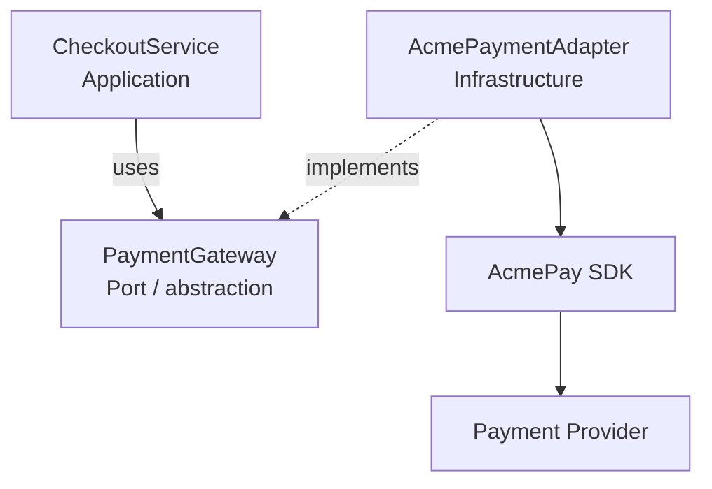

# Áp dụng nguyên lý đảo ngược phụ thuộc để bảo vệ nghiệp vụ khi cần thiết

> Chương: **Tổ chức phụ thuộc và lắp ráp ứng dụng**

Trong module **SOFTWARE_DESIGN_ARCHITECTURE_ARCHITECTURAL_PATTERN_LAYERED**, chúng ta học cách tổ chức phần mềm theo kiến trúc phân tầng. Bài này giải thích cách dùng **Dependency Inversion Principle (DIP)** để phần nghiệp vụ ít phụ thuộc vào công nghệ cụ thể như cơ sở dữ liệu, cổng thanh toán hoặc dịch vụ bên ngoài. Trọng tâm là xác định đúng hợp đồng, đặt nó ở phía cần khả năng đó, để phần triển khai phụ thuộc vào hợp đồng và lắp ráp các thành phần tại composition root.

DIP hữu ích khi một chi tiết kỹ thuật có khả năng thay đổi hoặc cần được cô lập khỏi nghiệp vụ. Không phải mọi lời gọi giữa hai class đều cần thêm interface. Hãy dùng nguyên lý này ở ranh giới có ý nghĩa, nơi việc đảo hướng phụ thuộc giúp giảm chi phí thay đổi, kiểm thử hoặc tích hợp.

## 1. Vấn đề khi nghiệp vụ phụ thuộc trực tiếp vào chi tiết kỹ thuật

Giả sử một ứng dụng bán hàng có ca sử dụng thanh toán đơn hàng. Nếu `CheckoutService` trực tiếp tạo đối tượng SDK của một nhà cung cấp thanh toán, nó sẽ biết cách cấu hình SDK, định dạng request riêng, mã lỗi và cách gọi mạng:

```java
@Service
public class CheckoutService {
    public PaymentReceipt pay(Order order) {
        var client = new AcmePayClient("secret-key");
        var response = client.charge(
            order.getTotal().doubleValue(), "VND");
        return new PaymentReceipt(response.transactionId());
    }
}
```

Đây là ví dụ rút gọn để minh họa sự phụ thuộc. `CheckoutService` đang phụ thuộc vào API cụ thể của `AcmePayClient`. Nếu thay nhà cung cấp, đổi SDK hoặc muốn kiểm thử mà không gọi mạng, phần điều phối nghiệp vụ phải biết và xử lý những chi tiết đó.

Vấn đề không nằm ở việc sử dụng SDK. Hệ thống cần một adapter để giao tiếp với nhà cung cấp. Vấn đề nằm ở chỗ phần nghiệp vụ phải phụ thuộc trực tiếp vào chi tiết triển khai đó. Một thành phần điều phối ổn định sẽ khó thay đổi nếu mọi công nghệ bên dưới đều được import và sử dụng trực tiếp.

## 2. Dependency Inversion Principle là gì?

**Dependency Inversion Principle (DIP)** là nguyên lý trong SOLID, nói rằng:

- Các thành phần cấp cao chứa chính sách hoặc quy trình quan trọng không nên phụ thuộc trực tiếp vào các thành phần cấp thấp chứa chi tiết triển khai; cả hai nên phụ thuộc vào abstraction.
- Abstraction không nên phụ thuộc vào chi tiết; chi tiết nên phụ thuộc vào abstraction.

Trong ví dụ thanh toán:

- `CheckoutService` là thành phần cấp cao vì nó điều phối ca sử dụng thanh toán.
- `AcmePayClient` là chi tiết cấp thấp vì nó đại diện cho một SDK cụ thể.
- `PaymentGateway` có thể là abstraction mô tả khả năng mà ca sử dụng cần.

Khi áp dụng DIP, `CheckoutService` chỉ biết `PaymentGateway`. Adapter sử dụng SDK sẽ triển khai interface đó. Nhờ vậy, mã nghiệp vụ không cần biết nhà cung cấp nào đang được dùng.



Mũi tên nét đứt thể hiện adapter triển khai hợp đồng. `CheckoutService` gọi qua interface; adapter nhận lời gọi tại thời điểm chạy và chuyển thành thao tác của SDK.

## 3. Đặt abstraction ở phía cần khả năng đó

Một cách áp dụng thường gặp là để Application định nghĩa port (cổng) mô tả khả năng mà ca sử dụng cần. Interface nên dùng thuật ngữ của ứng dụng, không để lộ kiểu dữ liệu riêng của SDK.

```java
package com.example.shop.application.port.out;

import java.math.BigDecimal;

public interface PaymentGateway {
    PaymentReceipt charge(PaymentRequest request);
}

public record PaymentRequest(
    String orderReference,
    BigDecimal amount,
    String currency
) {}

public record PaymentReceipt(
    String transactionId,
    PaymentStatus status
) {}

public enum PaymentStatus {
    APPROVED,
    DECLINED
}
```

Hợp đồng thể hiện điều Application cần: yêu cầu thanh toán với mã tham chiếu, số tiền và loại tiền; nhận lại mã giao dịch cùng trạng thái. Nó không chứa `AcmePayRequest`, `AcmePayResponse` hay class của SDK.

Application service sử dụng port:

```java
package com.example.shop.application;

@Service
public class CheckoutService {
    private final PaymentGateway paymentGateway;
    private final OrderRepository orders;

    public CheckoutService(PaymentGateway paymentGateway,
                           OrderRepository orders) {
        this.paymentGateway = paymentGateway;
        this.orders = orders;
    }

    public CheckoutResult checkout(CheckoutCommand command) {
        Order order = orders.findById(command.orderId())
            .orElseThrow(OrderNotFoundException::new);

        order.ensurePayable();
        PaymentReceipt receipt = paymentGateway.charge(
            new PaymentRequest(
                order.getId().toString(),
                order.getTotal(),
                order.getCurrency()));

        if (receipt.status() == PaymentStatus.APPROVED) {
            order.markPaid(receipt.transactionId());
            orders.save(order);
        }

        return new CheckoutResult(order.getId(), receipt.status());
    }
}
```

`CheckoutService` điều phối ca sử dụng và gọi hành vi nghiệp vụ như `ensurePayable()` hoặc `markPaid(...)`. Nó chỉ biết hợp đồng `PaymentGateway`. Ví dụ lược bỏ một số vấn đề như xử lý timeout, xác nhận thanh toán bất đồng bộ và idempotency; trong hệ thống thật, các tình huống này cần được thiết kế theo giao thức của nhà cung cấp và yêu cầu nghiệp vụ.

Adapter Infrastructure triển khai hợp đồng bằng SDK cụ thể:

```java
package com.example.shop.infrastructure.payment;

@Component
public class AcmePaymentAdapter implements PaymentGateway {
    private final AcmePayClient client;

    public AcmePaymentAdapter(AcmePayClient client) {
        this.client = client;
    }

    @Override
    public PaymentReceipt charge(PaymentRequest request) {
        AcmePayResponse response = client.charge(
            request.orderReference(),
            request.amount(),
            request.currency());

        PaymentStatus status = response.approved()
            ? PaymentStatus.APPROVED
            : PaymentStatus.DECLINED;

        return new PaymentReceipt(response.transactionId(), status);
    }
}
```

Adapter chuyển đổi từ kiểu dữ liệu của hợp đồng sang kiểu của SDK và ngược lại. Nếu SDK ném exception riêng, adapter có thể chuyển chúng thành lỗi tích hợp mà Application hiểu được, hoặc biểu diễn kết quả thất bại theo hợp đồng đã chọn. Không nên để exception và kiểu dữ liệu đặc thù của nhà cung cấp lan sâu vào Domain.

Trong cách bố trí này, mã nguồn của Application định nghĩa `PaymentGateway`; mã nguồn của Infrastructure import interface để triển khai nó. Như vậy, dependency compile-time hướng từ adapter vào abstraction. Tại thời điểm chạy, Application gọi interface và đối tượng adapter thực hiện lời gọi thực tế.

## 4. Phân biệt chiều phụ thuộc mã nguồn với luồng gọi lúc chạy

Khi mới nhìn sơ đồ, có thể thấy Application gọi Infrastructure nên nghĩ rằng Application vẫn phụ thuộc Infrastructure. Cần phân biệt hai khía cạnh:

| Khía cạnh | Trong ví dụ thanh toán |
|---|---|
| Phụ thuộc mã nguồn (compile-time) | `AcmePaymentAdapter` import và triển khai `PaymentGateway`; `CheckoutService` chỉ import `PaymentGateway` |
| Luồng gọi lúc chạy (runtime) | `CheckoutService` gọi `PaymentGateway.charge(...)`; đối tượng `AcmePaymentAdapter` nhận lời gọi và gọi SDK |

Luồng thực thi có thể đi từ phần nghiệp vụ ra adapter, trong khi hướng phụ thuộc mã nguồn vẫn hướng vào abstraction ở phía trong. Đây là ý nghĩa quan trọng của việc đảo ngược phụ thuộc.

Nếu Application import `AcmePaymentAdapter` hoặc `AcmePayClient`, ranh giới đã bị phá vỡ dù trong code vẫn có một interface khác. Interface chỉ hữu ích khi bên cấp cao thực sự phụ thuộc vào nó và không cần biết class triển khai cụ thể.

## 5. DIP khác Dependency Injection như thế nào?

Hai khái niệm liên quan nhưng không đồng nghĩa:

- **Dependency Inversion Principle (DIP):** nguyên lý thiết kế về hướng phụ thuộc giữa thành phần cấp cao, chi tiết và abstraction.
- **Dependency Injection (DI):** kỹ thuật cung cấp dependency cho một đối tượng từ bên ngoài, thay vì để đối tượng tự tạo dependency đó.

Ví dụ, constructor injection trong Spring là một cách thực hiện DI:

```java
public CheckoutService(PaymentGateway paymentGateway,
                       OrderRepository orders) {
    this.paymentGateway = paymentGateway;
    this.orders = orders;
}
```

Spring tìm bean phù hợp với kiểu `PaymentGateway` rồi truyền vào constructor khi tạo `CheckoutService`. Điều này giúp service không phải tự gọi `new AcmePaymentAdapter(...)`.

Tuy nhiên, DI không tự động bảo đảm DIP. Nếu constructor nhận trực tiếp `AcmePaymentAdapter`, đối tượng vẫn được inject nhưng mã cấp cao vẫn phụ thuộc vào chi tiết. Ngược lại, một ứng dụng có thể áp dụng DIP và tự lắp ráp dependency bằng code mà không dùng framework DI.

## 6. Lắp ráp dependency tại composition root

**Composition root** là vị trí của ứng dụng chịu trách nhiệm tạo và kết nối các thành phần. Với Spring, composition root thường được thể hiện qua cấu hình ứng dụng, component scanning và các bean do container quản lý.

Nếu adapter được đánh dấu `@Component`, service được đánh dấu `@Service` và các dependency đều có một bean phù hợp, Spring có thể tự động lắp ráp chúng qua constructor:

```java
@SpringBootApplication
public class ShopApplication {
    public static void main(String[] args) {
        SpringApplication.run(ShopApplication.class, args);
    }
}
```

Khi có nhiều implementation hoặc cần lựa chọn theo cấu hình, có thể khai báo bean rõ ràng:

```java
@Configuration
public class PaymentConfiguration {
    @Bean
    PaymentGateway paymentGateway(AcmePayClient client) {
        return new AcmePaymentAdapter(client);
    }
}
```

Nếu đồng thời có nhiều bean cùng triển khai `PaymentGateway`, cần chỉ định lựa chọn bằng `@Primary`, `@Qualifier` hoặc cấu hình có điều kiện phù hợp. Ví dụ, có thể dùng adapter sandbox trong môi trường thử nghiệm và adapter thật trong môi trường production. Bí mật như API key nên được lấy từ cấu hình an toàn, không ghi cứng trong source code.

Việc lắp ráp tập trung giúp `CheckoutService` không phải biết adapter nào được chọn. Cấu hình triển khai quyết định kết nối cụ thể, còn service chỉ dựa trên hợp đồng.

## 7. Dùng abstraction để kiểm thử nghiệp vụ

Khi Application phụ thuộc vào interface, kiểm thử có thể cung cấp một fake hoặc mock thay thế cho adapter thật. Nhờ đó, bài kiểm thử không cần kết nối nhà cung cấp thanh toán hoặc thực hiện giao dịch mạng.

Ví dụ một fake đơn giản:

```java
class FakePaymentGateway implements PaymentGateway {
    private PaymentStatus nextStatus = PaymentStatus.APPROVED;

    void setNextStatus(PaymentStatus status) {
        this.nextStatus = status;
    }

    @Override
    public PaymentReceipt charge(PaymentRequest request) {
        return new PaymentReceipt("test-transaction", nextStatus);
    }
}
```

Trong unit test, truyền fake vào `CheckoutService` và kiểm tra:

- Khi cổng thanh toán trả `APPROVED`, đơn được chuyển sang trạng thái đã thanh toán và lưu lại.
- Khi cổng thanh toán trả `DECLINED`, đơn không được đánh dấu đã thanh toán.
- Khi đơn không ở trạng thái có thể thanh toán, hành vi nghiệp vụ từ chối trước khi gọi cổng thanh toán.

Các bài kiểm thử này xác minh cách Application phối hợp nghiệp vụ mà không cần SDK thật. Adapter vẫn cần kiểm thử tích hợp riêng để xác minh mapping request/response, xác thực, timeout và cách chuyển lỗi của nhà cung cấp.

## 8. Không phải dependency nào cũng cần interface

DIP không có nghĩa phải tạo một interface cho mọi class hoặc mọi method. Nếu một service chỉ dùng một class tiện ích nội bộ ổn định, việc thêm interface và một implementation duy nhất có thể làm tăng số file, tăng cấu hình và khiến người đọc khó theo dõi mà không tạo ra ranh giới có ích.

Nên cân nhắc abstraction khi có một hoặc nhiều lý do:

- Phần nghiệp vụ đang phụ thuộc vào công nghệ hoặc nhà cung cấp dễ thay đổi.
- Cần nhiều implementation cho các môi trường hoặc chính sách khác nhau.
- Muốn kiểm thử phần nghiệp vụ mà không khởi động hạ tầng thật.
- Có một hợp đồng rõ ràng giữa module hoặc ranh giới triển khai.
- Chi tiết kỹ thuật có thể được thay thế mà không làm thay đổi mục tiêu nghiệp vụ.

Không nên tạo interface chỉ vì “mỗi class phải có interface”, hoặc vì nghĩ rằng abstraction tự động làm code tốt hơn. Nếu không có khả năng thay thế, không có ranh giới rõ và chi tiết không gây khó khăn cho kiểm thử hay thay đổi, phụ thuộc trực tiếp có thể đơn giản và phù hợp hơn.

## 9. Thiết kế port nhỏ và ổn định

Một port tốt biểu diễn nhu cầu của bên sử dụng. Tránh đưa toàn bộ API của SDK hoặc một repository tổng quát có hàng chục method ra làm hợp đồng cho ca sử dụng.

Ví dụ, `PaymentGateway.charge(...)` là một hợp đồng có mục đích. Nếu ứng dụng còn cần hoàn tiền, có thể bổ sung một port hoặc một thao tác riêng với kiểu dữ liệu và kết quả rõ ràng:

```java
public interface RefundGateway {
    RefundReceipt refund(RefundRequest request);
}
```

Việc tách interface theo khả năng giúp adapter và bên sử dụng chỉ phụ thuộc vào phần hợp đồng liên quan. Tuy nhiên, cũng không nên chia nhỏ đến mức mỗi method có một interface riêng mà không có lý do thực tế.

Hợp đồng nên dùng các kiểu dữ liệu thuộc về ứng dụng hoặc domain, xác định rõ đơn vị tiền tệ, định danh tham chiếu và các kết quả có thể xảy ra. Cần tránh các kiểu mơ hồ như `Object`, `Map<String, Object>` hoặc trả nguyên response của SDK vì chúng làm abstraction rò rỉ chi tiết triển khai.

## 10. Áp dụng DIP ở đâu trong kiến trúc phân tầng?

Các ranh giới thường có ích để đảo hướng phụ thuộc gồm:

| Ranh giới | Abstraction có thể đặt ở phía | Adapter/implementation có thể đặt ở |
|---|---|---|
| Truy cập dữ liệu | Application hoặc Domain, tùy vai trò repository | Infrastructure persistence: JPA, JDBC, SQL |
| Gửi thông báo | Application: `NotificationSender` | Infrastructure: SMTP, SMS provider, message broker |
| Thanh toán | Application: `PaymentGateway` | Infrastructure: SDK của nhà cung cấp |
| Lưu tệp | Application: `DocumentStorage` | Infrastructure: local disk hoặc object storage |
| Đọc thời gian hệ thống | Application/Domain: `Clock` hoặc abstraction tương đương | Adapter cung cấp system clock hoặc clock giả cho kiểm thử |

Vị trí chính xác của interface phụ thuộc mô hình module và quy ước của dự án. Một quy tắc hữu ích là đặt hợp đồng gần thành phần cần khả năng đó, để hợp đồng diễn đạt nhu cầu của bên sử dụng. Adapter phụ thuộc vào hợp đồng và chuyển nó thành thao tác kỹ thuật.

Trong kiến trúc phân tầng truyền thống, tầng trên có thể gọi API của tầng dưới. Khi tầng dưới là chi tiết hạ tầng mà nghiệp vụ cần sử dụng, DIP cho phép đặt port ở phía trong và để adapter bên ngoài triển khai port. Cách này thường được dùng trong kiến trúc Hexagonal hoặc Clean Architecture, nhưng cũng có thể áp dụng từng phần trong một ứng dụng phân tầng thông thường.

## 11. Những lỗi thường gặp khi áp dụng DIP

- **Tạo interface nhưng vẫn phụ thuộc implementation:** Application khai báo field hoặc constructor bằng class adapter thay vì kiểu interface.
- **Để abstraction phụ thuộc framework:** interface nghiệp vụ nhận `HttpServletRequest`, `EntityManager` hoặc kiểu response của SDK.
- **Đặt hợp đồng sai phía:** module nghiệp vụ phải import package Infrastructure chỉ để sử dụng interface do Infrastructure sở hữu, khiến hướng phụ thuộc không được đảo.
- **Để adapter chứa quy tắc nghiệp vụ:** adapter chỉ nên chuyển đổi và giao tiếp kỹ thuật; quyết định về trạng thái đơn hoặc quyền thanh toán thuộc Domain/Application.
- **Dùng service locator hoặc gọi container trực tiếp:** thành phần tự tìm bean làm dependency trở nên ẩn và khó kiểm thử hơn constructor injection.
- **Trừu tượng hóa quá mức:** quá nhiều interface một phương thức làm tăng chi phí điều hướng mà không bảo vệ ranh giới nào đáng kể.

Khi review, hãy lần theo import và kiểu của constructor để xem thành phần cấp cao đang phụ thuộc vào điều gì. Sau đó kiểm tra interface có mô tả nhu cầu thực sự của bên gọi không, adapter có phụ thuộc vào interface không và thành phần nào chịu trách nhiệm lắp ráp implementation.

## 12. Cách quyết định có nên đảo ngược phụ thuộc

Trước khi thêm port hoặc interface, hãy tự hỏi:

1. Thành phần cấp cao đang phụ thuộc vào chi tiết nào? Chi tiết đó có khả năng thay đổi hoặc gây khó khăn cho kiểm thử không?
2. Có thể mô tả nhu cầu bằng một hợp đồng nhỏ dùng thuật ngữ nghiệp vụ không?
3. Hợp đồng nên thuộc về module nào đang cần khả năng đó?
4. Adapter nào sẽ triển khai hợp đồng và ai sẽ lắp ráp nó?
5. Có thể kiểm thử thành phần cấp cao bằng fake mà không phải dùng hạ tầng thật không?
6. Chi phí interface, mapping và cấu hình có xứng đáng với lợi ích của ranh giới này không?

Nếu câu trả lời cho thấy một ranh giới thực sự cần được bảo vệ, DIP giúp mã nghiệp vụ ổn định hơn khi công nghệ thay đổi. Nếu dependency đã đơn giản, ổn định và không tạo khó khăn đáng kể, giữ cấu trúc trực tiếp có thể là quyết định hợp lý.

## Ghi nhớ

- DIP yêu cầu thành phần cấp cao và cấp thấp phụ thuộc vào abstraction; chi tiết triển khai phụ thuộc vào abstraction.
- Đặt port gần phía cần khả năng đó, dùng kiểu dữ liệu thuộc về ứng dụng và để adapter Infrastructure hiện thực hợp đồng.
- Phân biệt hướng phụ thuộc mã nguồn với luồng gọi lúc chạy: Application gọi interface, adapter nhận lời gọi qua cơ chế dispatch.
- Dependency Injection là kỹ thuật cung cấp dependency; nó hỗ trợ DIP nhưng không tự bảo đảm thiết kế đã đảo hướng phụ thuộc.
- Spring có thể lắp ráp implementation qua constructor injection, component scanning hoặc `@Bean` tại composition root.
- Dùng abstraction khi nó bảo vệ một ranh giới có ý nghĩa; không cần tạo interface cho mọi class.
