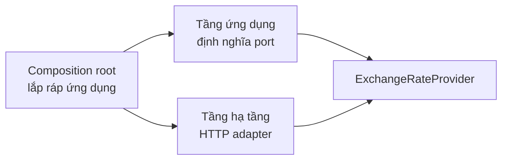
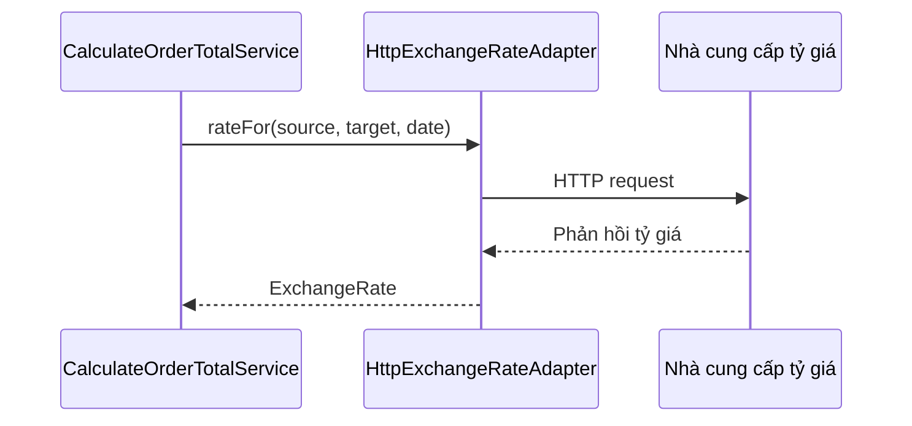

# Đặt interface và implementation theo bên sở hữu nhu cầu và hợp đồng

Khi chia ứng dụng thành các tầng hoặc module, một câu hỏi thiết kế quan trọng là: interface nên nằm ở đâu, còn lớp thực thi interface nên nằm ở đâu? Nếu đặt cả hai ở cùng một nơi theo thói quen, tầng nghiệp vụ có thể phụ thuộc trực tiếp vào thư viện database hoặc HTTP; ngược lại, nếu tạo interface cho mọi lớp mà không có lý do, mã nguồn sẽ có thêm nhiều tầng gián tiếp nhưng không tạo ra ranh giới hữu ích.

Trong module `SOFTWARE_DESIGN_ARCHITECTURE_ARCHITECTURAL_PATTERN_LAYERED` — học tổ chức phần mềm theo kiến trúc phân tầng — bài học này trình bày cách đặt hợp đồng và phần cài đặt dựa trên bên sở hữu nhu cầu, ý nghĩa của hợp đồng và hướng phụ thuộc mong muốn. Cách làm này hỗ trợ đảo ngược phụ thuộc, nhưng không áp đặt một vị trí interface duy nhất cho mọi dự án.

## 1. Interface là hợp đồng, implementation là cách đáp ứng hợp đồng

Một interface mô tả khả năng mà một thành phần cần sử dụng hoặc cung cấp. Nó xác định tên thao tác, đầu vào, đầu ra và các cam kết có ý nghĩa với bên gọi. Implementation cung cấp cách thực hiện những cam kết đó bằng thuật toán, database, HTTP API, file hoặc một cơ chế khác.

Ví dụ, một ca sử dụng tạo đơn hàng cần lưu đơn. Ca sử dụng quan tâm rằng có thể lưu và tìm lại đơn theo mã; nó không cần biết dữ liệu được ghi bằng JPA, JDBC hay gửi đến một dịch vụ khác.

```java
public interface OrderRepository {
    void save(Order order);

    Optional<Order> findById(OrderId id);
}
```

Interface này mô tả hợp đồng lưu và truy xuất đơn hàng. Một implementation có thể dùng Spring Data JPA; implementation khác có thể dùng JDBC hoặc bộ nhớ giả trong kiểm thử. Tên phương thức thể hiện ngôn ngữ của nghiệp vụ, không để lộ câu SQL hay loại ORM.

```java
public final class PlaceOrderService {
    private final OrderRepository orderRepository;

    public PlaceOrderService(OrderRepository orderRepository) {
        this.orderRepository = Objects.requireNonNull(orderRepository);
    }

    public OrderId place(PlaceOrderCommand command) {
        Order order = Order.create(command.customerId(), command.lines());
        order.place();
        orderRepository.save(order);
        return order.id();
    }
}
```

`PlaceOrderService` chỉ phụ thuộc vào hợp đồng `OrderRepository`. Nó không khởi tạo repository cụ thể, không tạo `EntityManager` và không tự mở kết nối database. Việc lựa chọn implementation được thực hiện ở nơi lắp ráp ứng dụng.

Interface không phải một bản sao của implementation. Nó chỉ nên chứa những thao tác mà bên sử dụng thực sự cần và những cam kết mà bên cung cấp có thể đáp ứng. Một interface với hàng chục phương thức CRUD tổng quát có thể làm lộ cấu trúc lưu trữ thay vì thể hiện một nhu cầu rõ ràng.

## 2. Bên sở hữu nhu cầu thường sở hữu port

Khi một thành phần cần một khả năng từ bên ngoài để thực hiện chính sách của nó, thành phần đó có thể định nghĩa interface mô tả nhu cầu. Trong kiến trúc hexagonal hoặc cách áp dụng dependency inversion, hợp đồng như vậy thường được gọi là **port**; implementation ở phía ngoài là **adapter**.

Ví dụ, dịch vụ tính giá cần tỷ giá tại một ngày xác định. Quy tắc tính giá không nên phụ thuộc vào một nhà cung cấp tỷ giá cụ thể hoặc thư viện HTTP.

```java
// Nằm gần ca sử dụng cần tỷ giá, trong application layer.
public interface ExchangeRateProvider {
    ExchangeRate rateFor(Currency source, Currency target, LocalDate date);
}
```

Ca sử dụng sử dụng port này:

```java
public final class CalculateOrderTotalService {
    private final ExchangeRateProvider exchangeRateProvider;

    public CalculateOrderTotalService(ExchangeRateProvider exchangeRateProvider) {
        this.exchangeRateProvider = exchangeRateProvider;
    }

    public Money calculate(Money subtotal, Currency target, LocalDate date) {
        ExchangeRate rate = exchangeRateProvider.rateFor(
            subtotal.currency(), target, date
        );
        return subtotal.convertTo(target, rate);
    }
}
```

Phần hạ tầng cung cấp adapter gọi nhà cung cấp bên ngoài:

```java
public final class HttpExchangeRateAdapter implements ExchangeRateProvider {
    private final ExchangeRateHttpClient client;

    public HttpExchangeRateAdapter(ExchangeRateHttpClient client) {
        this.client = client;
    }

    @Override
    public ExchangeRate rateFor(Currency source, Currency target, LocalDate date) {
        ProviderRateResponse response = client.getRate(
            source.getCurrencyCode(), target.getCurrencyCode(), date
        );

        return new ExchangeRate(
            source,
            target,
            response.rate(),
            response.effectiveDate()
        );
    }
}
```

Ở đây, `ExchangeRateProvider` nằm gần bên cần tỷ giá vì hợp đồng phản ánh cách ca sử dụng muốn nhận tỷ giá. Adapter nằm ở hạ tầng vì nó biết HTTP client, cấu trúc phản hồi của nhà cung cấp và cách chuyển dữ liệu ngoài thành kiểu nội bộ. Nếu nhà cung cấp đổi JSON hoặc được thay bằng một nguồn dữ liệu khác, thay đổi chủ yếu nằm ở adapter.

Đây là cách áp dụng nguyên tắc **dependency inversion**: chính sách cấp cao định nghĩa hợp đồng cần thiết; chi tiết cấp thấp triển khai hợp đồng đó. Mã nguồn của tầng ứng dụng không phải import lớp HTTP hoặc thư viện của nhà cung cấp.

## 3. Hướng phụ thuộc lúc biên dịch và hướng gọi lúc chạy

Khi đọc sơ đồ kiến trúc, cần phân biệt hai hướng:

- **Hướng phụ thuộc mã nguồn:** module nào import, tham chiếu hoặc cần module nào để biên dịch.
- **Hướng gọi lúc chạy:** đối tượng nào thực sự gọi phương thức của đối tượng nào khi ứng dụng hoạt động.

Với port do bên sử dụng sở hữu, sơ đồ phụ thuộc mã nguồn có thể như sau:



Lúc chạy, ca sử dụng gọi phương thức trên interface; đối tượng thực tế nhận lời gọi là adapter đã được tiêm vào:



Sơ đồ thứ hai diễn đạt ý nghĩa đa hình: bên gọi chỉ biết kiểu interface, còn cơ chế runtime dispatch đến implementation được gắn vào. Vì vậy, hướng gọi lúc chạy có thể từ ứng dụng ra adapter, trong khi hướng phụ thuộc mã nguồn của adapter lại trỏ vào hợp đồng do ứng dụng định nghĩa.

## 4. Không phải interface nào cũng do consumer định nghĩa

Quy tắc “bên sử dụng sở hữu interface” rất hữu ích khi thiết kế port cho nhu cầu nội bộ, nhưng không phải luật tuyệt đối. Có trường hợp interface là hợp đồng công khai mà module cung cấp chủ động cam kết với nhiều bên sử dụng. Khi đó, **bên cung cấp có thể sở hữu hợp đồng**.

Ví dụ, module `identity` công bố khả năng xác thực token cho nhiều module khác. Interface `TokenVerifier` có thể là một phần API công khai của module identity vì module này chịu trách nhiệm định nghĩa ý nghĩa, bảo mật, phiên bản và cam kết hỗ trợ của API đó. Các module gọi phụ thuộc vào API công khai này, còn implementation cụ thể có thể thay đổi bên trong module identity.

Một số câu hỏi giúp xác định bên sở hữu:

| Câu hỏi | Gợi ý về quyền sở hữu |
|---|---|
| Ai quyết định phương thức nào cần có để hoàn thành ca sử dụng? | Consumer thường sở hữu port nhu cầu |
| Ai định nghĩa ý nghĩa, bảo mật, phiên bản và cam kết của năng lực được công bố? | Provider thường sở hữu public API |
| Interface có chứa thuật ngữ riêng của một ca sử dụng hay quy tắc riêng của một module? | Thường nên đặt gần module sở hữu ngôn ngữ đó |
| Nhiều consumer có nhu cầu khác nhau nhưng đang dùng chung một interface rất rộng? | Cân nhắc tách thành các port nhỏ do từng consumer sở hữu |
| Hợp đồng được chia sẻ giữa nhiều module độc lập và có vòng đời phát hành riêng? | Có thể cần một module contract/shared API được quản trị rõ |

Điều quan trọng là quyền sở hữu hợp đồng phải rõ. Nếu provider thay đổi interface theo nhu cầu nội bộ của mình và làm nhiều consumer bị ảnh hưởng, đó là một kiểu phụ thuộc cần cân nhắc. Nếu consumer tự định nghĩa một interface nhưng đưa các chi tiết riêng của provider vào chữ ký, sự đảo ngược chỉ tồn tại trên danh nghĩa.

## 5. Đặt interface và implementation ở đâu trong cấu trúc package?

Với một ứng dụng phân tầng áp dụng dependency inversion, cấu trúc đơn giản có thể như sau:

```text
com.example.orders
├── application
│   ├── PlaceOrderService.java
│   └── port
│       └── out
│           └── OrderRepository.java
├── domain
│   ├── Order.java
│   ├── OrderLine.java
│   └── OrderId.java
├── infrastructure
│   └── persistence
│       └── JpaOrderRepositoryAdapter.java
└── bootstrap
    └── OrderConfiguration.java
```

Đây chỉ là một cách tổ chức. Một nhóm có thể đặt port trong package `domain.repository`, `application.port.out` hoặc package khác nếu phù hợp với ranh giới module. Hãy dựa vào ý nghĩa và bên sở hữu hợp đồng, không chỉ dựa vào tên thư mục.

Ví dụ adapter dùng Spring Data JPA:

```java
@Repository
@RequiredArgsConstructor
class JpaOrderRepositoryAdapter implements OrderRepository {
    private final SpringDataOrderJpaRepository jpaRepository;
    private final OrderMapper mapper;

    @Override
    public void save(Order order) {
        jpaRepository.save(mapper.toEntity(order));
    }

    @Override
    public Optional<Order> findById(OrderId id) {
        return jpaRepository.findById(id.value())
            .map(mapper::toDomain);
    }
}
```

`SpringDataOrderJpaRepository`, entity JPA và mapper thuộc chi tiết hạ tầng. Chúng không cần xuất hiện trong chữ ký `OrderRepository` mà tầng ứng dụng sử dụng. Adapter chuyển đổi giữa mô hình lưu trữ và mô hình mà bên gọi hiểu.

Trong một ứng dụng nhỏ dùng Spring Data JPA trực tiếp, có thể để service phụ thuộc vào một interface repository nằm trong package data access và interface đó mở rộng `JpaRepository`. Cách này đơn giản và hợp lý nếu nhóm chấp nhận tầng ứng dụng phụ thuộc Spring Data. Nếu mục tiêu là giữ tầng ứng dụng độc lập với ORM, hãy định nghĩa port riêng với chữ ký thuộc về ứng dụng hoặc miền và đặt adapter chuyển đổi ở hạ tầng. Quyết định phụ thuộc vào mức độ cách ly cần thiết, quy mô và chi phí bảo trì.

## 6. Đừng để hợp đồng làm rò rỉ chi tiết implementation

Một interface có thể mang tên trung lập nhưng vẫn làm lộ công nghệ qua chữ ký. Ví dụ:

```java
// Hợp đồng bị gắn với chi tiết ORM.
public interface CustomerStore {
    JpaRepository<CustomerJpaEntity, UUID> repository();
    EntityManager entityManager();
}
```

Tầng ứng dụng sử dụng interface này vẫn phải biết Spring Data JPA và JPA. Việc bọc một implementation bằng interface không tự động đảo ngược phụ thuộc nếu kiểu dữ liệu và hợp đồng vẫn thuộc về chi tiết hạ tầng.

Một hợp đồng phù hợp hơn có thể trả kiểu mà bên gọi hiểu:

```java
public interface CustomerLookup {
    Optional<CustomerProfile> findProfile(CustomerId id);
}

public record CustomerProfile(
    CustomerId id,
    String displayName,
    String email
) {}
```

`CustomerProfile` có thể là DTO do application sở hữu nếu chỉ phục vụ một ca sử dụng đọc; nếu nó là khái niệm miền có ý nghĩa và quy tắc riêng, có thể dùng kiểu miền tương ứng. Không nên biến mọi projection thành value object hoặc entity nếu chúng chỉ là dữ liệu phục vụ truy vấn.

Một hợp đồng tốt thường có các đặc điểm:

- Dùng thuật ngữ của bên sở hữu nhu cầu hoặc API công khai.
- Chỉ cung cấp những thao tác thực sự cần thiết.
- Không trả về `Connection`, `ResultSet`, `EntityManager`, `Session`, kiểu của ORM hoặc DTO riêng của nhà cung cấp.
- Nêu rõ ý nghĩa lỗi, kết quả rỗng, tính nhất quán và các điều kiện cần thiết khác.
- Có thể được thực thi bởi nhiều implementation mà consumer không phải thay đổi.

Đặc biệt, không nên tạo một `GenericRepository<T, ID>` với hàng loạt thao tác mà mọi module phải dùng dù không cần. Những phương thức như `save`, `find`, `delete` có thể hữu ích, nhưng hợp đồng nghiệp vụ đôi khi cần những thao tác có ý nghĩa cụ thể hơn như `findOpenOrdersForCustomer` hoặc `reserveInventory`. Chọn mức trừu tượng theo nhu cầu thật.

## 7. Lắp ráp implementation tại composition root

Khi consumer chỉ phụ thuộc vào interface, ứng dụng vẫn cần một nơi chọn implementation cụ thể. Nơi đó thường được gọi là **composition root**: điểm khởi tạo và nối các thành phần của ứng dụng.

Với Spring, composition root có thể được thể hiện bằng cấu hình `@Configuration` và các bean:

```java
@Configuration
class OrderConfiguration {

    @Bean
    OrderRepository orderRepository(
            SpringDataOrderJpaRepository jpaRepository,
            OrderMapper mapper) {
        return new JpaOrderRepositoryAdapter(jpaRepository, mapper);
    }

    @Bean
    PlaceOrderService placeOrderService(OrderRepository orderRepository) {
        return new PlaceOrderService(orderRepository);
    }
}
```

Spring có thể tiêm bean `OrderRepository` vào `PlaceOrderService` thông qua constructor. Có hai cách đăng ký adapter: khai báo bean tường minh trong cấu hình như ví dụ trên, hoặc đánh dấu adapter bằng `@Repository`/`@Component` để component scanning đăng ký. Hãy chọn một cách cho cùng một adapter; nếu vừa dùng `@Bean` vừa component-scan chính lớp đó, ứng dụng có thể có hai bean cùng implement một port. Khi chỉ có một implementation phù hợp, Spring có thể tự giải quyết dependency; cấu hình tường minh hữu ích khi có nhiều implementation hoặc khi muốn nhìn rõ quyết định lắp ráp.

Nếu có hai adapter cùng implement một port, ví dụ `JpaOrderRepositoryAdapter` và `InMemoryOrderRepositoryAdapter`, cần xác định bean nào được dùng. Có thể chọn bằng `@Qualifier`, `@Primary`, profile hoặc cấu hình theo môi trường. Đừng để việc chọn implementation phụ thuộc vào thứ tự quét package hoặc một quy tắc ngầm khó nhận biết.

### Ví dụ chọn adapter theo môi trường

```java
@Configuration
class ExchangeRateConfiguration {

    @Bean
    @Profile("production")
    ExchangeRateProvider productionRateProvider(ExchangeRateHttpClient client) {
        return new HttpExchangeRateAdapter(client);
    }

    @Bean
    @Profile("test")
    ExchangeRateProvider testRateProvider() {
        return new FixedExchangeRateAdapter();
    }
}
```

Ví dụ minh họa cấu hình hai implementation khác nhau. Cần bảo đảm profile được kích hoạt đúng ở môi trường chạy; không nên dùng profile test như cơ chế giả lập dữ liệu trong production. Với các lựa chọn phức tạp hơn, có thể dùng factory hoặc cấu hình triển khai riêng.

## 8. Interface giúp kiểm thử nhưng không chỉ để mock

Khi consumer phụ thuộc vào port, bài kiểm thử có thể thay adapter thật bằng một implementation giả có hành vi xác định. Điều này giúp kiểm thử logic ứng dụng mà không cần database hoặc dịch vụ mạng.

```java
final class InMemoryOrderRepository implements OrderRepository {
    private final Map<OrderId, Order> orders = new HashMap<>();

    @Override
    public void save(Order order) {
        orders.put(order.id(), order);
    }

    @Override
    public Optional<Order> findById(OrderId id) {
        return Optional.ofNullable(orders.get(id));
    }
}
```

Test có thể khởi tạo `PlaceOrderService` với repository trong bộ nhớ, gọi ca sử dụng và xác minh hành vi. Một kiểm thử tích hợp riêng dùng `JpaOrderRepositoryAdapter` và database thử nghiệm để xác minh ánh xạ, truy vấn và transaction. Nhờ vậy, kiểm thử tập trung đúng ranh giới.

Tuy nhiên, không nên tạo interface cho mọi class chỉ để có thể mock. Nếu một lớp là chi tiết nội bộ ổn định, chỉ có một consumer và không có lý do cách ly công nghệ, constructor injection bằng concrete class có thể đủ. Interface có ích khi nó thể hiện hợp đồng có ý nghĩa, ranh giới module, khả năng thay thế hoặc một điểm kiểm soát phụ thuộc cần thiết. Mock không nên trở thành mục tiêu duy nhất khiến kiến trúc phức tạp hơn.

## 9. Khi nhiều consumer có nhu cầu khác nhau

Một interface quá rộng thường xuất hiện khi nhiều consumer có mục đích khác nhau bị gom vào một hợp đồng chung. Ví dụ, `OrderRepository` có thể dần chứa các phương thức phục vụ màn hình báo cáo, xử lý thanh toán, tác vụ hết hạn và quản trị. Các consumer buộc phụ thuộc vào nhiều thao tác không cần thiết.

Có thể tách port theo nhu cầu:

```java
public interface OrderWriter {
    void save(Order order);
}

public interface OrderFinder {
    Optional<Order> findById(OrderId id);
}

public interface ExpiredOrderQuery {
    List<OrderId> findIdsExpiredBefore(Instant cutoff, int limit);
}
```

Một adapter có thể implement nhiều interface nếu các thao tác có cùng cơ chế và cùng quyền sở hữu phù hợp. Hoặc mỗi port có adapter riêng nếu cách truy vấn và vòng đời khác nhau. Tách interface không có nghĩa là phải tách thành nhiều dịch vụ triển khai hoặc nhiều database.

Hãy tránh tách quá sớm. Nếu chưa có nhu cầu khác biệt, một port nhỏ, rõ ràng có thể dễ hiểu hơn ba interface gần như giống hệt nhau. Chỉ tách khi trách nhiệm, quyền thay đổi hoặc consumer thực sự khác nhau.

## 10. Những dấu hiệu cho thấy vị trí phụ thuộc đang sai

- Tầng ứng dụng import `org.springframework.data`, `jakarta.persistence`, driver JDBC hoặc kiểu DTO của dịch vụ bên ngoài chỉ để thực hiện quy tắc nghiệp vụ.
- Một interface được đặt ở tầng dữ liệu nhưng tầng ứng dụng phải phụ thuộc vào package dữ liệu để gọi nó, trong khi mục tiêu kiến trúc là để tầng trong độc lập với hạ tầng.
- Implementation chứa logic quyết định chính sách nghiệp vụ vì interface không diễn đạt đủ hợp đồng hoặc consumer đẩy quy tắc sang adapter.
- Interface có nhiều phương thức mà phần lớn consumer không dùng, khiến thay đổi nhỏ ảnh hưởng nhiều module.
- Có nhiều implementation nhưng không ai xác định rõ cách chọn bean lúc chạy.
- Một package `common` hoặc `shared` chứa mọi interface chỉ vì nhiều module cùng import, không có chủ sở hữu hoặc chính sách phiên bản rõ ràng.
- Interface chỉ đổi tên một concrete class, không tạo ra hợp đồng ổn định hay điểm thay thế có ý nghĩa.

Khi gặp các dấu hiệu này, hãy xem lại ai cần khả năng đó, ai có quyền quyết định hợp đồng và bên nào chịu trách nhiệm thay đổi nó. Sau đó di chuyển hoặc thu gọn hợp đồng sao cho hướng phụ thuộc phản ánh đúng quyền sở hữu.

## 11. Quy trình quyết định vị trí interface và implementation

Khi thêm một dependency mới, có thể đi qua các câu hỏi sau:

1. **Xác định consumer:** thành phần nào cần gọi khả năng này để hoàn thành trách nhiệm của nó?
2. **Mô tả nhu cầu bằng ngôn ngữ của consumer:** consumer cần thao tác gì và cần nhận kết quả ở dạng nào?
3. **Xác định chủ sở hữu hợp đồng:** đây là port riêng của consumer hay API công khai do provider quản trị?
4. **Đặt interface ở ranh giới phù hợp:** thường gần consumer đối với port; ở module cung cấp đối với public API. Tránh đặt hợp đồng vào package chỉ vì implementation đã nằm ở đó.
5. **Đặt implementation gần chi tiết cần dùng:** adapter JDBC/JPA ở hạ tầng dữ liệu, HTTP adapter ở tích hợp ngoài, implementation trong bộ nhớ ở test hoặc môi trường phù hợp.
6. **Giữ kiểu dữ liệu qua ranh giới ổn định:** dùng kiểu của miền hoặc application, tránh để lộ thư viện và DTO riêng của adapter.
7. **Lắp ráp tại composition root:** cấu hình bean, qualifier, profile hoặc factory để lựa chọn implementation rõ ràng.
8. **Kiểm thử hai phía:** unit test consumer với fake, integration test adapter với công nghệ thật và kiểm tra quy tắc phụ thuộc nếu cần.

Không có một sơ đồ package hoặc số lượng interface bắt buộc cho mọi ứng dụng. Một hệ thống CRUD nhỏ có thể để service gọi trực tiếp Spring Data repository và chấp nhận phụ thuộc framework. Một hệ thống có miền nghiệp vụ quan trọng, nhiều adapter hoặc yêu cầu thay thế hạ tầng có thể hưởng lợi từ port do application/domain sở hữu và adapter ở ngoài. Chọn mức cách ly tương xứng với nhu cầu, nhưng phải biết rõ hợp đồng thuộc về ai và vì sao.

Khi interface phản ánh đúng nhu cầu hoặc năng lực được công bố, implementation nằm ở nơi hiểu chi tiết kỹ thuật, và composition root chịu trách nhiệm nối chúng, các tầng có thể thay đổi độc lập hơn. Hướng phụ thuộc khi đó trở thành quyết định có chủ đích, giúp kiến trúc dễ kiểm thử, dễ thay thế và dễ giải thích cho cả nhóm phát triển.
