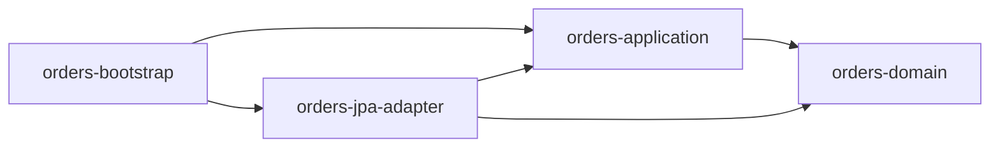
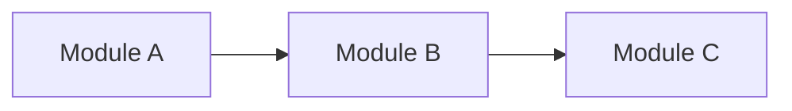
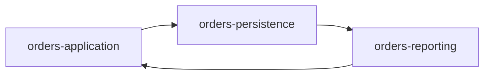
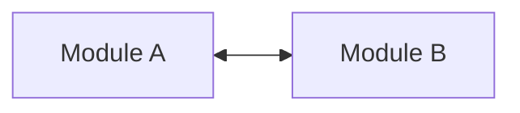
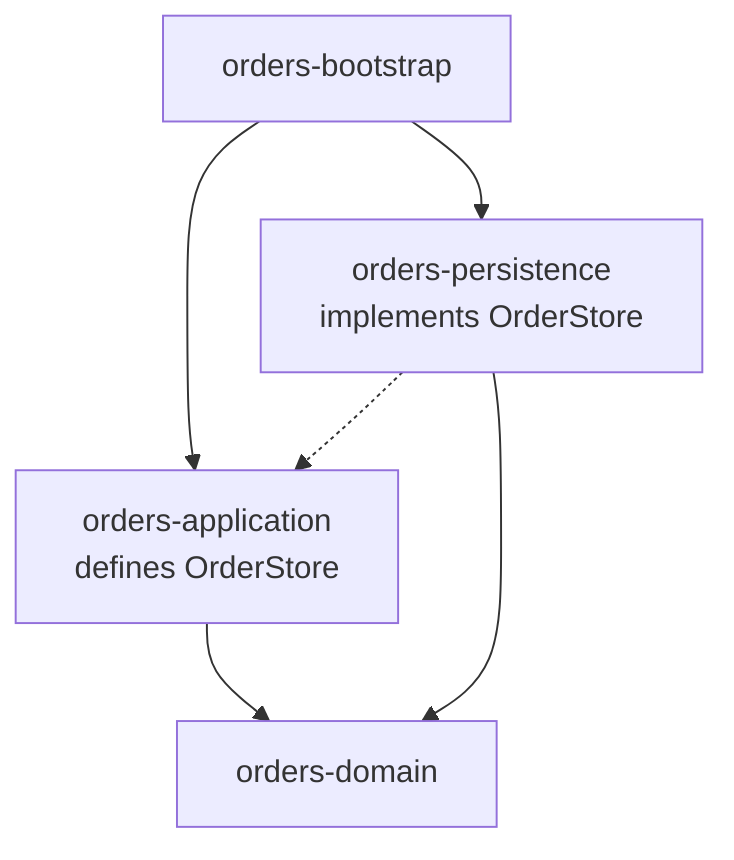
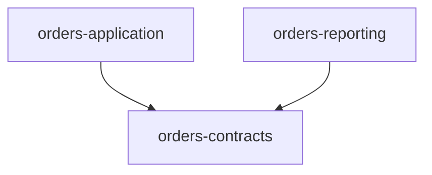

# Kiểm soát phụ thuộc trực tiếp, bắc cầu và chu trình giữa các module

> Chương: **Tổ chức phụ thuộc và lắp ráp ứng dụng**

Trong module **SOFTWARE_DESIGN_ARCHITECTURE_ARCHITECTURAL_PATTERN_LAYERED**, chúng ta học cách tổ chức phần mềm theo kiến trúc phân tầng. Khi hệ thống được chia thành nhiều package hoặc module, cần kiểm soát module nào được phép sử dụng module nào. Bài này tập trung vào ba dạng quan hệ thường gặp: phụ thuộc trực tiếp, phụ thuộc bắc cầu và phụ thuộc tạo thành chu trình. Hiểu rõ các quan hệ này giúp giữ ranh giới kiến trúc ổn định, giảm ảnh hưởng lan truyền khi thay đổi và tránh việc một module vô tình dựa vào chi tiết của module khác.

## 1. Phụ thuộc giữa các module là gì?

Một module là một đơn vị tổ chức mã nguồn có ranh giới và trách nhiệm tương đối rõ. Tùy dự án, module có thể là Gradle/Maven subproject, Java Platform Module System (JPMS) module, hoặc một nhóm package được quản lý theo quy ước kiến trúc.

Module A phụ thuộc module B khi mã nguồn hoặc quá trình thực thi của A cần khả năng, kiểu dữ liệu hay thành phần do B cung cấp. Ví dụ, `orders-application` sử dụng entity và quy tắc của `orders-domain`, nên Application có phụ thuộc vào Domain.

Có thể biểu diễn phụ thuộc bằng đồ thị có hướng:



Mũi tên đi từ module sử dụng tới module mà nó cần. Trong sơ đồ này, Application dùng Domain; adapter persistence triển khai các hợp đồng mà Application công bố; module bootstrap lắp ráp các thành phần. Không có đường phụ thuộc ngược từ Domain lên Application hoặc từ Application sang adapter cụ thể.

Đồ thị phụ thuộc có thể được xem ở nhiều mức:

- **Package/class:** một class import hoặc gọi class ở package khác.
- **Build module:** một Gradle/Maven project khai báo dependency tới project khác.
- **Java module (JPMS):** `module-info.java` khai báo module cần đọc bằng `requires`.
- **Runtime:** một thành phần cần thư viện hoặc dịch vụ khác khi ứng dụng chạy.

Các mức này có liên quan nhưng không hoàn toàn giống nhau. Một class có thể import package khác trong cùng build module; một build dependency có thể kéo thêm thư viện bắc cầu; và một module có thể cần một dịch vụ runtime mà không trực tiếp gọi class của nó.

## 2. Phụ thuộc trực tiếp

**Phụ thuộc trực tiếp (direct dependency)** tồn tại khi module A khai báo rõ rằng nó cần module B. Trong Java, điều này thường thể hiện qua import các kiểu của B cùng khai báo dependency trong cấu hình build hoặc `requires` trong `module-info.java`.

Ví dụ, Application cần kiểu `Order` từ Domain:

```java
package com.example.orders.application;

import com.example.orders.domain.Order;

public class CancelOrderService {
    public void cancel(Order order, String reason) {
        order.cancel(reason);
    }
}
```

Với Gradle, module Application có thể khai báo project dependency trực tiếp:

```groovy
dependencies {
    implementation project(":orders-domain")
}
```

Với JPMS, module Application có thể khai báo:

```java
module com.example.orders.application {
    requires com.example.orders.domain;
}
```

Khai báo trực tiếp làm rõ hợp đồng kiến trúc: Application thực sự cần Domain để biên dịch và hoạt động. Khi xem cấu hình module, người đọc có thể biết dependency nào là chủ ý của module.

Một nguyên tắc thực tế là nếu mã nguồn của module A trực tiếp sử dụng kiểu từ module C, hãy khai báo dependency trực tiếp tới C theo cơ chế build đang dùng. Đừng dựa vào việc C tình cờ xuất hiện trong dependency graph do một module khác kéo vào. Nếu B thay đổi cấu hình export dependency, A có thể không còn biên dịch được dù mã nguồn A không đổi.

## 3. Phụ thuộc bắc cầu

**Phụ thuộc bắc cầu (transitive dependency)** xuất hiện khi A phụ thuộc B, còn B lại phụ thuộc C. Khi đó C nằm trên đường phụ thuộc của A, dù A không trực tiếp khai báo C:



Ví dụ:

- `orders-application` phụ thuộc `orders-domain`.
- `orders-domain` sử dụng thư viện `money-types`.
- Đồ thị có đường A → B → C, nên `money-types` là dependency bắc cầu trên đường của Application.

Cần phân biệt **có mặt trong dependency graph** với **được phép sử dụng trực tiếp trong mã nguồn**. Build tool quyết định dependency bắc cầu có được đưa vào compile classpath hoặc runtime classpath của module tiêu thụ hay không. Điều này phụ thuộc cấu hình và scope, không phải mọi hệ thống đều xử lý giống nhau.

Với Gradle `java-library`, hai cấu hình thường gặp là:

- `api`: dependency là một phần của API công khai của module và được đưa vào compile classpath của consumer.
- `implementation`: dependency phục vụ triển khai nội bộ; consumer không cần nhìn thấy nó trên compile classpath chỉ vì phụ thuộc vào module hiện tại, dù dependency vẫn có thể cần ở runtime.

Ví dụ:

```groovy
plugins {
    id "java-library"
}

dependencies {
    api project(":orders-domain")
    implementation "org.springframework:spring-context:..."
}
```

Nếu public method của Application trả về `Order` thuộc Domain, kiểu đó xuất hiện trong API công khai và consumer cần đọc được kiểu `Order`; khi dùng Gradle Java Library, `api` có thể là cấu hình phù hợp. Nếu Spring chỉ được dùng bên trong implementation của Application và không xuất hiện trong chữ ký API công khai, `implementation` thường phù hợp hơn.

Trong JPMS, `requires` tạo quan hệ readability trực tiếp; `requires transitive` cho phép module phụ thuộc vào module hiện tại cũng đọc được module được khai báo bắc cầu. Chỉ nên dùng `requires transitive` khi kiểu từ module kia thực sự là một phần của API công khai và consumer cần quyền đọc nó.

```java
module com.example.orders.application {
    requires transitive com.example.orders.domain;
    requires spring.context;
    exports com.example.orders.application.api;
}
```

Ví dụ trên minh họa ý nghĩa của `requires transitive`; tên module và cấu hình thực tế phải khớp module descriptor của thư viện được dùng.

### Vì sao phụ thuộc bắc cầu cần được kiểm soát?

Phụ thuộc bắc cầu có thể làm module tiêu thụ vô tình dựa vào thư viện mà nó không trực tiếp lựa chọn. Một thư viện tưởng như không liên quan có thể xuất hiện trong classpath, ảnh hưởng phiên bản, tăng kích thước gói triển khai hoặc gây xung đột phiên bản.

Rủi ro kiến trúc lớn hơn xuất hiện khi kiểu dữ liệu của một dependency bắc cầu bị rò rỉ qua API công khai. Consumer bắt đầu import kiểu đó và phụ thuộc vào nó. Khi module trung gian thay thư viện hoặc không còn export dependency, nhiều consumer có thể phải sửa theo.

Để kiểm soát, hãy:

- Giữ kiểu của thư viện triển khai bên trong module sở hữu nó.
- Dùng kiểu thuộc về domain/application cho hợp đồng công khai.
- Chỉ export hoặc khai báo dependency bắc cầu khi consumer thực sự cần kiểu đó.
- Khai báo dependency trực tiếp nếu mã nguồn module đang sử dụng nó trực tiếp.
- Xem dependency report khi thêm hoặc nâng cấp thư viện để hiểu đường nào đã kéo dependency vào.

## 4. Phụ thuộc tạo thành chu trình

**Phụ thuộc chu trình (cyclic dependency)** xảy ra khi một chuỗi module quay lại chính module ban đầu. Ví dụ:



Application gọi persistence để lưu đơn; persistence gọi reporting để tạo báo cáo; reporting lại gọi Application để lấy trạng thái nghiệp vụ. Ba module tạo thành chu trình.

Một chu trình trực tiếp cũng có thể xảy ra:



Khi A cần B và B cũng cần A, không còn một hướng phụ thuộc rõ ràng giữa hai ranh giới. Việc thay đổi một module có thể buộc module kia thay đổi theo; kiểm thử và tái sử dụng từng module trở nên khó khăn.

Trong build system, project dependency cycle thường bị Gradle hoặc Maven từ chối hoặc gây task graph không thể thực thi. Với JPMS, đồ thị module được giải quyết phải không có chu trình `requires`. Ở mức package/class trong cùng một build module, chu trình có thể vẫn biên dịch được, nhưng thường làm kiến trúc khó hiểu và có thể ngăn việc tách module sau này.

Không phải mọi lời gọi qua lại lúc chạy đều tự động là chu trình phụ thuộc mã nguồn. Ví dụ, một callback có thể được truyền qua interface để module gọi lại mà không import implementation của nhau. Cần xem dependency graph của mã nguồn và hợp đồng, không chỉ xem trình tự runtime.

## 5. Vì sao chu trình làm kiến trúc khó duy trì?

Chu trình gây ra nhiều vấn đề:

- **Ranh giới trách nhiệm mờ:** khó xác định module nào sở hữu một quy tắc hoặc dữ liệu.
- **Thay đổi lan truyền:** sửa API của A có thể ảnh hưởng B, rồi quay lại A hoặc các module khác trong vòng phụ thuộc.
- **Khó kiểm thử độc lập:** muốn khởi tạo A có thể phải dựng B; muốn kiểm thử B lại cần A.
- **Khó tái sử dụng và triển khai:** không thể lấy một module ra dùng riêng nếu nó cần module nằm ở phía phụ thuộc ngược.
- **Khó phân tầng:** module có thể gọi xuyên qua ranh giới, khiến hướng từ presentation/application/domain/infrastructure mất rõ ràng.
- **Build và phát hành phức tạp:** một thay đổi nhỏ có thể kéo theo biên dịch hoặc phát hành nhiều module cùng lúc.

Một chu trình đôi khi là dấu hiệu các module đang được chia theo kỹ thuật hoặc theo folder mà chưa phản ánh đúng quyền sở hữu nghiệp vụ. Trước khi thêm interface để chữa triệu chứng, hãy xác định vì sao hai module cần biết về nhau.

## 6. Cách phá chu trình bằng cách đảo hướng phụ thuộc

Giả sử `orders-application` cần ghi đơn vào database, nhưng `orders-persistence` lại cần gọi Application để lấy quy tắc hoặc trạng thái. Thay vì để hai module phụ thuộc lẫn nhau, hãy xác định khả năng mà Application cần và đặt một port ở phía Application.



Ở đây:

1. Application định nghĩa interface `OrderStore` theo nhu cầu của ca sử dụng.
2. Persistence adapter phụ thuộc Application để triển khai interface đó.
3. Application gọi interface trong runtime; adapter thực hiện SQL/JPA.
4. Bootstrap lắp ráp Application và adapter bằng Spring hoặc cơ chế DI khác.

Ví dụ:

```java
// Trong orders-application
public interface OrderStore {
    Optional<Order> findById(UUID id);
    void save(Order order);
}
```

```java
// Trong orders-persistence
@Repository
public class JpaOrderStore implements OrderStore {
    private final SpringDataOrderRepository repository;

    public JpaOrderStore(SpringDataOrderRepository repository) {
        this.repository = repository;
    }

    @Override
    public Optional<Order> findById(UUID id) {
        return repository.findById(id).map(OrderEntity::toDomain);
    }

    @Override
    public void save(Order order) {
        repository.save(OrderEntity.fromDomain(order));
    }
}
```

Đây là ví dụ minh họa; mapping và transaction cần được thiết kế phù hợp với dự án. Điểm chính là interface thuộc về phía sử dụng khả năng lưu trữ, còn adapter triển khai nó. Application không import class JPA cụ thể.

## 7. Các chiến lược khác để xử lý chu trình

Không phải chu trình nào cũng nên được giải quyết bằng một interface mới. Tùy nguyên nhân, có thể chọn một trong các cách sau:

| Chiến lược | Khi phù hợp | Lưu ý |
|---|---|---|
| Đảo hướng phụ thuộc bằng port | Module nghiệp vụ cần khả năng do hạ tầng cung cấp | Hợp đồng phải diễn đạt nhu cầu của bên gọi |
| Trích xuất module hợp đồng nhỏ | Hai module cần dùng chung một kiểu hoặc giao thức ổn định | Module mới chỉ chứa khái niệm thực sự dùng chung, tránh thành `common` chứa mọi thứ |
| Chuyển điều phối lên module cấp cao hơn | Hai module không cần gọi trực tiếp nhau; một use case có thể điều phối cả hai | Module cấp thấp không nên biết về workflow phía trên |
| Dùng event hoặc callback qua abstraction | Hai phần cần phối hợp nhưng không nên phụ thuộc trực tiếp | Cần xử lý thứ tự, lỗi, retry và tính nhất quán |
| Gộp module | Hai module luôn thay đổi cùng nhau và ranh giới hiện tại không có giá trị | Đừng giữ ranh giới chỉ vì đã tạo folder hoặc project |
| Loại bỏ dependency không cần thiết | Phụ thuộc xuất hiện do import/helper hoặc tiện ích dùng chung không phù hợp | Di chuyển chức năng về module sở hữu đúng trách nhiệm |

### Trích xuất hợp đồng dùng chung

Nếu cả `orders-application` và `orders-reporting` cần một kiểu `OrderSummary`, có thể tạo module `orders-contracts` chỉ chứa kiểu dữ liệu và interface thực sự ổn định:



Hai module cùng phụ thuộc vào hợp đồng. Module hợp đồng không nên phụ thuộc ngược vào hai module tiêu thụ. Nếu `orders-contracts` bắt đầu chứa logic, helper và kiểu dữ liệu của mọi miền, nó sẽ trở thành điểm tập trung phụ thuộc và làm giảm giá trị của việc tách module.

### Chuyển điều phối lên trên

Nếu module A cần một kết quả từ B và B cần một hành động từ A chỉ vì workflow đang bị chia sai chỗ, có thể chuyển trình tự đó lên một module application hoặc bootstrap cấp cao hơn. Module này phụ thuộc vào cả A và B, rồi gọi API công khai của từng module. Hai module bên dưới không cần biết nhau.

## 8. Kiểm soát dependency bắc cầu trong Gradle và JPMS

Với Gradle, có thể xem dependency graph của một module bằng:

```shell
./gradlew :orders-application:dependencies --configuration compileClasspath
```

Để tìm lý do một dependency xuất hiện, dùng `dependencyInsight`:

```shell
./gradlew :orders-application:dependencyInsight \
  --dependency spring-context \
  --configuration runtimeClasspath
```

Các lệnh này giúp xác định module nào kéo thư viện vào, phiên bản nào được chọn và đường phụ thuộc liên quan. Khi dùng Maven, có thể xem dependency tree bằng `mvn dependency:tree`.

Với JPMS, xem `module-info.java` để hiểu module nào khai báo `requires`, `requires transitive`, `exports` và `opens`. Không nên dùng `requires transitive` chỉ để làm cho consumer biên dịch qua một kiểu tình cờ xuất hiện; hãy xem kiểu đó có thực sự là phần của API công khai không.

## 9. Tự động kiểm tra quy tắc kiến trúc

Review thủ công có ích nhưng khó phát hiện mọi phụ thuộc khi dự án lớn. Có thể dùng ArchUnit để kiểm tra quy tắc ở mức package/class. Ví dụ, nếu cấu trúc package tương ứng với các module logic:

```java
@Test
void domainMustNotDependOnApplicationOrInfrastructure() {
    noClasses()
        .that().resideInAPackage("..domain..")
        .should().dependOnClassesThat()
        .resideInAnyPackage("..application..", "..infrastructure..")
        .check(new ClassFileImporter().importPackages("com.example.orders"));
}
```

Quy tắc này ngăn Domain phụ thuộc ngược vào Application hoặc Infrastructure. Có thể bổ sung quy tắc tương tự để Presentation không phụ thuộc persistence adapter, hoặc để Application không import SDK của nhà cung cấp.

ArchUnit kiểm tra dependency ở mức class/package; nó không thay thế hoàn toàn việc kiểm tra project graph của Gradle/Maven hoặc readability graph của JPMS. Dùng đúng công cụ cho đúng mức ranh giới:

- Build tool kiểm tra dependency giữa các project/module và task graph.
- JPMS kiểm soát module readability và package được export.
- ArchUnit kiểm soát quy tắc phụ thuộc giữa class/package trong code đã biên dịch.
- Review API công khai để phát hiện kiểu của dependency nội bộ bị rò rỉ.

## 10. Checklist khi thiết kế module

Khi thêm hoặc sửa một dependency, hãy kiểm tra:

1. Module này cần khả năng nào từ module kia? Có thể mô tả bằng một API nhỏ không?
2. Đây là dependency trực tiếp hay chỉ xuất hiện bắc cầu qua module khác?
3. Mã nguồn có đang dùng kiểu từ dependency bắc cầu mà không khai báo trực tiếp không?
4. Kiểu của thư viện triển khai có bị lộ qua public API không?
5. Có đường đi nào quay lại module ban đầu tạo thành chu trình không?
6. Hướng phụ thuộc có phù hợp với trách nhiệm của Presentation, Application, Domain và Infrastructure không?
7. Có thể dùng port, module hợp đồng, chuyển điều phối lên trên hoặc loại bỏ dependency không cần thiết không?
8. Quy tắc này có thể được kiểm tra tự động bằng build tool, JPMS hoặc ArchUnit không?

Nếu một module cần một dependency, hãy khai báo rõ ràng và giới hạn phần API được công khai. Nếu một chu trình xuất hiện, hãy xem lại quyền sở hữu trách nhiệm và hướng phụ thuộc trước khi thêm lớp trung gian. Mục tiêu là đồ thị module dễ hiểu, có hướng rõ và không chứa chu trình ngoài ý muốn.

## Ghi nhớ

- Phụ thuộc trực tiếp là quan hệ được module khai báo rõ; phụ thuộc bắc cầu xuất hiện qua một đường phụ thuộc trung gian.
- Việc dependency bắc cầu có xuất hiện trên compile classpath hay không phụ thuộc build tool và cấu hình như Gradle `api`/`implementation` hoặc JPMS `requires transitive`.
- Nếu mã nguồn sử dụng trực tiếp một module, hãy khai báo dependency trực tiếp thay vì dựa vào dependency bắc cầu tình cờ.
- Chu trình làm mờ ranh giới, tăng ảnh hưởng thay đổi và thường gây vấn đề cho build hoặc khả năng tách module.
- Có thể phá chu trình bằng Dependency Inversion, module hợp đồng nhỏ, chuyển điều phối lên trên, event/callback, gộp module hợp lý hoặc bỏ dependency thừa.
- Dùng Gradle/Maven, JPMS và ArchUnit để kiểm tra ở đúng mức; không dựa vào tên folder để kết luận đồ thị phụ thuộc đã đúng.
