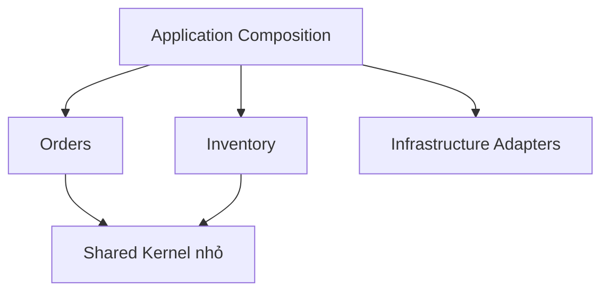

# Giới hạn mã dùng chung, thư viện quá rộng và giao diện không cần thiết

Bài học này thuộc module `SOFTWARE_DESIGN_ARCHITECTURE_ARCHITECTURAL_PATTERN_LAYERED`, nhằm giúp người học tổ chức phần mềm theo kiến trúc phân tầng. Trong chương **Tổ chức phụ thuộc và lắp ráp ứng dụng**, ta xem xét cách giới hạn phần mã được chia sẻ, chọn thư viện theo đúng nhu cầu và quyết định khi nào cần một interface. Những lựa chọn này ảnh hưởng trực tiếp đến mức độ gắn kết, phạm vi thay đổi và khả năng kiểm thử của các tầng.

## 1. Chia sẻ mã không phải mục tiêu tự thân

Khi hai nơi có đoạn mã giống nhau, phản xạ thường gặp là đưa chúng vào một lớp `CommonUtils` hoặc module `shared`. Cách làm đó có thể giảm lặp mã, nhưng cũng tạo thêm một phụ thuộc mà nhiều thành phần phải cùng mang theo. Nếu hai đoạn mã giống nhau chỉ tình cờ có cùng vài dòng nhưng phục vụ hai khái niệm khác nhau, việc ép chúng dùng chung có thể khiến thay đổi của bên này ảnh hưởng bên kia.

Ví dụ, hai module cùng cần chuẩn hóa một mã định danh. Ban đầu cả hai đều gọi `trim()` và chuyển chữ hoa. Sau đó mã khách hàng cần giữ nguyên chữ thường vì phân biệt hoa thường, còn mã kho vẫn cần chuẩn hóa chữ hoa. Nếu hai quy tắc bị gom vào `StringUtils.normalizeCode(...)`, thay đổi để phục vụ một module có thể làm hỏng module còn lại.

Trước khi tạo mã dùng chung, hãy hỏi:

- Hai nơi có đang giải quyết cùng một khái niệm nghiệp vụ hoặc kỹ thuật không?
- Quy tắc của chúng có cùng ý nghĩa và cùng lý do thay đổi không?
- Có thể mô tả một hợp đồng ổn định mà cả hai bên thực sự cần không?
- Lợi ích giảm lặp có lớn hơn chi phí phụ thuộc, phối hợp phiên bản và bảo trì không?

Nếu câu trả lời chưa rõ, giữ hai cách triển khai riêng có thể là lựa chọn hợp lý. Một ít mã trùng lặp có kiểm soát thường rẻ hơn một abstraction sai, đặc biệt khi hai luồng nghiệp vụ còn có thể phát triển theo hướng khác nhau.

## 2. Chia sẻ theo khái niệm và phạm vi sở hữu

Mã dùng chung nên có phạm vi nhỏ, chủ sở hữu rõ và một mục đích cụ thể. Có thể chia sẻ một value object như `Money`, một quy tắc định dạng thời gian đã được thống nhất, hoặc một hợp đồng sự kiện được nhiều module cùng tiêu thụ. Những thành phần này có ngữ nghĩa xác định và người dùng biết mình đang phụ thuộc vào điều gì.

Ngược lại, module `common` chứa mọi thứ từ xử lý chuỗi, ngày tháng, truy cập database đến gửi email thường trở thành nơi phụ thuộc tập trung. Các module chỉ cần một hàm nhỏ nhưng phải tham chiếu cả gói lớn; thay đổi trong common có thể kéo theo build, kiểm thử và phát hành nhiều thành phần không liên quan.

Một cấu trúc có phạm vi rõ có thể là:

```text
orders/
  domain/
  application/
  infrastructure/
inventory/
  domain/
  application/
  infrastructure/
shared-kernel/
  money/
  identifiers/
```

`shared-kernel` chỉ nên chứa những khái niệm thật sự được các module cùng sở hữu và có quy tắc thay đổi được phối hợp. Nó không phải nơi để đặt mọi lớp chưa biết thuộc module nào. Nếu hai module chỉ cần trao đổi thông tin, đôi khi một DTO hoặc event contract nhỏ ở ranh giới tích hợp phù hợp hơn việc chia sẻ cả mô hình miền.

### Khi nào nên trích xuất?

Giả sử `Order` và `Shipment` đều có mã định danh. Không nên tạo ngay một lớp cha `BaseEntity` chỉ để hai lớp dùng chung một trường `id`. Nếu hai loại mã có vòng đời, quy tắc sinh hoặc định dạng khác nhau, chúng không nhất thiết là cùng một khái niệm. Nếu chúng thực sự dùng chung một kiểu `OrderId` hoặc `ShipmentId` có hành vi cụ thể, hãy chia sẻ kiểu đó thay vì một lớp cha tổng quát.

Trích xuất khi có một khái niệm ổn định, nhiều nơi có cùng nhu cầu và abstraction giúp diễn đạt quy tắc tốt hơn. Tránh trích xuất chỉ vì hai đoạn mã hiện tại trông giống nhau.

## 3. Giới hạn bề mặt phụ thuộc vào thư viện

Thư viện giúp tái sử dụng mã đã được kiểm chứng, nhưng mỗi dependency đều mang theo API, phiên bản, cây phụ thuộc bắc cầu và yêu cầu vận hành. Một thư viện quá rộng có thể khiến module phụ thuộc vào nhiều khả năng mà nó không sử dụng.

Ví dụ, một module chỉ cần một kiểu dữ liệu đơn giản để biểu diễn kết quả phân trang. Nếu hợp đồng application công khai trực tiếp `Pageable` và `Page` của Spring Data, mọi caller của hợp đồng đó phải biết Spring Data. Khi cần thay persistence adapter hoặc dùng use case từ một tiến trình không chạy Spring, kiểu framework đã lan ra ngoài tầng lưu trữ.

Thay vào đó, có thể định nghĩa kiểu nhỏ thuộc hợp đồng ứng dụng:

```java
package com.example.orders.application;

public record PageRequestData(int page, int size) {
    public PageRequestData {
        if (page < 0) {
            throw new IllegalArgumentException("page must be >= 0");
        }
        if (size < 1 || size > 100) {
            throw new IllegalArgumentException("size must be between 1 and 100");
        }
    }
}

public record PageResult<T>(
    java.util.List<T> items,
    int page,
    int size,
    long totalElements
) {}
```

Adapter Spring Data chuyển đổi `PageRequestData` thành `PageRequest` khi gọi repository và chuyển `Page` thành `PageResult` trước khi trả về. Application chỉ phụ thuộc vào hợp đồng có kích thước vừa đủ.

Điều đó không có nghĩa phải bọc mọi thư viện. Nếu một ứng dụng nhỏ chủ động chấp nhận Spring Data ở tầng application, dùng trực tiếp `Pageable` có thể giảm mã chuyển đổi. Cần nhận thức rõ đây là một quyết định gắn kết framework và giới hạn nó trong phạm vi phù hợp.

### Chọn dependency theo khả năng thực sự cần

Khi thêm thư viện, hãy kiểm tra:

- Module cần API nào của thư viện, và có thể dùng một artifact nhỏ hơn không?
- Dependency là compile/runtime/test hay chỉ cần trong một adapter?
- Có dependency bắc cầu nào được đưa vào dù module không sử dụng không?
- API của thư viện có bị lộ trong public method, DTO hoặc interface của module không?
- Việc cập nhật phiên bản có ảnh hưởng tương thích, bảo mật hoặc vận hành không?

Với Gradle, cấu hình `implementation` thường giữ dependency ở phạm vi triển khai của module, trong khi `api` chủ ý đưa dependency vào compile classpath của người tiêu thụ thư viện. Không nên dùng `api` theo thói quen nếu kiểu của dependency không phải một phần hợp đồng công khai. Với Maven, cũng cần xem xét dependency scope và dependency transitive được công bố.

Ví dụ module persistence có thể phụ thuộc Spring Data JPA, trong khi module domain chỉ dùng Java chuẩn. Nếu domain import `JpaRepository` hoặc annotation ORM, dependency kỹ thuật đã vượt khỏi ranh giới dự kiến.

## 4. Adapter giúp cô lập thư viện bên ngoài

Khi một thư viện hoặc dịch vụ ngoài cần được thay thế, kiểm thử hoặc cấu hình độc lập, adapter có thể chuyển API của nó thành một hợp đồng nhỏ do ứng dụng hoặc miền sở hữu.

Ví dụ use case cần gửi yêu cầu thanh toán. Hợp đồng ứng dụng có thể chỉ mô tả khả năng cần thiết:

```java
package com.example.orders.application;

public interface PaymentGateway {
    PaymentResult charge(ChargeRequest request);
}
```

Use case sử dụng hợp đồng:

```java
public class PayOrderService {
    private final PaymentGateway payments;

    public PayOrderService(PaymentGateway payments) {
        this.payments = payments;
    }

    public PaymentResult handle(PayOrderCommand command) {
        ChargeRequest request = new ChargeRequest(
            command.orderId(), command.amount(), command.currency());
        return payments.charge(request);
    }
}
```

Adapter ở hạ tầng chuyển đổi hợp đồng đó sang SDK của nhà cung cấp:

```java
@Component
class AcmePaymentGateway implements PaymentGateway {
    private final AcmePaymentsClient client;

    AcmePaymentGateway(AcmePaymentsClient client) {
        this.client = client;
    }

    @Override
    public PaymentResult charge(ChargeRequest request) {
        AcmeChargeResponse response = client.createCharge(
            request.orderId().value(),
            request.amount().minorUnits(),
            request.currency().getCurrencyCode());

        return mapResult(response);
    }
}
```

`AcmePaymentsClient` và `AcmeChargeResponse` là kiểu của SDK bên ngoài, chỉ xuất hiện trong adapter. Nếu đổi nhà cung cấp, adapter có thể được thay mà use case vẫn làm việc với `PaymentGateway`, miễn là ngữ nghĩa của hợp đồng vẫn phù hợp.

Không phải mọi dependency đều cần adapter riêng. Hãy tạo ranh giới khi thư viện là chi tiết có khả năng thay đổi, có giao thức riêng, khó kiểm thử hoặc không nên xuất hiện trong API của tầng bên trong. Với một thư viện nhỏ, ổn định và được chấp nhận ở phạm vi module, lớp bọc thêm có thể không đem lại giá trị.

## 5. Interface không phải thứ cần tạo cho mọi lớp

Một interface hữu ích khi nó thể hiện một hợp đồng có ý nghĩa độc lập với một implementation cụ thể. Các lý do phổ biến gồm:

- Có nhiều implementation hợp lệ, chẳng hạn lưu file cục bộ và lưu object storage.
- Cần tách hệ thống ngoài để kiểm thử use case bằng fake hoặc stub.
- Cần đảo chiều phụ thuộc: tầng ứng dụng sở hữu port, tầng hạ tầng hiện thực port.
- Cần một điểm mở rộng có chủ đích, ví dụ nhiều chiến lược tính phí theo loại hợp đồng.
- Muốn định nghĩa API nhỏ mà caller cần, trong khi implementation có nhiều chi tiết hơn.

Interface không tự động làm code dễ thay thế. Nếu interface chỉ sao chép từng phương thức của một lớp và luôn chỉ có một implementation, không có ranh giới kiểm thử hay khả năng thay thế thực tế, nó có thể chỉ làm tăng số file và số bước điều hướng khi đọc code.

Ví dụ abstraction không cần thiết:

```java
public interface OrderNumberFormatter {
    String format(OrderId id);
}

public class DefaultOrderNumberFormatter implements OrderNumberFormatter {
    @Override
    public String format(OrderId id) {
        return "ORD-" + id.value();
    }
}
```

Nếu cách định dạng là quy tắc cố định của một module và không có nhu cầu thay thế, có thể dùng một lớp cụ thể hoặc phương thức trong value object. Interface chỉ đáng giữ khi nó tạo ra một ranh giới mà caller cần.

### Đừng tạo interface chỉ để mock

Một số đội tạo interface cho mọi service với lý do muốn mock trong unit test. Nhưng có thể kiểm thử service bằng cách tiêm một collaborator thật nhẹ, dùng fake ở ranh giới cần kiểm soát hoặc kiểm thử trực tiếp hành vi mà không mock mọi lớp nội bộ.

Nếu một lớp là logic thuần, ít phụ thuộc và không có hiệu ứng phụ, kiểm thử trực tiếp nó thường đơn giản hơn việc tạo một interface chỉ để thay nó bằng mock. Mock quá sâu còn có thể khiến test xác nhận cách triển khai hiện tại thay vì hành vi cần giữ.

## 6. Interface nên mô tả nhu cầu của caller

Một hợp đồng tốt không nhất thiết phản chiếu đầy đủ API của implementation. Nó chỉ nên cung cấp những thao tác mà bên gọi thực sự cần.

Ví dụ, use case chỉ cần tìm và lưu một đơn hàng:

```java
public interface OrderRepository {
    java.util.Optional<Order> findById(OrderId id);
    void save(Order order);
}
```

Không nên buộc use case phụ thuộc vào một interface repository khổng lồ chứa hàng chục truy vấn, thao tác batch, truy vấn báo cáo và API quản trị nếu nó chỉ cần hai thao tác. Có thể chia các port theo vai trò hoặc use case, miễn là ranh giới phản ánh nhu cầu thật và không tạo ra hàng loạt interface vụn vặt khó quản lý.

Một interface cũng nên tránh để lộ chi tiết implementation. Ví dụ `OrderRepository` không nên nhận `EntityManager`, `JpaSpecificationExecutor`, `HttpServletRequest` hoặc một kiểu SDK thanh toán. Nếu kiểu đó xuất hiện trong hợp đồng, chi tiết kỹ thuật đã rò rỉ sang caller.

## 7. Composition root: nơi lắp ráp implementation

Khi dùng interface và adapter, ứng dụng cần một nơi chọn implementation cụ thể và kết nối các dependency. Nơi đó thường được gọi là **composition root**. Trong ứng dụng Spring Boot, cấu hình bean và dependency injection thường đảm nhiệm vai trò này.

```java
@Configuration
class PaymentConfiguration {
    @Bean
    PaymentGateway paymentGateway(AcmePaymentsClient client) {
        return new AcmePaymentGateway(client);
    }
}
```

`PayOrderService` chỉ nhận `PaymentGateway`. Composition root quyết định cung cấp `AcmePaymentGateway`. Khi chạy integration test, cấu hình có thể cung cấp một implementation khác. Việc chọn implementation tập trung tại điểm lắp ráp giúp các lớp nghiệp vụ không tự khởi tạo SDK hoặc tự quyết định môi trường đang dùng.

Không nên gọi `new AcmePaymentsClient(...)` trong domain entity hoặc application service. Làm vậy khiến lớp nghiệp vụ tự tạo dependency, khó kiểm soát vòng đời, cấu hình và thay thế trong kiểm thử.

## 8. Tránh module dùng chung trở thành trung tâm phụ thuộc

Một module được nhiều module khác sử dụng cần có API công khai nhỏ và ổn định. Nếu module `common` phụ thuộc ngược vào `orders`, `inventory` hoặc Spring Web để hỗ trợ một tiện ích, đồ thị phụ thuộc sẽ trở nên khó hiểu và có thể tạo vòng phụ thuộc.

Hãy ưu tiên đồ thị phụ thuộc có hướng rõ ràng:



Shared Kernel không biết các module nghiệp vụ sử dụng nó. Composition module có thể phụ thuộc vào các module cụ thể để lắp ráp ứng dụng, trong khi Domain không cần phụ thuộc ngược vào composition root.

Khi module dùng chung thay đổi thường xuyên hoặc cần release đồng bộ với mọi caller, đó là dấu hiệu phạm vi chia sẻ có thể quá rộng. Hãy xem xét chuyển một thành phần về module sở hữu khái niệm đó, tạo một hợp đồng tích hợp nhỏ hoặc tách API ổn định khỏi implementation.

## 9. Cách đánh giá một abstraction trước khi giữ lại

Một interface, base class hoặc module dùng chung nên trả lời được các câu hỏi sau:

1. Nó đại diện cho khái niệm hoặc hợp đồng nào?
2. Ai là caller và caller thực sự cần những phương thức nào?
3. Có nhiều implementation hoặc một ranh giới cần kiểm soát không?
4. Thay đổi của abstraction sẽ ảnh hưởng đến những module nào?
5. Nó có kéo theo dependency framework hoặc thư viện không cần thiết không?
6. Có thể thay bằng mã đơn giản hơn mà vẫn giữ được khả năng kiểm thử và thay đổi cần thiết không?

Nếu không xác định được caller, ý nghĩa hoặc lý do thay đổi, abstraction có thể đang được tạo quá sớm. Hãy bắt đầu từ nhu cầu thực tế, sau đó trích xuất khi một hợp đồng ổn định xuất hiện.

## 10. Kiểm tra phụ thuộc và bảo trì

Quy tắc về dependency nên được thể hiện trong cấu trúc module và kiểm tra tự động khi hệ thống đủ lớn. Có thể dùng module boundary của Gradle/Maven, Java Platform Module System hoặc ArchUnit để phát hiện:

- Domain import package của Spring Web, Spring Data hoặc SDK bên ngoài.
- Module nghiệp vụ phụ thuộc vào module triển khai của một module khác thay vì API được công bố.
- Shared module phụ thuộc ngược vào module caller.
- Vòng phụ thuộc giữa các package hoặc module.
- Kiểu thư viện implementation bị lộ qua API công khai ngoài dự kiến.

Ngoài kiểm tra tĩnh, hãy xem dependency tree khi thêm thư viện, kiểm tra kích thước artifact và theo dõi phiên bản có lỗ hổng hoặc không còn được hỗ trợ. Không cần tạo quy trình kiểm tra phức tạp cho một ứng dụng nhỏ; mức kiểm soát nên tương xứng với số module, số người bảo trì và chi phí của một thay đổi phụ thuộc.

## 11. Ví dụ quyết định nhanh

| Tình huống | Quyết định thường hợp lý | Lý do |
|---|---|---|
| Hai module có hai quy tắc chuẩn hóa mã khác nhau | Giữ triển khai riêng | Cùng vài dòng code nhưng khác ngữ nghĩa |
| Nhiều module dùng cùng kiểu `Money` với quy tắc tiền tệ thống nhất | Cân nhắc chia sẻ value object | Có chung khái niệm và bất biến |
| Use case cần gọi một nhà cung cấp thanh toán | Tạo port và adapter | Cô lập giao thức ngoài và hỗ trợ thay thế/kiểm thử |
| Lớp thuần Java chỉ có một cách định dạng ổn định | Dùng lớp cụ thể hoặc phương thức | Interface có thể không tạo ra ranh giới hữu ích |
| Module application công khai `Pageable` dù muốn độc lập Spring Data | Dùng kiểu phân trang riêng | Hạn chế framework lan qua hợp đồng |
| Module common chứa cả email, SQL, chuỗi và nghiệp vụ đơn hàng | Tách theo khái niệm và chủ sở hữu | Giảm phụ thuộc không liên quan và tránh vòng phụ thuộc |

## 12. Ghi nhớ

Chỉ chia sẻ mã khi các nơi thực sự dùng chung một khái niệm và quy tắc ổn định; tránh biến `common` thành nơi chứa mọi thứ. Chọn thư viện theo API cần dùng, giới hạn dependency trong module phù hợp và không để kiểu framework lan qua hợp đồng nếu muốn giữ ranh giới độc lập. Interface có giá trị khi thể hiện nhu cầu của caller, tạo điểm thay thế, kiểm thử hoặc đảo chiều phụ thuộc; không cần tạo một interface cho mỗi lớp chỉ để có thêm abstraction. Composition root là nơi chọn và lắp ráp implementation. Hãy đánh giá mỗi abstraction bằng caller, lý do thay đổi, phạm vi ảnh hưởng và chi phí bảo trì, rồi giữ đồ thị phụ thuộc nhỏ, rõ hướng và dễ kiểm tra.
