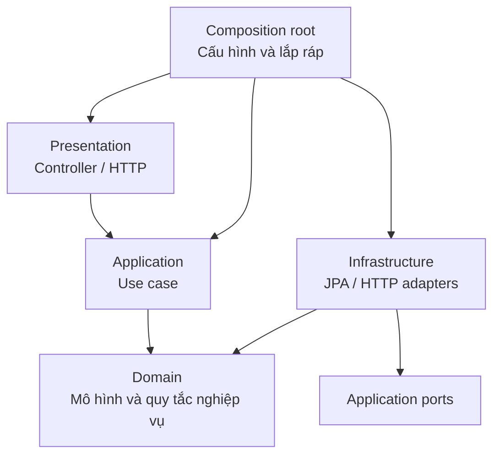
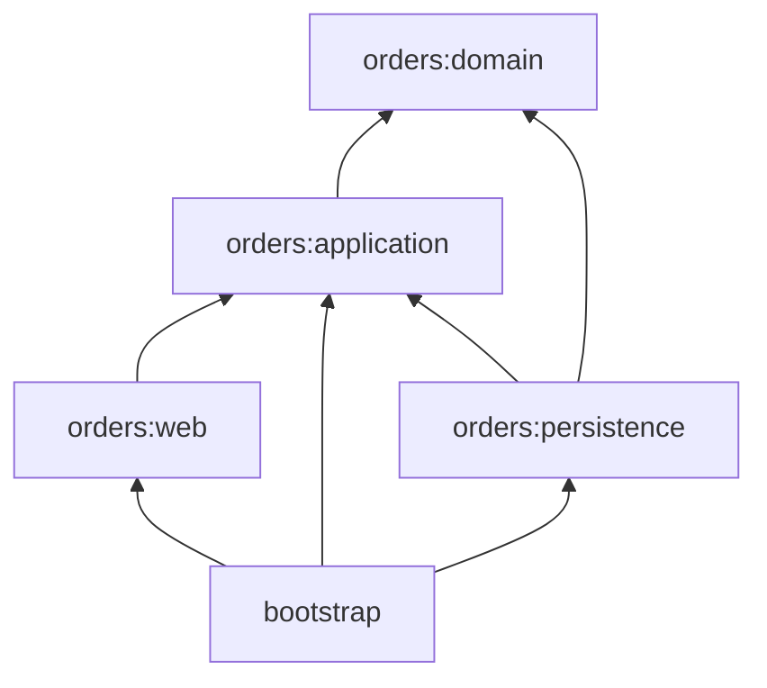

# Tổ chức package, module biên dịch và tự động kiểm tra phụ thuộc bị cấm

Kiến trúc phân tầng chỉ có giá trị lâu dài khi cấu trúc mã nguồn giúp người phát triển nhìn thấy và giữ được ranh giới giữa các trách nhiệm. Nếu tất cả lớp nằm trong một package lớn, hoặc bất kỳ package nào cũng có thể gọi trực tiếp bất kỳ package nào khác, quy tắc kiến trúc nhanh chóng bị phá vỡ khi dự án mở rộng.

Có ba mức tổ chức thường được dùng cùng nhau:

- **Package** nhóm lớp theo khái niệm và tạo namespace. Package giúp mã nguồn dễ tìm, nhưng tự nó không ngăn một lớp import lớp ở package khác.
- **Module biên dịch** tạo ranh giới phụ thuộc ở mức build hoặc ngôn ngữ. Gradle multi-project và Java Platform Module System (JPMS) có thể giới hạn module nào được phụ thuộc vào module nào.
- **Kiểm tra kiến trúc tự động** đọc cấu trúc lớp hoặc bytecode để phát hiện dependency đi sai hướng, package phụ thuộc bị cấm hoặc chu trình giữa các phần.

Ba mức này bổ sung cho nhau. Package thể hiện cách nhóm mã; module làm ranh giới có thể được công cụ biên dịch/build thực thi; kiểm tra kiến trúc biến các quy tắc thiết kế thành điều kiện có thể chạy lặp lại trong CI. Bài học này thuộc module học tổ chức phần mềm theo kiến trúc phân tầng, tập trung vào cách tổ chức và bảo vệ dependency trong mã Java.

## 1. Bắt đầu từ hướng phụ thuộc mong muốn

Trước khi tạo package hoặc module, hãy xác định phần nào được phép biết phần nào. Với một layered application có presentation, application, domain và infrastructure, một hướng phụ thuộc thường gặp là:



Sơ đồ biểu diễn dependency trong mã nguồn. Application có thể khai báo port để đọc/ghi dữ liệu hoặc gọi hệ thống ngoài; infrastructure adapter triển khai các port đó. Adapter có thể phụ thuộc vào application để biết hợp đồng và vào domain để ánh xạ mô hình. Domain không phụ thuộc vào application, presentation hoặc infrastructure. Composition root là nơi biết các thành phần cụ thể để lắp ráp ứng dụng, vì vậy nó có thể phụ thuộc vào nhiều module.

Một ma trận đơn giản giúp thống nhất quy tắc trước khi viết code:

| Thành phần gọi | Được phép phụ thuộc | Không được phụ thuộc trực tiếp |
|---|---|---|
| Presentation | Application API | Infrastructure, chi tiết domain không được use case công khai |
| Application | Domain và các abstraction/port do use case sở hữu | Presentation, adapter hạ tầng cụ thể |
| Domain | Các kiểu Java thuần và những abstraction thực sự thuộc miền | Application, Presentation, Infrastructure, framework kỹ thuật nếu mục tiêu là domain độc lập |
| Infrastructure | Port của Application và mô hình Domain cần triển khai/lưu trữ | Presentation |
| Composition root | Các thành phần cần thiết để cấu hình và khởi động ứng dụng | Không áp dụng quy tắc cấm dependency như các tầng nghiệp vụ; cần giữ package này nhỏ và tập trung |

Đây là một quy ước phổ biến, không phải sơ đồ duy nhất cho mọi hệ thống. Nếu repository port thuộc domain vì nó diễn đạt vòng đời aggregate, infrastructure sẽ phụ thuộc domain để triển khai; nếu port thuộc application vì nó phục vụ riêng một use case, adapter có thể phụ thuộc application. Điều quan trọng là domain không bị buộc phụ thuộc vào adapter và các tầng ngoài không bỏ qua use case để thao tác tùy tiện với dữ liệu.

## 2. Tổ chức package để người đọc thấy ranh giới

Trong một module Java duy nhất, có thể tổ chức package theo tầng:

```text
com.example.shop
├── presentation
│   ├── order
│   │   ├── OrderController.java
│   │   ├── CreateOrderRequest.java
│   │   └── OrderResponse.java
│   └── customer
├── application
│   ├── order
│   │   ├── CreateOrderUseCase.java
│   │   ├── CreateOrderService.java
│   │   └── port
│   │       └── out
│   │           ├── OrderRepository.java
│   │           └── PaymentGateway.java
├── domain
│   ├── order
│   │   ├── Order.java
│   │   ├── OrderId.java
│   │   └── OrderPolicy.java
│   └── customer
└── infrastructure
    ├── persistence
    │   └── JpaOrderRepository.java
    └── payment
        └── HttpPaymentGateway.java
```

Cấu trúc trên đặt tên tầng ở gần gốc package. Nó dễ nhìn khi dự án có ít feature hoặc nhóm muốn rà soát toàn bộ controller, application service hay adapter theo từng loại. Tuy nhiên, khi số feature tăng lên, một thay đổi cho chức năng đơn hàng có thể đòi hỏi mở nhiều nhánh package khác nhau.

Một cách khác là tổ chức theo feature trước, rồi chia trách nhiệm bên trong feature:

```text
com.example.shop
├── order
│   ├── presentation
│   ├── application
│   ├── domain
│   └── infrastructure
│       ├── persistence
│       └── payment
├── customer
│   ├── presentation
│   ├── application
│   ├── domain
│   └── infrastructure
└── bootstrap
```

Feature-first giúp mã liên quan một chức năng nằm gần nhau và hỗ trợ việc chia module theo feature khi cần. Cấu trúc layer-first lại thuận tiện nếu các tầng có quy mô riêng biệt hoặc quy ước chung được chia sẻ rộng. Có thể kết hợp hai cách: nhóm theo feature ở mức đầu, sau đó dùng package con để thể hiện tầng.

### Tránh package chung chung làm mờ trách nhiệm

Các package như `common`, `utils`, `helpers` hoặc `services` rất dễ trở thành nơi chứa mọi thứ không biết đặt ở đâu. Sau một thời gian, chúng có thể chứa cả quy tắc nghiệp vụ, lớp chuyển đổi HTTP, repository và hàm tiện ích không liên quan. Hãy đặt lớp gần khái niệm hoặc feature sở hữu nó. Chỉ tạo package dùng chung khi có một khái niệm thật sự được nhiều phần sử dụng và có quy tắc sở hữu rõ ràng.

Không nên tạo package cho từng lớp hoặc chia package quá sâu chỉ để thể hiện sơ đồ. Mục tiêu là làm cho dependency dễ hiểu và giới hạn truy cập có ý nghĩa. Package-private visibility của Java có thể giúp giữ một số lớp nội bộ trong package; chỉ công khai API cần thiết.

## 3. Package không phải module biên dịch

Hai lớp ở hai package khác nhau vẫn có thể import nhau nếu lớp và thành viên được khai báo `public` và nằm trong cùng một module biên dịch có thể truy cập. Vì thế, cấu trúc thư mục đẹp không đủ để bảo đảm dependency direction. Quy tắc “domain không được phụ thuộc infrastructure” có thể bị vi phạm ngay cả khi hai phần nằm trong hai nhánh package rất rõ ràng.

Một **Gradle subproject** hoặc **Maven module** tạo một đơn vị build riêng với dependency được khai báo. Nếu `orders-domain` không khai báo phụ thuộc vào `orders-infrastructure`, mã domain không thể sử dụng trực tiếp kiểu chỉ có trong module infrastructure trên compile classpath của nó. Đây là một hàng rào mạnh hơn package thông thường.

Java còn có **JPMS** (Java Platform Module System), được mô tả bằng `module-info.java`. JPMS cho phép khai báo module nào được đọc bằng `requires` và package nào được công khai bằng `exports`. Nó bổ sung cơ chế đóng gói ở cấp module của Java. JPMS và Gradle multi-project giải quyết hai khía cạnh khác nhau: Gradle tổ chức build và dependency giữa project; JPMS quy định module Java và khả năng truy cập khi biên dịch/chạy. Một dự án có thể dùng Gradle mà không dùng JPMS.

## 4. Tách module Gradle theo ranh giới cần bảo vệ

Khi một codebase lớn lên, có thể tách các thành phần thành module biên dịch. Ví dụ:

```text
shop/
├── settings.gradle
├── orders/
│   ├── domain/
│   ├── application/
│   ├── web/
│   └── persistence/
└── bootstrap/
```

Trong `settings.gradle`:

```groovy
rootProject.name = 'shop'

include 'orders:domain'
include 'orders:application'
include 'orders:web'
include 'orders:persistence'
include 'bootstrap'
```

Dependency được khai báo tại module cần sử dụng kiểu của module khác:

```groovy
// orders/application/build.gradle
dependencies {
    implementation project(':orders:domain')
}
```

```groovy
// orders/web/build.gradle
dependencies {
    implementation project(':orders:application')
}
```

```groovy
// orders/persistence/build.gradle
dependencies {
    implementation project(':orders:application')
    implementation project(':orders:domain')
}
```

```groovy
// bootstrap/build.gradle
dependencies {
    implementation project(':orders:web')
    implementation project(':orders:application')
    implementation project(':orders:persistence')
}
```

Sơ đồ dependency của các module:



Mũi tên trong sơ đồ đi từ module phụ thuộc tới module mà nó sử dụng. `orders:domain` không khai báo dependency vào module nào trong các module ứng dụng. `orders:application` phụ thuộc domain để điều phối use case. `orders:web` phụ thuộc application để gọi use case. `orders:persistence` phụ thuộc application để triển khai repository port và phụ thuộc domain để chuyển đổi aggregate/entity. `bootstrap` biết các adapter cụ thể để cấu hình dependency injection và khởi động ứng dụng.

Ví dụ giả định port `OrderRepository` được khai báo trong application. Nếu dự án đặt repository contract trong domain, cần điều chỉnh dependency tương ứng: persistence phụ thuộc domain; application vẫn phụ thuộc domain. Không thêm dependency chỉ để tiện import một lớp; trước tiên hãy xem lớp đó có thuộc đúng module và đúng API công khai không.

### Module hóa đem lại gì và tốn gì?

Module biên dịch giúp phát hiện sớm dependency không được khai báo và khiến việc chia sẻ API trở nên có chủ đích. Module domain có thể được build và kiểm thử độc lập; adapter có thể được thay thế mà không cần đưa thư viện JPA vào compile classpath của domain.

Đổi lại, module hóa tạo thêm cấu hình build, quản lý dependency, ranh giới API và đôi khi cần module tích hợp để lắp ráp. Với một ứng dụng nhỏ, chia thành nhiều module quá sớm có thể làm việc di chuyển lớp và chạy test phức tạp hơn mà chưa đem lại lợi ích. Có thể bắt đầu bằng package và kiểm tra kiến trúc, rồi tách module khi ranh giới đã ổn định hoặc cần được compiler/build thực thi.

## 5. Dùng JPMS để giới hạn khả năng truy cập

Một module domain có thể khai báo API công khai bằng `module-info.java`:

```java
module com.example.shop.orders.domain {
    exports com.example.shop.orders.domain.model;
    exports com.example.shop.orders.domain.value;
}
```

Module application có thể đọc domain và chỉ xuất package chứa use case mà module web cần gọi:

```java
module com.example.shop.orders.application {
    requires com.example.shop.orders.domain;

    exports com.example.shop.orders.application.port.in;
}
```

Các package không được `exports` không trở thành API công khai cho module khác theo quy tắc truy cập JPMS thông thường. Điều này giúp tránh việc module web hoặc bootstrap phụ thuộc vào lớp triển khai nội bộ của application.

Nếu chữ ký public của use case để lộ kiểu thuộc module domain, module gọi có thể cần đọc cả domain. Nên cân nhắc dùng command/result types thuộc application để giữ API độc lập; chỉ dùng `requires transitive` khi thực sự muốn công khai dependency đó cho mọi module đọc application.

Module adapter sẽ khai báo `requires` cho các module mà nó sử dụng và cho các thư viện bên ngoài có tên module phù hợp với phiên bản đang dùng. Tên module của một thư viện có thể đến từ module descriptor hoặc automatic module name trong JAR; cần kiểm tra tài liệu và artifact thực tế trước khi ghi `requires`. Không nên đoán tên module từ tên Maven artifact.

Một số framework, đặc biệt framework dùng reflection để tạo proxy hoặc truy cập thành viên, có thể cần package được mở có giới hạn bằng `opens`. Hãy chỉ mở package cần thiết và theo đúng yêu cầu framework. JPMS làm tăng tính đóng gói, nhưng cấu hình không phù hợp có thể khiến Spring hoặc thư viện persistence không truy cập được kiểu cần thiết. Vì vậy, không phải mọi ứng dụng Spring Boot đều cần bật JPMS ngay từ đầu.

## 6. Tự động kiểm tra dependency bị cấm bằng ArchUnit

Ngay cả khi đã có quy ước package, một pull request vẫn có thể thêm import sai tầng. ArchUnit cho phép viết kiểm tra kiến trúc bằng Java và chạy chúng như test thông thường. Công cụ phân tích bytecode đã biên dịch để tìm quan hệ phụ thuộc giữa lớp, package và module trong phạm vi được import.

Với JUnit 5, thêm dependency kiểm thử `archunit-junit5` vào module chứa các bài kiểm tra kiến trúc, dùng phiên bản tương thích với JDK và bộ JUnit của dự án. Sau đó tạo một test:

```java
package com.example.shop.architecture;

import com.tngtech.archunit.junit.AnalyzeClasses;
import com.tngtech.archunit.junit.ArchTest;
import com.tngtech.archunit.lang.ArchRule;

import static com.tngtech.archunit.library.Architectures.layeredArchitecture;

@AnalyzeClasses(packages = "com.example.shop")
class LayerDependencyTest {

    @ArchTest
    static final ArchRule layers_follow_dependency_direction =
            layeredArchitecture()
                    .consideringAllDependencies()
                    .layer("Presentation").definedBy("..presentation..")
                    .layer("Application").definedBy("..application..")
                    .layer("Domain").definedBy("..domain..")
                    .layer("Infrastructure").definedBy("..infrastructure..")
                    .layer("Bootstrap").definedBy("..bootstrap..")
                    .whereLayer("Presentation").mayOnlyBeAccessedByLayers("Bootstrap")
                    .whereLayer("Application")
                        .mayOnlyBeAccessedByLayers("Presentation", "Infrastructure", "Bootstrap")
                    .whereLayer("Domain")
                        .mayOnlyBeAccessedByLayers("Application", "Infrastructure")
                    .whereLayer("Infrastructure").mayOnlyBeAccessedByLayers("Bootstrap")
                    .whereLayer("Bootstrap").mayNotBeAccessedByAnyLayer()
                    .ensureAllClassesAreContainedInArchitecture();
}
```

Quy tắc trên diễn đạt một lựa chọn dependency cụ thể: bootstrap được phép lắp ráp presentation, application và infrastructure; presentation gọi application; application gọi domain; infrastructure phụ thuộc vào application port và domain để triển khai. Các tầng nghiệp vụ không được gọi ngược vào infrastructure hoặc bootstrap. `ensureAllClassesAreContainedInArchitecture()` yêu cầu mọi lớp trong phạm vi import thuộc một layer đã khai báo; nếu dự án có package khác, hãy thêm layer hoặc thu hẹp phạm vi quét có chủ đích.

Nếu cấu trúc package của dự án khác, hãy sửa pattern `..presentation..`, `..application..`, `..domain..` và `..infrastructure..` theo package thật. Nếu repository port nằm trong domain, điều chỉnh mô hình kiểm tra cho phù hợp. Không nên sao chép một rule mà không hiểu dependency hợp lệ của hệ thống.

### Viết rule cấm trực tiếp một số dependency

Khi cần một quy tắc hẹp và dễ đọc, có thể dùng `noClasses()`:

```java
import com.tngtech.archunit.junit.AnalyzeClasses;
import com.tngtech.archunit.junit.ArchTest;
import com.tngtech.archunit.lang.ArchRule;

import static com.tngtech.archunit.lang.syntax.ArchRuleDefinition.noClasses;

@AnalyzeClasses(packages = "com.example.shop")
class ForbiddenDependencyTest {

    @ArchTest
    static final ArchRule domain_must_not_use_spring_or_outer_layers =
            noClasses()
                    .that().resideInAPackage("..domain..")
                    .should().dependOnClassesThat().resideInAnyPackage(
                            "..presentation..",
                            "..application..",
                            "..infrastructure..",
                            "org.springframework..");

    @ArchTest
    static final ArchRule application_must_not_use_infrastructure =
            noClasses()
                    .that().resideInAPackage("..application..")
                    .should().dependOnClassesThat().resideInAnyPackage(
                            "..presentation..",
                            "..infrastructure..");

    @ArchTest
    static final ArchRule presentation_must_not_use_infrastructure =
            noClasses()
                    .that().resideInAPackage("..presentation..")
                    .should().dependOnClassesThat().resideInAnyPackage(
                            "..infrastructure..");
}
```

Rule đầu tiên ngăn domain phụ thuộc các tầng ngoài và Spring. Rule thứ hai ngăn application gọi ngược presentation hoặc adapter cụ thể. Rule thứ ba ngăn controller truy cập trực tiếp infrastructure. Có thể thêm các package hoặc thư viện cấm khác, nhưng nên cấm theo lý do kiến trúc cụ thể thay vì lập một danh sách lớn thiếu chủ đích.

### Phát hiện chu trình giữa các feature

Nếu tổ chức package theo feature, một feature có thể vô tình gọi trực tiếp implementation nội bộ của feature khác, tạo thành chu trình. ArchUnit có thể kiểm tra các slice không phụ thuộc vòng:

```java
import com.tngtech.archunit.junit.AnalyzeClasses;
import com.tngtech.archunit.junit.ArchTest;
import com.tngtech.archunit.lang.ArchRule;

import static com.tngtech.archunit.library.dependencies.SlicesRuleDefinition.slices;

@AnalyzeClasses(packages = "com.example.shop")
class FeatureDependencyTest {

    @ArchTest
    static final ArchRule features_should_be_free_of_cycles =
            slices()
                    .matching("com.example.shop.(*)..")
                    .should().beFreeOfCycles();
}
```

Pattern này xem package con trực tiếp dưới `com.example.shop` như một slice, ví dụ `order`, `customer` hoặc `inventory`. Nếu dự án dùng cấu trúc package khác, hãy điều chỉnh pattern để mỗi slice tương ứng một feature thực sự. Một chu trình được phát hiện không luôn có nghĩa phải tách service; trước tiên hãy xem hai feature đang chia sẻ khái niệm nào và liệu có thể đưa hợp đồng chung về vị trí sở hữu phù hợp hay không.

## 7. Tự động kiểm tra module và build dependency

ArchUnit kiểm tra quan hệ phụ thuộc ở mức lớp/package trong bytecode. Gradle hoặc Maven lại kiểm soát dependency giữa các module build. Hai cơ chế nên được dùng bổ sung:

- Nếu domain không được dùng thư viện Spring, không khai báo Spring trong `dependencies` của module domain. Việc build domain độc lập giúp phát hiện import không có dependency ngay ở compile time.
- Kiểm tra cả dependency bắc cầu: một thư viện có thể xuất dependency của nó ra compile classpath qua cấu hình `api` hoặc cơ chế tương đương. Tránh công khai dependency không cần thiết và xem compile classpath thực tế khi điều tra một kiểu không mong muốn vẫn truy cập được.
- Chỉ export API cần thiết từ module; giữ implementation package ở dạng nội bộ.
- Trong JPMS, dùng `requires` đúng chiều và `exports` có chọn lọc. Hạn chế `requires transitive` nếu không có lý do công khai dependency đó cho người dùng module.
- Đưa ArchUnit tests vào CI để kiểm tra dependency trong các package được quét, kể cả khi tất cả package vẫn nằm trong cùng một Gradle module.
- Xem xét dependency report của Gradle/Maven khi một thư viện không mong muốn xuất hiện trên compile classpath của module domain.

Build tool có thể bảo vệ ranh giới module, nhưng không hiểu ý nghĩa nghiệp vụ. Nếu toàn bộ mã được đặt trong một module duy nhất, compiler không tự biết `presentation` bị cấm phụ thuộc `infrastructure`; khi đó ArchUnit hoặc một công cụ kiểm tra kiến trúc tương tự là cần thiết. Ngược lại, ArchUnit không thay thế việc khai báo dependency module chính xác và có thể chỉ kiểm tra những lớp nằm trong phạm vi import.

## 8. Đưa kiểm tra kiến trúc vào quy trình phát triển

Kiểm tra kiến trúc chỉ hữu ích khi được chạy thường xuyên và có kết quả dễ hiểu. Có thể đặt ArchUnit tests trong source set test của module phù hợp và chạy cùng unit/integration test trong CI. Khi một rule thất bại, thông báo nên chỉ ra lớp nào phụ thuộc vào package bị cấm để người sửa biết phải chuyển trách nhiệm, đổi hợp đồng hay điều chỉnh rule có chủ đích.

Một quy trình thực tế:

1. Thống nhất sơ đồ dependency và các ngoại lệ hợp lệ của dự án.
2. Tổ chức package sao cho tên package thể hiện feature và tầng.
3. Tách Gradle/Maven module ở những ranh giới cần compiler/build bảo vệ.
4. Viết ArchUnit rules cho dependency direction, package cấm và chu trình.
5. Chạy các rule trong CI cùng các test khác; yêu cầu mọi ngoại lệ có giải thích và người chịu trách nhiệm.
6. Khi kiến trúc thay đổi, cập nhật sơ đồ và test cùng một thay đổi để tài liệu và quy tắc không lệch nhau.

Không nên tạo rule quá chặt đến mức mọi thay đổi hợp lệ đều phải sửa test, hoặc thêm ngoại lệ vô hạn để làm test xanh. Khi rule liên tục bị vi phạm, hãy xem lại ranh giới package/module hoặc cách diễn đạt use case. Nếu chỉ một adapter cần được composition root gọi trực tiếp, hãy giới hạn ngoại lệ ở package bootstrap thay vì cho phép toàn bộ application truy cập infrastructure.

## 9. Ví dụ nhận diện một dependency sai

Giả sử một controller gọi thẳng `JpaOrderRepository` để tải đơn hàng và tự tính tổng tiền. Code có thể chạy, nhưng nó tạo ra hai vấn đề: presentation phụ thuộc vào công nghệ lưu trữ và quy tắc tính tổng bị đặt ngoài mô hình nghiệp vụ. Cách sửa là controller gọi `GetOrderUseCase`; application service điều phối repository port và domain model; adapter JPA triển khai port. ArchUnit có thể phát hiện dependency presentation → infrastructure ngay khi test chạy.

Tương tự, nếu `Order` import `org.springframework.data.jpa.repository.JpaRepository` để tự tải dữ liệu, domain đã biết chi tiết persistence. Cách sửa là đưa thao tác tải dữ liệu ra khỏi entity: application service tải aggregate qua repository rồi gọi hành vi của `Order`. Rule cấm domain phụ thuộc Spring giúp ngăn lỗi này quay trở lại.

## 10. Chọn mức bảo vệ vừa đủ

| Quy mô hoặc nhu cầu | Cách bảo vệ phù hợp |
|---|---|
| Ứng dụng nhỏ, một build module | Package rõ ràng và ArchUnit rules cho dependency direction |
| Nhiều feature, nhiều nhóm cùng phát triển | Package theo feature, kiểm tra chu trình giữa slice và API công khai rõ ràng |
| Domain cần độc lập thư viện hạ tầng | Tách Gradle/Maven module và kiểm tra dependency của module domain |
| Cần đóng gói module ở cấp Java runtime | Cân nhắc JPMS với `module-info.java`, `exports` và `requires` có chọn lọc |
| Hệ thống lớn, nhiều ngoại lệ tích hợp | Composition root rõ ràng, architecture tests trong CI và quy trình duyệt ngoại lệ |

Không nhất thiết phải triển khai đồng thời mọi cơ chế. Hãy bắt đầu từ ranh giới đang gây rủi ro và chọn công cụ có thể thực thi quy tắc đó. Package giúp con người định vị trách nhiệm; module giúp compiler/build giới hạn dependency; ArchUnit giúp phát hiện các quan hệ lớp vi phạm quy ước; CI bảo đảm các quy tắc được kiểm tra ở mỗi thay đổi.

Khi package, module và architecture tests cùng phản ánh một hướng phụ thuộc nhất quán, cấu trúc phần mềm trở nên dễ đọc và khó bị phá vỡ ngoài ý muốn. Nhờ đó, nhóm có thể phát triển từng tầng hoặc feature với phạm vi ảnh hưởng rõ ràng, đồng thời giữ cho domain và application ít bị ràng buộc bởi chi tiết hạ tầng.
