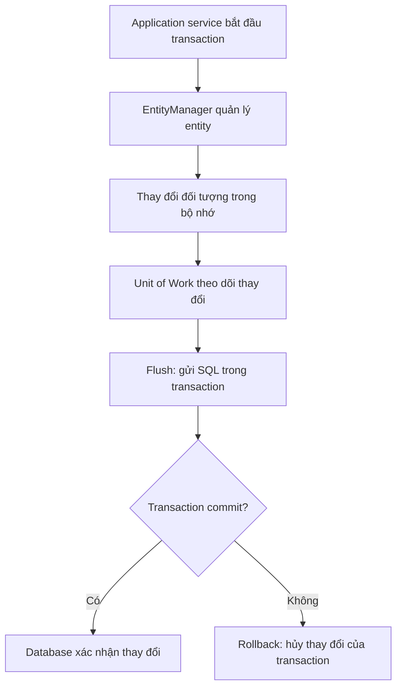
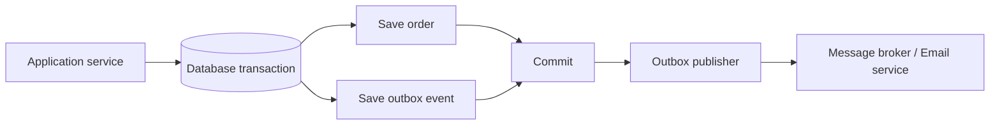

# Hiểu Unit of Work, thời điểm ghi, commit và rollback

Khi một ca sử dụng thay đổi dữ liệu, việc gọi `save()` hoặc sửa một đối tượng trong bộ nhớ chưa chắc có nghĩa dữ liệu đã được ghi bền vững vào cơ sở dữ liệu. ORM có thể theo dõi thay đổi trong một vùng làm việc, gom nhiều thao tác rồi gửi SQL tại một thời điểm thích hợp. Sau đó, giao dịch cơ sở dữ liệu mới commit để xác nhận các thay đổi. Nếu giao dịch rollback, các thay đổi đã gửi SQL trong giao dịch đó vẫn có thể bị hủy.

Bài học này thuộc module `SOFTWARE_DESIGN_ARCHITECTURE_ARCHITECTURAL_PATTERN_LAYERED`, tập trung vào tổ chức phần mềm theo kiến trúc phân tầng. Trong chương **Giao dịch và tính nhất quán**, ta tìm hiểu Unit of Work, thời điểm ghi dữ liệu, commit và rollback qua ví dụ Java với JPA và Spring. Nắm rõ vòng đời này giúp đặt ranh giới giao dịch đúng ở tầng ứng dụng và tránh báo thành công trước khi dữ liệu thực sự được xác nhận.

## Unit of Work là gì?

Unit of Work (đơn vị công việc) là mẫu thiết kế theo dõi những thay đổi cần thực hiện trong một phạm vi công việc, sau đó phối hợp ghi các thay đổi đó vào nơi lưu trữ. Thay vì mỗi lần một đối tượng thay đổi lại tự gửi ngay một câu SQL độc lập, một Unit of Work có thể ghi nhận:

- Đối tượng mới cần được thêm (new/insert).
- Đối tượng đang được quản lý đã thay đổi và cần cập nhật (dirty/update).
- Đối tượng cần xóa (removed/delete).

Khi công việc kết thúc, Unit of Work phối hợp các thao tác ghi. Nếu các thao tác thuộc cùng một giao dịch cơ sở dữ liệu, chúng có thể được commit cùng nhau hoặc rollback cùng nhau.

Trong JPA, `EntityManager` quản lý một persistence context. Persistence context thường đảm nhiệm vai trò Unit of Work: nó theo dõi các entity đang được quản lý, nhận biết thay đổi và đồng bộ chúng với cơ sở dữ liệu. Các chi tiết triển khai như cách phát hiện thay đổi có thể khác nhau giữa provider, nhưng ý tưởng chung là các thay đổi được quản lý trong một phạm vi trước khi flush.

Persistence context cũng thường duy trì identity map: trong cùng một context, việc tìm cùng một entity theo cùng khóa chính sẽ trả về cùng một instance được quản lý. Nhờ vậy, các thao tác trong cùng ca sử dụng có thể cùng làm việc trên một biểu diễn nhất quán của entity đó.

## Từ thay đổi trong bộ nhớ đến dữ liệu trong database

Hãy xét việc xác nhận một đơn hàng. Đơn hàng đang ở trạng thái `PENDING`; ca sử dụng kiểm tra điều kiện rồi chuyển nó sang `CONFIRMED`.

```java
@Service
class ConfirmOrderService {
    @PersistenceContext
    private EntityManager entityManager;

    @Transactional
    public void confirm(UUID orderId) {
        Order order = entityManager.find(Order.class, orderId);
        if (order == null) {
            throw new OrderNotFoundException(orderId);
        }

        order.confirm();
        // Entity đang được quản lý; JPA theo dõi thay đổi.
    }
}
```

Trong ví dụ, `find` tải entity vào persistence context. Khi `order.confirm()` thay đổi trạng thái, JPA có thể phát hiện sự thay đổi bằng cơ chế dirty checking. Không cần gọi `save()` chỉ để cập nhật một entity đang được quản lý trong một transaction JPA đang hoạt động. Khi giao dịch đồng bộ thay đổi, provider sẽ tạo câu SQL thích hợp.

Có thể hình dung vòng đời như sau:



Các bước trên là mô hình khái quát. Một số thao tác persist/remove có thể được xếp hàng; SQL có thể được gửi trước thời điểm kết thúc phương thức nếu provider cần flush sớm. Điều quan trọng là phân biệt trạng thái đang được quản lý trong bộ nhớ, SQL đã được gửi trong transaction và transaction đã commit.

## Flush không phải là commit

Flush là thao tác đồng bộ trạng thái mà persistence context đang quản lý với cơ sở dữ liệu bằng cách gửi các câu SQL cần thiết. Ví dụ:

```java
@Transactional
public void confirmAndCheck(UUID orderId) {
    Order order = entityManager.find(Order.class, orderId);
    order.confirm();

    entityManager.flush();

    // SQL cập nhật đã được gửi trong transaction hiện tại.
    // Transaction vẫn chưa commit tại dòng này.
}
```

Sau `flush()`, cơ sở dữ liệu đã nhận các câu SQL trong transaction hiện tại, nhưng các thay đổi chưa được xác nhận cuối cùng. Transaction vẫn có thể rollback. Các transaction khác thường chưa nhìn thấy những thay đổi chưa commit, tùy theo mức cô lập và cơ chế cơ sở dữ liệu.

JPA có thể flush ở một số thời điểm phổ biến:

- Khi ứng dụng gọi `EntityManager.flush()` một cách tường minh.
- Trước khi transaction commit.
- Trước một truy vấn trong chế độ flush `AUTO` nếu provider xác định các thay đổi đang chờ có thể ảnh hưởng đến kết quả truy vấn.

Với `FlushModeType.COMMIT`, provider có thể trì hoãn flush cho đến gần thời điểm commit; tuy nhiên ứng dụng không nên dựa vào một thứ tự SQL cụ thể trừ khi hợp đồng JPA hoặc cấu hình đang dùng bảo đảm điều đó. Việc flush tự động cũng có thể xảy ra ở thời điểm khác theo provider và thao tác.

Flush hữu ích khi cần phát hiện sớm lỗi SQL hoặc constraint trước khi tiếp tục một bước khác trong cùng transaction, hoặc khi cần bảo đảm các thay đổi đã được đồng bộ để truy vấn tiếp theo thấy chúng trong transaction hiện tại. Tuy vậy, gọi flush thường xuyên có thể làm giảm lợi ích gom thao tác và không thay thế việc thiết kế giao dịch đúng.

## Commit xác nhận giao dịch

Commit là thao tác kết thúc transaction theo hướng xác nhận các thay đổi. Khi commit thành công, cơ sở dữ liệu chấp nhận transaction và các thay đổi trở thành dữ liệu đã commit theo bảo đảm của hệ quản trị cơ sở dữ liệu.

Trong ứng dụng Spring, `@Transactional` thường đánh dấu ranh giới giao dịch ở một phương thức tầng ứng dụng. Khi phương thức được gọi qua Spring proxy, transaction interceptor bắt đầu hoặc tham gia transaction theo propagation đã cấu hình. Khi phương thức kết thúc bình thường, interceptor yêu cầu transaction manager commit nếu đây là ranh giới sở hữu transaction.

```java
@Service
class TransferMoneyService {
    private final AccountRepository accounts;

    TransferMoneyService(AccountRepository accounts) {
        this.accounts = accounts;
    }

    @Transactional
    public void transfer(UUID fromId, UUID toId, Money amount) {
        Account from = accounts.getById(fromId);
        Account to = accounts.getById(toId);

        from.withdraw(amount);
        to.deposit(amount);
    }
}
```

Hai thay đổi số dư thuộc cùng một transaction. Nếu commit thành công, cả hai thay đổi được xác nhận. Nếu một thao tác làm transaction rollback, cơ sở dữ liệu không giữ lại riêng phần rút tiền hoặc riêng phần cộng tiền. Điều này bảo vệ bất biến quan trọng của chuyển tiền: tiền không được biến mất hoặc tự sinh ra do chỉ một nửa thao tác thành công.

Phương thức trả về bình thường là điều kiện để Spring tiếp tục commit, nhưng commit vẫn có thể thất bại ở cuối phương thức do constraint, deadlock, lỗi kết nối hoặc xung đột optimistic locking. Vì vậy, lời gọi qua proxy chỉ được xem là hoàn tất khi interceptor kết thúc commit thành công. Không nên gửi thông báo “đã hoàn tất” trước khi ranh giới transaction trả về thành công.

Lưu ý: `@Transactional` của Spring dựa trên cơ chế proxy trong cấu hình phổ biến. Gọi một phương thức transactional khác bằng `this.someMethod()` trong cùng object (self-invocation) thường không đi qua proxy, nên annotation trên phương thức được gọi có thể không tạo ranh giới transaction riêng như mong đợi. Hãy đặt ranh giới ở phương thức public được gọi từ bean khác hoặc cấu hình cơ chế phù hợp.

## Rollback hủy các thay đổi của transaction

Rollback kết thúc transaction theo hướng hủy các thay đổi mà transaction đó chưa commit. Ví dụ, nếu chuyển tiền đã trừ tiền khỏi tài khoản nguồn nhưng thao tác cộng vào tài khoản đích thất bại, rollback giúp cơ sở dữ liệu trở về trạng thái trước transaction.

Với Spring, mặc định phổ biến là rollback khi phương thức transactional kết thúc bằng `RuntimeException` hoặc `Error`. Checked exception không tự động kích hoạt rollback theo mặc định; nếu muốn rollback khi một checked exception cụ thể được ném ra, có thể khai báo `rollbackFor`:

```java
@Transactional(rollbackFor = PaymentRejectedException.class)
public void pay(Invoice invoice) throws PaymentRejectedException {
    invoice.markPaid();
    paymentRepository.record(invoice);
    paymentGateway.capture(invoice); // Có thể ném checked exception.
}
```

Đây là ví dụ về cấu hình rollback, không phải khuyến nghị gọi dịch vụ thanh toán từ bên trong một transaction cơ sở dữ liệu dài. Gọi dịch vụ bên ngoài có thể kéo dài transaction và không thể được rollback tự động cùng database; phần sau sẽ giải thích giới hạn này.

Có thể tùy chỉnh quy tắc bằng `rollbackFor` hoặc `noRollbackFor`. Cần thống nhất quy ước trong dự án để người đọc hiểu khi nào lỗi sẽ làm transaction rollback. Đừng giả định mọi exception đều dẫn đến rollback.

### Bắt exception rồi tiếp tục có thể khiến transaction commit

Một lỗi thường gặp là bắt exception bên trong phương thức transactional rồi không ném lại:

```java
@Transactional
public void updateOrder(Order order) {
    try {
        order.updateAddress(...);
        orderRepository.save(order);
        auditRepository.save(...);
    } catch (RuntimeException ex) {
        log.warn("Không thể cập nhật đơn hàng", ex);
        // Không ném lại và không đánh dấu rollback-only.
    }
}
```

Nếu exception bị giữ lại và phương thức kết thúc bình thường, Spring có thể commit transaction. Một số lỗi persistence đã đánh dấu transaction rollback-only hoặc khiến transaction không thể commit, nhưng không nên dựa vào điều đó. Nếu lỗi có nghĩa toàn bộ ca sử dụng phải thất bại, hãy để exception truyền ra hoặc đánh dấu rollback-only theo cách có chủ đích.

Ngược lại, trả về một kết quả nghiệp vụ như `Rejected` cũng là kết thúc bình thường. Nếu ca sử dụng đã thay đổi dữ liệu trước khi tạo kết quả từ chối, transaction có thể commit những thay đổi đó. Hãy kiểm tra điều kiện từ chối trước khi ghi, hoặc dùng một chính sách rollback rõ ràng khi nghiệp vụ yêu cầu hủy toàn bộ thao tác.

Spring cung cấp `TransactionAspectSupport.currentTransactionStatus().setRollbackOnly()` để đánh dấu transaction hiện tại rollback-only trong một số trường hợp cần thiết. Đây là API phụ thuộc Spring; chỉ dùng khi hợp đồng ca sử dụng thực sự cần trả kết quả bình thường nhưng vẫn yêu cầu hủy transaction. Một lựa chọn khác là ném một exception có ngữ nghĩa rõ ràng và ánh xạ nó ở ranh giới giao diện.

## Ranh giới Unit of Work và transaction nên đặt ở đâu?

Ranh giới transaction thường phù hợp với một ca sử dụng cần nhiều thao tác dữ liệu thành công hoặc thất bại cùng nhau. Tầng ứng dụng là nơi hiểu toàn bộ trình tự công việc, vì vậy thường là vị trí hợp lý để đặt `@Transactional`.

Ví dụ, ca sử dụng tạo hóa đơn có thể tải đơn hàng, tính số tiền, tạo hóa đơn và lưu các dòng hóa đơn. Nếu các thay đổi này thuộc cùng một cơ sở dữ liệu và phải nhất quán cùng nhau, chúng thường nên nằm trong một transaction. Repository tập trung thao tác truy cập dữ liệu; nó không nên tự mở và commit một transaction độc lập cho mỗi lần lưu nếu điều đó phá vỡ tính nguyên tử của ca sử dụng.

Không nhất thiết mọi truy vấn đọc đều cần transaction ghi. Với luồng đọc đơn giản, có thể dùng transaction read-only hoặc không mở transaction tùy công nghệ và yêu cầu nhất quán. `readOnly = true` trong Spring chủ yếu là gợi ý cho transaction manager/provider; không phải một cơ chế bảo mật tuyệt đối ngăn mọi câu lệnh ghi trên tất cả cơ sở dữ liệu.

Transaction nên đủ ngắn để giảm thời gian giữ khóa và xung đột. Tránh giữ transaction mở trong lúc chờ người dùng nhập liệu, tải tệp lớn hoặc gọi một dịch vụ mạng chậm nếu không có thiết kế đặc biệt. Các thao tác dài hoặc trải qua nhiều dịch vụ có thể cần quy trình nhiều bước, saga hoặc cơ chế bù trừ thay vì một transaction cơ sở dữ liệu duy nhất.

## Commit và rollback không tự hoàn tác tác động bên ngoài

Rollback cơ sở dữ liệu chỉ hủy thay đổi thuộc transaction cơ sở dữ liệu đó. Nó không tự thu hồi email đã gửi, HTTP request đã gửi sang dịch vụ thanh toán, tin nhắn đã phát lên broker hoặc một tệp đã ghi ra hệ thống lưu trữ bên ngoài.

Ví dụ, nếu ứng dụng gửi email “Đơn hàng đã xác nhận” trước khi transaction commit, rồi database rollback, khách hàng vẫn nhận email dù đơn hàng chưa được lưu. Cách an toàn hơn là ghi một bản ghi sự kiện cần phát (outbox) trong cùng transaction với đơn hàng. Một tiến trình riêng đọc outbox sau khi commit và gửi sự kiện; nó cần xử lý gửi lặp bằng idempotency hoặc cơ chế đánh dấu đã xử lý.



Một cách khác là đăng ký callback chạy sau commit, chẳng hạn `@TransactionalEventListener(phase = AFTER_COMMIT)`, để chỉ phát sự kiện sau khi transaction thành công. Tuy nhiên, callback trong bộ nhớ không tự bảo đảm sự kiện được giao nếu tiến trình dừng ngay sau commit. Với yêu cầu không được mất sự kiện, transactional outbox thường cung cấp độ tin cậy tốt hơn vì dữ liệu sự kiện được lưu bền vững cùng transaction.

## Flush, commit và rollback trong các tình huống thực tế

| Tình huống | Trạng thái sau thao tác | Điều cần nhớ |
|---|---|---|
| Sửa entity đang managed, chưa flush | Thay đổi nằm trong persistence context | SQL có thể chưa được gửi |
| Gọi `flush()` thành công | SQL đã được gửi trong transaction | Chưa đồng nghĩa transaction đã commit |
| Commit thành công | Thay đổi được database xác nhận | Có thể thông báo thành công sau khi ranh giới transaction hoàn tất |
| Rollback sau flush | SQL đã gửi trong transaction bị hủy theo transaction | Không có nghĩa mọi tác động ngoài database cũng bị hủy |
| Flush hoặc commit gặp constraint violation | Transaction có thể thất bại hoặc bị đánh dấu rollback-only | Xử lý lỗi tại ranh giới transaction và không tiếp tục như thể dữ liệu đã lưu |

Sau rollback, không nên tiếp tục dùng persistence context như thể nó vẫn phản ánh trạng thái database. Với JPA, transaction thất bại có thể khiến persistence context không còn phù hợp để tiếp tục công việc; các entity trong bộ nhớ cũng không tự động được khôi phục về giá trị trước khi sửa. Thường nên kết thúc phạm vi persistence context, tải lại dữ liệu trong transaction mới và xử lý lại từ trạng thái đã commit.

## Kiểm thử vòng đời giao dịch

Nên kiểm thử cả kết quả nghiệp vụ lẫn trạng thái dữ liệu sau khi transaction kết thúc:

| Trường hợp | Điều cần xác minh |
|---|---|
| Ca sử dụng hoàn tất bình thường | Thay đổi được commit và đọc thấy trong transaction mới |
| Runtime exception phát sinh | Các thay đổi thuộc transaction bị rollback |
| Checked exception phát sinh với `rollbackFor` | Transaction rollback theo cấu hình đã khai báo |
| Checked exception không có quy tắc rollback | Xác minh đúng hành vi mặc định của cấu hình Spring đang dùng |
| Flush thành công rồi rollback | SQL không để lại dữ liệu đã commit |
| Constraint lỗi khi flush/commit | Ca sử dụng không báo thành công; lỗi được xử lý ở biên phù hợp |
| Bắt exception và trả về bình thường | Xác minh rõ transaction có commit hay đã bị đánh dấu rollback-only |
| Phát sự kiện sau commit | Sự kiện chỉ được phát sau khi commit thành công; outbox xử lý được gửi lặp |

Integration test với cơ sở dữ liệu phù hợp giúp kiểm tra constraint, transaction và hành vi flush thực tế. Test chạy trong một transaction do framework kiểm thử tự rollback khi kết thúc có thể che khuất hành vi commit thật; với các ca sử dụng cần xác minh commit, hãy kiểm tra dữ liệu từ transaction mới hoặc cấu hình test để transaction kết thúc theo đúng cách cần quan sát.

## Chọn mức kiểm soát vừa đủ

ORM và Unit of Work giúp giảm mã SQL thủ công, theo dõi thay đổi và gom thao tác ghi. Đổi lại, thời điểm SQL được phát ra có thể không trùng với dòng `save()` hoặc dòng sửa entity mà người đọc nhìn thấy. Khi hiểu rõ flush và commit, ta có thể dùng dirty checking đúng cách, gọi flush có chủ đích khi cần và xử lý lỗi transaction tại đúng ranh giới.

Không phải ứng dụng nào cũng cần một lớp Unit of Work tự viết. Với JPA, persistence context và transaction manager thường đã cung cấp cơ chế này. Chỉ tạo một abstraction riêng nếu nó làm rõ hợp đồng hoặc phục vụ nhiều công nghệ lưu trữ. Dù dùng ORM hay SQL trực tiếp, nguyên tắc vẫn là xác định rõ phạm vi công việc, biết khi nào dữ liệu mới được gửi, chỉ coi thao tác hoàn tất sau commit thành công, và không nhầm rollback database với việc hoàn tác các tác động bên ngoài.
