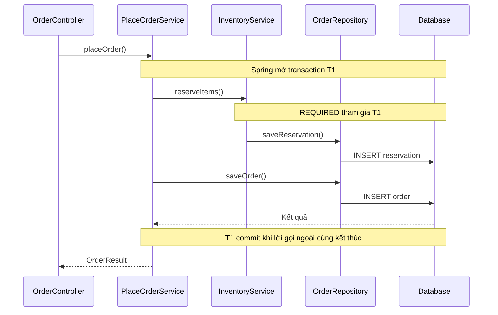
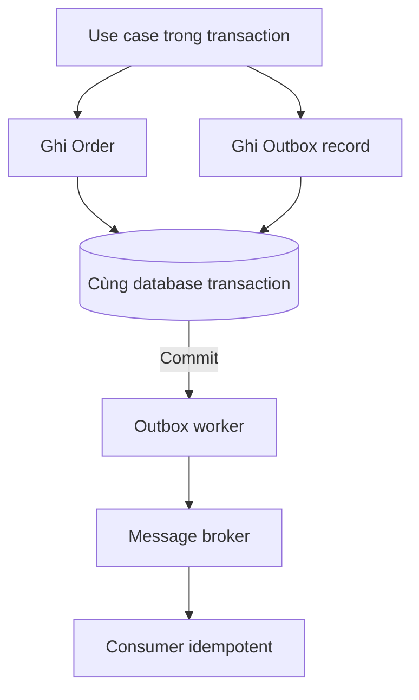

# Truyền ngữ cảnh giao dịch qua lời gọi nội bộ và ca sử dụng lồng nhau

Trong module **SOFTWARE_DESIGN_ARCHITECTURE_ARCHITECTURAL_PATTERN_LAYERED** (Học tổ chức phần mềm theo kiến trúc phân tầng), bài học này giải thích cách một giao dịch database được duy trì khi tầng ứng dụng gọi nhiều service nội bộ hoặc một ca sử dụng gọi tiếp ca sử dụng khác. Ta dùng quy trình đặt hàng để hiểu transaction context, propagation trong Spring, tác động của rollback và giới hạn khi lời gọi rời khỏi luồng thực thi hiện tại.

Một yêu cầu tạo đơn có thể cần lưu đơn hàng, ghi nhận dòng hàng, cập nhật lượng tồn được giữ và tạo bản ghi outbox. Nếu các thay đổi này cùng tạo nên một đơn vị nhất quán trong một database, chúng thường cần cùng commit hoặc cùng rollback. Khi application service gọi repository hoặc một service khác, ứng dụng cần biết lời gọi đó tham gia giao dịch đang có hay bắt đầu một giao dịch mới.

## 1. Ngữ cảnh giao dịch là gì?

Transaction là một đơn vị thực thi có ranh giới bắt đầu và kết thúc. Với database quan hệ, transaction thường bảo đảm các thay đổi trong đơn vị đó được commit cùng nhau hoặc rollback theo quy tắc của hệ quản trị cơ sở dữ liệu.

**Ngữ cảnh giao dịch (transaction context)** là trạng thái thực thi mà framework và transaction manager duy trì để các thao tác database liên quan có thể tham gia cùng một transaction. Trong Spring imperative, ngữ cảnh này thường được gắn với thread đang thực thi và các resource như JDBC connection hoặc EntityManager được transaction manager quản lý.

Trong mã ứng dụng thông thường, ta không truyền đối tượng transaction qua từng phương thức:

```java
public void placeOrder(PlaceOrderCommand command) {
    // Không cần nhận Connection hay Transaction làm tham số.
}
```

Thay vào đó, Spring quản lý ranh giới qua `@Transactional` hoặc TransactionTemplate. Khi một phương thức có `@Transactional` được gọi qua Spring proxy, transaction manager sẽ kiểm tra có transaction phù hợp đang tồn tại hay không, rồi áp dụng chính sách propagation.

Một transaction có thể đi qua nhiều lời gọi nội bộ:



Trong ví dụ, `PlaceOrderService` mở transaction T1. `InventoryService` được gọi trong cùng luồng và dùng propagation mặc định `REQUIRED`, nên nó tham gia T1. Việc phương thức `reserveItems()` kết thúc không làm transaction commit ngay; transaction ngoài cùng mới quyết định kết quả cuối.

## 2. Chọn ranh giới giao dịch theo đơn vị nhất quán

Hãy xác định dữ liệu nào phải nhất quán với nhau khi một use case thành công. Ví dụ, nếu tạo đơn yêu cầu lưu đơn hàng và các dòng hàng trong cùng database, ta thường muốn:

- Lưu đơn thành công thì các dòng hàng tương ứng cũng được lưu.
- Nếu lưu một dòng hàng thất bại, đơn mới tạo không được để lại một phần dữ liệu không hợp lệ.
- Nếu cập nhật một bản ghi tồn kho trong cùng database là phần bắt buộc của thao tác, thay đổi đó cần cùng ranh giới giao dịch hoặc được bảo vệ bằng một cơ chế nhất quán khác.

Một ranh giới phù hợp thường đặt ở application service đại diện cho use case, vì nơi đó biết mục tiêu nghiệp vụ và các thao tác cần phối hợp.

```java
@Service
@RequiredArgsConstructor
public class PlaceOrderService {
    private final OrderRepository orderRepository;
    private final InventoryService inventoryService;
    private final OutboxRepository outboxRepository;

    @Transactional
    public OrderResult handle(PlaceOrderCommand command) {
        var reservation = inventoryService.reserveItems(command.items());

        var order = Order.place(command.customerId(), command.items());
        var saved = orderRepository.save(order);

        outboxRepository.append(new OrderPlaced(saved.id()));

        return new OrderResult(saved.id(), reservation.reference());
    }
}
```

Ví dụ minh họa việc phối hợp các thành phần trong một transaction. Nó giả định các repository dùng cùng transaction manager và cùng database resource phù hợp. Nếu `InventoryService` gọi một hệ thống tồn kho từ xa qua HTTP, transaction database của đơn hàng không thể tự rollback tác động đã xảy ra ở hệ thống kia. Trường hợp đó cần thiết kế workflow, giữ chỗ, retry hoặc hành động bù trừ.

Không phải mọi phương thức repository đều cần khai báo một transaction mới. Nhiều thao tác repository sẽ tham gia transaction đang có. Việc tạo transaction ở từng tầng mà không hiểu propagation có thể khiến ranh giới dữ liệu khó dự đoán.

## 3. Propagation quyết định lời gọi lồng nhau tham gia transaction ra sao

Propagation là chính sách quy định cách một phương thức transactional xử lý khi được gọi trong hoặc ngoài một transaction đang tồn tại.

Spring cung cấp các chế độ propagation sau:

| Chế độ | Khi đã có transaction | Khi chưa có transaction |
|---|---|---|
| `REQUIRED` | Tham gia transaction hiện tại | Bắt đầu transaction mới |
| `REQUIRES_NEW` | Tạm treo transaction hiện tại, bắt đầu transaction mới | Bắt đầu transaction mới |
| `SUPPORTS` | Tham gia transaction hiện tại | Chạy không có transaction |
| `NOT_SUPPORTED` | Tạm treo transaction hiện tại, chạy không có transaction | Chạy không có transaction |
| `MANDATORY` | Tham gia transaction hiện tại | Ném lỗi vì không có transaction |
| `NEVER` | Ném lỗi vì đang có transaction | Chạy không có transaction |
| `NESTED` | Tạo điểm lưu (savepoint) trong transaction hiện tại nếu được hỗ trợ | Bắt đầu transaction mới |

### REQUIRED: lựa chọn mặc định cho phần lớn lời gọi nội bộ

`REQUIRED` là propagation mặc định của `@Transactional`. Nếu đã có transaction, lời gọi tham gia transaction đó. Nếu chưa có, Spring bắt đầu transaction mới.

```java
@Service
public class InventoryService {
    @Transactional(propagation = Propagation.REQUIRED)
    public Reservation reserveItems(List<OrderItem> items) {
        // Đọc và cập nhật dữ liệu tồn kho trong transaction hiện tại.
        return reservationRepository.reserve(items);
    }
}
```

Khi `PlaceOrderService.handle()` gọi `reserveItems()` qua Spring proxy, cả hai phương thức tham gia cùng transaction nếu dùng transaction manager phù hợp. Nếu `handle()` rollback, thay đổi tồn kho trong transaction đó cũng rollback.

Đây thường là lựa chọn phù hợp khi lời gọi nội bộ là một phần của cùng một đơn vị nghiệp vụ. Có thể bỏ thuộc tính `propagation` vì `REQUIRED` là mặc định.

### REQUIRES_NEW: transaction độc lập với transaction bên ngoài

`REQUIRES_NEW` luôn yêu cầu một transaction độc lập. Nếu transaction ngoài đang chạy, Spring tạm treo nó, mở transaction mới cho phương thức được gọi, rồi tiếp tục transaction ngoài sau khi transaction trong kết thúc.

```java
@Service
public class AuditLogService {
    private final AuditRepository auditRepository;

    public AuditLogService(AuditRepository auditRepository) {
        this.auditRepository = auditRepository;
    }

    @Transactional(propagation = Propagation.REQUIRES_NEW)
    public void recordAttempt(UUID orderId, String action) {
        auditRepository.save(new AuditEntry(orderId, action));
    }
}
```

Giả sử `PlaceOrderService` gọi `recordAttempt()`, audit có thể commit ngay cả khi transaction tạo đơn sau đó rollback. Đây là tính chất quan trọng: transaction REQUIRES_NEW độc lập, vì vậy dữ liệu đã commit trong transaction trong không bị rollback theo transaction ngoài.

Dùng chế độ này khi thật sự muốn một thao tác độc lập, chẳng hạn lưu dấu kiểm toán cần tồn tại dù nghiệp vụ chính thất bại. Không dùng nó chỉ để "làm cho service chạy được". Nếu audit phải commit cùng thay đổi đơn để phản ánh chính xác trạng thái đã lưu, `REQUIRED` có thể phù hợp hơn.

Transaction mới thường cần một connection khác trong khi transaction ngoài vẫn đang giữ connection. Nếu nhiều luồng cùng giữ transaction ngoài rồi mở REQUIRES_NEW, pool connection có thể thiếu tài nguyên hoặc gây chờ đợi. Cần cân nhắc giới hạn connection pool và thời gian giữ transaction.

### NESTED: điểm lưu bên trong transaction

`NESTED` cố gắng tạo một savepoint trong transaction hiện tại. Nếu phần nested rollback về savepoint, transaction ngoài có thể tiếp tục, tùy transaction manager và cách dùng resource.

Ví dụ khái niệm:

Trong ví dụ, `InvalidRowException` là unchecked exception để interceptor rollback phần nested khi exception thoát khỏi phương thức được gọi qua proxy.

```java
@Service
public class BatchImportService {
    private final RowImportService rowImportService;

    public BatchImportService(RowImportService rowImportService) {
        this.rowImportService = rowImportService;
    }

    @Transactional
    public void importBatch(List<Row> rows) {
        for (Row row : rows) {
            try {
                rowImportService.importOneRow(row);
            } catch (InvalidRowException ex) {
                // Ghi nhận dòng lỗi và tiếp tục batch.
            }
        }
    }
}

@Service
public class RowImportService {
    @Transactional(propagation = Propagation.NESTED)
    public void importOneRow(Row row) {
        // Thao tác của một dòng; có thể rollback về savepoint.
    }
}
```

Cần lưu ý `NESTED` không phải là một transaction độc lập như `REQUIRES_NEW`. Ví dụ trên gọi `RowImportService` qua bean Spring riêng để lời gọi đi qua proxy; nếu gọi `importOneRow()` bằng self-invocation trong cùng class thì propagation có thể không được áp dụng. Savepoint chỉ có ý nghĩa trong cùng transaction vật lý. Hỗ trợ phụ thuộc transaction manager và database. Với `JpaTransactionManager`, hỗ trợ nested savepoint có giới hạn: savepoint tác động đến JDBC connection, còn trạng thái entity đang được quản lý trong persistence context không tự động được khôi phục tương ứng. Vì vậy không nên giả định rollback nested sẽ hoàn nguyên mọi thay đổi trong object graph JPA. Hãy xác minh provider, transaction manager và cách ứng dụng quản lý entity trước khi dùng.

### Các chế độ còn lại

- `MANDATORY` hữu ích khi một thao tác chỉ có ý nghĩa bên trong transaction do use case ngoài mở. Nếu ai gọi trực tiếp khi chưa có transaction, Spring báo lỗi ngay.
- `SUPPORTS` cho phép cùng một phương thức chạy trong transaction nếu có, hoặc chạy không transaction nếu không có. Nó không bảo đảm rằng thao tác database luôn được bảo vệ.
- `NOT_SUPPORTED` tạm treo transaction hiện tại để chạy không transaction. Có thể phù hợp với công việc không nên giữ transaction mở, nhưng cần hiểu rằng các thao tác ghi bên trong không còn cùng đơn vị rollback.
- `NEVER` dùng để khẳng định một phương thức không được gọi trong transaction. Nếu có transaction, Spring báo lỗi.

Chọn propagation theo ý nghĩa nhất quán của use case, không chọn theo thói quen hoặc chỉ để xử lý một exception trước mắt.

## 4. Điều gì xảy ra khi một use case gọi use case khác?

Trong ứng dụng phân tầng, một use case đôi khi cần sử dụng một khả năng đã có. Ví dụ, `PlaceOrderService` cần giữ chỗ tồn kho; `ScheduleShipmentService` cần kiểm tra và lấy thông tin đơn hàng; hoặc một quy trình quản trị gọi nhiều thao tác nghiệp vụ.

Nếu hai use case cùng thuộc một đơn vị nhất quán, use case ngoài có thể gọi service bên trong với `REQUIRED`. Transaction ngoài bao trùm cả hai:

```java
@Service
@RequiredArgsConstructor
public class CheckoutService {
    private final ReserveInventoryService reserveInventory;
    private final CreateOrderService createOrder;

    @Transactional
    public CheckoutResult checkout(CheckoutCommand command) {
        var reservation = reserveInventory.handle(command.items());
        var order = createOrder.handle(command.toOrderCommand());

        return new CheckoutResult(order.id(), reservation.id());
    }
}
```

```java
@Service
@RequiredArgsConstructor
public class ReserveInventoryService {
    private final InventoryRepository inventoryRepository;

    @Transactional(propagation = Propagation.REQUIRED)
    public ReservationResult handle(List<OrderItem> items) {
        // Kiểm tra và cập nhật tồn kho trong transaction hiện tại.
        return inventoryRepository.reserve(items);
    }
}
```

Trong tình huống này, `ReserveInventoryService` không tự commit riêng. Nếu `CreateOrderService` thất bại và exception làm transaction rollback, phần giữ chỗ trong cùng database cũng rollback.

Tuy nhiên, không phải cứ có hai use case là nên lồng nhau. Nếu use case trong được thiết kế như một thao tác độc lập có thể được gọi từ nhiều luồng, hãy xác định rõ nó có nên tự sở hữu transaction hay chỉ tham gia transaction của caller. Một cách tổ chức khác là đưa logic dùng chung vào application/domain service chuyên trách, rồi để các use case cùng gọi thành phần đó. Mục tiêu là tránh tạo chuỗi use case khó hiểu và giữ ranh giới giao dịch rõ ràng.

## 5. Transactional proxy và lỗi self-invocation

Trong chế độ proxy mặc định của Spring, `@Transactional` được áp dụng khi lời gọi đi qua proxy do Spring tạo. Nếu một phương thức trong cùng object gọi trực tiếp phương thức khác bằng `this`, lời gọi đó không đi qua proxy và annotation trên phương thức được gọi có thể không được áp dụng như mong đợi.

Ví dụ dễ gây hiểu nhầm:

```java
@Service
public class OrderService {

    @Transactional
    public void checkout() {
        saveAudit(); // lời gọi nội bộ, không qua proxy
    }

    @Transactional(propagation = Propagation.REQUIRES_NEW)
    public void saveAudit() {
        // Không chắc có transaction mới như mong muốn.
    }
}
```

Nếu `checkout()` gọi `saveAudit()` trực tiếp trên cùng instance, Spring proxy không chặn được lời gọi nội bộ đó. `REQUIRES_NEW` trên `saveAudit()` vì vậy không được kích hoạt theo cách mong đợi.

Cách tổ chức dễ hiểu hơn là tách thao tác cần propagation riêng sang một bean khác:

```java
@Service
@RequiredArgsConstructor
public class OrderService {
    private final AuditLogService auditLogService;

    public void checkout(UUID orderId) {
        auditLogService.recordAttempt(orderId, "CHECKOUT");
    }
}
```

```java
@Service
public class AuditLogService {
    @Transactional(propagation = Propagation.REQUIRES_NEW)
    public void recordAttempt(UUID orderId, String action) {
        // Lời gọi đi qua proxy của AuditLogService.
    }
}
```

Một giải pháp khác là dùng TransactionTemplate khi cần điều khiển ranh giới bằng mã lệnh. Không nên dựa vào việc tự inject chính bean vào nó hoặc truy cập proxy hiện tại nếu chưa có lý do rõ ràng; cách đó làm luồng gọi khó hiểu và dễ tạo phụ thuộc vòng.

Ngoài self-invocation, cần lưu ý method và class phải phù hợp cơ chế proxy đang dùng. Trong mô hình proxy-based thông thường, nên đặt `@Transactional` trên phương thức public của bean Spring được gọi từ bean khác và tránh giả định annotation trên private method sẽ hoạt động như một ranh giới giao dịch độc lập.

## 6. Rollback được quyết định như thế nào?

Mặc định, Spring rollback transaction khi phương thức transactional kết thúc bằng unchecked exception (thường là `RuntimeException`) hoặc `Error`. Checked exception không tự động kích hoạt rollback theo mặc định.

Ví dụ:

```java
@Transactional
public void placeOrder(PlaceOrderCommand command)
        throws InventoryUnavailableException {
    // ...
}
```

Nếu `InventoryUnavailableException` là checked exception, transaction có thể không rollback mặc định. Có thể khai báo rõ:

```java
@Transactional(rollbackFor = InventoryUnavailableException.class)
public void placeOrder(PlaceOrderCommand command)
        throws InventoryUnavailableException {
    // ...
}
```

Hoặc dùng `noRollbackFor` khi có loại exception mà ứng dụng chủ đích muốn không rollback. Cần thiết kế exception theo ý nghĩa nghiệp vụ và xác định rõ điều gì phải rollback; không nên chỉ đổi mọi exception thành RuntimeException để né cấu hình.

### Exception bị bắt ở đâu?

Một tình huống dễ gây bất ngờ xảy ra khi lời gọi transactional lồng nhau ném runtime exception, interceptor đánh dấu transaction chung là rollback-only, rồi phương thức ngoài bắt exception và tiếp tục:

```java
@Transactional
public void outerOperation() {
    try {
        innerService.perform();
    } catch (BusinessFailure ex) {
        // Tiếp tục xử lý
    }

    // Có thể vẫn không commit được.
}
```

Nếu `innerService.perform()` tham gia cùng transaction bằng `REQUIRED` và exception đi qua interceptor của lời gọi đó, Spring có thể đánh dấu transaction là rollback-only. Việc bắt exception ở bên ngoài không tự xóa cờ này. Khi phương thức ngoài kết thúc và cố commit, ứng dụng có thể nhận `UnexpectedRollbackException`.

Nếu cần bắt một lỗi và tiếp tục trong cùng transaction, phải xác định liệu thao tác trước lỗi có thể được giữ lại một cách hợp lệ không. Nếu một phần cần rollback độc lập, có thể cân nhắc savepoint với `NESTED` khi được hỗ trợ, hoặc transaction độc lập với `REQUIRES_NEW` nếu nghiệp vụ cho phép commit riêng. Không nên nuốt exception rồi giả định transaction chắc chắn commit.

## 7. Cấu hình của transaction tham gia vào transaction đã có

Một phương thức dùng `REQUIRED` tham gia transaction hiện có thay vì tạo transaction vật lý mới. Do đó, các thuộc tính như isolation, timeout hoặc read-only khai báo ở phương thức trong thường không thay đổi cấu hình transaction vật lý đã được mở ở phương thức ngoài.

Ví dụ, nếu use case ngoài mở transaction với isolation mặc định, một service bên trong khai báo isolation khác nhưng dùng `REQUIRED` thường vẫn tham gia transaction ngoài. Muốn một transaction riêng với cấu hình riêng, cần một propagation mở transaction mới như `REQUIRES_NEW`, đồng thời hiểu tác động độc lập của nó.

Một số thuộc tính cần phân biệt:

- **Isolation:** điều khiển mức cô lập giữa các transaction và hiện tượng đọc/ghi đồng thời. Nó không quyết định lời gọi có tham gia transaction ngoài hay không.
- **Timeout:** giới hạn thời gian transaction theo khả năng transaction manager; không phải mọi driver hoặc thao tác đều dừng tức thì khi quá thời gian.
- **readOnly:** gợi ý cho transaction manager/provider tối ưu thao tác đọc. Nó không phải cơ chế phân quyền và không nên được xem là bảo đảm tuyệt đối rằng mọi lệnh ghi đều bị chặn.
- **rollbackFor / noRollbackFor:** xác định exception nào kích hoạt hoặc không kích hoạt rollback theo chính sách Spring.
- **Propagation:** quyết định quan hệ giữa transaction của lời gọi hiện tại và transaction đã có.

Khi có nhiều transaction manager, cần chỉ rõ manager phù hợp, ví dụ `@Transactional("ordersTransactionManager")`. Hai service dùng hai transaction manager khác nhau không mặc nhiên chia sẻ cùng một transaction. Nếu cần tính nguyên tử trên nhiều database hoặc hệ thống độc lập, phải dùng giải pháp hỗ trợ distributed transaction phù hợp hoặc thiết kế saga/outbox; propagation không tự biến nhiều resource thành một transaction ACID chung.

## 8. Ngữ cảnh giao dịch không tự đi qua mọi ranh giới thực thi

Trong Spring imperative, transaction context thường gắn với thread. Vì vậy, lời gọi đồng bộ trên cùng thread có thể tham gia transaction hiện tại nếu dùng transaction manager và resource phù hợp.

Khi công việc chuyển sang thread khác, transaction hiện tại không tự động được truyền sang. Các tình huống cần chú ý:

- Gọi phương thức được đánh dấu `@Async`.
- Tạo `CompletableFuture` chạy trên executor.
- Dùng parallel stream hoặc tự tạo thread.
- Gửi message sang broker để worker khác xử lý.
- Đưa công việc vào scheduler hoặc background job.

Ví dụ, một tác vụ `@Async` thường chạy trên thread khác. Nếu nó gọi service transactional, service đó có thể mở transaction mới theo cấu hình của chính nó; nó không tự tham gia transaction đang chạy ở thread gọi.

Không nên sao chép ThreadLocal transaction resource sang thread khác bằng cách thủ công. Connection và EntityManager không được thiết kế để dùng đồng thời tùy tiện giữa các thread. Nếu công việc phải chạy sau khi transaction ngoài commit, có thể phát event sau commit hoặc ghi outbox để worker xử lý độc lập.

Với Spring reactive, ngữ cảnh giao dịch được quản lý theo Reactor Context thay vì dựa vào ThreadLocal như mô hình imperative. Các thao tác phải nằm trong cùng reactive pipeline và dùng reactive transaction manager phù hợp. Không nên trộn cách truyền ngữ cảnh của imperative và reactive một cách tùy tiện.

## 9. Phối hợp tác động ngoài database: after-commit và outbox

Một transaction database không thể tự rollback email đã gửi, HTTP request đã gửi hoặc message đã được broker nhận. Nếu gửi thông báo trước khi database commit, thông báo có thể nói rằng đơn đã tạo dù transaction sau đó rollback.

Có hai hướng thường gặp:

**Chạy tác động sau commit.** Spring hỗ trợ `@TransactionalEventListener(phase = TransactionPhase.AFTER_COMMIT)` để xử lý event sau khi transaction commit thành công:

```java
@Component
public class OrderNotificationListener {

    @TransactionalEventListener(phase = TransactionPhase.AFTER_COMMIT)
    public void onOrderPlaced(OrderPlaced event) {
        // Gửi thông báo sau khi transaction tạo đơn đã commit.
    }
}
```

Cách này giúp tránh gửi thông báo trước khi dữ liệu commit. Tuy nhiên, listener trong cùng tiến trình không tự bảo đảm event được lưu bền vững nếu ứng dụng dừng đột ngột sau commit nhưng trước khi listener hoàn thành.

**Dùng transactional outbox.** Ghi thay đổi nghiệp vụ và một bản ghi outbox trong cùng transaction database. Một worker đọc outbox và gửi message ra broker, sau đó đánh dấu đã xử lý. Nếu worker lỗi, có thể retry. Consumer vẫn nên idempotent vì message có thể được gửi nhiều lần.



Outbox giải quyết vấn đề ghi database và ghi ý định phát message trong cùng transaction cục bộ. Nó không tạo giao dịch nguyên tử xuyên suốt database và broker; việc phát message có thể lặp, vì vậy consumer cần xử lý an toàn khi nhận bản lặp.

## 10. Kiểm thử propagation và ranh giới giao dịch

Không chỉ kiểm thử kết quả nghiệp vụ, cần kiểm tra transaction thực sự tham gia theo dự kiến.

| Trường hợp | Kết quả cần xác minh |
|---|---|
| Outer và inner cùng dùng REQUIRED | Cùng đơn vị commit/rollback |
| Outer rollback sau inner REQUIRED | Thay đổi inner trong cùng transaction cũng rollback |
| Inner dùng REQUIRES_NEW | Transaction inner có thể commit dù outer rollback |
| Inner dùng MANDATORY nhưng không có outer transaction | Lời gọi thất bại |
| Inner dùng NOT_SUPPORTED | Transaction ngoài bị treo trong thời gian inner chạy |
| Inner dùng NESTED | Rollback về savepoint nếu manager và resource hỗ trợ |
| Gọi qua self-invocation | Annotation trên phương thức được gọi không được áp dụng qua proxy như mong đợi |
| Chạy async | Không mặc định thừa hưởng transaction của thread gọi |

Một integration test có thể kiểm tra tình huống REQUIRED:

```java
@Test
void requiredWorkRollsBackWithOuterTransaction() {
    assertThrows(RuntimeException.class, () ->
        placeOrderService.createThenFail(command)
    );

    assertFalse(orderRepository.existsById(expectedOrderId));
    assertFalse(reservationRepository.existsFor(expectedOrderId));
}
```

Và một test khác có thể xác minh REQUIRES_NEW giữ bản ghi độc lập sau khi outer rollback:

```java
@Test
void requiresNewAuditSurvivesOuterRollback() {
    assertThrows(RuntimeException.class, () ->
        orderService.createAndFailAfterAudit(command)
    );

    assertFalse(orderRepository.existsById(expectedOrderId));
    assertTrue(auditRepository.existsFor(expectedOrderId));
}
```

Các ví dụ giả định test gọi bean Spring qua proxy và database test thật sự thực thi transaction. Cần tránh để test method tự mở một transaction ngoài không chủ đích, vì test transaction có thể làm kết quả quan sát khác với luồng production. Với `NESTED`, cần integration test trên đúng transaction manager/database đang dùng; unit test không chứng minh savepoint và persistence context hoạt động đúng.

Có thể dùng `TransactionSynchronizationManager.isActualTransactionActive()` trong kiểm thử hoặc log chẩn đoán để quan sát transaction đang hoạt động. Đây là công cụ kiểm tra, không nên dùng làm nhánh logic nghiệp vụ thông thường.

## 11. Những lỗi thường gặp

**Mỗi service đều tự mở transaction mới.** Nếu mọi lời gọi dùng `REQUIRES_NEW`, một use case có thể bị chia thành nhiều phần commit riêng; outer rollback không hoàn tác phần inner đã commit. Hãy dùng `REQUIRED` cho các bước thuộc cùng đơn vị nhất quán.

**Nghĩ rằng phương thức inner kết thúc là transaction đã commit.** Với `REQUIRED`, inner chỉ kết thúc phần thực thi của nó. Transaction có thể chỉ commit khi phương thức transactional ngoài cùng kết thúc.

**Đặt @Transactional ở private method hoặc gọi qua this.** Trong proxy mode, lời gọi không qua proxy không kích hoạt interceptor như mong muốn. Hãy đặt ranh giới trên bean được gọi từ bên ngoài hoặc dùng TransactionTemplate.

**Bắt exception rồi giả định transaction vẫn commit.** Inner REQUIRED có thể đã đánh dấu rollback-only. Cần hiểu exception đi qua interceptor ở đâu và quyết định rollback có thể được thay đổi không.

**Dùng NESTED như REQUIRES_NEW.** Savepoint không phải transaction độc lập. Rollback savepoint không tự khôi phục mọi trạng thái object trong persistence context JPA.

**Nghĩ transaction tự truyền sang @Async hoặc thread mới.** Transaction imperative thường gắn với thread; công việc mới cần ranh giới transaction riêng hoặc cơ chế phối hợp sau commit.

**Dùng transaction database để bao phủ dịch vụ từ xa.** HTTP call, email và broker không tự rollback cùng database. Hãy dùng outbox, saga hoặc cơ chế bù trừ khi cần.

**Nhầm propagation với isolation.** Propagation quyết định tham gia hay tạo transaction; isolation điều khiển mức cô lập giữa các transaction.

## 12. Cách chọn propagation cho một lời gọi nội bộ

Khi thêm một service hoặc use case lồng nhau, hãy lần lượt trả lời:

1. Thao tác này có thuộc cùng một đơn vị nghiệp vụ và phải rollback cùng caller không? Nếu có, thường chọn `REQUIRED`.
2. Thao tác có cần commit độc lập dù caller thất bại không? Nếu có lý do nghiệp vụ rõ ràng, cân nhắc `REQUIRES_NEW`.
3. Chỉ cần rollback một phần về savepoint trong transaction hiện tại không? Chỉ cân nhắc `NESTED` sau khi xác minh hỗ trợ và giới hạn persistence context.
4. Phương thức có bắt buộc caller phải mở transaction trước không? Cân nhắc `MANDATORY`.
5. Công việc có cần chạy ngoài transaction hiện tại không? Xem xét `NOT_SUPPORTED` và tác động của các thao tác ghi.
6. Lời gọi có đi qua Spring proxy không, hay đang là self-invocation?
7. Các thành phần có dùng cùng transaction manager và resource không?
8. Công việc có chuyển sang thread, message consumer hoặc reactive pipeline khác không?
9. Nếu exception xảy ra và bị bắt, transaction có bị đánh dấu rollback-only không?
10. Các tác động bên ngoài database có cần after-commit, outbox, retry hoặc bù trừ không?

Ngữ cảnh giao dịch giúp nhiều lời gọi nội bộ phối hợp trên một đơn vị dữ liệu nhất quán. Khi chọn đúng propagation và đặt ranh giới ở application use case, nhóm phát triển có thể dự đoán thay đổi nào sẽ commit cùng nhau, phần nào độc lập, và điều gì xảy ra khi lỗi xuất hiện giữa một quy trình nhiều bước.

