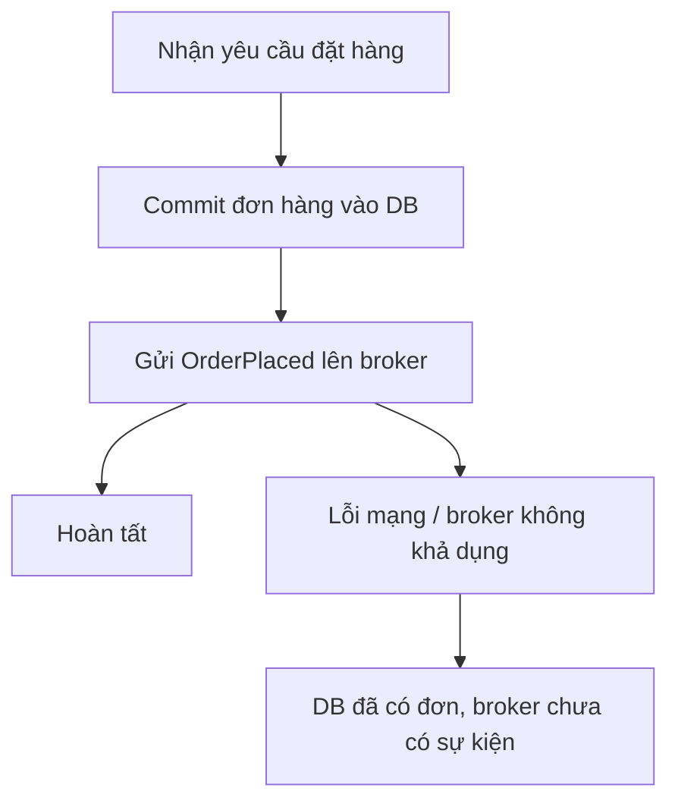
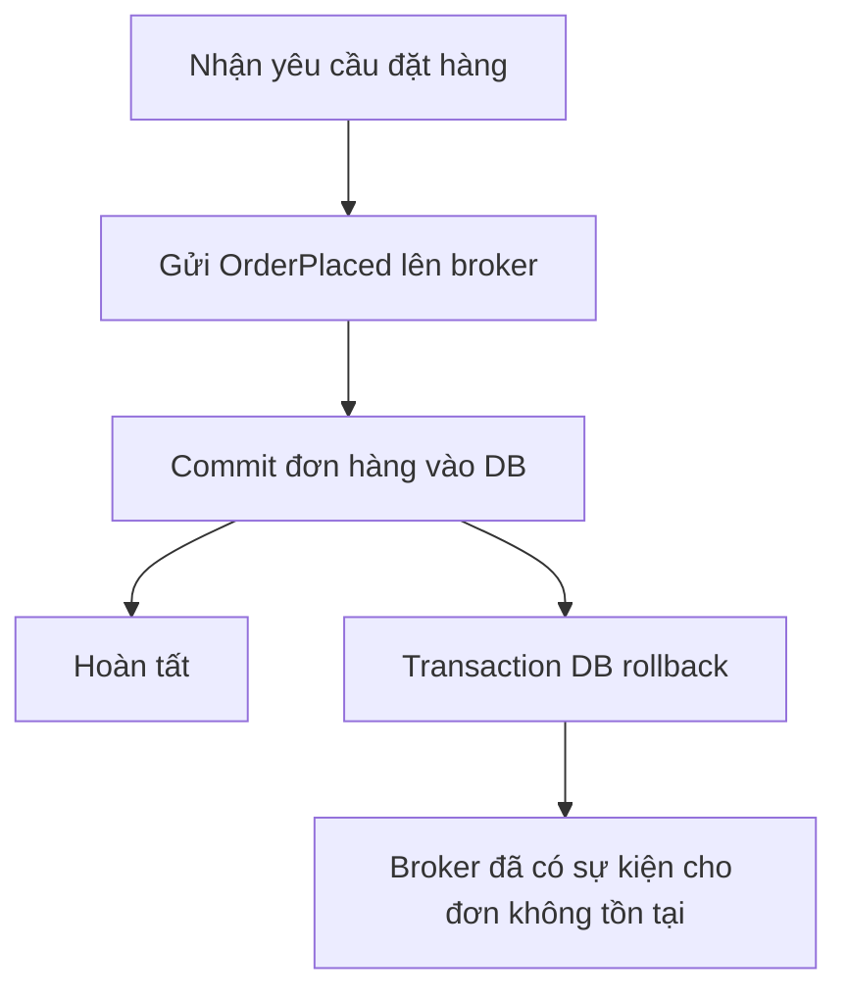
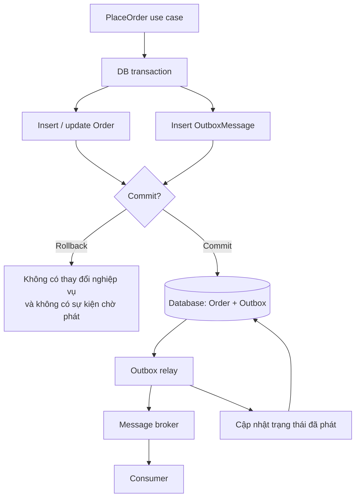

# Phối hợp commit dữ liệu với phát thông điệp bằng transactional outbox

Một ca sử dụng thường vừa thay đổi dữ liệu trong cơ sở dữ liệu vừa cần thông báo cho hệ thống khác: tạo đơn hàng rồi phát `OrderPlaced`, cập nhật hồ sơ rồi phát `CustomerUpdated`, hoặc ghi nhận thanh toán rồi gửi sự kiện cho dịch vụ kế toán. Hai hành động này nằm ở hai hệ thống có cơ chế commit riêng. Nếu ứng dụng ghi database thành công nhưng gửi thông điệp thất bại, dữ liệu đã đổi mà hệ thống nhận không biết. Nếu gửi thông điệp thành công nhưng transaction database rollback, hệ thống khác lại xử lý một sự kiện không có thay đổi tương ứng.

**Transactional outbox** giải quyết khoảng trống này bằng cách ghi thay đổi nghiệp vụ và một bản ghi mô tả thông điệp cần phát vào cùng một transaction database. Một tiến trình chuyển tiếp riêng đọc các bản ghi outbox đã commit và gửi chúng đến message broker. Nhờ đó, ý định phát thông điệp được lưu bền vững cùng với dữ liệu nghiệp vụ.

Trong module `SOFTWARE_DESIGN_ARCHITECTURE_ARCHITECTURAL_PATTERN_LAYERED` — học tổ chức phần mềm theo kiến trúc phân tầng — bài học này tập trung vào ranh giới transaction, cách tổ chức outbox và relay, xử lý gửi lặp, tính thứ tự, consumer idempotent và các đánh đổi vận hành. Outbox là một mẫu phối hợp giữa database và hệ thống thông điệp; nó không biến hai hệ thống thành một transaction phân tán duy nhất.

## 1. Vấn đề dual write

Giả sử một API đặt hàng cần thực hiện hai thao tác:

1. Lưu đơn hàng với trạng thái `PLACED` vào database.
2. Gửi sự kiện `OrderPlaced` lên broker để kho, thanh toán hoặc thông báo tiếp tục xử lý.

Nếu code ghi database rồi gửi broker tuần tự, có hai cửa sổ lỗi:



Đảo thứ tự cũng không giải quyết được:



Đây là bài toán **dual write**: ứng dụng phải ghi vào hai hệ thống độc lập nhưng không có một transaction nguyên tử chung. Retry một cách đơn giản cũng có thể tạo ra thông điệp trùng hoặc không khôi phục được trạng thái nếu tiến trình dừng giữa hai thao tác.

## 2. Nguyên lý transactional outbox

Outbox thêm một bảng trong cùng database với dữ liệu nghiệp vụ. Trong một transaction cục bộ, ứng dụng:

1. Thực hiện thay đổi nghiệp vụ, ví dụ tạo đơn hàng.
2. Thêm một bản ghi outbox chứa sự kiện cần phát.
3. Commit transaction.

Nếu commit thành công, cả đơn hàng và bản ghi outbox cùng tồn tại. Nếu rollback, cả hai cùng không được ghi nhận. Một relay độc lập đọc bản ghi outbox đã commit, gửi nội dung đến broker rồi đánh dấu bản ghi đã phát.



Điều kiện quan trọng là dữ liệu nghiệp vụ và outbox phải được ghi trong **cùng một transaction trên cùng ranh giới database có tính nguyên tử**. Nếu ghi outbox vào một database khác, ta lại có bài toán dual write giữa hai database.

Outbox lưu lại ý định phát sự kiện, không nhất thiết lưu trạng thái đã gửi ngay trong transaction nghiệp vụ. Việc gửi đến broker diễn ra sau commit, do relay chịu trách nhiệm. Nhờ vậy, broker tạm thời không khả dụng cũng không làm mất dấu việc cần phát thông điệp.

## 3. Thiết kế bản ghi outbox

Một bảng outbox tối thiểu cần có định danh sự kiện, loại sự kiện, đối tượng nghiệp vụ liên quan, nội dung payload và thời điểm tạo. Với relay dùng polling, thường cần thêm trạng thái gửi, số lần thử và thông tin lease để nhiều worker có thể chia nhau xử lý.

Ví dụ schema theo PostgreSQL:

```sql
create table outbox_message (
    event_id          uuid primary key,
    aggregate_type    varchar(120) not null,
    aggregate_id      varchar(160) not null,
    aggregate_version bigint,
    event_type        varchar(160) not null,
    schema_version    integer not null default 1,
    payload           jsonb not null,
    occurred_at       timestamptz not null,
    status            varchar(20) not null,
    attempts           integer not null default 0,
    next_attempt_at   timestamptz not null,
    locked_until      timestamptz,
    lock_token        uuid,
    published_at      timestamptz,
    last_error        text
);

create index ix_outbox_pending
    on outbox_message (status, next_attempt_at, occurred_at);

create index ix_outbox_aggregate
    on outbox_message (aggregate_type, aggregate_id, aggregate_version);
```

Các cột có mục đích như sau:

| Trường | Mục đích |
|---|---|
| `event_id` | Định danh duy nhất để relay và consumer nhận biết cùng một sự kiện qua các lần retry |
| `aggregate_type`, `aggregate_id` | Cho biết sự kiện thuộc loại đối tượng và đối tượng nghiệp vụ nào |
| `aggregate_version` | Có thể dùng để giữ thứ tự hoặc phát hiện sự kiện đến sai phiên bản |
| `event_type` | Tên loại sự kiện, ví dụ `OrderPlaced` |
| `schema_version` | Phiên bản cấu trúc payload để hỗ trợ thay đổi hợp đồng sự kiện |
| `payload` | Dữ liệu sự kiện được tuần tự hóa, thường là JSON hoặc định dạng đã thống nhất |
| `occurred_at` | Thời điểm sự kiện được ghi nhận trong nghiệp vụ |
| `status`, `attempts`, `next_attempt_at` | Trạng thái relay và lịch retry |
| `locked_until`, `lock_token` | Lease để worker nhận quyền xử lý trong một khoảng thời gian |
| `published_at` | Thời điểm relay xác nhận broker đã nhận thông điệp |
| `last_error` | Thông tin lỗi gần nhất để chẩn đoán |

Schema thực tế có thể đơn giản hơn. Một relay nhỏ chỉ có một worker có thể chưa cần lease; một hệ thống dùng change data capture (CDC) có thể không cần cập nhật trạng thái gửi trực tiếp trong bảng. Hãy chọn cột theo cơ chế relay và yêu cầu vận hành.

Payload nên chứa dữ liệu mà consumer cần để xử lý sự kiện, nhưng tránh đưa thông tin bí mật hoặc dữ liệu cá nhân không cần thiết vào broker. Cần xác định schema, quy tắc tương thích phiên bản và ý nghĩa thời điểm sự kiện. Không nên coi payload là bản sao tùy tiện của toàn bộ entity ORM.

## 4. Ghi outbox cùng thay đổi nghiệp vụ trong Spring

Giả sử ứng dụng dùng Spring Boot, Spring Data JPA và một transaction manager quản lý cùng database. Service tạo đơn và thêm bản ghi outbox trong cùng phương thức `@Transactional`.

```java
@Service
@RequiredArgsConstructor
class PlaceOrderService {
    private final OrderRepository orderRepository;
    private final OutboxRepository outboxRepository;
    private final ObjectMapper objectMapper;

    @Transactional
    public OrderId place(PlaceOrderCommand command) {
        Order order = Order.create(command.customerId(), command.lines());
        order.place();
        orderRepository.save(order);

        OrderPlacedPayload payload = new OrderPlacedPayload(
            order.id().value(),
            order.customerId().value(),
            order.total().amount(),
            order.total().currency().getCurrencyCode()
        );

        OutboxMessage message = OutboxMessage.pending(
            UUID.randomUUID(),
            "Order",
            order.id().value().toString(),
            "OrderPlaced",
            1,
            toJson(payload),
            Instant.now()
        );
        outboxRepository.save(message);

        return order.id();
    }

    private String toJson(Object payload) {
        try {
            return objectMapper.writeValueAsString(payload);
        } catch (JsonProcessingException exception) {
            throw new IllegalStateException("Không thể tạo payload sự kiện", exception);
        }
    }
}
```

`OrderRepository` và `OutboxRepository` phải tham gia cùng transaction manager và cùng database transaction. Khi `outboxRepository.save` thất bại, exception làm transaction rollback theo quy tắc Spring; thay đổi đơn hàng cũng rollback. Khi commit thành công, cả hai bản ghi đều đã bền vững để relay có thể đọc.

Một số lưu ý khi áp dụng:

- Không gửi broker trực tiếp trong phương thức `@Transactional` rồi cho rằng hai hệ thống đã commit nguyên tử. Transaction database không bao trùm transaction của broker.
- Không dùng `@TransactionalEventListener(phase = AFTER_COMMIT)` như cơ chế lưu bền vững duy nhất. Nếu tiến trình dừng sau commit nhưng trước khi listener gửi sự kiện, sự kiện vẫn có thể mất vì chưa có bản ghi durable để relay khôi phục.
- Tạo `event_id` ổn định và lưu cùng payload. ID này sẽ được giữ nguyên khi relay retry.
- Nếu việc tạo payload hoặc lưu outbox thất bại, cần để transaction thất bại theo chính sách. Không bắt exception rồi tiếp tục commit thay đổi nghiệp vụ trong khi sự kiện bắt buộc đã bị bỏ qua.
- Nếu một ca sử dụng phát nhiều sự kiện, ghi tất cả bản ghi outbox trong cùng transaction nghiệp vụ.

Ví dụ trên dùng `Instant.now()` để dễ đọc. Trong ứng dụng thực tế, có thể inject `Clock` để kiểm thử thời gian nhất quán và tránh phụ thuộc trực tiếp vào đồng hồ hệ thống.

## 5. Relay: chuyển bản ghi outbox thành thông điệp

Relay là tiến trình nền đọc các bản ghi đã commit và gửi thông điệp đến broker. Có hai hướng triển khai phổ biến:

| Cách relay | Cơ chế | Phù hợp khi |
|---|---|---|
| Polling publisher | Định kỳ truy vấn bản ghi chưa gửi, claim, publish và cập nhật trạng thái | Muốn triển khai trực tiếp trong ứng dụng hoặc worker, dễ quan sát và kiểm soát retry |
| Change data capture (CDC) | Đọc log thay đổi của database như WAL hoặc binlog rồi chuyển bản ghi outbox đến broker | Có hạ tầng CDC, cần luồng sự kiện liên tục và muốn giảm truy vấn polling |

### Polling relay

Một relay polling có thể chạy theo chu kỳ ngắn hoặc liên tục theo batch. Quy trình an toàn nên tách việc nhận quyền xử lý khỏi việc gọi mạng:

1. Trong transaction ngắn, claim một nhóm bản ghi đang chờ bằng cách đặt trạng thái `IN_PROGRESS`, `lock_token` và `locked_until`.
2. Commit transaction claim để worker khác không lấy cùng bản ghi trong thời gian lease còn hiệu lực.
3. Gửi từng thông điệp đến broker với `event_id` làm message key hoặc header định danh.
4. Nếu broker xác nhận, mở transaction ngắn khác để đánh dấu `PUBLISHED`, đặt `published_at` và xóa lease.
5. Nếu gửi lỗi, cập nhật số lần thử, `next_attempt_at`, thông tin lỗi và trả bản ghi về trạng thái chờ; hoặc chuyển sang trạng thái cần xử lý thủ công theo chính sách.

Ví dụ câu lệnh claim mang tính minh họa cho PostgreSQL:

```sql
with candidates as (
    select event_id
    from outbox_message
    where (
        status = 'PENDING'
        and next_attempt_at <= now()
    ) or (
        status = 'IN_PROGRESS'
        and locked_until < now()
    )
    order by occurred_at, event_id
    for update skip locked
    limit :batch_size
)
update outbox_message as message
set status = 'IN_PROGRESS',
    lock_token = :worker_token,
    locked_until = now() + interval '30 seconds',
    attempts = attempts + 1
from candidates
where message.event_id = candidates.event_id
returning message.*;
```

Lệnh này cần chạy trong transaction claim riêng. `FOR UPDATE SKIP LOCKED` giúp nhiều worker lấy các nhóm bản ghi khác nhau mà không chờ khóa của nhau. Sau khi commit claim, worker gửi broker ngoài transaction database.

Khi cập nhật trạng thái sau publish, cần kiểm tra `lock_token` vẫn thuộc worker đó:

```sql
update outbox_message
set status = 'PUBLISHED',
    published_at = now(),
    locked_until = null,
    lock_token = null,
    last_error = null
where event_id = :event_id
  and status = 'IN_PROGRESS'
  and lock_token = :worker_token;
```

Nếu update không tác động dòng nào, lease có thể đã hết hạn và được worker khác nhận. Relay cần log và xử lý tình huống này; thông điệp có thể đã được publish nên lần gửi tiếp theo có thể tạo duplicate. Lease nên dài hơn thời gian gửi dự kiến hoặc được gia hạn khi xử lý batch lớn. Không giữ row lock database trong suốt thời gian chờ broker, vì broker chậm sẽ khiến transaction và connection bị giữ lâu.

Một phương án đơn giản hơn là chọn và publish trong cùng transaction có khóa hàng. Cách đó dễ minh họa nhưng giữ transaction và khóa database trong lúc gọi mạng; với tải hoặc độ trễ broker đáng kể, nó có thể làm tăng contention và chiếm connection. Chỉ dùng khi đã đánh giá rõ giới hạn, batch nhỏ và thời gian gửi được kiểm soát.

### Retry và backoff

Khi broker tạm thời không khả dụng, relay cần thử lại. Không nên retry liên tục không có khoảng nghỉ vì có thể làm tăng tải đúng lúc hệ thống đang lỗi. Có thể dùng exponential backoff có giới hạn và jitter, ví dụ thời gian chờ tăng dần theo số lần thử, cộng một độ lệch ngẫu nhiên nhỏ.

```java
Duration retryDelay(int attempts) {
    long baseSeconds = 2L;
    long maxSeconds = 300L;
    long exponential = Math.min(maxSeconds, baseSeconds << Math.min(attempts, 7));
    long jitter = ThreadLocalRandom.current().nextLong(0, 4);
    return Duration.ofSeconds(Math.min(maxSeconds, exponential + jitter));
}
```

Đây là ví dụ chính sách retry, cần điều chỉnh theo broker, SLA và mức độ quan trọng của sự kiện. Cần phân biệt lỗi tạm thời như timeout hoặc broker unavailable với lỗi vĩnh viễn như payload không thể serialize hoặc schema không được consumer hỗ trợ. Sự kiện lỗi lâu dài không nên bị retry vô hạn mà không có cảnh báo và quy trình xử lý.

### CDC relay

Với CDC, một connector đọc các thay đổi commit của bảng outbox từ transaction log của database rồi đưa chúng đến broker. Ví dụ, Debezium có thể đọc PostgreSQL WAL hoặc MySQL binlog và phát change event sang Kafka thông qua cấu hình phù hợp.

CDC giảm nhu cầu polling liên tục và có thể cung cấp luồng gần thời gian thực. Tuy nhiên, hệ thống phải vận hành connector, theo dõi offset, schema, quyền đọc log, retention của transaction log và cách xử lý snapshot/restart. CDC không loại bỏ yêu cầu thiết kế payload, idempotency của consumer hoặc quản lý dữ liệu outbox đã phát. Cơ chế đánh dấu/cleanup bản ghi phụ thuộc cấu hình và công cụ CDC được chọn.

## 6. Vì sao transactional outbox vẫn có thể gửi trùng?

Hãy xét chuỗi sau:

1. Relay gửi thông điệp `OrderPlaced` đến broker.
2. Broker nhận và lưu thông điệp thành công.
3. Relay bị dừng trước khi cập nhật `status = 'PUBLISHED'` trong database.
4. Lease hết hạn hoặc worker khác nhận lại bản ghi.
5. Relay gửi lại cùng sự kiện.

Broker có thể nhận hai bản sao của cùng `event_id`. Đây không phải lỗi bất thường của outbox; đó là hệ quả của việc không thể commit nguyên tử giữa xác nhận của broker và cập nhật trạng thái database trong một transaction cục bộ duy nhất.

Vì vậy, transactional outbox thường bảo đảm **at-least-once delivery**: một sự kiện đã được ghi bền vững sẽ được relay thử gửi cho đến khi được xác nhận hoặc chuyển sang trạng thái cần xử lý theo chính sách. Nó không tự bảo đảm mỗi consumer chỉ xử lý sự kiện đúng một lần. Không nên quảng bá outbox là “exactly once end-to-end”.

Thiết kế cần chấp nhận duplicate và làm cho việc xử lý lặp an toàn. `event_id` phải ổn định qua các lần retry; không tạo ID mới mỗi lần gửi lại.

## 7. Consumer idempotent và inbox deduplication

Consumer nên xử lý cùng một sự kiện nhiều lần mà không làm lặp hiệu ứng nghiệp vụ. Một cách phổ biến là lưu `event_id` đã xử lý vào bảng inbox trong cùng transaction với thay đổi nghiệp vụ của consumer.

Ví dụ schema:

```sql
create table processed_message (
    consumer_name varchar(120) not null,
    event_id uuid not null,
    processed_at timestamptz not null,
    primary key (consumer_name, event_id)
);
```

Với PostgreSQL, thao tác đăng ký có thể dùng `ON CONFLICT DO NOTHING` và kiểm tra số dòng được insert:

```sql
insert into processed_message (consumer_name, event_id, processed_at)
values (:consumer_name, :event_id, now())
on conflict (consumer_name, event_id) do nothing;
```

Nếu câu lệnh insert tạo một dòng, đây là lần xử lý đầu tiên; nếu không có dòng nào được thêm do xung đột khóa duy nhất, consumer đã gặp sự kiện này. Cách làm nguyên tử này tránh tình huống hai worker cùng đọc thấy chưa có inbox record rồi cùng thực hiện hiệu ứng. Với hệ quản trị khác, dùng cú pháp upsert hoặc cơ chế bắt xung đột tương đương.

Consumer xử lý theo trình tự:

1. Bắt đầu transaction database của consumer.
2. Thử insert `(consumer_name, event_id)` vào bảng inbox.
3. Nếu khóa duy nhất đã tồn tại, sự kiện đã được xử lý trước đó; kết thúc mà không lặp hiệu ứng.
4. Nếu insert thành công, áp dụng thay đổi nghiệp vụ trong cùng transaction.
5. Commit database, sau đó mới xác nhận message với broker theo cơ chế ack của client.

Mã minh họa:

```java
@Transactional
public void handle(OrderPlacedEvent event) {
    boolean firstDelivery = inboxRepository.tryRegister(
        "inventory-service", event.eventId(), Instant.now()
    );

    if (!firstDelivery) {
        return; // Duplicate: hiệu ứng nghiệp vụ đã được commit trước đó.
    }

    inventoryService.reserveFor(event.orderId(), event.lines());
}
```

`tryRegister` có thể được cài bằng câu lệnh insert ở trên và trả về `true` khi insert một dòng. Nó cần dựa trên ràng buộc unique ở database và xử lý xung đột theo cách phù hợp với hệ quản trị, không chỉ đọc trước rồi insert vì hai consumer đồng thời có thể cùng đọc thấy chưa tồn tại. Nếu insert inbox và cập nhật tồn kho cùng transaction, khi cập nhật nghiệp vụ thất bại thì bản ghi inbox cũng rollback; broker có thể giao lại để thử lần sau.

Việc ack broker phải diễn ra sau khi transaction consumer commit thành công. Nếu ack trước commit rồi database rollback, broker có thể không giao lại message và hiệu ứng nghiệp vụ bị mất. Nếu commit xong nhưng ack thất bại, broker giao lại; inbox giúp nhận diện duplicate.

Inbox không tự làm cho side effect bên ngoài trở nên idempotent. Nếu consumer gọi một API thanh toán hoặc gửi email, thao tác đó lại nằm ngoài transaction database của consumer. Có thể cần idempotency key mà hệ thống ngoài hỗ trợ, một outbox khác cho bước tiếp theo, hoặc quy trình bù trừ.

## 8. Thứ tự sự kiện và nhiều worker

Outbox thường được xử lý theo batch và có thể có nhiều worker. Nếu thứ tự sự kiện quan trọng, chỉ `order by occurred_at` chưa chắc bảo đảm mọi consumer nhận đúng thứ tự nghiệp vụ:

- Hai transaction có thể commit theo thứ tự khác với lúc tạo timestamp.
- Nhiều worker có thể publish các sự kiện cùng aggregate đồng thời.
- Broker có thể chỉ bảo đảm thứ tự trong một partition hoặc một phạm vi nhất định.
- Retry một sự kiện cũ có thể khiến nó đến sau sự kiện mới.

Nếu cần thứ tự theo từng aggregate, hãy tạo `aggregate_version` hoặc số thứ tự sự kiện tăng đơn điệu trong cùng transaction với cập nhật aggregate. Relay cần bảo đảm không phát phiên bản sau trước phiên bản trước cho cùng aggregate; có thể phân vùng worker theo `aggregate_id`, claim theo nhóm hoặc chỉ claim sự kiện có version kế tiếp. Khi gửi Kafka, dùng `aggregate_id` làm key để các sự kiện của cùng aggregate vào cùng partition. Cần thiết kế tương thích với cơ chế partition và số consumer.

Không phải mọi loại sự kiện đều cần thứ tự toàn cục. Thứ tự toàn cục thường làm giảm khả năng song song. Hãy xác định rõ phạm vi cần giữ thứ tự: toàn hệ thống, theo loại aggregate hay chỉ theo từng aggregate.

## 9. Vận hành, retry lỗi vĩnh viễn và dọn dẹp outbox

Outbox là dữ liệu vận hành có thể tăng liên tục. Cần theo dõi và đặt chính sách lưu trữ:

| Chỉ số / chính sách | Điều cần quan sát hoặc quyết định |
|---|---|
| Số bản ghi pending | Có đang tăng nhanh hơn tốc độ relay xử lý không? |
| Tuổi của bản ghi pending lâu nhất | Sự kiện cũ nhất đang chờ bao lâu? |
| Tốc độ publish và retry | Relay có bắt kịp lưu lượng tạo sự kiện không? |
| Số bản ghi lỗi hoặc dead-letter | Có payload lỗi hoặc broker từ chối liên tục không? |
| Lease hết hạn | Worker có bị dừng hoặc giữ xử lý lâu hơn lease không? |
| Dung lượng bảng và chỉ mục | Outbox có cần partition, archive hoặc cleanup theo thời gian không? |
| Retention | Giữ bản ghi đã phát bao lâu để điều tra, replay hoặc đáp ứng kiểm toán? |

Không xóa bản ghi ngay khi vừa publish nếu hệ thống cần khả năng điều tra hoặc replay. Một job cleanup có thể xóa hoặc chuyển sang bảng lưu trữ các bản ghi đã `PUBLISHED` sau thời gian retention. Không cleanup các bản ghi pending, đang có lease hoặc đang cần điều tra. Với CDC, phải cân nhắc offset và khả năng connector đọc lại trước khi xóa dữ liệu nguồn.

Nếu một sự kiện thất bại quá số lần thử cho phép, có thể chuyển sang `FAILED`/dead-letter và phát cảnh báo. Cần công cụ hoặc quy trình để xem payload, nguyên nhân, sửa lỗi cấu hình và phát lại an toàn. Đừng đánh dấu `PUBLISHED` chỉ để làm sạch hàng đợi khi broker chưa xác nhận.

## 10. Kiểm thử transactional outbox

Kiểm thử nên tập trung vào các ranh giới có thể gây mất hoặc nhân đôi sự kiện:

1. **Commit thành công:** khi tạo đơn thành công, database có cả đơn và bản ghi outbox với đúng `event_id`, loại sự kiện và payload.
2. **Rollback:** nếu lưu outbox thất bại hoặc ca sử dụng ném exception trước commit, thay đổi đơn hàng và outbox đều không tồn tại sau transaction.
3. **Relay gửi thành công:** bản ghi được claim, gửi đến broker và chuyển sang `PUBLISHED`.
4. **Broker lỗi:** bản ghi không bị đánh dấu đã phát; retry được lên lịch và số lần thử tăng.
5. **Crash sau publish:** mô phỏng broker đã nhận nhưng relay chưa cập nhật trạng thái; lần gửi lại tạo duplicate có cùng `event_id`.
6. **Consumer duplicate:** gửi cùng `event_id` hai lần và xác minh hiệu ứng nghiệp vụ chỉ được commit một lần.
7. **Consumer rollback:** nếu xử lý nghiệp vụ thất bại, inbox record không được commit; message có thể được giao lại.
8. **Nhiều worker:** xác minh claim/lease ngăn xử lý đồng thời cùng bản ghi trong điều kiện bình thường và lease hết hạn có thể phục hồi sau worker crash.
9. **Thứ tự:** nếu nghiệp vụ yêu cầu, xác minh version của cùng aggregate không bị phát sai thứ tự.

Nên dùng database thật tương thích với câu lệnh claim khi kiểm thử `SKIP LOCKED`, unique constraint và transaction isolation. Test dựa hoàn toàn vào mock không thể chứng minh hành vi khóa hoặc commit của database.

## 11. Transactional outbox không giải quyết mọi bài toán phân tán

Outbox giải quyết việc ghi dữ liệu nghiệp vụ và ghi ý định phát thông điệp trong cùng một transaction database. Nó không bảo đảm:

- Broker và database cùng commit trong một transaction nguyên tử.
- Consumer chỉ nhận một bản sao.
- Nhiều dịch vụ cùng cập nhật dữ liệu như một transaction ACID duy nhất.
- Sự kiện luôn được xử lý tức thì; relay và broker có thể có độ trễ.
- Một chuỗi nhiều dịch vụ tự động rollback mọi thay đổi khi bước cuối thất bại.

Với quy trình nhiều dịch vụ, có thể kết hợp outbox với saga: mỗi bước commit trạng thái cục bộ và phát sự kiện/command tiếp theo; nếu bước sau thất bại, saga điều phối hành động bù trừ theo nghiệp vụ. Nếu hệ thống thật sự cần transaction phân tán và hạ tầng hỗ trợ, có thể cân nhắc giải pháp khác, nhưng chi phí vận hành và coupling cần được đánh giá.

Outbox phù hợp khi ứng dụng cần phát sự kiện bền vững sau thay đổi database, chấp nhận xử lý bất đồng bộ và có thể thiết kế consumer idempotent. Với một thao tác nội bộ không cần thông báo sang hệ thống khác, thêm outbox có thể tạo độ phức tạp không cần thiết.

## 12. Quy trình áp dụng trong một ca sử dụng

Khi cần phát thông điệp sau khi thay đổi dữ liệu, hãy đi theo các bước:

1. Xác định thay đổi nghiệp vụ và thông điệp cần phát; đặt tên sự kiện theo điều đã xảy ra, chẳng hạn `OrderPlaced`.
2. Xác định dữ liệu tối thiểu consumer cần và thiết kế payload có phiên bản.
3. Tạo bản ghi outbox trong cùng transaction với thay đổi nghiệp vụ, dùng cùng database transaction manager.
4. Chọn relay polling hoặc CDC theo hạ tầng và yêu cầu độ trễ.
5. Thiết kế retry, lease, quan sát và xử lý sự kiện lỗi lâu dài.
6. Giữ `event_id` ổn định và làm consumer idempotent, thường bằng inbox với unique constraint.
7. Nếu cần thứ tự, xác định phạm vi và dùng version/partition phù hợp.
8. Kiểm thử rollback, crash giữa các bước, duplicate, concurrency và cleanup.

Transactional outbox giúp một thay đổi nghiệp vụ và ý định thông báo thay đổi đó được lưu cùng nhau. Relay có thể tiếp tục gửi sau sự cố, còn consumer idempotent xử lý việc giao lặp một cách an toàn. Khi hiểu rõ giới hạn at-least-once, phạm vi transaction, thứ tự và vòng đời dữ liệu outbox, nhóm có thể phối hợp database với message broker một cách bền vững mà không giả định hai hệ thống có chung một cơ chế commit.
