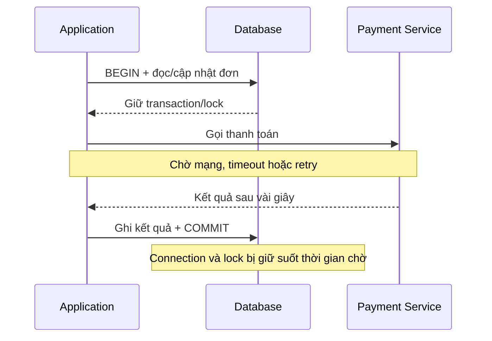
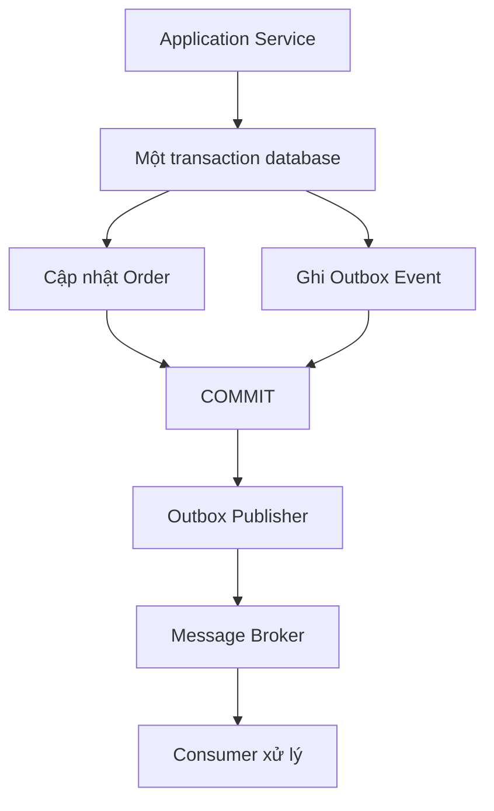

# Tránh giao dịch kéo dài và lời gọi mạng bên trong giao dịch

*Chương: Giao dịch và tính nhất quán*

Bài học này thuộc module `SOFTWARE_DESIGN_ARCHITECTURE_ARCHITECTURAL_PATTERN_LAYERED`, có mục tiêu **Học tổ chức phần mềm theo kiến trúc phân tầng**. Trong ứng dụng phân tầng, tầng ứng dụng thường điều phối một ca sử dụng và xác định ranh giới giao dịch; tầng nghiệp vụ giữ các quy tắc; tầng truy cập dữ liệu thực hiện đọc và ghi. Một quyết định quan trọng là giữ giao dịch cơ sở dữ liệu đủ ngắn để bảo vệ tính nhất quán mà không chiếm tài nguyên trong lúc chờ công việc bên ngoài.

Giao dịch dài thường xuất hiện khi một phương thức vừa đọc và cập nhật dữ liệu, vừa gọi HTTP đến dịch vụ khác, gửi message đồng bộ, tải file hoặc chờ người dùng. Khi đó, kết nối và khóa database có thể bị giữ trong suốt thời gian chờ. Bài học này giải thích tác hại, cách đặt ranh giới giao dịch và các mẫu phối hợp phù hợp khi một ca sử dụng cần nhiều bước.

## 1. Giao dịch nên bảo vệ một đơn vị công việc dữ liệu

Một transaction cơ sở dữ liệu gom các thao tác đọc/ghi liên quan thành một đơn vị có tính nguyên tử và nhất quán theo cấu hình isolation. Nếu một bước thất bại trước khi commit, các thay đổi trong transaction có thể được rollback. Ví dụ, khi xác nhận đơn hàng, ứng dụng có thể cập nhật trạng thái đơn và ghi lịch sử xác nhận trong cùng transaction để hai thay đổi không bị tách rời.

Trong Spring, ranh giới thường được đặt ở phương thức của application service:

```java
@Service
public class ConfirmOrderService {
    private final OrderRepository orders;
    private final OrderHistoryRepository history;

    public ConfirmOrderService(
            OrderRepository orders,
            OrderHistoryRepository history) {
        this.orders = orders;
        this.history = history;
    }

    @Transactional
    public void execute(OrderId id) {
        Order order = orders.findById(id)
                .orElseThrow(OrderNotFoundException::new);

        order.confirm();
        orders.save(order);
        history.recordConfirmed(order.id());
    }
}
```

Hai thao tác lưu trữ thuộc cùng một đơn vị nghiệp vụ. Nếu ghi lịch sử thất bại, trạng thái xác nhận cũng không nên được commit riêng. Đây là trường hợp transaction có giá trị rõ ràng.

Transaction không nên bao trùm mọi thứ mà ca sử dụng thực hiện. Gọi một dịch vụ thanh toán, gửi email, tải tài liệu hoặc chờ một dịch vụ định danh phản hồi không phải thao tác database nằm trong cùng một transaction cục bộ. Các công việc đó có thời gian thực thi, cơ chế lỗi và khả năng retry khác với database.

## 2. Vì sao transaction kéo dài gây hại?

Khi một transaction mở lâu, nhiều tài nguyên có thể bị giữ trong thời gian không cần thiết:

- **Kết nối database:** một connection có thể được giữ từ lúc transaction bắt đầu đến khi commit/rollback. Pool có số lượng hữu hạn; nhiều request cùng chờ mạng có thể làm cạn pool.
- **Khóa:** thao tác cập nhật có thể giữ row lock hoặc các khóa khác cho đến khi transaction kết thúc. Request khác cần cùng dữ liệu phải chờ.
- **Phiên bản dữ liệu và tài nguyên lưu trữ:** transaction dài có thể làm tăng công việc duy trì snapshot hoặc version cũ, tùy database và isolation level.
- **Khả năng phục hồi:** transaction càng dài, càng có nhiều việc đã làm phải rollback nếu bước cuối thất bại.
- **Thông lượng:** các request giữ connection và khóa lâu làm giảm số công việc database có thể xử lý đồng thời.

Ví dụ, một request giữ transaction 8 giây vì chờ dịch vụ thanh toán có thể giữ connection trong gần toàn bộ 8 giây, dù thao tác database thực tế chỉ cần vài chục mili giây. Khi số request tăng, pool nhanh chóng trở thành nút thắt.

Một giao dịch kéo dài còn làm tăng khả năng xung đột. Nếu một đơn hàng bị khóa trong lúc chờ dịch vụ bên ngoài, các thao tác khác muốn cập nhật đơn đó có thể phải chờ hoặc nhận lỗi timeout/lock conflict. Người dùng có thể thấy hệ thống chậm dù database không thực hiện truy vấn nặng.



Sơ đồ thể hiện vấn đề phổ biến: database phải duy trì transaction trong khi ứng dụng không làm việc với database. Nếu dịch vụ bên ngoài chậm hoặc không phản hồi, thời gian giữ tài nguyên tăng theo thời gian chờ đó.

## 3. Vì sao không nên gọi mạng bên trong @Transactional?

Một lời gọi HTTP không tự động tham gia transaction cơ sở dữ liệu của ứng dụng. Annotation `@Transactional` thường quản lý transaction của resource mà transaction manager tương ứng điều khiển, chẳng hạn database qua JDBC/JPA. Nếu dịch vụ thanh toán đã thu tiền nhưng transaction database của ứng dụng rollback, khoản thanh toán từ xa không tự động được hoàn tác.

Điều này tạo ra hai nhóm rủi ro:

1. **Giữ tài nguyên database trong lúc chờ:** connection và khóa có thể bị giữ dù không có truy vấn nào đang chạy.
2. **Không có tính nguyên tử xuyên hệ thống:** database cục bộ có thể rollback, nhưng hành động ở dịch vụ từ xa đã xảy ra và cần một quy trình bù hoặc đối soát riêng.

Ví dụ cần tránh:

```java
@Service
public class UnsafeCheckoutService {
    private final OrderRepository orders;
    private final PaymentClient paymentClient;

    public UnsafeCheckoutService(
            OrderRepository orders,
            PaymentClient paymentClient) {
        this.orders = orders;
        this.paymentClient = paymentClient;
    }

    @Transactional
    public void checkout(OrderId id) {
        Order order = orders.findById(id)
                .orElseThrow(OrderNotFoundException::new);

        order.markPaymentPending();
        orders.save(order);

        // Không nên giữ transaction database trong lúc chờ HTTP.
        paymentClient.charge(order.paymentRequest());

        order.markPaid();
        orders.save(order);
    }
}
```

Nếu lời gọi thanh toán mất 5 giây, transaction có thể giữ connection và khóa suốt thời gian đó. Nếu dịch vụ thanh toán đã xử lý thành công nhưng response bị mất, ứng dụng có thể không biết kết quả. Nếu ứng dụng rollback, trạng thái local không phản ánh việc tiền đã bị thu.

Đặt timeout cho HTTP client là cần thiết, nhưng chỉ giới hạn thời gian chờ mạng. Nó không biến lời gọi từ xa thành một phần nguyên tử của transaction database. Tương tự, đặt transaction timeout có thể giới hạn một số giao dịch bị treo nhưng không thay thế việc thiết kế ranh giới đúng.

## 4. Tách điều phối ca sử dụng khỏi các transaction ngắn

Một cách tổ chức thường hữu ích là để application service điều phối nhiều bước, còn các bean chuyên trách thực hiện từng đơn vị database trong transaction ngắn. Lời gọi mạng được thực hiện ở giữa, khi transaction trước đã commit và transaction tiếp theo chưa bắt đầu.

Ví dụ, bước đầu chuẩn bị một lần thanh toán:

```java
@Service
public class PaymentPreparationService {
    private final OrderRepository orders;
    private final PaymentAttemptRepository attempts;

    public PaymentPreparationService(
            OrderRepository orders,
            PaymentAttemptRepository attempts) {
        this.orders = orders;
        this.attempts = attempts;
    }

    @Transactional
    public PaymentAttempt prepare(OrderId id) {
        Order order = orders.findById(id)
                .orElseThrow(OrderNotFoundException::new);

        order.markPaymentPending();

        PaymentAttempt attempt =
                PaymentAttempt.createFor(order);

        orders.save(order);
        attempts.save(attempt);

        return attempt;
    }
}
```

Phương thức này chỉ đọc và ghi dữ liệu cần thiết, sau đó commit khi trả về. Trong ví dụ, `PaymentAttempt` được hiểu là một DTO bất biến chứa request và idempotency key cần cho lời gọi bên ngoài, không phải entity JPA đang được quản lý hoặc đối tượng phụ thuộc vào persistence context đã kết thúc.

Bước điều phối không mở transaction:

```java
@Service
public class CheckoutOrchestrator {
    private final PaymentPreparationService preparation;
    private final PaymentGateway paymentGateway;
    private final PaymentFinalizationService finalization;

    public CheckoutOrchestrator(
            PaymentPreparationService preparation,
            PaymentGateway paymentGateway,
            PaymentFinalizationService finalization) {
        this.preparation = preparation;
        this.paymentGateway = paymentGateway;
        this.finalization = finalization;
    }

    public CheckoutResult execute(OrderId orderId) {
        PaymentAttempt attempt = preparation.prepare(orderId);

        PaymentResult result;
        try {
            result = paymentGateway.charge(
                    attempt.request(),
                    attempt.idempotencyKey());
        } catch (PaymentTimeoutException exception) {
            finalization.markOutcomeUnknown(attempt.id());
            return CheckoutResult.pendingConfirmation();
        }

        return finalization.recordResult(attempt.id(), result);
    }
}
```

Bước cuối ghi nhận kết quả trong một transaction riêng:

```java
@Service
public class PaymentFinalizationService {
    private final PaymentAttemptRepository attempts;
    private final OrderRepository orders;

    public PaymentFinalizationService(
            PaymentAttemptRepository attempts,
            OrderRepository orders) {
        this.attempts = attempts;
        this.orders = orders;
    }

    @Transactional
    public CheckoutResult recordResult(
            PaymentAttemptId attemptId,
            PaymentResult result) {

        PaymentAttempt attempt = attempts.findById(attemptId)
                .orElseThrow(PaymentAttemptNotFoundException::new);

        Order order = orders.findById(attempt.orderId())
                .orElseThrow(OrderNotFoundException::new);

        if (result.isSuccessful()) {
            attempt.markSucceeded(result.providerReference());
            order.markPaid();
            attempts.save(attempt);
            orders.save(order);
            return CheckoutResult.paid(order.id());
        }

        attempt.markFailed(result.failureCode());
        order.markPaymentFailed();
        attempts.save(attempt);
        orders.save(order);
        return CheckoutResult.paymentFailed(order.id());
    }

    @Transactional
    public void markOutcomeUnknown(PaymentAttemptId attemptId) {
        attempts.findById(attemptId)
                .orElseThrow(PaymentAttemptNotFoundException::new)
                .markOutcomeUnknown();
    }
}
```

Các kiểu và phương thức trong ví dụ là minh họa cho cấu trúc; dự án cần định nghĩa trạng thái, kết quả và quy tắc chuyển trạng thái cụ thể. Điều cần giữ là phương thức chuẩn bị và hoàn tất được gọi qua bean Spring khác nhau. Trong cấu hình proxy mặc định, lời gọi nội bộ từ một phương thức trong cùng object đến phương thức khác có `@Transactional` thường không đi qua proxy, nên annotation có thể không được áp dụng như mong đợi. Tách các ranh giới transaction thành bean riêng hoặc dùng cơ chế quản lý transaction tường minh giúp hành vi dễ dự đoán hơn.

Lời gọi mạng trong ví dụ diễn ra sau khi `prepare` đã kết thúc transaction. Nếu payment gateway timeout, trạng thái thanh toán được đánh dấu chưa rõ để hệ thống đối soát thay vì kết luận ngay rằng thanh toán thất bại.

## 5. Timeout không đồng nghĩa với thất bại

Khi client gọi một dịch vụ bên ngoài và hết thời gian chờ, có ít nhất ba khả năng:

- Request chưa đến được dịch vụ.
- Dịch vụ nhận request nhưng chưa xử lý xong.
- Dịch vụ đã xử lý thành công, nhưng response bị trễ hoặc thất lạc.

Do đó, timeout là **kết quả chưa xác định**, không nhất thiết là thao tác thất bại. Nếu ứng dụng gửi lại một yêu cầu thu tiền với mã mới, khách hàng có thể bị thu hai lần.

Các cơ chế giúp xử lý an toàn:

- **Idempotency key:** gửi một mã duy nhất cho một ý định thanh toán. Nếu retry cùng ý định, gửi lại cùng mã để nhà cung cấp nhận diện thao tác trùng.
- **Tra cứu trạng thái:** khi timeout, hỏi nhà cung cấp về kết quả của mã giao dịch hoặc idempotency key.
- **Trạng thái trung gian:** lưu `PENDING` hoặc `UNKNOWN` để không nhầm lẫn giữa thất bại và chưa biết kết quả.
- **Đối soát:** chạy tác vụ kiểm tra những giao dịch còn ở trạng thái chưa xác định và cập nhật kết quả khi có bằng chứng.
- **Giới hạn retry:** dùng timeout, backoff và giới hạn số lần thử; không retry vô hạn hoặc tạo mã giao dịch mới cho cùng một ý định.

Việc retry cần dựa vào hợp đồng của dịch vụ từ xa. Không phải endpoint nào cũng idempotent. Nếu nhà cung cấp không hỗ trợ idempotency, ứng dụng cần thiết kế quy trình tra cứu hoặc xử lý thủ công phù hợp với rủi ro nghiệp vụ.

## 6. Dùng Transactional Outbox khi cần phát sự kiện đáng tin cậy

Một vấn đề khác xuất hiện khi ứng dụng vừa cập nhật database vừa cần gửi message. Nếu commit database trước rồi process dừng trước khi gửi message, sự kiện bị mất. Nếu gửi message trước rồi database rollback, consumer có thể nhận một sự kiện cho thay đổi chưa được commit.

Transactional Outbox giải quyết khoảng trống này bằng cách ghi dữ liệu nghiệp vụ và một bản ghi outbox trong cùng transaction database:



Khi transaction commit, cả thay đổi nghiệp vụ và bản ghi outbox đều tồn tại. Một publisher độc lập đọc các bản ghi chưa gửi và phát message sau đó. Publisher đánh dấu đã gửi bằng một thao tác database riêng.

Cần chấp nhận rằng publisher có thể gửi message thành công nhưng bị dừng trước khi đánh dấu đã gửi. Khi chạy lại, nó có thể gửi message lần nữa. Vì vậy consumer nên xử lý lặp an toàn, thường bằng cách lưu `eventId` đã xử lý trong cùng transaction với thay đổi dữ liệu của consumer. Outbox cung cấp khả năng phát message đáng tin cậy theo kiểu ít nhất một lần; nó không tự bảo đảm đúng một lần ở mọi thành phần.

Ví dụ cấu trúc dữ liệu:

```java
@Transactional
public void requestPayment(Order order) {
    order.markPaymentPending();
    orders.save(order);

    outbox.save(OutboxEvent.paymentRequested(
            UUID.randomUUID(),
            order.id(),
            order.total()
    ));
}
```

Publisher đọc outbox sau khi transaction này commit rồi mới gọi message broker. Nếu cần gọi HTTP đến nhà cung cấp, worker có thể đọc sự kiện, commit việc nhận/claim công việc, gọi mạng bên ngoài transaction, rồi lưu kết quả trong một transaction mới. Không giữ transaction database mở trong lúc chờ broker hoặc HTTP.

Outbox phù hợp khi việc phát sự kiện phải nhất quán với thay đổi database. Với thông báo không quan trọng, có thể dùng cơ chế best-effort sau commit, nhưng cần hiểu rằng process có thể dừng sau commit và trước khi gửi.

## 7. Khi quy trình trải qua nhiều hệ thống: Saga và hành động bù

Một transaction database cục bộ không thể tự rollback một thao tác đã hoàn tất ở hệ thống khác. Khi một quy trình gồm nhiều dịch vụ, có thể cần Saga: chia quy trình thành các bước cục bộ, mỗi bước commit độc lập; nếu bước sau thất bại, hệ thống thực hiện hành động bù đã được định nghĩa.

Ví dụ quy trình đặt hàng:

1. Tạo đơn ở trạng thái chờ thanh toán.
2. Yêu cầu dịch vụ thanh toán thu tiền.
3. Xác nhận đặt chỗ tồn kho.
4. Chuyển đơn sang trạng thái đã xác nhận.

Nếu đặt chỗ tồn kho thất bại sau khi đã thu tiền, quy trình có thể yêu cầu hoàn tiền. Hoàn tiền là một hành động bù nghiệp vụ, không phải rollback database của dịch vụ thanh toán.

Saga có thể được điều phối tập trung (orchestration) hoặc để các dịch vụ phản ứng với sự kiện (choreography). Cả hai cách đều cần:

- Trạng thái tiến trình được lưu bền vững.
- Mỗi bước có timeout và chính sách retry.
- Thao tác có tác dụng phụ được bảo vệ bằng idempotency.
- Hành động bù được định nghĩa theo ngữ nghĩa nghiệp vụ.
- Có cách xử lý khi bù cũng thất bại hoặc cần con người can thiệp.

Không nên đưa Saga vào một quy trình chỉ có vài thao tác database cục bộ. Nó làm tăng số trạng thái và cơ chế vận hành; chỉ dùng khi công việc thực sự trải qua nhiều ranh giới độc lập và cần tiến trình dài hạn.

## 8. Xử lý batch và công việc dài bằng các transaction theo lô

Một tác vụ nhập hàng trăm nghìn bản ghi không nên giữ một transaction duy nhất từ đầu đến cuối nếu không có yêu cầu nguyên tử đặc biệt. Transaction lớn có thể giữ nhiều khóa, tạo lượng rollback lớn và làm tăng áp lực lên bộ nhớ hoặc log database.

Một cách thường dùng là chia công việc thành các chunk:

- Đọc một lô dữ liệu có kích thước giới hạn.
- Xác thực và chuyển đổi dữ liệu ngoài transaction nếu không cần khóa dữ liệu.
- Ghi một lô trong transaction ngắn.
- Commit và lưu checkpoint để biết đã xử lý đến đâu.
- Tiếp tục lô kế tiếp.

Nếu tác vụ dừng giữa chừng, nó có thể tiếp tục từ checkpoint. Để tránh ghi trùng, cần khóa định danh nguồn, unique constraint hoặc xử lý idempotent cho từng bản ghi. Nếu yêu cầu nghiệp vụ bắt buộc toàn bộ batch phải nguyên tử, cần đánh giá rõ chi phí và giới hạn của transaction lớn, hoặc cân nhắc mô hình staging rồi chuyển trạng thái bằng một bước kiểm soát.

Với công việc có thể mất nhiều phút, không nên mở transaction rồi chờ file upload, người dùng xác nhận hoặc dịch vụ ngoài hoàn tất. Hãy lưu trạng thái tiến trình và xử lý theo từng bước có thể khôi phục.

## 9. Những hiểu lầm thường gặp

| Hiểu lầm | Cách hiểu chính xác |
|---|---|
| Thêm `@Transactional` là mọi thứ trong phương thức cùng nguyên tử | Annotation quản lý transaction của resource được cấu hình; HTTP hoặc message bên ngoài thường không tự tham gia |
| Đặt timeout là đủ để giải quyết transaction dài | Timeout giới hạn thời gian chờ nhưng vẫn có thể giữ connection/lock đến khi kết thúc |
| Nếu HTTP timeout thì thao tác từ xa chưa xảy ra | Dịch vụ có thể đã xử lý và response bị mất; cần trạng thái chưa xác định và đối soát |
| Dùng `REQUIRES_NEW` sẽ loại bỏ mọi vấn đề | Transaction ngoài có thể vẫn giữ resource; transaction mới còn làm tăng nhu cầu connection |
| Gửi event sau commit luôn đáng tin cậy | Process có thể dừng sau commit và trước khi gửi; Outbox giải quyết khoảng trống này |
| Chia nhỏ transaction luôn giữ nguyên tính nguyên tử toàn quy trình | Mỗi chunk commit độc lập; cần checkpoint, idempotency và xử lý một phần thất bại |

Đặc biệt, `REQUIRES_NEW` không phải cách chữa mặc định cho lời gọi mạng kéo dài. Nó tạo một transaction độc lập cho phần được gọi, nhưng transaction bên ngoài có thể vẫn đang mở và giữ connection hoặc khóa. Dùng propagation cần dựa trên yêu cầu nhất quán cụ thể, không chỉ để làm cho code chạy được.

## 10. Cách thiết kế và kiểm tra ranh giới giao dịch

Khi thiết kế một ca sử dụng, hãy đi theo trình tự:

1. Xác định những thay đổi database nào phải cùng commit hoặc rollback.
2. Gom các thay đổi đó vào một transaction cục bộ ở tầng ứng dụng hoặc một ranh giới phù hợp.
3. Kết thúc transaction trước khi gọi HTTP, message broker, email, file storage hoặc chờ người dùng.
4. Ghi trạng thái trung gian nếu quy trình cần tiếp tục sau lời gọi ngoài.
5. Dùng idempotency key, retry có giới hạn, timeout và đối soát cho lời gọi có tác dụng phụ.
6. Dùng Outbox nếu việc phát sự kiện phải nhất quán với commit database.
7. Dùng Saga khi quy trình nhiều bước qua nhiều hệ thống cần hành động bù.
8. Với batch, chia chunk và lưu checkpoint nếu nghiệp vụ cho phép commit từng phần.

Có thể kiểm tra thiết kế bằng một số câu hỏi:

- Trong lúc một request chờ mạng, transaction database có còn mở không?
- Có connection hoặc khóa nào bị giữ chỉ vì một dịch vụ khác phản hồi chậm?
- Nếu process dừng sau khi dịch vụ ngoài đã thành công nhưng trước khi cập nhật database, hệ thống khôi phục thế nào?
- Nếu timeout xảy ra, ứng dụng có phân biệt kết quả thất bại với kết quả chưa xác định không?
- Retry có thể tạo tác dụng phụ trùng lặp không?
- Có kiểm thử xác nhận transaction rollback khi thao tác lưu cục bộ thất bại không?
- Có metric về thời lượng transaction, connection pool, lock wait và timeout để nhận diện vấn đề trong production không?

Trong Spring, nên kiểm tra transaction thực tế qua log transaction, tracing hoặc metric của connection pool thay vì chỉ nhìn annotation. Cần nhớ `@Transactional` thường được áp dụng qua proxy; self-invocation trong cùng bean có thể bỏ qua proxy. Đặt ranh giới ở phương thức public của bean được gọi từ bên ngoài giúp hành vi rõ ràng hơn. Cũng cần cấu hình timeout riêng cho HTTP client và transaction manager theo mục tiêu vận hành.

Transaction ngắn không có nghĩa mọi ca sử dụng chỉ được phép có một transaction. Một quy trình có thể gồm nhiều transaction cục bộ, xen giữa là lời gọi mạng và các bước phục hồi. Điều cần thiết là xác định rõ trạng thái ở từng bước, chấp nhận khả năng một phần công việc đã hoàn tất và cung cấp cơ chế tiếp tục hoặc bù phù hợp. Cách tổ chức đó giúp ứng dụng giữ tài nguyên database trong thời gian cần thiết và vận hành ổn định hơn khi hệ thống bên ngoài chậm hoặc gặp sự cố.

