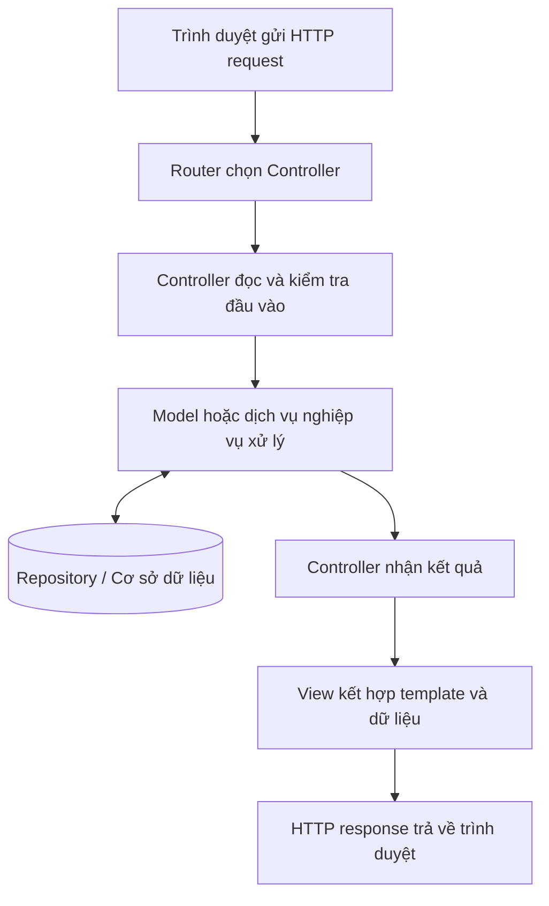

# MVC (Model–View–Controller) là gì

## 1. Khái niệm

**MVC (Model–View–Controller)** là một mẫu kiến trúc dùng để chia ứng dụng thành ba phần có trách nhiệm khác nhau:

- **Model** quản lý trạng thái, dữ liệu miền nghiệp vụ và các quy tắc nghiệp vụ.
- **View** trình bày dữ liệu cho người dùng, thường dưới dạng HTML, giao diện hoặc một định dạng phản hồi.
- **Controller** tiếp nhận tương tác hoặc HTTP request, điều phối xử lý và quyết định phản hồi phù hợp.

Mục tiêu của MVC là giảm sự phụ thuộc giữa nghiệp vụ, giao diện và cách người dùng tương tác với ứng dụng. Khi ba trách nhiệm được tách bạch, mỗi phần có thể được phát triển, thay đổi và kiểm thử với ít ảnh hưởng dây chuyền hơn.

Ví dụ, trong chức năng xem danh sách sản phẩm, Controller nhận request `GET /products`, yêu cầu Model cung cấp dữ liệu, rồi chuyển dữ liệu đó cho View dựng thành trang HTML. View không tự truy vấn cơ sở dữ liệu; Model cũng không cần biết trang HTML được trình bày bằng màu sắc hay bố cục nào.

MVC là một **mẫu tổ chức trách nhiệm**, không phải một thư viện hay một framework cụ thể. Spring MVC, ASP.NET MVC và nhiều framework web khác cung cấp cơ chế để triển khai các ý tưởng của mẫu này.

## 2. Ba thành phần của MVC

### 2.1. Model — dữ liệu và nghiệp vụ

Model đại diện cho phần thông tin và quy tắc mà ứng dụng cần quản lý. Tùy cách tổ chức hệ thống, phần này có thể bao gồm:

- Các đối tượng miền nghiệp vụ, chẳng hạn `Product`, `Order`, `Customer`.
- Trạng thái và các phép biến đổi hợp lệ trên trạng thái đó.
- Quy tắc nghiệp vụ, chẳng hạn giá sản phẩm phải lớn hơn hoặc bằng không, hoặc đơn hàng chỉ được hủy khi chưa giao.
- Cơ chế truy cập và lưu trữ dữ liệu, thường thông qua repository hoặc lớp tương đương.

Model tập trung vào ý nghĩa của dữ liệu đối với nghiệp vụ. Ví dụ, `Order` có thể cung cấp hành vi `cancel()` và tự bảo vệ quy tắc không cho hủy một đơn hàng đã giao. Quy tắc này cần được bảo đảm dù yêu cầu đến từ trang web, API hay một tác vụ chạy nền.

Model không nên phụ thuộc vào chi tiết trình bày như tên template, cấu trúc HTML, màu sắc hoặc thành phần giao diện. Nhờ vậy, cùng một nghiệp vụ có thể được sử dụng bởi nhiều loại giao diện khác nhau.

Trong một số framework, từ *Model* còn được dùng cho đối tượng chứa dữ liệu đưa sang View. Ý nghĩa đó hẹp hơn khái niệm Model ở cấp kiến trúc. Cần xem xét ngữ cảnh và quy ước của framework để tránh nhầm đối tượng truyền dữ liệu với toàn bộ mô hình miền nghiệp vụ.

### 2.2. View — phần trình bày

View chịu trách nhiệm biến dữ liệu đã được chuẩn bị thành nội dung mà người dùng hoặc client có thể tiếp nhận. Trong ứng dụng web, View thường là template tạo HTML. Với một kiểu ứng dụng khác, View có thể là màn hình, trang, hoặc thành phần giao diện.

Ví dụ, View danh sách sản phẩm nhận một tập dữ liệu và trình bày tên, giá cùng liên kết xem chi tiết. View có thể quyết định cách hiển thị giá tiền hoặc thông báo danh sách rỗng, nhưng không nên tự thực hiện quy tắc tính giá hay truy vấn cơ sở dữ liệu.

Một View có trách nhiệm tốt thường:

- Chỉ sử dụng dữ liệu cần thiết để trình bày.
- Tách cấu trúc giao diện khỏi quy tắc nghiệp vụ.
- Mã hóa dữ liệu đầu ra đúng ngữ cảnh để tránh chèn mã độc vào HTML.
- Hiển thị trạng thái phù hợp, chẳng hạn dữ liệu rỗng, lỗi nhập liệu hoặc thông báo thành công.

### 2.3. Controller — tiếp nhận và điều phối

Controller là điểm tiếp nhận các thao tác từ bên ngoài. Trong ứng dụng web, thao tác đó thường được biểu diễn bằng HTTP request gồm đường dẫn, phương thức, tham số, header và phần thân request.

Controller có nhiệm vụ:

1. Nhận request và xác định thao tác cần xử lý.
2. Đọc dữ liệu đầu vào, chuyển dữ liệu đó sang kiểu dữ liệu phù hợp và kiểm tra tính hợp lệ ở cấp request.
3. Gọi Model hoặc lớp dịch vụ nghiệp vụ để thực hiện công việc.
4. Chọn View hoặc định dạng phản hồi, đồng thời cung cấp dữ liệu cần thiết.
5. Chuyển tiếp lỗi phù hợp nếu thao tác không thể hoàn tất.

Controller nên giữ vai trò điều phối. Nếu Controller chứa nhiều quy tắc nghiệp vụ, truy vấn dữ liệu trực tiếp và đồng thời dựng nội dung giao diện, nó sẽ trở nên khó đọc, khó tái sử dụng và khó kiểm thử.

## 3. Luồng xử lý trong ứng dụng web

Một luồng MVC phía máy chủ thường diễn ra như sau:



Xét chức năng xem danh sách sản phẩm:

1. Trình duyệt gửi `GET /products`.
2. Bộ định tuyến ánh xạ request đến phương thức xử lý danh sách trong `ProductController`.
3. Controller gọi `ProductService` để lấy danh sách sản phẩm.
4. Lớp nghiệp vụ lấy dữ liệu qua repository; repository làm việc với nguồn lưu trữ.
5. Controller đặt danh sách vào dữ liệu dành cho View và chọn template `products/index`.
6. View dựng HTML từ template và dữ liệu sản phẩm.
7. Máy chủ trả HTML về trình duyệt.

Trong luồng này, Controller điều phối, Model cung cấp dữ liệu và hành vi nghiệp vụ, còn View chịu trách nhiệm trình bày. Một số framework có thêm router, middleware, service hoặc repository thành các lớp riêng. Những thành phần đó bổ sung cách tổ chức triển khai; chúng không làm mất đi ba trách nhiệm cốt lõi của MVC.

## 4. Ví dụ triển khai với Java và Spring MVC

Ví dụ sau minh họa một Controller xử lý việc hiển thị và tạo sản phẩm. `ProductService` đại diện cho lớp thực hiện nghiệp vụ; phần lưu trữ được ẩn sau lớp này.

```java
@Controller
@RequestMapping("/products")
public class ProductController {
    private final ProductService productService;

    public ProductController(ProductService productService) {
        this.productService = productService;
    }

    @GetMapping
    public String list(Model viewModel) {
        viewModel.addAttribute("products", productService.findAll());
        return "products/index";
    }

    @GetMapping("/new")
    public String newForm(Model viewModel) {
        viewModel.addAttribute("form", new ProductForm());
        return "products/new";
    }

    @PostMapping
    public String create(
            @Valid @ModelAttribute("form") ProductForm form,
            BindingResult errors) {
        if (errors.hasErrors()) {
            return "products/new";
        }

        productService.create(form.getName(), form.getPrice());
        return "redirect:/products";
    }
}
```

Trong ví dụ này:

- `ProductController` tiếp nhận request và điều phối lời gọi đến `ProductService`.
- `ProductForm` là đối tượng nhận dữ liệu từ biểu mẫu. Nó là hợp đồng đầu vào của chức năng tạo sản phẩm.
- `ProductService` xử lý nghiệp vụ và phối hợp với phần lưu trữ.
- `Model` trong tham số của Spring MVC là nơi Controller đặt dữ liệu để View sử dụng. Tên lớp này không có nghĩa nó chứa toàn bộ Model miền nghiệp vụ.
- Các chuỗi `products/index` và `products/new` là tên View template mà framework sẽ phân giải.

Một `ProductForm` có thể khai báo ràng buộc đầu vào như sau:

```java
public class ProductForm {
    @NotBlank
    private String name;

    @NotNull
    @PositiveOrZero
    private BigDecimal price;

    // Getters và setters
}
```

Khi dữ liệu không hợp lệ, `BindingResult` chứa lỗi để Controller trả lại biểu mẫu cùng thông tin cần hiển thị. Khi dữ liệu hợp lệ, Controller gọi nghiệp vụ rồi chuyển hướng đến danh sách sản phẩm. Cách chuyển hướng sau khi xử lý POST thường được gọi là **Post/Redirect/Get (PRG)**; nó giúp trình duyệt tải một request GET mới sau khi gửi biểu mẫu và giảm nguy cơ gửi lại thao tác tạo khi người dùng tải lại trang kết quả.

## 5. Hợp đồng dữ liệu giữa request, Model và View

Phân tách trách nhiệm cũng đòi hỏi xác định rõ dữ liệu đi qua ranh giới giữa các thành phần.

| Hợp đồng | Mục đích | Ví dụ |
|---|---|---|
| Request DTO / Form | Nhận dữ liệu do client gửi | `ProductForm` gồm tên và giá |
| Domain Model | Biểu diễn trạng thái và quy tắc nghiệp vụ | `Product`, `Order` |
| View Model / Response DTO | Cung cấp dữ liệu cần cho đầu ra | `ProductListItem` gồm tên, giá đã định dạng |

Không nên mặc định dùng cùng một đối tượng cho cả ba mục đích. Đối tượng nhận request thường cần giới hạn những trường client được phép gửi. Domain Model cần bảo vệ các bất biến nghiệp vụ. View Model chỉ cần chứa thông tin phù hợp với cách trình bày hoặc phản hồi.

Ví dụ, client không nên tự gửi `createdAt`, `approvedBy` hoặc `isAdmin` trong biểu mẫu tạo sản phẩm nếu đó là dữ liệu do hệ thống quản lý. Controller cần ánh xạ những trường được phép từ request sang lệnh nghiệp vụ; lớp nghiệp vụ tiếp tục kiểm tra các điều kiện mà client không thể tự quyết định.

## 6. Xử lý biểu mẫu và lỗi

Biểu mẫu là một ví dụ rõ ràng về sự phối hợp giữa ba thành phần:

- View hiển thị trường nhập liệu, nhãn, thông báo và lỗi tương ứng.
- Controller nhận dữ liệu gửi lên, thực hiện kiểm tra cấu trúc và ràng buộc đầu vào.
- Model hoặc lớp nghiệp vụ kiểm tra quy tắc miền, ví dụ sản phẩm có mã trùng hoặc đơn hàng không còn ở trạng thái cho phép cập nhật.

Hai loại kiểm tra này có mục đích khác nhau. Kiểm tra đầu vào giúp phản hồi sớm khi dữ liệu thiếu hoặc sai định dạng. Kiểm tra nghiệp vụ bảo vệ tính đúng đắn của hệ thống trong mọi luồng gọi, kể cả khi thao tác không đến từ biểu mẫu web.

Ứng dụng cũng cần chuyển lỗi thành phản hồi phù hợp. Một số trường hợp thường gặp:

| Tình huống | Phản hồi thường dùng | Cách trình bày |
|---|---|---|
| Request sai định dạng hoặc thiếu trường bắt buộc | `400 Bad Request` | Thông báo lỗi gắn với trường hoặc nội dung request |
| Không tìm thấy tài nguyên | `404 Not Found` | Trang không tìm thấy hoặc phản hồi lỗi tương ứng |
| Người dùng chưa được phép thực hiện thao tác | `403 Forbidden` hoặc `401 Unauthorized` tùy tình huống | Trang thông báo quyền truy cập hoặc phản hồi phù hợp |
| Lỗi không dự kiến phía máy chủ | `500 Internal Server Error` | Thông báo chung, mã theo dõi nếu có |

Không đưa stack trace, câu truy vấn, thông tin bí mật hoặc chi tiết nội bộ vào thông báo gửi cho người dùng. Hãy ghi log ở phía máy chủ với thông tin đủ để điều tra, đồng thời trả nội dung lỗi an toàn và dễ hiểu.

## 7. Bảo mật tại các ranh giới MVC

MVC giúp xác định vị trí xử lý, nhưng bản thân mẫu kiến trúc không tự bảo đảm ứng dụng an toàn. Các lớp vẫn phải thực hiện những kiểm soát phù hợp:

- **Xác thực và phân quyền:** xác định người dùng là ai và họ có quyền thực hiện hành động trên tài nguyên cụ thể hay không. Việc kiểm tra quyền sở hữu tài nguyên nên được bảo đảm ở lớp nghiệp vụ hoặc một lớp bảo vệ thích hợp, không chỉ dựa vào việc ẩn nút trên View.
- **Kiểm tra dữ liệu đầu vào:** không tin dữ liệu từ trình duyệt. Chỉ bind những trường được phép, kiểm tra kiểu, giới hạn và quy tắc nghiệp vụ.
- **Chống CSRF:** với biểu mẫu dùng cookie phiên đăng nhập, áp dụng cơ chế CSRF token theo framework và cấu hình của ứng dụng.
- **Mã hóa đầu ra:** View phải escape dữ liệu theo đúng ngữ cảnh HTML, thuộc tính, URL hoặc JavaScript để hạn chế XSS.
- **Bảo vệ dữ liệu nhạy cảm:** chỉ đưa các trường cần thiết sang View hoặc response; không hiển thị mật khẩu, token hay dữ liệu nội bộ.
- **Xử lý lỗi an toàn:** không tiết lộ stack trace hoặc cấu hình nội bộ cho client.

Controller là một ranh giới quan trọng để nhận request và áp dụng các kiểm tra phù hợp, nhưng quy tắc bảo vệ dữ liệu và nghiệp vụ cần được duy trì xuyên suốt hệ thống.

## 8. Kiểm thử ứng dụng theo trách nhiệm MVC

Khi trách nhiệm đã được tách rõ, có thể kiểm thử từng phần ở mức phù hợp:

| Phạm vi | Nội dung cần kiểm tra | Cách kiểm thử thường dùng |
|---|---|---|
| Model / nghiệp vụ | Quy tắc, trạng thái hợp lệ, các trường hợp biên | Unit test cho domain model và service |
| Controller | Ánh xạ route, binding, validation, quyền truy cập, lựa chọn View hoặc status | Web layer test hoặc controller test |
| View | Dữ liệu được trình bày đúng, trạng thái rỗng và lỗi hiển thị phù hợp | Kiểm thử template hoặc kiểm thử tích hợp |
| Toàn luồng | Request đi qua các lớp và trả phản hồi đúng | Integration test với các thành phần cần thiết |

Ví dụ, quy tắc không cho phép tạo sản phẩm có giá âm nên được kiểm thử ở lớp nghiệp vụ. Controller test có thể xác minh request có giá trị không hợp lệ sẽ trả lại biểu mẫu với lỗi. Kiểm thử template có thể xác minh thông báo lỗi được đặt đúng vị trí. Mỗi kiểm thử tập trung vào một hợp đồng cụ thể, nhờ đó lỗi dễ được khoanh vùng.

## 9. Lợi ích và giới hạn của MVC

**Lợi ích**

- Tách nghiệp vụ khỏi giao diện và cách tiếp nhận tương tác.
- Giúp nhiều người hoặc nhóm phát triển làm việc trên các phần có ranh giới rõ hơn.
- Cho phép thay đổi View mà ít tác động đến quy tắc nghiệp vụ.
- Tạo điều kiện tái sử dụng nghiệp vụ qua nhiều kênh giao tiếp.
- Hỗ trợ kiểm thử theo từng trách nhiệm.

**Giới hạn và điểm cần cân nhắc**

- Ứng dụng nhỏ có thể phát sinh nhiều lớp và tệp hơn mức cần thiết nếu áp dụng quá máy móc.
- Controller dễ trở thành “fat controller” nếu chứa nghiệp vụ, truy vấn và xử lý trình bày cùng lúc.
- Ranh giới Model có thể không rõ nếu dự án trộn lẫn domain entity, DTO, đối tượng dữ liệu của framework và View Model.
- MVC không tự quyết định cách chia module, giao dịch, lưu trữ, phân quyền hay giao tiếp giữa các dịch vụ; các quyết định đó cần được thiết kế thêm.

Với ứng dụng web truyền thống, View thường dựng HTML ở phía máy chủ. Với API, Controller có thể trả JSON thay cho tên template và View có thể được hiểu là phần tạo định dạng phản hồi. Với ứng dụng frontend chạy độc lập, client có thể áp dụng cách phân tách tương tự trong giao diện. Cách triển khai thay đổi theo nền tảng, nhưng nguyên tắc phân tách trách nhiệm vẫn có giá trị.

## 10. Những nhầm lẫn thường gặp

1. **Cho rằng Model chỉ là bảng cơ sở dữ liệu.** Model ở cấp kiến trúc còn thể hiện khái niệm và quy tắc của miền nghiệp vụ.
2. **Đưa toàn bộ nghiệp vụ vào Controller.** Controller nên điều phối; quy tắc cần dùng lại nên nằm trong Model hoặc lớp nghiệp vụ phù hợp.
3. **Để View truy cập cơ sở dữ liệu.** View nên nhận dữ liệu đã chuẩn bị và tập trung vào trình bày.
4. **Dùng entity làm dữ liệu đầu vào trực tiếp.** Điều này có thể cho phép client cập nhật những trường không được phép và làm lộ cấu trúc nội bộ.
5. **Nghĩ rằng có ba thư mục `model`, `view`, `controller` là đã có MVC tốt.** Tên thư mục không bảo đảm trách nhiệm thực tế được tách đúng; cần xem luồng phụ thuộc và nội dung từng lớp.

## 11. Kết luận

MVC tổ chức ứng dụng quanh ba trách nhiệm: Model quản lý trạng thái và nghiệp vụ, View trình bày dữ liệu, Controller tiếp nhận tương tác và điều phối xử lý. Trong ứng dụng web, HTTP request thường đi qua Controller, được xử lý bởi Model hoặc lớp nghiệp vụ, rồi kết quả được chuyển đến View để tạo phản hồi.

Khi thiết kế MVC, hãy giữ quy tắc nghiệp vụ ở nơi có thể bảo vệ và tái sử dụng, xác định rõ hợp đồng dữ liệu đầu vào và đầu ra, xử lý lỗi tại ranh giới phù hợp, áp dụng kiểm soát bảo mật và kiểm thử từng trách nhiệm. Đó là cách MVC giúp ứng dụng dễ hiểu, dễ thay đổi và đáng tin cậy hơn.
