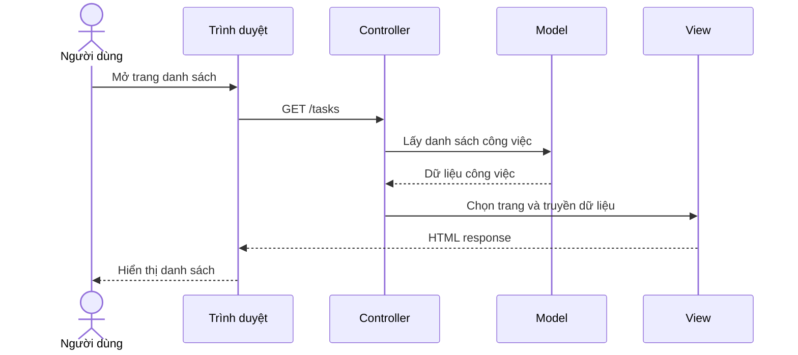
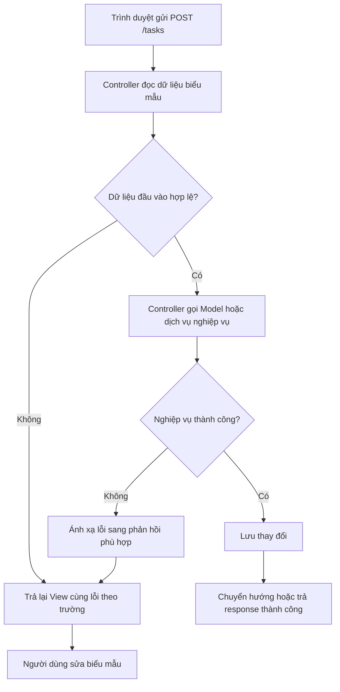

# Mục tiêu phân tách trách nhiệm của MVC

Model–View–Controller (MVC) là mẫu kiến trúc tổ chức phần giao diện của ứng dụng thành ba nhóm trách nhiệm: quản lý trạng thái và nghiệp vụ, trình bày thông tin, và tiếp nhận rồi điều phối tương tác. Mục tiêu cốt lõi của cách tổ chức này là làm cho mỗi phần có một vai trò dễ hiểu, có ranh giới tương đối rõ và có thể thay đổi, kiểm thử mà ít gây ảnh hưởng dây chuyền đến phần còn lại.

Trong ứng dụng web, một yêu cầu thường đi qua nhiều bước: nhận HTTP request, đọc dữ liệu biểu mẫu hoặc tham số URL, kiểm tra dữ liệu, thực hiện nghiệp vụ, lấy dữ liệu cần hiển thị và tạo HTTP response. Nếu tất cả các bước nằm trong cùng một đoạn mã, phần xử lý giao diện dễ bị trộn với quy tắc nghiệp vụ và truy cập dữ liệu. MVC cung cấp một cách phân chia để luồng xử lý đó có cấu trúc hơn.

## Vì sao cần phân tách trách nhiệm?

Hãy hình dung một trang quản lý công việc. Khi người dùng mở trang, ứng dụng phải lấy danh sách công việc, sắp xếp dữ liệu và dựng HTML. Khi người dùng gửi biểu mẫu tạo công việc, ứng dụng phải đọc tiêu đề, kiểm tra dữ liệu, xác định người dùng có quyền tạo hay không, lưu công việc và phản hồi kết quả.

Nếu một lớp vừa đọc request, chạy câu lệnh SQL, kiểm tra quy tắc nghiệp vụ, ghép chuỗi HTML và xử lý thông báo lỗi, lớp đó có nhiều lý do để thay đổi. Một thay đổi nhỏ ở giao diện có thể làm hỏng truy vấn dữ liệu; thay đổi quy tắc nghiệp vụ có thể buộc phải sửa mã dựng HTML. Càng nhiều chức năng được thêm vào, việc hiểu và kiểm thử lớp này càng khó.

MVC hướng đến các mục tiêu sau:

1. **Tách biệt mối quan tâm:** mỗi thành phần tập trung vào một loại công việc. Mã trình bày không phải nơi quyết định nghiệp vụ; mã nghiệp vụ không phải nơi tạo HTML.
2. **Giảm phụ thuộc giữa các phần:** thay đổi cách trình bày hoặc cách tiếp nhận request có thể được thực hiện mà không phải viết lại quy tắc miền nghiệp vụ.
3. **Tăng khả năng tái sử dụng:** cùng một Model có thể phục vụ nhiều màn hình hoặc nhiều cách trình bày; cùng một View có thể hiển thị dữ liệu từ những luồng xử lý khác nhau nếu hợp đồng dữ liệu phù hợp.
4. **Làm rõ nơi đặt mã:** khi cần tìm quy tắc tính toán, xử lý biểu mẫu hoặc dựng giao diện, nhóm phát triển có thể bắt đầu từ thành phần chịu trách nhiệm tương ứng.
5. **Hỗ trợ kiểm thử và cộng tác:** nghiệp vụ có thể được kiểm thử độc lập với HTTP và HTML; giao diện có thể được phát triển dựa trên dữ liệu mẫu; các nhóm có thể làm việc song song trên những phần có hợp đồng rõ ràng.

Phân tách trách nhiệm không có nghĩa là ba thành phần hoàn toàn không liên hệ với nhau. Chúng cần trao đổi dữ liệu theo một luồng có chủ đích. Điều cần tránh là để một thành phần làm thay công việc cốt lõi của thành phần khác hoặc phụ thuộc quá sâu vào chi tiết triển khai của nó.

## Ba trách nhiệm trong MVC

### Model: trạng thái và quy tắc của ứng dụng

Model đại diện cho dữ liệu và hành vi liên quan đến miền nghiệp vụ mà ứng dụng quản lý. Với ví dụ quản lý công việc, Model có thể bao gồm công việc, trạng thái hoàn thành, quy tắc đặt tiêu đề hợp lệ và thao tác hoàn thành công việc.

Model thường chịu trách nhiệm:

- biểu diễn trạng thái và các khái niệm nghiệp vụ;
- bảo vệ các bất biến, chẳng hạn tiêu đề công việc không được để trống;
- thực hiện hoặc phối hợp các thao tác nghiệp vụ;
- cung cấp dữ liệu cần thiết cho luồng xử lý;
- phối hợp với thành phần lưu trữ để đọc và ghi dữ liệu.

Trong một ứng dụng lớn, phần Model có thể được tổ chức thành các đối tượng miền, dịch vụ nghiệp vụ, repository và các thành phần truy cập dữ liệu. Repository là cách tách chi tiết lưu trữ khỏi quy tắc miền; nó không làm thay đổi mục tiêu phân chia trách nhiệm của MVC.

Model không đồng nghĩa với một bảng cơ sở dữ liệu hay một lớp ánh xạ ORM. Một đối tượng miền có thể có hành vi và quy tắc, trong khi một bản ghi lưu trữ chỉ phản ánh cấu trúc dữ liệu. Cũng không nên biến Model thành một nơi chứa mọi thứ: mã xử lý HTTP và mã tạo HTML vẫn thuộc trách nhiệm của những phần khác.

### View: trình bày dữ liệu cho người dùng

View quyết định thông tin được trình bày như thế nào. Trong ứng dụng web, View thường là template HTML, thành phần giao diện hoặc trang được dựng từ dữ liệu do luồng xử lý cung cấp.

View thường chịu trách nhiệm:

- hiển thị dữ liệu và trạng thái phù hợp với người dùng;
- bố trí nội dung, biểu mẫu, liên kết và thông báo;
- thể hiện trạng thái rỗng, trạng thái lỗi hoặc trạng thái thành công;
- định dạng dữ liệu để dễ đọc, chẳng hạn ngày tháng hoặc số tiền;
- mã hóa dữ liệu đầu ra đúng ngữ cảnh để giảm nguy cơ chèn mã độc vào trang.

View nên tập trung vào cách trình bày. Một template có thể dùng điều kiện để ẩn hoặc hiện một phần giao diện, nhưng không nên tự quyết định những quy tắc nghiệp vụ như người dùng có đủ điều kiện hoàn tiền hay một đơn hàng có được phép hủy hay không. Những quyết định đó cần được xác định trong Model hoặc tầng nghiệp vụ.

View cũng không nên tự truy vấn cơ sở dữ liệu. Thay vào đó, nó nhận một tập dữ liệu đã được chuẩn bị theo hợp đồng rõ ràng, ví dụ danh sách công việc cùng thông tin phân trang và thông báo cần hiển thị.

### Controller: tiếp nhận và điều phối tương tác

Controller là điểm tiếp nhận tương tác từ người dùng hoặc request của ứng dụng. Trong web MVC, một Controller thường gắn với một nhóm URL hoặc một nhóm hành động.

Controller thường chịu trách nhiệm:

- nhận request và xác định hành động cần thực hiện;
- đọc tham số URL, dữ liệu biểu mẫu và thông tin ngữ cảnh của request;
- kiểm tra cấu trúc đầu vào ở ranh giới HTTP, sau đó chuyển dữ liệu thành lệnh hoặc đối tượng phù hợp;
- gọi Model hoặc dịch vụ nghiệp vụ để thực hiện công việc;
- chọn View, chuyển dữ liệu cho View hoặc tạo response phù hợp;
- ánh xạ kết quả và lỗi nghiệp vụ thành phản hồi HTTP thích hợp.

Controller nên giữ vai trò điều phối. Nếu một phương thức Controller chứa nhiều phép tính nghiệp vụ, truy vấn dữ liệu phức tạp hoặc dựng HTML bằng cách nối chuỗi, ranh giới trách nhiệm đang bị mờ. Có thể chuyển nghiệp vụ vào Model hoặc dịch vụ nghiệp vụ, còn Controller giữ phần tiếp nhận và điều hướng.

### Bảng phân biệt trách nhiệm

| Thành phần | Câu hỏi chính | Ví dụ trong ứng dụng quản lý công việc | Nên tránh |
|---|---|---|---|
| Model | Dữ liệu và quy tắc của ứng dụng là gì? | Tạo công việc, kiểm tra tiêu đề, đánh dấu hoàn thành | Đọc trực tiếp HTTP request, tạo HTML |
| View | Kết quả được trình bày ra sao? | Hiển thị danh sách, biểu mẫu và lỗi nhập liệu | Chạy quy tắc nghiệp vụ, truy vấn cơ sở dữ liệu |
| Controller | Tương tác được tiếp nhận và điều phối thế nào? | Nhận POST, gọi dịch vụ tạo công việc, chọn trang phản hồi | Chứa toàn bộ nghiệp vụ hoặc logic trình bày |

## Luồng request trong ứng dụng web MVC

Một luồng phổ biến bắt đầu khi trình duyệt gửi request đến Controller. Controller gọi Model để lấy hoặc thay đổi dữ liệu. Sau đó, Controller chọn View và cung cấp dữ liệu cần thiết. View tạo nội dung response để gửi lại trình duyệt.



Khi người dùng gửi biểu mẫu, luồng có thêm bước kiểm tra dữ liệu và xử lý kết quả:



Trong thực tế, framework có thể bổ sung router, middleware, bộ lọc, bộ ánh xạ dữ liệu và cơ chế xử lý lỗi chung. Những thành phần đó hỗ trợ luồng MVC nhưng không làm mất đi ba trách nhiệm nền tảng.

## Ví dụ: tạo một công việc

Giả sử người dùng nhập tiêu đề công việc vào biểu mẫu. Một thiết kế có ranh giới rõ sẽ chia công việc như sau:

1. View hiển thị biểu mẫu và gửi trường `title` bằng HTTP POST.
2. Controller nhận dữ liệu, kiểm tra lỗi đầu vào và gọi dịch vụ tạo công việc.
3. Model bảo vệ quy tắc miền, chẳng hạn tiêu đề sau khi chuẩn hóa không được rỗng.
4. Thành phần lưu trữ ghi công việc.
5. Controller chọn phản hồi: hiển thị lại biểu mẫu khi có lỗi hoặc chuyển hướng đến danh sách khi thành công.

Ví dụ Java dưới đây minh họa một đối tượng miền giữ quy tắc của chính nó:

```java
public final class Task {
    private final String title;
    private boolean completed;

    public Task(String title) {
        if (title == null || title.isBlank()) {
            throw new IllegalArgumentException("Tiêu đề không được để trống");
        }
        this.title = title.trim();
        this.completed = false;
    }

    public String title() {
        return title;
    }

    public boolean isCompleted() {
        return completed;
    }

    public void complete() {
        this.completed = true;
    }
}
```

Đối tượng `Task` không cần biết request đến từ URL nào, biểu mẫu được dựng bằng template nào hoặc dữ liệu được gửi qua HTTP. Nó tập trung vào trạng thái và quy tắc của công việc.

Một Controller theo phong cách Spring MVC có thể điều phối request như sau:

```java
@PostMapping("/tasks")
public String create(
        @Valid @ModelAttribute("form") CreateTaskForm form,
        BindingResult errors) {

    if (errors.hasErrors()) {
        return "tasks/new";
    }

    taskService.create(form.title());
    return "redirect:/tasks";
}
```

Đoạn mã trên chỉ minh họa vai trò của Controller. `CreateTaskForm` là cấu trúc nhận dữ liệu biểu mẫu; `taskService` phối hợp nghiệp vụ và lưu trữ; View `tasks/new` hiển thị biểu mẫu cùng lỗi nếu dữ liệu không hợp lệ. Trong ứng dụng thực tế, cần bổ sung xử lý lỗi nghiệp vụ và xác thực quyền truy cập theo yêu cầu của chức năng.

Một View đơn giản có thể trình bày biểu mẫu:

```html
<form action="/tasks" method="post">
  <label for="title">Tên công việc</label>
  <input id="title" name="title" type="text" required>
  <button type="submit">Tạo công việc</button>
</form>
```

Thuộc tính `required` giúp trình duyệt hỗ trợ kiểm tra đầu vào, nhưng không thay thế kiểm tra phía máy chủ. Request có thể được gửi mà không đi qua giao diện này, vì vậy Controller và Model vẫn phải bảo vệ dữ liệu và quy tắc nghiệp vụ.

## Hợp đồng dữ liệu giữa các thành phần

Phân tách chỉ có ích khi các thành phần thống nhất dữ liệu trao đổi. Controller cần biết View cần trường nào; Model cần nhận dữ liệu nghiệp vụ ở dạng phù hợp; View cần biết tên và ý nghĩa của dữ liệu được cung cấp.

Một số nguyên tắc hữu ích:

- Dùng đối tượng nhận request hoặc form object để biểu diễn dữ liệu đầu vào. Không nhất thiết gắn trực tiếp toàn bộ entity của cơ sở dữ liệu vào biểu mẫu.
- Dùng DTO hoặc view model để cung cấp đúng dữ liệu View cần. Không buộc View hiểu cấu trúc nội bộ của toàn bộ miền nghiệp vụ.
- Xác định rõ trường bắt buộc, kiểu dữ liệu, giới hạn độ dài và cách biểu diễn lỗi.
- Giữ tên trường và ý nghĩa dữ liệu nhất quán giữa form, Controller và View.
- Không tin dữ liệu từ trình duyệt. Mọi dữ liệu ảnh hưởng đến trạng thái hoặc quyền truy cập đều phải được kiểm tra ở phía máy chủ.

Tách form object khỏi entity giúp tránh việc người dùng gửi thêm các trường mà họ không được phép thay đổi, chẳng hạn `role`, `ownerId` hoặc `approved`. Controller chỉ chuyển những trường được phép vào lệnh nghiệp vụ.

## Xử lý lỗi, bảo mật và kiểm thử theo ranh giới

Phân tách trách nhiệm giúp xác định nơi xử lý từng loại vấn đề:

| Vấn đề | Nơi xử lý phù hợp | Ví dụ |
|---|---|---|
| Thiếu trường hoặc sai định dạng request | Ranh giới Controller / validation đầu vào | Tiêu đề bị bỏ trống, ngày không đúng định dạng |
| Vi phạm quy tắc nghiệp vụ | Model hoặc dịch vụ nghiệp vụ | Không thể hoàn thành công việc đã bị khóa |
| Không tìm thấy tài nguyên | Luồng nghiệp vụ và Controller ánh xạ kết quả | Trả về trang 404 hoặc response 404 |
| Không có quyền thực hiện hành động | Cơ chế xác thực/phân quyền và kiểm tra nghiệp vụ cần thiết | Người dùng không được sửa công việc của người khác |
| Dữ liệu không an toàn khi hiển thị | View và cơ chế mã hóa đầu ra | Mã hóa nội dung người dùng nhập trước khi đưa vào HTML |

MVC không tự động làm cho ứng dụng an toàn. Ứng dụng vẫn cần xác thực danh tính, kiểm tra quyền ở phía máy chủ, bảo vệ request thay đổi trạng thái khỏi CSRF, kiểm tra dữ liệu và mã hóa đầu ra. View có thể ẩn nút thao tác với người không có quyền, nhưng việc ẩn nút không thay thế kiểm tra quyền tại Controller hoặc tầng nghiệp vụ.

Ranh giới MVC cũng gợi ý cách tổ chức kiểm thử:

- **Kiểm thử Model:** xác minh quy tắc và trạng thái, ví dụ tiêu đề rỗng bị từ chối hoặc thao tác hoàn thành cập nhật trạng thái đúng.
- **Kiểm thử Controller:** gửi request với dữ liệu hợp lệ và không hợp lệ, xác minh dịch vụ được gọi đúng, trạng thái HTTP hoặc hướng chuyển trang phù hợp.
- **Kiểm thử View:** xác minh dữ liệu được trình bày, thông báo lỗi xuất hiện và nội dung người dùng nhập được mã hóa an toàn.
- **Kiểm thử tích hợp:** kiểm tra luồng hoàn chỉnh từ request qua nghiệp vụ và lưu trữ đến response.

Không phải mọi ứng dụng đều cần một bộ kiểm thử riêng cho từng template. Chọn mức kiểm thử dựa trên rủi ro và hành vi cần bảo vệ; mục tiêu là kiểm tra được từng trách nhiệm mà không phải khởi chạy toàn bộ hệ thống cho mọi trường hợp.

## Dấu hiệu thiết kế đang lệch khỏi MVC

Một số dấu hiệu thường gặp cho thấy trách nhiệm chưa được phân chia tốt:

- **Controller quá lớn:** phương thức xử lý request chứa nhiều nhánh nghiệp vụ, tính toán, truy vấn và định dạng dữ liệu. Hãy chuyển phần nghiệp vụ sang Model hoặc dịch vụ phù hợp.
- **View chứa nghiệp vụ:** template tự quyết định giá, quyền hạn hoặc trạng thái hợp lệ. Hãy đưa quyết định đó về tầng nghiệp vụ và chỉ truyền kết quả cần trình bày.
- **Model phụ thuộc giao diện:** đối tượng miền chứa tên template, mã HTML hoặc thông tin riêng của request. Hãy giữ Model độc lập với cách người dùng tương tác.
- **View tự truy cập dữ liệu:** template gọi repository hoặc phát sinh truy vấn. Hãy để luồng xử lý lấy dữ liệu trước rồi truyền kết quả cho View.
- **Dùng entity làm dữ liệu biểu mẫu cho mọi trường hợp:** người dùng có thể gửi các thuộc tính nội bộ mà chức năng không định cho phép sửa. Hãy định nghĩa form object hoặc command có phạm vi trường rõ ràng.

Không nên tạo thêm lớp hoặc tầng chỉ để làm cho sơ đồ trông giống MVC. Với ứng dụng nhỏ, một Controller, một Model và một View đơn giản có thể đã đủ. Khi nghiệp vụ, quy mô nhóm hoặc yêu cầu kiểm thử tăng lên, có thể tách dịch vụ, repository và DTO để giữ các trách nhiệm rõ ràng hơn.

## Cách tự đánh giá một thiết kế MVC

Khi xem xét một chức năng, hãy lần theo một request thực tế và tự hỏi:

1. Điểm nào nhận request và chịu trách nhiệm đọc dữ liệu đầu vào?
2. Quy tắc nào quyết định thao tác có hợp lệ về mặt nghiệp vụ?
3. Thành phần nào lưu hoặc truy xuất trạng thái?
4. View nhận dữ liệu nào và có đang tự thực hiện nghiệp vụ hay truy vấn dữ liệu không?
5. Lỗi đầu vào, lỗi nghiệp vụ và lỗi không tìm thấy tài nguyên được phân biệt ra sao?
6. Quyền truy cập được kiểm tra ở phía máy chủ tại đâu?
7. Có thể kiểm thử quy tắc nghiệp vụ mà không cần dựng giao diện hoặc gửi HTTP request không?

Nếu mỗi câu hỏi có câu trả lời rõ ràng và luồng dữ liệu giữa các phần dễ theo dõi, thiết kế đã đạt được mục tiêu chính của MVC. Giá trị của MVC nằm ở khả năng kiểm soát độ phức tạp bằng ranh giới trách nhiệm có ý nghĩa; tên lớp hay cấu trúc thư mục chỉ là cách thể hiện ranh giới đó.
