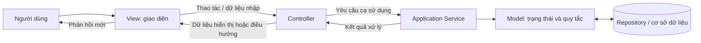
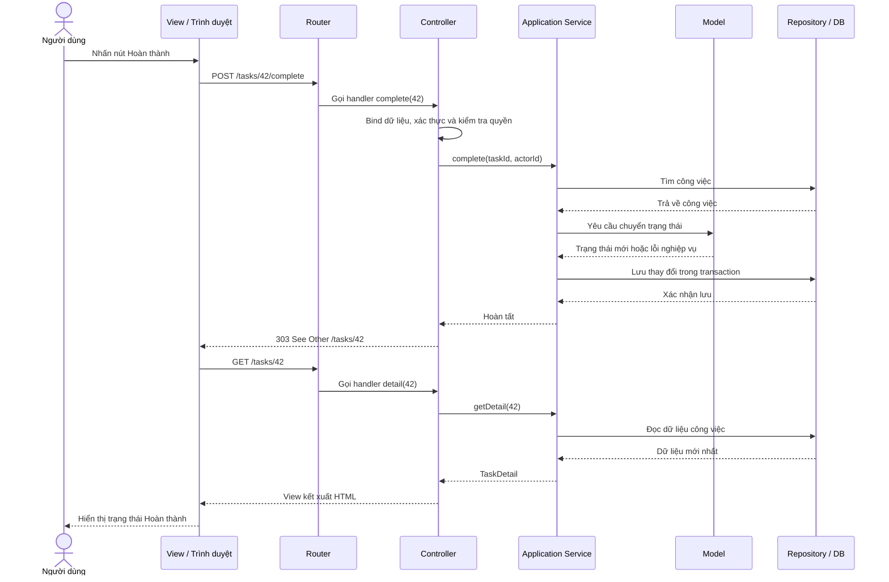

# Bức tranh tổng thể từ thao tác người dùng đến phản hồi giao diện

Trong ứng dụng web, một thao tác nhỏ như nhấn nút **Hoàn thành công việc** có thể đi qua nhiều thành phần trước khi người dùng nhìn thấy kết quả. Trình duyệt phát sinh yêu cầu, ứng dụng định tuyến yêu cầu đến bộ điều khiển, nghiệp vụ kiểm tra và cập nhật trạng thái, sau đó ứng dụng tạo phản hồi để trình duyệt hiển thị.

Mô hình **Model–View–Controller (MVC)** giúp tổ chức luồng này thành ba vai trò có trách nhiệm rõ ràng: **Model** quản lý trạng thái và quy tắc nghiệp vụ, **View** trình bày thông tin, còn **Controller** tiếp nhận tương tác và điều phối xử lý. Nhờ phân tách như vậy, ứng dụng dễ đọc, dễ thay đổi giao diện, dễ kiểm thử và dễ xác định lỗi nằm ở bước nào.

## 1. Ba vai trò trong một luồng tương tác

| Thành phần | Trách nhiệm chính | Câu hỏi mà thành phần trả lời |
|---|---|---|
| **Model** | Biểu diễn dữ liệu và trạng thái của miền nghiệp vụ; thực thi hoặc bảo vệ các quy tắc nghiệp vụ. | Dữ liệu hiện tại là gì? Thao tác này có hợp lệ theo nghiệp vụ không? |
| **View** | Hiển thị dữ liệu, cung cấp điều khiển tương tác và phản ánh kết quả cho người dùng. | Người dùng cần nhìn thấy gì và có thể thực hiện thao tác nào? |
| **Controller** | Nhận đầu vào, chuyển đầu vào thành yêu cầu xử lý, gọi nghiệp vụ phù hợp và chọn phản hồi. | Người dùng vừa yêu cầu điều gì và ứng dụng nên phản hồi ra sao? |

Ba vai trò phối hợp với nhau nhưng không nên thay thế trách nhiệm của nhau:

- View có thể hiển thị nút hoàn thành, nhưng không tự quyết định một công việc có đủ điều kiện để hoàn thành hay không.
- Controller có thể nhận mã công việc và danh tính người dùng, nhưng không nên chứa toàn bộ quy tắc chuyển trạng thái hoặc tự viết truy vấn cơ sở dữ liệu.
- Model bảo vệ tính đúng đắn của trạng thái, nhưng không nên phụ thuộc vào chi tiết như HTML, tên route hay cấu trúc biểu mẫu.

Trong ứng dụng web nhiều lớp, Controller thường gọi một **Application Service** để điều phối ca sử dụng. Service tải Model, kiểm tra quyền, thực hiện nghiệp vụ và lưu thay đổi thông qua Repository. Các lớp Service và Repository là cách tổ chức phổ biến để triển khai MVC trong ứng dụng lớn; chúng bổ sung cấu trúc cho luồng xử lý chứ không thay thế ba vai trò MVC.



Sơ đồ thể hiện hướng phối hợp thường gặp trong ứng dụng web. Chi tiết triển khai có thể khác nhau: một ứng dụng nhỏ có thể không cần lớp Service hoặc Repository riêng, còn một ứng dụng lớn thường tách chúng để quản lý nghiệp vụ và lưu trữ tốt hơn.

## 2. Luồng từ lúc người dùng thao tác đến khi giao diện cập nhật

Hãy xét trang chi tiết công việc đang hiển thị trạng thái **Đang thực hiện**. Người dùng nhấn **Hoàn thành**. Với ứng dụng web kết xuất HTML ở phía máy chủ, luồng điển hình gồm các bước sau.

1. **View hiển thị trạng thái hiện tại.** Máy chủ đã lấy dữ liệu công việc và kết xuất trang HTML. Trang hiển thị tên công việc, trạng thái và nút Hoàn thành.
2. **Người dùng tạo tương tác.** Trình duyệt ghi nhận sự kiện nhấn nút. Nếu thao tác gửi biểu mẫu, trình duyệt thu thập các trường dữ liệu và gửi HTTP request theo `method` và `action` của biểu mẫu.
3. **Ứng dụng định tuyến request.** Router đối chiếu HTTP method và URL, chẳng hạn `POST /tasks/42/complete`, rồi chuyển request đến handler tương ứng trong Controller.
4. **Controller tiếp nhận và kiểm tra đầu vào.** Các giá trị trên đường dẫn, query string hoặc request body được chuyển đổi sang kiểu dữ liệu phù hợp. Ứng dụng kiểm tra định dạng, dữ liệu bắt buộc, trạng thái đăng nhập và quyền thực hiện thao tác.
5. **Controller gọi xử lý nghiệp vụ.** Controller chuyển các dữ liệu cần thiết cho Service. Nó không nên tự quyết định toàn bộ quy tắc hoàn thành công việc.
6. **Model kiểm tra và thay đổi trạng thái.** Service tải công việc, kiểm tra người dùng có quyền cập nhật hay không, rồi yêu cầu Model chuyển trạng thái. Model bảo vệ các bất biến, ví dụ công việc đã bị hủy thì không thể chuyển sang hoàn thành.
7. **Ứng dụng lưu kết quả.** Nếu nghiệp vụ hợp lệ, thay đổi được lưu trong một transaction phù hợp. Nếu có lỗi, transaction có thể rollback và ứng dụng chuyển lỗi thành phản hồi có ý nghĩa.
8. **Controller tạo phản hồi.** Với thao tác cập nhật từ biểu mẫu HTML, ứng dụng thường chuyển hướng sang trang chi tiết bằng mẫu Post/Redirect/Get. Với truy vấn hiển thị, Controller lấy dữ liệu cần thiết và yêu cầu View kết xuất HTML.
9. **Trình duyệt hiển thị phản hồi.** Trình duyệt theo redirect nếu có, nhận HTML hoặc dữ liệu JSON, cập nhật tài liệu và cho người dùng thấy trạng thái mới hoặc thông báo lỗi.



Sơ đồ dùng hai request để minh họa Post/Redirect/Get: request `POST` thay đổi dữ liệu, còn request `GET` lấy trạng thái mới để hiển thị. Router, Service và Repository là các thành phần hạ tầng hoặc lớp ứng dụng thường đi cùng MVC; chúng không phải là ba thành phần cốt lõi của mẫu MVC.

## 3. Ví dụ: hoàn thành một công việc

Giả sử ứng dụng quản lý công việc có trang `/tasks/42`. Người dùng được phép hoàn thành công việc nếu họ có quyền cập nhật và công việc chưa bị hủy.

### 3.1. View gửi một yêu cầu có ý nghĩa rõ ràng

View cung cấp biểu mẫu cho thao tác hoàn thành:

```html
<form method="post" action="/tasks/42/complete">
    <!-- Token CSRF được thêm theo cơ chế bảo vệ của ứng dụng. -->
    <button type="submit">Hoàn thành</button>
</form>
```

`POST` biểu thị một yêu cầu thay đổi trạng thái. Mã `42` xác định tài nguyên cần thao tác. Trong ứng dụng thực tế, URL có thể được sinh bởi template engine thay vì viết cố định; token CSRF phải được gửi theo cơ chế bảo vệ mà máy chủ cấu hình.

View chỉ mô tả cách người dùng gửi yêu cầu. Việc ẩn nút khi công việc đã hoàn thành có thể cải thiện trải nghiệm, nhưng không thay thế kiểm tra nghiệp vụ và quyền ở phía máy chủ. Người dùng vẫn có thể tự tạo request bằng công cụ khác.

### 3.2. Controller chuyển request thành lời gọi nghiệp vụ

Ví dụ dưới đây sử dụng Spring MVC. Các kiểu `CurrentUser`, `TaskDetail` và `TaskService` đại diện cho các kiểu của ứng dụng; phần import được lược bỏ để tập trung vào luồng xử lý.

```java
@Controller
@RequestMapping("/tasks")
public class TaskController {
    private final TaskService taskService;

    public TaskController(TaskService taskService) {
        this.taskService = taskService;
    }

    @PostMapping("/{id}/complete")
    public String complete(
            @PathVariable long id,
            @AuthenticationPrincipal CurrentUser currentUser,
            RedirectAttributes redirectAttributes) {

        taskService.complete(id, currentUser.id());
        redirectAttributes.addFlashAttribute(
                "notice", "Công việc đã được hoàn thành.");
        return "redirect:/tasks/" + id;
    }

    @GetMapping("/{id}")
    public String detail(@PathVariable long id, Model viewModel) {
        TaskDetail task = taskService.getDetail(id);
        viewModel.addAttribute("task", task);
        return "tasks/detail";
    }
}
```

Controller ở đây làm ba việc chính: nhận mã công việc và người dùng đã đăng nhập, gọi Service, rồi chọn cách phản hồi. Phương thức `complete` không tự cập nhật cơ sở dữ liệu. Phương thức `detail` đưa dữ liệu cần hiển thị vào `Model` của Spring MVC và trả về tên template.

### 3.3. Service điều phối nghiệp vụ, Model bảo vệ quy tắc

Service có thể triển khai ca sử dụng như sau:

```java
@Transactional
public void complete(long taskId, long actorId) {
    Task task = taskRepository.findById(taskId)
            .orElseThrow(() -> new TaskNotFoundException(taskId));

    permissionPolicy.requireCanUpdate(actorId, task);
    task.complete();
}
```

Quy tắc chuyển trạng thái thuộc về Model:

```java
public void complete() {
    if (status == TaskStatus.CANCELLED) {
        throw new InvalidTaskTransitionException(
                "Không thể hoàn thành công việc đã bị hủy.");
    }

    status = TaskStatus.COMPLETED;
}
```

`@Transactional` minh họa ranh giới transaction của ca sử dụng. Repository chịu trách nhiệm đọc và ghi dữ liệu; Service phối hợp quyền và nghiệp vụ; Model bảo vệ quy tắc của trạng thái. Tùy thiết kế, thao tác lưu có thể được thực hiện tự động khi transaction kết thúc hoặc thông qua lời gọi repository rõ ràng.

### 3.4. View hiển thị dữ liệu mới

Handler `detail` lấy một đối tượng trình bày `TaskDetail`, đưa vào Spring `Model` và chọn template `tasks/detail`. Template đọc các thuộc tính cần hiển thị, chẳng hạn tên công việc và trạng thái. Khi trình duyệt gửi lại `GET /tasks/42`, dữ liệu được lấy từ nguồn lưu trữ nên giao diện phản ánh kết quả đã được chấp nhận.

Trong Spring MVC, tham số có kiểu `org.springframework.ui.Model` là vùng chứa thuộc tính chuyển từ Controller sang View. Nó không đồng nghĩa với **Domain Model** của mẫu MVC. Cần phân biệt hai cách dùng từ “Model” này khi đọc mã nguồn.

## 4. Hợp đồng dữ liệu giữa các bước

Mỗi ranh giới trong luồng nên có hợp đồng rõ ràng. Hợp đồng giúp Controller biết cần nhận gì, Service biết cần xử lý gì và View biết có thể hiển thị gì.

| Ranh giới | Dữ liệu đi qua | Điều cần xác định |
|---|---|---|
| View → Controller | HTTP method, URL, path variable, query parameter, form field hoặc JSON body | Tên trường, kiểu dữ liệu, trường bắt buộc và giới hạn đầu vào |
| Controller → Service | Tham số ca sử dụng và danh tính người gọi | Chỉ truyền dữ liệu cần thiết; không truyền đối tượng request vào sâu trong nghiệp vụ |
| Service → Model / Repository | Đối tượng miền, yêu cầu nghiệp vụ và thao tác lưu trữ | Quy tắc hợp lệ, quyền truy cập, transaction và tính nhất quán |
| Controller → View | View model, thông báo, lỗi trường hoặc chỉ thị điều hướng | Chỉ cung cấp dữ liệu cần trình bày; tránh đưa thực thể nội bộ nhạy cảm ra giao diện |
| Controller → Client API | HTTP status và response DTO hoặc lỗi có cấu trúc | Định dạng ổn định, mã lỗi và ý nghĩa của từng trường |

Không nên dùng trực tiếp một đối tượng thực thể cơ sở dữ liệu làm hợp đồng cho mọi lớp. **Request DTO** mô tả dữ liệu client được phép gửi; **Response DTO** hoặc **ViewModel** mô tả dữ liệu được phép trả về. Cách tách này hạn chế việc client tự gửi các trường nhạy cảm như `ownerId`, `role` hoặc `isAdmin` để cố thay đổi dữ liệu ngoài quyền hạn.

Kiểm tra ở giao diện có ích để người dùng sửa lỗi sớm, nhưng máy chủ luôn phải xác thực lại. Dữ liệu gửi qua HTTP có thể bị thay đổi trước khi đến Controller.

## 5. Hai cách trả kết quả: kết xuất trang và API

MVC có thể được dùng trong ứng dụng kết xuất HTML phía máy chủ hoặc trong backend cung cấp API cho giao diện phía trình duyệt.

### Kết xuất HTML phía máy chủ

Controller lấy dữ liệu, đưa vào ViewModel và chọn template. Máy chủ kết xuất HTML rồi trả về trình duyệt. Với biểu mẫu thay đổi dữ liệu, Post/Redirect/Get thường giúp thao tác tải lại trang không gửi lại request `POST` vừa thực hiện.

```text
POST /tasks/42/complete
        ↓
  Controller + nghiệp vụ
        ↓
303 Location: /tasks/42
        ↓
GET /tasks/42
        ↓
  Controller + View
        ↓
      HTML mới
```

### Backend trả JSON cho giao diện tương tác

Với giao diện dùng JavaScript hoặc một framework phía client, Controller có thể trả JSON thay vì tên template:

```java
@RestController
@RequestMapping("/api/tasks")
public class TaskApiController {
    private final TaskService taskService;

    @PostMapping("/{id}/complete")
    public TaskResponse complete(
            @PathVariable long id,
            @AuthenticationPrincipal CurrentUser currentUser) {

        return taskService.completeAndGetResult(id, currentUser.id());
    }
}
```

Client nhận response, cập nhật state giao diện và kết xuất lại phần cần thay đổi. Trong cách này, View ở phía client chịu trách nhiệm trình bày; Controller ở backend vẫn tiếp nhận request và điều phối nghiệp vụ. Cần thống nhất rõ response DTO, mã HTTP và cách biểu diễn lỗi để frontend không phải đoán kết quả.

Hai cách trên có thể cùng tồn tại trong một hệ thống. Việc chọn cách nào phụ thuộc yêu cầu tương tác, khả năng truy cập, SEO, kiến trúc frontend và cách đội ngũ muốn triển khai ứng dụng.

## 6. Khi xử lý không thành công

Luồng MVC không chỉ xử lý trường hợp thành công. Mỗi lỗi cần được chuyển thành phản hồi phù hợp để người dùng hiểu việc gì đã xảy ra, đồng thời không làm lộ thông tin nội bộ.

| Tình huống | Ví dụ | Phản hồi thường dùng |
|---|---|---|
| Đầu vào sai định dạng hoặc thiếu trường | Mã công việc không hợp lệ, tên bị bỏ trống | `400 Bad Request` hoặc trả lại biểu mẫu kèm lỗi theo từng trường |
| Chưa đăng nhập | Phiên đăng nhập hết hạn | `401 Unauthorized` hoặc điều hướng đến trang đăng nhập theo chính sách ứng dụng |
| Không có quyền | Người dùng không sở hữu công việc | `403 Forbidden`; một số hệ thống dùng `404` để không tiết lộ tài nguyên tồn tại |
| Không tìm thấy dữ liệu | Mã công việc không tồn tại | `404 Not Found` |
| Xung đột trạng thái | Công việc đã bị hủy hoặc thay đổi đồng thời | `409 Conflict` hoặc lỗi nghiệp vụ được ánh xạ phù hợp |
| Lỗi ngoài dự kiến | Cơ sở dữ liệu không truy cập được | `500 Internal Server Error` với mã tham chiếu để tra cứu log |

Controller hoặc lớp xử lý lỗi tập trung chuyển exception thành trang lỗi hay response API. Thông báo cho người dùng nên ngắn gọn và có hướng xử lý; log nội bộ có thể lưu stack trace và thông tin chẩn đoán phù hợp. Không trả stack trace, câu SQL hoặc bí mật cấu hình về trình duyệt.

Một số nguyên tắc bảo vệ luồng request:

- Xác thực người dùng trước khi xử lý thao tác cần danh tính; kiểm tra quyền trên từng tài nguyên ở phía máy chủ.
- Bảo vệ request thay đổi trạng thái khỏi CSRF khi dùng cookie phiên đăng nhập.
- Xác thực dữ liệu ở phía máy chủ và chỉ bind những trường client được phép thay đổi.
- Mã hóa dữ liệu khi kết xuất HTML để tránh biến dữ liệu người dùng thành mã thực thi.
- Dùng transaction cho thay đổi cần tính toàn vẹn; xác định cách xử lý khi hai request cập nhật cùng một tài nguyên.
- Tránh gửi dữ liệu cá nhân hoặc trường nội bộ không cần thiết trong ViewModel và response DTO.

## 7. Phân định trách nhiệm để luồng dễ bảo trì

| Công việc | Nơi xử lý phù hợp | Lý do |
|---|---|---|
| Nhận URL, HTTP method và tham số request | Router / Controller | Đây là chi tiết giao tiếp HTTP |
| Chuyển đổi và kiểm tra cấu trúc đầu vào | Binding, validation tại ranh giới Controller | Phát hiện dữ liệu sai trước khi chạy nghiệp vụ |
| Kiểm tra quyền thao tác trên tài nguyên | Lớp bảo mật hoặc Service theo chính sách | Quyền cần được kiểm tra ở phía máy chủ và gắn với ca sử dụng |
| Quyết định trạng thái có được chuyển đổi hay không | Model / Domain Service | Quy tắc nghiệp vụ cần nhất quán ở mọi nơi gọi |
| Đọc và lưu dữ liệu | Repository / tầng persistence | Cô lập chi tiết lưu trữ khỏi giao diện và HTTP |
| Chọn template, redirect hoặc response DTO | Controller | Chuyển kết quả ca sử dụng thành phản hồi giao tiếp |
| Bố cục, nhãn, định dạng và điều khiển hiển thị | View | Tập trung vào cách trình bày cho người dùng |

Ranh giới này không có nghĩa mọi ứng dụng phải tạo một lớp cho từng dòng trong bảng. Với ứng dụng nhỏ, một số trách nhiệm có thể nằm trong cùng module hoặc lớp. Điều quan trọng là vẫn giữ được hướng phụ thuộc hợp lý và không để giao diện quyết định nghiệp vụ hay Controller trở thành nơi chứa toàn bộ ứng dụng.

## 8. Những lỗi thiết kế thường gặp

**Controller quá nhiều nghiệp vụ.** Một handler vừa đọc request, kiểm tra nhiều quy tắc, chạy SQL, thay đổi trạng thái và dựng HTML sẽ khó kiểm thử. Hãy chuyển ca sử dụng sang Service và đặt bất biến gần Model.

**View tự quyết định quy tắc nghiệp vụ.** Ẩn nút hoặc vô hiệu hóa trường chỉ là hỗ trợ trải nghiệm. Máy chủ vẫn phải kiểm tra quyền và trạng thái vì request có thể được gửi mà không qua giao diện đó.

**Model phụ thuộc vào HTTP hoặc template.** Nếu đối tượng miền phải biết URL, session hay tên template, nghiệp vụ sẽ khó dùng lại trong API, tác vụ nền hoặc kiểm thử độc lập.

**Dùng cùng một cấu trúc dữ liệu cho mọi ranh giới.** Đưa entity thẳng ra client hoặc bind toàn bộ request vào entity có thể làm lộ trường nội bộ và mở ra lỗ hổng cập nhật ngoài ý muốn. Dùng DTO phù hợp với từng chiều dữ liệu.

**Chỉ cập nhật giao diện mà không xác nhận kết quả từ máy chủ.** Giao diện có thể hiển thị trạng thái lạc quan trong lúc chờ, nhưng cần xử lý phản hồi thất bại và khôi phục hoặc đồng bộ state khi máy chủ từ chối thao tác.

**Nhầm lẫn giữa redirect và việc lưu thành công.** Redirect chỉ là chỉ thị điều hướng. Ứng dụng cần bảo đảm thao tác nghiệp vụ và transaction đã hoàn tất trước khi trả redirect thành công.

## 9. Kiểm thử theo từng ranh giới

Vì luồng được chia thành các trách nhiệm, có thể kiểm thử từng phần và kiểm thử tích hợp toàn luồng:

1. **Model / Domain:** kiểm tra các chuyển trạng thái hợp lệ, trạng thái bị cấm và bất biến của đối tượng.
2. **Service:** kiểm tra phối hợp Repository, quyền truy cập, transaction và kết quả ca sử dụng.
3. **Controller:** kiểm tra route, binding, validation, mã HTTP, redirect, response DTO và cách xử lý lỗi.
4. **View:** kiểm tra dữ liệu và thông báo quan trọng được trình bày đúng; các biểu mẫu gửi đúng method, action và trường cần thiết.
5. **Tích hợp hoặc end-to-end:** mô phỏng người dùng thao tác từ trình duyệt, xác nhận dữ liệu được cập nhật và giao diện phản ánh trạng thái mới.

Ví dụ, kiểm thử luồng hoàn thành công việc nên bao gồm cả trường hợp thành công, công việc đã bị hủy, người dùng không có quyền và công việc không tồn tại. Các trường hợp này xác nhận rằng phản hồi giao diện phản ánh đúng kết quả nghiệp vụ.

## 10. Cách đọc một luồng MVC trong mã nguồn

Khi lần đầu tiếp cận một chức năng, hãy lần theo một request cụ thể thay vì đọc các lớp rời rạc:

1. Tìm biểu mẫu hoặc sự kiện trong View để biết người dùng gửi method, URL và dữ liệu nào.
2. Tìm route và handler trong Controller để biết request được tiếp nhận ở đâu.
3. Theo lời gọi Service để tìm ca sử dụng thực sự được thực hiện.
4. Xác định Model và Repository tham gia vào việc kiểm tra, thay đổi và lưu trạng thái.
5. Quay lại Controller để xem ứng dụng trả template, redirect hay JSON.
6. Kiểm tra View hoặc client code nhận phản hồi và cập nhật giao diện như thế nào.

Khi có lỗi, vị trí sai lệch thường nằm ở một trong các ranh giới: dữ liệu gửi lên không đúng hợp đồng, Controller bind sai, nghiệp vụ từ chối thao tác, dữ liệu không được lưu, hoặc View không đọc đúng dữ liệu phản hồi.

MVC cung cấp một bản đồ để hiểu đường đi từ tương tác đến phản hồi. Model giữ cho trạng thái và quy tắc nghiệp vụ nhất quán, View giúp người dùng quan sát và tạo tương tác, còn Controller nối hai phía thông qua các request và response có hợp đồng rõ ràng. Khi mỗi phần làm đúng trách nhiệm, toàn bộ luồng trở nên dễ theo dõi, kiểm thử và mở rộng.
