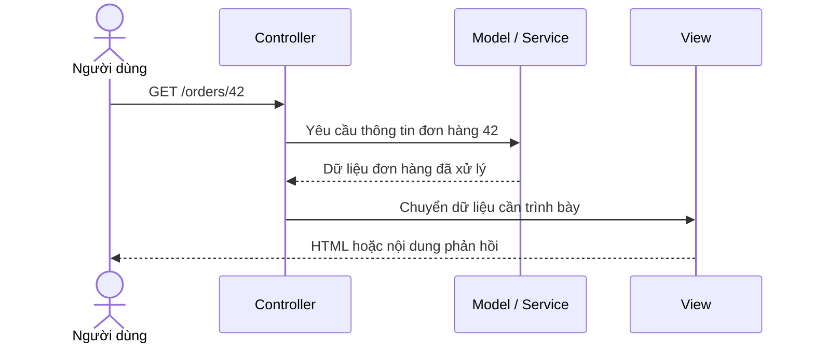

# Lợi ích về khả năng thay đổi, tái sử dụng và kiểm thử

MVC (Model–View–Controller) tổ chức ứng dụng thành ba phần có trách nhiệm khác nhau: **Model** quản lý dữ liệu và quy tắc nghiệp vụ, **View** trình bày thông tin, còn **Controller** tiếp nhận tương tác và điều phối xử lý. Cách phân chia này giúp mã nguồn có ranh giới rõ ràng. Khi một yêu cầu thay đổi, nhóm phát triển có thể xác định phần cần điều chỉnh, đánh giá ảnh hưởng qua các hợp đồng giữa các phần và kiểm tra kết quả ở phạm vi phù hợp.

Giá trị của MVC thể hiện rõ qua ba khía cạnh liên quan chặt chẽ với nhau: khả năng thay đổi, khả năng tái sử dụng và khả năng kiểm thử. Đây không phải là kết quả tự động chỉ nhờ tạo ba thư mục có tên Model, View và Controller. Lợi ích xuất hiện khi mỗi phần giữ đúng trách nhiệm, phụ thuộc được kiểm soát và dữ liệu trao đổi có cấu trúc ổn định.

## 1. Nhắc lại ranh giới trách nhiệm trong MVC

Trong một ứng dụng web, có thể hiểu ba thành phần như sau:

| Thành phần | Trách nhiệm chính | Ví dụ trong ứng dụng đặt hàng |
|---|---|---|
| Model | Biểu diễn trạng thái, dữ liệu và quy tắc nghiệp vụ; phối hợp với các dịch vụ hoặc kho dữ liệu khi cần | Đơn hàng, dòng hàng, quy tắc tính tổng tiền, dịch vụ đặt hàng |
| View | Trình bày dữ liệu cho người dùng hoặc một loại đầu ra cụ thể | Trang chi tiết đơn hàng, biểu mẫu cập nhật, phản hồi JSON |
| Controller | Nhận request hoặc sự kiện, kiểm tra đầu vào ở ranh giới, gọi xử lý phù hợp và chọn kết quả trả về | Nhận yêu cầu xem đơn hàng, gọi dịch vụ truy vấn, đưa dữ liệu vào View |

Tên gọi Model có thể được hiện thực khác nhau tùy framework. Trong một ứng dụng, Model có thể bao gồm đối tượng miền, dịch vụ nghiệp vụ và thành phần truy cập dữ liệu; trong ứng dụng khác, framework có thể dùng một đối tượng `Model` riêng để chuyển dữ liệu sang View. Cần phân biệt đối tượng mang dữ liệu trình bày với toàn bộ mô hình miền và nghiệp vụ của ứng dụng.

Một request xem đơn hàng thường đi qua các bước:



Controller điều phối luồng này. Quy tắc như đơn hàng nào được phép xem, tổng tiền được tính ra sao hoặc trạng thái nào có thể chuyển đổi thuộc về phần nghiệp vụ. View quyết định cách trình bày kết quả, chẳng hạn định dạng ngày tháng, bố cục bảng và nhãn hiển thị.

## 2. Tăng khả năng thay đổi

Khả năng thay đổi (maintainability hoặc modifiability) là mức độ dễ dàng để hiểu, sửa và mở rộng phần mềm khi yêu cầu thay đổi. Một hệ thống có khả năng thay đổi tốt giúp lập trình viên khoanh vùng phần chịu ảnh hưởng, thực hiện sửa đổi với ít tác động ngoài dự kiến và xác minh được hành vi sau khi sửa.

### 2.1. Cô lập thay đổi theo trách nhiệm

Khi giao diện, điều phối request và nghiệp vụ bị trộn trong cùng một đoạn mã, một thay đổi nhỏ có thể buộc lập trình viên sửa nhiều phần không liên quan. Ví dụ, một trang chi tiết đơn hàng vừa truy vấn cơ sở dữ liệu, vừa tự tính chiết khấu, vừa tạo chuỗi HTML. Khi quy tắc chiết khấu thay đổi, người sửa phải đọc cả mã truy vấn và mã trình bày để tìm đúng vị trí.

Với MVC được phân chia hợp lý, mỗi loại thay đổi thường có một điểm bắt đầu rõ ràng:

- Thay đổi cách hiển thị tổng tiền từ số nguyên sang định dạng tiền tệ thuộc về View hoặc bộ chuyển đổi dữ liệu trình bày.
- Thay đổi cách tính chiết khấu thuộc về Model hoặc dịch vụ nghiệp vụ.
- Thay đổi URL, phương thức HTTP hoặc cách ánh xạ request vào thao tác thuộc về Controller và cấu hình định tuyến.

Ví dụ, khi doanh nghiệp bổ sung quy tắc giảm giá theo hạng thành viên, View không cần biết công thức mới. View chỉ nhận tổng tiền và mức giảm đã được tính. Tương tự, khi đổi màu nút hoặc sắp xếp lại các trường trên trang, quy tắc tính tiền không cần thay đổi.

### 2.2. Giảm phụ thuộc và giới hạn phạm vi ảnh hưởng

Tách trách nhiệm có ích khi các thành phần trao đổi qua hợp đồng dữ liệu và giao diện rõ ràng. Controller nên phụ thuộc vào một dịch vụ nghiệp vụ có phương thức dễ hiểu; View nhận dữ liệu đã được chuẩn bị để trình bày; Model không nên phụ thuộc vào cấu trúc HTML hoặc chi tiết của một template cụ thể.

Ví dụ dưới đây minh họa Controller gọi một dịch vụ truy vấn và chuyển dữ liệu sang View theo phong cách Java/Spring MVC:

```java
public record OrderDetailViewData(
    String orderNumber,
    String customerName,
    String formattedTotal,
    String statusLabel
) {}

@Controller
@RequestMapping("/orders")
public class OrderController {
    private final OrderQueryService orderQueryService;

    public OrderController(OrderQueryService orderQueryService) {
        this.orderQueryService = orderQueryService;
    }

    @GetMapping("/{id}")
    public String detail(@PathVariable long id, Model model) {
        OrderDetailViewData order = orderQueryService.getDetail(id);
        model.addAttribute("order", order);
        return "orders/detail";
    }
}
```

Trong ví dụ này, Controller biết cách nhận mã đơn hàng và chọn View `orders/detail`. Nó không tự viết câu truy vấn SQL, tính tổng tiền hoặc tạo HTML. `OrderQueryService` chịu trách nhiệm lấy dữ liệu cần thiết và chuẩn bị kết quả cho ca sử dụng. View chỉ đọc các trường như `orderNumber`, `formattedTotal` và `statusLabel` để hiển thị.

Đối tượng `Model` trong chữ ký của Spring MVC là nơi gắn dữ liệu cho View; nó không đại diện cho toàn bộ Model của kiến trúc MVC. Sự phân biệt này giúp tránh đặt mọi logic miền vào một đối tượng truyền dữ liệu đơn giản.

Hợp đồng giữa các phần cũng cần được giữ ổn định. Nếu đổi tên một trường trong `OrderDetailViewData`, các View đang dùng trường đó có thể phải cập nhật. Vì vậy, tách lớp không làm mất mọi phụ thuộc; nó làm phụ thuộc trở nên tường minh và dễ quản lý hơn. Một thay đổi vẫn có thể lan rộng nếu nhiều thành phần cùng dựa vào hợp đồng bị thay đổi.

### 2.3. Dễ đọc, dễ định vị và dễ mở rộng

Khi trách nhiệm được đặt đúng chỗ, cấu trúc mã nguồn phản ánh cách hệ thống hoạt động. Người mới có thể lần theo request từ Controller, đến dịch vụ hoặc Model, rồi đến View để hiểu luồng xử lý. Khi thêm một chức năng mới, nhóm có thể xác định cần bổ sung thao tác điều phối, quy tắc nghiệp vụ hay cách trình bày.

Ví dụ, yêu cầu thêm trang lịch sử đơn hàng có thể được triển khai bằng một thao tác truy vấn mới trong dịch vụ, một endpoint trong Controller và một View mới. Quy tắc xác định người dùng được xem những đơn hàng nào vẫn được dùng chung ở lớp nghiệp vụ hoặc lớp phân quyền phù hợp. Nhờ vậy, chức năng mới có thể mở rộng hệ thống mà không sao chép toàn bộ xử lý của trang chi tiết.

## 3. Tăng khả năng tái sử dụng

Tái sử dụng (reusability) là khả năng dùng lại một thành phần trong nhiều chức năng hoặc ngữ cảnh mà không phải sao chép và duy trì nhiều phiên bản của cùng một logic. MVC tạo điều kiện cho việc này vì nghiệp vụ, điều phối và trình bày được phân tách. Tuy nhiên, không phải mọi lớp đều nên được dùng chung; cần chọn đúng phần có ý nghĩa ổn định và phạm vi trách nhiệm phù hợp.

### 3.1. Dùng chung quy tắc nghiệp vụ qua nhiều giao diện

Một quy tắc nghiệp vụ thường không thuộc riêng một trang web. Ví dụ, việc tính tổng tiền đơn hàng có thể được sử dụng bởi:

- Trang chi tiết đơn hàng cho khách hàng.
- Trang quản trị để nhân viên kiểm tra đơn.
- API cung cấp dữ liệu cho ứng dụng di động.
- Tác vụ nền tạo hóa đơn hoặc báo cáo.

Nếu công thức tính tiền nằm trong template của trang chi tiết, các chức năng khác có thể phải sao chép công thức đó. Khi chính sách thuế thay đổi, nhiều bản sao cần được sửa đồng thời và rất dễ không nhất quán. Nếu quy tắc được đóng gói trong Model hoặc dịch vụ nghiệp vụ, các luồng xử lý có thể gọi cùng một logic và nhận kết quả nhất quán.

Điều này không có nghĩa là mọi giao diện phải dùng chung một Controller hoặc một View. Mỗi giao diện có thể có Controller và cách trình bày riêng, trong khi cùng sử dụng các ca sử dụng hoặc dịch vụ nghiệp vụ ở phía sau.

### 3.2. Tái sử dụng View và thành phần trình bày

View có thể được chia thành các template, layout hoặc thành phần nhỏ có trách nhiệm rõ ràng. Ví dụ, thanh điều hướng, thông báo lỗi, phần tóm tắt đơn hàng và định dạng trạng thái có thể được dùng ở nhiều trang.

Tái sử dụng ở tầng View giúp giao diện nhất quán và giảm công sức chỉnh sửa. Khi quy chuẩn hiển thị trạng thái đơn hàng thay đổi, một thành phần dùng chung có thể được cập nhật tại một nơi. Dù vậy, chỉ nên dùng chung khi các màn hình thực sự có cùng ý nghĩa và hành vi. Hai vùng giao diện trông giống nhau nhưng có quy tắc tương tác khác nhau có thể cần các thành phần riêng để tránh tạo ra một thành phần dùng chung với quá nhiều điều kiện.

### 3.3. Tái sử dụng qua hợp đồng rõ ràng

Một dịch vụ hoặc thành phần dễ tái sử dụng khi nó thể hiện một mục đích cụ thể, nhận đầu vào có cấu trúc và trả về kết quả có ý nghĩa. Ví dụ, `OrderQueryService.getDetail(id)` mô tả nhu cầu lấy chi tiết đơn hàng. Controller của trang web và Controller của API có thể gọi cùng ca sử dụng, sau đó chuyển kết quả sang dạng phản hồi phù hợp với từng kênh.

Hợp đồng tốt thường có các đặc điểm:

- Tên phương thức và kiểu dữ liệu thể hiện mục đích, không gắn với một trang cụ thể.
- Quy tắc nghiệp vụ không phụ thuộc vào tên route, template hoặc thành phần giao diện.
- Đầu vào được xác thực ở ranh giới thích hợp và đầu ra không để lộ dữ liệu nội bộ không cần thiết.
- Lỗi và kết quả không thành công được biểu diễn nhất quán để các bên gọi có thể xử lý.

Tái sử dụng không đồng nghĩa với việc tạo một lớp tổng quát cho mọi trường hợp. Một thành phần quá nhiều tham số tùy chọn, nhánh điều kiện hoặc phụ thuộc đặc thù có thể khó hiểu hơn các thành phần nhỏ riêng biệt. Chỉ nên trừu tượng hóa khi có nhu cầu chung thực tế và một hợp đồng đủ ổn định.

### 3.4. Ví dụ: một nghiệp vụ, nhiều cách trình bày

Giả sử hệ thống có dịch vụ `OrderQueryService` trả về thông tin đơn hàng. Hai Controller có thể sử dụng cùng dịch vụ:

```java
@Controller
@RequestMapping("/orders")
class WebOrderController {
    private final OrderQueryService orders;

    @GetMapping("/{id}")
    String detail(@PathVariable long id, Model model) {
        model.addAttribute("order", orders.getDetail(id));
        return "orders/detail";
    }
}

@RestController
@RequestMapping("/api/orders")
class OrderApiController {
    private final OrderQueryService orders;

    @GetMapping("/{id}")
    OrderDetailViewData detail(@PathVariable long id) {
        return orders.getDetail(id);
    }
}
```

Đây là ví dụ rút gọn để minh họa việc dùng chung ca sử dụng. Trong ứng dụng thực tế, API thường có DTO và quy tắc tuần tự hóa riêng để kiểm soát phiên bản, bảo mật và cấu trúc phản hồi. Dù đầu ra khác nhau, hai luồng vẫn có thể dùng chung phần truy vấn và quy tắc nghiệp vụ cần thiết.

## 4. Tăng khả năng kiểm thử

Khả năng kiểm thử (testability) là mức độ dễ dàng để kiểm tra hành vi của hệ thống một cách có kiểm soát. Một thành phần dễ kiểm thử thường có đầu vào và đầu ra rõ ràng, ít phụ thuộc ẩn và có thể thay thế các thành phần bên ngoài bằng đối tượng giả hoặc dữ liệu thử nghiệm.

MVC hỗ trợ kiểm thử bằng cách chia hệ thống thành các ranh giới có thể kiểm tra riêng. Nhóm có thể xác minh quy tắc nghiệp vụ mà không cần dựng giao diện, kiểm tra Controller mà không cần kết nối cơ sở dữ liệu thật trong mọi trường hợp, và kiểm tra View thông qua dữ liệu mẫu.

### 4.1. Kiểm thử Model và dịch vụ nghiệp vụ

Đây là nơi kiểm tra các quy tắc quan trọng của ứng dụng: tính tổng tiền, áp dụng giảm giá, kiểm tra chuyển trạng thái, xác định quyền thực hiện thao tác hoặc tính phí vận chuyển. Các kiểm thử này thường là unit test vì có thể gọi trực tiếp phương thức nghiệp vụ với đầu vào xác định.

Ví dụ, khi kiểm tra quy tắc giảm giá, bài kiểm thử có thể xác nhận ba trường hợp: khách hàng đủ điều kiện được giảm, khách hàng không đủ điều kiện không được giảm và tổng tiền không trở thành số âm. Các kiểm thử này không cần mở trình duyệt hay render HTML.

```java
class DiscountPolicyTest {
    private final DiscountPolicy policy = new DiscountPolicy();

    @Test
    void appliesMemberDiscountWhenCustomerIsEligible() {
        Money total = policy.apply(
            Money.of(1_000_000),
            CustomerTier.GOLD
        );

        assertEquals(Money.of(900_000), total);
    }
}
```

Đoạn mã chỉ minh họa ý tưởng kiểm thử quy tắc độc lập; kiểu `Money`, `CustomerTier` và chính sách giảm giá là các thành phần miền của ví dụ. Khi Model hoặc dịch vụ nghiệp vụ không phụ thuộc trực tiếp vào HTTP request, template hay cơ sở dữ liệu cụ thể, việc tạo dữ liệu thử nghiệm và kiểm tra kết quả sẽ đơn giản hơn.

Nếu dịch vụ cần đọc hoặc ghi dữ liệu, có thể phụ thuộc vào interface repository và cung cấp implementation giả trong unit test. Kiểm thử tích hợp riêng sẽ xác minh implementation repository làm việc đúng với cơ sở dữ liệu thật.

### 4.2. Kiểm thử Controller

Controller cần được kiểm tra ở ranh giới HTTP và ở trách nhiệm điều phối. Các trường hợp thường gặp gồm:

- URL và phương thức HTTP được ánh xạ đúng đến thao tác.
- Tham số request được đọc và xác thực đúng.
- Dịch vụ cần thiết được gọi với dữ liệu phù hợp.
- Kết quả thành công chọn đúng View hoặc trả về đúng cấu trúc phản hồi.
- Lỗi nghiệp vụ, dữ liệu không tồn tại và dữ liệu đầu vào không hợp lệ được chuyển thành phản hồi phù hợp.

Vì Controller nhận dịch vụ qua constructor, bài kiểm thử có thể truyền một mock hoặc fake thay cho dịch vụ thật. Khi đó, kiểm thử tập trung vào cách Controller xử lý request và kết quả dịch vụ. Với Spring MVC, `MockMvc` có thể được dùng để kiểm tra endpoint mà không cần khởi chạy máy chủ HTTP thực; các framework khác cũng có cơ chế tương đương.

Không nên chỉ kiểm tra rằng một phương thức nội bộ đã được gọi nếu điều đó không chứng minh hành vi mà người dùng hoặc client quan sát được. Ưu tiên xác minh status code, dữ liệu phản hồi, View được chọn và các tác động có ý nghĩa ở ranh giới.

### 4.3. Kiểm thử View

View có thể được kiểm tra bằng dữ liệu mẫu để xác nhận các trường quan trọng xuất hiện đúng, trạng thái được trình bày dễ hiểu và trường hợp thiếu dữ liệu không làm trang lỗi. Với template HTML, cần chú ý cả việc escape dữ liệu do người dùng cung cấp để tránh đưa nội dung không an toàn vào trang.

Kiểm thử View không thay thế kiểm thử nghiệp vụ. Nó xác nhận rằng dữ liệu đã được chuyển đến được trình bày đúng cách. Ví dụ, Model có thể tính đúng tổng tiền nhưng View lại hiển thị nhầm trường; kiểm thử ở tầng trình bày sẽ giúp phát hiện lỗi này.

### 4.4. Kiểm thử tích hợp toàn luồng

Unit test cho từng phần không bảo đảm mọi thành phần kết nối với nhau chính xác. Một kiểm thử tích hợp hoặc kiểm thử đầu-cuối nên xác minh luồng quan trọng: request đi vào ứng dụng, dữ liệu được lấy và xử lý, sau đó phản hồi được tạo đúng. Có thể dùng cơ sở dữ liệu kiểm thử hoặc môi trường cô lập để kiểm tra những tích hợp cần thiết.

Một chiến lược kiểm thử cân bằng thường gồm:

| Phạm vi | Nội dung xác minh | Ví dụ |
|---|---|---|
| Unit test cho Model/dịch vụ | Quy tắc và kết quả nghiệp vụ | Tính chiết khấu, kiểm tra chuyển trạng thái |
| Kiểm thử Controller | Ánh xạ request, xác thực đầu vào, điều phối và phản hồi | GET đơn hàng hợp lệ trả về trang chi tiết; ID không tồn tại trả về lỗi phù hợp |
| Kiểm thử View | Cách trình bày dữ liệu và các trạng thái giao diện | Tổng tiền, nhãn trạng thái và thông báo lỗi xuất hiện đúng |
| Kiểm thử tích hợp | Các thành phần và hạ tầng hoạt động cùng nhau | Truy vấn repository và render trang với dữ liệu từ cơ sở dữ liệu kiểm thử |

Việc phân lớp giúp tìm lỗi nhanh hơn: nếu unit test của quy tắc giảm giá thất bại, phạm vi cần xem xét tập trung ở Model hoặc dịch vụ; nếu nghiệp vụ đúng nhưng trang hiển thị sai, cần kiểm tra dữ liệu chuyển sang View và template.

## 5. Ba lợi ích hỗ trợ lẫn nhau như thế nào?

Khả năng thay đổi, tái sử dụng và kiểm thử không phải ba mục tiêu tách biệt. Chúng thường xuất phát từ cùng một nền tảng: trách nhiệm rõ ràng, phụ thuộc có chủ đích và hợp đồng dễ hiểu.

| Quyết định thiết kế | Khả năng thay đổi | Khả năng tái sử dụng | Khả năng kiểm thử |
|---|---|---|---|
| Đưa quy tắc nghiệp vụ vào Model hoặc dịch vụ nghiệp vụ | Thay đổi quy tắc tại nơi tập trung | Nhiều Controller hoặc tác vụ có thể dùng chung | Kiểm tra quy tắc mà không cần giao diện |
| Giữ Controller tập trung vào điều phối | Thay đổi route hoặc cách nhận request ít ảnh hưởng nghiệp vụ | Nhiều Controller có thể gọi cùng ca sử dụng | Kiểm tra request và phản hồi bằng dịch vụ giả |
| Đưa trình bày vào View | Điều chỉnh giao diện ít ảnh hưởng quy tắc | Dùng lại layout và thành phần trình bày | Kiểm tra template bằng dữ liệu mẫu |
| Dùng interface và hợp đồng dữ liệu rõ ràng | Thay implementation trong phạm vi hợp đồng | Dùng thành phần ở nhiều ngữ cảnh | Thay phụ thuộc bằng fake hoặc mock |

Ví dụ, khi thêm một API cho ứng dụng di động, phần giao diện web không cần bị sửa. API có thể có Controller riêng và định dạng JSON riêng, nhưng vẫn dùng dịch vụ nghiệp vụ hiện có. Dịch vụ đó có unit test để xác minh quy tắc; Controller API có kiểm thử riêng để xác minh HTTP; kiểm thử tích hợp xác nhận toàn bộ đường đi. Cùng một quyết định tách nghiệp vụ khỏi giao diện hỗ trợ cả ba lợi ích.

## 6. Điều kiện để nhận được các lợi ích và những sai lầm thường gặp

MVC chỉ là cách tổ chức trách nhiệm. Nếu ranh giới bị đặt sai, ứng dụng vẫn có thể khó sửa, khó dùng lại và khó kiểm thử.

**Controller quá nhiều nghiệp vụ.** Khi Controller tự tính toán, truy vấn dữ liệu và thực hiện quy tắc miền, nhiều endpoint có thể lặp lại cùng logic. Hãy chuyển quy tắc có ý nghĩa nghiệp vụ vào Model hoặc dịch vụ phù hợp; giữ Controller làm nhiệm vụ điều phối.

**View chứa quy tắc nghiệp vụ.** Một template có thể định dạng dữ liệu và quyết định cách hiển thị, nhưng không nên là nơi xác định một đơn hàng có đủ điều kiện hoàn tiền hay không. Quy tắc này cần được thực thi ở tầng nghiệp vụ để mọi kênh truy cập dùng chung và không thể bỏ qua chỉ bằng cách gọi một endpoint khác.

**Model phụ thuộc vào giao diện hoặc HTTP.** Nếu đối tượng miền phải biết tên template, request hiện tại hay cấu trúc HTML, việc dùng lại nghiệp vụ trong API hoặc tác vụ nền sẽ khó khăn. Hãy giữ phần nghiệp vụ độc lập với chi tiết trình bày và giao thức khi có thể.

**Tạo quá nhiều lớp chỉ để tuân theo tên gọi.** Không phải mỗi trường dữ liệu đều cần một lớp mới, và không phải mọi thao tác đều cần thêm một tầng chuyển tiếp. Một lớp chỉ chuyển tiếp lời gọi mà không tạo ra ranh giới, chính sách hay khả năng thay thế có thể làm luồng xử lý dài hơn mà không đem lại lợi ích.

**Dùng chung một thành phần cho các trường hợp khác nhau.** Tái sử dụng quá mức có thể tạo ra API nhiều tham số tùy chọn và nhiều nhánh đặc biệt. Nếu hai chức năng chỉ giống nhau bề ngoài nhưng khác quy tắc, hãy giữ chúng riêng hoặc chỉ chia sẻ phần thực sự chung.

**Kiểm thử chỉ ở một tầng.** Chỉ có kiểm thử giao diện sẽ khiến việc định vị lỗi nghiệp vụ khó hơn; chỉ có unit test lại không phát hiện được lỗi định tuyến hoặc template. Chọn phạm vi kiểm thử theo rủi ro và hành vi cần xác minh.

Ngoài ra, phân tách thành phần không tự động giải quyết các vấn đề bảo mật. Controller cần kiểm tra và chuẩn hóa đầu vào ở ranh giới, Model hoặc dịch vụ phải thực thi quy tắc quyền hạn ở nơi thích hợp, còn View phải escape dữ liệu khi xuất ra HTML. Không nên xem việc ẩn một nút trên giao diện là cơ chế phân quyền.

## 7. Cách đánh giá một thiết kế MVC

Khi xem xét một chức năng, có thể tự đặt các câu hỏi sau:

1. Nếu yêu cầu đổi cách trình bày, có phải sửa quy tắc nghiệp vụ không?
2. Nếu thêm một kênh truy cập như API hoặc tác vụ nền, phần nghiệp vụ hiện có có thể được gọi lại không?
3. Có thể kiểm tra quy tắc quan trọng mà không khởi chạy giao diện hoặc máy chủ web không?
4. Controller có chủ yếu nhận request, điều phối và chọn phản hồi không?
5. View có tập trung trình bày dữ liệu và tránh quyết định nghiệp vụ không?
6. Các thành phần có hợp đồng rõ ràng, lỗi được xử lý nhất quán và phụ thuộc có thể thay thế khi kiểm thử không?

Không nhất thiết mọi câu trả lời đều phải là “có” trong mọi hệ thống. Một ứng dụng nhỏ có thể cần cấu trúc đơn giản hơn một hệ thống lớn với nhiều kênh truy cập. Điều quan trọng là mức độ phân tách phải tương xứng với độ phức tạp và khả năng thay đổi dự kiến.

## Kết luận

MVC giúp ứng dụng dễ thay đổi khi mỗi loại thay đổi có phạm vi và điểm chịu trách nhiệm rõ ràng; dễ tái sử dụng khi nghiệp vụ và các thành phần trình bày phù hợp được đóng gói qua hợp đồng ổn định; và dễ kiểm thử khi từng phần có thể được kiểm tra độc lập cùng với các kiểm thử tích hợp cần thiết. Ba lợi ích này phụ thuộc vào chất lượng của ranh giới thiết kế. Việc đặt tên ba thành phần theo MVC là bước khởi đầu; giữ đúng trách nhiệm, kiểm soát phụ thuộc và xác minh hành vi mới là điều tạo ra giá trị lâu dài.
