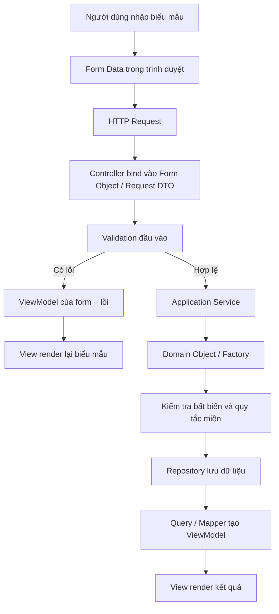

# Phân biệt đối tượng miền, DTO, dữ liệu biểu mẫu và ViewModel

Trong ứng dụng web theo kiến trúc **MODEL_VIEW_CONTROLLER (MVC)**, dữ liệu đi qua nhiều ranh giới: từ trình duyệt vào Controller, từ Controller đến tầng nghiệp vụ, từ Model đến tầng trình bày và từ máy chủ trở lại trình duyệt. Các cấu trúc dữ liệu ở những ranh giới này có thể trông giống nhau, nhưng chúng phục vụ những mục đích khác nhau.

Một đơn hàng có thể được biểu diễn bằng đối tượng miền `Order`, được gửi qua API dưới dạng `OrderResponse`, được người dùng nhập qua `CreateOrderForm` và được hiển thị trên trang chi tiết bằng `OrderDetailViewModel`. Cả bốn cấu trúc có thể chứa mã đơn hàng hoặc tổng tiền, nhưng chúng không có cùng trách nhiệm, vòng đời hay quyền thay đổi.

Bài học này phân biệt bốn khái niệm:

- **Đối tượng miền (Domain Object):** mô hình hóa khái niệm, dữ liệu và quy tắc của miền nghiệp vụ.
- **DTO (Data Transfer Object):** mang dữ liệu qua một ranh giới giao tiếp.
- **Dữ liệu biểu mẫu (Form Data):** biểu diễn dữ liệu người dùng nhập hoặc gửi từ giao diện biểu mẫu.
- **ViewModel:** cung cấp dữ liệu đã chuẩn bị cho một View cụ thể.

Phân biệt đúng giúp tránh để giao diện quyết định trạng thái nghiệp vụ, tránh lộ trường nội bộ, giảm phụ thuộc giữa các tầng và làm rõ nơi cần kiểm tra dữ liệu.

## 1. Vì sao không dùng một lớp cho mọi mục đích?

Giả sử ứng dụng quản lý đơn hàng có một lớp `Order` với các trường:

```java
class Order {
    String id;
    String customerId;
    String customerName;
    String status;
    BigDecimal total;
    String shippingAddress;
    String selectedTab;
    String successMessage;
}
```

Nếu lớp này vừa đại diện cho dữ liệu lưu trữ, vừa nhận request, vừa được serialize thành JSON, vừa được đưa trực tiếp vào template, nó sẽ phải phục vụ nhiều yêu cầu không liên quan:

- Tầng nghiệp vụ cần bảo vệ quy tắc chuyển trạng thái và tính tổng tiền.
- API cần định dạng dữ liệu theo hợp đồng công khai và phiên bản API.
- Form cần giữ giá trị người dùng nhập, kể cả khi dữ liệu chưa hợp lệ.
- View cần nhãn trạng thái đã dịch, kiểu huy hiệu, thông báo và tab đang chọn.
- Cơ sở dữ liệu có thể cần khóa kỹ thuật, version hoặc quan hệ phục vụ persistence.

Khi gộp tất cả vào một lớp, một thay đổi giao diện có thể buộc sửa Model nghiệp vụ; một trường nội bộ có thể vô tình bị gửi ra API; dữ liệu chưa hợp lệ có thể đi vào entity; hoặc người dùng có thể gửi thêm thuộc tính không được phép thay đổi.

Một nguyên tắc hữu ích là **mỗi cấu trúc dữ liệu nên có một hợp đồng rõ ràng với người sử dụng nó**. Hợp đồng đó xác định dữ liệu nào tồn tại, ai được tạo hoặc thay đổi, dữ liệu có ý nghĩa trong phạm vi nào và được dùng trong bao lâu.

## 2. Đối tượng miền (Domain Object)

Đối tượng miền mô hình hóa một khái niệm trong lĩnh vực mà ứng dụng giải quyết. Nó không chỉ là một túi dữ liệu. Tùy thiết kế, Domain Object có thể là entity, value object, aggregate root hoặc một đối tượng miền khác có hành vi.

### Entity

Entity có định danh ổn định trong phạm vi miền. Ví dụ, đơn hàng `ORD-42` vẫn là cùng một đơn hàng dù địa chỉ giao hàng hoặc trạng thái thay đổi.

```java
public final class Order {
    private final OrderId id;
    private final CustomerId customerId;
    private final List<OrderLine> lines;
    private OrderStatus status;

    // Constructor/factory và các hành vi miền được định nghĩa tại đây.
}
```

Định danh giúp phân biệt hai đơn hàng có cùng khách hàng và cùng tổng tiền. Một entity có thể thay đổi theo thời gian nhưng vẫn giữ identity.

### Value Object

Value object mô tả một giá trị theo thuộc tính của nó, thường không có identity độc lập và nên bất biến khi phù hợp. Ví dụ: `Money`, `EmailAddress`, `Address` hoặc `DateRange`.

```java
public record Money(BigDecimal amount, Currency currency) {
    public Money {
        Objects.requireNonNull(amount);
        Objects.requireNonNull(currency);

        if (amount.signum() < 0) {
            throw new IllegalArgumentException("Amount cannot be negative");
        }
    }
}
```

Hai giá trị tiền có cùng số tiền và đơn vị tiền tệ có thể được xem là bằng nhau theo giá trị. Không nên dùng số thực nhị phân như `double` để biểu diễn tiền trong các phép tính tài chính thông thường.

### Hành vi và bất biến miền

Domain Object bảo vệ những quy tắc cần đúng để đối tượng luôn hợp lệ. Ví dụ, đơn hàng không được xác nhận khi chưa có dòng hàng; đơn đã thanh toán không thể quay về trạng thái bản nháp bằng một setter tùy ý.

```java
public final class Order {
    private final OrderId id;
    private final List<OrderLine> lines = new ArrayList<>();
    private OrderStatus status = OrderStatus.DRAFT;

    public void addLine(OrderLine line) {
        requireStatus(OrderStatus.DRAFT);
        lines.add(Objects.requireNonNull(line));
    }

    public void confirm() {
        requireStatus(OrderStatus.DRAFT);
        if (lines.isEmpty()) {
            throw new IllegalStateException(
                    "An order without lines cannot be confirmed");
        }
        status = OrderStatus.CONFIRMED;
    }

    private void requireStatus(OrderStatus expected) {
        if (status != expected) {
            throw new IllegalStateException("Invalid order transition");
        }
    }
}
```

Đoạn mã rút gọn minh họa cách hành vi miền kiểm soát thay đổi. Trong ứng dụng thực tế, cần bổ sung constructor/factory, getter an toàn, quy tắc tiền tệ, transaction và cơ chế persistence phù hợp.

Domain Object thường được tạo hoặc khôi phục bởi tầng nghiệp vụ/persistence, sau đó được application service điều phối. Nó không nên phụ thuộc vào HTTP request, tên trường HTML, session trình duyệt hoặc cách một template hiển thị nhãn.

## 3. DTO (Data Transfer Object)

DTO là cấu trúc dữ liệu dùng để chuyển thông tin qua một ranh giới. Ranh giới có thể là giữa client và server, giữa hai service, giữa tầng ứng dụng và một adapter, hoặc giữa một tiến trình và một tiến trình khác.

DTO thường chứa dữ liệu và ít hoặc không chứa hành vi nghiệp vụ. Nó có thể là Java `record`, class bất biến hoặc một cấu trúc serialization khác. DTO không nhất thiết phải là một lớp cho mọi request; mục tiêu là làm hợp đồng truyền dữ liệu rõ ràng.

### Request DTO

Request DTO mô tả dữ liệu client được phép gửi cho một endpoint hoặc use case.

```java
public record CreateOrderRequest(
        String shippingAddress,
        List<CreateOrderLineRequest> lines
) {}

public record CreateOrderLineRequest(
        String productId,
        int quantity
) {}
```

Request này chỉ nhận địa chỉ giao hàng và các dòng hàng. Nó không nhận `status`, `total`, `customerId`, `createdAt` hoặc trường audit nếu người dùng không có quyền quyết định chúng. Server xác định khách hàng từ danh tính đã xác thực, lấy giá từ nguồn có thẩm quyền và để miền tính tổng tiền.

### Response DTO

Response DTO mô tả dữ liệu server công khai cho client:

```java
public record OrderResponse(
        String orderNumber,
        String status,
        BigDecimal total,
        String currency
) {}
```

Response DTO có thể khác với entity về tên trường, cấu trúc lồng nhau, định dạng ngày giờ hoặc cách biểu diễn enum. Nó không nên vô tình để lộ thông tin nội bộ như ghi chú vận hành, khóa persistence hoặc dữ liệu cá nhân không thuộc hợp đồng.

### DTO theo mục đích giao tiếp

Không nhất thiết phải có một `OrderDto` duy nhất cho mọi luồng. Các endpoint có thể cần các hợp đồng khác nhau:

| DTO | Mục đích | Dữ liệu ví dụ |
|---|---|---|
| `CreateOrderRequest` | Gửi yêu cầu tạo đơn | Địa chỉ giao, sản phẩm và số lượng |
| `UpdateShippingRequest` | Thay đổi địa chỉ giao | Địa chỉ mới, version nếu cần |
| `OrderSummaryResponse` | Hiển thị danh sách qua API | Mã đơn, trạng thái, tổng tiền |
| `OrderDetailResponse` | Đọc chi tiết qua API | Dòng hàng, địa chỉ, trạng thái, tổng tiền |
| `CancelOrderRequest` | Yêu cầu hủy | Lý do hủy nếu hợp đồng cần |

DTO nhỏ theo hành động giúp giảm trường không cần thiết và làm rõ quyền thay đổi. Tuy nhiên, không nên chia DTO quá vụn nếu các hợp đồng thực sự giống nhau và không có lý do độc lập để tiến hóa.

## 4. Dữ liệu biểu mẫu (Form Data)

Form Data là dữ liệu được thu thập từ một biểu mẫu giao diện. Trong ứng dụng HTML, dữ liệu thường được gửi bằng form fields như `input`, `select`, `textarea` hoặc được chuyển thành JSON bởi JavaScript.

Form Data có một số đặc điểm riêng:

- Có thể chứa chuỗi rỗng, giá trị thiếu, giá trị không chuyển đổi được hoặc định dạng mà người dùng đang nhập dở.
- Có thể cần giữ lại sau khi validation thất bại để người dùng sửa tiếp.
- Có thể bao gồm trường chỉ phục vụ trải nghiệm, như xác nhận checkbox hoặc token CSRF, không phải thuộc tính của entity.
- Không phải mọi trường người dùng gửi đều được phép ghi vào Domain Object.
- Kiểu dữ liệu nhận từ HTTP thường là chuỗi hoặc dạng biểu diễn giao thức, cần binding và chuyển đổi trước khi áp dụng quy tắc miền.

### Form object / form backing object

Trong một số framework MVC, dữ liệu biểu mẫu được bind vào một object trung gian thường gọi là form object hoặc form backing bean. Object này có thể đồng thời là một request DTO nếu mục đích và vòng đời phù hợp.

```java
public class CreateOrderForm {
    @NotBlank
    @Size(max = 250)
    private String shippingAddress;

    @NotEmpty
    private List<@Valid OrderLineForm> lines = new ArrayList<>();

    // Getter/setter phục vụ data binding của framework.
}

public class OrderLineForm {
    @NotBlank
    private String productId;

    @NotNull
    @Min(1)
    private Integer quantity;

    // Getter/setter phục vụ data binding.
}
```

Ở đây, `Integer` cho phép biểu diễn trường chưa được nhập (`null`) trước khi validation. Nếu dùng `int`, giá trị mặc định `0` có thể làm khó phân biệt trường bị bỏ trống với người dùng thực sự nhập số 0.

Form object có thể dùng setter để framework binding dữ liệu. Điều đó không có nghĩa Domain Object cũng nên có setter công khai cho mọi trường. Form object là vùng đệm tiếp nhận dữ liệu không đáng tin cậy; Domain Object là mô hình cần bảo vệ bất biến.

### Form Data không đồng nghĩa với `FormData` của JavaScript

Trong JavaScript, `FormData` là API trình duyệt dùng để đóng gói dữ liệu từ form, thường cho `fetch` hoặc multipart upload:

```javascript
const form = document.querySelector("#create-order-form");
const payload = new FormData(form);

await fetch("/orders", {
  method: "POST",
  body: payload
});
```

API `FormData` là cơ chế truyền dữ liệu của trình duyệt. Khái niệm Form Data trong thiết kế MVC rộng hơn: nó chỉ dữ liệu người dùng nhập và cấu trúc trung gian nhận dữ liệu đó, bất kể framework dùng Java bean, DTO, multipart hay JSON.

## 5. ViewModel

ViewModel là cấu trúc dữ liệu được chuẩn bị để một View cụ thể trình bày. Nó tập trung vào nhu cầu hiển thị và tương tác của màn hình, không nhất thiết trùng với Domain Object hoặc API DTO.

Ví dụ, trang chi tiết đơn hàng cần:

- Mã đơn và tên khách hàng để hiển thị.
- Nhãn trạng thái đã dịch theo ngôn ngữ hiện tại.
- Kiểu badge để tô màu trạng thái.
- Tổng tiền đã định dạng theo locale.
- Danh sách dòng hàng với tên sản phẩm.
- Một cờ gợi ý có nên hiển thị nút hủy hay không.
- Tab đang chọn hoặc thông báo một lần sau redirect.

```java
public record OrderLineViewModel(
        String productName,
        int quantity,
        String lineTotalText
) {}

public record OrderDetailViewModel(
        String orderNumber,
        String customerName,
        String statusLabel,
        String statusBadgeClass,
        String totalText,
        boolean showCancelAction,
        String activeTab,
        String notice,
        List<OrderLineViewModel> lines
) {
    public OrderDetailViewModel {
        lines = List.copyOf(lines);
    }
}
```

Các trường `statusLabel`, `statusBadgeClass`, `totalText`, `activeTab` và `notice` phục vụ trình bày. Chúng không phải thuộc tính cần lưu trong entity `Order`. `showCancelAction` là gợi ý giao diện dựa trên quyền và trạng thái được tính ở server; endpoint hủy vẫn phải kiểm tra quyền và trạng thái mới nhất khi nhận request.

ViewModel thường được tạo cho một trang, một component hoặc một use case trình bày. Nó có thể tổng hợp dữ liệu từ nhiều Domain Object hoặc nhiều query. Vì vậy, ViewModel không nhất thiết có quan hệ một-một với entity.

## 6. Bảng so sánh bốn loại dữ liệu

| Tiêu chí | Domain Object | DTO | Form Data | ViewModel |
|---|---|---|---|---|
| Mục tiêu | Mô hình hóa miền và bảo vệ quy tắc | Chuyển dữ liệu qua ranh giới | Tiếp nhận dữ liệu người dùng nhập | Cung cấp dữ liệu cho một View |
| Nội dung | Trạng thái, identity, hành vi, bất biến | Các trường của hợp đồng truyền | Giá trị nhập, có thể chưa hợp lệ | Dữ liệu đã định dạng/tổng hợp cho UI |
| Quy tắc | Có thể chứa quy tắc miền | Thường không chứa nghiệp vụ | Validation đầu vào và binding | Quy tắc trình bày/điều kiện hiển thị |
| Nguồn tạo | Factory, repository, domain service | Mapper, serializer, adapter | Browser và data binding | Controller, mapper hoặc query service |
| Người sử dụng | Tầng nghiệp vụ | Client/service/adapter nhận dữ liệu | Controller và validation | View/template/component |
| Vòng đời | Theo vòng đời đối tượng nghiệp vụ | Theo request/message hoặc hợp đồng | Theo lần nhập/gửi form | Theo lần render hoặc ngữ cảnh View |
| Có thể chứa dữ liệu chưa hợp lệ? | Không nên sau khi được tạo hợp lệ | Có thể nếu là raw transport DTO, nhưng nên phân biệt rõ | Có | Thông thường không; nên chuẩn bị để View dùng an toàn |
| Có phải nguồn sự thật? | Có thể là mô hình có thẩm quyền trong xử lý nghiệp vụ | Không, chỉ là bản truyền dữ liệu | Không | Không, chỉ là bản trình bày |

Ranh giới này là hướng dẫn về trách nhiệm, không phải luật bắt buộc mỗi khái niệm phải là một class riêng. Một DTO có thể được dùng làm form object nếu nó thực sự đại diện cho cùng hợp đồng đầu vào. Một ViewModel có thể được serialize thành response API trong thiết kế phù hợp, nhưng khi hợp đồng API và nhu cầu View tiến hóa độc lập thì nên tách chúng.

## 7. Luồng dữ liệu trong một ứng dụng MVC

Một luồng tạo đơn hàng có thể đi qua các bước:



Ở mỗi bước, dữ liệu được chuyển qua một hợp đồng phù hợp:

1. Browser thu thập Form Data; đây là dữ liệu người dùng kiểm soát.
2. Controller bind dữ liệu vào Form Object hoặc Request DTO.
3. Validation kiểm tra kiểu, định dạng, trường bắt buộc và giới hạn đầu vào.
4. Application service kiểm tra danh tính, quyền và điều phối use case.
5. Domain Object được tạo hoặc tải từ repository, rồi áp dụng hành vi miền.
6. Repository lưu thay đổi trong transaction phù hợp.
7. Mapper/query service tạo ViewModel để View hiển thị kết quả.

Không phải ứng dụng nào cũng cần tất cả các lớp này cho một form đơn giản. Tuy nhiên, khi dữ liệu và quy tắc phức tạp hơn, việc tách ranh giới giúp hệ thống dễ thay đổi và kiểm thử.

## 8. Ví dụ xuyên suốt: tạo đơn hàng

### Bước 1: Nhận dữ liệu biểu mẫu

Người dùng nhập địa chỉ giao hàng và danh sách sản phẩm. Form không được gửi giá tiền cuối cùng như một sự thật đáng tin cậy, vì trình duyệt có thể bị sửa.

```html
<form action="/orders" method="post" id="create-order-form">
  <label for="shipping-address">Địa chỉ giao hàng</label>
  <textarea id="shipping-address" name="shippingAddress" required></textarea>

  <label for="product-id">Sản phẩm</label>
  <input id="product-id" name="lines[0].productId" required>

  <label for="quantity">Số lượng</label>
  <input id="quantity" name="lines[0].quantity" type="number" min="1" required>

  <button type="submit">Tạo đơn hàng</button>
</form>
```

Framework có thể bind các trường này vào `CreateOrderForm`. Form object giữ giá trị đầu vào để hiển thị lại nếu validation thất bại.

### Bước 2: Kiểm tra và chuyển đổi

Controller kiểm tra validation đầu vào rồi chuyển các giá trị đã hợp lệ sang command/request cho application service. Kiểm tra định dạng không thay thế quy tắc miền: ví dụ số lượng phải là số dương ở DTO, và miền vẫn phải xác nhận sản phẩm còn được bán, còn hàng hoặc được phép đặt.

### Bước 3: Tạo Domain Object

Application service xác định `customerId` từ người dùng đã xác thực, lấy thông tin sản phẩm và giá hiện tại từ nguồn có thẩm quyền, sau đó tạo đơn hàng bằng factory hoặc phương thức miền. Model tính tổng tiền từ dữ liệu đã xác nhận và đặt trạng thái ban đầu hợp lệ.

### Bước 4: Tạo ViewModel

Sau khi lưu thành công, ứng dụng có thể redirect đến trang chi tiết. Query service tải dữ liệu và mapper tạo `OrderDetailViewModel`, gồm nhãn trạng thái, tổng tiền đã định dạng, tên sản phẩm và các hành động có thể hiển thị.

## 9. Mapper: chuyển đổi có chủ đích giữa các hợp đồng

Mapper là thành phần chuyển dữ liệu từ cấu trúc này sang cấu trúc khác. Nó giúp tránh để View hoặc Controller tự truy cập và chuyển đổi tùy tiện các trường của entity.

Ví dụ ánh xạ từ Domain Object sang response DTO:

```java
public final class OrderResponseMapper {
    public OrderResponse toResponse(Order order) {
        return new OrderResponse(
                order.getId().value(),
                order.getStatus().name(),
                order.getTotal().amount(),
                order.getTotal().currency().getCurrencyCode()
        );
    }
}
```

Ví dụ ánh xạ sang ViewModel có định dạng theo locale:

```java
public final class OrderDetailViewModelMapper {
    public OrderDetailViewModel toViewModel(
            Order order,
            String customerName,
            Locale locale,
            boolean mayCancel,
            String activeTab,
            String notice) {

        NumberFormat moneyFormat = NumberFormat.getCurrencyInstance(locale);
        String totalText = moneyFormat.format(
                order.getTotal().amount());

        String statusLabel = switch (order.getStatus()) {
            case DRAFT -> "Bản nháp";
            case CONFIRMED -> "Đã xác nhận";
            case PAID -> "Đã thanh toán";
            case CANCELLED -> "Đã hủy";
        };

        boolean showCancelAction = mayCancel
                && order.getStatus() != OrderStatus.PAID
                && order.getStatus() != OrderStatus.CANCELLED;

        List<OrderLineViewModel> lines = order.getLines().stream()
                .map(line -> new OrderLineViewModel(
                        line.getProductName(),
                        line.getQuantity(),
                        moneyFormat.format(line.getSubtotal().amount())))
                .toList();

        return new OrderDetailViewModel(
                order.getId().value(),
                customerName,
                statusLabel,
                "status-" + order.getStatus().name().toLowerCase(Locale.ROOT),
                totalText,
                showCancelAction,
                activeTab,
                notice,
                lines
        );
    }
}
```

Ví dụ dùng Java 17 trở lên (`record`, `switch` expression và `Stream.toList`). Tên kiểu miền được rút gọn để tập trung vào mapping. Trong ứng dụng thực tế, nên đưa dịch thuật nhãn vào message bundle, xử lý đơn vị tiền tệ rõ ràng và không giả định `mayCancel` thay thế kiểm tra quyền ở endpoint.

Mapper không nên âm thầm tạo ra quy tắc nghiệp vụ. Nếu cần xác định đơn có thể hủy hay không, application service/policy hoặc Model chịu trách nhiệm quyết định; mapper chỉ chuyển kết quả đã được xác định thành dữ liệu hiển thị.

## 10. Validation ở đâu?

Validation thường được chia thành nhiều lớp vì mỗi lớp kiểm tra một loại điều kiện khác nhau.

| Loại kiểm tra | Ví dụ | Nơi thường thực hiện |
|---|---|---|
| Binding/conversion | Chuỗi `abc` có chuyển thành số nguyên được không? | Web binding/conversion layer |
| Validation đầu vào | Tiêu đề không rỗng, độ dài không quá giới hạn | Form object hoặc Request DTO |
| Quy tắc nghiệp vụ | Không thể xác nhận đơn hàng rỗng | Domain Object/domain service |
| Quyền truy cập | Người dùng có được sửa đơn hàng này không? | Application service/authorization policy |
| Ràng buộc lưu trữ | Mã đơn phải duy nhất | Database constraint và xử lý persistence |

Không nên đặt tất cả validation trong View. Kiểm tra phía trình duyệt giúp phản hồi nhanh nhưng có thể bị bỏ qua. Không nên đặt mọi quy tắc nghiệp vụ vào annotation của Form Object vì cùng một quy tắc có thể được gọi từ API, batch job hoặc message consumer.

Một quy tắc có thể được kiểm tra ở nhiều lớp với mục đích khác nhau. Ví dụ, Form Object kiểm tra số lượng là số dương để phản hồi gần trường nhập; Domain Object vẫn bảo vệ điều kiện đó để không có caller nào khác tạo ra dòng hàng không hợp lệ.

## 11. Binding dữ liệu và rủi ro mass assignment

**Mass assignment** hoặc over-posting xảy ra khi ứng dụng tự động bind nhiều trường từ request vào một đối tượng có nhiều thuộc tính hơn những gì người dùng được phép thay đổi.

Ví dụ entity có:

```java
class Account {
    private String displayName;
    private String email;
    private boolean administrator;
    private AccountStatus status;
    private Instant createdAt;
}
```

Nếu Controller bind trực tiếp request vào `Account`, người dùng có thể tự gửi thêm `administrator=true` hoặc `status=ACTIVE` dù form không hiển thị các trường đó. Việc ẩn trường trong HTML không ngăn request được tạo thủ công.

Hãy dùng DTO/Form Object chỉ có trường được phép nhận:

```java
public record UpdateProfileRequest(
        @NotBlank @Size(max = 80) String displayName,
        @Email String email
) {}
```

Sau đó application service tải Account hiện tại, kiểm tra quyền và gọi phương thức cập nhật có chủ đích. `administrator`, `status` và `createdAt` được quản lý bởi use case riêng hoặc hệ thống, không nhận từ form cập nhật hồ sơ.

## 12. Không serialize Domain Object trực tiếp thành JSON

Trả entity trực tiếp từ controller API có vẻ tiện lợi nhưng tạo phụ thuộc không mong muốn:

- Thay đổi cấu trúc miền có thể vô tình thay đổi hợp đồng API.
- Quan hệ hai chiều có thể tạo vòng lặp serialize hoặc tải dữ liệu ngoài ý muốn.
- Trường nội bộ có thể bị lộ.
- Lazy loading có thể phát sinh truy vấn khi serializer truy cập thuộc tính.
- Tên enum, kiểu ngày giờ hoặc cấu trúc collection có thể không phù hợp với client.
- Client bị phụ thuộc vào cấu trúc persistence thay vì hợp đồng được thiết kế.

Response DTO giúp kiểm soát rõ trường công khai, định dạng và phiên bản. Khi API cần tiến hóa, có thể thay đổi DTO và mapper mà không buộc Domain Object phải thay đổi theo cùng nhịp.

## 13. DTO, Form Object và ViewModel có thể trùng nhau không?

Các khái niệm này mô tả **vai trò**, không nhất thiết là bốn loại class kỹ thuật hoàn toàn khác nhau.

### Khi có thể dùng chung

- Một `CreateProfileRequest` có thể đồng thời là Form Object nếu form HTML và endpoint nhận đúng cùng các trường, cùng quy tắc binding và cùng vòng đời.
- Một DTO response đơn giản có thể được dùng làm ViewModel nếu View chỉ cần đúng hợp đồng đó và nhu cầu trình bày không làm hợp đồng API bị chi phối.
- Một ViewModel có thể là record bất biến hoặc DTO nội bộ nếu nó chỉ truyền dữ liệu đến template.

### Khi nên tách

- Form cần giữ chuỗi chưa chuyển đổi được để hiển thị lỗi, trong khi command DTO chỉ nên chứa kiểu dữ liệu đã được chuyển đổi.
- API công khai cần ổn định qua nhiều phiên bản, còn View thay đổi thường xuyên theo thiết kế giao diện.
- View cần nhãn đã dịch, định dạng tiền tệ, tab đang chọn hoặc thông báo; API DTO không nên chứa trạng thái riêng của một trang.
- Nhiều View khác nhau cần các trường và cách trình bày khác nhau từ cùng một Domain Object.
- Request cập nhật chỉ được phép thay đổi một tập trường, còn response cần hiển thị nhiều trường hơn.
- Dữ liệu đầu vào và đầu ra có quy tắc bảo mật hoặc quyền truy cập khác nhau.

Không nên tách lớp chỉ vì muốn có một lớp cho mỗi tên gọi. Hãy tách khi mục đích, vòng đời, quyền thay đổi hoặc nhịp tiến hóa thực sự khác nhau.

## 14. Tổ chức package và phụ thuộc

Một cách tổ chức minh họa trong ứng dụng Java MVC:

```text
com.example.orders
├── domain
│   ├── Order.java
│   ├── OrderLine.java
│   ├── OrderStatus.java
│   └── Money.java
├── application
│   ├── CreateOrderUseCase.java
│   ├── GetOrderDetailQuery.java
│   └── OrderRepository.java
├── web
│   ├── OrderController.java
│   ├── form
│   │   ├── CreateOrderForm.java
│   │   └── OrderLineForm.java
│   ├── dto
│   │   ├── CreateOrderRequest.java
│   │   └── OrderResponse.java
│   ├── viewmodel
│   │   └── OrderDetailViewModel.java
│   └── mapper
│       └── OrderViewModelMapper.java
└── infrastructure
    └── persistence
        └── JpaOrderRepository.java
```

Đây chỉ là một cách tổ chức, không phải cấu trúc thư mục bắt buộc của MVC. Dự án nhỏ có thể dùng ít package hơn; dự án lớn có thể tổ chức theo feature/module thay vì chia toàn bộ theo technical layer.

Điều cần giữ là hướng phụ thuộc hợp lý:

- Domain không phụ thuộc vào Servlet API, template engine hoặc form HTML.
- Application service điều phối use case và làm việc với abstraction cần thiết.
- Web adapter biết request DTO, Form Object và ViewModel.
- Infrastructure triển khai repository hoặc tích hợp kỹ thuật.
- Mapper chuyển đổi tại ranh giới, không khiến Domain Object phải biết cách serialize hoặc trình bày.

## 15. Kiểm thử từng loại cấu trúc

Tách hợp đồng dữ liệu giúp kiểm thử theo trách nhiệm.

| Đối tượng kiểm thử | Điều cần xác minh | Ví dụ |
|---|---|---|
| Domain Object | Bất biến và hành vi miền | Đơn rỗng không thể xác nhận |
| Request DTO/Form Object | Binding và validation đầu vào | Tiêu đề rỗng bị từ chối, lỗi gắn đúng trường |
| Mapper | Ánh xạ dữ liệu và định dạng | `PAID` thành nhãn “Đã thanh toán” |
| ViewModel | Dữ liệu đủ và đúng cho View | Danh sách dòng hàng không null, thông báo đúng |
| Controller | Request được chuyển thành use case và response đúng | POST hợp lệ gọi service, lỗi render lại form |
| API contract | JSON đúng cấu trúc và không lộ trường nội bộ | Response không chứa `createdByInternal` |
| Security | Request không thể thay đổi trường ngoài quyền | Gửi thêm `administrator=true` không nâng quyền |

Ví dụ kiểm thử mass assignment nên gửi thêm một trường không thuộc DTO và xác minh trường đó không thay đổi. Không nên chỉ kiểm tra HTML form không chứa trường đó, vì request có thể được tạo thủ công.

## 16. Các lỗi thiết kế thường gặp

### Dùng entity làm Form Object

Form có thể bind trực tiếp vào nhiều thuộc tính nội bộ, tạo nguy cơ over-posting và làm dữ liệu chưa hợp lệ đi vào Domain Object. Hãy nhận dữ liệu qua Form Object/Request DTO rồi chuyển đổi có kiểm soát.

### Dùng DTO làm nơi chứa quy tắc nghiệp vụ

DTO nên mô tả hợp đồng truyền dữ liệu. Nếu DTO tự quyết định một đơn hàng có thể hủy hoặc tính tổng tiền có thẩm quyền, logic sẽ bị gắn với một ranh giới giao tiếp và có thể bị bỏ qua ở caller khác. Đưa quy tắc vào Domain Object/domain service phù hợp.

### Đưa trạng thái giao diện vào Domain Object

Các trường như `activeTab`, `expanded`, `successMessage` hoặc `sortDirection` thường chỉ thuộc ngữ cảnh View. Đưa chúng vào entity làm miền phụ thuộc vào màn hình và có thể tạo dữ liệu lưu trữ vô nghĩa.

### Trả Domain Object trực tiếp từ API

Điều này gắn hợp đồng bên ngoài với cấu trúc miền/persistence và có thể lộ trường nội bộ. Dùng response DTO khi cần kiểm soát rõ hợp đồng công khai.

### Tạo quá nhiều lớp trùng lặp

Nếu `OrderRequest`, `OrderForm`, `OrderInputDto` đều có cùng trường và cùng vòng đời nhưng chỉ chuyển đổi qua lại mà không tạo giá trị, kiến trúc sẽ nặng nề. Hãy dùng chung khi vai trò thực sự trùng nhau và tách khi có khác biệt rõ ràng.

### Đặt mọi mapping trong Controller

Controller dài với nhiều phép chuyển đổi, định dạng và logic quyền sẽ khó đọc, khó kiểm thử. Chuyển mapping phức tạp sang mapper/query service; Controller tập trung vào điều phối request và response.

### Dùng ViewModel làm nguồn dữ liệu ghi

ViewModel có thể chứa nhãn, giá trị đã định dạng hoặc cờ hiển thị. Không nên nhận lại toàn bộ ViewModel từ trình duyệt rồi ghi trực tiếp vào entity. Hãy tạo request/command riêng cho hành động ghi.

## 17. Quy trình chọn loại đối tượng phù hợp

Khi cần tạo một cấu trúc dữ liệu mới, hãy hỏi:

1. **Nó đại diện cho khái niệm nghiệp vụ có identity hoặc bất biến không?** Nếu có, xem xét Domain Object.
2. **Nó chỉ mang dữ liệu qua một ranh giới giao tiếp không?** Nếu có, xem xét DTO.
3. **Nó chứa dữ liệu người dùng nhập, có thể còn thiếu hoặc sai định dạng không?** Nếu có, xem xét Form Object/Form Data.
4. **Nó được tạo để một trang hoặc component hiển thị không?** Nếu có, xem xét ViewModel.
5. **Ai được phép thay đổi các trường?** Xác định rõ trường do người dùng gửi, trường do hệ thống gán và trường do miền tính toán.
6. **Vòng đời và nhịp tiến hóa có khác nhau không?** Nếu hợp đồng API cần ổn định trong khi giao diện thay đổi, hãy tách.
7. **Có thể tái tạo dữ liệu từ nguồn có thẩm quyền không?** Tránh lưu trùng nhãn, tổng tiền hoặc dữ liệu dẫn xuất nếu không có lý do nghiệp vụ.
8. **Kiểm tra nào thuộc lớp nào?** Phân biệt binding, validation đầu vào, quy tắc miền, authorization và constraint lưu trữ.

Một ví dụ quyết định nhanh:

| Nhu cầu | Cấu trúc phù hợp thường gặp |
|---|---|
| Bảo vệ trạng thái đơn hàng và chuyển trạng thái hợp lệ | `Order` Domain Object |
| Nhận dữ liệu tạo đơn từ API | `CreateOrderRequest` |
| Giữ giá trị nhập và lỗi của biểu mẫu HTML | `CreateOrderForm` |
| Hiển thị chi tiết đơn với nhãn và tổng tiền định dạng | `OrderDetailViewModel` |
| Trả JSON chi tiết đơn cho ứng dụng di động | `OrderDetailResponse` |

## Kết luận

Domain Object mô hình hóa sự thật và quy tắc của miền nghiệp vụ. DTO mang dữ liệu qua một ranh giới giao tiếp. Form Data và Form Object đại diện cho dữ liệu người dùng nhập, có thể chưa hợp lệ và cần được kiểm tra. ViewModel chuẩn bị dữ liệu cho một ngữ cảnh trình bày cụ thể.

Các cấu trúc này có thể dùng chung một số trường hoặc thậm chí cùng một kiểu class khi mục đích trùng nhau. Điều quyết định là trách nhiệm, quyền thay đổi, vòng đời và nhịp tiến hóa của hợp đồng. Trong MVC, giữ rõ các ranh giới đó giúp Controller điều phối đơn giản, Model bảo vệ quy tắc, View nhận đúng dữ liệu cần hiển thị và API không bị ràng buộc vào cấu trúc nội bộ của ứng dụng.
