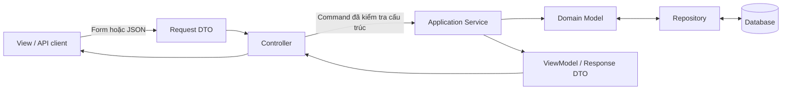
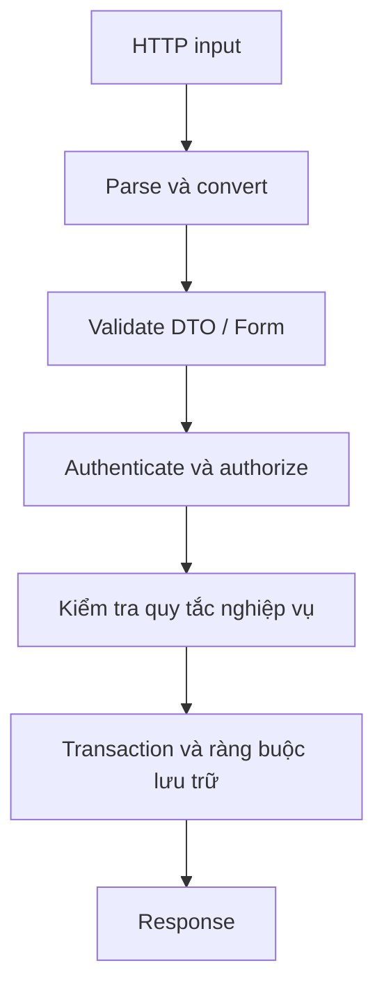

# Thiết kế dữ liệu nhập theo từng hành động

Trong một ứng dụng quản lý công việc, người dùng có thể tạo công việc, đổi tiêu đề, phân công người phụ trách, đánh dấu hoàn thành hoặc tìm kiếm danh sách. Các hành động này đều tác động đến cùng một khái niệm **Công việc**, nhưng mỗi hành động cần những dữ liệu đầu vào khác nhau.

Nếu ứng dụng dùng một đối tượng `Task` duy nhất để nhận mọi request, client có thể gửi thêm những trường không thuộc quyền cập nhật của hành động hiện tại. Một request chỉ muốn đổi tiêu đề có thể vô tình ghi đè trạng thái, người tạo hoặc người phụ trách. Một form phân công lại có thể phải gửi cả mô tả và ngày đến hạn dù người dùng không chỉnh sửa chúng.

Trong MVC, Controller là ranh giới tiếp nhận dữ liệu từ giao diện hoặc client API. Vì vậy, mỗi hành động nên có một **hợp đồng dữ liệu nhập** mô tả chính xác client được phép gửi gì, dữ liệu nào bắt buộc, dữ liệu nào tùy chọn và ứng dụng sẽ kiểm tra chúng ra sao. Thiết kế hợp đồng theo hành động giúp giảm phụ thuộc vào cấu trúc lưu trữ, giới hạn bề mặt cập nhật và làm rõ trách nhiệm giữa View, Controller, Service và Model.

## 1. Hợp đồng dữ liệu nhập là gì?

Hợp đồng dữ liệu nhập (input contract) là thỏa thuận giữa client và ứng dụng về dữ liệu được gửi để thực hiện một thao tác. Với ứng dụng web MVC, hợp đồng này thường được thể hiện qua:

- HTTP method và URL của hành động.
- Nguồn dữ liệu: path variable, query parameter, form field, JSON body hoặc multipart upload.
- Tên trường, kiểu dữ liệu, định dạng và giới hạn giá trị.
- Trường bắt buộc, trường tùy chọn và ý nghĩa khi trường bị bỏ qua hoặc có giá trị `null`.
- Quy tắc kiểm tra dữ liệu và quyền thực hiện hành động.
- Cách ứng dụng phản hồi khi dữ liệu hợp lệ hoặc không hợp lệ.

Ví dụ, hành động tạo công việc có thể nhận tiêu đề, mô tả và ngày đến hạn. Hành động hoàn thành công việc có thể không cần body nào: mã công việc nằm trong URL, còn danh tính người thực hiện được lấy từ phiên đăng nhập. Hành động phân công cần mã người được phân công, nhưng không cần nhận `ownerId` của người gửi request.

Hợp đồng nhập không phải là bản sao của bảng cơ sở dữ liệu. Nó được thiết kế theo mục đích của thao tác và nhu cầu thực tế của client.

## 2. Vì sao nên thiết kế dữ liệu theo từng hành động?

Một tài nguyên có thể có nhiều hành động với quyền và quy tắc khác nhau. Chia hợp đồng theo hành động mang lại một số lợi ích cụ thể.

**Chỉ nhận dữ liệu cần thiết.** Hành động đổi tiêu đề chỉ nhận tiêu đề. Client không thể vô tình gửi lại những trường không liên quan.

**Giới hạn trường được phép thay đổi.** Controller không bind toàn bộ request vào entity, nhờ đó giảm nguy cơ mass assignment, tức client tự thêm trường như `status`, `createdBy` hoặc `isAdmin` để thay đổi dữ liệu ngoài dự kiến.

**Diễn đạt quy tắc rõ ràng.** Tạo mới có thể yêu cầu tiêu đề; phân công yêu cầu một người phụ trách hợp lệ; hoàn thành yêu cầu công việc đang ở trạng thái cho phép chuyển đổi.

**Dễ thay đổi độc lập.** Bổ sung trường cho thao tác tạo không nhất thiết làm thay đổi hợp đồng cập nhật hoặc tìm kiếm.

**Dễ kiểm thử.** Mỗi hành động có thể kiểm tra trường bắt buộc, dữ liệu không hợp lệ, quyền và kết quả riêng.

Ví dụ, một lớp nhận mọi trường của công việc có thể dẫn đến API như sau:

```json
{
  "title": "Chuẩn bị báo cáo",
  "description": "Tổng hợp số liệu tháng",
  "status": "COMPLETED",
  "ownerId": 7,
  "createdBy": 1,
  "assigneeId": 9
}
```

Trong khi đó, request hoàn thành công việc chỉ cần định danh tài nguyên:

```http
POST /api/tasks/42/complete
```

Nếu hành động cần thêm ghi chú, body có thể chỉ chứa trường đó. Client không cần gửi lại toàn bộ trạng thái công việc.

## 3. Phân biệt dữ liệu nhập với Model và entity lưu trữ

Ba loại đối tượng thường có cấu trúc khác nhau:

| Đối tượng | Mục đích | Ví dụ trường |
|---|---|---|
| Request DTO / Form object | Nhận dữ liệu client được phép gửi cho một hành động | `title`, `description`, `dueDate` |
| Domain Model | Biểu diễn trạng thái và quy tắc nghiệp vụ | `TaskId`, `TaskStatus`, hành vi `complete()` |
| Persistence entity | Ánh xạ dữ liệu theo cấu trúc lưu trữ | `id`, `version`, `created_at`, `deleted_at` |

Request DTO không nên chứa mọi trường của entity. Các trường như ID do server sinh, thời điểm tạo, version lưu trữ, người tạo hoặc cờ quản trị thường do ứng dụng kiểm soát. Nếu một hành động thực sự cho phép client chọn người phụ trách, DTO có thể nhận `assigneeId`; Service vẫn phải xác minh người đó tồn tại và người gọi có quyền phân công.

Trong Spring MVC, `org.springframework.ui.Model` là vùng chứa thuộc tính chuyển dữ liệu sang View. Nó cũng không phải request DTO hay Domain Model. Các đối tượng có tên gần nhau nhưng có trách nhiệm khác nhau.



Luồng trên cho thấy dữ liệu nhập đi qua ranh giới HTTP rồi được chuyển thành yêu cầu nghiệp vụ. Model và Repository quyết định cách biểu diễn, thay đổi và lưu trạng thái. DTO phản hồi hoặc ViewModel được tạo riêng cho nhu cầu hiển thị.

## 4. Bắt đầu bằng danh sách hành động của tài nguyên

Trước khi tạo DTO, hãy liệt kê những hành động mà client được phép thực hiện và dữ liệu thực sự cần cho từng hành động.

Ví dụ với tài nguyên Công việc:

| Hành động | Request | Dữ liệu nhập chính | Trường do server kiểm soát |
|---|---|---|---|
| Tạo công việc | `POST /tasks` | Tiêu đề, mô tả, ngày đến hạn | ID, người tạo, thời điểm tạo, trạng thái ban đầu |
| Sửa nội dung | `PUT /tasks/{id}` hoặc `PATCH /tasks/{id}` | Những trường nội dung được phép sửa | ID, người tạo, version, trạng thái nếu không thuộc hành động này |
| Phân công | `POST /tasks/{id}/assign` | ID người được phân công | Người thực hiện, thời điểm phân công, quyền phân công |
| Hoàn thành | `POST /tasks/{id}/complete` | Có thể không cần body hoặc chỉ có ghi chú hoàn thành | Người hoàn thành, thời điểm hoàn thành, trạng thái mới |
| Hủy | `POST /tasks/{id}/cancel` | Lý do hủy nếu nghiệp vụ yêu cầu | Người hủy, thời điểm hủy, trạng thái mới |
| Tìm kiếm | `GET /tasks` | Từ khóa, bộ lọc, trang, kích thước trang | Quyền xem dữ liệu và giới hạn truy vấn |

Bảng này là điểm bắt đầu để xác định request DTO. Không nhất thiết mỗi URL phải có một lớp DTO nếu hợp đồng thực sự giống nhau, nhưng không nên dùng chung một lớp chỉ vì các hành động tác động đến cùng một entity.

## 5. Thiết kế DTO cho các hành động cụ thể

### Tạo mới

Tạo công việc cần các trường mà người dùng được phép quyết định lúc tạo. Ví dụ:

```java
public record CreateTaskRequest(
        @NotBlank(message = "Tiêu đề không được để trống.")
        @Size(max = 200, message = "Tiêu đề tối đa 200 ký tự.")
        String title,

        @Size(max = 1000, message = "Mô tả tối đa 1000 ký tự.")
        String description,

        @FutureOrPresent(message = "Ngày đến hạn không được ở quá khứ.")
        LocalDate dueDate) {
}
```

DTO không nhận `id`, `createdBy`, `createdAt` hay `status`. Service lấy người tạo từ ngữ cảnh xác thực, sinh ID và đặt trạng thái ban đầu theo quy tắc của ứng dụng.

### Sửa nội dung

Nếu `PUT` được dùng theo ngữ nghĩa thay thế toàn bộ biểu diễn có thể chỉnh sửa, request nên thể hiện đầy đủ các trường thuộc phần nội dung đó:

```java
public record ReplaceTaskContentRequest(
        @NotBlank @Size(max = 200) String title,
        @Size(max = 1000) String description,
        LocalDate dueDate) {
}
```

Controller lấy `id` từ URL và truyền dữ liệu cần thiết vào Service:

```java
@PutMapping("/{id}/content")
public ResponseEntity<TaskResponse> replaceContent(
        @PathVariable long id,
        @Valid @RequestBody ReplaceTaskContentRequest request,
        @AuthenticationPrincipal AppUserPrincipal actor) {

    ReplaceTaskContentCommand command = new ReplaceTaskContentCommand(
            new TaskId(id), request.title(), request.description(),
            request.dueDate(), new UserId(actor.userId()));
    TaskResponse result = taskService.replaceContent(command);
    return ResponseEntity.ok(result);
}
```

`ReplaceTaskContentCommand` là kiểu đầu vào của ca sử dụng, có thể được định nghĩa riêng trong tầng ứng dụng. Cách chuyển đổi này giữ cho Service không phụ thuộc vào annotation HTTP hoặc cấu trúc JSON.

Nếu chỉ muốn đổi một phần, dùng `PATCH` hoặc một endpoint hành động cụ thể. Hợp đồng cần nói rõ trường nào có thể vắng mặt và ý nghĩa của `null`.

### Phân công

Phân công cần biết người được giao. Người thực hiện thao tác được lấy từ danh tính đã xác thực:

```java
public record AssignTaskRequest(
        @NotNull @Positive Long assigneeId) {
}
```

```java
@PostMapping("/{id}/assign")
public ResponseEntity<TaskResponse> assign(
        @PathVariable long id,
        @Valid @RequestBody AssignTaskRequest request,
        @AuthenticationPrincipal AppUserPrincipal actor) {

    TaskResponse result = taskService.assign(
            id, request.assigneeId(), actor.userId());
    return ResponseEntity.ok(result);
}
```

`assigneeId` là dữ liệu người dùng lựa chọn nên có thể nhận từ client. `actor.userId()` là danh tính người thực hiện nên phải lấy từ ngữ cảnh xác thực, không tin một trường `actorId` trong JSON. Service cần xác minh người được giao tồn tại, thuộc phạm vi được phép và người gọi có quyền phân công.

### Hoàn thành

Nếu không cần dữ liệu bổ sung, endpoint hoàn thành không cần request DTO:

```java
@PostMapping("/{id}/complete")
public ResponseEntity<Void> complete(
        @PathVariable long id,
        @AuthenticationPrincipal AppUserPrincipal actor) {

    taskService.complete(id, actor.userId());
    return ResponseEntity.noContent().build();
}
```

Nếu nghiệp vụ yêu cầu ghi chú khi hoàn thành, chỉ thêm trường đó:

```java
public record CompleteTaskRequest(
        @Size(max = 500) String note) {
}
```

Không cần gửi `status: "COMPLETED"` để yêu cầu hoàn thành. Chính hành động và quy tắc trong Model quyết định trạng thái mới.

### Tìm kiếm và lọc

Các điều kiện đọc danh sách thường nằm trong query parameter:

```http
GET /api/tasks?status=IN_PROGRESS&assigneeId=9&page=0&size=20
```

Có thể gom chúng vào query object:

```java
public record TaskSearchCriteria(
        String keyword,
        TaskStatus status,
        Long assigneeId,
        @Min(0) int page,
        @Min(1) @Max(100) int size) {
}
```

Nếu nhận trực tiếp bằng `@RequestParam`, có thể khai báo giá trị mặc định ngay tại ranh giới Controller:

```java
@GetMapping
public Page<TaskResponse> search(
        @RequestParam(required = false) String keyword,
        @RequestParam(required = false) TaskStatus status,
        @RequestParam(required = false) Long assigneeId,
        @RequestParam(defaultValue = "0") @Min(0) int page,
        @RequestParam(defaultValue = "20") @Min(1) @Max(100) int size) {

    return taskQueryService.search(
            new TaskSearchCriteria(keyword, status, assigneeId, page, size));
}
```

Với request `GET`, không nên dựa vào body để truyền bộ lọc. Hãy xác định giá trị mặc định cho `page` và `size`, giới hạn kích thước tối đa và kiểm tra người dùng có quyền xem tập dữ liệu được yêu cầu hay không. Nếu dùng query object, hãy cấu hình binder hoặc constructor để áp dụng cùng các giá trị mặc định.

## 6. Chọn nguồn dữ liệu đúng cho từng trường

Không phải mọi giá trị cần cho hành động đều nên nằm trong JSON body. Vị trí của dữ liệu là một phần của hợp đồng.

| Nguồn | Dùng cho | Ví dụ |
|---|---|---|
| Path variable | Định danh tài nguyên hoặc hành động trên tài nguyên | `/tasks/42/complete` |
| Query parameter | Bộ lọc, sắp xếp, phân trang hoặc tùy chọn đọc | `?status=OPEN&page=0` |
| Form field | Dữ liệu nhập từ biểu mẫu HTML | `title`, `description` |
| JSON body | Dữ liệu có cấu trúc cho API hoặc thao tác phức tạp | `{"assigneeId":9}` |
| Header | Metadata của request hoặc điều khiển giao thức | `If-Match`, `Idempotency-Key`, `Accept` |
| Authentication context | Danh tính và quyền đã được xác thực | ID người đang đăng nhập |
| Multipart part | File và metadata đi kèm | Tệp đính kèm và mô tả |

Định danh tài nguyên thường đặt ở URL để request có đích rõ ràng. Dữ liệu thay đổi do người dùng nhập đặt trong body hoặc form. Metadata giao thức đặt trong header. Danh tính người gửi lấy từ cơ chế xác thực. Không nên để client tự quyết định các giá trị bảo mật chỉ vì chúng dễ gửi trong JSON.

## 7. Phân biệt trường bắt buộc, tùy chọn, bị bỏ qua và null

Một hợp đồng tốt cần định nghĩa rõ ý nghĩa của từng trạng thái đầu vào.

| Trạng thái trường | Ý nghĩa cần quy định |
|---|---|
| Bắt buộc | Request thiếu trường sẽ bị từ chối |
| Tùy chọn khi tạo | Thiếu trường thì dùng giá trị mặc định hoặc để trống theo nghiệp vụ |
| Bị bỏ qua trong cập nhật từng phần | Giữ nguyên giá trị hiện tại |
| Có mặt với `null` | Có thể có nghĩa xóa giá trị, đặt về rỗng hoặc bị từ chối |
| Chuỗi rỗng | Có thể được xem là giá trị rỗng hoặc không hợp lệ; không tự động đồng nhất với thiếu trường |

Ví dụ với `PATCH /tasks/42/content`:

```json
{
  "description": null
}
```

Nếu hợp đồng theo JSON Merge Patch (RFC 7396), trường bị bỏ qua có nghĩa giữ nguyên, còn `null` có nghĩa loại bỏ giá trị tương ứng. Nếu API dùng DTO PATCH riêng, cần tự định nghĩa và tài liệu hóa cùng ngữ nghĩa này. Một DTO Java thông thường có trường nullable có thể không phân biệt được trường bị bỏ qua với trường được gửi rõ ràng là `null` sau khi deserialize.

Khi cần phân biệt ba trạng thái, có thể dùng một trong các cách:

- Dùng JSON Merge Patch và triển khai đúng quy tắc của định dạng.
- Dùng wrapper biểu diễn rõ `absent`, `null` và `value`.
- Tách hành động thành endpoint cụ thể, ví dụ `PATCH /tasks/{id}/description` để đặt hoặc xóa mô tả theo một hợp đồng đơn giản.

Không nên đoán ý nghĩa của `null` từ cách framework bind dữ liệu. Hợp đồng phải nói rõ client gửi gì và server diễn giải ra sao.

## 8. Validation theo nhiều lớp

Kiểm tra dữ liệu không chỉ là gắn annotation vào DTO. Mỗi lớp có mục đích khác nhau.

### Kiểm tra cú pháp và kiểu dữ liệu

Ở ranh giới HTTP, framework kiểm tra dữ liệu có thể chuyển đổi hay không. Ví dụ `id=abc` không thể chuyển thành `long`, hoặc JSON sai cú pháp không thể deserialize thành DTO.

### Validation cấu trúc và trường

Bean Validation kiểm tra các điều kiện độc lập như bắt buộc, độ dài, định dạng và giới hạn số:

```java
public record CreateTaskRequest(
        @NotBlank @Size(max = 200) String title,
        @Email String notificationEmail,
        @Min(1) @Max(100) int priority) {
}
```

Có thể dùng validation cấp lớp cho điều kiện liên quan nhiều trường, ví dụ ngày kết thúc phải sau ngày bắt đầu. Với form HTML, `BindingResult` giúp Controller trả lại biểu mẫu cùng lỗi từng trường. Với API, lỗi validation có thể được chuyển thành response lỗi có cấu trúc.

### Kiểm tra nghiệp vụ

Một giá trị có thể đúng kiểu và đúng định dạng nhưng vẫn không hợp lệ theo nghiệp vụ. Ví dụ:

- Người được phân công không thuộc dự án.
- Công việc đã bị hủy nên không thể hoàn thành.
- Người dùng không được phép sửa công việc của nhóm khác.
- Ngày đến hạn không phù hợp với chính sách của dự án.

Những quy tắc này cần được kiểm tra trong Service, Model hoặc policy tương ứng. Không nên đặt chúng chỉ trong View hay annotation của DTO, vì cùng nghiệp vụ có thể được gọi từ nhiều loại client.

### Ràng buộc lưu trữ

Unique constraint, foreign key, not-null và transaction ở cơ sở dữ liệu là lớp bảo vệ cuối cùng cho tính toàn vẹn. Chúng không thay thế validation ở giao diện hoặc nghiệp vụ; chúng bảo vệ dữ liệu ngay cả khi có nhiều request đồng thời hoặc một đường ghi khác đi vào hệ thống.



Các bước có thể đan xen tùy ứng dụng. Ví dụ kiểm tra quyền truy cập tài nguyên thường cần tải dữ liệu trước khi quyết định; sơ đồ thể hiện những lớp kiểm tra cần có, không áp đặt một thứ tự kỹ thuật duy nhất.

## 9. Ánh xạ DTO thành Command và Model

Request DTO thuộc ranh giới giao tiếp. Service nên nhận một yêu cầu nghiệp vụ rõ ràng thay vì phụ thuộc trực tiếp vào Servlet request hoặc cấu trúc JSON.

Ví dụ command:

```java
public record CreateTaskCommand(
        String title,
        String description,
        LocalDate dueDate,
        UserId actorId) {
}
```

Controller chuyển DTO thành command:

```java
@PostMapping
public ResponseEntity<TaskResponse> create(
        @Valid @RequestBody CreateTaskRequest request,
        @AuthenticationPrincipal AppUserPrincipal actor) {

    CreateTaskCommand command = new CreateTaskCommand(
            request.title().trim(),
            request.description(),
            request.dueDate(),
            new UserId(actor.userId()));

    TaskResponse response = taskService.create(command);
    URI location = URI.create("/api/tasks/" + response.id());
    return ResponseEntity.created(location).body(response);
}
```

Ở ví dụ này, Controller thực hiện chuyển đổi đơn giản và bổ sung danh tính đã xác thực. Với hệ thống lớn, mapper hoặc application facade có thể đảm nhận việc chuyển đổi. Việc chuẩn hóa chuỗi cần được thực hiện theo quy tắc miền đã thống nhất; không nên tự ý trim hoặc biến đổi dữ liệu nếu khoảng trắng có ý nghĩa.

Service điều phối nghiệp vụ:

```java
@Transactional
public TaskResponse create(CreateTaskCommand command) {
    User creator = userRepository.getRequired(command.actorId());
    Task task = Task.create(
            command.title(),
            command.description(),
            command.dueDate(),
            creator.id());

    taskRepository.save(task);
    return taskMapper.toResponse(task);
}
```

Model tạo trạng thái ban đầu và bảo vệ bất biến. Repository lưu Model. Response DTO được tạo theo hợp đồng trả về, không cần trùng với request DTO.

## 10. Hợp đồng dữ liệu cho biểu mẫu HTML và API

Một hành động có thể được gọi từ form HTML hoặc JSON API. Hai giao diện có thể dùng chung nghiệp vụ, nhưng không bắt buộc phải dùng chung một lớp nhận dữ liệu.

### Form object cho HTML

Với Spring MVC kết xuất trang, `@ModelAttribute` bind form field vào form object:

```java
public class CreateTaskForm {
    @NotBlank
    @Size(max = 200)
    private String title;

    @Size(max = 1000)
    private String description;

    private LocalDate dueDate;

    // Getter và setter.
}
```

```java
@PostMapping("/tasks")
public String create(
        @Valid @ModelAttribute("form") CreateTaskForm form,
        BindingResult errors,
        @AuthenticationPrincipal AppUserPrincipal currentUser,
        RedirectAttributes redirectAttributes) {

    if (errors.hasErrors()) {
        return "tasks/form";
    }

    TaskResponse created = taskService.create(new CreateTaskCommand(
            form.getTitle(), form.getDescription(), form.getDueDate(),
            new UserId(currentUser.userId())));
    redirectAttributes.addFlashAttribute("notice", "Đã tạo công việc.");
    return "redirect:/tasks/" + created.id();
}
```

Khi validation thất bại, render lại form giúp giữ dữ liệu người dùng đã nhập và hiển thị lỗi theo trường. Khi thành công, Post/Redirect/Get giúp trình duyệt gửi một request `GET` mới để xem kết quả. CSRF token được xử lý theo cơ chế bảo vệ của ứng dụng, không phải là trường nghiệp vụ của `CreateTaskForm`.

### Request DTO cho JSON API

Với API, `@RequestBody` đọc JSON và message converter chuyển thành DTO:

```java
@PostMapping(value = "/api/tasks", consumes = MediaType.APPLICATION_JSON_VALUE)
public ResponseEntity<TaskResponse> create(
        @Valid @RequestBody CreateTaskRequest request,
        @AuthenticationPrincipal AppUserPrincipal actor) {

    TaskResponse response = taskService.create(new CreateTaskCommand(
            request.title(), request.description(), request.dueDate(),
            new UserId(actor.userId())));
    return ResponseEntity
            .created(URI.create("/api/tasks/" + response.id()))
            .body(response);
}
```

Form object và JSON DTO có thể giống nhau nếu hợp đồng giống nhau, nhưng cũng có thể khác vì HTML cần giữ trạng thái form, định dạng nhập hoặc trường giao diện. Điều quan trọng là cả hai cùng chuyển thành ca sử dụng có quy tắc rõ ràng.

## 11. Hợp đồng lỗi cũng là một phần của dữ liệu

Client cần biết trường nào sai và vì sao request bị từ chối. Không nên chỉ trả một chuỗi lỗi chung hoặc stack trace.

Một response lỗi API có thể theo dạng:

```json
{
  "type": "https://example.invalid/problems/validation",
  "title": "Dữ liệu không hợp lệ",
  "status": 400,
  "detail": "Có trường cần được kiểm tra lại.",
  "errors": [
    {
      "field": "title",
      "code": "NotBlank",
      "message": "Tiêu đề không được để trống."
    }
  ]
}
```

Đây là ví dụ cấu trúc minh họa; schema thực tế cần được thống nhất với client. Với Spring Framework hỗ trợ `ProblemDetail`, có thể bổ sung thuộc tính mở rộng như `errors` để biểu diễn lỗi trường. Với phiên bản hoặc hợp đồng khác, có thể dùng error DTO riêng.

Các nhóm lỗi thường gặp:

| Loại lỗi | Ví dụ | Phản hồi thường dùng |
|---|---|---|
| Request sai cú pháp hoặc không chuyển đổi được | JSON sai, ID không phải số | `400 Bad Request` |
| Validation trường thất bại | Thiếu tiêu đề, độ dài vượt giới hạn | `400` hoặc `422` theo hợp đồng API |
| Chưa xác thực | Phiên đăng nhập hết hạn | `401 Unauthorized` hoặc điều hướng đăng nhập với ứng dụng HTML |
| Không đủ quyền | Không được phân công công việc của nhóm khác | `403 Forbidden` hoặc `404` theo chính sách tiết lộ tài nguyên |
| Không tìm thấy tài nguyên | ID không tồn tại | `404 Not Found` |
| Xung đột trạng thái | Hoàn thành công việc đã hủy | `409 Conflict` |
| Lỗi ngoài dự kiến | Database không khả dụng | `500 Internal Server Error` với mã tham chiếu |

Thông báo cho người dùng nên dễ hiểu và không tiết lộ dữ liệu nội bộ. Log có thể lưu chi tiết kỹ thuật cần thiết nhưng phải tránh ghi token, mật khẩu hoặc dữ liệu cá nhân không cần thiết.

## 12. Bảo vệ hợp đồng khỏi mass assignment và dữ liệu giả mạo

Mass assignment xảy ra khi ứng dụng tự động bind dữ liệu client vào một đối tượng có nhiều thuộc tính hơn những gì client được phép thay đổi. Nếu Controller nhận trực tiếp entity, request có thể chứa các trường ngoài biểu mẫu.

Ví dụ nguy hiểm:

```java
@PostMapping("/tasks/{id}")
public String update(@PathVariable long id, @ModelAttribute TaskEntity entity) {
    taskRepository.save(entity);
    return "redirect:/tasks/" + id;
}
```

Đoạn mã này có nhiều vấn đề: entity có thể chứa trường nhạy cảm; dữ liệu nhận vào không được giới hạn theo hành động; ID trong URL và ID trong entity có thể không nhất quán; quy tắc nghiệp vụ có thể bị bỏ qua.

Thiết kế an toàn hơn:

- Nhận form object hoặc request DTO chỉ có trường được phép thay đổi.
- Lấy định danh tài nguyên từ path và xác minh tài nguyên tồn tại.
- Lấy actor từ ngữ cảnh xác thực, không tin `actorId` do client gửi.
- Kiểm tra quyền trên tài nguyên ở server.
- Gọi hành vi nghiệp vụ thay vì gán tùy ý các trường trạng thái.
- Không trả dữ liệu nhạy cảm trong response DTO.

Ví dụ, để hoàn thành công việc, client gọi endpoint `complete`; Model kiểm tra trạng thái hiện tại và chuyển đổi hợp lệ. Client không thể ép trạng thái thành `COMPLETED` chỉ bằng cách gửi một giá trị trong JSON.

## 13. Kiểm soát cập nhật đồng thời và gửi lặp

Thiết kế dữ liệu nhập cần xem xét trường hợp nhiều request tác động đến cùng một tài nguyên.

### Optimistic locking

Nếu hai người cùng sửa công việc, request thứ hai có thể dựa trên dữ liệu đã cũ. Có thể dùng version trong entity và hợp đồng cập nhật:

```json
{
  "title": "Chuẩn bị báo cáo mới",
  "version": 5
}
```

Server chỉ chấp nhận cập nhật nếu version hiện tại vẫn là `5`. Nếu dữ liệu đã đổi, server trả xung đột và client tải lại hoặc yêu cầu người dùng xử lý. Với HTTP, có thể dùng `ETag` và `If-Match` để biểu diễn điều kiện phiên bản ở tầng giao thức. Dù chọn cách nào, ý nghĩa của version phải rõ ràng và được kiểm tra ở server.

### Idempotency cho thao tác có nguy cơ lặp

Một request `POST` có thể được gửi lại do người dùng nhấn nhiều lần, client retry hoặc mạng mất response sau khi server đã xử lý. Với hành động có tác động không nên lặp, có thể hỗ trợ `Idempotency-Key` hoặc mã yêu cầu duy nhất. Server lưu kết quả gắn với khóa trong phạm vi phù hợp và trả lại kết quả cũ khi nhận lại cùng một thao tác.

Không phải mọi form đều cần idempotency key. Hãy áp dụng cho hành động mà việc thực hiện hai lần tạo ra tác động sai hoặc tốn kém, đồng thời vẫn bảo vệ quy tắc ở Service và cơ sở dữ liệu.

## 14. Tương thích và tiến hóa hợp đồng

Hợp đồng dữ liệu sẽ thay đổi khi nghiệp vụ phát triển. Thay đổi cần được đánh giá theo ảnh hưởng đến client hiện có.

| Thay đổi | Mức độ ảnh hưởng thường gặp | Cách xử lý |
|---|---|---|
| Thêm trường tùy chọn | Thường tương thích nếu client cũ bỏ qua được | Cung cấp giá trị mặc định và mô tả ý nghĩa |
| Thêm trường bắt buộc | Có thể phá vỡ client cũ | Có giai đoạn chuyển tiếp, version mới hoặc quy tắc mặc định |
| Đổi tên hoặc xóa trường | Thường phá vỡ client hiện tại | Hỗ trợ trường cũ trong giai đoạn chuyển đổi hoặc version hợp đồng |
| Đổi kiểu dữ liệu | Có thể làm client deserialize thất bại | Dùng trường mới hoặc version mới |
| Thay đổi ý nghĩa `null` | Dễ gây lỗi cập nhật dữ liệu | Tài liệu hóa và kiểm thử rõ ngữ nghĩa |
| Thêm giá trị enum | Client cũ có thể không nhận diện | Thiết kế client chịu được giá trị chưa biết hoặc version hóa |

Một số nguyên tắc hữu ích:

- Ưu tiên thêm trường tùy chọn có ý nghĩa rõ ràng.
- Không thay đổi ngầm ý nghĩa của trường đã công bố.
- Chuẩn hóa định dạng ngày giờ, múi giờ, số thập phân và enum.
- Có ví dụ request/response và mô tả lỗi cho từng hành động.
- Dùng version API khi thay đổi không tương thích không thể triển khai theo giai đoạn.
- Kiểm thử contract giữa client và server trước khi phát hành thay đổi lớn.

## 15. Kiểm thử hợp đồng dữ liệu nhập

Kiểm thử nên bao phủ cả trường hợp hợp lệ và các cách client có thể gửi dữ liệu không mong đợi.

### Kiểm thử DTO và validation

Kiểm tra trường bắt buộc, độ dài, định dạng, giới hạn số, điều kiện nhiều trường và các trường hợp null/omitted.

### Kiểm thử Controller

Với Spring MVC, `MockMvc` có thể xác nhận request được bind đúng và response lỗi có cấu trúc:

```java
@WebMvcTest(TaskApiController.class)
class TaskApiControllerTest {
    @Autowired
    MockMvc mockMvc;

    @Test
    void rejectsBlankTitle() throws Exception {
        mockMvc.perform(post("/api/tasks")
                .contentType(MediaType.APPLICATION_JSON)
                .content("""
                    {"title":" ","description":"Mô tả"}
                    """))
            .andExpect(status().isBadRequest());
    }
}
```

Ví dụ minh họa kiểm tra validation ở ranh giới MVC. Test thực tế cần mock các dependency được Controller sử dụng và xác nhận schema lỗi cụ thể theo hợp đồng của ứng dụng.

### Kiểm thử Service và Model

Kiểm tra quy tắc nghiệp vụ, quyền, trạng thái hiện tại, transaction và hành vi khi request lặp hoặc cập nhật đồng thời. Không nên chỉ dựa vào test DTO để kết luận nghiệp vụ được bảo vệ.

### Kiểm thử tương thích

Lưu các ví dụ request hợp lệ, response và lỗi làm contract fixture. Khi thay đổi DTO, chạy kiểm thử để phát hiện client cũ có thể bị ảnh hưởng. Với hệ thống nhiều dịch vụ, có thể dùng consumer-driven contract testing để xác nhận cả phía cung cấp và phía tiêu thụ tuân thủ thỏa thuận.

## 16. Lỗi thiết kế thường gặp

| Lỗi | Hệ quả | Cách cải thiện |
|---|---|---|
| Dùng một DTO khổng lồ cho mọi hành động | Trường không liên quan bị gửi và cập nhật ngoài ý muốn | Tách DTO theo hành động hoặc nhóm hợp đồng thực sự giống nhau |
| Nhận trực tiếp entity ORM | Mass assignment và phụ thuộc vào cấu trúc lưu trữ | Dùng request DTO hoặc form object |
| Client gửi `actorId` hoặc `createdBy` | Có thể giả mạo danh tính hoặc nguồn tạo | Lấy danh tính từ authentication context |
| Client gửi trạng thái mới tùy ý | Bỏ qua quy tắc chuyển trạng thái | Tạo endpoint hành động và gọi hành vi Model |
| Không định nghĩa `null` và trường bị bỏ qua | Cập nhật từng phần có kết quả khó đoán | Quy định semantics rõ ràng hoặc dùng định dạng patch chuẩn |
| Chỉ validation ở trình duyệt | Request trực tiếp có thể bỏ qua kiểm tra | Validate ở server và kiểm tra nghiệp vụ |
| Dùng cùng DTO cho request và response | Lộ trường nội bộ, khó tiến hóa độc lập | Tách request DTO và response DTO |
| Không kiểm tra version hoặc request lặp | Mất cập nhật hoặc thực hiện thao tác nhiều lần | Optimistic locking và idempotency khi cần |
| Thay đổi hợp đồng mà không kiểm tra client cũ | Client hiện tại bị lỗi | Kiểm thử contract và triển khai thay đổi tương thích |

## 17. Quy trình thiết kế hợp đồng nhập cho một hành động

Khi thêm một chức năng MVC, có thể đi theo trình tự sau:

1. Xác định hành động và tài nguyên mà hành động tác động đến.
2. Liệt kê thông tin client thực sự cần cung cấp để thực hiện hành động.
3. Xác định dữ liệu lấy từ URL, query, body, header và authentication context.
4. Phân loại trường bắt buộc, tùy chọn, chỉ đọc, do server kiểm soát và có thể bị bỏ qua.
5. Định nghĩa kiểu dữ liệu, định dạng, giới hạn và ý nghĩa của `null`.
6. Tạo Request DTO hoặc Form object chỉ chứa trường được phép nhập.
7. Validate cấu trúc ở Controller boundary; kiểm tra quyền và nghiệp vụ trong các lớp tương ứng.
8. Chuyển dữ liệu thành command/query để Service xử lý mà không phụ thuộc HTTP.
9. Chọn response DTO hoặc ViewModel riêng cho client.
10. Kiểm thử dữ liệu hợp lệ, thiếu trường, sai kiểu, giả mạo trường, xung đột và tương thích.

Thiết kế dữ liệu nhập theo từng hành động giúp hợp đồng phản ánh đúng điều người dùng đang yêu cầu. Mỗi request chỉ mang dữ liệu cần thiết; Controller kiểm soát ranh giới HTTP; Service điều phối ca sử dụng; Model bảo vệ quy tắc và trạng thái. Khi request DTO, command và response DTO được phân định rõ, ứng dụng MVC an toàn hơn, dễ kiểm thử hơn và có thể phát triển mà không buộc mọi giao diện phụ thuộc vào cấu trúc dữ liệu nội bộ.
