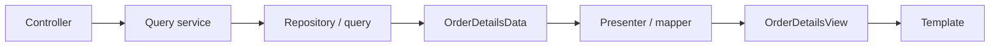

# Thiết kế dữ liệu trình bày theo nhu cầu của View

Trong kiến trúc Model–View–Controller (MVC), View cần dữ liệu để hiển thị một màn hình hoặc tạo phản hồi cho người dùng. Dữ liệu trong Model thường phản ánh trạng thái và khái niệm nghiệp vụ, trong khi View cần một cấu trúc được chọn lọc, đặt tên rõ ràng và phù hợp với cách trình bày. Vì vậy, ứng dụng thường chuyển dữ liệu nghiệp vụ thành một hợp đồng trình bày như ViewModel hoặc presentation DTO trước khi đưa sang View.

Ví dụ, đối tượng Order có thể chứa mã định danh nội bộ, khách hàng, dòng hàng, trạng thái, lịch sử, thông tin thanh toán và các quan hệ ORM. Trang chi tiết đơn hàng chỉ cần mã đơn dễ đọc, tên khách hàng, tổng tiền đã định dạng, nhãn trạng thái, ngày đặt hàng và các hành động đang khả dụng. Đưa nguyên entity vào template làm View phụ thuộc vào cấu trúc nội bộ và có thể vô tình làm lộ dữ liệu không nên hiển thị.

Thiết kế dữ liệu trình bày tốt tạo ra ranh giới rõ ràng: Model bảo vệ nghiệp vụ, lớp truy vấn hoặc application service cung cấp dữ liệu cần thiết, presenter/mapper chuyển dữ liệu thành cấu trúc trình bày và View chỉ hiển thị hợp đồng đó.

## 1. Vì sao View cần một hợp đồng dữ liệu riêng?

Model và View phục vụ hai mục đích khác nhau:

- **Model nghiệp vụ** mô tả trạng thái, hành vi và quy tắc của ứng dụng. Cấu trúc của nó thay đổi khi nghiệp vụ thay đổi.
- **View** tổ chức thông tin để người dùng hiểu và thao tác. Nhu cầu của View thay đổi theo bố cục, thiết bị, ngôn ngữ và trải nghiệm sử dụng.
- **ViewModel / presentation DTO** là cấu trúc dữ liệu ở giữa, mô tả chính xác những gì View cần nhận.

Nếu View dùng trực tiếp entity, một thay đổi trong cấu trúc lưu trữ có thể làm hỏng template. Ngược lại, nếu thiết kế ViewModel riêng, có thể đổi tên trường nội bộ hoặc cách lưu dữ liệu mà không buộc View thay đổi, miễn hợp đồng trình bày vẫn được giữ.

Ví dụ, entity có thể lưu tên và họ khách hàng thành hai trường riêng, nhưng View chỉ cần một tên hiển thị. ViewModel gom hai trường thành một giá trị phù hợp với màn hình. Khi cách lưu tên khách hàng thay đổi, template không cần biết.

### Các lợi ích chính

- **Giảm phụ thuộc:** View không cần biết cấu trúc entity, quan hệ ORM hoặc bảng cơ sở dữ liệu.
- **Giới hạn dữ liệu:** chỉ gửi những trường thực sự cần hiển thị và được phép xem.
- **Dễ trình bày:** dữ liệu có thể được gom nhóm, đặt tên và định dạng phù hợp với màn hình.
- **Ổn định hợp đồng:** thay đổi bên trong Model ít ảnh hưởng đến View.
- **Dễ kiểm thử:** mapper hoặc presenter có thể được kiểm tra độc lập bằng dữ liệu đầu vào mẫu.
- **Hỗ trợ nhiều giao diện:** trang HTML, ứng dụng di động và API có thể có các cấu trúc phản hồi riêng nhưng cùng sử dụng nghiệp vụ chung.

## 2. Phân biệt Entity, DTO và ViewModel

Các đối tượng dữ liệu có thể trông giống nhau nhưng có mục đích khác nhau. Đặt tên và vị trí phù hợp giúp tránh việc một kiểu dữ liệu bị dùng cho quá nhiều ranh giới.

| Loại | Mục đích | Ví dụ |
|---|---|---|
| Entity / Domain object | Biểu diễn trạng thái và hành vi nghiệp vụ | Order, Customer |
| Persistence model | Ánh xạ cấu trúc lưu trữ khi cần tách khỏi domain | OrderEntity |
| Request DTO / Form | Nhận dữ liệu đầu vào từ người dùng hoặc API | CreateOrderRequest |
| Application result / Query DTO | Trả dữ liệu từ ca sử dụng hoặc truy vấn | OrderDetailsData |
| ViewModel / Presentation DTO | Cung cấp dữ liệu đã chuẩn bị cho một View cụ thể | OrderDetailsView |
| API response DTO | Mô tả hợp đồng phản hồi công khai của API | OrderDetailsResponse |

Không phải ứng dụng nào cũng cần tất cả các loại trên. Ứng dụng nhỏ có thể dùng một DTO làm dữ liệu truy vấn và ViewModel nếu hai hợp đồng thực sự giống nhau. Khi View có nhu cầu khác với API hoặc dữ liệu truy vấn, tách riêng sẽ làm ranh giới rõ ràng hơn.

### Entity không phải là ViewModel

Ví dụ entity:

```java
public class Order {
    private UUID id;
    private String orderNumber;
    private Customer customer;
    private List<OrderLine> lines;
    private OrderStatus status;
    private BigDecimal total;
    private String internalNote;
    private Instant createdAt;

    public void confirm() {
        // Quy tắc chuyển trạng thái của đơn hàng.
    }
}
```

Entity có thể chứa quan hệ, trường phục vụ nghiệp vụ và hành vi miền. View không cần truy cập tất cả những thành phần đó. Đưa entity trực tiếp vào template còn có thể khiến template truy cập lazy relationship, gây truy vấn ngoài dự kiến hoặc lỗi khi persistence context đã đóng.

ViewModel cho trang chi tiết có thể đơn giản hơn:

```java
public record OrderDetailsView(
    UUID id,
    String orderNumber,
    String customerName,
    String totalText,
    String statusLabel,
    String createdAtText,
    boolean canConfirm,
    boolean canCancel
) {}
```

View nhận đúng các trường cần thiết để hiển thị. Nó không cần biết Order có bao nhiêu quan hệ hoặc internalNote được lưu ở đâu.

## 3. Thiết kế hợp đồng từ nhu cầu của màn hình

Điểm bắt đầu nên là câu hỏi: người dùng cần biết gì và cần thực hiện hành động nào trên màn hình này? Từ đó mới xác định dữ liệu cần truy vấn và cấu trúc ViewModel.

Với trang chi tiết đơn hàng, có thể phân tích thành các nhóm:

| Khu vực màn hình | Dữ liệu cần có | Ghi chú thiết kế |
|---|---|---|
| Tiêu đề | Mã đơn hàng | Dùng mã dễ đọc thay vì chỉ dùng UUID |
| Thông tin khách hàng | Tên hiển thị | Không cần toàn bộ entity khách hàng |
| Tóm tắt | Tổng tiền, số dòng hàng | Đã tính theo quy tắc nghiệp vụ |
| Trạng thái | Nhãn trạng thái | Nhãn phù hợp ngôn ngữ giao diện |
| Thời gian | Ngày tạo, ngày xác nhận | Định dạng theo locale và múi giờ |
| Danh sách sản phẩm | Tên, số lượng, đơn giá, thành tiền | Chỉ đưa trường được phép hiển thị |
| Khu vực thao tác | Có thể xác nhận/hủy hay không | Chỉ hỗ trợ hiển thị; máy chủ vẫn kiểm tra lại khi nhận lệnh |

Từ phân tích đó, thiết kế một hợp đồng có cấu trúc rõ ràng:

```java
public record OrderLineView(
    String productName,
    int quantity,
    String unitPriceText,
    String subtotalText
) {}

public record OrderDetailsView(
    UUID id,
    String orderNumber,
    String customerName,
    String totalText,
    String statusLabel,
    String createdAtText,
    List<OrderLineView> lines,
    boolean canConfirm,
    boolean canCancel
) {}
```

Một ViewModel có thể chứa ViewModel con cho các khu vực lặp lại như dòng hàng, địa chỉ hoặc thông tin thanh toán. Cách tổ chức này giúp template đơn giản và tránh để View tự truy cập những quan hệ sâu trong entity.

Hợp đồng cũng cần quy định cách biểu diễn dữ liệu thiếu:

- Danh sách không có phần tử nên là danh sách rỗng nếu View có thể hiển thị trạng thái chưa có dữ liệu.
- Trường tùy chọn như thời điểm xác nhận có thể là null hoặc được biểu diễn bằng một kiểu tùy chọn nhất quán với dự án.
- Không dùng chuỗi giả như `N/A`, dấu gạch ngang hoặc số 0 để thay cho dữ liệu thiếu nếu những giá trị đó có thể mang ý nghĩa thật.
- Với trường bắt buộc, hãy bảo đảm query/presenter luôn tạo giá trị hợp lệ hoặc trả lỗi rõ ràng nếu dữ liệu nguồn vi phạm hợp đồng.

Quy ước null và empty nhất quán giúp View biết khi nào nên hiển thị giá trị, khi nào hiển thị trạng thái rỗng và khi nào cần xử lý lỗi.

### Đặt tên theo ý nghĩa trình bày

Tên trường nên thể hiện điều View cần hiểu, không buộc View phải biết chi tiết nội bộ:

- **customerName** rõ hơn **customer**.
- **statusLabel** rõ hơn **status** nếu giá trị đã là nhãn dành cho người dùng.
- **totalText** rõ hơn **total** nếu giá trị đã được định dạng thành chuỗi.
- **canConfirm** mô tả khả năng hiển thị thao tác; nó không có nghĩa endpoint sẽ bỏ qua kiểm tra nghiệp vụ.

Tránh tên chung chung như data1, value, flag hoặc tái sử dụng tên cột cơ sở dữ liệu nếu tên đó không có ý nghĩa với View.

## 4. Tách truy vấn dữ liệu khỏi việc định dạng trình bày

Một luồng thường gặp là application/query service lấy dữ liệu cần thiết, sau đó presenter hoặc mapper chuyển dữ liệu thành ViewModel. Controller điều phối hai bước và đưa kết quả sang View.



Ví dụ kiểu dữ liệu truy vấn:

```java
public record OrderDetailsData(
    UUID id,
    String orderNumber,
    String customerName,
    BigDecimal total,
    String currencyCode,
    OrderStatus status,
    Instant createdAt,
    List<OrderLineData> lines,
    boolean canConfirm,
    boolean canCancel
) {}
```

OrderDetailsData mang dữ liệu có kiểu rõ ràng, chưa nhất thiết phải được định dạng thành chuỗi hiển thị. Presenter chuyển dữ liệu đó thành cấu trúc phù hợp với locale và màn hình.

Ví dụ presenter:

```java
@Component
@RequiredArgsConstructor
public class OrderDetailsPresenter {
    private final MessageSource messages;

    public OrderDetailsView present(
            OrderDetailsData data,
            Locale locale,
            ZoneId userZone) {

        NumberFormat money = NumberFormat.getCurrencyInstance(locale);
        money.setCurrency(Currency.getInstance(data.currencyCode()));

        DateTimeFormatter dateTime = DateTimeFormatter
            .ofLocalizedDateTime(FormatStyle.MEDIUM)
            .withLocale(locale)
            .withZone(userZone);

        List<OrderLineView> lines = data.lines().stream()
            .map(line -> new OrderLineView(
                line.productName(),
                line.quantity(),
                money.format(line.unitPrice()),
                money.format(line.subtotal())
            ))
            .toList();

        return new OrderDetailsView(
            data.id(),
            data.orderNumber(),
            data.customerName(),
            money.format(data.total()),
            statusLabel(data.status(), locale),
            dateTime.format(data.createdAt()),
            lines,
            data.canConfirm(),
            data.canCancel()
        );
    }

    private String statusLabel(OrderStatus status, Locale locale) {
        return messages.getMessage(
            "order.status." + status.name(), null, locale
        );
    }
}
```

Ví dụ rút gọn minh họa vai trò của presenter. MessageSource lấy nhãn từ message bundle theo locale. NumberFormat sử dụng mã tiền tệ đi kèm dữ liệu truy vấn, còn DateTimeFormatter định dạng thời gian theo múi giờ người dùng. Các lớp hỗ trợ như OrderLineData được lược bỏ để tập trung vào hợp đồng.

Controller cung cấp ViewModel cho template:

```java
@Controller
@RequiredArgsConstructor
@RequestMapping("/orders")
public class OrderPageController {
    private final OrderQueryService orderQueryService;
    private final OrderDetailsPresenter presenter;
    private final UserPreferencesService userPreferencesService;

    @GetMapping("/{id}")
    public String details(
            @PathVariable UUID id,
            Locale locale,
            @AuthenticationPrincipal AppPrincipal principal,
            Model model) {

        OrderDetailsData data = orderQueryService.getDetails(id);
        ZoneId userZone = userPreferencesService.zoneFor(principal.userId());
        model.addAttribute("order", presenter.present(data, locale, userZone));
        return "orders/details";
    }
}
```

Trong Spring MVC, Model ở đây là vùng chứa thuộc tính cho template. Nó không phải entity nghiệp vụ. Controller không cần chuyển toàn bộ Order vào template; nó cung cấp một đối tượng OrderDetailsView đã được chuẩn bị.
Ví dụ giả định ứng dụng có UserPreferencesService để lấy múi giờ theo hồ sơ người dùng; ZoneId không phải tham số Spring MVC mặc định tự động phân giải trong mọi cấu hình.

## 5. View chỉ trình bày dữ liệu đã được chuẩn bị

Template có thể hiển thị ViewModel bằng các biểu thức đơn giản. Ví dụ, template đọc các trường orderNumber, customerName, totalText, statusLabel và createdAtText để tạo tiêu đề, phần tóm tắt và danh sách dòng hàng. Một điều kiện như canConfirm có thể quyết định có hiển thị nút xác nhận hay không.

Ví dụ rút gọn với Thymeleaf:

```html
<h1 th:text="${order.orderNumber}">ORD-1001</h1>
<p th:text="${order.customerName}">Nguyễn An</p>
<p th:text="${order.totalText}">1.250.000 ₫</p>
<p th:text="${order.statusLabel}">Đã xác nhận</p>
<ul>
  <li th:each="line : ${order.lines}"
      th:text="${line.productName}">Bàn phím</li>
</ul>
<button th:if="${order.canConfirm}">Xác nhận</button>
```

Template đọc và trình bày dữ liệu. Nó không tự tính tổng tiền, truy vấn sản phẩm, quyết định người dùng có quyền xác nhận hay cập nhật trạng thái. Điều kiện canConfirm chỉ giúp giao diện biết có nên hiển thị nút; endpoint vẫn phải xác thực, phân quyền và kiểm tra trạng thái hiện tại khi nhận POST.

## 6. Dữ liệu trình bày và dữ liệu nghiệp vụ phải giữ đúng kiểu

Một ViewModel có thể chứa cả giá trị có kiểu và giá trị đã định dạng. Chọn loại nào tùy nơi chịu trách nhiệm trình bày:

| Dữ liệu | Kiểu nên dùng trong dữ liệu truy vấn | Kiểu có thể dùng trong ViewModel |
|---|---|---|
| Tiền | BigDecimal cùng mã tiền tệ | String đã định dạng hoặc số tiền và currency riêng |
| Thời điểm | Instant, OffsetDateTime | String theo locale/múi giờ hoặc thời điểm có kiểu |
| Trạng thái | Enum / kiểu miền | Nhãn String và mã trạng thái nếu cần |
| Khả năng thao tác | Kết quả policy dạng boolean hoặc capability | boolean canConfirm để điều khiển hiển thị |
| Định danh | UUID hoặc kiểu định danh | UUID/String tùy hợp đồng route |
| Số lượng | int / long / BigDecimal theo nghiệp vụ | Kiểu số hoặc chuỗi theo định dạng giao diện |

Không nên chuyển tiền sang double chỉ để định dạng, vì kiểu dấu phẩy động nhị phân có thể gây sai số. Hãy giữ BigDecimal hoặc kiểu tiền tệ phù hợp cho tính toán, chỉ định dạng thành chuỗi ở lớp trình bày.

Với ngày giờ, không nên lưu chuỗi đã định dạng làm trạng thái nghiệp vụ. Hãy giữ một kiểu thời gian có ý nghĩa như Instant rồi chuyển sang múi giờ và locale khi trình bày. Nếu nhiều View cần định dạng khác nhau, mỗi presenter có thể tạo chuỗi theo ngữ cảnh riêng.

## 7. Thiết kế dữ liệu theo quyền và nguyên tắc tối thiểu

ViewModel là một ranh giới dữ liệu gửi tới giao diện, do đó cần chỉ đưa các trường người dùng hiện tại được phép xem. Không nên trả toàn bộ entity rồi dựa vào template để ẩn trường nhạy cảm.

Ví dụ, đơn hàng có thể chứa:

- Ghi chú nội bộ dành cho nhân viên.
- Thông tin thanh toán hoặc định danh giao dịch.
- Địa chỉ giao hàng.
- Thông tin liên hệ của khách hàng.
- Lịch sử thao tác nội bộ.

Trang khách hàng có thể chỉ cần tên và mã đơn; trang nhân viên có thể cần thêm ghi chú nội bộ nếu người đó có quyền. Có thể tạo hai ViewModel riêng hoặc tạo một cấu trúc được xây dựng theo policy quyền truy cập.

Không nên chỉ dùng một trường boolean isAdmin trong template để quyết định có hiển thị dữ liệu nhạy cảm nếu dữ liệu đó đã được gửi xuống trình duyệt. Việc giới hạn dữ liệu phải xảy ra ở phía máy chủ trước khi tạo response.

### Tránh mass assignment ở chiều đầu vào

Hợp đồng trình bày là dữ liệu đi ra, còn Request DTO/Form là dữ liệu đi vào. Không nên dùng cùng một entity cho cả hai chiều. Ví dụ, người dùng được phép gửi note nhưng không được tự gửi status, ownerId hoặc total.

```java
public record ConfirmOrderRequest(
    @Size(max = 300) String note
) {}
```

Controller chuyển các trường được cho phép thành command. Model tự quyết định trạng thái mới dựa trên quy tắc nghiệp vụ. Cách này ngăn client tự gán trường nhạy cảm bằng cách thêm thuộc tính vào request.

## 8. Dữ liệu cho danh sách, bộ lọc và phân trang

View danh sách thường cần nhiều hơn một mảng entity. Nó có thể cần nội dung từng dòng, bộ lọc hiện tại, tổng số kết quả, số trang và các thao tác hàng loạt.

Ví dụ:

```java
public record OrderListItemView(
    UUID id,
    String orderNumber,
    String customerName,
    String totalText,
    String statusLabel
) {}

public record PageInfoView(
    int page,
    int size,
    long totalElements,
    int totalPages,
    boolean hasPrevious,
    boolean hasNext
) {}

public record OrderListView(
    List<OrderListItemView> items,
    String searchText,
    String selectedStatus,
    PageInfoView pageInfo
) {}
```

Hợp đồng này giúp View biết:

- Những dòng dữ liệu cần hiển thị.
- Bộ lọc nào đang được chọn để giữ trạng thái biểu mẫu.
- Đang ở trang nào và còn trang trước/trang sau hay không.
- Tổng số kết quả để hiển thị thông tin phân trang.

Không nên tải toàn bộ dữ liệu rồi phân trang ở template nếu tập dữ liệu có thể lớn. Query service nên áp dụng lọc và phân trang tại nguồn dữ liệu. ViewModel chỉ chứa trang kết quả và metadata cần hiển thị.

Khi dữ liệu danh sách có thể thay đổi trong lúc người dùng chuyển trang, tổng số kết quả hoặc số trang có thể thay đổi theo thời gian. Hợp đồng cần xác định rõ page bắt đầu từ 0 hay 1, cách xử lý trang vượt phạm vi và thứ tự sắp xếp mặc định.

## 9. Hợp đồng dữ liệu có thể thay đổi như thế nào?

ViewModel cũng là một hợp đồng giữa lớp chuẩn bị dữ liệu và View. Khi thay đổi trường, cần xem xét tác động đến template, component, kiểm thử và các client đang sử dụng.

| Thay đổi | Tác động có thể có | Cách xử lý |
|---|---|---|
| Thêm trường tùy chọn | View cũ có thể bỏ qua | Có thể bổ sung tương thích nếu không làm thay đổi ý nghĩa trường cũ |
| Xóa hoặc đổi tên trường | Template đang tham chiếu có thể lỗi | Cập nhật đồng bộ hoặc duy trì giai đoạn chuyển tiếp |
| Đổi kiểu dữ liệu | Client có thể không chuyển đổi được | Xem như thay đổi hợp đồng, cập nhật consumer và kiểm thử |
| Đổi ý nghĩa trường | Giao diện có thể hiển thị sai dù tên không đổi | Dùng tên mới hoặc phiên bản hợp đồng rõ ràng |
| Thay cấu trúc lồng nhau | Template và mapper cần cập nhật | Chỉ thay khi có nhu cầu trình bày thực sự |
| Thêm trường nhạy cảm | Có thể làm lộ dữ liệu | Đánh giá quyền và mục đích trước khi thêm |

Với ViewModel nội bộ chỉ dùng cho một template trong cùng ứng dụng, có thể cập nhật đồng thời producer và consumer. Với API công khai hoặc nhiều client độc lập, cần cân nhắc versioning, khả năng tương thích ngược và thời gian chuyển đổi.

Không nên thêm version cho mọi ViewModel ngay từ đầu. Versioning hữu ích khi có consumer độc lập và không thể cập nhật cùng lúc; với hợp đồng nội bộ được triển khai cùng một bản phát hành, quy trình refactor và kiểm thử thường đủ.

## 10. Tránh các lỗi thường gặp

| Lỗi | Hệ quả | Cách cải thiện |
|---|---|---|
| Đưa entity trực tiếp vào template | View phụ thuộc ORM, quan hệ sâu và trường nội bộ | Tạo ViewModel theo nhu cầu màn hình |
| Dùng một DTO cho mọi màn hình | DTO có nhiều trường thừa hoặc thiếu, khó hiểu | Tạo hợp đồng theo từng nhu cầu trình bày khi khác biệt có ý nghĩa |
| Đưa quy tắc nghiệp vụ vào presenter | Quy tắc bị gắn với một giao diện và có thể bị bỏ qua ở kênh khác | Giữ quy tắc trong Model/policy/application service |
| Định dạng tiền bằng double | Có thể xuất hiện sai số | Giữ BigDecimal, định dạng ở presentation layer |
| Trả dữ liệu nhạy cảm rồi ẩn bằng CSS/template | Dữ liệu vẫn có trong response | Loại dữ liệu ở phía máy chủ theo quyền |
| View tự truy cập lazy relationship | Truy vấn ngoài dự kiến hoặc lỗi persistence context | Query dữ liệu cần thiết và map trước khi render |
| Tính toán toàn bộ danh sách ở View | Template phức tạp và có thể tải quá nhiều dữ liệu | Query service xử lý lọc, phân trang và tổng hợp cần thiết |
| Dùng ViewModel làm request model | Client có thể gửi lại trường chỉ dành cho hiển thị | Tách Request DTO/Form và ViewModel/Response DTO |
| Không kiểm thử mapper/presenter | Dữ liệu sai định dạng hoặc thiếu trường khó phát hiện | Unit test chuyển đổi và kiểm thử template/response |

## 11. Kiểm thử hợp đồng trình bày

Có thể kiểm thử ở nhiều mức:

| Loại kiểm thử | Điều cần xác minh | Ví dụ |
|---|---|---|
| Unit test query service | Lấy đủ dữ liệu cần thiết, áp dụng bộ lọc đúng | Danh sách chỉ chứa đơn hàng của khách hàng hiện tại |
| Unit test presenter/mapper | Chuyển dữ liệu thành ViewModel chính xác | Tiền, thời gian và nhãn trạng thái theo locale |
| Kiểm thử quyền dữ liệu | Trường nhạy cảm không xuất hiện với người không có quyền | internalNote không có trong ViewModel của khách hàng |
| Kiểm thử Controller | Đúng ViewModel được đưa sang View hoặc response | Attribute order có kiểu OrderDetailsView |
| Kiểm thử template/API | Consumer sử dụng đúng hợp đồng | Nhãn trạng thái và danh sách dòng hàng được render |
| Kiểm thử tương thích | Thay đổi hợp đồng không làm hỏng client hiện có | Response API giữ trường bắt buộc và kiểu dữ liệu ổn định |

Ví dụ unit test presenter:

```java
@Test
void mapsOrderDataToPresentationFields() {
    OrderDetailsData data = new OrderDetailsData(
        UUID.fromString("00000000-0000-0000-0000-000000000001"),
        "ORD-1001",
        "Nguyễn An",
        new BigDecimal("1250000"),
        "VND",
        OrderStatus.CONFIRMED,
        Instant.parse("2026-11-19T02:30:00Z"),
        List.of(),
        false,
        true
    );

    OrderDetailsView view = presenter.present(
        data, Locale.forLanguageTag("vi-VN"), ZoneId.of("Asia/Ho_Chi_Minh")
    );

    assertEquals("ORD-1001", view.orderNumber());
    assertEquals("Nguyễn An", view.customerName());
    assertEquals("Đã xác nhận", view.statusLabel());
    assertFalse(view.canConfirm());
    assertTrue(view.canCancel());
}
```

Ví dụ giả định presenter đã được cấu hình nhãn tiếng Việt và định dạng tiền tệ phù hợp. Trong kiểm thử thực tế, nên cố định locale, múi giờ và đồng hồ nếu có dữ liệu phụ thuộc thời gian để kết quả ổn định giữa các môi trường.

## 12. Checklist thiết kế dữ liệu cho View

- Đã xác định rõ người dùng cần biết và cần làm gì trên màn hình chưa?
- ViewModel có chứa đúng những trường cần thiết, tránh mang toàn bộ entity không?
- Tên trường có mô tả ý nghĩa trình bày rõ ràng không?
- Dữ liệu nghiệp vụ có giữ kiểu phù hợp trước khi định dạng không?
- Tiền, thời gian và nhãn có được định dạng theo locale/múi giờ thích hợp không?
- Trường nhạy cảm đã được loại bỏ ở phía máy chủ theo quyền truy cập chưa?
- Dữ liệu danh sách có được lọc và phân trang ở query service không?
- Request DTO/Form có tách khỏi ViewModel/Response DTO không?
- Presenter/mapper có trách nhiệm chuyển đổi rõ ràng và không chứa quy tắc miền không?
- Hợp đồng có được kiểm thử ở mapper, Controller và View/consumer không?
- Nếu hợp đồng thay đổi, các consumer có thể được cập nhật hoặc version hóa an toàn không?

## Kết luận

Thiết kế dữ liệu trình bày theo nhu cầu của View bắt đầu từ nội dung và hành động người dùng cần trên màn hình. Ứng dụng truy vấn dữ liệu nghiệp vụ, chuyển nó thành ViewModel hoặc presentation DTO có trường rõ ràng, giới hạn theo quyền và định dạng phù hợp. View chỉ đọc hợp đồng này để trình bày. Tách hợp đồng trình bày khỏi entity và request model giúp giao diện ít phụ thuộc vào nội bộ nghiệp vụ, dữ liệu được kiểm soát tốt hơn và thay đổi màn hình dễ kiểm thử hơn.
