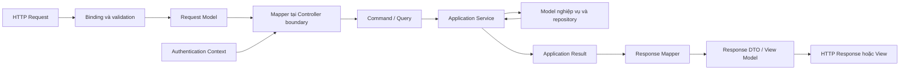

# Ánh xạ dữ liệu tại ranh giới Controller và dịch vụ

Trong ứng dụng MVC, Controller tiếp nhận dữ liệu từ HTTP request rồi chuyển yêu cầu đó đến phần xử lý ứng dụng. Dịch vụ ứng dụng thực hiện ca sử dụng và trả kết quả để Controller tạo phản hồi HTML hoặc JSON. Hai phía có mục đích khác nhau: Controller làm việc với giao thức web và cấu trúc đầu vào của client; dịch vụ làm việc với ý nghĩa của thao tác trong ứng dụng. Vì vậy, dữ liệu đi qua ranh giới này cần được ánh xạ có chủ đích.

Ánh xạ dữ liệu (data mapping) là quá trình chuyển đổi một biểu diễn dữ liệu sang biểu diễn khác, đồng thời giữ đúng ý nghĩa của thông tin. Ví dụ, Controller nhận `CreateOrderRequest` từ JSON, lấy danh tính khách hàng từ ngữ cảnh xác thực, tạo `CreateOrderCommand` rồi gọi `CreateOrderService`. Dịch vụ trả `CreateOrderResult`; Controller chuyển kết quả thành `CreateOrderResponse` hoặc View Model để trả về client.

Ranh giới rõ ràng giúp dịch vụ không phụ thuộc vào `HttpServletRequest`, annotation binding hay cấu trúc template. Nó cũng giúp Controller không phải biết entity được lưu trong cơ sở dữ liệu ra sao. Trong MVC, việc tách các hợp đồng đầu vào, dữ liệu ứng dụng và dữ liệu đầu ra giữ cho mỗi phần có thể thay đổi và kiểm thử theo mục đích riêng.

## 1. Vì sao cần ánh xạ tại ranh giới?

Một request tạo đơn hàng có thể chứa tên người nhận, địa chỉ giao hàng, danh sách sản phẩm và số lượng. Dịch vụ ứng dụng lại cần một command thể hiện ý định đặt hàng, định danh khách hàng đã xác thực và những giá trị đã được chuẩn hóa. Sau khi xử lý, dịch vụ có thể trả về mã đơn, trạng thái và thời điểm tạo; API response hoặc trang HTML có thể cần cách đặt tên, định dạng và mức chi tiết khác.

Nếu dùng cùng một đối tượng cho tất cả các bước, cấu trúc của giao diện sẽ ràng buộc dịch vụ và Model. Một thay đổi tên trường JSON có thể buộc sửa logic nghiệp vụ. Một entity ORM có thể vô tình được trả ra API. Một biểu mẫu có thể gửi thêm trường nhạy cảm mà người dùng không được phép thay đổi.

Ánh xạ tách biệt các biểu diễn dữ liệu theo ranh giới:

- **Request/Form Model:** mô tả dữ liệu client được phép gửi và các ràng buộc đầu vào ở tầng web.
- **Command hoặc Query:** mô tả yêu cầu ở mức ứng dụng; command biểu đạt ý định thay đổi, query biểu đạt nhu cầu đọc dữ liệu.
- **Model nghiệp vụ:** biểu diễn trạng thái, khái niệm và quy tắc của miền.
- **Application Result:** biểu diễn kết quả của ca sử dụng để adapter bên ngoài xử lý.
- **Response DTO hoặc View Model:** mô tả dữ liệu được phép trả về API hoặc trình bày trên một View.

Không phải ứng dụng nào cũng cần một lớp riêng cho từng loại. Với chức năng nhỏ, request DTO có thể trùng cấu trúc với command. Điều quan trọng là biết chúng đang đại diện cho hợp đồng nào và không để chi tiết của một ranh giới rò rỉ sang ranh giới khác.

## 2. Luồng dữ liệu qua Controller và dịch vụ

Một luồng request điển hình có thể được mô tả như sau:



Ở chiều vào, Controller nhận request, framework bind dữ liệu vào một kiểu đầu vào, kiểm tra cấu trúc và các ràng buộc phù hợp, sau đó ánh xạ thành command hoặc query. Dịch vụ ứng dụng thực hiện ca sử dụng bằng các thành phần nghiệp vụ và hạ tầng được cung cấp qua hợp đồng.

Ở chiều ra, dịch vụ trả kết quả ở mức ứng dụng. Controller hoặc presenter chuyển kết quả thành response DTO, View Model, redirect hay một mã HTTP phù hợp. Dịch vụ không cần biết client yêu cầu JSON, HTML hay một kiểu giao diện cụ thể.

| Chặng | Kiểu dữ liệu thường dùng | Câu hỏi cần trả lời |
|---|---|---|
| HTTP vào | JSON, query parameter, path variable, form field | Client gửi dữ liệu gì? |
| Binding | Request DTO hoặc Form Model | Dữ liệu có đúng kiểu và cấu trúc không? |
| Ranh giới ứng dụng | Command hoặc Query | Client đang yêu cầu ca sử dụng nào? |
| Bên trong ứng dụng | Entity, Value Object, repository contract | Quy tắc và trạng thái nào cần được áp dụng? |
| Kết quả ứng dụng | Result hoặc query projection | Ca sử dụng hoàn tất với kết quả nào? |
| HTTP ra | Response DTO hoặc View Model | Client được phép nhận và cần trình bày dữ liệu gì? |

## 3. Phân biệt các kiểu dữ liệu ở ranh giới

### 3.1. Request Model hoặc Form Model

Request Model biểu diễn dữ liệu mà client gửi lên. Nó thường có annotation validation, tên trường và kiểu dữ liệu phù hợp với giao thức hoặc biểu mẫu.

Ví dụ:

```java
public record CreateOrderRequest(
    @NotBlank String shippingName,
    @NotBlank String shippingAddress,
    @NotEmpty List<@Valid CreateOrderLineRequest> lines
) {}

public record CreateOrderLineRequest(
    @Positive long productId,
    @Positive int quantity
) {}
```

Request này chỉ chứa các trường mà client được phép cung cấp cho thao tác tạo đơn. Nó không nhận `orderId`, `status`, `totalAmount`, `approvedBy` hoặc `customerId` nếu những giá trị đó phải do server quyết định.

Form Model có thể gần với Request DTO nhưng được thiết kế theo nhu cầu nhập liệu của một biểu mẫu HTML. Ví dụ form có thể chứa chuỗi ngày tháng, trường xác nhận lại email hoặc giá trị checkbox. API JSON và HTML form có thể cần hai kiểu đầu vào riêng dù cùng gọi một ca sử dụng.

### 3.2. Command và Query

Command biểu đạt ý định thực hiện một thao tác làm thay đổi trạng thái hoặc tạo tác động trong ứng dụng. Query biểu đạt nhu cầu đọc dữ liệu. Cả hai thuộc hợp đồng của tầng ứng dụng, không phải bản sao nguyên trạng của HTTP request.

```java
public record CreateOrderCommand(
    CustomerId customerId,
    ShippingAddress shippingAddress,
    List<RequestedOrderLine> lines
) {}

public record RequestedOrderLine(long productId, int quantity) {}

public record GetOrderDetailQuery(OrderId orderId, CustomerId requesterId) {}
```

`customerId` được lấy từ danh tính đã xác thực ở server. Command có thể dùng `CustomerId` hoặc `ShippingAddress` là kiểu miền để biểu đạt ý nghĩa rõ hơn so với chuỗi tùy ý. Query có thể mang ngữ cảnh người yêu cầu để dịch vụ áp dụng quyền truy cập phù hợp.

Không phải dự án nào cũng cần tách command và request model. Nếu cấu trúc và vòng đời thay đổi giống nhau, có thể dùng chung tạm thời. Khi API có phiên bản riêng, có nhiều client hoặc nghiệp vụ phát triển độc lập, tách chúng sẽ giúp bảo vệ hợp đồng ứng dụng.

### 3.3. Model nghiệp vụ và Persistence Model

Model nghiệp vụ thể hiện quy tắc và trạng thái của miền, ví dụ `Order`, `Money`, `OrderStatus`. Persistence Model hoặc entity ORM phản ánh cách dữ liệu được lưu và ánh xạ vào cơ sở dữ liệu. Trong ứng dụng nhỏ, hai kiểu có thể được kết hợp; trong ứng dụng phức tạp, chúng có thể được tách bằng mapper persistence.

Controller không nên tự tạo entity ORM từ mọi trường request hoặc trả entity trực tiếp ra HTTP response. Việc đó khiến giao diện phụ thuộc vào cấu trúc lưu trữ và có thể để lộ trường nội bộ hoặc quan hệ không cần thiết.

### 3.4. Application Result, Response DTO và View Model

Application Result biểu diễn kết quả ca sử dụng, chẳng hạn mã đơn hàng được tạo hoặc thông tin cần thiết cho bước tiếp theo. Response DTO là hợp đồng dữ liệu trả qua API. View Model tổ chức dữ liệu theo nhu cầu của một trang hoặc vùng giao diện.

Ví dụ:

```java
public record CreateOrderResult(
    OrderId orderId,
    String orderNumber,
    OrderStatus status
) {}

public record CreateOrderResponse(
    String id,
    String orderNumber,
    String status
) {}

public record OrderDetailViewModel(
    String orderNumber,
    String customerName,
    String statusLabel,
    String formattedTotal
) {}
```

Response DTO và View Model có thể khác nhau dù cùng xuất phát từ một kết quả ứng dụng. API có thể trả enum ổn định hoặc mã trạng thái để client xử lý; View Model có thể chuyển trạng thái thành nhãn đã dịch và định dạng tổng tiền theo locale.

## 4. Ánh xạ dữ liệu đầu vào

### 4.1. Binding và validation ở Controller boundary

Framework web thường hỗ trợ chuyển dữ liệu HTTP thành đối tượng Java. Trong Spring MVC, `@RequestBody` dùng để đọc body JSON, `@ModelAttribute` thường dùng để bind query parameter hoặc form field, còn `@PathVariable` và `@RequestParam` nhận dữ liệu từ URL.

Ví dụ Controller nhận request tạo đơn:

```java
@RestController
@RequestMapping("/api/orders")
public class OrderController {
    private final CreateOrderService createOrder;

    public OrderController(CreateOrderService createOrder) {
        this.createOrder = createOrder;
    }

    @PostMapping
    public ResponseEntity<CreateOrderResponse> create(
            @Valid @RequestBody CreateOrderRequest request,
            @AuthenticationPrincipal AppPrincipal principal) {

        CreateOrderCommand command = new CreateOrderCommand(
            principal.customerId(),
            ShippingAddress.of(
                request.shippingName(),
                request.shippingAddress()
            ),
            request.lines().stream()
                .map(line -> new RequestedOrderLine(
                    line.productId(), line.quantity()
                ))
                .toList()
        );

        CreateOrderResult result = createOrder.execute(command);
        CreateOrderResponse response = new CreateOrderResponse(
            result.orderId().value().toString(),
            result.orderNumber(),
            result.status().name()
        );

        return ResponseEntity
            .created(URI.create("/api/orders/" + response.id()))
            .body(response);
    }
}
```

Ví dụ minh họa ánh xạ ở ranh giới; các kiểu `AppPrincipal`, `CustomerId`, `ShippingAddress`, `CreateOrderService` và `OrderId` là kiểu ứng dụng/miền được định nghĩa riêng. Trong dự án thực tế cần kiểm tra quyền, xử lý lỗi và tạo URI theo cấu hình định tuyến phù hợp.

Controller thực hiện các việc sau:

1. Nhận JSON và bind vào `CreateOrderRequest`.
2. Yêu cầu framework kiểm tra các ràng buộc khai báo qua `@Valid`.
3. Lấy danh tính khách hàng từ principal đã xác thực.
4. Chuyển dữ liệu request thành command có ý nghĩa ứng dụng.
5. Gọi dịch vụ và ánh xạ kết quả sang response DTO.
6. Trả status code và body theo hợp đồng HTTP.

Controller không nhận `customerId` từ body để quyết định người đặt hàng. Nếu client gửi thêm trường không được phép, ứng dụng cần có chính sách rõ về việc từ chối hoặc bỏ qua trường đó; không bind trực tiếp vào entity có các trường nhạy cảm.

### 4.2. Validation cấu trúc và validation nghiệp vụ

Validation ở ranh giới thường kiểm tra dữ liệu có thể xác định từ request:

- Trường bắt buộc có được cung cấp không?
- Chuỗi có vượt độ dài cho phép không?
- Số lượng có lớn hơn 0 không?
- Email hoặc ngày tháng có đúng định dạng không?
- Danh sách có số phần tử hợp lệ không?

Validation nghiệp vụ cần ngữ cảnh ứng dụng hoặc dữ liệu miền:

- Khách hàng có được phép đặt hàng không?
- Sản phẩm có đang được bán và còn đủ tồn kho không?
- Đơn hàng có thể chuyển sang trạng thái mới không?
- Hạn mức của tài khoản có đủ cho giao dịch không?

Không nên chỉ kiểm tra quy tắc nghiệp vụ trong Controller vì use case có thể được gọi từ API khác, tác vụ nền hoặc một adapter khác. Những điều kiện bảo vệ tính hợp lệ của miền phải được thực thi trong application service hoặc Model nghiệp vụ ở phía server.

### 4.3. Chuẩn hóa trước khi tạo command

Ánh xạ có thể bao gồm chuẩn hóa định dạng nếu quy tắc đó thuộc ranh giới giao tiếp, chẳng hạn loại bỏ khoảng trắng thừa ở mã tham chiếu hoặc chuyển ngày giờ có offset thành kiểu thời gian chuẩn. Tuy nhiên, cần phân biệt chuẩn hóa kỹ thuật với thay đổi ý nghĩa nghiệp vụ.

Một số quyết định cần được xác định rõ:

- Chuỗi rỗng có được coi là `null` hay là một giá trị không hợp lệ?
- Múi giờ của thời điểm đến từ client được diễn giải ra sao?
- Số tiền được nhận dưới dạng decimal và currency nào?
- Mã enum không nhận diện được sẽ bị từ chối hay ánh xạ sang giá trị mặc định?
- Danh sách trùng phần tử được giữ, gộp hay từ chối?

Không nên âm thầm thay dữ liệu không hợp lệ bằng giá trị mặc định nếu việc đó có thể làm thay đổi ý định của người dùng. Hợp đồng phải quy định rõ cách xử lý.

### 4.4. Ánh xạ có chọn lọc để chống mass assignment

Mass assignment xảy ra khi ứng dụng bind toàn bộ trường request vào một đối tượng có nhiều thuộc tính hơn những gì client được phép thay đổi. Ví dụ, nếu request được bind trực tiếp vào `OrderEntity`, client có thể thử gửi thêm `status`, `total`, `customerId` hoặc `approved` dù biểu mẫu không hiển thị các trường đó.

Hãy dùng request model chỉ chứa trường được phép nhận, sau đó tạo command một cách tường minh. Các giá trị do server quyết định như chủ sở hữu, trạng thái ban đầu, giá hiện hành và thời điểm tạo phải được lấy hoặc tính ở phía server. Việc ẩn trường khỏi HTML không phải cơ chế bảo mật.

## 5. Ánh xạ dữ liệu đầu ra

### 5.1. Từ kết quả ứng dụng sang response DTO

Dịch vụ trả kết quả theo hợp đồng ứng dụng. Controller hoặc response mapper chuyển kết quả sang định dạng HTTP:

```java
public record CreateOrderResult(
    OrderId orderId,
    String orderNumber,
    OrderStatus status
) {}

public record CreateOrderResponse(
    String id,
    String orderNumber,
    String status
) {}

public final class CreateOrderResponseMapper {
    public CreateOrderResponse toResponse(CreateOrderResult result) {
        return new CreateOrderResponse(
            result.orderId().value().toString(),
            result.orderNumber(),
            result.status().name()
        );
    }
}
```

Response mapper chọn đúng các trường được công khai. Nó không trả trực tiếp entity hoặc đối tượng có quan hệ persistence. Khi API cần định dạng ổn định hơn enum nội bộ, có thể ánh xạ sang mã trạng thái công khai được quản lý như một phần của hợp đồng API.

### 5.2. Từ kết quả truy vấn sang View Model

Một trang HTML có thể cần dữ liệu đã định dạng hoặc tổng hợp. Ví dụ View Model chứa nhãn trạng thái, ngày hiển thị và số tiền đã định dạng:

```java
public record OrderDetailViewModel(
    String orderNumber,
    String statusLabel,
    String createdAt,
    String formattedTotal
) {}

public final class OrderDetailViewMapper {
    private final MessageSource messages;

    public OrderDetailViewMapper(MessageSource messages) {
        this.messages = messages;
    }

    public OrderDetailViewModel toViewModel(
            OrderDetailData data,
            Locale locale) {

        NumberFormat currencyFormat = NumberFormat.getCurrencyInstance(locale);
        currencyFormat.setCurrency(
            Currency.getInstance(data.total().currencyCode())
        );

        return new OrderDetailViewModel(
            data.orderNumber(),
            statusLabel(data.status(), locale),
            DateTimeFormatter
                .ofLocalizedDateTime(FormatStyle.MEDIUM)
                .withLocale(locale)
                .format(data.createdAt()),
            currencyFormat.format(data.total().amount())
        );
    }

    private String statusLabel(OrderStatus status, Locale locale) {
        return messages.getMessage(
            "order.status." + status.name().toLowerCase(Locale.ROOT),
            null,
            locale
        );
    }
}
```

Ví dụ rút gọn giả định `createdAt` có kiểu thời gian phù hợp và `total` có mã tiền tệ ISO 4217. `MessageSource` lấy nhãn từ message bundle theo locale; formatter dùng locale cho cách hiển thị nhưng lấy đơn vị tiền từ dữ liệu giao dịch. Múi giờ trình bày cũng cần được xác định rõ.

View Model phục vụ trang chi tiết không nhất thiết dùng được cho API. API có thể cần timestamp ISO-8601 và mã trạng thái; HTML cần chuỗi dễ đọc. Tách hai mapper giúp mỗi hợp đồng phát triển độc lập.

## 6. Ranh giới của mapper và dịch vụ

Mapper chuyển đổi biểu diễn dữ liệu. Dịch vụ ứng dụng thực hiện ca sử dụng. Hai trách nhiệm này không nên bị trộn.

Mapper phù hợp để:

- Đổi tên trường giữa request và command.
- Chuyển kiểu dữ liệu, ví dụ `String` sang `OrderId` sau khi kiểm tra định dạng.
- Chuyển danh sách DTO thành danh sách value object hoặc command item.
- Chọn các trường cần có trong response DTO hoặc View Model.
- Định dạng dữ liệu trình bày theo locale và múi giờ.

Mapper không nên:

- Truy vấn repository hoặc gọi API bên ngoài.
- Tự quyết định khách hàng có quyền đặt hàng hay không.
- Tính giá, thuế hoặc hạn mức bằng cách sao chép quy tắc nghiệp vụ.
- Lưu entity hoặc mở transaction.
- Che giấu lỗi bằng cách tự thay dữ liệu sai thành một giá trị hợp lệ tùy tiện.

Nếu việc ánh xạ cần dữ liệu từ repository, hãy để application service lấy dữ liệu trước rồi cung cấp cho mapper. Nếu phép chuyển đổi chứa một quy tắc miền có ý nghĩa, hãy đặt quy tắc đó trong Model nghiệp vụ hoặc dịch vụ miền và gọi nó từ use case.

### 6.1. Ánh xạ trong Controller hay lớp riêng?

Với request chỉ có vài trường, ánh xạ tường minh ngay trong Controller có thể dễ đọc và tránh tạo thêm lớp không cần thiết. Khi mapping dài, lặp lại ở nhiều endpoint, có quy tắc định dạng hoặc cần kiểm thử độc lập, hãy tách thành mapper chuyên biệt.

| Tình huống | Cách phù hợp |
|---|---|
| Chuyển 2–3 trường đơn giản ở một endpoint | Ánh xạ trực tiếp trong Controller |
| Nhiều endpoint dùng cùng quy tắc chuyển đổi | Dùng mapper dùng chung có phạm vi rõ |
| Response khác nhau theo HTML và JSON | Tách View Model mapper và response mapper |
| Mapping cần truy vấn dữ liệu hoặc kiểm tra quyền | Đưa việc lấy dữ liệu/kiểm tra vào service; mapper chỉ nhận dữ liệu đã có |
| Mapping chứa quy tắc miền | Đặt quy tắc trong Model hoặc domain service |

Không nên dùng một mapper tổng quát với hàng chục nhánh điều kiện cho mọi loại đối tượng. Các mapper nhỏ, có tên thể hiện nguồn và đích, thường dễ kiểm thử và bảo trì hơn.

## 7. Giữ hợp đồng dịch vụ độc lập với HTTP

Application service nên nhận kiểu dữ liệu thuộc ứng dụng hoặc miền. Tránh để chữ ký dịch vụ chứa các kiểu phụ thuộc trực tiếp vào framework web:

```java
// Không nên: dịch vụ phụ thuộc vào HTTP và cơ chế binding của Spring.
public interface CreateOrderService {
    ResponseEntity<?> create(
        HttpServletRequest request,
        BindingResult bindingResult
    );
}
```

Một hợp đồng phù hợp hơn:

```java
public interface CreateOrderService {
    CreateOrderResult execute(CreateOrderCommand command);
}
```

Controller chuyển dữ liệu web thành command và dịch vụ trả application result. Adapter web quyết định status code, header, redirect hoặc tên template. Nhờ đó, cùng use case có thể được gọi từ Controller HTML, Controller API, tác vụ nền hoặc một adapter khác mà không phải tạo request HTTP giả.

Tương tự, không nên trả `ModelAndView`, `BindingResult`, `HttpStatus` hoặc `ResponseEntity` từ application service. Các kiểu này thuộc adapter web. Dịch vụ có thể trả kết quả có ý nghĩa như `OrderCreated`, `OrderNotFound` hoặc `OrderCannotBeCancelled`; Controller ánh xạ chúng sang giao thức.

## 8. Ánh xạ lỗi qua ranh giới

Lỗi ở tầng web và lỗi ở tầng ứng dụng có ý nghĩa khác nhau. Lỗi binding có thể xảy ra trước khi dịch vụ được gọi; lỗi nghiệp vụ phát sinh trong quá trình thực hiện use case; lỗi hạ tầng có thể đến từ cơ sở dữ liệu hoặc dịch vụ bên ngoài.

| Loại lỗi | Ví dụ | Nơi xử lý chính | Phản hồi thường gặp |
|---|---|---|---|
| Binding / cấu trúc request | Chuỗi không chuyển được thành số | Web adapter | `400 Bad Request` hoặc lỗi tại trường form |
| Validation đầu vào | Thiếu tên giao hàng, số lượng không dương | Controller boundary | `400` hoặc render lại form kèm lỗi |
| Quy tắc nghiệp vụ | Đơn hàng không thể hủy ở trạng thái hiện tại | Application/domain | `409 Conflict` hoặc thông báo nghiệp vụ |
| Không tìm thấy | Không có đơn hàng tương ứng | Application/query | `404 Not Found` nếu phù hợp với hợp đồng |
| Không đủ quyền | Người gọi không được xem đơn hàng | Security/application | `403 Forbidden` hoặc `404` theo chính sách tiết lộ tài nguyên |
| Lỗi hạ tầng | Database timeout | Infrastructure/application boundary | `5xx` với thông báo an toàn |

Application layer nên phát biểu lỗi theo ngôn ngữ ứng dụng, ví dụ `OrderNotFound` hoặc `OrderCannotBeCancelled`. Adapter persistence chuyển exception kỹ thuật thành lỗi phù hợp; Controller hoặc `@ControllerAdvice` ánh xạ lỗi ứng dụng sang HTTP status, API error DTO hoặc View lỗi.

Ví dụ một kiểu lỗi API:

```java
public record ApiError(
    String code,
    String message,
    Map<String, String> fieldErrors,
    String traceId
) {}
```

`code` là mã lỗi ổn định để client xử lý; `message` là nội dung an toàn cho người dùng; `fieldErrors` chứa lỗi gắn với trường; `traceId` hỗ trợ bộ phận vận hành tra log nếu cần. Không đưa stack trace, câu SQL, tên bảng, địa chỉ máy chủ hoặc dữ liệu bí mật vào response.

### 8.1. Validation lỗi trong Spring MVC

Với `@Valid @RequestBody`, Spring có thể từ chối request khi ràng buộc không đạt và tạo exception validation trước khi gọi phương thức Controller. Với `@ModelAttribute`, `BindingResult` thường đặt ngay sau tham số được validate để Controller có thể kiểm tra và trả lại form. Cần chọn cách xử lý nhất quán giữa các endpoint và định nghĩa error response chung nếu API có nhiều client.

Không nên biến mọi exception thành `400`. Lỗi hệ thống không phải lỗi nhập liệu; lỗi quyền không phải lỗi validation. Ánh xạ đúng loại lỗi giúp client biết có nên sửa dữ liệu, đăng nhập lại, xin quyền hay thử lại sau.

## 9. Các trường hợp ánh xạ cần đặc biệt chú ý

### 9.1. Null, trường bị thiếu và giá trị mặc định

Với thao tác tạo mới, trường bắt buộc bị thiếu thường là lỗi validation. Với thao tác cập nhật một phần, cần phân biệt:

- Trường không xuất hiện: client không yêu cầu thay đổi trường đó.
- Trường xuất hiện với `null`: client muốn xóa giá trị hoặc gửi dữ liệu không hợp lệ, tùy hợp đồng.
- Trường xuất hiện với chuỗi rỗng: có thể là giá trị rỗng hợp lệ hoặc lỗi validation.

Nếu dùng kiểu Java primitive như `int` hoặc `boolean`, framework có thể gán giá trị mặc định khi trường bị thiếu. Điều đó làm mất khả năng phân biệt “không gửi” và “gửi 0/false”. Với cập nhật một phần, có thể dùng wrapper type, `Optional` theo quy ước rõ ràng hoặc một kiểu biểu diễn có trạng thái presence riêng.

### 9.2. Enum và giá trị không nhận diện

Không nên âm thầm ánh xạ một chuỗi enum lạ thành giá trị mặc định như `PENDING` nếu điều đó làm thay đổi ý định client. Có thể từ chối bằng lỗi validation hoặc dùng mã trạng thái công khai có khả năng mở rộng và xử lý unknown value theo hợp đồng.

### 9.3. Ngày giờ, múi giờ và tiền tệ

Ngày sinh, ngày giao hàng và thời điểm sự kiện có ý nghĩa khác nhau. Một ngày lịch không nên tự động bị diễn giải thành thời điểm UTC. Thời điểm xảy ra sự kiện nên có offset hoặc quy ước múi giờ rõ ràng. Tương tự, số tiền phải đi cùng currency; không nên chỉ ánh xạ một `BigDecimal` mà mất đơn vị tiền.

### 9.4. Collection và quan hệ lồng nhau

Request có thể chứa danh sách dòng hàng hoặc địa chỉ lồng nhau. Cần xác định thứ tự có ý nghĩa không, phần tử trùng có được phép không, giới hạn kích thước danh sách và validation đệ quy. Tránh bind một đồ thị entity ORM sâu từ JSON vì nó có thể tạo quan hệ không hợp lệ hoặc cho phép client sửa những đối tượng không thuộc quyền của họ.

### 9.5. PATCH và cập nhật một phần

Với `PATCH`, mapping phải bảo toàn ý nghĩa của trường bị thiếu so với trường có giá trị `null`. Nếu DTO chỉ dùng nullable field mà không có thông tin presence, mapper có thể vô tình xóa dữ liệu khi client chỉ muốn cập nhật một trường khác. Hãy chọn một định dạng cập nhật có ngữ nghĩa rõ ràng, chẳng hạn JSON Merge Patch/JSON Patch hoặc command biểu diễn rõ trường cần thay đổi.

## 10. Bảo mật và quyền sở hữu dữ liệu

Ánh xạ dữ liệu là một điểm kiểm soát bảo mật quan trọng. Controller cần coi request là dữ liệu không tin cậy, kể cả khi biểu mẫu giao diện chỉ hiển thị một số trường.

- Không bind trực tiếp request vào entity có trường nội bộ hoặc trường phân quyền.
- Lấy user/customer ID từ security context đã xác thực khi đó là danh tính của người gọi.
- Kiểm tra người gọi có quyền thao tác trên tài nguyên cụ thể trong application service hoặc policy phù hợp.
- Chọn trường response theo quyền và mục đích; không trả mọi thuộc tính của entity.
- Giới hạn kích thước chuỗi, danh sách, tệp và cấu trúc lồng nhau để giảm nguy cơ lạm dụng tài nguyên.
- Escape dữ liệu khi View render HTML; serialization JSON không tự giải quyết an toàn khi dữ liệu sau đó được chèn vào DOM.

Không nên dựa vào `canEdit`, `isOwner` hoặc `showDeleteButton` trong View Model để quyết định quyền thực thi. Những trường đó chỉ giúp View trình bày thao tác. Server vẫn phải kiểm tra quyền ở mỗi request.

## 11. Quản lý phiên bản hợp đồng

Request và response DTO là hợp đồng giữa client và server. Khi có nhiều client hoặc API được phát hành công khai, thay đổi tên trường, kiểu dữ liệu, ý nghĩa null hoặc mã trạng thái có thể phá vỡ client cũ.

Một số nguyên tắc:

- Thêm trường tùy chọn thường ít gây ảnh hưởng hơn xóa hoặc đổi nghĩa trường hiện có, nhưng client vẫn cần xử lý dữ liệu chưa biết.
- Không tái sử dụng tên trường cũ cho một ý nghĩa khác.
- Duy trì mã lỗi và quy tắc status nhất quán.
- Nếu thay đổi không tương thích, cân nhắc phiên bản API hoặc thời gian chuyển đổi.
- Giữ DTO công khai độc lập với entity và cấu trúc bảng để thay đổi nội bộ không làm đổi hợp đồng bên ngoài.

Không phải mọi ứng dụng nội bộ đều cần versioning phức tạp. Nếu Controller và service được triển khai cùng một ứng dụng và cùng một nhịp, command có thể thay đổi đồng bộ. Nhưng khi nhiều client hoặc nhóm khác nhau phụ thuộc vào API, hợp đồng cần được quản lý như một sản phẩm có vòng đời.

## 12. Kiểm thử ánh xạ tại ranh giới

Mapping nên được kiểm tra độc lập vì lỗi chuyển đổi có thể làm sai dữ liệu dù Model và dịch vụ hoạt động đúng.

| Phạm vi | Điều cần kiểm tra | Ví dụ |
|---|---|---|
| Request binding | JSON/form được chuyển thành kiểu đầu vào đúng | Số lượng chuỗi không hợp lệ bị từ chối |
| Input validation | Ràng buộc cấu trúc và trường bắt buộc | Danh sách rỗng hoặc số lượng âm bị từ chối |
| Request-to-command mapper | Ánh xạ đủ trường và dùng nguồn dữ liệu đáng tin cậy | `customerId` lấy từ principal, không lấy từ body |
| Application service | Command dẫn đến hành vi và kết quả đúng | Khách hàng không thể đặt sản phẩm ngừng bán |
| Result-to-response mapper | Chỉ công khai trường được phép và mã hóa đúng kiểu | Không trả trường nội bộ của entity |
| View Model mapper | Nhãn, ngày giờ, tiền tệ và locale đúng | Trạng thái được hiển thị bằng nhãn phù hợp |
| Controller test | Status, header, redirect và body đúng hợp đồng | POST thành công trả `201 Created` và Location phù hợp |

Ví dụ unit test mapper:

```java
class CreateOrderResponseMapperTest {
    private final CreateOrderResponseMapper mapper =
        new CreateOrderResponseMapper();

    @Test
    void mapsApplicationResultToPublicResponse() {
        CreateOrderResult result = new CreateOrderResult(
            new OrderId(new UUID(0L, 42L)),
            "ORD-1042",
            OrderStatus.PENDING
        );

        CreateOrderResponse response = mapper.toResponse(result);

        assertEquals("00000000-0000-0000-0000-00000000002a", response.id());
        assertEquals("ORD-1042", response.orderNumber());
        assertEquals("PENDING", response.status());
    }
}
```

Đây là ví dụ minh họa; constructor và biểu diễn `OrderId` phụ thuộc cách định nghĩa trong dự án. Unit test mapper không cần database hoặc Spring context. Controller test nên dùng mock dịch vụ để xác minh request được chuyển đúng và phản hồi HTTP phù hợp; application service và repository adapter có các bài kiểm thử riêng.

## 13. Những sai lầm thường gặp

**Dùng một entity cho request, nghiệp vụ và response.** Điều này gắn client với cấu trúc nội bộ, dễ lộ trường nhạy cảm và tạo nguy cơ mass assignment. Hãy tạo kiểu đầu vào/đầu ra phù hợp với hợp đồng khi các mục đích khác nhau.

**Đưa kiểu HTTP vào application service.** Nếu service nhận `HttpServletRequest` hoặc trả `ResponseEntity`, use case bị phụ thuộc vào framework web. Hãy chuyển dữ liệu thành command/query và trả application result.

**Đặt quy tắc nghiệp vụ trong mapper.** Mapper chỉ chuyển biểu diễn. Quy tắc tính giá, phân quyền hoặc chuyển trạng thái cần nằm trong application/domain để mọi luồng gọi đều tuân theo.

**Mapper truy vấn database.** Việc này tạo side effect ẩn và làm mapping khó kiểm thử. Hãy để service lấy dữ liệu trước rồi truyền vào mapper.

**Sao chép mapping bằng nhiều đoạn code gần giống nhau.** Quy tắc chuyển đổi có thể lệch giữa các endpoint. Khi mapping lặp lại và có ý nghĩa chung, hãy tách mapper có tên rõ nguồn và đích.

**Dùng một DTO khổng lồ cho mọi màn hình.** Các View hoặc API khác nhau có thể cần trường và mức chi tiết khác nhau. Hãy tạo response DTO hoặc View Model theo hợp đồng thực tế, đồng thời tái sử dụng mapper nhỏ khi phù hợp.

**Bỏ qua null và giá trị mặc định.** Mapping có thể biến trường bị thiếu thành `0`, `false` hoặc xóa dữ liệu không chủ ý. Định nghĩa rõ ngữ nghĩa presence, null và empty cho từng thao tác.

**Chỉ validate ở frontend.** Client có thể bị sửa hoặc gọi trực tiếp. Mọi ràng buộc quan trọng phải được xác thực lại ở server; validation phía client chỉ cải thiện trải nghiệm.

**Trả exception kỹ thuật cho client.** Stack trace và thông tin database không thuộc hợp đồng response. Ánh xạ lỗi thành mã và thông báo an toàn, ghi chi tiết ở log nội bộ.

## 14. Checklist thiết kế hợp đồng và mapping

Khi thêm một endpoint hoặc một luồng MVC, hãy tự hỏi:

1. Request Model có chỉ chứa các trường client được phép gửi không?
2. Danh tính và dữ liệu do server quyết định có được lấy từ nguồn tin cậy không?
3. Validation cấu trúc và validation nghiệp vụ đã được đặt đúng nơi chưa?
4. Command hoặc Query có thể hiện ý định ứng dụng thay vì sao chép HTTP request không?
5. Application service có độc lập với kiểu dữ liệu của framework web không?
6. Mapper có chỉ chuyển đổi dữ liệu, không truy vấn hay thực thi quy tắc nghiệp vụ không?
7. Response DTO hoặc View Model có chỉ công khai dữ liệu cần thiết không?
8. Null, trường thiếu, enum, ngày giờ, tiền tệ và collection có ngữ nghĩa rõ ràng không?
9. Lỗi được chuyển thành hợp đồng phản hồi nhất quán và an toàn không?
10. Mapping và Controller có thể được kiểm thử độc lập không?
11. Thay đổi hợp đồng có ảnh hưởng client hiện hữu hoặc cần phiên bản mới không?

## Kết luận

Ánh xạ dữ liệu tại ranh giới Controller và dịch vụ giúp tách hợp đồng HTTP khỏi hợp đồng ứng dụng và Model nghiệp vụ. Controller nhận Request/Form Model, xác thực dữ liệu ở ranh giới, bổ sung ngữ cảnh đáng tin cậy rồi chuyển thành command hoặc query. Dịch vụ thực hiện ca sử dụng và trả application result; adapter web ánh xạ kết quả thành Response DTO hoặc View Model phù hợp. Khi mapping được đặt đúng chỗ, có chọn lọc và được kiểm thử, ứng dụng MVC giảm phụ thuộc giữa client, giao thức, nghiệp vụ và cơ chế lưu trữ, đồng thời kiểm soát tốt hơn validation, bảo mật và khả năng thay đổi hợp đồng.
