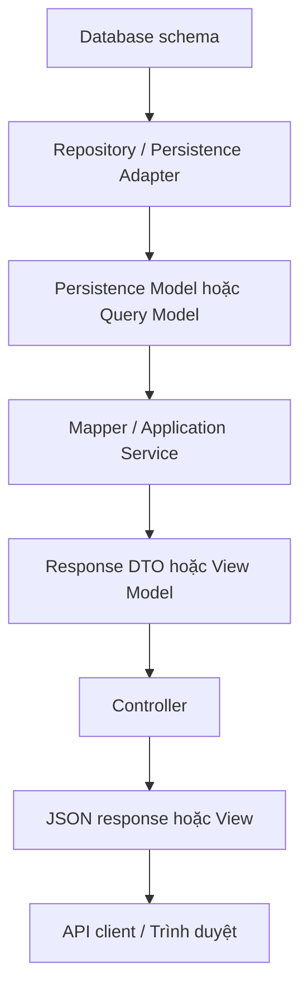
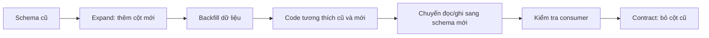

# Giữ hợp đồng giao diện ổn định khi mô hình lưu trữ thay đổi

## 1. Vấn đề cần giải quyết

Trong ứng dụng MVC, dữ liệu đi qua nhiều ranh giới: cơ sở dữ liệu, Domain Model, dịch vụ ứng dụng, Controller và View hoặc API client. Các lớp này có mục đích khác nhau nên không nhất thiết phải dùng chung một cấu trúc đối tượng.

Mô hình lưu trữ thường thay đổi theo nhu cầu vận hành và phát triển. Một bảng có thể được tách thành nhiều bảng; tên cột có thể được chuẩn hóa; dữ liệu có thể chuyển từ một cơ sở dữ liệu quan hệ sang dịch vụ khác; hoặc một trường được tính toán thay vì lưu trực tiếp. Những thay đổi đó không nên tự động buộc giao diện HTML hoặc client API phải thay đổi theo.

Ví dụ, ban đầu bảng `customer` lưu một cột `full_name`. Sau này hệ thống tách thành `first_name` và `last_name`, hoặc chuyển thông tin hồ sơ sang bảng `customer_profile`. Nếu Controller trả trực tiếp entity được ánh xạ từ bảng, thay đổi lưu trữ có thể làm thay đổi JSON hoặc thuộc tính mà View đang sử dụng. Client bị ảnh hưởng dù ý nghĩa nghiệp vụ “tên hiển thị của khách hàng” không đổi.

Giải pháp là xác định **hợp đồng giao diện riêng** cho dữ liệu vào và dữ liệu ra, rồi ánh xạ giữa hợp đồng đó với Domain Model và mô hình lưu trữ. Controller và View phụ thuộc vào hợp đồng được thiết kế có chủ đích; chi tiết database được giữ phía sau repository và adapter.

## 2. Phân biệt các mô hình dữ liệu

Từ *Model* thường được dùng cho nhiều loại đối tượng. Cần phân biệt vai trò để tránh vô tình làm giao diện phụ thuộc vào schema.

| Loại mô hình | Mục đích | Ví dụ |
|---|---|---|
| Persistence Model / Entity | Ánh xạ dữ liệu được lưu trữ và quan hệ trong database | `CustomerEntity` có `firstName`, `lastName`, `profileId` |
| Domain Model | Thể hiện khái niệm, trạng thái và quy tắc nghiệp vụ | `Customer` có hành vi đổi tên và kiểm tra trạng thái |
| Request DTO / Form Object | Mô tả dữ liệu client được phép gửi vào | `UpdateCustomerRequest` |
| Response DTO | Mô tả dữ liệu API cam kết trả về | `CustomerResponse` |
| View Model / Page Model | Mô tả dữ liệu và trạng thái cần cho một màn hình | `CustomerDetailPage` |
| Framework Model | Vùng chứa thuộc tính Controller chuyển cho template | `org.springframework.ui.Model` |

Các mô hình này có thể có trường trùng nhau, nhưng không nên đồng nhất chúng theo mặc định. Entity phục vụ lưu trữ; Domain Model bảo vệ nghiệp vụ; DTO và View Model xác định hợp đồng ở ranh giới giao tiếp.

Đặc biệt, `org.springframework.ui.Model` của Spring MVC chỉ là nơi đặt thuộc tính để View sử dụng. Nó không phải Domain Model và cũng không phải entity của ORM.

## 3. Vì sao không nên trả trực tiếp entity cho giao diện?

Trả trực tiếp JPA entity hoặc đối tượng persistence cho View/API có vẻ tiện vì giảm số lớp ánh xạ. Tuy nhiên, cách làm này tạo ra một hợp đồng ngầm dựa trên chi tiết lưu trữ.

Những rủi ro thường gặp:

- **Rò rỉ schema:** đổi tên cột hoặc quan hệ entity có thể làm thay đổi cấu trúc JSON hoặc thuộc tính template.
- **Lộ dữ liệu ngoài ý muốn:** entity có thể chứa email nội bộ, cờ quản trị, thông tin thanh toán hoặc trường chỉ dành cho máy chủ.
- **Quan hệ ORM bị kéo theo:** serialize quan hệ lazy có thể gây truy vấn ngoài ý muốn, vòng tham chiếu hoặc lỗi khi session persistence đã đóng.
- **Khó kiểm soát thay đổi:** thêm một trường vào entity có thể vô tình làm lộ trường đó ra response.
- **Ghép chặt hai vòng đời:** database phải được thay đổi theo nhu cầu của client, hoặc client phải sửa theo từng lần refactor database.
- **Khó biểu diễn dữ liệu phù hợp cho giao diện:** entity có thể chứa cấu trúc phức tạp trong khi màn hình chỉ cần một số trường đã định dạng.

Không phải mọi ứng dụng đều cần một lớp DTO cho từng bảng. Nhưng tại ranh giới công khai hoặc ranh giới có vòng đời thay đổi độc lập, hợp đồng rõ ràng giúp giảm phụ thuộc và kiểm soát dữ liệu tốt hơn.

## 4. Hợp đồng giao diện ổn định hoạt động như thế nào?

Một luồng đọc điển hình trong Web MVC:



Mỗi ranh giới có một nhiệm vụ:

1. Repository đọc và ghi dữ liệu theo schema hiện tại.
2. Persistence Model mô tả cách dữ liệu được lưu hoặc truy vấn.
3. Mapper hoặc application layer chuyển dữ liệu sang mô hình phù hợp với use case.
4. Response DTO hoặc View Model thể hiện hợp đồng mà giao diện cần.
5. Controller trả hợp đồng đó qua JSON hoặc đưa vào View.

Khi schema thay đổi, phần repository và mapping có thể được điều chỉnh trong khi hợp đồng giao diện vẫn giữ nguyên. Nếu ý nghĩa nghiệp vụ thực sự thay đổi, hợp đồng có thể cần thay đổi có chủ đích và theo chính sách tương thích.

## 5. Ví dụ: đổi cấu trúc bảng khách hàng nhưng giữ API

Giả sử API hiện tại trả về:

```json
{
  "id": "7e5d3b3d-4c8a-4a63-b89b-4d5b3b2e1001",
  "displayName": "Nguyen An",
  "email": "an@example.test",
  "active": true
}
```

Đây là hợp đồng mà client sử dụng. Client cần biết khách hàng có `displayName`, `email` và trạng thái `active`; client không cần biết tên được lưu trong một cột hay ghép từ hai cột.

### 5.1. Persistence Model ban đầu

Ở phiên bản đầu, entity có thể ánh xạ một cột `full_name`:

```java
@Entity
@Table(name = "customer")
public class CustomerEntity {
    @Id
    private UUID id;

    @Column(name = "full_name", nullable = false)
    private String fullName;

    @Column(name = "email_address", nullable = false)
    private String emailAddress;

    @Column(name = "active", nullable = false)
    private boolean active;

    protected CustomerEntity() {
        // Constructor mặc định cho JPA
    }

    public CustomerEntity(UUID id, String fullName,
                          String emailAddress, boolean active) {
        this.id = id;
        this.fullName = fullName;
        this.emailAddress = emailAddress;
        this.active = active;
    }

    // Getters và setters
}
```

### 5.2. Hợp đồng Response DTO

Response DTO được định nghĩa theo ngôn ngữ của API:

```java
public record CustomerResponse(
        UUID id,
        String displayName,
        String email,
        boolean active) {
}
```

Mapper chuyển entity sang DTO:

```java
public class CustomerResponseMapper {
    public CustomerResponse toResponse(CustomerEntity entity) {
        return new CustomerResponse(
                entity.getId(),
                entity.getFullName(),
                entity.getEmailAddress(),
                entity.isActive());
    }
}
```

Controller trả DTO:

```java
@RestController
@RequestMapping("/api/customers")
public class CustomerController {
    private final CustomerRepository repository;
    private final CustomerResponseMapper mapper;

    public CustomerController(
            CustomerRepository repository,
            CustomerResponseMapper mapper) {
        this.repository = repository;
        this.mapper = mapper;
    }

    @GetMapping("/{id}")
    public CustomerResponse detail(@PathVariable UUID id) {
        CustomerEntity customer = repository.findById(id)
                .orElseThrow(() -> new CustomerNotFoundException(id));
        return mapper.toResponse(customer);
    }
}
```

Ví dụ được rút gọn để minh họa mapping; trong ứng dụng lớn, Controller thường gọi query service hoặc Application Service thay vì trực tiếp dùng repository.

### 5.3. Persistence Model sau khi đổi schema

Sau này database tách `full_name` thành hai cột:

```java
@Entity
@Table(name = "customer")
public class CustomerEntity {
    @Id
    private UUID id;

    @Column(name = "first_name", nullable = false)
    private String firstName;

    @Column(name = "last_name", nullable = false)
    private String lastName;

    @Column(name = "email_address", nullable = false)
    private String emailAddress;

    @Column(name = "active", nullable = false)
    private boolean active;

    protected CustomerEntity() {
        // Constructor mặc định cho JPA
    }

    public CustomerEntity(UUID id, String firstName, String lastName,
                          String emailAddress, boolean active) {
        this.id = id;
        this.firstName = firstName;
        this.lastName = lastName;
        this.emailAddress = emailAddress;
        this.active = active;
    }

    // Getters và setters
}
```

Chỉ mapper cần biết cách tạo tên hiển thị từ hai trường:

```java
public class CustomerResponseMapper {
    public CustomerResponse toResponse(CustomerEntity entity) {
        String displayName = (entity.getFirstName() + " "
                + entity.getLastName()).trim();

        return new CustomerResponse(
                entity.getId(),
                displayName,
                entity.getEmailAddress(),
                entity.isActive());
    }
}
```

`CustomerResponse` vẫn giữ nguyên cấu trúc. Client tiếp tục đọc `displayName`, không cần biết schema mới có hai cột. Đây là lợi ích của việc đặt hợp đồng ở ranh giới giao diện thay vì để entity quyết định JSON.

## 6. Tách hợp đồng cho dữ liệu vào và dữ liệu ra

Request và response thường có mục đích khác nhau, vì vậy nên thiết kế riêng.

Ví dụ form cập nhật khách hàng:

```java
public record UpdateCustomerRequest(
        @NotBlank @Size(max = 80) String firstName,
        @NotBlank @Size(max = 80) String lastName,
        @Email @Size(max = 254) String email) {
}
```

Request chỉ cho phép client gửi những trường được cập nhật. Các trường như `id`, `createdAt`, `role`, `active`, `approvedBy` hoặc `version` có thể do máy chủ quản lý và không nên tự động bind từ body nếu use case không cho phép.

Response có thể bao gồm dữ liệu dẫn xuất mà request không có:

```java
public record CustomerDetailResponse(
        UUID id,
        String displayName,
        String email,
        boolean active,
        Instant createdAt,
        String accountStatusLabel) {
}
```

Không nên dùng một DTO duy nhất cho mọi thao tác chỉ vì các trường có vẻ giống nhau. Tạo, cập nhật, danh sách và chi tiết có thể có các hợp đồng khác nhau. Tuy vậy, cũng không cần tách DTO quá mức nếu hai use case thật sự có cùng yêu cầu và cùng vòng đời.

## 7. Hợp đồng cho View HTML và API có thể khác nhau

Một màn hình HTML và một API response có thể cùng dựa trên một Domain Model nhưng cần dữ liệu trình bày khác nhau.

Ví dụ trang chi tiết khách hàng có thể cần:

```java
public record CustomerDetailPage(
        String displayName,
        String formattedCreatedAt,
        String statusLabel,
        boolean canEdit,
        List<OrderSummaryItem> recentOrders) {
}
```

API có thể trả `createdAt` ở dạng thời gian chuẩn ISO 8601 và trạng thái dưới dạng mã ổn định; View Model có thể có `formattedCreatedAt` và `statusLabel` đã được bản địa hóa. Không nên buộc API dùng chuỗi ngày đã định dạng theo locale của một trình duyệt.

Một số nguyên tắc:

- Response DTO của API nên biểu diễn dữ liệu theo hợp đồng máy có thể xử lý ổn định.
- View Model có thể chứa nhãn, trạng thái hiển thị, URL điều hướng và các cờ phục vụ giao diện.
- Không đưa logic phân quyền thực sự vào View Model. `canEdit` chỉ giúp ẩn/hiện điều khiển; endpoint vẫn phải kiểm tra quyền ở máy chủ.
- Không để template phụ thuộc vào entity hoặc quan hệ ORM.

## 8. Quy tắc thiết kế hợp đồng ổn định

Hợp đồng ổn định không có nghĩa là không bao giờ thay đổi. Nó có nghĩa là thay đổi được quản lý và có chủ đích.

### 8.1. Giữ tên và ý nghĩa trường

Nếu client đang dùng `displayName`, không đổi thành `name` chỉ vì database đổi cột thành `first_name` và `last_name`. Tên trường giao diện nên phản ánh ngôn ngữ của hợp đồng, không sao chép tên cột.

### 8.2. Bổ sung trường theo cách tương thích

Thêm trường tùy chọn thường ít gây ảnh hưởng hơn xóa hoặc đổi kiểu trường. Tuy nhiên, một số client dùng schema nghiêm ngặt hoặc deserialize vào kiểu không chấp nhận trường lạ. Hãy kiểm tra hành vi client thực tế và ghi rõ chính sách tương thích.

Khi thêm trường:

- Xác định giá trị có thể vắng mặt hay luôn có.
- Quy định ý nghĩa khi trường là `null`, không xuất hiện hoặc có giá trị mặc định.
- Không thay đổi ý nghĩa của trường cũ.
- Cập nhật tài liệu và contract test.

### 8.3. Không đổi kiểu hoặc đơn vị âm thầm

Không đổi `price` từ decimal sang chuỗi hoặc từ đồng sang nghìn đồng mà không thay đổi hợp đồng. Không đổi timestamp UTC thành chuỗi giờ địa phương không kèm múi giờ. Nếu cần thay đổi, cung cấp trường hoặc phiên bản mới và có kế hoạch chuyển client.

### 8.4. Thiết kế enum có khả năng mở rộng

Client có thể nhận một giá trị enum mới khi nghiệp vụ bổ sung trạng thái. Client nên có nhánh mặc định để xử lý giá trị chưa biết, hoặc API cần quy định cách mở rộng enum. Không giả định tập enum sẽ mãi cố định nếu hợp đồng cho phép thêm trạng thái.

### 8.5. Phân trang và lọc là một phần của hợp đồng

Không để cách database phân trang quyết định trực tiếp giao diện. Hợp đồng có thể cung cấp `items`, `page`, `size`, `totalElements` hoặc cursor. Nếu chuyển từ offset pagination sang cursor pagination, cần đánh giá tác động đến client và có thể cung cấp endpoint hoặc phiên bản mới.

## 9. Thay đổi schema database mà không phá vỡ ứng dụng

Khi schema thay đổi, có thể dùng chiến lược **expand-and-contract** để triển khai an toàn, đặc biệt khi nhiều phiên bản ứng dụng cùng chạy trong quá trình deploy.

Ví dụ chuyển từ `full_name` sang `first_name` và `last_name`:

1. **Expand:** thêm hai cột mới, ban đầu cho phép nullable hoặc có giá trị mặc định phù hợp; chưa xóa cột cũ.
2. **Backfill:** chuyển dữ liệu cũ sang hai cột mới bằng migration có thể kiểm soát và kiểm tra.
3. **Dual compatibility:** triển khai code có thể đọc cấu trúc mới và, nếu cần, tiếp tục ghi tương thích trong giai đoạn chuyển đổi.
4. **Switch:** chuyển truy vấn chính sang các cột mới sau khi dữ liệu đã sẵn sàng.
5. **Verify:** theo dõi số lượng bản ghi, dữ liệu thiếu, lỗi ghi và kết quả đọc trong thời gian chuyển đổi.
6. **Contract:** chỉ xóa `full_name` sau khi mọi phiên bản ứng dụng, job, báo cáo và consumer không còn phụ thuộc vào cột đó.



Chiến lược cụ thể phụ thuộc database, quy mô dữ liệu và cách deploy. Không phải lúc nào cũng cần dual-write; nếu dùng, phải xác định thứ tự ghi, xử lý lỗi một phía và cơ chế đối soát. Với dữ liệu lớn, backfill nên theo batch, có thể tiếp tục hoặc chạy lại an toàn.

Điểm quan trọng là migration schema và thay đổi API/View contract là hai loại thay đổi độc lập. Có thể đổi schema mà không đổi response; cũng có thể thay đổi response trong khi schema vẫn giữ nguyên.

## 10. Mapping và vị trí của nó trong MVC

Mapping có thể đặt ở nhiều nơi tùy mức độ phức tạp:

- Mapper thuần cho DTO đơn giản có thể nằm ở application layer hoặc một package mapping riêng.
- Query service có thể chiếu dữ liệu trực tiếp thành read DTO nếu chỉ cần đọc và không cần nạp toàn bộ aggregate.
- Domain Model không nên chứa annotation JSON hoặc biết tên trường API nếu điều đó làm nó phụ thuộc vào giao thức.
- Controller có thể thực hiện mapping rất nhỏ, nhưng không nên chứa quy tắc chuyển đổi phức tạp hoặc lặp lại ở nhiều endpoint.
- Repository không nên trả cấu trúc JSON công khai như một cách để tránh định nghĩa hợp đồng, trừ khi đó là một read model được thiết kế có chủ đích cho query boundary.

Một mapper tốt cần rõ ràng và có thể kiểm thử. Không nên tạo một framework mapping phức tạp cho vài trường đơn giản; cũng không nên viết lại cùng phép chuyển đổi ở nhiều Controller.

## 11. Hợp đồng lỗi và dữ liệu tùy chọn

Hợp đồng không chỉ gồm response thành công. Client còn cần biết cách diễn giải lỗi, dữ liệu vắng mặt và các trường có thể null.

Ví dụ một response lỗi ổn định:

```json
{
  "type": "https://api.example.test/problems/customer-not-found",
  "title": "Không tìm thấy khách hàng",
  "status": 404,
  "code": "CUSTOMER_NOT_FOUND",
  "detail": "Không tìm thấy khách hàng được yêu cầu."
}
```

Mã `code` giúp client xử lý theo chương trình; `title` và `detail` dành cho con người. Không để client phải phân tích câu thông báo để đoán nguyên nhân.

Với trường tùy chọn, cần quy định rõ:

- Trường không xuất hiện nghĩa là không được cung cấp, chưa tải hoặc không áp dụng?
- `null` nghĩa là không có giá trị, bị ẩn hay chưa xác định?
- Chuỗi rỗng có khác với `null` không?
- Khi cập nhật một phần, bỏ trường có nghĩa là giữ nguyên hay xóa giá trị?

Đặc biệt với `PATCH`, ngữ nghĩa của trường bị bỏ qua và trường được gửi với `null` phụ thuộc định dạng patch được chọn. Hãy định nghĩa rõ trong hợp đồng.

## 12. Versioning khi thực sự cần thay đổi hợp đồng

Nếu cần một thay đổi không tương thích, có thể dùng versioning thay vì âm thầm phá vỡ client.

Các chiến lược thường gặp:

- Version trong URL, ví dụ `/api/v1/customers` và `/api/v2/customers`.
- Version qua media type hoặc header theo chính sách API.
- Duy trì endpoint cũ trong thời gian chuyển đổi rồi ngừng hỗ trợ theo lịch đã công bố.

Không cần tăng version chỉ vì database đổi schema. Versioning dành cho thay đổi hợp đồng bên ngoài. Khi version mới ra đời, cần xác định:

1. Khác biệt giữa phiên bản cũ và mới.
2. Thời gian hỗ trợ phiên bản cũ.
3. Cách client phát hiện và chuyển sang phiên bản mới.
4. Kiểm thử tương thích cho cả hai phiên bản trong giai đoạn chuyển tiếp.
5. Thời điểm ngừng hỗ trợ và thông báo cho consumer.

## 13. Kiểm thử hợp đồng dữ liệu

Kiểm thử hợp đồng giúp bảo đảm thay đổi nội bộ không vô tình thay đổi response mà client đang sử dụng.

| Loại kiểm thử | Mục tiêu | Ví dụ |
|---|---|---|
| Mapper unit test | Mapping từ persistence/domain model sang DTO đúng | `firstName` + `lastName` tạo `displayName` |
| Controller test | Endpoint trả đúng status, content type và trường dữ liệu | JSON vẫn có `displayName`, `email`, `active` |
| Serialization test | Kiểu dữ liệu và định dạng JSON ổn định | UUID, timestamp, decimal và nullability |
| Consumer contract test | Provider đáp ứng kỳ vọng của client đã đăng ký | Client cần `displayName` và mã lỗi `CUSTOMER_NOT_FOUND` |
| Schema migration test | Dữ liệu cũ được chuyển đúng sang schema mới | Backfill tên và kiểm tra bản ghi thiếu |
| Compatibility test | Phiên bản mới vẫn phục vụ consumer cũ trong thời gian hỗ trợ | Response bổ sung trường nhưng không đổi trường cũ |

Ví dụ mapper test:

```java
class CustomerResponseMapperTest {
    @Test
    void mapsSplitNameToStableDisplayName() {
        CustomerEntity entity = new CustomerEntity(
                UUID.fromString("7e5d3b3d-4c8a-4a63-b89b-4d5b3b2e1001"),
                "Nguyen",
                "An",
                "an@example.test",
                true);

        CustomerResponse response = new CustomerResponseMapper()
                .toResponse(entity);

        assertEquals("Nguyen An", response.displayName());
        assertEquals("an@example.test", response.email());
        assertTrue(response.active());
    }
}
```

Test trên tập trung vào hợp đồng đầu ra, không cần biết dữ liệu đến từ cột nào. Ngoài unit test, nên lưu mẫu response hoặc schema OpenAPI và kiểm tra thay đổi trong CI để phát hiện breaking change sớm.

## 14. Các lỗi thiết kế thường gặp

1. **Serialize entity trực tiếp:** schema database vô tình trở thành API contract.
2. **Dùng chung một lớp cho request, entity và response:** client có thể cập nhật trường nội bộ hoặc nhận quá nhiều dữ liệu.
3. **Đổi tên trường API theo tên cột:** một refactor database buộc mọi client sửa theo.
4. **Đưa logic mapping vào nhiều Controller:** cùng một dữ liệu có thể được chuyển đổi không nhất quán giữa endpoint.
5. **Ẩn thay đổi ý nghĩa sau tên trường cũ:** giữ tên `price` nhưng đổi đơn vị hoặc tiền tệ là breaking change về ngữ nghĩa.
6. **Xóa cột cũ quá sớm:** phiên bản ứng dụng cũ hoặc job nền vẫn có thể đang đọc/ghi cột đó.
7. **Không định nghĩa null và trường tùy chọn:** client không biết cách xử lý dữ liệu vắng mặt.
8. **Không kiểm thử contract:** thay đổi serializer hoặc mapper có thể làm hỏng client mà unit test nghiệp vụ không phát hiện.
9. **Version API vì thay đổi database:** trộn lẫn vòng đời nội bộ với vòng đời hợp đồng bên ngoài.

## 15. Quy trình giữ hợp đồng ổn định

Khi cần thay đổi mô hình lưu trữ, có thể thực hiện theo trình tự:

1. Liệt kê các View, API client và consumer đang sử dụng dữ liệu bị ảnh hưởng.
2. Xác định hợp đồng bên ngoài hiện tại và những trường client thực sự phụ thuộc.
3. Thiết kế schema mới cùng chiến lược migration tương thích.
4. Điều chỉnh repository, query model và mapper để vẫn tạo ra hợp đồng cũ.
5. Chạy mapper test, controller/serialization test, consumer contract test và migration test.
6. Triển khai theo expand-and-contract nếu các phiên bản có thể cùng tồn tại.
7. Theo dõi lỗi và mức sử dụng schema cũ trước khi loại bỏ cột hoặc bảng cũ.
8. Chỉ version API khi hợp đồng bên ngoài thực sự cần thay đổi không tương thích.

## 16. Kết luận

Giữ hợp đồng giao diện ổn định khi mô hình lưu trữ thay đổi bằng cách tách Persistence Model, Domain Model, Request DTO, Response DTO và View Model theo trách nhiệm của chúng. Repository và mapper hấp thụ thay đổi schema; Controller và View tiếp tục sử dụng hợp đồng đã được thiết kế cho client.

Hợp đồng cần có tên trường, kiểu dữ liệu, nullability, ngữ nghĩa và cách xử lý lỗi rõ ràng. Thay đổi database nên được triển khai theo chiến lược migration an toàn như expand-and-contract; thay đổi API không tương thích cần có versioning và lộ trình chuyển đổi. Contract test giúp xác minh rằng các thay đổi nội bộ không vô tình phá vỡ giao diện đang được sử dụng.
