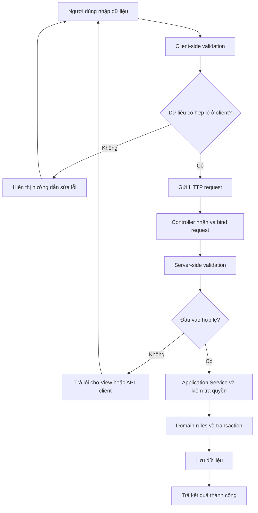

# Phân biệt kiểm tra phía trình duyệt và phía máy chủ

Trong ứng dụng web theo kiến trúc **MODEL_VIEW_CONTROLLER (MVC)**, biểu mẫu là điểm tiếp nhận dữ liệu từ người dùng. Dữ liệu đó có thể được dùng để tạo tài khoản, cập nhật hồ sơ, đặt hàng hoặc thay đổi một đối tượng nghiệp vụ. Trước khi dữ liệu được chấp nhận, ứng dụng cần kiểm tra xem nó có đúng định dạng, nằm trong giới hạn cho phép và phù hợp với quy tắc của hệ thống hay không.

Việc kiểm tra thường diễn ra ở hai nơi: **phía trình duyệt (client-side validation)** và **phía máy chủ (server-side validation)**. Kiểm tra phía trình duyệt phản hồi nhanh khi người dùng nhập liệu; kiểm tra phía máy chủ bảo vệ ứng dụng tại ranh giới tin cậy và quyết định request có được xử lý hay không. Hai lớp này hỗ trợ nhau nhưng không thay thế cho nhau.

Bài học này giải thích vai trò, giới hạn và cách phối hợp hai lớp kiểm tra trong luồng MVC; minh họa bằng HTML, JavaScript và Spring MVC; đồng thời phân biệt validation đầu vào với quy tắc nghiệp vụ và authorization.

## 1. Validation là gì?

**Validation (kiểm tra tính hợp lệ)** là quá trình xác định dữ liệu có thỏa mãn những điều kiện đã đặt ra hay không. Điều kiện có thể liên quan đến:

- Sự hiện diện: trường bắt buộc có được nhập không?
- Kiểu và định dạng: email có đúng dạng, ngày có parse được, số lượng có phải số nguyên không?
- Giới hạn: chuỗi có vượt độ dài tối đa, số có nằm trong khoảng cho phép không?
- Quan hệ giữa các trường: ngày kết thúc có sau ngày bắt đầu không?
- Ngữ cảnh nghiệp vụ: sản phẩm còn được bán, đơn hàng có còn được phép sửa không?

Không phải mọi điều kiện đều thuộc cùng một lớp. Ví dụ, trình duyệt có thể kiểm tra một trường email có dạng cơ bản phù hợp; máy chủ phải kiểm tra lại dữ liệu nhận được; tầng nghiệp vụ có thể kiểm tra email đã được sử dụng chưa hoặc người dùng có quyền thay đổi email đó không.

### Client-side validation

Client-side validation chạy trong môi trường phía người dùng, thường là trình duyệt, trước khi gửi request hoặc ngay khi người dùng nhập liệu. Nó có thể dùng HTML constraint validation, JavaScript hoặc thư viện giao diện.

Mục tiêu chính:

- Phản hồi sớm mà không cần chờ round trip đến máy chủ.
- Hướng dẫn người dùng sửa dữ liệu gần trường nhập.
- Giảm những request rõ ràng sai định dạng.
- Cải thiện trải nghiệm khi điền biểu mẫu.

### Server-side validation

Server-side validation chạy trong ứng dụng phía máy chủ sau khi nhận request. Nó kiểm tra dữ liệu đã bind/parse, áp dụng các điều kiện đầu vào và phối hợp với quy tắc nghiệp vụ trước khi ghi dữ liệu.

Mục tiêu chính:

- Bảo vệ hệ thống trước dữ liệu không đáng tin cậy.
- Bảo đảm mọi client đều tuân theo cùng một hợp đồng, kể cả khi không dùng giao diện web.
- Ngăn dữ liệu không hợp lệ đi vào Domain Object hoặc cơ sở dữ liệu.
- Cung cấp kết quả có thẩm quyền để Controller trả response phù hợp.

## 2. So sánh hai lớp kiểm tra

| Tiêu chí | Client-side validation | Server-side validation |
|---|---|---|
| Nơi chạy | Trình duyệt hoặc client app | Backend/server |
| Thời điểm | Khi nhập, khi blur hoặc trước khi gửi | Sau khi request đến máy chủ |
| Mục tiêu chính | Trải nghiệm và phản hồi nhanh | Tính đúng đắn và bảo vệ dữ liệu |
| Tốc độ phản hồi | Thường tức thời | Phụ thuộc mạng và xử lý backend |
| Có thể bị bỏ qua/sửa? | Có, người dùng kiểm soát client | Không thể bị bỏ qua bằng cách sửa giao diện; tuy vậy server vẫn phải xử lý lỗi và dữ liệu không đáng tin cậy |
| Có truy cập dữ liệu có thẩm quyền? | Thường không | Có thể truy vấn database, service và chính sách hiện tại |
| Áp dụng cho client khác | Không tự động | Có thể dùng chung cho web, mobile, API và job |
| Vai trò bảo mật | Hỗ trợ trải nghiệm, không phải ranh giới bảo vệ | Ranh giới kiểm tra bắt buộc trước khi xử lý |
| Ví dụ | Báo email sai định dạng trước submit | Kiểm tra email trùng và quyền cập nhật hồ sơ |

Một biểu mẫu tốt thường dùng cả hai. Client giúp người dùng sửa lỗi sớm; server xác minh lại mọi điều kiện cần thiết trước khi chấp nhận thay đổi.

## 3. Vì sao không thể chỉ tin kiểm tra phía trình duyệt?

Trình duyệt nằm ngoài vùng tin cậy của máy chủ. Người dùng có thể thay đổi hoặc bỏ qua bất kỳ logic nào chạy ở client. Họ có thể:

- Tắt JavaScript hoặc gửi request bằng công cụ HTTP khác.
- Sửa HTML để xóa `required`, `maxlength`, `min`, `max` hoặc `pattern`.
- Thay đổi hidden input, `data-*`, query parameter hoặc payload JSON.
- Gọi trực tiếp endpoint mà không mở trang form.
- Gửi giá trị khác kiểu, thiếu trường hoặc chứa trường không có trong giao diện.
- Gửi request cũ sau khi trạng thái dữ liệu trên máy chủ đã thay đổi.

Ví dụ, form có trường số lượng với `min="1"` không ngăn client gửi `quantity=-100` bằng một request tự tạo. Tương tự, ẩn nút “Phê duyệt” không ngăn người dùng gọi endpoint phê duyệt trực tiếp.

Vì vậy, **mọi dữ liệu từ request đều phải được xem là không đáng tin cậy**, dù trình duyệt đã hiển thị thông báo hợp lệ. Server phải kiểm tra lại các điều kiện cần thiết và tự quyết định có chấp nhận thao tác hay không.

## 4. Luồng validation trong ứng dụng MVC

Một luồng gửi form thường diễn ra như sau:



Trong MVC, View có thể thực hiện kiểm tra để phản hồi tức thì. Controller nhận request và điều phối binding, validation, authorization và use case. Application service cùng Domain Object bảo vệ quy tắc nghiệp vụ. Repository lưu dữ liệu sau khi các điều kiện cần thiết đã được thỏa mãn.

Luồng này không có nghĩa mọi validation phải nằm trong Controller. Controller có thể kích hoạt validation request và chuyển lỗi cho View; quy tắc miền cần được đặt ở Model/domain service hoặc application service phù hợp để các entry point khác cũng được bảo vệ.

## 5. Client-side validation bằng HTML

HTML có sẵn cơ chế **Constraint Validation** cho nhiều loại trường. Trình duyệt có thể kiểm tra một số điều kiện trước khi submit mà không cần viết JavaScript.

```html
<form action="/accounts" method="post">
  <div>
    <label for="display-name">Tên hiển thị</label>
    <input
      id="display-name"
      name="displayName"
      type="text"
      required
      minlength="2"
      maxlength="80">
  </div>

  <div>
    <label for="email">Địa chỉ email</label>
    <input
      id="email"
      name="email"
      type="email"
      autocomplete="email"
      required>
  </div>

  <div>
    <label for="age">Tuổi</label>
    <input
      id="age"
      name="age"
      type="number"
      min="18"
      max="120"
      step="1"
      required>
  </div>

  <button type="submit">Tạo tài khoản</button>
</form>
```

Các thuộc tính thường dùng:

| Thuộc tính | Tác dụng | Ví dụ |
|---|---|---|
| `required` | Yêu cầu trường có giá trị | Email bắt buộc |
| `type="email"` | Kiểm tra định dạng email cơ bản | `user@example.com` |
| `type="url"` | Kiểm tra định dạng URL | `https://example.com` |
| `minlength`, `maxlength` | Giới hạn độ dài chuỗi | Tên từ 2 đến 80 ký tự |
| `min`, `max` | Giới hạn giá trị số/ngày | Tuổi từ 18 đến 120 |
| `step` | Quy định bước hợp lệ của giá trị số | Bước 1 cho số nguyên |
| `pattern` | Kiểm tra chuỗi bằng regular expression | Mã gồm chữ và số |

Trình duyệt có thể hiển thị thông báo mặc định và đưa focus đến trường không hợp lệ. Hành vi, cách diễn đạt và khả năng hỗ trợ của trình duyệt có thể khác nhau; không nên phụ thuộc hoàn toàn vào thông báo mặc định nếu sản phẩm cần trải nghiệm nhất quán.

### `pattern` cần được dùng cẩn thận

Ví dụ kiểm tra mã tham chiếu gồm 6 đến 12 ký tự chữ in hoa và số:

```html
<label for="reference">Mã tham chiếu</label>
<input
  id="reference"
  name="reference"
  pattern="[A-Z0-9]{6,12}"
  title="Nhập từ 6 đến 12 ký tự chữ in hoa hoặc số"
  required>
```

`pattern` chỉ kiểm tra cú pháp chuỗi theo quy tắc của HTML/browser; nó không xác minh mã có tồn tại hoặc thuộc về người dùng hiện tại hay không. Nếu quy tắc có tính nghiệp vụ, server vẫn phải kiểm tra.

### HTML validation không phải bảo vệ backend

Các thuộc tính HTML giúp trình duyệt hướng dẫn người dùng. Một request được tạo ngoài form vẫn có thể gửi dữ liệu bất kỳ. Server cần áp dụng hợp đồng đầu vào tương ứng và không giả định browser đã kiểm tra.

## 6. Client-side validation bằng JavaScript

JavaScript hữu ích khi điều kiện phụ thuộc nhiều trường hoặc cần thông báo theo ngôn ngữ và thiết kế của ứng dụng.

Ví dụ kiểm tra hai trường mật khẩu phải khớp:

```html
<form id="register-form" action="/accounts" method="post">
  <label for="password">Mật khẩu</label>
  <input id="password" name="password" type="password" required minlength="12">

  <label for="confirm-password">Nhập lại mật khẩu</label>
  <input id="confirm-password" name="confirmPassword" type="password" required>

  <p id="password-error" aria-live="polite"></p>
  <button type="submit">Đăng ký</button>
</form>
```

```javascript
const form = document.querySelector("#register-form");
const password = document.querySelector("#password");
const confirmation = document.querySelector("#confirm-password");
const error = document.querySelector("#password-error");

function validatePasswordMatch() {
  if (confirmation.value !== password.value) {
    confirmation.setCustomValidity("Hai mật khẩu chưa khớp.");
    error.textContent = "Hai mật khẩu chưa khớp.";
    return false;
  }

  confirmation.setCustomValidity("");
  error.textContent = "";
  return true;
}

confirmation.addEventListener("input", validatePasswordMatch);

form.addEventListener("submit", (event) => {
  if (!validatePasswordMatch() || !form.reportValidity()) {
    event.preventDefault();
  }
});
```

`setCustomValidity(message)` đặt lỗi tùy chỉnh cho trường; truyền chuỗi rỗng để xóa lỗi. `reportValidity()` yêu cầu trình duyệt hiển thị trạng thái validation và báo kết quả. Trong ví dụ, JavaScript cải thiện phản hồi khi người dùng nhập; server vẫn cần kiểm tra hai giá trị khớp trước khi tạo tài khoản.

Không nên dùng JavaScript để tạo một thông báo khác với điều kiện server áp dụng. Nếu client yêu cầu mật khẩu tối thiểu 12 ký tự nhưng server cho phép 8, hoặc ngược lại, người dùng sẽ gặp lỗi bất ngờ. Hãy thống nhất hợp đồng và dùng cùng quy tắc ở các nơi có thể chia sẻ an toàn.

## 7. Server-side validation trong Spring MVC

Trong Spring MVC, request có thể được bind vào một Form Object hoặc Request DTO. Bean Validation giúp khai báo các điều kiện đầu vào thông qua annotation như `@NotBlank`, `@Email`, `@Size`, `@Min`, `@Max`.

```java
import jakarta.validation.constraints.Email;
import jakarta.validation.constraints.NotBlank;
import jakarta.validation.constraints.Size;

public record CreateAccountRequest(
        @NotBlank(message = "Vui lòng nhập tên hiển thị")
        @Size(min = 2, max = 80,
              message = "Tên hiển thị phải có từ 2 đến 80 ký tự")
        String displayName,

        @NotBlank(message = "Vui lòng nhập email")
        @Email(message = "Email chưa đúng định dạng")
        @Size(max = 254, message = "Email quá dài")
        String email
) {}
```

Controller kích hoạt validation bằng `@Valid` hoặc `@Validated`. `BindingResult` cần nằm ngay sau tham số được validate để Controller nhận lỗi binding/validation:

```java
@Controller
class AccountController {

    private final AccountApplicationService service;

    AccountController(AccountApplicationService service) {
        this.service = service;
    }

    @PostMapping("/accounts")
    String create(
            @Valid @ModelAttribute("form") CreateAccountRequest form,
            BindingResult bindingResult,
            Model model,
            RedirectAttributes redirectAttributes) {

        if (bindingResult.hasErrors()) {
            return "accounts/new";
        }

        service.create(form);
        redirectAttributes.addFlashAttribute(
                "notice", "Tài khoản đã được tạo.");
        return "redirect:/accounts";
    }
}
```

Đây là ví dụ Spring MVC rút gọn. Ứng dụng thực tế cần nạp lại dữ liệu phụ trợ cho form khi validation lỗi, xử lý exception nghiệp vụ và cấu hình redirect/response phù hợp. Nếu endpoint nhận JSON qua `@RequestBody`, cách bind và trả lỗi thường dùng `@Valid` cùng `@RestControllerAdvice` thay vì render template.

### Phân biệt lỗi binding và lỗi validation

- **Binding/conversion error:** dữ liệu không chuyển được sang kiểu đích, ví dụ gửi `abc` vào trường số nguyên.
- **Validation error:** giá trị đã chuyển được nhưng không thỏa điều kiện, ví dụ số lượng bằng 0 khi yêu cầu tối thiểu là 1.
- **Business rule violation:** dữ liệu có định dạng hợp lệ nhưng hành động không hợp lệ theo trạng thái nghiệp vụ, ví dụ tài khoản đã khóa không thể thay đổi email.

Controller cần ánh xạ những lỗi này thành response có thể hiểu được, không để exception kỹ thuật thô xuất hiện trên trang.

## 8. Validation đầu vào khác quy tắc nghiệp vụ

Không nên đặt mọi điều kiện vào một lớp validation duy nhất. Có ít nhất bốn nhóm cần phân biệt:

| Nhóm | Câu hỏi | Ví dụ | Nơi xử lý thường gặp |
|---|---|---|---|
| Binding/conversion | Dữ liệu có chuyển được sang kiểu cần thiết không? | `abc` không phải số nguyên | Web binding/conversion |
| Input validation | Dữ liệu có đúng định dạng và giới hạn đầu vào không? | Email không rỗng, tên tối đa 80 ký tự | Form Object/Request DTO |
| Business rule | Hành động có hợp lệ theo miền và trạng thái hiện tại không? | Đơn đã thanh toán không thể hủy theo luồng thông thường | Domain Object/domain service/application service |
| Authorization | Người dùng hiện tại có quyền thực hiện hành động trên tài nguyên này không? | Nhân viên không được sửa tài khoản của người khác | Application service/policy/security layer |

Ví dụ, trường `email` có thể vượt qua kiểm tra cú pháp nhưng đã được một tài khoản khác sử dụng. Đây là điều kiện cần kiểm tra với dữ liệu có thẩm quyền ở server. Tương tự, email có thể hợp lệ và chưa trùng nhưng người dùng hiện tại không được thay đổi email của tài khoản mục tiêu; đây là authorization.

Validation không thay thế authorization. Một request hoàn toàn đúng định dạng vẫn có thể bị từ chối vì người dùng không có quyền.

## 9. Kiểm tra dữ liệu phụ thuộc vào trạng thái máy chủ

Một số điều kiện không thể được xác nhận đáng tin cậy chỉ bằng trình duyệt vì chúng phụ thuộc dữ liệu hiện tại:

- Email hoặc tên đăng nhập đã được sử dụng chưa.
- Mã giảm giá còn hiệu lực và còn lượt sử dụng không.
- Sản phẩm có còn tồn kho không.
- Người dùng có quyền sửa đối tượng tại thời điểm gửi request không.
- Đơn hàng có còn ở trạng thái cho phép hủy không.
- Bản ghi có còn tồn tại hoặc version đã thay đổi không.

Client có thể gọi API để kiểm tra sơ bộ, ví dụ kiểm tra email có sẵn, nhưng kết quả chỉ là thông tin hỗ trợ. Tình trạng có thể thay đổi trước khi người dùng submit form.

Ví dụ: client kiểm tra email `a@example.com` chưa được sử dụng lúc 10:00. Một người khác đăng ký email đó lúc 10:01. Request tạo tài khoản của người thứ nhất đến server lúc 10:02. Nếu server chỉ tin kết quả kiểm tra lúc 10:00, hai tài khoản có thể được tạo trùng.

Server phải kiểm tra lại trong use case ghi và dựa vào ràng buộc duy nhất ở cơ sở dữ liệu để xử lý trường hợp đồng thời. Việc kiểm tra trước giúp trải nghiệm tốt hơn; unique constraint bảo vệ tính nhất quán cuối cùng.

## 10. Chuẩn hóa dữ liệu trước khi kiểm tra

Một số dữ liệu có nhiều cách biểu diễn nhưng có thể mang cùng ý nghĩa. Ví dụ, tên người dùng có khoảng trắng ở đầu/cuối; mã định danh có thể không phân biệt chữ hoa/chữ thường; văn bản Unicode có thể có nhiều dạng chuẩn hóa.

Ứng dụng cần xác định rõ thứ tự và quy tắc:

1. Đọc dữ liệu và áp dụng giới hạn kích thước request để tránh đầu vào quá lớn.
2. Chuẩn hóa theo quy tắc đã công bố, ví dụ trim khoảng trắng ở đầu/cuối hoặc canonicalize mã định danh.
3. Kiểm tra định dạng và giới hạn trên giá trị đã chuẩn hóa.
4. Áp dụng quy tắc nghiệp vụ và lưu dạng chuẩn theo cùng một chính sách.

Không tự ý thay đổi nội dung mà người dùng kỳ vọng được giữ nguyên. Ví dụ, không nên lowercase mọi tên hiển thị hoặc xóa mọi dấu câu trong địa chỉ. Chuẩn hóa email, username, số điện thoại và Unicode cần quy tắc rõ ràng, thống nhất giữa kiểm tra, lưu trữ và so sánh.

Validation không thay thế output encoding. Một chuỗi hợp lệ vẫn có thể chứa ký tự đặc biệt; khi hiển thị trong HTML, cần escape theo ngữ cảnh. Cũng không dùng validation như biện pháp duy nhất chống SQL injection; hãy dùng prepared statement hoặc cơ chế parameter binding của ORM.

## 11. File upload và dữ liệu có rủi ro đặc thù

Với upload, kiểm tra phía trình duyệt có thể giới hạn loại tệp qua `accept` hoặc hiển thị kích thước trước khi gửi. Những kiểm tra đó chỉ hỗ trợ người dùng chọn đúng tệp.

Server cần tự kiểm tra:

- Giới hạn kích thước request và kích thước từng tệp.
- Số lượng tệp và tổng dung lượng được phép.
- Loại nội dung thực tế bằng cách kiểm tra chữ ký/magic bytes khi phù hợp, không chỉ tin phần mở rộng hoặc `Content-Type` do client gửi.
- Tên tệp được chuẩn hóa và không thể dùng path traversal để ghi ra ngoài thư mục cho phép.
- Nội dung được lưu ở vị trí phù hợp, không thực thi trực tiếp như mã nguồn.
- Quyền truy cập khi tải lên và tải xuống.
- Cơ chế quét malware hoặc xử lý cách ly nếu yêu cầu sản phẩm cần.

Không tải toàn bộ tệp lớn vào bộ nhớ chỉ để kiểm tra. Hãy đặt giới hạn ở reverse proxy, web server và ứng dụng để bảo vệ tài nguyên.

## 12. Trình bày lỗi dễ hiểu và có thể tiếp cận

Khi validation thất bại, View cần giúp người dùng biết trường nào có vấn đề, vì sao và cách sửa. Không chỉ tô viền đỏ hoặc hiển thị một thông báo chung ở đầu trang.

Ví dụ HTML cho một trường lỗi:

```html
<div class="form-field">
  <label for="email">Địa chỉ email</label>
  <input
    id="email"
    name="email"
    type="email"
    value="invalid-value"
    aria-invalid="true"
    aria-describedby="email-help email-error">
  <p id="email-help">Ví dụ: name@example.com</p>
  <p id="email-error" class="field-error">
    Hãy nhập địa chỉ email hợp lệ.
  </p>
</div>
```

Với nhiều lỗi, có thể thêm phần tóm tắt ở đầu form, gồm liên kết đến từng trường. Khi server render lại form, giữ lại dữ liệu không nhạy cảm để người dùng không phải nhập lại. Không giữ lại mật khẩu, token hoặc mã xác thực trong response lỗi.

Các nguyên tắc hữu ích:

- Dùng label thật, không dùng placeholder làm nhãn duy nhất.
- Liên kết thông báo lỗi với trường bằng `aria-describedby`.
- Dùng `aria-invalid="true"` khi trường hiện tại không hợp lệ.
- Không dùng màu sắc làm dấu hiệu lỗi duy nhất.
- Thông báo nói rõ cách sửa, ví dụ “Số lượng phải lớn hơn 0”.
- Nếu có nhiều lỗi, cung cấp tóm tắt và điều hướng đến trường lỗi.
- Không công bố stack trace, SQL, tên lớp hoặc thông tin nhạy cảm.

Đối với cập nhật bất đồng bộ, vùng thông báo có thể dùng `role="status"` cho kết quả thông thường hoặc `role="alert"` cho lỗi cần chú ý ngay. Không dùng alert cho mọi lỗi nhỏ vì có thể làm gián đoạn người dùng trình đọc màn hình.

## 13. Response lỗi trong ứng dụng MVC và API

Với server-rendered MVC, khi form không hợp lệ, Controller thường render lại cùng View với Form Object và danh sách lỗi. Với thao tác thành công, Controller có thể dùng Post/Redirect/Get để chuyển sang trang kết quả.

Với API, server trả mã HTTP và cấu trúc lỗi rõ ràng để client hiển thị. Ví dụ:

```json
{
  "type": "validation_error",
  "title": "Dữ liệu chưa hợp lệ",
  "status": 422,
  "errors": {
    "email": ["Email chưa đúng định dạng"],
    "displayName": ["Vui lòng nhập tên hiển thị"]
  }
}
```

Đây là ví dụ payload; hợp đồng thực tế cần thống nhất với client. Một số API dùng `400 Bad Request` cho lỗi validation; một số dùng `422 Unprocessable Content` khi cú pháp request hợp lệ nhưng nội dung không thỏa điều kiện. Quan trọng là chọn quy ước nhất quán và không trả thông tin nội bộ trong lỗi.

Không trả `200 OK` cho mọi lỗi chỉ vì client có thể đọc một trường `success=false`. HTTP status giúp client, proxy, logging và monitoring phân biệt kết quả đúng hơn.

## 14. Tránh lặp quy tắc và lệch nhau giữa client/server

Khi cùng một quy tắc xuất hiện ở client và server, có nguy cơ hai bên triển khai khác nhau. Ví dụ:

- Client cho phép tên 100 ký tự, server chỉ nhận 80.
- Client yêu cầu mật khẩu 8 ký tự, server yêu cầu 12.
- Client coi ngày kết thúc bằng ngày bắt đầu là hợp lệ, server yêu cầu ngày kết thúc phải sau ngày bắt đầu.
- Client trim khoảng trắng nhưng server lưu nguyên chuỗi.

Hãy xác định hợp đồng server làm chuẩn, sau đó đồng bộ các quy tắc đơn giản có thể tái sử dụng ở client. Không phải quy tắc nào cũng nên chạy trên client: điều kiện liên quan quyền, tồn kho, trạng thái hiện tại hoặc dữ liệu nhạy cảm cần được giữ ở phía máy chủ.

Nếu có schema dùng chung cho nhiều client, có thể sinh validator hoặc tài liệu hợp đồng từ schema đó. Tuy vậy, việc dùng chung schema không loại bỏ nhu cầu kiểm tra nghiệp vụ và authorization ở server.

## 15. Kiểm thử client-side và server-side validation

Kiểm thử cần chứng minh hai lớp hoạt động đúng và server vẫn bảo vệ hệ thống khi client validation bị bỏ qua.

| Cấp kiểm thử | Client-side | Server-side |
|---|---|---|
| Unit test | Hàm kiểm tra trường và điều kiện liên trường | Validator, value object hoặc rule service |
| Component test | Lỗi hiển thị khi nhập sai; submit bị chặn phù hợp | Controller render lại form cùng lỗi |
| Integration test | Mock API để kiểm tra phản hồi bất đồng bộ | Binding, Bean Validation, database constraint và transaction |
| Security test | Không dựa vào hidden field hoặc trạng thái UI | Gửi request trực tiếp với dữ liệu giả mạo và trường thừa |
| End-to-end test | Hướng dẫn lỗi và luồng sửa dữ liệu | Request sai bị server từ chối dù client đã bị bỏ qua |

Các kịch bản quan trọng:

1. Form trống: client báo trường bắt buộc; server cũng từ chối request thiếu trường.
2. Email sai định dạng: client phản hồi nhanh; server trả lỗi nếu request được gửi thủ công.
3. Gửi `age=-1` bằng HTTP client: server từ chối dù HTML có `min="18"`.
4. Gửi thêm `role=ADMIN`: DTO không nhận trường ngoài hợp đồng và service không nâng quyền.
5. Email bị đăng ký đồng thời: unique constraint bảo vệ dữ liệu dù kiểm tra trước đó báo còn trống.
6. Người dùng không có quyền sửa tài nguyên: server từ chối dù form client cho phép submit.
7. Request JSON chứa kiểu dữ liệu sai: server trả lỗi binding có cấu trúc.
8. Upload tệp vượt giới hạn hoặc giả MIME type: server từ chối.
9. Kiểm tra lỗi bằng bàn phím và trình đọc màn hình: người dùng biết trường nào cần sửa và cách sửa.

Không nên chỉ test bằng cách nhập dữ liệu qua giao diện. Hãy có test gửi request trực tiếp để chứng minh backend không phụ thuộc vào JavaScript hoặc HTML constraint.

## 16. Các lỗi thiết kế thường gặp

### Chỉ kiểm tra ở client

Người dùng có thể tắt JavaScript, sửa form hoặc gọi endpoint trực tiếp. Luôn kiểm tra lại ở server trước khi chấp nhận dữ liệu.

### Sao chép quy tắc nhưng không đồng bộ

Client và server áp dụng giới hạn khác nhau khiến người dùng vượt qua bước nhập rồi bị từ chối khi submit. Hãy xác định hợp đồng server và đồng bộ các quy tắc đầu vào phù hợp.

### Đặt quy tắc nghiệp vụ vào JavaScript

JavaScript không có thẩm quyền quyết định tồn kho, quyền sở hữu hoặc trạng thái đơn hàng. Những điều kiện đó phải được xác minh ở server.

### Nhầm validation với authorization

Dữ liệu đúng định dạng không có nghĩa người gửi được phép thay đổi tài nguyên. Kiểm tra quyền trên từng hành động và tài nguyên ở phía máy chủ.

### Dùng validation để thay thế parameterized query

Chặn một số ký tự không bảo vệ ứng dụng khỏi SQL injection. Dùng prepared statement/ORM parameter binding và kiểm tra dữ liệu theo hợp đồng.

### Hiển thị lỗi không có ngữ cảnh

Thông báo “Dữ liệu không hợp lệ” không giúp người dùng biết cần sửa gì. Hãy gắn lỗi với trường, giải thích điều kiện và cung cấp cách sửa.

### Tin kết quả kiểm tra bất đồng bộ đã cũ

Email hoặc mã có thể hợp lệ lúc kiểm tra nhưng đã được người khác sử dụng trước khi submit. Server cần kiểm tra lại trong use case ghi và dựa vào constraint phù hợp.

## 17. Quy trình thiết kế validation cho một biểu mẫu

Khi xây dựng form trong ứng dụng MVC, hãy thực hiện theo trình tự:

1. **Liệt kê dữ liệu đầu vào:** trường nào bắt buộc, kiểu nào, giới hạn nào và trường nào do hệ thống quản lý?
2. **Phân loại điều kiện:** điều kiện định dạng, quy tắc nghiệp vụ, quyền truy cập hay ràng buộc dữ liệu?
3. **Thiết kế hợp đồng server:** tạo Form Object/Request DTO chỉ chứa trường được phép nhận.
4. **Triển khai server validation:** binding, Bean Validation, domain rule và authorization ở đúng tầng.
5. **Bổ sung client validation:** HTML constraints và JavaScript để phản hồi sớm theo cùng hợp đồng đầu vào.
6. **Thiết kế lỗi:** lỗi theo trường, tóm tắt, thông báo nghiệp vụ và response API nhất quán.
7. **Bảo vệ dữ liệu:** chuẩn hóa, giới hạn request, kiểm tra upload, escape output và dùng truy vấn tham số hóa.
8. **Kiểm thử bypass:** gửi request thủ công với dữ liệu sai, trường thừa và quyền không hợp lệ.
9. **Kiểm thử trải nghiệm:** bàn phím, screen reader, zoom và thông báo lỗi dễ hiểu.
10. **Quan sát sau triển khai:** theo dõi tỷ lệ lỗi validation, lỗi binding và lỗi nghiệp vụ mà không ghi dữ liệu nhạy cảm vào log.

## Kết luận

Client-side validation giúp người dùng nhận phản hồi nhanh và sửa dữ liệu ngay trên biểu mẫu. Server-side validation kiểm tra lại request tại ranh giới tin cậy và quyết định dữ liệu có được chấp nhận hay không. Client có thể bị sửa hoặc bỏ qua, vì vậy không bao giờ được xem kết quả kiểm tra phía trình duyệt là bằng chứng dữ liệu an toàn.

Trong MVC, View có thể hướng dẫn người dùng nhập đúng; Controller bind request và chuyển lỗi; application service kiểm tra quyền và điều phối use case; Domain Object bảo vệ bất biến; Repository cùng cơ sở dữ liệu bảo đảm các ràng buộc lưu trữ. Kết hợp hai lớp kiểm tra đúng vai trò giúp biểu mẫu dễ sử dụng, backend an toàn và dữ liệu nghiệp vụ nhất quán.
