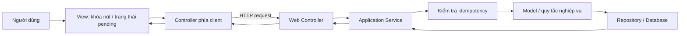
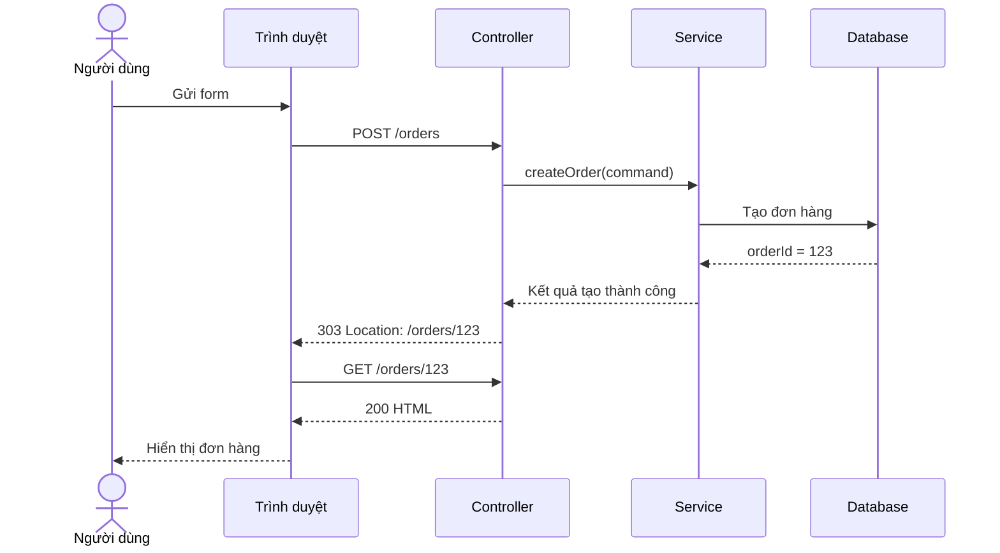

# Ngăn gửi lặp và phân biệt với kiểm soát thao tác lũy đẳng

Hãy tưởng tượng người dùng đặt một đơn hàng trên trang web. Họ nhấn **Đặt hàng**, nhưng trang chưa phản hồi ngay nên nhấn thêm lần nữa. Trình duyệt có thể gửi hai request `POST`; nếu máy chủ xử lý cả hai như hai yêu cầu độc lập, hệ thống có thể tạo hai đơn hàng. Một tình huống khác là máy chủ đã tạo đơn hàng nhưng response bị mất trên đường truyền. Người dùng, SDK hoặc client có thể gửi lại request, và máy chủ có thể tạo thêm một đơn hàng nữa.

Hai tình huống này liên quan đến cùng một vấn đề nhưng cần các lớp giải quyết khác nhau. Giao diện có thể **ngăn người dùng gửi lặp ngoài ý muốn** bằng cách khóa nút sau lần gửi đầu. Máy chủ có thể **bảo đảm một thao tác lặp lại không tạo thêm hiệu ứng** bằng cách thiết kế hành động lũy đẳng hoặc dùng khóa idempotency. Hai cơ chế hỗ trợ nhau, nhưng không thay thế nhau.

Trong MVC, View quản lý phản hồi tương tác; Controller tiếp nhận request và kiểm tra hợp đồng; Service điều phối hành động; Model bảo vệ quy tắc nghiệp vụ; Repository và cơ sở dữ liệu giúp bảo đảm tính nhất quán khi nhiều request đến đồng thời. Bài học này phân biệt các trách nhiệm đó và hướng dẫn chọn giải pháp phù hợp cho biểu mẫu HTML và API.

## 1. Hai khái niệm cần phân biệt

### Ngăn gửi lặp ở giao diện

Ngăn gửi lặp (duplicate submission prevention) là cách hạn chế một thao tác bị gửi nhiều lần do người dùng nhấn nút liên tiếp, nhấn Enter nhiều lần hoặc tương tác trong lúc request trước chưa hoàn tất.

Ví dụ, sau khi người dùng gửi form, View chuyển nút sang trạng thái **Đang gửi...** và vô hiệu hóa nút. Điều này cải thiện trải nghiệm, tránh thao tác lặp vô ý và cho người dùng biết ứng dụng đang xử lý.

Đây là biện pháp ở phía client. Nó không ngăn được mọi request trùng lặp: người dùng có thể mở nhiều tab, gửi request bằng công cụ khác, trình duyệt hoặc proxy có thể retry, hay một request có thể được gửi lại sau khi mất response.

### Tính lũy đẳng của thao tác

Một thao tác có tính **idempotent** khi thực hiện cùng một yêu cầu nhiều lần tạo ra hiệu lực nghiệp vụ tương đương với thực hiện một lần. Có thể biểu diễn đơn giản bằng trạng thái:

\[
f(f(s)) = f(s)
\]

Trong đó `s` là trạng thái ban đầu và `f` là thao tác. Sau lần đầu, các lần lặp không làm thay đổi hiệu lực cuối cùng của thao tác đó.

Ví dụ, đặt trạng thái yêu thích của một tài nguyên thành `true` là lũy đẳng: gọi nhiều lần vẫn cho kết quả yêu thích. Ngược lại, thao tác **đảo trạng thái yêu thích** không lũy đẳng: gọi lần đầu bật, lần thứ hai lại tắt.

Tính lũy đẳng nói về hiệu lực của thao tác. Nó không bắt buộc mọi response phải giống hệt nhau. Ví dụ, request `DELETE` đầu tiên có thể trả `204`, request tiếp theo có thể trả `404`, nhưng hiệu lực cuối cùng vẫn là tài nguyên đã bị xóa.

### So sánh nhanh

| Tiêu chí | Ngăn gửi lặp | Tính lũy đẳng |
|---|---|---|
| Mục tiêu | Hạn chế người dùng kích hoạt nhiều lần | Bảo đảm request lặp không tạo thêm hiệu lực nghiệp vụ |
| Vị trí chính | View hoặc client controller | Hợp đồng API, Service, Model và tầng lưu trữ |
| Cách làm | Khóa nút, trạng thái pending, chống submit lần hai | Thiết kế hành động lũy đẳng hoặc dùng idempotency key |
| Có chống được retry từ mạng hay client khác? | Không bảo đảm | Có, nếu server triển khai đúng cơ chế |
| Có cần khi nào? | Form hoặc thao tác dễ bị kích hoạt liên tiếp | Thao tác mà gửi lại có thể tạo bản ghi, thanh toán hoặc side effect trùng |

Một giao diện tốt nên ngăn gửi lặp để người dùng dễ thao tác. Một hệ thống đáng tin cậy còn phải xử lý request lặp ở phía server, đặc biệt với thao tác tạo đơn hàng, đặt chỗ, thanh toán hoặc phát hành lệnh có tác động bên ngoài.

## 2. Request có thể bị gửi lặp từ đâu?

Không phải mọi request trùng đều xuất phát từ việc người dùng nhấn nút hai lần.

- **Double click:** người dùng nhấn liên tiếp vì không thấy phản hồi ngay.
- **Nhấn Enter nhiều lần:** form nhận nhiều sự kiện submit.
- **Nhiều tab:** cùng một biểu mẫu được mở ở nhiều tab và gửi gần như đồng thời.
- **Refresh hoặc quay lại:** trình duyệt hỏi gửi lại form hoặc người dùng lặp lại thao tác.
- **Timeout:** client không nhận được response và không biết máy chủ đã xử lý hay chưa.
- **Retry tự động:** SDK, gateway hoặc proxy được cấu hình retry; job worker cũng có thể gửi lại thông điệp sau lỗi tạm thời.
- **Thông điệp được giao lại:** hệ thống message có thể giao cùng một sự kiện nhiều lần.
- **Request đồng thời:** hai request giống nhau đến server trước khi request đầu tiên kịp lưu kết quả.

Vì vậy, chỉ kiểm tra một biến `isSubmitting` trong JavaScript không thể bảo đảm dữ liệu không bị tạo trùng. Biến đó chỉ tồn tại trong một instance giao diện và không phối hợp được giữa các tab, thiết bị hoặc tiến trình server.

## 3. Trách nhiệm của từng lớp MVC

Mỗi lớp xử lý một phần khác nhau của vấn đề:

| Thành phần | Trách nhiệm |
|---|---|
| View | Hiển thị trạng thái đang gửi, vô hiệu hóa điều khiển và báo kết quả |
| Client Controller | Chặn sự kiện submit lặp trong cùng màn hình, quản lý request đang chờ |
| Web Controller | Nhận request, xác thực dữ liệu, danh tính và chuyển yêu cầu đến ca sử dụng |
| Application Service | Áp dụng chính sách idempotency, điều phối transaction và nghiệp vụ |
| Domain Model | Bảo vệ quy tắc trạng thái, ví dụ một đơn hàng không thể được xác nhận hai lần theo hai hiệu lực khác nhau |
| Repository / Database | Lưu dấu vết khóa idempotency, áp dụng unique constraint và bảo vệ cập nhật đồng thời |
| Tích hợp ngoài | Dùng khóa idempotency hoặc cơ chế chống trùng của nhà cung cấp khi gọi dịch vụ bên ngoài |



Không nên dồn toàn bộ cơ chế vào View hoặc Controller. View cải thiện tương tác; Service và tầng lưu trữ xử lý các tình huống request trùng thực sự có thể xảy ra trong môi trường phân tán.

## 4. Ngăn gửi lặp trong biểu mẫu HTML

Với form HTML thông thường, có thể lắng nghe sự kiện `submit`. Khi form được gửi hợp lệ lần đầu, đánh dấu đang gửi và khóa nút. Sự kiện submit bao phủ cả nhấn nút lẫn nhấn Enter trong form.

```html
<form id="create-order-form" method="post" action="/orders">
    <input type="hidden" name="productId" value="42">
    <label for="quantity">Số lượng</label>
    <input id="quantity" name="quantity" type="number" min="1" value="2">
    <label for="customer-note">Ghi chú</label>
    <textarea id="customer-note" name="note"></textarea>

    <button type="submit" data-submit-button>Đặt hàng</button>
</form>

<script>
    const form = document.querySelector("#create-order-form");
    const submitButton = form.querySelector("[data-submit-button]");
    let submitting = false;

    form.addEventListener("submit", event => {
        if (submitting) {
            event.preventDefault();
            return;
        }

        submitting = true;
        submitButton.disabled = true;
        submitButton.textContent = "Đang gửi...";
    });
</script>
```

Trình duyệt vẫn thực hiện lần submit đầu tiên theo cơ chế HTML bình thường. Nếu một submit tiếp theo xảy ra trong cùng instance trang, handler ngăn request thứ hai. Kiểm tra hợp lệ HTML xảy ra trước sự kiện submit, nên form không hợp lệ sẽ không bị khóa bởi đoạn mã này.

Đây là biện pháp trải nghiệm, không phải bảo đảm phía server. Nếu trang bị tải lại, mở tab khác hoặc request được gửi trực tiếp, biến `submitting` không có tác dụng. Với form có JavaScript xử lý lỗi mà không tải lại trang, cần mở khóa nút khi request thất bại để người dùng có thể sửa hoặc thử lại.

### Khi dùng fetch hoặc AJAX

Nếu client tự gửi request, có thể dùng một cờ pending để chặn submit đồng thời và dùng `finally` để dọn trạng thái:

```javascript
let submitting = false;
// Giữ nguyên khóa này khi retry cùng một đơn hàng và cùng payload.
let currentAttemptKey = crypto.randomUUID();

async function submitOrder(form) {
    if (submitting) return;

    submitting = true;
    setSubmitButtonDisabled(true);
    showSubmittingState();
    let succeeded = false;

    try {
        const formData = new FormData(form);
        const payload = {
            productId: Number(formData.get("productId")),
            quantity: Number(formData.get("quantity")),
            note: formData.get("note")
        };

        const response = await fetch("/api/orders", {
            method: "POST",
            body: JSON.stringify(payload),
            headers: {
                "Accept": "application/json",
                "Content-Type": "application/json",
                "Idempotency-Key": currentAttemptKey
            }
        });

        if (!response.ok) {
            throw new Error("Không thể gửi đơn hàng.");
        }

        const result = await response.json();
        succeeded = true;
        showOrderCreated(result);
        setSubmitButtonLabel("Đã đặt hàng");
    } catch (error) {
        showError(error.message);
    } finally {
        if (!succeeded) {
            submitting = false;
            setSubmitButtonDisabled(false);
            hideSubmittingState();
        }
    }
}
```

Đoạn mã minh họa luồng client; các hàm `setSubmitButtonDisabled`, `showSubmittingState`, `showOrderCreated`, `setSubmitButtonLabel` và `showError` là helper giao diện cần được ứng dụng định nghĩa. Ví dụ AJAX chuyển dữ liệu form thành JSON và gọi endpoint API `/api/orders`; form HTML gửi trực tiếp vẫn có thể dùng endpoint `/orders` riêng. Ứng dụng thực tế cần gửi CSRF token theo cơ chế đang dùng và xử lý response lỗi có cấu trúc. Khi thành công, nút tiếp tục bị khóa cho đến khi giao diện bắt đầu một đơn hàng mới. Khi thất bại hoặc timeout, client có thể thử lại với cùng khóa và cùng payload. Nếu người dùng sửa dữ liệu để tạo một ý định khác, cần tạo khóa mới theo chính sách của API. `finally` dọn trạng thái pending khi thao tác chưa thành công, nhưng nó không cho biết server đã thực hiện thao tác hay chưa.

### Khóa nút không được làm mất khả năng truy cập

- Dùng phần tử `button` thực sự và thuộc tính `disabled` khi thao tác đang chạy.
- Hiển thị trạng thái bằng văn bản như “Đang gửi...” thay vì chỉ đổi màu.
- Dùng vùng `role="status"` hoặc thông báo phù hợp để công nghệ hỗ trợ nhận biết tiến trình.
- Không khóa các trường cần thiết trước khi trình duyệt thu thập dữ liệu form theo cách làm mất dữ liệu.
- Khi request thất bại và người dùng có thể thử lại, khôi phục nút và giữ dữ liệu đã nhập.

## 5. Post/Redirect/Get giúp gì và không giải quyết điều gì?

Với ứng dụng kết xuất HTML, mẫu **Post/Redirect/Get (PRG)** thường được dùng sau khi xử lý form thành công:

1. Trình duyệt gửi `POST /orders`.
2. Server tạo đơn hàng thành công.
3. Server trả redirect, thường dùng `303 See Other` để yêu cầu trình duyệt gửi `GET` đến trang kết quả.
4. Trình duyệt gửi `GET /orders/123` và hiển thị đơn hàng.

Sau khi redirect, người dùng refresh trang kết quả sẽ tải lại `GET`, không gửi lại form `POST` vừa thực hiện. PRG giảm nguy cơ gửi lại form do refresh.

PRG không ngăn được hai lần nhấn trước khi redirect được nhận, hai tab gửi cùng form hoặc client retry sau khi mất response. Nếu request `POST` thứ nhất đã tạo đơn hàng nhưng response redirect bị mất, client có thể gửi lại `POST` và tạo đơn hàng thứ hai. Vì vậy, PRG và idempotency giải quyết hai lớp vấn đề khác nhau.



## 6. Hiểu tính idempotent trong HTTP

HTTP định nghĩa một số method có ngữ nghĩa idempotent. Theo ngữ nghĩa giao thức, gửi cùng một request một lần hay nhiều lần có cùng hiệu lực dự kiến trên server.

| Method | Ngữ nghĩa thường dùng | Ví dụ |
|---|---|---|
| `GET` | Safe và idempotent; dùng để đọc | `GET /orders/123` |
| `PUT` | Idempotent; đặt biểu diễn tài nguyên theo nội dung gửi | `PUT /users/7/preferences` với `emailNotifications: true` |
| `DELETE` | Idempotent; yêu cầu tài nguyên ở trạng thái đã xóa | `DELETE /orders/123` |
| `POST` | Không mặc nhiên idempotent; thường tạo tài nguyên hoặc thực hiện command | `POST /orders` |
| `PATCH` | Tùy semantics của patch; không mặc nhiên idempotent | Tăng số lượng thêm 1 không idempotent; đặt mô tả thành một giá trị cố định có thể idempotent |

Điểm quan trọng là **idempotency thuộc ngữ nghĩa hành động**, không chỉ do tên HTTP method quyết định. Một endpoint `POST /tasks/42/complete` có thể được thiết kế để gọi lại vẫn giữ công việc ở trạng thái hoàn thành và không phát sinh hiệu ứng phụ lần nữa. Ngược lại, một endpoint `PUT` được cài đặt sai, mỗi lần gọi lại đều gửi email mới, có thể không có hiệu lực tổng thể lũy đẳng.

`GET` phải không được dùng để tạo thay đổi nghiệp vụ. Việc đọc có thể ghi log hoặc cập nhật telemetry nội bộ, nhưng không được khiến một request đọc tài nguyên vô tình đặt hàng, thanh toán hay thay đổi trạng thái nghiệp vụ.

## 7. Thiết kế hành động lũy đẳng ngay từ nghiệp vụ

Khi có thể, hãy thiết kế command theo hướng **đặt trạng thái mong muốn** thay vì **đảo trạng thái** hoặc **tăng thêm hiệu lực**.

Ví dụ với mục yêu thích:

| Thiết kế | Request lặp | Có lũy đẳng không? |
|---|---|---|
| `POST /favorites/toggle` | Bật rồi tắt | Không |
| `PUT /favorites/42` với ý nghĩa đặt là yêu thích | Luôn ở trạng thái yêu thích | Có |
| `DELETE /favorites/42` với ý nghĩa bỏ yêu thích | Luôn ở trạng thái không yêu thích | Có |

Với công việc, command `completeTask(42)` có thể được thiết kế để nếu công việc đã hoàn thành thì trả lại kết quả hiện tại mà không thay đổi trạng thái lần nữa. Tuy nhiên, cần kiểm tra cả side effect như phát sự kiện, gửi email hoặc tạo lịch sử. Nếu mỗi lần gọi lại đều phát thông báo “công việc đã hoàn thành”, trạng thái có thể không đổi nhưng hiệu ứng tổng thể vẫn bị lặp.

Ví dụ logic nghiệp vụ minh họa:

```java
public CompletionResult complete(Instant completedAt) {
    if (status == TaskStatus.COMPLETED) {
        return CompletionResult.alreadyCompleted(this);
    }

    if (status != TaskStatus.IN_PROGRESS) {
        throw new InvalidTaskTransitionException();
    }

    status = TaskStatus.COMPLETED;
    this.completedAt = completedAt;
    return CompletionResult.completed(this);
}
```

Service chỉ phát sự kiện hoàn thành khi kết quả cho biết chuyển trạng thái thực sự vừa diễn ra. Nếu thao tác được retry sau khi commit, lần gọi sau không phát lại sự kiện nghiệp vụ. Trong hệ thống có nhiều tiến trình hoặc side effect, cần bảo đảm việc lưu trạng thái và ghi nhận sự kiện nhất quán, ví dụ bằng transactional outbox.

## 8. Idempotency key cho request có thể được retry

Với hành động `POST` tạo tài nguyên hoặc gây tác động không nên lặp, client có thể gửi một **idempotency key**. Đây là mã duy nhất đại diện cho một ý định thao tác cụ thể.

Ví dụ:

```http
POST /api/orders
Idempotency-Key: 2e9f2c7d-2b2c-4f2b-a3d0-1a7e6f3a8c10
Content-Type: application/json

{
  "productId": 42,
  "quantity": 2
}
```

Nếu client không nhận được response và cần thử lại cùng thao tác, nó gửi lại cùng `Idempotency-Key` và cùng dữ liệu. Server nhận ra đây là cùng một ý định và trả kết quả đã ghi nhận thay vì tạo thêm đơn hàng.

Nếu người dùng chủ động tạo một đơn hàng mới, client phải tạo khóa mới. Không dùng lại một khóa cố định cho mọi thao tác hoặc tạo khóa mới ở mỗi lần retry.

Idempotency key nhận diện **cùng một ý định khi client gửi lại cùng khóa**. Nó không tự nhận ra hai request có khóa khác nhau nhưng tình cờ mang cùng payload là cùng một ý định. Nếu nghiệp vụ cấm tạo hai đặt chỗ cho cùng một người và cùng một suất, cần thêm ràng buộc duy nhất theo khóa nghiệp vụ, chẳng hạn `UNIQUE(user_id, event_slot_id)`. Tương tự, nếu nhiều tab phải cùng đại diện cho một thao tác đang chờ, ứng dụng cần chia sẻ khóa của thao tác đó hoặc dựa vào bất biến nghiệp vụ ở server.

### Vòng đời của khóa

1. Client tạo khóa khi người dùng bắt đầu một ý định mới, thường bằng UUID đủ khó đoán.
2. Client giữ khóa cùng dữ liệu thao tác trong suốt thời gian chờ kết quả.
3. Server nhận khóa, xác định phạm vi và kiểm tra request đã được xử lý chưa.
4. Nếu chưa có, server ghi nhận quyền xử lý khóa và thực hiện nghiệp vụ.
5. Server lưu kết quả cuối cùng gắn với khóa.
6. Nếu request cùng khóa được gửi lại, server trả kết quả đã lưu hoặc phản hồi trạng thái đang xử lý theo hợp đồng.
7. Khi thao tác mới được bắt đầu, client dùng khóa mới.

Nếu giao diện cho phép khôi phục thao tác sau khi refresh hoặc mở lại trang, cần lưu khóa cùng bản nháp của chính thao tác đó, chẳng hạn trong session state hoặc draft phía server. Chỉ xóa khóa khi biết thao tác đã hoàn tất hoặc người dùng bắt đầu một ý định mới. Không dùng lại khóa của bản nháp cũ cho một đơn hàng khác.

### Phạm vi của khóa

Khóa nên được định danh trong một phạm vi đủ rõ, thường gồm:

- Người dùng hoặc tenant đã xác thực.
- Hành động hoặc endpoint, có thể kèm HTTP method.
- Giá trị idempotency key do client gửi.

Không nên chỉ tra cứu một chuỗi khóa toàn cục mà không giới hạn người dùng và hành động. Phạm vi giúp tránh va chạm giữa các client và ngăn một người dùng nhận lại kết quả của người khác.

## 9. Quy tắc server khi nhận request trùng khóa

Server cần định nghĩa rõ cách phản hồi cho các trường hợp sau:

| Trường hợp | Cách xử lý thường dùng |
|---|---|
| Khóa chưa tồn tại | Ghi nhận khóa và xử lý thao tác |
| Cùng khóa, cùng nội dung, thao tác đã hoàn tất | Trả lại status, body và các header kết quả quan trọng đã lưu |
| Cùng khóa, cùng nội dung, thao tác đang chạy | Chờ kết quả hoặc trả trạng thái “đang xử lý” theo hợp đồng |
| Cùng khóa nhưng nội dung request khác | Từ chối, thường bằng `409 Conflict` |
| Khóa hết thời hạn lưu | Xử lý theo chính sách hết hạn đã công bố; không giả định khóa cũ luôn còn hiệu lực |
| Request không được xác thực hoặc không có quyền | Từ chối theo chính sách bảo mật; không tiết lộ dữ liệu của khóa thuộc người khác |

Để phát hiện cùng khóa nhưng khác nội dung, server có thể lưu **request fingerprint**: dấu vân tay được tính từ method, endpoint và biểu diễn dữ liệu đã chuẩn hóa. Không nên hash trực tiếp JSON thô nếu thứ tự field hoặc cách biểu diễn tương đương có thể khác nhau; hãy dùng dạng chuẩn hóa hoặc command đã parse.

Nếu client gửi lại cùng khóa với payload khác, không được âm thầm trả kết quả cũ hoặc thực hiện payload mới. Hãy trả lỗi xung đột để client nhận ra đã sử dụng sai khóa.

## 10. Lưu idempotency record an toàn khi có request đồng thời

Một cách triển khai phổ biến là lưu bản ghi idempotency trong cơ sở dữ liệu. Bảng minh họa:

```sql
CREATE TABLE idempotency_record (
    principal_id       BIGINT NOT NULL,
    operation_name     VARCHAR(120) NOT NULL,
    idempotency_key    VARCHAR(128) NOT NULL,
    request_fingerprint CHAR(64) NOT NULL,
    state              VARCHAR(20) NOT NULL,
    response_status    INTEGER,
    response_body      TEXT,
    response_location  VARCHAR(512),
    created_at         TIMESTAMP NOT NULL,
    expires_at         TIMESTAMP NOT NULL,
    PRIMARY KEY (principal_id, operation_name, idempotency_key)
);
```

Đây là DDL minh họa; kiểu dữ liệu JSON, cú pháp timestamp, độ dài cột và chiến lược khóa cần điều chỉnh theo hệ quản trị cơ sở dữ liệu. Khóa chính hoặc unique constraint là thiết yếu để hai request đồng thời không cùng chiếm một khóa.

Một quy trình xử lý khái quát:

1. Xác thực người dùng, kiểm tra quyền và xác thực cấu trúc request.
2. Tạo fingerprint từ command đã chuẩn hóa.
3. Thử chèn bản ghi với khóa và trạng thái `IN_PROGRESS` bằng thao tác có unique constraint.
4. Nếu chèn thành công, tiến hành nghiệp vụ trong transaction phù hợp.
5. Lưu thay đổi nghiệp vụ và kết quả idempotency thành `COMPLETED` trong cùng transaction khi cả hai cùng nằm trong một cơ sở dữ liệu.
6. Nếu chèn thất bại vì khóa đã tồn tại, đọc bản ghi hiện tại và so sánh fingerprint.
7. Nếu fingerprint khác, trả xung đột. Nếu cùng và đã hoàn tất, trả kết quả đã lưu. Nếu đang xử lý, chờ hoặc trả trạng thái đang xử lý theo hợp đồng.

Không nên chỉ làm theo kiểu “kiểm tra khóa chưa tồn tại rồi mới insert” mà không có unique constraint hoặc cơ chế đồng bộ. Hai request có thể cùng kiểm tra thấy chưa tồn tại rồi cùng thực hiện nghiệp vụ. Việc chiếm khóa phải nguyên tử.

Unique constraint trên idempotency key ngăn hai request dùng **cùng khóa** cùng thực hiện. Nó không thay thế unique constraint cho quy tắc nghiệp vụ. Nếu hai request có hai khóa khác nhau nhưng vi phạm cùng một điều kiện miền, Service và cơ sở dữ liệu vẫn phải bảo vệ điều kiện đó bằng kiểm tra hoặc ràng buộc riêng.

Khi bản ghi khóa và thay đổi nghiệp vụ nằm trong cùng một transaction, request cạnh tranh thường phải chờ transaction đầu commit hoặc rollback; sau đó nó đọc được kết quả hoàn tất hoặc có thể giành quyền xử lý. Nếu muốn commit riêng trạng thái `IN_PROGRESS` để request thứ hai đọc được và trả ngay thông báo đang xử lý, cần thêm lease/timeout và cơ chế phục hồi bản ghi bị bỏ dở khi tiến trình dừng. Không để một bản ghi `IN_PROGRESS` tồn tại vô thời hạn.

### Lưu kết quả nào?

Tùy hợp đồng, server có thể lưu status, body và một số header có ý nghĩa như `Location`. Không nhất thiết lưu mọi header của HTTP response. Tránh lưu hoặc phát lại header nhạy cảm, cookie, token, header theo từng request hoặc dữ liệu cá nhân không cần thiết. Một phương án khác là lưu ID của tài nguyên được tạo rồi dựng lại response từ tài nguyên đó.

### Xử lý lỗi và transaction

Hợp đồng cần quy định kết quả nào được ghi nhớ. Ví dụ, lỗi validation trước khi thực hiện nghiệp vụ thường có thể trả ngay và cho phép client sửa dữ liệu. Lỗi tạm thời trước khi transaction commit có thể rollback cả bản ghi khóa để request cùng khóa được thử lại. Khi thao tác đã commit nhưng response bị mất, bản ghi hoàn tất phải còn để lần retry nhận lại kết quả cũ.

Không có một chính sách duy nhất phù hợp mọi hệ thống. Điều quan trọng là trạng thái khóa và hiệu lực nghiệp vụ phải được lưu nhất quán, kể cả khi request đồng thời hoặc server dừng giữa chừng.

## 11. Ví dụ điều phối idempotency trong Spring MVC

Controller nhận khóa từ header rồi chuyển đến Service. `IdempotentCommandExecutor` dưới đây là một abstraction do ứng dụng tự xây dựng; Spring MVC không tự cung cấp một annotation idempotency phổ quát.

```java
@RestController
@RequestMapping("/api/orders")
public class OrderController {
    private final OrderApplicationService orderService;

    public OrderController(OrderApplicationService orderService) {
        this.orderService = orderService;
    }

    @PostMapping
    public ResponseEntity<OrderResponse> create(
            @RequestHeader("Idempotency-Key") String key,
            @Valid @RequestBody CreateOrderRequest request,
            @AuthenticationPrincipal AppUserPrincipal actor) {

        IdempotentResult<OrderResponse> result = orderService.createOnce(
                actor.userId(), key, request);

        return ResponseEntity.status(result.status())
                .location(result.location())
                .body(result.body());
    }
}
```

Service hoặc một thành phần chuyên trách sẽ thực hiện các bước chiếm khóa, so fingerprint, xử lý transaction và phát lại kết quả. Controller không nên tự kiểm tra một map trong bộ nhớ để quyết định khóa đã dùng hay chưa, vì map đó không chia sẻ giữa nhiều instance server và mất dữ liệu khi tiến trình khởi động lại.

Khi triển khai, cần quyết định cách xử lý khóa thiếu hoặc sai định dạng, cách biểu diễn trạng thái đang chạy, thời hạn lưu, status khi cùng khóa nhưng payload khác và các response nào được lưu để phát lại.

## 12. Khi thao tác có side effect bên ngoài

Một transaction cơ sở dữ liệu không thể tự bảo đảm một dịch vụ bên ngoài chỉ được gọi đúng một lần. Ví dụ, Service tạo đơn hàng trong database rồi gọi cổng thanh toán. Nếu cổng thanh toán đã thu tiền nhưng response bị mất, ứng dụng có thể retry và yêu cầu thu tiền lần nữa.

Với tích hợp bên ngoài:

- Nếu nhà cung cấp hỗ trợ idempotency key, truyền khóa ổn định của cùng một ý định sang nhà cung cấp.
- Lưu trạng thái yêu cầu và mã giao dịch bên ngoài để có thể đối soát.
- Dùng transactional outbox khi cần ghi thay đổi nghiệp vụ và sự kiện phát đi trong cùng transaction.
- Consumer xử lý message nên có cơ chế deduplicate theo event ID hoặc khóa nghiệp vụ.
- Thiết kế luồng retry, timeout và reconciliation cho trường hợp không xác định được nhà cung cấp đã thực hiện hay chưa.

Không nên khẳng định hệ thống phân tán có thể bảo đảm “exactly once” chỉ bằng một lần gọi hàm hoặc một transaction cục bộ. Thực tế thường kết hợp giao nhận có thể lặp, lưu dấu vết xử lý, idempotency và đối soát để đạt hiệu lực nghiệp vụ mong muốn.

## 13. Phân biệt idempotency key với các loại mã khác

Các loại mã có hình thức giống nhau nhưng mục đích khác nhau:

| Loại mã | Mục đích | Có chống thao tác lặp không? |
|---|---|---|
| Idempotency key | Nhận diện cùng một ý định thao tác để phát lại kết quả | Có, nếu server thực thi đúng |
| Request ID | Nhận diện một lần gửi request cụ thể để log và tracing | Không tự động |
| Correlation ID | Liên kết nhiều request hoặc service trong cùng luồng nghiệp vụ | Không tự động |
| CSRF token | Chứng minh request thay đổi trạng thái đến từ ngữ cảnh hợp lệ của người dùng | Không |
| Resource ID | Định danh tài nguyên đã tồn tại hoặc được tạo | Không tự động |
| Version / ETag | Phát hiện dữ liệu đã thay đổi kể từ lần đọc | Ngăn ghi đè cũ, không tự nó deduplicate cùng một ý định |

Một idempotency key không phải thông tin xác thực và không thay thế kiểm tra quyền. Server vẫn phải xác thực người gửi, kiểm tra quyền với tài nguyên và bảo vệ endpoint khỏi CSRF nếu ứng dụng dùng cookie phiên.

## 14. Thời hạn lưu khóa và dữ liệu nhạy cảm

Idempotency record cần được lưu đủ lâu để bao phủ khoảng thời gian client có thể retry hợp lệ. Thời hạn phụ thuộc loại thao tác, đặc điểm mạng và cam kết của API. Nếu xóa khóa quá sớm, một request retry muộn có thể tạo hiệu lực mới. Nếu lưu vô thời hạn, bảng sẽ tăng không giới hạn và có thể chứa response nhạy cảm quá lâu.

Khi thiết kế thời hạn:

- Công bố khoảng thời gian khóa được bảo đảm có hiệu lực.
- Dùng tác vụ dọn dẹp bản ghi hết hạn theo chính sách.
- Giữ unique constraint trong suốt thời hạn bảo vệ.
- Không tái sử dụng khóa cũ cho một ý định mới.
- Hạn chế dữ liệu response lưu lại; mã hóa hoặc kiểm soát truy cập nếu chứa dữ liệu nhạy cảm.
- Ghi log trạng thái và số lần replay nhưng không ghi toàn bộ payload nhạy cảm.

Nếu cùng khóa đã hết hạn, API cần quy định rõ server có coi đó là thao tác mới hay từ chối vì khóa hết hạn. Client không nên dựa vào hành vi không được tài liệu hóa.

## 15. Kiểm thử ngăn gửi lặp và idempotency

Kiểm thử cần xác nhận cả trải nghiệm client và hiệu lực nghiệp vụ phía server.

| Tình huống | Kết quả cần xác nhận |
|---|---|
| Nhấn nút hai lần nhanh trong cùng form | Client chỉ phát một request trong luồng tương tác thông thường |
| Nhấn Enter liên tiếp | Guard xử lý submit event, không chỉ click event |
| Hai tab gửi cùng ý định với cùng khóa | Server chỉ tạo một hiệu lực nghiệp vụ |
| Hai request đồng thời cùng khóa | Unique constraint hoặc cơ chế chiếm khóa nguyên tử ngăn xử lý kép |
| Retry cùng khóa và cùng payload sau khi hoàn tất | Server trả lại kết quả đã lưu |
| Cùng khóa nhưng payload khác | Server trả lỗi xung đột |
| Khóa khác nhau cho hai ý định mới | Hai thao tác được xử lý độc lập theo quy tắc nghiệp vụ |
| Timeout sau khi server commit | Retry cùng khóa không tạo thêm tài nguyên hoặc side effect |
| Lỗi trước khi commit | Trạng thái khóa và chính sách retry đúng như hợp đồng |
| Khóa hết hạn | Hành vi tuân theo chính sách hết hạn đã công bố |
| Người dùng không có quyền | Không được truy cập hoặc phát lại kết quả của người khác |

### Kiểm thử Controller với MockMvc

Có thể kiểm tra header idempotency được yêu cầu và truyền đúng xuống Service:

```java
mockMvc.perform(post("/api/orders")
        .header("Idempotency-Key", "order-attempt-001")
        .contentType(MediaType.APPLICATION_JSON)
        .content("""
            {"productId":42,"quantity":2}
            """))
    .andExpect(status().isCreated())
    .andExpect(header().exists("Location"));
```

Đây chỉ là kiểm thử ranh giới Controller. Cơ chế chống trùng cần kiểm thử tích hợp với kho idempotency thực tế, đặc biệt cho hai request đồng thời và tình huống server dừng sau khi commit.

### Kiểm thử nghiệp vụ

Với hành động tự nhiên lũy đẳng như hoàn thành công việc, gọi command hai lần phải giữ cùng trạng thái cuối và không phát hai sự kiện hoàn thành. Với hành động được bảo vệ bằng idempotency key, hai request cùng khóa phải tham chiếu cùng một kết quả đã tạo.

## 16. Lỗi thiết kế thường gặp

| Lỗi | Hệ quả | Cách cải thiện |
|---|---|---|
| Chỉ disable nút ở frontend | Request từ tab khác hoặc retry vẫn có thể tạo trùng | Bổ sung bảo vệ ở Service và tầng lưu trữ |
| Chỉ dùng PRG | Hai POST có thể đến trước redirect hoặc retry sau timeout | Dùng idempotency khi hành động cần bảo vệ |
| Tạo khóa mới cho mỗi lần retry | Server coi mỗi lần gửi là một ý định mới | Giữ nguyên khóa cho cùng ý định |
| Dùng một khóa cố định cho mọi lần tạo | Các thao tác mới bị coi là thao tác cũ | Sinh khóa mới cho từng ý định mới |
| Kiểm tra khóa bằng truy vấn rồi insert không nguyên tử | Hai request đồng thời có thể cùng vượt qua kiểm tra | Dùng unique constraint và thao tác chiếm khóa nguyên tử |
| Chỉ lưu khóa trong bộ nhớ một instance | Mất dấu vết khi restart hoặc request đến instance khác | Lưu bền vững trong kho dùng chung |
| Cùng khóa nhưng không so payload | Client có thể vô tình nhận kết quả của nội dung khác | Lưu fingerprint và trả xung đột khi khác |
| Cho rằng hai request có payload giống nhau tự động là một ý định | Hai khóa khác nhau vẫn có thể tạo hai hiệu lực | Bảo vệ bất biến nghiệp vụ bằng unique constraint hoặc khóa miền phù hợp |
| Chỉ deduplicate database nhưng gửi email mỗi lần | Side effect bên ngoài vẫn bị lặp | Dùng outbox, event ID và idempotency ở downstream |
| Coi idempotency key là token bảo mật | Bỏ qua xác thực hoặc kiểm tra quyền | Xác thực và authorize độc lập |
| Không quy định thời hạn lưu | Retry muộn có hành vi khó đoán hoặc dữ liệu tăng mãi | Công bố TTL và dọn dẹp có kiểm soát |

## 17. Chọn giải pháp theo loại hành động

Không phải thao tác nào cũng cần idempotency key. Có thể dùng hướng dẫn sau:

| Loại hành động | Giải pháp thường phù hợp |
|---|---|
| Tìm kiếm hoặc đọc dữ liệu | Dùng `GET`; không tạo side effect nghiệp vụ |
| Đặt một thuộc tính về giá trị cụ thể | Thiết kế semantics `PUT` hoặc command lũy đẳng |
| Xóa tài nguyên | Thiết kế `DELETE` có hiệu lực lặp an toàn; xác định response khi tài nguyên đã mất |
| Tạo tài nguyên thông thường | Ngăn submit lặp ở UI; cân nhắc idempotency key nếu retry có thể tạo dữ liệu trùng |
| Thanh toán, đặt chỗ, phát hành lệnh | Idempotency key bền vững, transaction/unique constraint và cơ chế đối soát |
| Gửi email hoặc phát sự kiện | Deduplicate theo event ID, transactional outbox hoặc cơ chế idempotency của dịch vụ nhận |
| Chuyển trạng thái nghiệp vụ | Thiết kế command theo trạng thái đích và bảo vệ transition trong Model |

Một số hành động có thể dùng đồng thời cả ba lớp: View ngăn nhấn lặp, API nhận idempotency key để xử lý retry, còn Model bảo đảm trạng thái cuối hợp lệ. Cách kết hợp phụ thuộc tác động của hành động và mức độ rủi ro khi thực hiện nhiều lần.

## 18. Quy trình triển khai cho một form hoặc endpoint

Khi xây dựng thao tác có khả năng bị gửi lặp, hãy lần lượt xác định:

1. Người dùng có thể kích hoạt thao tác nhiều lần bằng cách nào?
2. Nếu cùng request được thực hiện hai lần, hiệu lực nghiệp vụ có thay đổi lần nữa không?
3. Có thể thiết kế hành động theo trạng thái đích để nó tự nhiên lũy đẳng không?
4. View cần trạng thái pending, khóa nút và cách khôi phục khi lỗi như thế nào?
5. PRG có phù hợp với form HTML không?
6. Client cần idempotency key cho thao tác nào và giữ khóa qua các lần retry ra sao?
7. Server định phạm vi khóa, fingerprint, trạng thái đang chạy, kết quả replay và thời hạn lưu như thế nào?
8. Cơ sở dữ liệu bảo vệ việc chiếm khóa đồng thời bằng unique constraint hoặc transaction ra sao?
9. Các side effect bên ngoài được chống trùng và đối soát như thế nào?
10. Kiểm thử có bao gồm double click, retry, request đồng thời, timeout và lỗi sau commit không?

Ngăn gửi lặp giúp giao diện phản hồi rõ ràng và giảm thao tác vô ý. Tính lũy đẳng bảo vệ hiệu lực nghiệp vụ khi cùng một yêu cầu được thực hiện nhiều lần. PRG giúp tránh gửi lại form khi refresh trang kết quả; idempotency key giúp server nhận diện cùng một ý định qua nhiều request; Model và cơ sở dữ liệu bảo vệ trạng thái và tính nhất quán. Phân biệt đúng các lớp này giúp ứng dụng MVC xử lý an toàn cả thao tác thông thường lẫn các tình huống retry và đồng thời trong môi trường thực tế.
