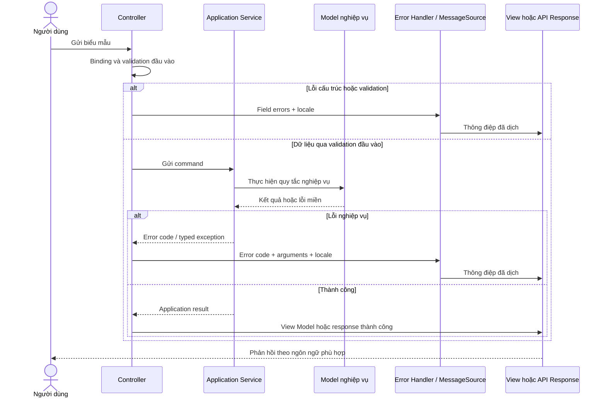

# Thiết kế thông báo lỗi rõ nghĩa và hỗ trợ nhiều ngôn ngữ

Thông báo lỗi là một phần của hợp đồng tương tác giữa ứng dụng MVC và người dùng. Khi biểu mẫu không hợp lệ, người dùng không có quyền thực hiện thao tác hoặc hệ thống gặp sự cố, View cần giải thích điều gì đã xảy ra và hướng dẫn bước tiếp theo. Một thông báo tốt phải đủ cụ thể để người dùng hành động, nhất quán giữa các màn hình và có thể hiển thị bằng ngôn ngữ phù hợp.

Trong MVC (Model–View–Controller), Controller tiếp nhận request và điều phối xử lý; Model hoặc dịch vụ nghiệp vụ xác định thao tác có hợp lệ hay không; View trình bày lỗi theo ngữ cảnh. Để hỗ trợ nhiều ngôn ngữ, phần xử lý nên phát ra mã lỗi hoặc loại lỗi ổn định, còn adapter trình bày chọn thông điệp tương ứng với locale. Nhờ vậy, quy tắc nghiệp vụ không phụ thuộc vào câu chữ của một ngôn ngữ cụ thể và cùng một lỗi có thể được trình bày nhất quán trên trang HTML hoặc API.

## 1. Thế nào là một thông báo lỗi rõ nghĩa?

Một thông báo hữu ích giúp người dùng trả lời được ba câu hỏi:

1. **Điều gì không đúng?** Nêu trường, thao tác hoặc trạng thái đang có vấn đề.
2. **Vì sao thao tác chưa hoàn tất?** Giải thích nguyên nhân ở mức người dùng có thể hiểu.
3. **Có thể làm gì tiếp theo?** Đưa ra hành động sửa dữ liệu, kiểm tra lại, đăng nhập, xin quyền hoặc thử lại khi phù hợp.

Ví dụ:

| Thông báo kém hữu ích | Thông báo rõ nghĩa hơn |
|---|---|
| Dữ liệu không hợp lệ. | Nhập địa chỉ email theo dạng `ten@example.com`. |
| Lỗi xảy ra. | Không thể lưu địa chỉ vì mã bưu chính cần có 5 chữ số. |
| Không thành công. | Đơn hàng đã được giao nên không thể hủy. |
| Access denied. | Bạn không có quyền chỉnh sửa hồ sơ này. Hãy liên hệ người quản lý nếu cần hỗ trợ. |
| Server error. | Dịch vụ đang tạm thời không khả dụng. Vui lòng thử lại sau. |

Thông báo không nhất thiết phải dài. Nó cần cụ thể, đúng sự thật và phù hợp với khả năng khắc phục của người dùng. Không nên đổ lỗi cho người dùng bằng những câu như “Bạn nhập sai”; hãy mô tả điều cần sửa một cách trung lập.

### 1.1. Đặt lỗi gần nơi người dùng cần xử lý

Với lỗi validation, đặt thông báo ngay cạnh trường liên quan để người dùng biết cần sửa gì. Nếu có nhiều lỗi, hiển thị thêm phần tóm tắt ở đầu biểu mẫu để người dùng có thể nhận ra toàn bộ vấn đề và điều hướng đến từng trường.

Với lỗi không gắn với trường, như phiên đăng nhập hết hạn hoặc hệ thống không thể lưu dữ liệu, dùng vùng thông báo chung ở đầu biểu mẫu hoặc khu vực nội dung. Không gắn lỗi hệ thống vào một trường bất kỳ chỉ để tận dụng giao diện lỗi có sẵn.

### 1.2. Phân biệt lỗi có thể sửa và lỗi cần hỗ trợ

- Lỗi dữ liệu đầu vào thường cần hướng dẫn sửa trường hoặc thay đổi lựa chọn.
- Lỗi quy tắc nghiệp vụ cần giải thích trạng thái hiện tại và điều kiện cần đáp ứng.
- Lỗi xác thực cần hướng dẫn đăng nhập lại hoặc làm mới phiên.
- Lỗi phân quyền cần nói rõ người dùng không thể thực hiện thao tác, có thể chỉ dẫn liên hệ quản trị viên.
- Lỗi hạ tầng thường cần thông báo ngắn gọn, có thể cung cấp mã tham chiếu và hướng dẫn thử lại sau.

Không nên cung cấp nút “Thử lại” cho lỗi dữ liệu không hợp lệ hoặc lỗi thiếu quyền. Retry chỉ có ích khi nguyên nhân có thể tạm thời và việc gửi lại an toàn.

## 2. Phân loại lỗi trước khi tạo thông báo

Một ứng dụng thường có nhiều nguồn phát sinh lỗi. Phân loại chúng giúp chọn thông báo, vị trí hiển thị và cách xử lý phù hợp.

| Nhóm lỗi | Ví dụ | Cách phản hồi cho người dùng |
|---|---|---|
| Binding hoặc cú pháp request | Không chuyển được chuỗi thành số; thiếu body bắt buộc | Nêu dữ liệu hoặc cấu trúc không hợp lệ, yêu cầu gửi lại đúng định dạng |
| Validation trường | Email sai định dạng; mật khẩu quá ngắn | Hiển thị lỗi ngay cạnh trường và hướng dẫn sửa |
| Validation liên trường | Ngày kết thúc sớm hơn ngày bắt đầu | Hiển thị lỗi chung cho nhóm trường liên quan |
| Quy tắc nghiệp vụ | Đơn đã giao không thể hủy | Giải thích trạng thái hiện tại và điều kiện thao tác |
| Xác thực | Chưa đăng nhập hoặc phiên hết hạn | Yêu cầu đăng nhập lại theo luồng an toàn |
| Phân quyền | Người dùng không có quyền cập nhật tài nguyên | Thông báo không đủ quyền, không tiết lộ dữ liệu hạn chế |
| Xung đột dữ liệu | Bản ghi đã được người khác cập nhật | Yêu cầu tải lại hoặc xem lại thay đổi trước khi lưu |
| Lỗi hệ thống | Database timeout hoặc dịch vụ ngoài không phản hồi | Thông báo sự cố tạm thời và mã tham chiếu nếu cần |

Mã HTTP là tín hiệu ở ranh giới giao thức, không phải toàn bộ nội dung lỗi. `400 Bad Request`, `401 Unauthorized`, `403 Forbidden`, `404 Not Found`, `409 Conflict`, `422 Unprocessable Content` và `5xx` có thể được ánh xạ thành thông báo khác nhau tùy hợp đồng API. Không nên biến mọi exception thành lỗi “Dữ liệu không hợp lệ”.

### 2.1. Validation cấu trúc và validation nghiệp vụ

Validation cấu trúc có thể kiểm tra ngay tại ranh giới Controller: trường bắt buộc, độ dài chuỗi, định dạng email, số lượng dương hoặc danh sách không rỗng. Validation nghiệp vụ cần trạng thái và ngữ cảnh ứng dụng: khách hàng có được đặt hàng không, đơn hàng có thể hủy không, tài khoản có đủ hạn mức không.

Thông báo cho hai nhóm này có thể cùng xuất hiện trên biểu mẫu, nhưng nơi phát sinh phải rõ ràng. Controller hoặc framework web xử lý lỗi binding; Model và dịch vụ nghiệp vụ xác định điều kiện miền; lớp ánh xạ lỗi chuyển kết quả sang thông điệp phù hợp. Không đặt quy tắc nghiệp vụ chỉ trong JavaScript hoặc annotation ở biểu mẫu vì request có thể được gửi trực tiếp đến server.

### 2.2. Lỗi trường và lỗi tổng thể

Một biểu mẫu có thể có lỗi ở nhiều trường cùng lúc. Ví dụ, địa chỉ giao hàng thiếu tên đường và mã bưu chính; đồng thời ngày giao hàng được chọn không còn khả dụng. Hai lỗi đầu gắn với trường, lỗi cuối có thể gắn với toàn bộ yêu cầu.

Nên biểu diễn hai loại riêng:

- `fieldErrors`: danh sách lỗi có `field`, `code` và thông điệp đã dịch.
- `globalErrors`: lỗi không thuộc một trường cụ thể, có mã và thông điệp riêng.

Không nên chỉ trả về một chuỗi lỗi tổng thể nếu người dùng cần sửa nhiều trường. Cũng không nên giả định mỗi trường chỉ có một lỗi; một trường có thể vi phạm nhiều ràng buộc.

## 3. Tách mã lỗi khỏi câu thông báo

Mã lỗi và thông điệp phục vụ hai mục đích khác nhau:

- **Mã lỗi (error code):** định danh ổn định để chương trình, log, kiểm thử và client nhận diện loại lỗi.
- **Thông điệp (message):** câu chữ dành cho người dùng, được chọn theo ngôn ngữ và ngữ cảnh.

Ví dụ:

| Error code | Tiếng Việt | English |
|---|---|---|
| `VALIDATION_EMAIL_INVALID` | Địa chỉ email chưa đúng định dạng. | Enter a valid email address. |
| `VALIDATION_REQUIRED` | Trường này không được để trống. | This field is required. |
| `ORDER_ALREADY_SHIPPED` | Đơn hàng đã được giao nên không thể hủy. | This order has been delivered and cannot be cancelled. |
| `AUTH_SESSION_EXPIRED` | Phiên đăng nhập đã hết hạn. Vui lòng đăng nhập lại. | Your session has expired. Please sign in again. |
| `RESOURCE_VERSION_CONFLICT` | Dữ liệu đã được cập nhật ở nơi khác. Hãy tải lại trước khi lưu. | This item was changed elsewhere. Reload it before saving. |
| `SYSTEM_TEMPORARILY_UNAVAILABLE` | Dịch vụ đang tạm thời không khả dụng. Vui lòng thử lại sau. | The service is temporarily unavailable. Please try again later. |

Client nên dựa vào `code` để quyết định hành vi như focus trường lỗi, mở luồng đăng nhập hoặc hiển thị nút thử lại. Không nên dựa vào việc so sánh chuỗi tiếng Việt hoặc tiếng Anh vì nội dung có thể thay đổi theo bản dịch.

### 3.1. Mã lỗi cần ổn định và có phạm vi

Một mã lỗi tốt:

- Có ý nghĩa rõ và không phụ thuộc câu chữ của một ngôn ngữ.
- Không thay đổi chỉ vì đội nội dung sửa cách diễn đạt.
- Có phạm vi phân biệt đủ để client xử lý đúng.
- Không chứa dữ liệu người dùng, thông tin bí mật hoặc chi tiết triển khai.

Tránh dùng tên exception Java như `IllegalArgumentException` làm mã API công khai. Exception có thể được đổi tên hoặc thay thế khi refactor; mã lỗi công khai cần thuộc hợp đồng ứng dụng. Cũng tránh dùng một mã `ERROR` chung cho mọi trường hợp vì client không thể quyết định cách khắc phục.

### 3.2. Không đưa thông điệp đã dịch vào Model nghiệp vụ

Model nghiệp vụ nên biểu đạt lỗi bằng loại lỗi, mã hoặc kết quả có ý nghĩa miền, chẳng hạn `OrderCannotBeCancelled`. Nó không nên trả câu tiếng Việt hoặc tiếng Anh đã dịch. Nếu Model giữ chuỗi hiển thị, quy tắc nghiệp vụ sẽ phụ thuộc vào ngôn ngữ và khó được dùng lại ở API, tác vụ nền hoặc ứng dụng khác.

Adapter web hoặc tầng trình bày nhận mã lỗi và tham số, sau đó dùng message catalog để tạo thông điệp theo locale. Với lỗi validation, framework có thể giữ message key trong metadata của lỗi và chỉ phân giải thành câu chữ khi tạo phản hồi.

## 4. Thiết kế message catalog cho nhiều ngôn ngữ

Message catalog là tập hợp các khóa thông điệp và bản dịch theo từng locale. Mỗi ý nghĩa có một khóa ổn định; mỗi ngôn ngữ cung cấp nội dung tương ứng.

Ví dụ cấu trúc trong ứng dụng Spring Boot:

```text
src/main/resources/
├── messages.properties
├── messages_vi.properties
└── messages_en.properties
```

`messages.properties` có thể chứa ngôn ngữ mặc định hoặc các khóa dự phòng. `messages_vi.properties` và `messages_en.properties` chứa bản dịch theo locale. Nếu dự án chọn tiếng Việt làm mặc định, cần cấu hình và kiểm thử fallback nhất quán, không dựa vào ngôn ngữ hệ điều hành của máy chủ.

### 4.1. Ví dụ bản dịch

`messages_vi.properties`:

```properties
validation.required=Trường này không được để trống.
validation.email.invalid=Địa chỉ email chưa đúng định dạng.
validation.password.min={min} ký tự là độ dài tối thiểu của mật khẩu.
order.cancel.already-shipped=Đơn hàng {0} đã được giao nên không thể hủy.
error.validation.title=Vui lòng kiểm tra lại thông tin.
error.system.unavailable=Dịch vụ đang tạm thời không khả dụng. Vui lòng thử lại sau.
```

`messages_en.properties`:

```properties
validation.required=This field is required.
validation.email.invalid=Enter a valid email address.
validation.password.min=The password must contain at least {min} characters.
order.cancel.already-shipped=Order {0} has been delivered and cannot be cancelled.
error.validation.title=Please review the information you entered.
error.system.unavailable=The service is temporarily unavailable. Please try again later.
```

Placeholder phải được quy định rõ và có giá trị tương ứng khi định dạng.

Khóa nên được nhóm theo ngữ cảnh hoặc loại lỗi. Tránh đặt tên khóa theo câu tiếng Việt, ví dụ `email-sai-dinh-dang`, vì tên khóa cần ổn định khi nội dung được viết lại hoặc bổ sung ngôn ngữ mới.

### 4.2. Cấu hình Spring Boot

Với Spring Boot, có thể cấu hình message bundle trong `application.properties`:

```properties
spring.messages.basename=messages
spring.messages.encoding=UTF-8
spring.messages.fallback-to-system-locale=false
```

`basename` chỉ định tên bundle; encoding xác định cách đọc file; tắt fallback theo locale hệ thống giúp kết quả không thay đổi bất ngờ theo cấu hình máy chủ. Cần chọn một locale mặc định rõ ràng và cung cấp bản dịch dự phòng cho những khóa bắt buộc.

### 4.3. Chọn locale cho request

Locale có thể đến từ nhiều nguồn: lựa chọn ngôn ngữ trong hồ sơ người dùng, tùy chọn lưu trong cookie/session, tham số URL hoặc header `Accept-Language`. Ứng dụng cần quy định thứ tự ưu tiên. Một chính sách phổ biến là:

1. Ngôn ngữ người dùng đã chọn và lưu trong hồ sơ hoặc phiên.
2. Tùy chọn ngôn ngữ được ứng dụng cho phép trong cookie hoặc URL.
3. Ngôn ngữ phù hợp nhất trong `Accept-Language`.
4. Locale mặc định của ứng dụng.

Không nên hỗ trợ mọi locale mà trình duyệt gửi nếu ứng dụng chỉ có một số bản dịch. Hãy chuẩn hóa và đối chiếu với danh sách locale được hỗ trợ; nếu không khớp, dùng fallback đã định nghĩa.

Trong Spring MVC, `LocaleResolver` hoặc `LocaleContextResolver` có thể xác định locale cho request. Với API, có thể chọn locale theo `Accept-Language` và trả `Content-Language` để client biết ngôn ngữ của thông điệp. Nếu API không cam kết thông điệp bản địa hóa, có thể chỉ trả mã lỗi ổn định để client tự dịch.

### 4.4. Fallback khi thiếu bản dịch

Nếu thiếu khóa ở locale được chọn, ứng dụng cần có hành vi dự phòng:

- Dùng bản dịch của locale mặc định nếu có.
- Nếu vẫn thiếu, hiển thị thông báo chung an toàn và ghi log để nhóm phát triển bổ sung khóa.
- Trong môi trường phát triển hoặc CI, có thể coi khóa bắt buộc bị thiếu là lỗi kiểm tra.

Không nên hiển thị nguyên key kỹ thuật như `order.cancel.already-shipped` cho người dùng cuối. Cũng không nên trả về nội dung exception thô chỉ vì không tìm được bản dịch.

## 5. Placeholder, số nhiều và định dạng theo locale

Thông điệp thường cần chèn dữ liệu như tên trường, giới hạn ký tự hoặc số lượng. Dùng placeholder có tên hoặc tham số có thứ tự thay vì nối chuỗi thủ công.

Ví dụ:

```java
String message = messageSource.getMessage(
    "order.cancel.already-shipped",
    new Object[] { orderNumber },
    locale
);
```

Không nên tạo câu bằng cách nối các mảnh như `"Có " + count + " đơn hàng"`, vì trật tự từ và cách biến đổi theo số nhiều khác nhau giữa ngôn ngữ. Với thông điệp có số nhiều, giống ngữ pháp hoặc cấu trúc phức tạp, dùng cơ chế hỗ trợ pluralization như ICU MessageFormat hoặc thư viện i18n tương ứng. Mỗi ngôn ngữ có thể có nhiều quy tắc số nhiều hơn hai dạng “một/nhiều”.

Ngày, giờ, số thập phân và tiền tệ cũng cần định dạng theo locale và ngữ cảnh dữ liệu. Locale quyết định cách viết dấu phân cách và thứ tự ngày; múi giờ phải đến từ quy ước nghiệp vụ hoặc tùy chọn người dùng; currency phải lấy từ giá trị tiền tệ, không suy ra chỉ từ ngôn ngữ.

### 5.1. Placeholder phải an toàn và có ngữ nghĩa

Chỉ truyền dữ liệu cần thiết để giải thích lỗi. Không đưa nội dung người dùng nhập trực tiếp vào thông báo nếu không cần thiết. Nếu cần hiển thị giá trị, phải escape khi render HTML và không dùng chuỗi đó để tạo markup hoặc SQL.

Nên đặt tên placeholder theo ý nghĩa, ví dụ `{min}`, `{max}`, `{orderNumber}`. Tất cả bản dịch của cùng một key phải giữ cùng tập tham số và ý nghĩa tương đương. Kiểm tra tự động có thể phát hiện bản dịch thiếu placeholder.

## 6. Tạo thông báo lỗi trong luồng MVC

Một cách tổ chức phù hợp là giữ lỗi có cấu trúc ở tầng ứng dụng, rồi chuyển thành thông điệp ở adapter web.



Controller chịu trách nhiệm tiếp nhận request và chọn phản hồi. Dịch vụ hoặc Model phát biểu lỗi ở mức nghiệp vụ. Error handler tra message catalog bằng locale hiện tại, sau đó View trình bày thông điệp. Dịch vụ không cần biết người dùng đang dùng tiếng Việt hay tiếng Anh.

### 6.1. Validation message trong Bean Validation

Có thể dùng message key trong annotation thay vì viết câu chữ trực tiếp:

```java
public record RegisterRequest(
    @NotBlank(message = "{validation.required}")
    String fullName,

    @NotBlank(message = "{validation.required}")
    @Email(message = "{validation.email.invalid}")
    String email,

    @NotBlank(message = "{validation.required}")
    @Size(min = 12, message = "{validation.password.min}")
    String password
) {}
```

Bean Validation sử dụng message key để tìm bản dịch theo locale. Cần kiểm tra cấu hình `MessageSource` và validation provider để bảo đảm bundle được phân giải theo cùng chính sách locale của ứng dụng. Không nên ghi câu tiếng Việt trực tiếp vào annotation nếu ứng dụng cần hỗ trợ nhiều ngôn ngữ.

### 6.2. Ánh xạ lỗi validation trong Spring MVC

Với API dùng `@Valid @RequestBody`, lỗi validation thường được báo trước khi phương thức Controller xử lý xong. Một `@RestControllerAdvice` có thể chuyển các `FieldError` thành cấu trúc response nhất quán:

```java
public record FieldViolation(
    String field,
    String code,
    String message
) {}

public record ApiError(
    String code,
    String message,
    List<FieldViolation> fieldErrors,
    String traceId
) {}

@RestControllerAdvice
public class ApiErrorHandler {
    private final MessageSource messages;

    public ApiErrorHandler(MessageSource messages) {
        this.messages = messages;
    }

    @ExceptionHandler(MethodArgumentNotValidException.class)
    public ResponseEntity<ApiError> validation(
            MethodArgumentNotValidException exception) {

        Locale locale = LocaleContextHolder.getLocale();
        List<FieldViolation> violations = exception.getBindingResult()
            .getFieldErrors()
            .stream()
            .map(error -> new FieldViolation(
                error.getField(),
                error.getCode(),
                messages.getMessage(error, locale)
            ))
            .toList();

        ApiError body = new ApiError(
            "VALIDATION_FAILED",
            messages.getMessage("error.validation.title", null, locale),
            violations,
            null
        );
        return ResponseEntity.badRequest().body(body);
    }
}
```

Đây là ví dụ rút gọn; ứng dụng thực tế cần tạo `traceId` từ cơ chế theo dõi request, xử lý lỗi toàn cục và bảo đảm mã lỗi của từng constraint ổn định. `error.getCode()` có thể phản ánh tên constraint như `NotBlank` hoặc `Email`; nếu API cần mã công khai ổn định, hãy ánh xạ constraint nội bộ sang mã riêng thay vì phụ thuộc trực tiếp vào tên framework.

Với biểu mẫu HTML, Controller có thể trả lại cùng View với `BindingResult` để template hiển thị lỗi cạnh trường. Cả HTML và API có thể dùng chung message catalog nhưng có cấu trúc phản hồi khác nhau.

### 6.3. Lỗi nghiệp vụ và exception handler

Giả sử Model phát sinh `OrderAlreadyShippedException` khi người dùng yêu cầu hủy đơn đã giao. Exception hoặc kết quả ứng dụng nên mang loại lỗi ổn định, có thể kèm mã đơn làm tham số; không chứa câu đã dịch.

```java
@ExceptionHandler(OrderAlreadyShippedException.class)
public ResponseEntity<ApiError> orderAlreadyShipped(
        OrderAlreadyShippedException exception) {

    Locale locale = LocaleContextHolder.getLocale();
    String message = messages.getMessage(
        "order.cancel.already-shipped",
        new Object[] { exception.orderNumber() },
        locale
    );

    ApiError body = new ApiError(
        "ORDER_ALREADY_SHIPPED",
        message,
        List.of(),
        null
    );
    return ResponseEntity.status(HttpStatus.CONFLICT).body(body);
}
```

Nếu dùng exception, nên xử lý exception ở ranh giới web hoặc một lớp ánh xạ tập trung. Không để Controller bắt mọi exception rồi trả `exception.getMessage()` cho client. Nội dung exception có thể chứa chi tiết kỹ thuật hoặc dữ liệu không được phép tiết lộ.

## 7. Hợp đồng lỗi cho API và giao diện HTML

API và HTML có nhu cầu trình bày khác nhau dù cùng một lỗi.

API nên cung cấp mã lỗi ổn định, danh sách lỗi trường và thông điệp đã dịch nếu hợp đồng yêu cầu server bản địa hóa. Ví dụ:

```json
{
  "code": "VALIDATION_FAILED",
  "message": "Vui lòng kiểm tra lại thông tin.",
  "fieldErrors": [
    {
      "field": "email",
      "code": "VALIDATION_EMAIL_INVALID",
      "message": "Địa chỉ email chưa đúng định dạng."
    }
  ],
  "traceId": "req-7f3a"
}
```

Trong ví dụ, `traceId` là mã tham chiếu không nhạy cảm; không đưa stack trace hoặc thông tin hạ tầng vào response. Client có thể dùng `fieldErrors.field` để gắn lỗi vào trường và `fieldErrors.code` để chọn hành vi phù hợp.

Với HTML server-rendered, View thường nhận một cấu trúc chứa global errors và field errors. Template hiển thị tiêu đề chung, phần tóm tắt và thông báo gần từng trường. Khi người dùng gửi lại biểu mẫu, dữ liệu hợp lệ đã nhập nên được giữ lại để họ không phải điền lại từ đầu.

### 7.1. Chọn nơi bản địa hóa: server hay client?

Có hai cách thường gặp:

- **Server trả thông điệp đã dịch:** phù hợp với HTML server-rendered và API muốn cung cấp thông báo trực tiếp cho người dùng. Server cần xác định locale cho request.
- **Server chỉ trả mã lỗi và tham số:** phù hợp khi client sở hữu toàn bộ giao diện và message catalog. Client tự dịch theo ngôn ngữ đang chọn.

Một API có thể trả cả mã và thông điệp. Mã là phần ổn định để xử lý; thông điệp chỉ phục vụ hiển thị và có thể thay đổi theo locale. Cần quy định rõ client có được phép tự dịch thay cho message server hay không để tránh hiển thị hai thông báo khác nhau.

Không nên gửi một câu tiếng Việt rồi yêu cầu client đoán ngôn ngữ hoặc dịch ngược. Hãy dùng locale tường minh hoặc mã lỗi.

## 8. Giữ thông báo an toàn và không tiết lộ nội bộ

Thông báo cần hữu ích nhưng không được tiết lộ thông tin có thể hỗ trợ tấn công hoặc xâm phạm quyền riêng tư.

| Không nên hiển thị | Cách trình bày an toàn hơn |
|---|---|
| `SQLIntegrityConstraintViolationException: duplicate key on customer_email` | Email này đã được sử dụng. Hãy đăng nhập hoặc dùng địa chỉ khác nếu phù hợp với chính sách tài khoản. |
| `Connection refused db-prod-03:5432` | Dịch vụ đang tạm thời không khả dụng. Vui lòng thử lại sau. |
| `NullPointerException at OrderService.java:87` | Chưa thể xử lý yêu cầu. Hãy thử lại sau hoặc liên hệ hỗ trợ với mã tham chiếu. |
| `User 1287 does not own order 9912` | Bạn không có quyền thực hiện thao tác này. |

Không nên tiết lộ tài khoản có tồn tại hay không trong những luồng nhạy cảm như khôi phục mật khẩu nếu điều đó giúp dò tìm tài khoản. Thông báo có thể trung tính: “Nếu địa chỉ này đã được đăng ký, hướng dẫn tiếp theo sẽ được gửi.”

Chi tiết kỹ thuật nên được ghi vào log phía server với correlation ID/trace ID. Log cần tránh ghi mật khẩu, token, dữ liệu thanh toán hoặc nội dung nhạy cảm. Mã tham chiếu gửi cho người dùng phải đủ để bộ phận hỗ trợ tra cứu mà không tiết lộ thông tin nội bộ.

### 8.1. Escape nội dung khi render

Thông điệp có placeholder không đồng nghĩa dữ liệu được chèn vào đã an toàn cho HTML. Nếu thông báo có tên người dùng, mã đơn hoặc nội dung do client gửi, template phải escape theo ngữ cảnh. Không ghép message thành HTML tùy ý hoặc đưa trực tiếp vào `innerHTML`.

Không nên cho phép bản dịch chứa HTML tùy ý chỉ để tạo liên kết hoặc định dạng. Nếu cần liên kết hành động, View nên dựng cấu trúc liên kết riêng và giữ thông điệp văn bản an toàn.

## 9. Khả năng tiếp cận và trải nghiệm người dùng

Thông báo lỗi cần được người dùng nhìn thấy, đọc được bằng công nghệ hỗ trợ và liên kết đúng với trường.

- Dùng văn bản cùng màu sắc hoặc biểu tượng; không chỉ tô viền đỏ để biểu thị lỗi.
- Gắn lỗi trường bằng `aria-describedby` và đặt `aria-invalid="true"` khi phù hợp.
- Dùng vùng thông báo có ngữ nghĩa như `role="alert"` cho lỗi cần được thông báo ngay hoặc `role="status"` cho cập nhật ít khẩn cấp.
- Đưa focus đến phần tóm tắt lỗi hoặc trường đầu tiên có lỗi sau khi gửi form thất bại, tùy thiết kế.
- Giữ thứ tự đọc hợp lý và không làm mất dữ liệu người dùng đã nhập.
- Dùng ngôn ngữ đơn giản, tránh viết tắt kỹ thuật và câu quá dài.

Ví dụ:

```html
<label for="email">Địa chỉ email</label>
<input
  id="email"
  name="email"
  type="email"
  aria-invalid="true"
  aria-describedby="email-error"
>
<p id="email-error" class="field-error">
  Địa chỉ email chưa đúng định dạng. Ví dụ: ten@example.com.
</p>
```

Trong ứng dụng đa ngôn ngữ, nội dung label, placeholder, mô tả trợ năng và thông báo lỗi đều cần được dịch đồng bộ. Không nên dịch thông báo lỗi nhưng bỏ nguyên nhãn trường hoặc tên nút bằng ngôn ngữ khác.

## 10. Nguyên tắc biên tập nội dung đa ngôn ngữ

### 10.1. Dịch theo ý nghĩa, không dịch từng từ

Thông điệp cần giữ đúng ý nghĩa và hành động ở mọi ngôn ngữ. Một câu dịch sát chữ có thể nghe không tự nhiên hoặc quá trực tiếp. Nên cung cấp ngữ cảnh cho người dịch: thông báo xuất hiện ở trường nào, người dùng cần làm gì, có giới hạn ký tự hay không và placeholder đại diện cho giá trị nào.

### 10.2. Không ghép câu bằng nhiều mảnh

Không tạo thông điệp bằng cách ghép tiền tố, số lượng và hậu tố vì thứ tự ngữ pháp khác nhau. Hãy cung cấp cả câu với placeholder hoặc dùng cơ chế pluralization. Ví dụ, tiếng Anh có dạng số ít/số nhiều đơn giản hơn một số ngôn ngữ khác; một quy tắc `count == 1` không đủ cho mọi locale.

### 10.3. Độ dài và bố cục

Một bản dịch có thể dài hơn đáng kể so với bản gốc. Thiết kế form, toast, dialog và nút cần cho phép nội dung co giãn, xuống dòng và không bị cắt. Không đặt chiều rộng cố định quá hẹp cho thông báo hoặc giả định mọi ngôn ngữ có cùng số ký tự.

### 10.4. Thuật ngữ nhất quán

Các thuật ngữ như “đơn hàng”, “hồ sơ”, “tài khoản”, “lưu”, “gửi” cần được dùng nhất quán giữa nhãn, hướng dẫn, thông báo lỗi và tài liệu trợ giúp. Nên có glossary hoặc quy ước thuật ngữ cho sản phẩm khi số lượng thông điệp tăng.

### 10.5. Định dạng theo locale và ngữ cảnh

Locale có thể quyết định thứ tự ngày tháng, dấu thập phân và cách viết số. Tuy nhiên, múi giờ và currency là dữ liệu/ngữ cảnh riêng. Ví dụ, người dùng dùng giao diện tiếng Việt vẫn có thể xem giao dịch bằng USD; không được đổi currency sang VND chỉ vì locale là `vi-VN`.

## 11. Kiểm thử thông báo và bản dịch

Kiểm thử cần bao phủ cả nội dung, mã lỗi, locale và hành vi của View.

| Phạm vi | Trường hợp kiểm tra |
|---|---|
| Message catalog | Mọi key bắt buộc có bản dịch ở locale được hỗ trợ |
| Placeholder | Các bản dịch có cùng tham số và không làm mất dữ liệu khi định dạng |
| Locale resolution | Hồ sơ, cookie/session, `Accept-Language` và fallback hoạt động đúng thứ tự |
| Validation | Lỗi trường và lỗi tổng thể được ánh xạ đúng key |
| Business error | Mã lỗi ổn định được chuyển thành thông điệp phù hợp |
| Security | Không có stack trace, SQL, token hoặc dữ liệu nhạy cảm trong response |
| Accessibility | Lỗi được liên kết với trường và trình đọc màn hình nhận biết được |
| Layout | Bản dịch dài không bị cắt hoặc làm vỡ bố cục |
| Regression | Sửa câu chữ không làm thay đổi error code hoặc hành vi client |

Ví dụ unit test cho message source:

```java
class ErrorMessageTest {
    private final MessageSource messages = createMessageSource();

    @Test
    void resolvesVietnameseValidationMessage() {
        String message = messages.getMessage(
            "validation.email.invalid",
            null,
            Locale.forLanguageTag("vi-VN")
        );

        assertEquals("Địa chỉ email chưa đúng định dạng.", message);
    }

    @Test
    void resolvesEnglishValidationMessage() {
        String message = messages.getMessage(
            "validation.email.invalid",
            null,
            Locale.ENGLISH
        );

        assertEquals("Enter a valid email address.", message);
    }
}
```

`createMessageSource()` đại diện cho cấu hình bundle của ứng dụng. Ngoài unit test, nên có kiểm tra tự động đọc toàn bộ key và so sánh placeholder giữa các locale. Những key thiếu bản dịch cần được phát hiện trong CI thay vì chỉ xuất hiện khi người dùng mở đúng màn hình.

### 11.1. Kiểm thử locale fallback

Kiểm thử các trường hợp:

- Locale được hỗ trợ có bản dịch đầy đủ.
- Locale được hỗ trợ nhưng một key mới chưa có bản dịch.
- Locale không được hỗ trợ.
- `Accept-Language` có nhiều lựa chọn và quality value.
- Người dùng đổi ngôn ngữ trong khi đang ở biểu mẫu có lỗi.

Kết quả phải tuân theo chính sách fallback đã công bố. Không nên để locale của máy chủ hoặc môi trường triển khai quyết định ngôn ngữ người dùng nhìn thấy.

## 12. Những sai lầm thường gặp

**Viết câu thông báo trực tiếp trong Controller hoặc Model.** Cách này làm nội dung khó quản lý và gắn logic với một ngôn ngữ. Hãy dùng mã lỗi hoặc message key rồi phân giải ở tầng trình bày.

**Dùng chuỗi thông báo làm mã lỗi.** Client phải so sánh câu chữ và sẽ hỏng khi dịch hoặc biên tập. Hãy cung cấp mã lỗi ổn định riêng.

**Dùng một thông báo chung cho mọi lỗi.** Người dùng không biết cần sửa trường, đăng nhập, xin quyền hay thử lại. Hãy phân loại lỗi và đưa hướng dẫn phù hợp.

**Trả nguyên exception hoặc lỗi database cho client.** Nội dung có thể tiết lộ stack trace, schema, máy chủ hoặc dữ liệu nhạy cảm. Hãy ánh xạ sang mã lỗi và thông báo an toàn.

**Chỉ dịch thông báo, bỏ quên label và nội dung trợ năng.** Giao diện vẫn khó hiểu nếu trường, nút hoặc mô tả không cùng ngôn ngữ. Hãy quản lý toàn bộ chuỗi UI trong cùng quy trình i18n.

**Ghép câu bằng chuỗi và số.** Cách này dễ sai ngữ pháp và pluralization. Dùng placeholder hoặc thư viện hỗ trợ số nhiều theo locale.

**Không kiểm tra bản dịch thiếu.** Lỗi chỉ xuất hiện trong một locale hoặc một nhánh hiếm. Hãy kiểm tra catalog tự động và có fallback an toàn.

**Đưa dữ liệu nhạy cảm vào placeholder.** Thông báo có thể bị ghi log, chụp màn hình hoặc gửi qua kênh hỗ trợ. Chỉ hiển thị thông tin tối thiểu và escape khi render.

**Coi locale là currency hoặc timezone.** Ngôn ngữ giao diện không quyết định đơn vị tiền hay múi giờ của dữ liệu. Hãy dùng ngữ cảnh riêng cho từng giá trị.

## 13. Checklist thiết kế thông báo lỗi đa ngôn ngữ

Khi thêm một lỗi hoặc trường validation, hãy tự hỏi:

1. Lỗi thuộc nhóm binding, validation, nghiệp vụ, xác thực, phân quyền, xung đột hay hệ thống?
2. Người dùng cần biết điều gì và có thể làm gì tiếp theo?
3. Lỗi có mã ổn định tách khỏi câu chữ không?
4. Thông báo có gắn đúng trường hoặc vùng nội dung không?
5. Message key có bản dịch ở tất cả locale được hỗ trợ không?
6. Placeholder có cùng ý nghĩa và đủ dữ liệu ở mọi bản dịch không?
7. Có xử lý số nhiều, ngày giờ, số và tiền tệ theo locale/ngữ cảnh không?
8. Locale được chọn và fallback có nhất quán giữa HTML và API không?
9. Response có tránh tiết lộ exception, SQL, token và dữ liệu nhạy cảm không?
10. View có hỗ trợ trình đọc màn hình, bàn phím và bản dịch dài không?
11. Có kiểm thử message key, placeholder, fallback, mã lỗi và hành vi hiển thị không?

## Kết luận

Thông báo lỗi rõ nghĩa giúp người dùng hiểu vấn đề và biết cách xử lý; hỗ trợ nhiều ngôn ngữ đòi hỏi nội dung được quản lý qua message key, locale và message catalog thay vì viết cứng trong Controller hoặc Model. Trong MVC, tầng ứng dụng phát biểu lỗi bằng mã hoặc loại lỗi ổn định, Controller/error handler ánh xạ lỗi sang phản hồi theo hợp đồng, còn View trình bày câu chữ phù hợp với ngôn ngữ và ngữ cảnh. Khi tách mã lỗi khỏi thông điệp, kiểm soát fallback, placeholder, bảo mật và khả năng tiếp cận, ứng dụng có thể giữ hành vi nhất quán trong khi nội dung được dịch và cải thiện độc lập.
