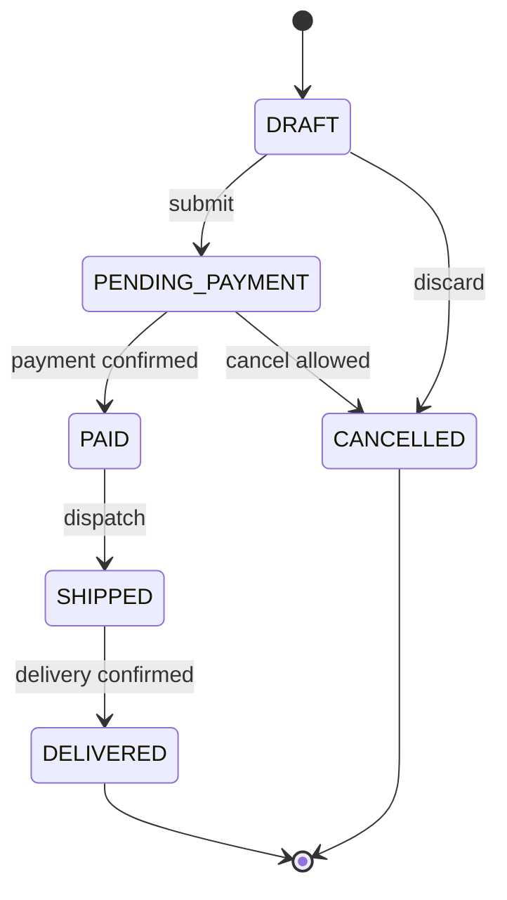
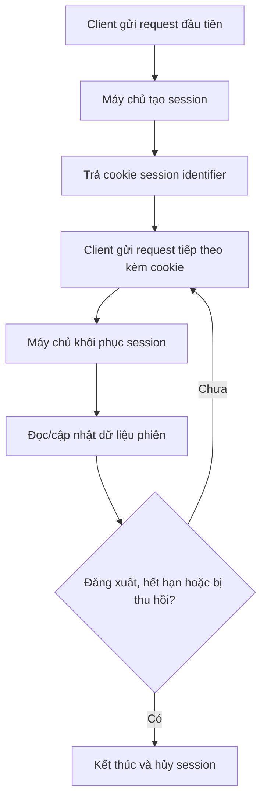
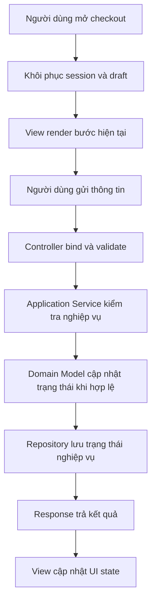

# Phân loại trạng thái nghiệp vụ, phiên làm việc và giao diện

## 1. Vì sao cần phân loại trạng thái?

Ứng dụng MVC quản lý nhiều loại trạng thái cùng lúc. Một trang chi tiết đơn hàng có thể hiển thị trạng thái nghiệp vụ của đơn (`PENDING`, `SHIPPED`), trạng thái phiên làm việc của người dùng (đã đăng nhập, đang thực hiện quy trình thanh toán) và trạng thái giao diện (đang tải, tab đang mở, bộ lọc đang chọn).

Những trạng thái này có thể xuất hiện trên cùng một màn hình nhưng khác nhau về ý nghĩa, quyền sở hữu, vòng đời và nơi lưu trữ. Nếu trộn chúng vào một đối tượng hoặc lưu tất cả trong session, hệ thống dễ gặp các vấn đề như dữ liệu nghiệp vụ bị mất khi session hết hạn, giao diện hiển thị thông tin cũ, hoặc người dùng có thể sửa trạng thái quan trọng chỉ bằng cách thay đổi dữ liệu phía trình duyệt.

Trong MVC, cần phân biệt ba nhóm chính:

- **Trạng thái nghiệp vụ (Business State):** trạng thái có ý nghĩa đối với hoạt động của hệ thống và được bảo vệ bởi quy tắc nghiệp vụ, ví dụ đơn hàng đang chờ thanh toán hay đã giao.
- **Trạng thái phiên làm việc (Session State):** thông tin tạm gắn với một phiên tương tác của người dùng, ví dụ định danh phiên đăng nhập hoặc tiến trình biểu mẫu nhiều bước chưa hoàn tất.
- **Trạng thái giao diện (UI State):** thông tin phục vụ cách màn hình đang hiển thị và tương tác, ví dụ tab đang chọn, bộ lọc đang mở hoặc dữ liệu đang tải.

Phân loại đúng giúp xác định nơi lưu trữ, cách đồng bộ, cách kiểm tra quyền và cách khôi phục trạng thái khi request mới được gửi đến.

## 2. So sánh ba nhóm trạng thái

| Tiêu chí | Trạng thái nghiệp vụ | Trạng thái phiên làm việc | Trạng thái giao diện |
|---|---|---|---|
| Ý nghĩa | Phản ánh sự thật hoặc tiến trình của nghiệp vụ | Duy trì ngữ cảnh giữa các request trong một phiên tương tác | Điều khiển cách màn hình hiển thị và phản hồi |
| Chủ sở hữu | Miền nghiệp vụ hoặc aggregate | Cơ chế quản lý phiên và use case tạm thời | View hoặc component giao diện |
| Vòng đời | Theo vòng đời của đối tượng/quy trình nghiệp vụ | Theo phiên, có thể hết hạn hoặc kết thúc sớm | Theo component, trang hoặc lần tương tác |
| Nơi lưu thường gặp | Database, event store hoặc hệ thống nghiệp vụ có thẩm quyền | HTTP session, session store hoặc kho tạm có TTL | Bộ nhớ trình duyệt, component/store, URL hoặc local storage tùy nhu cầu |
| Nguồn sự thật | Hệ thống nghiệp vụ phía máy chủ | Session store hoặc cơ chế xác thực được cấu hình | Thường là client; một số trạng thái được tái tạo từ server |
| Mức độ tin cậy | Được kiểm tra bằng quy tắc và quyền nghiệp vụ | Phải được xác thực, giới hạn và kiểm tra theo người dùng | Không đáng tin cậy đối với quyết định bảo mật hoặc nghiệp vụ |
| Ví dụ | Đơn đã thanh toán, tài khoản bị khóa | Người dùng đã đăng nhập, bước checkout tạm thời | Modal đang mở, trang hiện tại, bộ lọc đang chọn |

Ba nhóm không nhất thiết là ba loại dữ liệu hoàn toàn tách rời về mặt vật lý. Một trạng thái nghiệp vụ có thể được sao chép vào session hoặc cache để đọc nhanh, và UI có thể giữ một bản hiển thị của nó. Tuy nhiên, bản sao không tự trở thành nguồn sự thật. Cần biết thành phần nào có thẩm quyền quyết định và cập nhật giá trị đó.

## 3. Trạng thái nghiệp vụ (Business State)

### 3.1. Đặc điểm

Trạng thái nghiệp vụ mô tả một đối tượng hoặc quy trình đang ở giai đoạn nào theo quy tắc của miền. Nó thường tồn tại lâu hơn một request hoặc một phiên đăng nhập.

Ví dụ:

- Đơn hàng: `DRAFT`, `PENDING_PAYMENT`, `PAID`, `SHIPPED`, `DELIVERED`, `CANCELLED`.
- Yêu cầu hoàn tiền: `REQUESTED`, `APPROVED`, `PROCESSING`, `COMPLETED`, `REJECTED`.
- Tài khoản: `ACTIVE`, `SUSPENDED`, `CLOSED`.
- Phiếu hỗ trợ: `OPEN`, `IN_PROGRESS`, `RESOLVED`, `CLOSED`.

Trạng thái nghiệp vụ ảnh hưởng đến hành động nào được phép. Ví dụ, đơn hàng đã giao có thể không còn được hủy trực tuyến; tài khoản bị khóa không được thực hiện giao dịch; yêu cầu hoàn tiền đã hoàn tất không nên được xử lý lần nữa.

### 3.2. Ai được phép thay đổi?

Domain Model hoặc domain policy cần bảo vệ các chuyển đổi hợp lệ. Controller không nên tự gán trạng thái dựa trên một trường do client gửi lên.

Ví dụ, request sau không an toàn nếu được bind trực tiếp vào entity:

```json
{
  "orderId": 42,
  "status": "PAID"
}
```

Client không được tự quyết định đơn đã thanh toán. Thay vào đó, client gửi ý định như `confirmPayment` hoặc hệ thống thanh toán gửi một sự kiện đã được xác thực. Application Service điều phối use case; Model kiểm tra điều kiện và cập nhật trạng thái theo kết quả đáng tin cậy.

### 3.3. Mô hình hóa chuyển trạng thái

Không phải mọi trạng thái đều có thể chuyển sang mọi trạng thái khác. Hãy biểu diễn các chuyển đổi hợp lệ một cách rõ ràng.



Sơ đồ là ví dụ giản lược. Quy tắc thực tế có thể bổ sung hoàn tiền, giao hàng thất bại, thanh toán hết hạn hoặc xử lý thủ công. Mỗi chuyển đổi cần xác định:

- Trạng thái hiện tại được phép thực hiện hành động nào?
- Ai hoặc hệ thống nào có quyền yêu cầu hành động?
- Điều kiện dữ liệu nào phải thỏa mãn?
- Thao tác nào cần thực hiện cùng nhau trong một transaction?
- Sự kiện nào được phát ra sau khi chuyển trạng thái thành công?

Ví dụ Domain Model:

```java
public enum OrderStatus {
    DRAFT,
    PENDING_PAYMENT,
    PAID,
    SHIPPED,
    DELIVERED,
    CANCELLED
}

public class Order {
    private OrderStatus status;

    public void markPaid(PaymentConfirmation confirmation) {
        if (status != OrderStatus.PENDING_PAYMENT) {
            throw new InvalidOrderTransitionException(status, "PAID");
        }
        if (!confirmation.isVerifiedFor(this)) {
            throw new InvalidPaymentConfirmationException();
        }
        status = OrderStatus.PAID;
    }

    public void ship() {
        if (status != OrderStatus.PAID) {
            throw new InvalidOrderTransitionException(status, "SHIPPED");
        }
        status = OrderStatus.SHIPPED;
    }
}
```

Ví dụ giả định `PaymentConfirmation` đã được xác minh bởi adapter thanh toán. Model không tin một chuỗi `status` do trình duyệt gửi lên; nó nhận bằng chứng hoặc dữ liệu có kiểu từ luồng xử lý đáng tin cậy.

### 3.4. Lưu trữ và tính nhất quán

Trạng thái nghiệp vụ thường được lưu bền vững để vẫn tồn tại sau khi người dùng đóng trình duyệt hoặc session hết hạn. Database là nguồn sự thật phổ biến; một số hệ thống dùng event store hoặc hệ thống nghiệp vụ chuyên trách.

Khi nhiều request cùng thay đổi một đối tượng, cần bảo vệ khỏi cập nhật mất dữ liệu hoặc chuyển trạng thái dựa trên thông tin cũ. Các kỹ thuật có thể gồm:

- Optimistic locking với version.
- Pessimistic locking cho trường hợp cần khóa trong transaction.
- Điều kiện cập nhật nguyên tử, ví dụ chỉ cập nhật khi trạng thái hiện tại vẫn là `PENDING_PAYMENT`.
- Idempotency key hoặc xử lý sự kiện lặp an toàn.

Không nên chỉ kiểm tra trạng thái trong UI rồi giả định nó vẫn đúng khi người dùng nhấn nút. Máy chủ phải tải hoặc kiểm tra trạng thái hiện tại ngay trong use case.

## 4. Trạng thái phiên làm việc (Session State)

### 4.1. Đặc điểm và mục đích

HTTP không tự ghi nhớ request trước đó. Session là cơ chế ở tầng ứng dụng giúp liên kết nhiều request của cùng một phiên tương tác. Trong ứng dụng web, máy chủ thường tạo session và gửi session identifier qua cookie; các request tiếp theo gửi cookie để máy chủ khôi phục ngữ cảnh.

Session state có thể chứa:

- Định danh phiên và thông tin xác thực theo cơ chế của framework.
- Thông tin ngữ cảnh ngắn hạn như locale hoặc lựa chọn giao diện tạm.
- Tiến trình biểu mẫu nhiều bước chưa hoàn tất.
- Giỏ hàng ẩn danh tạm thời, nếu sản phẩm định nghĩa nó có vòng đời theo session.
- Thông tin điều hướng hoặc flash message qua một lần redirect.

Session không nên trở thành nơi lưu duy nhất cho dữ liệu nghiệp vụ cần tồn tại lâu dài. Ví dụ, sau khi đơn hàng đã được tạo, đơn phải tồn tại độc lập với session đã tạo ra nó.

### 4.2. Vòng đời session



Session có thể kết thúc do người dùng đăng xuất, hết thời gian không hoạt động, bị thu hồi sau sự kiện bảo mật hoặc do chính sách vận hành. Khi session hết hạn, dữ liệu tạm trong session có thể mất; dữ liệu nghiệp vụ đã lưu vẫn cần được giữ.

### 4.3. Ví dụ lưu tiến trình biểu mẫu nhiều bước

Một quy trình đăng ký có thể gồm thông tin liên hệ, địa chỉ và bước xác nhận. Trước khi hoàn tất, dữ liệu có thể được giữ tạm trong session hoặc một kho draft có TTL.

```java
public class RegistrationDraft {
    private String email;
    private String displayName;
    private String deliveryAddress;

    public void updateAddress(String deliveryAddress) {
        this.deliveryAddress = deliveryAddress;
    }

    // Getters và các phương thức cập nhật những bước khác
}

@Controller
@SessionAttributes("registrationDraft")
public class RegistrationController {
    private final RegistrationApplicationService registrationService;

    public RegistrationController(
            RegistrationApplicationService registrationService) {
        this.registrationService = registrationService;
    }

    @ModelAttribute("registrationDraft")
    public RegistrationDraft createDraft() {
        return new RegistrationDraft();
    }

    @PostMapping("/registration/address")
    public String saveAddress(
            @Valid @ModelAttribute("addressForm") AddressForm form,
            BindingResult errors,
            @ModelAttribute("registrationDraft") RegistrationDraft draft,
            RedirectAttributes attributes) {
        if (errors.hasErrors()) {
            return "registration/address";
        }
        draft.updateAddress(form.deliveryAddress());
        attributes.addFlashAttribute("message", "Đã lưu địa chỉ tạm thời.");
        return "redirect:/registration/review";
    }

    @PostMapping("/registration/complete")
    public String complete(
            @ModelAttribute("registrationDraft") RegistrationDraft draft,
            SessionStatus sessionStatus) {
        registrationService.complete(draft);
        sessionStatus.setComplete();
        return "redirect:/registration/done";
    }
}
```

Đoạn mã minh họa một draft có thể cập nhật trong session và gọi `SessionStatus.setComplete()` sau khi use case hoàn tất thành công. Các kiểu `AddressForm` và `RegistrationApplicationService` được lược giản để tập trung vào vòng đời session. Trong ứng dụng thực tế, cần xác định rõ cách merge từng bước, thời gian hết hạn, cách xóa draft sau khi hoàn tất và cách xử lý nhiều tab. Không lưu entity đang được quản lý bởi JPA hoặc đối tượng lớn vào session nếu không có lý do rõ ràng.

Khi người dùng xác nhận đăng ký, Application Service cần kiểm tra lại dữ liệu và quy tắc nghiệp vụ rồi tạo bản ghi bền vững. Session draft chỉ là dữ liệu tạm, không phải bằng chứng rằng nghiệp vụ đã hoàn tất.

### 4.4. Session và xác thực

Session có thể gắn với trạng thái đăng nhập, nhưng không nên tự coi một thuộc tính session do ứng dụng tùy ý đặt là bằng chứng quyền truy cập. Hãy dùng cơ chế authentication và authorization của framework.

Các biện pháp quan trọng:

- Dùng session identifier ngẫu nhiên, khó đoán và bảo vệ qua HTTPS.
- Cấu hình cookie `Secure`, `HttpOnly` và `SameSite` phù hợp.
- Đổi session ID sau khi xác thực hoặc thay đổi mức đặc quyền để giảm session fixation.
- Hủy hoặc thu hồi session khi đăng xuất và khi cần phản ứng với sự kiện bảo mật.
- Không lưu password, access token không cần thiết hoặc dữ liệu nhạy cảm dạng rõ trong session.
- Kiểm tra quyền trên từng tài nguyên và hành động ở phía máy chủ.
- Bảo vệ request thay đổi trạng thái bằng CSRF protection khi dùng cookie tự động gửi.

## 5. Trạng thái giao diện (UI State)

### 5.1. Đặc điểm

UI state mô tả cách một View hoặc component đang hoạt động. Nó thường có vòng đời ngắn và có thể thay đổi liên tục khi người dùng tương tác mà không làm thay đổi nghiệp vụ.

Ví dụ:

- Tab “Đơn hàng” hay “Thanh toán” đang được chọn.
- Modal xác nhận đang mở hay đóng.
- Bộ lọc trạng thái nào đang được áp dụng.
- Trang hiện tại và thứ tự sắp xếp của bảng.
- Trạng thái `loading`, `success`, `empty` hoặc `error` của một vùng dữ liệu.
- Giá trị người dùng đang gõ nhưng chưa gửi biểu mẫu.
- Một mục trong danh sách đang được chọn để xem chi tiết.

UI state thường được giữ trong component state, client-side store, URL query string hoặc local storage tùy nhu cầu. Nó không cần được lưu vào database nghiệp vụ nếu không có yêu cầu khôi phục hoặc chia sẻ rõ ràng.

### 5.2. Ví dụ trạng thái của một component

```typescript
type LoadState<T> =
  | { status: "loading" }
  | { status: "success"; data: T }
  | { status: "empty" }
  | { status: "error"; message: string };

type OrderListUiState = {
  selectedStatus: "ALL" | "PENDING" | "SHIPPED";
  page: number;
  sortBy: "createdAt" | "total";
  detailsPanelOpen: boolean;
  result: LoadState<OrderSummary[]>;
};
```

View dùng state này để quyết định hiển thị spinner, bảng dữ liệu, thông báo rỗng hoặc lỗi. `detailsPanelOpen` và `selectedStatus` là trạng thái giao diện. `OrderSummary.status` là dữ liệu nghiệp vụ được máy chủ trả về. Hai loại có thể cùng xuất hiện trong một component nhưng không nên bị nhầm lẫn.

Một component có thể cập nhật UI state khi người dùng mở panel:

```typescript
function openDetails(state: OrderListUiState): OrderListUiState {
  return { ...state, detailsPanelOpen: true };
}
```

Thay đổi này chỉ điều khiển giao diện. Nó không được dùng để xác nhận rằng người dùng có quyền xem đơn hàng; API vẫn phải kiểm tra quyền.

### 5.3. UI state có thể được đặt trong URL

Một số trạng thái nên được biểu diễn trong URL để có thể bookmark, chia sẻ hoặc khôi phục khi tải lại trang:

- Từ khóa tìm kiếm.
- Bộ lọc và thứ tự sắp xếp.
- Trang hiện tại.
- Tab có thể điều hướng độc lập.

Ví dụ `/orders?status=SHIPPED&page=2&sort=createdAt` mô tả cách xem danh sách. Khi tải lại trang, client có thể khôi phục các lựa chọn từ URL.

Không đưa dữ liệu nhạy cảm, session identifier hoặc thông tin bí mật vào URL. URL thường xuất hiện trong lịch sử trình duyệt, log máy chủ, analytics và có thể được chia sẻ.

## 6. Một màn hình có thể chứa cả ba nhóm trạng thái

Ví dụ màn hình checkout:

| Thông tin trên màn hình | Nhóm trạng thái | Nguồn có thẩm quyền |
|---|---|---|
| Đơn hàng đã được thanh toán hay chưa | Nghiệp vụ | Order/Payment service và dữ liệu đã xác minh |
| Địa chỉ giao hàng tạm thời người dùng đang nhập | Session hoặc draft state | Session/draft store sau khi kiểm tra đầu vào |
| Người dùng đã đăng nhập | Phiên/xác thực | Security context hoặc identity provider |
| Bước hiện tại của wizard | UI state hoặc session workflow tùy yêu cầu khôi phục | Client store hoặc session/draft store |
| Nút “Thanh toán” đang bị khóa vì request đang gửi | UI state | Component state |
| Kết quả thanh toán đã được cổng thanh toán xác nhận | Nghiệp vụ | Payment provider đã xác minh và hệ thống phía máy chủ |

Luồng tương tác minh họa:



Khi thanh toán thành công, chỉ xác nhận trạng thái đơn sau khi kết quả thanh toán được xác thực theo hợp đồng tích hợp. Việc nút trên UI chuyển sang “Đã thanh toán” hoặc trình duyệt nhận callback không đáng tin cậy không đủ để thay đổi trạng thái nghiệp vụ.

## 7. Chọn nơi lưu trạng thái

Nơi lưu cần phù hợp với vòng đời và yêu cầu khôi phục:

| Nhu cầu | Nơi lưu gợi ý | Lý do |
|---|---|---|
| Trạng thái đơn hàng, tài khoản, giao dịch | Database hoặc hệ thống nghiệp vụ có thẩm quyền | Cần tồn tại lâu dài, kiểm tra quyền và bảo đảm tính nhất quán |
| Danh tính đăng nhập và session context | Session store hoặc cơ chế token được quản lý | Cần liên kết các request trong thời hạn phiên |
| Draft nhiều bước cần khôi phục sau khi đóng trình duyệt | Kho draft phía máy chủ có TTL hoặc lưu bền vững theo yêu cầu | Có thể khôi phục an toàn và quản lý thời hạn |
| Tab đang mở, modal, hover, trạng thái focus | Component state trong bộ nhớ | Vòng đời ngắn, không cần lưu bền vững |
| Bộ lọc, trang, từ khóa có thể chia sẻ | URL query string | Có thể bookmark và điều hướng bằng lịch sử trình duyệt |
| Tùy chọn giao diện lâu dài như theme | Profile người dùng hoặc local storage tùy phạm vi | Có thể khôi phục giữa các lần truy cập |

Đừng chọn nơi lưu chỉ dựa trên sự tiện lợi của framework. Hãy hỏi dữ liệu cần tồn tại bao lâu, ai cần đọc, có cần chia sẻ giữa thiết bị không, có nhạy cảm không và điều gì xảy ra khi nó hết hạn.

## 8. Đồng bộ trạng thái giữa client và server

Client thường giữ một bản sao dữ liệu để giao diện phản hồi nhanh. Bản sao đó có thể cũ vì một người dùng khác đã cập nhật dữ liệu hoặc một tác vụ nền đã thay đổi trạng thái.

Một số nguyên tắc đồng bộ:

- Server là nguồn sự thật cho trạng thái nghiệp vụ.
- UI có thể dùng optimistic update để phản hồi nhanh, nhưng cần hoàn tác hoặc làm mới nếu server từ chối.
- Dùng version, ETag hoặc timestamp để phát hiện dữ liệu đã thay đổi nếu hợp đồng hỗ trợ.
- Sau thao tác quan trọng, cập nhật UI từ response đã được server xác nhận.
- Với dữ liệu thay đổi liên tục, dùng polling, Server-Sent Events hoặc WebSocket theo yêu cầu; vẫn cần xác minh trạng thái cuối cùng ở server.
- Không giả định session hoặc local storage của một tab luôn đồng bộ với tab khác.

Ví dụ optimistic update cho nút yêu thích có thể đổi biểu tượng ngay, sau đó gửi request. Nếu server trả lỗi, UI khôi phục giá trị cũ và hiển thị thông báo. Với thanh toán hoặc chuyển tiền, không nên hiển thị trạng thái hoàn tất trước khi server xác nhận.

## 9. Nhiều tab, nhiều thiết bị và ứng dụng chạy nhiều instance

Trạng thái session và UI có thể phát sinh tình huống cạnh tranh:

- Người dùng mở hai tab và chỉnh sửa cùng một draft.
- Hai request từ cùng session đến hai instance ứng dụng khác nhau.
- Session bị thu hồi trong khi một request đang chạy.
- Một thiết bị cập nhật đơn hàng, thiết bị khác vẫn hiển thị trạng thái cũ.

Với hệ thống nhiều instance, không nên mặc định dữ liệu session trong bộ nhớ một máy sẽ có sẵn ở máy khác. Có thể dùng session store dùng chung hoặc cơ chế định tuyến phù hợp; cần đánh giá khả năng chịu lỗi và tính nhất quán.

Đối với draft nhiều tab, có thể dùng draft ID riêng cho mỗi quy trình thay vì một thuộc tính session duy nhất bị ghi đè. Với cập nhật nghiệp vụ, dùng optimistic locking hoặc cơ chế xung đột để tránh một tab ghi đè dữ liệu mới của tab khác.

Sticky session có thể giữ request của một client trên cùng instance, nhưng không thay thế thiết kế session store có khả năng phục hồi khi instance bị lỗi hoặc triển khai lại.

## 10. Bảo mật và quyền sở hữu trạng thái

Phân loại trạng thái cũng là cách xác định dữ liệu nào đáng tin cậy và ai được phép thay đổi nó.

- Không nhận `businessStatus`, `role`, `ownerId` hoặc `isAdmin` từ client như giá trị có thẩm quyền.
- Không tin dữ liệu UI state hoặc local storage để quyết định quyền truy cập.
- Không xem session identifier là dữ liệu có thể đưa vào log hoặc URL.
- Gắn draft với người dùng hoặc phiên phù hợp; kiểm tra quyền khi đọc và hoàn tất draft.
- Xóa hoặc hết hạn dữ liệu tạm theo chính sách, đặc biệt nếu chứa thông tin cá nhân.
- Dùng CSRF protection khi session được xác thực bằng cookie và request thay đổi trạng thái.
- Kiểm tra quyền trên từng tài nguyên ở phía máy chủ, kể cả khi UI đã ẩn hành động.

Một session hợp lệ chỉ chứng minh request thuộc một phiên đã xác thực theo cơ chế ứng dụng; nó không tự động chứng minh người dùng được phép sửa mọi đơn hàng hoặc tài khoản.

## 11. Kiểm thử trạng thái và vòng đời

Mỗi nhóm trạng thái cần loại kiểm thử phù hợp:

| Phạm vi | Trường hợp cần kiểm tra | Kết quả mong đợi |
|---|---|---|
| Business state | Chuyển trạng thái hợp lệ và không hợp lệ | Chỉ chuyển đổi được phép; bất biến được bảo vệ |
| Business state | Hai request cập nhật đồng thời | Không ghi đè trạng thái mới hoặc xử lý trùng ngoài ý muốn |
| Session state | Request tiếp theo gửi đúng session cookie | Khôi phục đúng ngữ cảnh của phiên |
| Session state | Hết hạn, đăng xuất hoặc thu hồi | Dữ liệu phiên không còn được sử dụng; dữ liệu nghiệp vụ vẫn tồn tại |
| Session state | Nhiều tab cập nhật draft | Có quy tắc merge hoặc phát hiện xung đột rõ ràng |
| UI state | Loading, success, empty và error | View hiển thị đúng trạng thái cho từng kết quả |
| UI state | Tải lại trang hoặc dùng back/forward | Trạng thái cần khôi phục được lấy từ URL hoặc nguồn đã chọn |
| Security | Client sửa trường trạng thái hoặc quyền | Server từ chối hoặc bỏ qua dữ liệu không được phép |
| Integration | Session hết hạn giữa quy trình | Người dùng được yêu cầu xác thực lại; thao tác không tạo dữ liệu dở dang |

Unit test cho Domain Model không cần khởi chạy web server. Session test cần xác minh cookie và vòng đời phiên. UI test cần xác minh cách render và tương tác. Integration test kiểm tra các ranh giới phối hợp với nhau.

## 12. Các lỗi thiết kế thường gặp

1. **Lưu trạng thái nghiệp vụ duy nhất trong session:** khi session hết hạn, dữ liệu quan trọng có thể mất.
2. **Để client tự gửi trạng thái cuối:** người dùng có thể sửa request để bỏ qua quy tắc chuyển trạng thái.
3. **Đưa UI state vào Domain Model:** các thuộc tính như `modalOpen` hoặc `activeTab` làm nhiễu mô hình nghiệp vụ.
4. **Dùng session cho mọi thứ:** session phình to, khó mở rộng nhiều instance và dễ giữ dữ liệu nhạy cảm quá lâu.
5. **Coi UI state là nguồn sự thật:** giao diện có thể hiển thị trạng thái cũ hoặc bị người dùng sửa.
6. **Không xử lý nhiều tab:** một tiến trình có thể ghi đè draft của tiến trình khác.
7. **Không định nghĩa thời hạn dữ liệu tạm:** draft và dữ liệu phiên tồn tại lâu hơn cần thiết.
8. **Đồng bộ lạc quan không có rollback:** UI báo thành công dù server từ chối hoặc request thất bại.
9. **Không bảo vệ chuyển trạng thái đồng thời:** hai request có thể cùng vượt qua kiểm tra dựa trên trạng thái cũ.

## 13. Quy trình phân loại một trạng thái mới

Khi thêm một trường trạng thái, hãy trả lời lần lượt:

1. Nó mô tả sự thật nghiệp vụ, ngữ cảnh phiên hay cách hiển thị?
2. Thành phần nào có quyền quyết định giá trị?
3. Giá trị cần tồn tại trong bao lâu?
4. Có cần khôi phục sau khi đóng trình duyệt, đăng xuất hoặc khởi động lại server không?
5. Có cần chia sẻ giữa tab, thiết bị hoặc người dùng khác không?
6. Dữ liệu có nhạy cảm hoặc ảnh hưởng đến quyền truy cập không?
7. Điều gì xảy ra nếu giá trị bị cũ, bị sửa hoặc mất?
8. Cần kiểm thử chuyển đổi, hết hạn, đồng bộ hay phân quyền ở lớp nào?

Ví dụ, `order.status` là trạng thái nghiệp vụ; `checkoutDraftId` có thể thuộc session/workflow; `isPaymentDialogOpen` là UI state. Nếu muốn người dùng tiếp tục checkout sau nhiều ngày hoặc trên thiết bị khác, draft có thể cần trở thành một tài nguyên bền vững có quyền sở hữu và thời hạn rõ ràng, thay vì chỉ nằm trong HTTP session.

## 14. Kết luận

Trạng thái nghiệp vụ, trạng thái phiên làm việc và trạng thái giao diện phục vụ ba mục đích khác nhau. Business State phản ánh tiến trình có ý nghĩa đối với miền nghiệp vụ và cần được bảo vệ, lưu trữ theo vòng đời của tài nguyên. Session State duy trì ngữ cảnh tạm giữa các request và có thể hết hạn. UI State điều khiển cách View hiển thị và tương tác, thường tồn tại trong phạm vi component hoặc trang.

Hãy xác định nguồn sự thật, chủ sở hữu, vòng đời và yêu cầu bảo mật trước khi chọn nơi lưu. Server phải kiểm tra mọi thay đổi nghiệp vụ; session chỉ giữ ngữ cảnh cần thiết; UI state không được dùng làm bằng chứng phân quyền hoặc kết quả giao dịch. Phân tách đúng ba nhóm giúp ứng dụng MVC dễ mở rộng, khôi phục và kiểm thử hơn.
