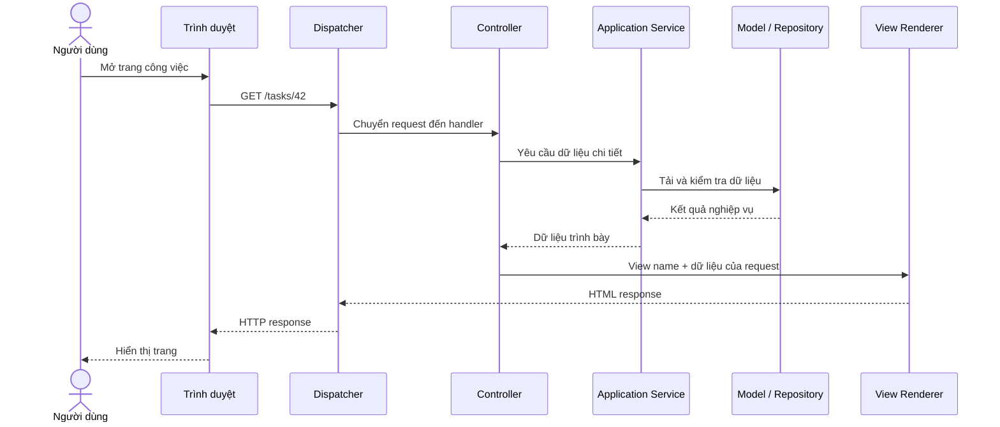
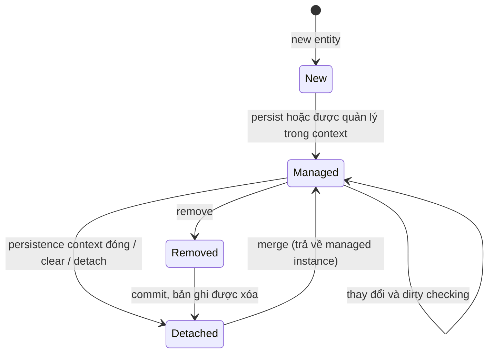

# Phạm vi tồn tại của Model, View và Controller

Trong MVC, Model, View và Controller có những trách nhiệm khác nhau, vì vậy dữ liệu và đối tượng thuộc mỗi phần cũng có phạm vi tồn tại khác nhau. Hiểu đúng vòng đời giúp tránh giữ nhầm trạng thái giữa các request, rò rỉ dữ liệu giữa người dùng, dùng đối tượng ORM sau khi phiên làm việc đã kết thúc hoặc tạo ra giao diện không còn đồng bộ với dữ liệu.

Trong ứng dụng web, một request thường được xử lý trong thời gian ngắn: trình duyệt gửi request, Controller điều phối nghiệp vụ, View tạo response rồi request kết thúc. Tuy nhiên, không phải mọi thứ tham gia luồng đó đều có cùng tuổi thọ. Controller do framework quản lý có thể tồn tại suốt vòng đời ứng dụng; dữ liệu truyền cho một lần render thường chỉ tồn tại trong request; đối tượng miền có thể được tải và thay đổi trong một transaction; dữ liệu đã lưu trong cơ sở dữ liệu có thể tồn tại lâu hơn tiến trình ứng dụng; DOM trong trình duyệt tồn tại cho đến khi trang bị thay thế hoặc cập nhật.

Vì thế, cần phân biệt **vai trò kiến trúc**, **vòng đời của object trong bộ nhớ**, **phạm vi dữ liệu theo request/session/application** và **vòng đời lưu trữ của dữ liệu**. Các khái niệm này liên quan nhưng không đồng nhất.

## Vòng đời trong MVC có nghĩa là gì?

Vòng đời (lifecycle) mô tả một thành phần hoặc dữ liệu được tạo ra khi nào, được sử dụng trong khoảng thời gian nào, được chia sẻ với ai và kết thúc bằng cách nào. Phạm vi tồn tại (lifetime/scope) cho biết một đối tượng có thể được truy cập trong bao lâu và trong phạm vi nào.

Ví dụ trong ứng dụng quản lý công việc:

- Một request `GET /tasks/42` tạo ra ngữ cảnh xử lý riêng cho lần truy cập đó.
- `TaskController` có thể là một bean singleton được tạo một lần khi ứng dụng khởi động và phục vụ nhiều request.
- Đối tượng `Task` có thể được tải từ cơ sở dữ liệu trong quá trình xử lý request và được quản lý trong persistence context của transaction.
- `org.springframework.ui.Model` nhận dữ liệu chỉ nhằm render trang hiện tại.
- Template tạo HTML trong quá trình xử lý response; DOM tương ứng được trình duyệt giữ sau khi nhận HTML.
- Bản ghi công việc trong cơ sở dữ liệu vẫn tồn tại sau khi request, Controller hoặc tiến trình ứng dụng kết thúc.

Không thể kết luận vòng đời chỉ từ tên lớp. Một class tên `TaskModel` có thể là đối tượng miền được tạo theo request, còn một class tên `TaskController` có thể là singleton. Hãy xem nơi tạo đối tượng, cơ chế quản lý scope và nơi lưu trạng thái.

## Luồng request và những vòng đời cùng tham gia

Trong web MVC phía máy chủ, mỗi request thường tạo một chuỗi xử lý mới. Router/Dispatcher chuyển request đến Controller; Controller gọi dịch vụ và Model; sau đó dữ liệu trình bày được chuyển đến View để tạo response.



Khi response được gửi xong, request scope kết thúc. Dữ liệu tạm của request không tự động tồn tại cho request tiếp theo. Request kế tiếp thường phải tải lại trạng thái cần thiết từ nguồn lưu trữ hoặc nhận dữ liệu qua một cơ chế được thiết kế rõ như session, cookie hay token.

## Vòng đời của Controller

Controller là điểm tiếp nhận và điều phối request. Vòng đời object Controller do framework hoặc cơ chế khởi tạo ứng dụng quyết định; nó không nhất thiết trùng với vòng đời của request.

### Controller singleton trong Spring MVC

Trong Spring, bean mặc định có scope `singleton`: container tạo một instance cho mỗi bean definition trong ApplicationContext và tái sử dụng instance đó. Các lớp `@Controller` và `@RestController` thường là singleton nếu không khai báo scope khác. Vì vậy, cùng một instance Controller có thể xử lý nhiều request, kể cả đồng thời trên nhiều thread.

Controller singleton nên giữ các dependency dùng chung ở field `final`, được inject qua constructor. Dữ liệu riêng của request phải nằm trong tham số phương thức, biến cục bộ hoặc đối tượng có scope phù hợp. Không lưu tên người dùng, ID tài nguyên, form hiện tại hay kết quả truy vấn của một request vào field có thể bị request khác ghi đè.

```java
@Controller
@RequestMapping("/tasks")
public class TaskController {
    private final TaskQueryService taskQueryService;

    public TaskController(TaskQueryService taskQueryService) {
        this.taskQueryService = taskQueryService;
    }

    @GetMapping("/{id}")
    public String details(@PathVariable long id, Model model) {
        TaskDetailsView details = taskQueryService.getDetails(id);
        model.addAttribute("task", details);
        return "tasks/details";
    }
}
```

`taskQueryService` là dependency được chia sẻ theo vòng đời bean của nó; `id`, `details` và `model` là dữ liệu của lần gọi handler. `Model` trong chữ ký này là vùng chứa dữ liệu cho View của request, không phải domain Model dùng để biểu diễn toàn bộ nghiệp vụ.

### Vì sao không lưu trạng thái request trong field?

Ví dụ sau không an toàn:

```java
@Controller
public class UnsafeTaskController {
    private long currentTaskId;

    @GetMapping("/tasks/{id}")
    public String details(@PathVariable long id, Model model) {
        currentTaskId = id;
        // Các bước xử lý tiếp theo có thể bị request khác ghi đè currentTaskId.
        return "tasks/details";
    }
}
```

Hai request đồng thời có thể ghi đè `currentTaskId`, khiến dữ liệu hoặc quyết định của request này bị trộn với request kia. Hãy dùng biến cục bộ hoặc truyền ID trực tiếp qua lời gọi dịch vụ. Nếu cần trạng thái giữa nhiều request, chọn session hoặc kho lưu trữ phù hợp và xác định rõ quyền truy cập, thời hạn và đồng bộ.

### Khi nào dùng request scope hoặc session scope?

Spring hỗ trợ nhiều bean scope. Một số scope thường gặp:

| Scope | Vòng đời khái quát | Ví dụ sử dụng |
|---|---|---|
| `singleton` | Một instance trong ApplicationContext | Controller stateless, service dùng chung, repository |
| `prototype` | Container tạo instance mới mỗi lần yêu cầu bean | Đối tượng có vòng đời ngắn cần được tạo riêng; cần hiểu cách quản lý hủy bean |
| `request` | Một instance trong phạm vi một HTTP request | Ngữ cảnh xử lý chỉ dùng trong một request |
| `session` | Gắn với một HTTP session của người dùng | Trạng thái wizard nhiều bước hoặc tùy chọn phiên |
| `application` | Một instance trong ServletContext của web application | Dữ liệu dùng chung ở phạm vi ứng dụng, nếu cần và được đồng bộ |

Không nên đổi Controller sang request scope chỉ để giữ một vài biến request. Tham số handler và biến cục bộ thường đơn giản hơn. Nếu singleton bean cần sử dụng một bean request-scoped, Spring có thể dùng scoped proxy hoặc cơ chế provider để lấy đúng instance theo request hiện tại.

Session scope chỉ nên dùng cho trạng thái thực sự cần đi qua nhiều request của cùng một phiên. Không lưu dữ liệu nhạy cảm hoặc bản sao trạng thái nghiệp vụ dài hạn vào session mà không có chính sách hết hạn, kiểm soát quyền và xử lý thay đổi đồng thời. Nhiều tab trình duyệt có thể dùng chung session và cập nhật cùng dữ liệu.

## Vòng đời của Model

Từ “Model” có thể chỉ nhiều loại đối tượng. Cần xác định đang nói đến domain model, đối tượng dữ liệu cho View hay trạng thái đã lưu.

### Domain Model và entity trong bộ nhớ

Domain Model biểu diễn khái niệm, trạng thái và hành vi nghiệp vụ. Class như `Task`, `Project` hoặc `User` được định nghĩa trong mã nguồn và tồn tại trong suốt thời gian class được nạp, nhưng từng instance thường được tạo khi cần, tải từ repository hoặc dựng từ command.

Trong ứng dụng web stateless, instance domain thường được tải trong một use case hoặc transaction, được kiểm tra và thay đổi, sau đó được lưu. Sau khi request kết thúc, ứng dụng không nhất thiết giữ nguyên instance đó trong bộ nhớ. Request tiếp theo có thể tải một instance mới đại diện cho cùng bản ghi đã lưu.

Điều này không có nghĩa dữ liệu nghiệp vụ mất đi. Cần phân biệt:

- **Instance trong bộ nhớ:** một đối tượng Java cụ thể, có thể trở nên không còn được tham chiếu sau khi use case kết thúc.
- **Trạng thái đã lưu:** dữ liệu được ghi trong cơ sở dữ liệu hoặc kho lưu trữ và có thể được tải lại sau này.
- **Định nghĩa kiểu:** class hoặc record mô tả cấu trúc và hành vi, tồn tại theo vòng đời class loader.

Model có thể tồn tại lâu hơn một request nếu ứng dụng chủ động giữ nó trong session, cache hoặc một tiến trình chạy lâu. Tuy nhiên, giữ entity sống lâu làm tăng nguy cơ dữ liệu cũ, đồng bộ khó khăn và rò rỉ tài nguyên. Hãy chọn vòng đời theo nhu cầu, không mặc định rằng mọi Model phải sống suốt session.

### Phân biệt domain Model với `org.springframework.ui.Model`

Trong Spring MVC, tham số `Model` của handler là một abstraction để thêm thuộc tính mà View sẽ sử dụng khi render. Ví dụ:

```java
@GetMapping("/tasks")
public String list(Model model) {
    model.addAttribute("tasks", taskQueryService.findTasks());
    model.addAttribute("pageTitle", "Danh sách công việc");
    return "tasks/list";
}
```

Đối tượng `Model` này thuộc ngữ cảnh xử lý MVC của request. Nó không phải nơi lưu trạng thái nghiệp vụ lâu dài và không thay thế entity, repository hay application service. Khi response được render xong, dữ liệu trong vùng chứa này không tự động trở thành trạng thái của request tiếp theo.

### Vòng đời entity trong JPA

Nếu dùng JPA, một entity còn có vòng đời persistence riêng. Vòng đời này không đồng nghĩa với vòng đời MVC:



- **New/Transient:** đối tượng mới được tạo, chưa được persistence context quản lý.
- **Managed/Persistent:** entity đang được một persistence context quản lý; thay đổi có thể được ghi nhận qua dirty checking.
- **Detached:** entity từng được quản lý nhưng hiện không còn gắn với persistence context đó.
- **Removed:** entity được đánh dấu xóa trong persistence context; thao tác xóa được đồng bộ khi flush/commit theo transaction.

Trong Spring, persistence context thường gắn với transaction hoặc được quản lý theo cấu hình Open EntityManager in View. Không nên dựa vào việc entity còn managed sau khi service trả về. Nếu View truy cập quan hệ lazy khi persistence context đã đóng, có thể gặp `LazyInitializationException`. Cách tổ chức an toàn thường là tải đủ dữ liệu cần thiết trong use case rồi ánh xạ thành DTO/View Model trước khi render.

`merge()` không đơn giản biến chính instance detached thành managed; JPA trả về một instance managed chứa trạng thái được hợp nhất. Vì vậy, hãy dùng đối tượng trả về từ `merge()` nếu cần tiếp tục thao tác với instance managed.

## Vòng đời của View

View cũng có nhiều nghĩa tùy môi trường chạy.

### View render phía máy chủ

Với server-side MVC, View thường là template hoặc thành phần renderer. Nó được dùng trong quá trình tạo response: nhận dữ liệu, định dạng và sinh HTML. Sau khi response được tạo, việc render kết thúc; template không tiếp tục sống như một đối tượng giao diện đang lắng nghe request mới.

Mỗi request render trang thường tạo một response mới. Dữ liệu dành cho View nên được truyền rõ ràng qua model attribute hoặc View Model, không lưu vào field dùng chung của template engine.

### View trong trình duyệt

HTML được trình duyệt nhận và phân tích thành DOM. DOM cùng các đối tượng JavaScript liên quan tồn tại trong trang cho đến khi bị thay thế, điều hướng, reload hoặc được cập nhật. Tuổi thọ này có thể dài hơn request đã tạo ra HTML.

Ví dụ, người dùng có thể mở trang danh sách trong vài phút và thực hiện nhiều request bất đồng bộ để lọc hoặc cập nhật dữ liệu. View trong trình duyệt tiếp tục tồn tại, trong khi mỗi request gửi lên máy chủ có vòng đời riêng. Trạng thái giao diện như tab đang chọn hoặc nội dung ô tìm kiếm có thể nằm ở client; trạng thái nghiệp vụ có thẩm quyền vẫn nằm ở phía máy chủ hoặc kho lưu trữ.

### View trong ứng dụng SPA

Trong ứng dụng Single Page Application, một component giao diện có thể được mount khi route được mở, cập nhật nhiều lần khi state thay đổi và unmount khi người dùng rời màn hình. Vòng đời component do framework phía client quản lý. Nó khác với vòng đời Controller hoặc Model phía máy chủ.

Một trang SPA có thể tồn tại qua nhiều request API. Không nên giả định dữ liệu hiển thị luôn mới: cần quy định khi nào tải lại, cập nhật lạc quan, xử lý response đến muộn và giải quyết xung đột khi nhiều tab cùng thay đổi dữ liệu.

## So sánh vòng đời thường gặp

| Thành phần/đối tượng | Phạm vi thường gặp trong web MVC | Có thể sống lâu hơn request không? | Nơi giữ trạng thái phù hợp |
|---|---|---|---|
| Controller Spring | Singleton theo ApplicationContext | Có, thường là toàn bộ vòng đời ứng dụng | Chỉ dependency an toàn khi chia sẻ; dữ liệu request ở biến cục bộ |
| Request context | Một HTTP request | Không | Request attributes hoặc tham số handler |
| Spring `Model` | Một lần xử lý/render View | Thường không | Dữ liệu chỉ dành cho response hiện tại |
| Domain entity instance | Một use case/transaction là lựa chọn phổ biến | Có thể, nhưng cần chủ đích | Database là nguồn trạng thái bền vững; cache/session chỉ khi có chính sách |
| JPA managed entity | Persistence context | Có thể qua nhiều thao tác trong cùng context | Persistence context và transaction |
| Server-side View/template | Một lần render | Template có thể được cache, nhưng dữ liệu render thuộc request | View Model/request model |
| DOM/component phía client | Một trang hoặc vòng đời route/component | Có, qua nhiều request API | Client state; không thay thế trạng thái có thẩm quyền của server |
| Session data | Nhiều request của cùng phiên | Có, đến khi hết hạn hoặc bị hủy | Session store, có timeout và kiểm soát truy cập |
| Bản ghi cơ sở dữ liệu | Theo chính sách lưu trữ | Có, qua nhiều request và lần khởi động | Database hoặc kho lưu trữ bền vững |

Bảng trên mô tả cách tổ chức phổ biến, không phải quy tắc bắt buộc của mọi framework. Framework có thể hỗ trợ scope khác hoặc cách quản lý persistence khác; cần kiểm tra cấu hình thực tế.

## Chia sẻ trạng thái giữa các request

HTTP thường được thiết kế theo mô hình stateless: mỗi request cần mang đủ thông tin để server xử lý hoặc tham chiếu đến trạng thái được lưu ở nơi khác. Nếu một quy trình cần nhớ dữ liệu qua nhiều bước, phải chọn cơ chế lưu trạng thái phù hợp.

### Request scope

Dùng cho dữ liệu chỉ cần trong một lần xử lý, chẳng hạn correlation ID, thông tin đã được xác minh hoặc dữ liệu tạm phục vụ render. Request scope không phù hợp để lưu thông tin cần có ở request tiếp theo.

### Session scope

Session có thể dùng cho wizard nhiều bước, giỏ hàng chưa đăng nhập hoặc tùy chọn giao diện theo phiên. Cần đặt thời hạn, giới hạn kích thước, bảo vệ cookie/session ID và cân nhắc nhiều tab hoặc nhiều thiết bị. Với hệ thống chạy nhiều instance, session cần được chia sẻ hoặc định tuyến phù hợp nếu không dùng session affinity.

Không nên lưu toàn bộ entity graph hoặc đối tượng ORM managed vào session. Dữ liệu có thể cũ, không serializable hoặc gắn với persistence context đã đóng. Thường nên lưu định danh và dữ liệu tối thiểu, rồi tải trạng thái mới từ repository khi xử lý request tiếp theo.

### Database và cache

Database thường là nguồn trạng thái bền vững. Cache có thể giảm chi phí đọc nhưng cần chính sách hết hạn và vô hiệu hóa khi dữ liệu thay đổi. Không nên xem cache hoặc field singleton là nguồn sự thật nếu ứng dụng cần tính nhất quán của nghiệp vụ.

### Cookie và token

Cookie hoặc token có thể mang định danh phiên hay một số claim đã ký. Không nên đưa dữ liệu nhạy cảm hoặc trạng thái nghiệp vụ có thể thay đổi vào client mà không có cơ chế bảo vệ, hết hạn và kiểm tra phù hợp. Dữ liệu client gửi lại luôn cần được xác minh theo hợp đồng và quyền phía máy chủ.

## An toàn khi có nhiều request đồng thời

Vòng đời dài không tự động làm đối tượng an toàn khi chia sẻ. Một Controller singleton có thể nhận nhiều request đồng thời; session của một người dùng có thể được nhiều tab cập nhật cùng lúc; cùng một bản ghi Model có thể được hai transaction sửa song song.

Một số nguyên tắc:

- Giữ Controller stateless; không dùng field mutable để lưu dữ liệu riêng của request.
- Dependency singleton cần an toàn khi chia sẻ, hoặc tự quản lý đồng bộ nếu có trạng thái mutable thực sự cần thiết.
- Không giả định session chỉ có một request hoạt động tại một thời điểm.
- Dùng optimistic locking, version hoặc cơ chế cập nhật nguyên tử khi nhiều request có thể sửa cùng một entity.
- Không giữ entity managed lâu hơn persistence context chỉ để truyền sang View hoặc request sau.
- Với thao tác có tác động bên ngoài, xác định rõ idempotency, retry và xử lý sự kiện đến muộn.

Ví dụ, nếu hai request cùng đọc một `Task` ở version 3 rồi cùng sửa, optimistic locking có thể cho phép một transaction commit và từ chối transaction còn lại vì version đã thay đổi. Ứng dụng cần chuyển xung đột đó thành phản hồi có ý nghĩa, chẳng hạn yêu cầu người dùng tải lại dữ liệu.

## Các lỗi thường gặp khi quản lý vòng đời

- **Controller giữ dữ liệu request trong field:** request đồng thời có thể ghi đè nhau và gây rò rỉ dữ liệu giữa người dùng. Dùng tham số hoặc biến cục bộ.
- **Nhầm `org.springframework.ui.Model` với domain Model:** dữ liệu render bị xem như trạng thái nghiệp vụ. Tách DTO/View Model khỏi entity và repository.
- **Giữ entity ORM trong session:** entity có thể cũ hoặc detached, quan hệ lazy có thể không truy cập được. Lưu ID/dữ liệu tối thiểu và tải lại khi cần.
- **Để View tự tải dữ liệu từ repository:** View phụ thuộc persistence và có thể truy vấn ngoài dự kiến. Chuẩn bị dữ liệu ở tầng ứng dụng.
- **Dùng singleton cho đối tượng có trạng thái riêng từng người dùng:** dữ liệu có thể bị chia sẻ sai phạm vi. Chọn scope hoặc cấu trúc dữ liệu phù hợp.
- **Dùng session làm kho lưu trữ chính:** trạng thái có thể mất khi hết hạn, khó đồng bộ giữa instance và khó kiểm soát cập nhật đồng thời. Lưu nghiệp vụ quan trọng ở database.
- **Không xử lý dữ liệu cũ trong trình duyệt:** View có thể hiển thị trạng thái đã thay đổi ở request khác. Dùng version, tải lại hoặc cơ chế cập nhật phù hợp.
- **Giả định request kết thúc đồng nghĩa dữ liệu đã lưu:** transaction có thể rollback hoặc commit thất bại. Chỉ phản hồi thành công sau khi use case hoàn tất theo hợp đồng.

## Kiểm thử vòng đời và phạm vi tồn tại

Có thể kiểm tra vòng đời ở nhiều mức:

- **Controller:** gửi nhiều request liên tiếp hoặc đồng thời với ID/người dùng khác nhau và xác minh dữ liệu không bị trộn.
- **Request scope:** xác minh dữ liệu tạm của request này không xuất hiện trong request khác.
- **Session:** xác minh dữ liệu cần giữ qua nhiều request tồn tại đúng phạm vi, hết hạn đúng chính sách và không rò rỉ giữa session.
- **Persistence:** kiểm tra entity được lưu, tải lại, detach và cập nhật theo transaction như mong đợi.
- **View:** xác minh template nhận đúng dữ liệu của request hiện tại; với SPA, kiểm tra component được mount/unmount và response đến muộn không ghi đè state mới.
- **Đồng thời:** gửi các cập nhật cạnh tranh và xác minh optimistic locking, constraint hoặc cơ chế đồng bộ bảo vệ trạng thái.

Một kiểm thử quan trọng cho Controller singleton là gửi hai request song song với hai ID khác nhau, rồi xác minh mỗi response chứa đúng dữ liệu tương ứng. Kiểm thử này có thể phát hiện việc vô tình lưu ID hoặc kết quả truy vấn vào field mutable của Controller.

## Cách lựa chọn phạm vi tồn tại

Khi tạo một đối tượng hoặc quyết định nơi lưu trạng thái, hãy tự hỏi:

1. Dữ liệu chỉ cần trong một lần xử lý hay phải tồn tại qua nhiều request?
2. Có cần chia sẻ dữ liệu giữa người dùng, giữa tab hoặc giữa nhiều instance ứng dụng không?
3. Dữ liệu có phải trạng thái nghiệp vụ có thẩm quyền cần được lưu bền vững không?
4. Đối tượng có mutable không và có thể được nhiều thread/request truy cập đồng thời không?
5. Nếu giữ đối tượng lâu, dữ liệu có thể cũ, chiếm tài nguyên hoặc phụ thuộc persistence context không?
6. Framework đang quản lý bean hoặc entity theo scope nào trong cấu hình thực tế?
7. Có thể chỉ lưu ID hoặc DTO nhỏ rồi tải lại trạng thái khi cần không?

Trong web MVC, Controller thường sống lâu hơn request, dữ liệu dành cho View thường sống trong một lần render, còn Model nghiệp vụ có thể được tải và lưu qua nhiều request nhưng không nhất thiết giữ cùng một instance trong bộ nhớ. Khi xác định đúng scope cho từng loại dữ liệu, ứng dụng tránh được trạng thái dùng chung ngoài ý muốn, giảm lỗi đồng thời và giữ rõ ranh giới giữa giao diện, điều phối và nghiệp vụ.
