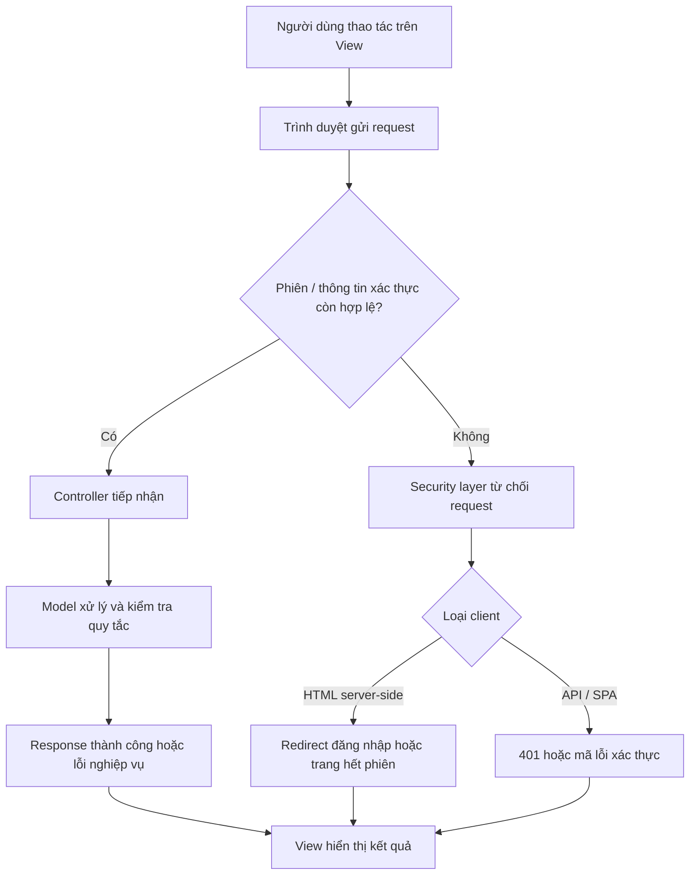
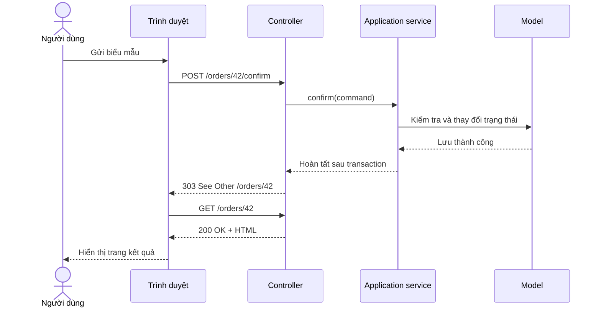

# Hết phiên, tải lại trang và thao tác quay lại

Trong ứng dụng web dùng Model–View–Controller (MVC), một màn hình có thể được mở trong thời gian dài, tải lại nhiều lần hoặc được khôi phục khi người dùng nhấn nút Back của trình duyệt. Trong khoảng thời gian đó, phiên đăng nhập có thể hết hạn, dữ liệu trên trang có thể đã cũ và một biểu mẫu có thể đã được gửi nhưng người dùng chưa nhận được phản hồi. Nếu ứng dụng không quản lý các tình huống này rõ ràng, người dùng có thể mất dữ liệu, gửi một hành động nhiều lần hoặc nhìn thấy trạng thái không còn đúng với máy chủ.

Thiết kế vòng đời cần xác định trạng thái nào nằm ở trình duyệt, trạng thái nào nằm ở máy chủ, khi nào phải truy vấn lại và cách xử lý khi một request không còn được xác thực. Controller điều phối phản hồi theo từng tình huống; Model vẫn bảo vệ quy tắc và tính nhất quán; View thông báo rõ trạng thái hiện tại để người dùng biết bước tiếp theo.

## 1. Những khái niệm cần phân biệt

Một ứng dụng web thường có nhiều loại trạng thái tồn tại trong thời gian khác nhau:

| Loại trạng thái | Nơi lưu thường gặp | Vòng đời |
|---|---|---|
| Trạng thái nghiệp vụ | Cơ sở dữ liệu / Model | Theo vòng đời dữ liệu nghiệp vụ |
| Phiên đăng nhập | Session phía máy chủ, cookie hoặc cơ chế token | Theo chính sách xác thực và thời hạn |
| Trạng thái giao diện | DOM, JavaScript state, form state | Theo vòng đời trang hoặc component |
| Dữ liệu cache | Bộ nhớ trình duyệt, cache HTTP, proxy | Theo chính sách cache và cơ chế hết hạn |
| Dữ liệu tạm của request | Request attributes, flash attributes | Trong một request hoặc lần chuyển hướng kế tiếp |
| Dữ liệu chưa lưu của biểu mẫu | Form trong trình duyệt, bộ nhớ tạm được kiểm soát | Có thể mất khi tải lại hoặc đóng trang |

Không nên coi tất cả các loại trạng thái trên là một. Ví dụ, trang vẫn còn hiển thị tên người dùng không có nghĩa phiên đăng nhập còn hợp lệ. Một biểu mẫu vẫn còn giá trị sau khi nhấn Back không có nghĩa dữ liệu đó đã được lưu. Một trang được trình duyệt khôi phục từ bộ nhớ không có nghĩa dữ liệu bên trong vẫn mới nhất.

### Session và authentication timeout

**Session** thường là vùng trạng thái phía máy chủ được liên kết với một session identifier, thường được trình duyệt gửi lại qua cookie. **Authentication timeout** là thời điểm thông tin xác thực không còn được chấp nhận theo chính sách của ứng dụng. Hai khái niệm có liên quan nhưng không nhất thiết trùng nhau: một ứng dụng có thể có idle timeout, absolute timeout, thời hạn token hoặc yêu cầu xác thực lại cho một thao tác nhạy cảm.

- **Idle timeout:** phiên hết hạn sau một khoảng thời gian không có hoạt động được tính là hợp lệ.
- **Absolute timeout:** phiên hết hạn sau một khoảng thời gian tối đa kể từ lúc được tạo, kể cả khi người dùng vẫn hoạt động.
- **Token expiry:** access token hết hạn theo trường thời hạn; client có thể cần refresh token hoặc xác thực lại tùy thiết kế.
- **Session invalidation:** máy chủ chủ động vô hiệu hóa phiên, ví dụ khi đăng xuất hoặc thu hồi quyền.

Thời hạn cụ thể phụ thuộc chính sách bảo mật và cấu hình. Không nên giả định mọi ứng dụng đều có cùng thời gian hết phiên hoặc mọi hoạt động trên trang đều gia hạn session.

## 2. Luồng tổng thể khi phiên hết hạn

Giả sử người dùng mở trang chi tiết đơn hàng, để tab đó trong một thời gian rồi nhấn nút xác nhận. Trình duyệt gửi request nhưng cookie phiên đã hết hạn. Máy chủ phải xác định request không còn được xác thực, trả phản hồi phù hợp và không thực hiện thay đổi nghiệp vụ.



Trong Spring Security, bộ lọc bảo mật thường kiểm tra xác thực trước khi request đi đến Controller. Vì vậy, không phải mọi request hết phiên đều được xử lý bởi một phương thức Controller cụ thể. Cần cấu hình entry point, access denied handler hoặc exception handler tương ứng với loại giao diện.

### Nguyên tắc quan trọng

- Request không được xác thực không được thực hiện hành động nghiệp vụ.
- Không coi dữ liệu hiển thị trong trình duyệt là bằng chứng phiên còn hợp lệ.
- Phản hồi hết phiên cần phân biệt với lỗi validation, lỗi nghiệp vụ và lỗi máy chủ.
- Sau khi người dùng đăng nhập lại, ứng dụng phải quyết định có thể tiếp tục thao tác hay cần tải lại và xác nhận dữ liệu.
- Không chuyển hướng mù quáng đến một URL do client cung cấp mà chưa kiểm tra đích đến.

## 3. Xử lý hết phiên với trang HTML server-side

Với ứng dụng render HTML ở máy chủ, cách phổ biến là chuyển hướng người dùng đến trang đăng nhập hoặc trang thông báo phiên hết hạn. Trang đích có thể giải thích rằng phiên không còn hợp lệ và yêu cầu người dùng đăng nhập lại.

Luồng minh họa:

1. Người dùng gửi request từ trang đang mở.
2. Security layer phát hiện chưa được xác thực.
3. Ứng dụng lưu một đích quay lại an toàn nếu chính sách cho phép.
4. Trình duyệt được chuyển đến trang đăng nhập.
5. Sau khi đăng nhập thành công, ứng dụng kiểm tra đích quay lại và tải lại tài nguyên.
6. Người dùng xác nhận lại hành động nếu dữ liệu hoặc điều kiện có thể đã thay đổi.

Không nên tự động phát lại một POST thay đổi trạng thái chỉ vì người dùng vừa đăng nhập lại. Request cũ có thể đã đến máy chủ trước khi kết nối bị gián đoạn, hoặc trạng thái nghiệp vụ có thể đã thay đổi. Với hành động quan trọng, nên tải lại trạng thái hiện tại và để người dùng xác nhận lại.

### Giữ đích quay lại an toàn

Nếu ứng dụng muốn đưa người dùng trở lại trang trước đăng nhập, chỉ nên lưu một đường dẫn nội bộ đã được kiểm tra. Không sử dụng URL tùy ý từ query parameter làm đích redirect, vì có thể tạo lỗ hổng open redirect.

- Chỉ chấp nhận đường dẫn tương đối thuộc ứng dụng.
- Dùng allowlist các route hợp lệ.
- Loại bỏ scheme, host và các dạng URL không mong muốn.
- Nếu không xác định được đích an toàn, chuyển đến trang mặc định sau đăng nhập.

Đích quay lại chỉ nên giúp điều hướng. Nó không phải dữ liệu đáng tin để bỏ qua kiểm tra quyền hoặc quy tắc nghiệp vụ.

## 4. Xử lý hết phiên với API và SPA

Với giao diện JavaScript hoặc ứng dụng di động, response HTML redirect có thể gây khó xử lý. Client thường mong đợi JSON nhưng lại nhận trang đăng nhập HTML, đôi khi với status 200 OK sau chuỗi redirect. Khi đó mã giao diện có thể cố parse HTML như JSON và hiển thị lỗi không rõ nguyên nhân.

Một hợp đồng API nên trả status và cấu trúc lỗi nhất quán:

```http
HTTP/1.1 401 Unauthorized
Content-Type: application/problem+json

{
  "type": "about:blank",
  "title": "Authentication required",
  "status": 401,
  "code": "SESSION_EXPIRED",
  "detail": "Phiên đăng nhập đã hết hạn. Vui lòng đăng nhập lại."
}
```

Client có thể xử lý 401 ở một nơi chung:

- Dừng các thao tác yêu cầu xác thực tiếp theo.
- Hiển thị thông báo phiên hết hạn.
- Điều hướng đến luồng đăng nhập hoặc mở hộp thoại xác thực.
- Sau khi xác thực lại, tải lại dữ liệu cần thiết.
- Không tự động phát lại mọi request POST/PUT/PATCH/DELETE.

401 Unauthorized biểu thị request thiếu thông tin xác thực hợp lệ. 403 Forbidden biểu thị người dùng đã được xác thực nhưng không được phép thực hiện hành động. Không nên dùng hai mã này thay thế nhau vì client cần biết nên yêu cầu đăng nhập lại hay thông báo không đủ quyền.

### Ví dụ xử lý phản hồi ở client

```javascript
async function loadOrder(orderId) {
  const response = await fetch("/api/orders/" + orderId, {
    headers: { "Accept": "application/json" }
  });

  if (response.status === 401) {
    authState.markExpired();
    showSessionExpiredMessage();
    return;
  }

  if (response.status === 403) {
    showAccessDeniedMessage();
    return;
  }

  if (!response.ok) {
    showLoadError();
    return;
  }

  const order = await response.json();
  renderOrder(order);
}
```

Đây là ví dụ minh họa; trong ứng dụng thật, logic xử lý lỗi xác thực nên được dùng chung ở HTTP client hoặc middleware để mọi màn hình có hành vi thống nhất. Không đưa token, cookie hoặc thông tin xác thực vào thông báo hiển thị hay log phía trình duyệt.

## 5. Tải lại trang và mẫu Post/Redirect/Get

Người dùng có thể nhấn Refresh sau khi xem trang hoặc sau khi gửi biểu mẫu. Nếu response cuối cùng là kết quả trực tiếp của một POST, trình duyệt có thể hỏi người dùng có muốn gửi lại biểu mẫu hay không. Nếu người dùng đồng ý, hành động có thể được gửi lần nữa.

Mẫu **Post/Redirect/Get (PRG)** giải quyết phần lớn tình huống này:

1. Trình duyệt gửi POST để tạo hoặc thay đổi dữ liệu.
2. Máy chủ xác thực, kiểm tra và xử lý nghiệp vụ.
3. Khi xử lý thành công, Controller trả redirect đến một URL GET.
4. Trình duyệt gửi GET và nhận trang kết quả.
5. Refresh trang kết quả chỉ gửi lại GET.



Ví dụ Controller Spring MVC:

```java
@PostMapping("/{id}/confirm")
public String confirm(
        @PathVariable UUID id,
        @Valid @ModelAttribute("form") ConfirmOrderForm form,
        BindingResult errors,
        @AuthenticationPrincipal AppPrincipal principal,
        RedirectAttributes redirectAttributes) {

    if (errors.hasErrors()) {
        return "orders/confirm";
    }

    orderApplicationService.confirm(
        new ConfirmOrderCommand(id, principal.userId(), form.note())
    );

    redirectAttributes.addFlashAttribute(
        "message", "Đơn hàng đã được xác nhận"
    );
    return "redirect:/orders/" + id;
}
```

Spring MVC thường dùng redirect sau khi Controller trả về chuỗi redirect:; có thể cấu hình hoặc chọn status redirect phù hợp với hợp đồng HTTP. Với PRG, 303 See Other diễn đạt rõ rằng trình duyệt nên truy vấn URL đích bằng GET sau POST. Hãy xác minh status thực tế trong cấu hình và kiểm thử Controller.

### PRG không bảo đảm hành động chỉ chạy một lần

PRG ngăn refresh trang kết quả gửi lại POST trong luồng thông thường. Nó không giải quyết mọi trường hợp gửi trùng:

- Người dùng nhấn nút nhiều lần trước khi redirect.
- Client tự gửi lại request do timeout.
- Proxy hoặc ứng dụng retry một request.
- Người dùng mở nhiều tab và gửi cùng hành động.
- Máy chủ đã commit nhưng kết nối bị ngắt trước khi client nhận response.

Với hành động có tác động đáng kể như tạo đơn hàng, thanh toán hoặc đặt chỗ, cần thêm bảo vệ ở cấp nghiệp vụ, ví dụ idempotency key, mã giao dịch duy nhất hoặc kiểm tra chuyển trạng thái hợp lệ.

## 6. Idempotency và chống gửi hành động trùng

Một thao tác **idempotent** khi thực hiện nhiều lần với cùng điều kiện vẫn cho kết quả cuối tương đương với một lần thực hiện. GET được định nghĩa là safe và idempotent theo ngữ nghĩa HTTP; PUT và DELETE cũng có ngữ nghĩa idempotent theo chuẩn, dù cách triển khai vẫn phải tuân thủ hợp đồng. POST không mặc nhiên idempotent.

Ví dụ, lệnh xác nhận đơn hàng có thể được thiết kế để:

- Lần đầu chuyển đơn từ DRAFT sang CONFIRMED.
- Lần tiếp theo phát hiện đơn đã xác nhận và trả kết quả phù hợp mà không tạo tác động phụ lần nữa.

Nếu mỗi lần nhận POST đều tạo một khoản thanh toán hoặc gửi một yêu cầu vận chuyển mới, việc chỉ dựa vào nút bị disable ở giao diện là không đủ.

### Idempotency key

Client có thể tạo một key duy nhất cho một ý định gửi lệnh và gửi kèm request. Máy chủ lưu key cùng kết quả xử lý trong một phạm vi phù hợp. Nếu nhận lại cùng key, máy chủ trả kết quả đã ghi nhận thay vì thực hiện hành động lần nữa.

Một hợp đồng đơn giản:

```http
POST /api/payments
Idempotency-Key: 8f6b1e2a-...
Content-Type: application/json
```

Máy chủ cần xác định phạm vi key, thời gian lưu, cách xử lý khi cùng key được gửi với payload khác và tính nguyên tử giữa ghi nhận key với tác động nghiệp vụ. Key không phải cơ chế xác thực hoặc phân quyền; request vẫn phải được xác thực và kiểm tra quyền.

### Kiểm tra trạng thái tại Model

Ngay cả khi không dùng idempotency key, Model cần bảo vệ chuyển trạng thái:

```java
public void confirm(Instant now) {
    if (status == OrderStatus.CONFIRMED) {
        return; // Nếu nghiệp vụ xác định xác nhận lặp là không gây tác động mới.
    }

    if (status != OrderStatus.DRAFT) {
        throw new InvalidOrderStateException();
    }

    status = OrderStatus.CONFIRMED;
    confirmedAt = now;
}
```

Hành vi lặp cần được quyết định theo nghiệp vụ. Có hệ thống nên trả xung đột 409 Conflict khi đơn đã xác nhận; hệ thống khác có thể trả kết quả hiện tại để hỗ trợ retry an toàn. Nếu hành động có tác động bên ngoài như trừ tiền, gửi thông báo hoặc tạo vận đơn, phải bảo đảm những tác động đó cũng không bị lặp.

## 7. Nút Back, cache trình duyệt và dữ liệu cũ

Khi người dùng nhấn Back, trình duyệt có thể lấy lại trang từ nhiều nguồn:

- **HTTP cache:** lưu response theo chính sách cache và có thể dùng lại hoặc xác thực lại với máy chủ.
- **Back/Forward Cache (BFCache):** lưu một bản snapshot của trang đang hoạt động, gồm DOM và trạng thái JavaScript, để khôi phục nhanh khi điều hướng Back/Forward.
- **Tải lại từ máy chủ:** trình duyệt gửi request mới nếu không thể hoặc không chọn khôi phục bản đã lưu.

Các cơ chế này khác nhau. Không nên giả định Back luôn gửi request mới hoặc luôn khôi phục đúng trạng thái trước đó. BFCache có thể khôi phục một trang đã cũ so với dữ liệu máy chủ; HTTP cache có quy tắc riêng dựa trên header.

### Dữ liệu trong trang có thể đã lỗi thời

Ví dụ:

1. Người dùng mở trang đơn hàng khi trạng thái là DRAFT.
2. Một người khác xác nhận đơn hàng.
3. Người dùng đầu tiên mở tab khác hoặc chuyển sang trang khác.
4. Người dùng nhấn Back và trình duyệt khôi phục trang cũ, vẫn hiển thị nút xác nhận.
5. Người dùng nhấn nút và gửi POST.

Giao diện có thể hiển thị dữ liệu cũ, nhưng máy chủ phải tải trạng thái hiện tại và kiểm tra lại quy tắc trước khi xử lý. Không được tin trạng thái trong DOM, hidden input hoặc JavaScript state.

### Đồng bộ khi trang được khôi phục

Có thể dùng sự kiện pageshow để nhận biết trang được hiển thị, kể cả khi được khôi phục từ BFCache. Thuộc tính event.persisted cho biết trang có được khôi phục từ BFCache hay không trong các trình duyệt hỗ trợ:

```javascript
window.addEventListener("pageshow", event => {
  if (event.persisted) {
    refreshVisibleData();
  }
});
```

Đối với ứng dụng SPA, có thể làm mới dữ liệu khi route được kích hoạt lại hoặc khi tab trở nên visible. Việc làm mới nên có kiểm soát để tránh gọi API không cần thiết mỗi lần người dùng chuyển tab.

Không nên dựa vào pageshow như hàng rào bảo mật. Đây chỉ là cơ chế đồng bộ giao diện; máy chủ luôn phải xác thực và kiểm tra trạng thái khi nhận hành động.

## 8. Chính sách cache cho trang có dữ liệu nhạy cảm

Header cache quyết định trình duyệt và proxy có thể lưu hoặc dùng lại response như thế nào. Cần chọn chính sách theo mức độ nhạy cảm và khả năng chấp nhận dữ liệu cũ.

| Directive | Ý nghĩa khái quát | Trường hợp thường cân nhắc |
|---|---|---|
| no-store | Không lưu response vào cache | Trang chứa dữ liệu nhạy cảm cần tránh lưu trữ |
| no-cache | Có thể lưu nhưng phải xác thực lại trước khi dùng | Nội dung cần kiểm tra tính mới với máy chủ |
| private | Chỉ cache riêng của client, không cho shared cache | Trang cá nhân hóa không được cache ở proxy dùng chung |
| max-age | Thời gian response còn mới theo cache | Nội dung có thể dùng lại trong khoảng thời gian xác định |

Ví dụ header cho trang nhạy cảm:

```http
Cache-Control: no-store
```

Với nội dung cá nhân hóa ít nhạy cảm nhưng cần xác thực lại, có thể cân nhắc private, no-cache. Cần hiểu đúng rằng no-cache không đồng nghĩa với không lưu; nếu mục tiêu là cấm lưu trữ thì no-store mới là directive phù hợp. Chính sách thực tế phải được kiểm tra trên các trình duyệt và proxy trong môi trường triển khai.

Không nên đặt no-store cho mọi tài nguyên một cách máy móc. CSS, JavaScript có version/hash và hình ảnh công khai có thể hưởng lợi từ cache dài hạn. Hãy phân biệt tài nguyên tĩnh công khai với trang cá nhân hóa hoặc response chứa dữ liệu nhạy cảm.

Một số header có thể ảnh hưởng khả năng BFCache tùy trình duyệt và tình huống. Không nên cố ép trình duyệt không dùng BFCache chỉ để thay thế việc kiểm tra dữ liệu ở máy chủ. Nếu trang được khôi phục, hãy làm mới dữ liệu cần thiết và vẫn kiểm tra mọi thao tác ở server.

## 9. Biểu mẫu chưa lưu và hành vi khi quay lại

Người dùng có thể nhập một biểu mẫu dài rồi chuyển sang trang khác hoặc phiên hết hạn. Khi quay lại, dữ liệu có thể còn trong bộ nhớ biểu mẫu, được khôi phục bởi trình duyệt hoặc đã mất. Ứng dụng cần quyết định rõ dữ liệu nào có thể khôi phục.

### Các lựa chọn giữ dữ liệu biểu mẫu

| Cách lưu | Ưu điểm | Giới hạn và lưu ý |
|---|---|---|
| Giữ trong DOM / BFCache | Không cần lưu riêng, khôi phục nhanh | Không bảo đảm luôn được dùng; có thể mất khi đóng tab hoặc reload |
| Session phía máy chủ | Có thể khôi phục qua request và thiết bị theo session | Phải giới hạn thời gian, dung lượng và xử lý hết phiên |
| sessionStorage | Giữ dữ liệu trong một tab qua reload | Không chia sẻ giữa tab; vẫn là dữ liệu phía client |
| localStorage | Có thể còn sau khi đóng và mở lại trình duyệt | Dữ liệu sống lâu, dễ bị script cùng origin đọc; không phù hợp dữ liệu nhạy cảm |
| Bản nháp lưu phía máy chủ | Có thể khôi phục ổn định và đồng bộ nhiều thiết bị | Cần quyền truy cập, thời hạn, xóa bản nháp và xử lý xung đột |

Không nên lưu mật khẩu, token, dữ liệu thanh toán hoặc thông tin nhạy cảm vào Web Storage để khôi phục biểu mẫu. Nếu cần lưu bản nháp, hãy thiết kế nó như một tài nguyên nghiệp vụ riêng có xác thực, phân quyền, thời hạn và quy trình xóa.

### Phân biệt bản nháp với dữ liệu đã gửi

Biểu mẫu đang được chỉnh sửa chưa phải là dữ liệu đã lưu. View nên thể hiện rõ trạng thái:

- Có thay đổi chưa lưu.
- Đang gửi.
- Đã lưu thành công.
- Gửi thất bại và cần thử lại.
- Phiên đã hết hạn; người dùng cần xác thực lại.
- Bản nháp đã cũ hoặc bị thay đổi bởi người khác.

Nếu có thể, ứng dụng nên cảnh báo trước khi người dùng rời trang có thay đổi chưa lưu. Cảnh báo trình duyệt chỉ hỗ trợ trải nghiệm; nó không thay thế lưu bản nháp nếu nghiệp vụ yêu cầu bảo đảm không mất dữ liệu.

## 10. Flash message và dữ liệu qua redirect

Trong ứng dụng Spring MVC, RedirectAttributes.addFlashAttribute() có thể lưu dữ liệu tạm để hiển thị sau redirect. Flash attribute thường được chuyển qua một lần điều hướng kế tiếp và không phải nơi lưu trạng thái lâu dài.

Ví dụ:

```java
redirectAttributes.addFlashAttribute(
    "message", "Thông tin đã được lưu"
);
return "redirect:/profile";
```

Flash message phù hợp cho thông báo ngắn sau một POST thành công. Không nên lưu toàn bộ entity hoặc dữ liệu nhạy cảm vào flash scope. Với nhiều tab hoặc redirect đồng thời, cần hiểu cách framework lưu và tiêu thụ flash attributes; một thông báo có thể được gắn với request kế tiếp không như người dùng dự đoán nếu có nhiều điều hướng cùng lúc.

Nếu thông tin cần tồn tại lâu hơn, hãy lưu trạng thái phù hợp trong Model hoặc cơ sở dữ liệu và tải lại bằng GET. Flash message chỉ là thông báo tạm, không phải nguồn sự thật của nghiệp vụ.

## 11. Xử lý CSRF và session timeout

Với ứng dụng dùng cookie để xác thực, trình duyệt tự động gửi cookie cùng request phù hợp. Vì vậy, các endpoint thay đổi trạng thái cần có cơ chế chống Cross-Site Request Forgery (CSRF) theo kiến trúc bảo mật.

Khi session hết hạn, CSRF token gắn với session cũ cũng có thể không còn hợp lệ. Người dùng có thể gặp lỗi CSRF khi gửi biểu mẫu từ một trang mở lâu.

Cách xử lý:

- Bảo đảm mọi request thay đổi trạng thái dùng HTTP method phù hợp, không dùng GET để thực hiện hành động.
- Giữ CSRF protection được bật cho các luồng dùng cookie/session theo cấu hình bảo mật.
- Khi token hết hạn, trả thông báo dễ hiểu và yêu cầu tải lại biểu mẫu để nhận token mới.
- Không tự động bỏ qua CSRF validation chỉ vì request đến từ một trang cùng ứng dụng.
- Sau khi xác thực lại, tạo form/request mới với token hiện hành.

CSRF token không phải session identifier và không thay thế xác thực. Cần bảo vệ cookie phiên bằng các thuộc tính phù hợp như Secure, HttpOnly và SameSite theo cách triển khai, đồng thời vẫn kiểm tra quyền và quy tắc nghiệp vụ.

## 12. Trạng thái đồng thời và dữ liệu lỗi thời

Ngay cả khi phiên còn hợp lệ, dữ liệu trang có thể cũ do người dùng khác hoặc một tác vụ nền đã thay đổi Model. Đây là vấn đề nhất quán dữ liệu, không chỉ là vấn đề trình duyệt.

Một cách phổ biến là optimistic locking với version:

```java
@Entity
public class OrderEntity {
    @Id
    private UUID id;

    @Version
    private long version;
}
```

Khi client hiển thị dữ liệu, có thể đưa version vào một trường của form hoặc response nếu hợp đồng cần kiểm tra phiên bản. Khi cập nhật, application service hoặc repository phải bảo đảm phiên bản vẫn khớp. Nếu có xung đột, trả 409 Conflict hoặc hiển thị thông báo yêu cầu tải lại dữ liệu.

Version gửi từ client không phải bằng chứng đáng tin về quyền hoặc trạng thái; nó chỉ là điều kiện phát hiện dữ liệu cũ. Máy chủ vẫn phải tải dữ liệu hiện tại và kiểm tra bất biến. Với form nhạy cảm, có thể hiển thị hai lựa chọn: tải lại và thử lại, hoặc sao chép nội dung người dùng đã nhập vào một bản nháp an toàn.

## 13. Kiểm thử các tình huống vòng đời

Không chỉ kiểm thử luồng thành công. Cần mô phỏng việc phiên hết hạn, gửi lại request, refresh và quay lại trang cũ.

| Kịch bản | Điều cần xác minh |
|---|---|
| GET khi session còn hiệu lực | Controller tải dữ liệu và render View đúng |
| GET khi session hết hạn | HTML client được chuyển đến trang đăng nhập hoặc hết phiên |
| API request khi session hết hạn | Trả 401 theo hợp đồng JSON, không trả HTML đăng nhập giả dạng thành công |
| Người dùng đã đăng nhập nhưng thiếu quyền | Trả 403 hoặc phản hồi tương ứng |
| POST thành công rồi refresh | PRG khiến trình duyệt tải lại GET, không gửi lại POST thông thường |
| POST bị gửi hai lần | Model hoặc idempotency mechanism ngăn tác động trùng theo chính sách |
| Back khôi phục trang cũ | Dữ liệu hiển thị được làm mới khi cần; hành động vẫn bị kiểm tra ở máy chủ |
| CSRF token hết hạn | Request bị từ chối và người dùng nhận hướng dẫn tải lại form |
| Dữ liệu bị cập nhật ở tab khác | Optimistic locking hoặc quy tắc nghiệp vụ phát hiện xung đột |
| Biểu mẫu có thay đổi chưa lưu | Người dùng được cảnh báo hoặc có thể khôi phục bản nháp theo thiết kế |
| Đăng nhập lại sau timeout | Điều hướng về đích an toàn; không tự phát lại hành động nhạy cảm |

Với Spring MVC, có thể dùng MockMvc để kiểm tra status, redirect, session và phản hồi lỗi. Kiểm thử bảo mật có thể dùng cấu hình Spring Security test để mô phỏng người dùng đã xác thực, chưa xác thực hoặc thiếu quyền. Kiểm thử trình duyệt thực tế cần xác minh hành vi Back/Forward Cache trên các trình duyệt được hỗ trợ.

## 14. Những lỗi thiết kế thường gặp

| Lỗi | Hệ quả | Cách cải thiện |
|---|---|---|
| Tin rằng trang còn hiển thị nghĩa là session còn hiệu lực | Request có thể bị thực hiện trong trạng thái chưa xác thực | Kiểm tra xác thực ở mọi request tại server |
| API hết phiên trả HTML login với status 200 | Client không phân biệt được lỗi xác thực | Trả 401 và cấu trúc lỗi API ổn định |
| Tự động phát lại POST sau đăng nhập | Có thể tạo tác động nghiệp vụ trùng hoặc sai thời điểm | Tải lại dữ liệu và yêu cầu xác nhận lại |
| Chỉ dùng PRG để chống gửi trùng | Không bảo vệ được retry và nhiều tab | Dùng idempotency hoặc quy tắc trạng thái ở server |
| Cho rằng Back luôn tải trang mới | View có thể hiển thị snapshot cũ | Làm mới dữ liệu khi cần và luôn kiểm tra tại server |
| Dùng no-cache với kỳ vọng không lưu dữ liệu | Response vẫn có thể được lưu nhưng cần revalidate | Dùng no-store khi thực sự cần cấm lưu |
| Lưu biểu mẫu nhạy cảm trong localStorage | Dữ liệu tồn tại lâu và có thể bị script cùng origin đọc | Dùng bản nháp server-side có quyền và thời hạn |
| Dùng URL quay lại không kiểm tra | Có thể tạo open redirect | Chỉ chấp nhận đích nội bộ hoặc allowlist |
| Coi CSRF token và session là một | Có thể xử lý sai vòng đời và cơ chế bảo mật | Quản lý riêng xác thực, session và CSRF |
| Không kiểm tra dữ liệu đồng thời | Ghi đè trạng thái mới bằng form cũ | Versioning hoặc khóa phù hợp |

## 15. Checklist thiết kế vòng đời trang MVC

- Đã xác định session, token và dữ liệu giao diện có vòng đời riêng chưa?
- Mọi request có được xác thực và phân quyền ở phía máy chủ không?
- HTML và API có hợp đồng xử lý hết phiên phù hợp với từng client không?
- Redirect sau đăng nhập có giới hạn ở đích nội bộ an toàn không?
- POST thành công có dùng PRG khi phù hợp không?
- Hành động có thể bị retry đã có idempotency hoặc kiểm tra trạng thái chưa?
- View có thể được khôi phục từ BFCache hoặc HTTP cache và hiển thị dữ liệu cũ không?
- Chính sách cache có phù hợp mức độ nhạy cảm của response không?
- Biểu mẫu chưa lưu có được xử lý theo mức độ quan trọng của dữ liệu không?
- CSRF protection có được giữ đúng cho các request thay đổi trạng thái không?
- Dữ liệu đồng thời có được bảo vệ khỏi cập nhật lỗi thời không?
- Có kiểm thử session timeout, refresh, Back, retry, CSRF và xung đột dữ liệu không?

## Kết luận

Hết phiên, tải lại và quay lại trang là những tình huống bình thường trong vòng đời ứng dụng web. Ứng dụng MVC cần xác thực mỗi request ở máy chủ, phân biệt phản hồi HTML với API, dùng PRG cho biểu mẫu phù hợp, bảo vệ hành động lặp bằng idempotency hoặc quy tắc nghiệp vụ, và làm mới dữ liệu khi trình duyệt khôi phục một trang cũ. Chính sách cache, lưu bản nháp và CSRF phải phù hợp với độ nhạy cảm của dữ liệu. Khi các ranh giới này rõ ràng, người dùng có thể tiếp tục làm việc an toàn mà không nhầm lẫn giữa trạng thái đang hiển thị và trạng thái thật của ứng dụng.
