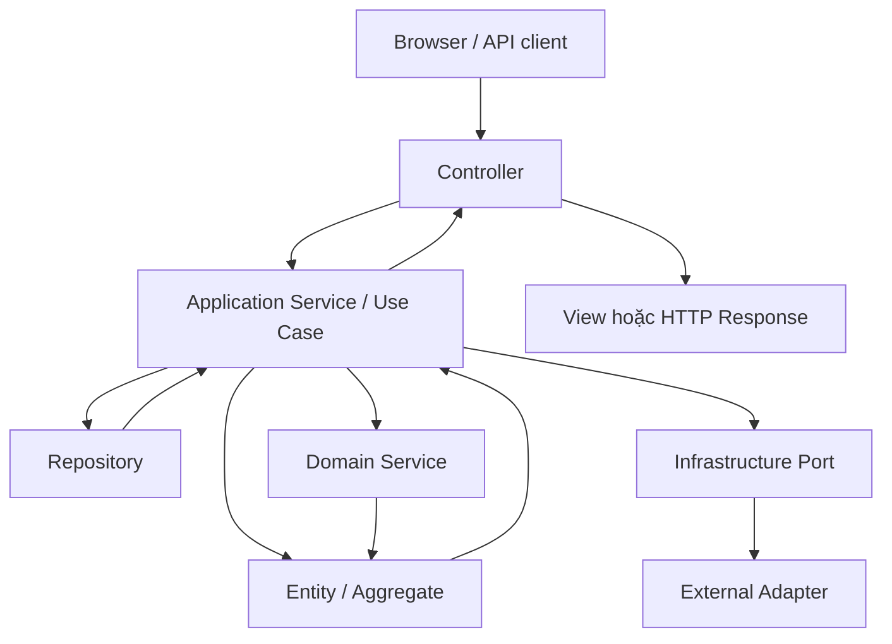

# Phân biệt dịch vụ ứng dụng và dịch vụ nghiệp vụ

## 1. Vì sao cần phân biệt các loại dịch vụ?

Trong ứng dụng MVC, Controller nhận request và điều phối tương tác, còn Model giữ trạng thái và quy tắc của miền nghiệp vụ. Khi một thao tác cần nhiều bước hoặc liên quan đến nhiều đối tượng, đặt toàn bộ xử lý trong Controller sẽ khiến Controller phình to. Tuy nhiên, chuyển tất cả code sang một lớp có tên `Service` cũng chưa chắc tạo ra ranh giới tốt.

Một ứng dụng có thể cần ít nhất hai loại dịch vụ với mục đích khác nhau:

- **Dịch vụ ứng dụng (Application Service):** thực hiện một use case ở cấp ứng dụng. Nó điều phối các bước, gọi repository và các thành phần nghiệp vụ, quản lý ranh giới giao dịch, rồi trả kết quả cho adapter như Controller.
- **Dịch vụ nghiệp vụ (Domain Service):** biểu diễn một quy tắc hoặc phép tính thuộc miền nghiệp vụ nhưng không tự nhiên thuộc về một Entity hay Value Object cụ thể. Nó làm việc bằng các khái niệm của miền và bảo vệ tính nhất quán của quy tắc đó.

Hai loại dịch vụ có thể cùng tham gia một request. Application Service điều phối use case; Domain Service thực hiện một phần quy tắc nghiệp vụ chuyên biệt. Phân biệt đúng giúp biết code nên nằm ở đâu, dependency nào được phép xuất hiện và kiểm thử ở mức nào.

Trong bài này, “dịch vụ nghiệp vụ” được dùng theo nghĩa **Domain Service** trong Domain-Driven Design. Một số dự án dùng cụm *Business Service* theo nghĩa rộng hơn, thậm chí để chỉ cả Application Service. Vì vậy, khi đọc codebase, hãy xem trách nhiệm và dependency thực tế thay vì chỉ dựa vào tên gọi.

## 2. Định nghĩa và mục tiêu

### 2.1. Dịch vụ ứng dụng (Application Service)

Application Service đại diện cho một thao tác mà ứng dụng cung cấp, thường được gọi là *use case* hoặc *application operation*. Ví dụ:

- Đặt hàng.
- Hủy đơn hàng.
- Đăng ký tài khoản.
- Phê duyệt yêu cầu hoàn tiền.
- Tạo báo cáo doanh thu.

Một Application Service nhận dữ liệu đầu vào đã được chuyển thành kiểu phù hợp, xác định các đối tượng cần thiết, gọi nghiệp vụ, lưu thay đổi và trả kết quả. Nó tập trung vào **quy trình thực hiện use case**.

Application Service thường biết đến repository, cổng tích hợp (port), Domain Model và Domain Service. Nó có thể phụ thuộc vào cơ chế transaction hoặc các abstraction ở tầng ứng dụng. Nó không nên phụ thuộc vào HTTP request, template HTML hoặc chi tiết của một framework giao diện.

### 2.2. Dịch vụ nghiệp vụ (Domain Service)

Domain Service biểu diễn một hành vi nghiệp vụ thuộc miền nhưng không có một Entity hoặc Value Object đơn lẻ nào là nơi sở hữu tự nhiên của hành vi đó.

Ví dụ:

- Tính giá cuối cùng dựa trên khách hàng, các dòng hàng và chương trình khuyến mại.
- Xác định hạn mức chuyển tiền dựa trên hai tài khoản và chính sách áp dụng.
- Tính phân bổ chi phí giữa nhiều đơn vị chịu phí.
- Kiểm tra một quy tắc nghiệp vụ liên quan đến nhiều aggregate.

Domain Service nên sử dụng ngôn ngữ của miền, nhận các đối tượng hoặc giá trị miền làm đầu vào và trả về kết quả miền. Nó không nên biết HTTP, View, session, SQL, ORM hoặc cách gửi email. Nếu quy tắc có thể đặt tự nhiên trong một Entity hoặc Value Object, hãy ưu tiên đặt tại đó thay vì tạo service chỉ để gọi lại một phương thức.

Domain Service thường không giữ trạng thái theo request. Nó có thể là một đối tượng stateless và được chia sẻ an toàn giữa các lời gọi nếu không lưu dữ liệu thay đổi theo từng lần thực thi.

## 3. So sánh Application Service và Domain Service

| Tiêu chí | Application Service | Domain Service |
|---|---|---|
| Câu hỏi chính | Use case này cần phối hợp những bước nào? | Quy tắc nghiệp vụ này được tính hoặc thực hiện ra sao? |
| Mục tiêu | Điều phối luồng ứng dụng | Biểu diễn hành vi và quy tắc của miền |
| Đầu vào | Command, ID, actor/context và dữ liệu use case | Entity, Value Object, policy hoặc dữ liệu miền |
| Công việc thường làm | Tải đối tượng, kiểm tra quyền ở cấp use case, gọi nghiệp vụ, lưu kết quả | Tính toán, quyết định hoặc áp dụng quy tắc nghiệp vụ |
| Repository | Có thể gọi repository qua abstraction | Thông thường không truy cập repository hoặc lưu trữ |
| Transaction | Thường xác định ranh giới transaction của use case | Không tự quản lý transaction |
| HTTP / View | Không phụ thuộc trực tiếp | Không phụ thuộc |
| Ví dụ | `PlaceOrderService.placeOrder()` | `OrderPricingService.calculate()` |
| Kiểm thử trọng tâm | Trình tự điều phối, quyền, transaction và tương tác dependency | Quy tắc miền, trường hợp biên và tính toán |

Điểm khác biệt không nằm ở hậu tố tên lớp. Một lớp tên `OrderService` có thể là Application Service hoặc Domain Service tùy vào trách nhiệm thực tế. Hãy xem nó điều phối use case hay thực hiện quy tắc miền.

## 4. Vị trí của hai dịch vụ trong MVC

Trong một cấu trúc phân lớp thường gặp, Controller gọi Application Service. Application Service sử dụng Domain Model và có thể gọi Domain Service. Repository và adapter hạ tầng cung cấp dữ liệu hoặc tích hợp bên ngoài.



Luồng điển hình:

1. Controller nhận request, bind dữ liệu và kiểm tra hợp lệ ở ranh giới giao thức.
2. Controller gọi Application Service bằng command hoặc tham số có kiểu.
3. Application Service tải các aggregate cần thiết qua repository.
4. Application Service gọi hành vi của Entity/Value Object và Domain Service khi use case cần.
5. Application Service lưu thay đổi và hoàn tất transaction.
6. Application Service trả kết quả; Controller ánh xạ kết quả sang View, redirect hoặc response JSON.

Domain Service không cần biết ai đã gọi nó. Nó có thể được dùng từ nhiều use case khác nhau miễn là các caller tuân thủ cùng hợp đồng nghiệp vụ.

## 5. Trách nhiệm của Application Service

Một Application Service thường thực hiện các công việc sau:

- Nhận command hoặc dữ liệu đầu vào của use case.
- Tải aggregate hoặc dữ liệu cần thiết qua repository.
- Xác định người dùng hiện tại và phối hợp kiểm tra quyền trên use case hoặc tài nguyên.
- Gọi phương thức của Domain Model và Domain Service để thực hiện quy tắc.
- Phối hợp các cổng tích hợp khi nghiệp vụ cần hệ thống bên ngoài.
- Xác định ranh giới transaction và lưu thay đổi.
- Phát hoặc lên lịch phát sự kiện sau khi thao tác được chấp nhận theo cơ chế nhất quán của hệ thống.
- Trả kết quả có kiểu để Controller chuyển thành response.

Application Service nên giữ luồng xử lý dễ đọc. Nó có thể có điều kiện điều phối như “nếu không tìm thấy khách hàng thì dừng” hoặc “nếu use case thành công thì lưu aggregate”. Nhưng phép tính giảm giá, quy tắc chuyển trạng thái hay bất biến của đơn hàng nên nằm trong Domain Model hoặc Domain Service phù hợp.

### 5.1. Những gì không nên đặt trong Application Service

- Mã HTML, tên template hoặc logic hiển thị.
- Logic đọc `HttpServletRequest`, cookie hoặc session nếu có thể chuyển ngữ cảnh cần thiết thành tham số rõ ràng ở adapter.
- Truy vấn SQL hoặc thao tác ORM chi tiết thay cho repository.
- Quy tắc miền phức tạp được sao chép giữa nhiều use case.
- Các phép tính nghiệp vụ chỉ được kiểm tra ở một Controller hoặc một đường gọi duy nhất.

## 6. Khi nào cần Domain Service?

Không nên tạo Domain Service cho mọi hành vi. Trước hết hãy xem xét Entity, Aggregate và Value Object có thể sở hữu hành vi đó hay không.

Domain Service phù hợp khi:

1. Quy tắc thuộc về miền nghiệp vụ, không phải chi tiết kỹ thuật.
2. Quy tắc cần phối hợp nhiều đối tượng miền và không có một đối tượng nào phù hợp làm chủ sở hữu.
3. Hành vi có tên rõ trong ngôn ngữ nghiệp vụ.
4. Việc đặt quy tắc vào một Entity sẽ tạo phụ thuộc không tự nhiên hoặc làm Entity chịu trách nhiệm của nhiều khái niệm khác nhau.

Ví dụ, `Order` nên sở hữu quy tắc “đơn đã giao không thể hủy”, vì đó là hành vi trực tiếp của đơn hàng. Nhưng cách tính giá cuối cùng có thể cần thông tin từ khách hàng, sản phẩm, các dòng hàng và chương trình khuyến mại. Một `OrderPricingService` có thể là nơi phù hợp để phối hợp các khái niệm đó.

Nếu một service chỉ gọi `repository.findById()` rồi trả kết quả, nó có thể chỉ là query service hoặc một lớp truy cập dữ liệu, chưa chắc là Domain Service. Nếu service chủ yếu gửi email, gọi HTTP hoặc đọc file, đó thường là infrastructure/application adapter chứ không phải Domain Service.

## 7. Ví dụ: Application Service đặt hàng và Domain Service định giá

Giả sử khách hàng đặt một đơn hàng gồm nhiều sản phẩm. Giá cuối cùng phụ thuộc vào giá từng sản phẩm, hạng khách hàng và khuyến mại đang áp dụng.

### 7.1. Command của use case

Command mô tả ý định đặt hàng và dữ liệu cần thiết cho use case:

```java
public record PlaceOrderCommand(
        UUID customerId,
        List<OrderLineInput> lines,
        String promotionCode) {
}

public record OrderLineInput(UUID productId, int quantity) {
}
```

Command không phải Entity và cũng không phải request object bắt buộc phải dùng trực tiếp ở mọi adapter. Controller HTML hoặc REST có thể có request DTO riêng rồi ánh xạ sang `PlaceOrderCommand`.

### 7.2. Kết quả định giá thuộc miền nghiệp vụ

```java
public record PriceBreakdown(
        Money subtotal,
        Money discount,
        Money total) {
}
```

`Money` là Value Object biểu diễn số tiền cùng đơn vị tiền tệ. Trong ứng dụng thực tế, phép cộng/trừ tiền phải kiểm tra currency, quy tắc làm tròn và độ chính xác; không dùng `double` cho số tiền.

### 7.3. Domain Service thực hiện quy tắc định giá

```java
public class OrderPricingService {

    public PriceBreakdown calculate(
            Customer customer,
            List<OrderLine> lines,
            Optional<Promotion> promotion) {

        Money subtotal = lines.stream()
                .map(OrderLine::lineTotal)
                .reduce(Money.zero(customer.currency()), Money::plus);

        Money loyaltyDiscount = customer.discountFor(subtotal);
        Money promotionDiscount = promotion
                .map(p -> p.discountFor(customer, subtotal))
                .orElse(Money.zero(customer.currency()));

        Money discount = loyaltyDiscount.plus(promotionDiscount)
                .min(subtotal);
        Money total = subtotal.minus(discount);

        return new PriceBreakdown(subtotal, discount, total);
    }
}
```

Đây là ví dụ minh họa; các kiểu `Money`, `Customer`, `OrderLine` và `Promotion` đại diện cho các đối tượng miền. Domain Service nhận dữ liệu miền đã được chuẩn bị, áp dụng chính sách định giá và trả kết quả. Nó không truy vấn database, không đọc HTTP request và không lưu đơn hàng.

Nếu chính sách giảm giá chỉ phụ thuộc vào một `Customer`, có thể đặt hành vi đó trong `Customer`. Domain Service ở đây chỉ hợp lý vì tổng giá cần phối hợp nhiều dòng hàng, chính sách khách hàng và khuyến mại.

### 7.4. Application Service điều phối use case

```java
@Service
public class PlaceOrderService {
    private final CustomerRepository customerRepository;
    private final ProductRepository productRepository;
    private final PromotionRepository promotionRepository;
    private final OrderRepository orderRepository;
    private final OrderAuthorization orderAuthorization;
    private final OrderPricingService pricingService;

    public PlaceOrderService(
            CustomerRepository customerRepository,
            ProductRepository productRepository,
            PromotionRepository promotionRepository,
            OrderRepository orderRepository,
            OrderAuthorization orderAuthorization,
            OrderPricingService pricingService) {
        this.customerRepository = customerRepository;
        this.productRepository = productRepository;
        this.promotionRepository = promotionRepository;
        this.orderRepository = orderRepository;
        this.orderAuthorization = orderAuthorization;
        this.pricingService = pricingService;
    }

    @Transactional
    public UUID placeOrder(PlaceOrderCommand command, UserId actor) {
        Customer customer = customerRepository.findById(command.customerId())
                .orElseThrow(() -> new CustomerNotFoundException(command.customerId()));

        orderAuthorization.checkCanPlaceOrder(actor, customer);

        List<OrderLine> lines = command.lines().stream()
                .map(input -> {
                    Product product = productRepository.findById(input.productId())
                            .orElseThrow(() -> new ProductNotFoundException(input.productId()));
                    return OrderLine.create(product, input.quantity());
                })
                .toList();

        Optional<Promotion> promotion = command.promotionCode() == null
                ? Optional.empty()
                : promotionRepository.findApplicable(command.promotionCode(), customer);

        PriceBreakdown price = pricingService.calculate(customer, lines, promotion);
        Order order = Order.place(customer.id(), lines, price);
        orderRepository.save(order);

        return order.id();
    }
}
```

Application Service chịu trách nhiệm tải dữ liệu, kiểm tra quyền ở cấp use case, gọi Domain Service và tạo/lưu đơn. `Order` vẫn cần bảo vệ các bất biến của chính nó, ví dụ đơn phải có ít nhất một dòng hàng và tổng tiền phải nhất quán với các dòng hàng.

Ví dụ đã lược giản các chi tiết như kiểm tra tồn kho, giữ hàng, xử lý giá thay đổi giữa lúc xem và đặt, idempotency và phát sự kiện. Trong hệ thống thực tế, các điều kiện đó cần được xử lý trong use case và miền phù hợp; không nên giả định việc đọc sản phẩm rồi lưu đơn tự động bảo đảm tồn kho.

### 7.5. Controller chỉ chuyển request thành use case

```java
@Controller
@RequestMapping("/orders")
public class OrderController {
    private final PlaceOrderService placeOrderService;
    private final CurrentUser currentUser;

    public OrderController(
            PlaceOrderService placeOrderService,
            CurrentUser currentUser) {
        this.placeOrderService = placeOrderService;
        this.currentUser = currentUser;
    }

    @PostMapping
    public String place(
            @Valid @ModelAttribute("form") PlaceOrderForm form,
            BindingResult errors,
            RedirectAttributes attributes) {
        if (errors.hasErrors()) {
            return "orders/new";
        }

        PlaceOrderCommand command = form.toCommand();
        UUID orderId = placeOrderService.placeOrder(command, currentUser.id());
        attributes.addFlashAttribute("message", "Đơn hàng đã được tạo.");
        return "redirect:/orders/" + orderId;
    }
}
```

Controller tập trung vào HTTP binding, validation đầu vào, gọi use case và chọn redirect. Nó không tự tính giảm giá hoặc thao tác repository.

## 8. Application Service và ranh giới transaction

Application Service thường là nơi phù hợp để đặt ranh giới transaction vì nó biểu diễn một use case hoàn chỉnh. Ví dụ đặt hàng có thể cần tạo đơn và ghi các dòng hàng trong cùng một transaction cơ sở dữ liệu.

Một số điểm cần lưu ý:

- Transaction nên bao phủ các thay đổi dữ liệu cần tính nguyên tử trong cùng một hệ thống lưu trữ.
- Domain Service không nên tự mở hoặc commit transaction.
- Không giữ transaction database mở trong lúc chờ một HTTP call chậm đến hệ thống ngoài nếu có thể tránh.
- Với thông điệp hoặc sự kiện cần phát sau commit, cân nhắc transactional outbox hoặc cơ chế after-commit phù hợp.
- Với quy trình trải qua nhiều hệ thống, transaction cục bộ không đủ để rollback mọi tác động; có thể cần saga, compensating action hoặc trạng thái xử lý bất đồng bộ.
- Thiết kế idempotency cho use case có thể được gửi lại, ví dụ đặt hàng hoặc tạo thanh toán.

`@Transactional` trong ví dụ là annotation của Spring ở tầng ứng dụng. Domain Model và Domain Service không cần biết annotation đó tồn tại.

## 9. Phân biệt Domain Service với dịch vụ hạ tầng

Tên “service” còn được dùng cho các thành phần tích hợp kỹ thuật. Không nên nhầm chúng với Domain Service.

| Loại | Mục tiêu | Ví dụ | Phụ thuộc thường gặp |
|---|---|---|---|
| Application Service | Điều phối use case | `PlaceOrderService` | Repository, Domain Model, Domain Service, port |
| Domain Service | Thực hiện quy tắc miền | `OrderPricingService` | Entity, Value Object, domain policy |
| Infrastructure Service / Adapter | Giao tiếp với công nghệ hoặc hệ thống ngoài | `SmtpEmailSender`, `StripePaymentAdapter`, `S3FileStorage` | SDK, HTTP client, database driver, filesystem |
| Query Service | Chuẩn bị dữ liệu đọc cho màn hình hoặc API | `OrderHistoryQueryService` | Repository, read model, query API |

Ví dụ `PaymentGateway` có thể là port được Application Service sử dụng. Adapter triển khai port bằng HTTP client để gọi nhà cung cấp thanh toán. Adapter này không phải Domain Service vì nhiệm vụ chính là giao tiếp kỹ thuật. Quy tắc “khi nào đơn được phép thanh toán” vẫn thuộc nghiệp vụ.

## 10. Dependency và tổ chức package

Một cách tổ chức theo layer có thể như sau:

```text
orders/
├── presentation/
│   ├── OrderController.java
│   └── PlaceOrderForm.java
├── application/
│   ├── PlaceOrderService.java
│   ├── PlaceOrderCommand.java
│   └── port/
│       ├── OrderRepository.java
│       └── PaymentGateway.java
├── domain/
│   ├── Order.java
│   ├── OrderLine.java
│   ├── Money.java
│   └── OrderPricingService.java
└── infrastructure/
    ├── JpaOrderRepository.java
    └── PaymentGatewayAdapter.java
```

Tên package có thể khác tùy dự án. Điều quan trọng là hướng phụ thuộc: presentation gọi application; application sử dụng domain và các port; infrastructure triển khai port. Domain không phụ thuộc ngược vào Controller, Spring MVC, JPA hoặc SDK của nhà cung cấp.

Trong dự án nhỏ, không cần tạo nhiều package hoặc interface chỉ để tuân theo sơ đồ. Hãy bắt đầu từ ranh giới thực sự có ý nghĩa và tách khi có lý do về vòng đời, thay đổi hoặc kiểm thử.

## 11. Dependency Injection và vòng đời dịch vụ

Trong Spring, Application Service thường được đăng ký bằng `@Service`. Domain Service có thể là lớp Java thuần và được cung cấp qua cấu hình hoặc đăng ký bean nếu cần inject.

Ví dụ:

```java
@Configuration
public class DomainServiceConfiguration {
    @Bean
    OrderPricingService orderPricingService() {
        return new OrderPricingService();
    }
}
```

Constructor injection giúp khai báo rõ dependency và làm kiểm thử dễ hơn. Tránh dùng field injection hoặc tự gọi `new` cho repository/adapter bên trong service vì nó che giấu phụ thuộc.

Các bean service trong Spring thường có scope singleton. Vì vậy, không lưu dữ liệu riêng của một request vào field có thể thay đổi trong service dùng chung. Dữ liệu theo lần thực thi phải nằm trong biến cục bộ hoặc đối tượng command/context được truyền rõ ràng. Domain Service stateless thường phù hợp với singleton.

## 12. Xử lý lỗi và kết quả của dịch vụ

Application Service có thể trả kết quả có kiểu hoặc phát sinh exception miền/hạ tầng. Controller hoặc exception handler ánh xạ kết quả đó sang HTTP response.

Phân biệt một số nhóm:

- **Lỗi đầu vào:** request thiếu trường hoặc sai định dạng; thường được xử lý ở Controller/binding layer.
- **Từ chối nghiệp vụ:** khách hàng không đủ điều kiện đặt hàng hoặc khuyến mại không áp dụng; được biểu diễn bằng kết quả miền hoặc exception miền có kiểu.
- **Không tìm thấy tài nguyên:** repository không tìm thấy đối tượng cần thiết; use case chuyển thành kết quả phù hợp.
- **Lỗi hạ tầng:** database hoặc dịch vụ ngoài không sẵn sàng; cần được phân biệt với từ chối nghiệp vụ.

Domain Service không nên trả HTTP status hoặc câu thông báo đã dịch. Nó trả mã/kết quả thuộc miền. Application Service có thể đóng gói kết quả use case; Controller quyết định status code, redirect hoặc View.

Không bắt exception chung rồi bỏ qua để trả thành công. Nếu use case thất bại, trạng thái dữ liệu và response cần phản ánh đúng kết quả.

## 13. Kiểm thử từng loại dịch vụ

Tách Application Service và Domain Service giúp kiểm thử với mục tiêu rõ ràng:

| Thành phần | Kiểm thử tập trung vào | Cách kiểm thử thường dùng |
|---|---|---|
| Domain Service | Quy tắc, phép tính, trường hợp biên và bất biến | Unit test thuần, không cần Spring context hoặc database |
| Application Service | Điều phối repository, gọi Domain Service, quyền, transaction và kết quả | Unit test với dependency giả lập; integration test cho persistence/transaction |
| Controller | Binding, validation, gọi use case và HTTP/View response | WebMvcTest hoặc MockMvc |
| Infrastructure Adapter | Giao tiếp database, message broker hoặc dịch vụ ngoài | Integration test với test container hoặc mock server phù hợp |

Với `OrderPricingService`, các trường hợp kiểm thử có thể gồm:

- Không có khuyến mại: tổng tiền bằng tổng các dòng hàng trừ ưu đãi khách hàng hợp lệ.
- Có khuyến mại: mức giảm được tính theo chính sách áp dụng.
- Tổng giảm không vượt quá subtotal.
- Khuyến mại không áp dụng cho khách hàng hoặc sản phẩm không đủ điều kiện.
- Các khoản tiền phải cùng currency và được làm tròn theo quy tắc đã định.

Với `PlaceOrderService`, kiểm thử nên xác minh khách hàng không tồn tại thì dừng, quyền đặt hàng được kiểm tra, Domain Service được gọi với dữ liệu phù hợp, đơn được lưu khi thành công và không lưu khi use case bị từ chối. Controller test chỉ cần xác minh request hợp lệ được chuyển thành command và response đúng.

## 14. Các lỗi thiết kế thường gặp

1. **Gọi mọi lớp là `Service` mà không có trách nhiệm rõ:** người đọc không biết lớp đó điều phối use case hay sở hữu quy tắc miền.
2. **Đưa quy tắc nghiệp vụ vào Application Service:** nhiều use case phải sao chép cùng một điều kiện hoặc phép tính.
3. **Đưa repository và HTTP vào Domain Service:** Domain Service bị ghép với hạ tầng, khó kiểm thử độc lập.
4. **Tạo Domain Service cho hành vi vốn thuộc Entity:** làm hành vi bị tách khỏi dữ liệu và bất biến mà nó cần bảo vệ.
5. **Application Service trở thành lớp khổng lồ:** một service quản lý quá nhiều use case không liên quan; nên tách theo use case hoặc nhóm hành vi có ý nghĩa.
6. **Domain Service giữ trạng thái theo request:** bean singleton có thể gây rò rỉ dữ liệu giữa người dùng hoặc request đồng thời.
7. **Controller tự điều phối nhiều repository:** logic use case bị gắn với HTTP và khó tái sử dụng.
8. **Infrastructure Adapter bị xem là Domain Service:** chi tiết SDK hoặc giao thức ngoài xâm nhập vào miền nghiệp vụ.
9. **Tạo service trung gian không có giá trị:** một lớp chỉ chuyển tiếp một lời gọi mà không tạo ranh giới, hợp đồng hoặc trách nhiệm riêng làm tăng độ phức tạp không cần thiết.

## 15. Cách quyết định đặt logic ở đâu

Khi thêm một hành vi, có thể tự hỏi:

1. Đây là thao tác ở cấp ứng dụng cần điều phối nhiều bước? Nếu có, đặt luồng đó trong Application Service.
2. Đây là quy tắc của một Entity hoặc Value Object? Nếu có, đặt hành vi trong chính đối tượng đó.
3. Quy tắc thuộc miền nhưng cần phối hợp nhiều đối tượng và không có chủ sở hữu tự nhiên? Cân nhắc Domain Service.
4. Công việc chủ yếu là gọi database, HTTP, file hoặc message broker? Đặt ở repository hoặc Infrastructure Adapter.
5. Mục tiêu là chuẩn bị dữ liệu đọc cho View/API? Cân nhắc Query Service hoặc read model.
6. Code có phụ thuộc HTTP, template hoặc session không? Giữ các chi tiết đó ở presentation adapter và chuyển dữ liệu cần thiết vào Application Service.

Không cần tạo một Domain Service chỉ vì một phép tính có nhiều dòng code. Cũng không cần tạo Application Service cho mọi phương thức của Entity. Chọn nơi đặt dựa trên ý nghĩa nghiệp vụ và ranh giới thay đổi.

## 16. Kết luận

Application Service và Domain Service phục vụ hai mục đích khác nhau trong MVC. Application Service điều phối một use case: tải dữ liệu, gọi nghiệp vụ, quản lý transaction và trả kết quả cho Controller. Domain Service biểu diễn quy tắc nghiệp vụ cần phối hợp nhiều đối tượng miền mà không thuộc tự nhiên về một Entity hoặc Value Object.

Giữ Controller tập trung vào HTTP, để Application Service điều phối, đặt bất biến trong Domain Model và chỉ tạo Domain Service khi có quy tắc miền thực sự cần nó. Repository và Infrastructure Adapter đảm nhiệm lưu trữ, tích hợp kỹ thuật. Khi các ranh giới này rõ ràng, nghiệp vụ có thể được tái sử dụng qua nhiều giao diện và kiểm thử mà không cần khởi chạy toàn bộ ứng dụng web.
