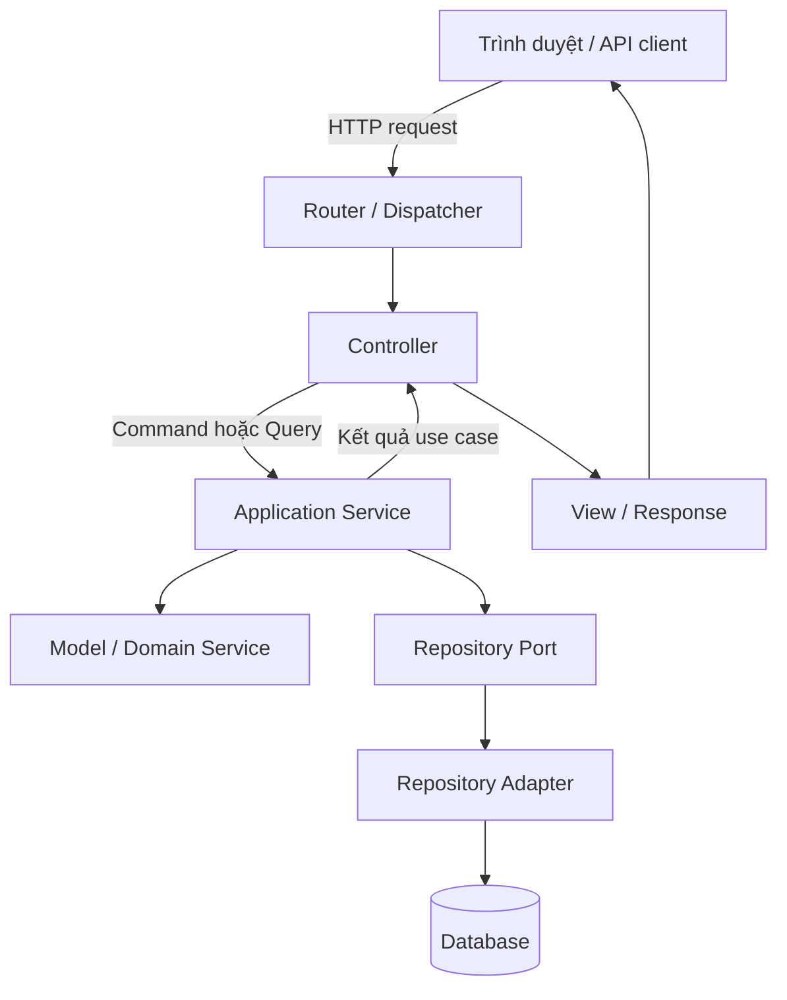
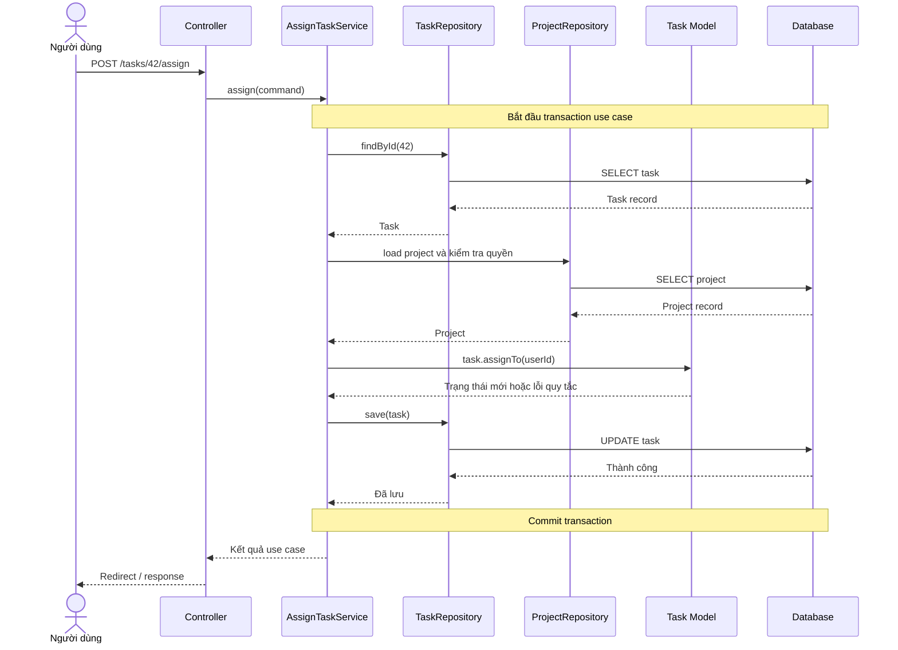

# Controller phối hợp ca sử dụng thay vì thao tác lưu trữ trực tiếp

Trong MVC, Controller tiếp nhận request và điều phối tương tác giữa giao diện web với phần nghiệp vụ. Khi xử lý một yêu cầu như tạo công việc, giao việc hoặc hoàn thành công việc, Controller nên gọi một ca sử dụng (use case) ở tầng ứng dụng. Ca sử dụng phối hợp Model, repository và các dịch vụ cần thiết để hoàn thành hành động. Controller sau đó chuyển kết quả thành View, redirect hoặc HTTP response.

Controller không nên tự viết SQL, gọi `EntityManager`, mở transaction hoặc trực tiếp điều khiển chi tiết ORM để thực hiện một chức năng. Những thao tác đó thuộc ranh giới lưu trữ và tầng ứng dụng. Khi Controller phụ thuộc trực tiếp vào cơ sở dữ liệu, mã HTTP bị gắn với cấu trúc persistence; quy tắc nghiệp vụ dễ bị lặp giữa nhiều endpoint và khó tái sử dụng từ API, tác vụ nền hoặc message consumer.

Ví dụ, khi người dùng gửi biểu mẫu tạo công việc, Controller đọc và kiểm tra dữ liệu request, chuyển nó thành `CreateTaskCommand`, rồi gọi `CreateTaskUseCase`. Dịch vụ ứng dụng tạo đối tượng miền, bảo vệ quy tắc, lưu qua `TaskRepository` trong transaction và trả mã định danh. Controller dùng kết quả đó để chuyển hướng đến trang chi tiết hoặc trả response JSON.

## Phân chia trách nhiệm trong luồng MVC

Một luồng MVC điển hình có thể phân chia như sau:

| Thành phần | Trách nhiệm | Ví dụ |
|---|---|---|
| Controller | Nhận request, chuyển đổi đầu vào, gọi use case, chọn response | Nhận `POST /tasks` và gọi `createTask.handle(command)` |
| Application service / use case | Điều phối một hành động ứng dụng, phối hợp Model và port, xác định transaction | Tạo công việc và lưu thay đổi |
| Model / domain service | Bảo vệ bất biến và quyết định nghiệp vụ | Từ chối hoàn thành công việc đã hủy |
| Repository port | Cung cấp hợp đồng đọc/ghi dữ liệu cho ứng dụng | `TaskRepository.save(task)` |
| Repository adapter | Thực hiện hợp đồng bằng JPA, JDBC hoặc công nghệ khác | `JpaTaskRepositoryAdapter` |
| View / response mapper | Trình bày kết quả hoặc chuyển dữ liệu thành response | Render `tasks/details` hoặc trả JSON |

Controller điều phối ở ranh giới giao tiếp; application service điều phối ở cấp use case. Hai loại điều phối này khác nhau. Controller biết HTTP, form và tên View; application service biết hành động ứng dụng, command, Model và các port cần thiết. Application service không nên biết URL, session HTTP hay template HTML.



Sơ đồ cho thấy Controller không cần biết adapter đang dùng JPA hay JDBC. Nó chỉ cần hợp đồng use case. Application service sử dụng repository port để đọc và ghi; adapter thực hiện chi tiết lưu trữ ở phía hạ tầng.

## Ca sử dụng là đơn vị điều phối nghiệp vụ

Ca sử dụng mô tả một mục tiêu mà người dùng hoặc hệ thống muốn đạt được, chẳng hạn:

- tạo một công việc;
- đổi tiêu đề công việc;
- giao công việc cho thành viên;
- đánh dấu công việc hoàn thành;
- tìm danh sách công việc mà người dùng có quyền xem.

Một use case có thể gồm nhiều bước: tải dữ liệu, kiểm tra quyền, đánh giá quy tắc, gọi hành vi Model, lưu kết quả và phát sinh tác động tiếp theo. Những bước này nên được gom ở tầng ứng dụng để mọi adapter đầu vào có thể sử dụng cùng một quy trình.

Ví dụ, `CreateTaskUseCase` có thể nhận một command thay vì nhận trực tiếp `HttpServletRequest` hoặc form object của Spring:

```java
public record CreateTaskCommand(
        String title,
        LocalDate dueDate,
        UserId actorId) {
}

public interface CreateTaskUseCase {
    TaskId handle(CreateTaskCommand command);
}
```

Command thể hiện dữ liệu mà use case cần. Nó không chứa những chi tiết chỉ có ý nghĩa với HTTP như header, cookie, session hoặc tên template. Nếu cùng use case được gọi từ REST API, giao diện HTML hoặc tác vụ nền, mỗi adapter có thể chuyển dữ liệu của mình thành command tương ứng.

### Application service thực hiện use case

```java
@Service
public class CreateTaskService implements CreateTaskUseCase {
    private final TaskRepository taskRepository;
    private final TaskIdGenerator idGenerator;

    public CreateTaskService(
            TaskRepository taskRepository,
            TaskIdGenerator idGenerator) {
        this.taskRepository = taskRepository;
        this.idGenerator = idGenerator;
    }

    @Override
    @Transactional
    public TaskId handle(CreateTaskCommand command) {
        Task task = Task.create(
                idGenerator.nextId(),
                command.title(),
                command.dueDate(),
                command.actorId());

        taskRepository.save(task);
        return task.id();
    }
}
```

Dịch vụ ứng dụng thực hiện trình tự của use case: tạo Model qua factory, sau đó lưu qua repository. `Task.create(...)` chịu trách nhiệm kiểm tra các bất biến thuộc về công việc. Ví dụ này giả định `TaskRepository`, `TaskIdGenerator`, `TaskId`, `UserId` và `Task` là các kiểu thuộc ứng dụng/miền đã được định nghĩa.

`@Transactional` đặt transaction quanh use case trong ứng dụng Spring. Khi phương thức kết thúc bình thường, transaction có thể commit theo cấu hình; khi có lỗi phù hợp, transaction được rollback theo quy tắc rollback của Spring. Với hệ thống khác, dùng cơ chế transaction tương ứng. Không nên đặt transaction trong Controller vì Controller không phải ranh giới nghiệp vụ ổn định và một use case có thể được gọi từ nhiều kênh.

## Repository cung cấp hợp đồng, adapter thực hiện lưu trữ

Application service cần đọc và ghi dữ liệu nhưng không cần biết câu lệnh SQL hoặc chi tiết ORM. Repository port cung cấp hợp đồng phù hợp với nhu cầu của use case:

```java
public interface TaskRepository {
    Optional<Task> findById(TaskId id);
    void save(Task task);
}
```

Adapter hạ tầng triển khai hợp đồng này:

```java
@Repository
public class JpaTaskRepositoryAdapter implements TaskRepository {
    private final SpringDataTaskRepository jpaRepository;
    private final TaskPersistenceMapper mapper;

    public JpaTaskRepositoryAdapter(
            SpringDataTaskRepository jpaRepository,
            TaskPersistenceMapper mapper) {
        this.jpaRepository = jpaRepository;
        this.mapper = mapper;
    }

    @Override
    public Optional<Task> findById(TaskId id) {
        return jpaRepository.findById(id.value())
                .map(mapper::toDomain);
    }

    @Override
    public void save(Task task) {
        jpaRepository.save(mapper.toEntity(task));
    }
}
```

Adapter chuyển giữa đối tượng miền `Task` và entity persistence. Nếu ứng dụng dùng chung một class cho domain entity và JPA entity thì mapper có thể không cần thiết; điều quan trọng là Controller không phụ thuộc trực tiếp vào chi tiết lưu trữ. Khi cần thay đổi công nghệ, test hoặc cấu trúc dữ liệu, ranh giới repository giúp giới hạn phần mã bị ảnh hưởng.

Không phải mọi truy vấn đều cần một repository method theo từng câu SQL. Truy vấn đọc phức tạp cho màn hình báo cáo có thể phù hợp với query service hoặc read model riêng. Dù cách tổ chức nào, Controller vẫn nên gọi hợp đồng ứng dụng thay vì tự tạo truy vấn.

## Controller gọi use case và chọn response

Controller nhận request, kiểm tra dữ liệu tại ranh giới web, tạo command và gọi use case. Sau đó Controller chọn cách phản hồi theo loại client.

### Ví dụ Controller render HTML

```java
@Controller
@RequestMapping("/tasks")
public class TaskController {
    private final CreateTaskUseCase createTask;

    public TaskController(CreateTaskUseCase createTask) {
        this.createTask = createTask;
    }

    @PostMapping
    public String create(
            @Valid @ModelAttribute("form") CreateTaskForm form,
            BindingResult errors,
            Principal principal,
            RedirectAttributes redirectAttributes) {

        if (errors.hasErrors()) {
            return "tasks/new";
        }

        TaskId id = createTask.handle(new CreateTaskCommand(
                form.getTitle(),
                form.getDueDate(),
                userIdFrom(principal)));

        redirectAttributes.addFlashAttribute(
                "message", "Đã tạo công việc");
        return "redirect:/tasks/" + id.value();
    }
}
```

Controller không biết cách tạo ID, cách lưu entity hoặc transaction được thực hiện ra sao. Nó chỉ chuyển form thành command, gọi use case và chuyển kết quả thành redirect. Dữ liệu người thực hiện được lấy từ principal đã xác thực; không tin `actorId` do client tự gửi.

### Ví dụ Controller trả JSON

Cùng use case có thể được gọi từ REST adapter:

```java
@RestController
@RequestMapping("/api/tasks")
public class TaskApiController {
    private final CreateTaskUseCase createTask;

    public TaskApiController(CreateTaskUseCase createTask) {
        this.createTask = createTask;
    }

    @PostMapping
    public ResponseEntity<CreateTaskResponse> create(
            @Valid @RequestBody CreateTaskRequest request,
            Principal principal) {

        TaskId id = createTask.handle(new CreateTaskCommand(
                request.title(),
                request.dueDate(),
                userIdFrom(principal)));

        URI location = URI.create("/api/tasks/" + id.value());
        return ResponseEntity.created(location)
                .body(new CreateTaskResponse(id.value()));
    }
}
```

Hai Controller có thể dùng cùng use case nhưng có request DTO và response khác nhau. Application service không phải viết lại chỉ vì giao diện HTML và API dùng giao thức trình bày khác nhau.

## Vì sao Controller không nên thao tác lưu trữ trực tiếp?

Để Controller gọi thẳng repository hoặc `EntityManager` có thể tiện trong một ví dụ rất nhỏ, nhưng khi ứng dụng phát triển, cách làm này thường tạo ra các vấn đề:

1. **Trộn giao tiếp với nghiệp vụ:** phương thức Controller vừa đọc HTTP, vừa quyết định hành động, vừa lưu dữ liệu.
2. **Lặp quy trình:** nhiều endpoint có thể lặp kiểm tra quyền, kiểm tra trạng thái, cập nhật và lưu theo những cách không nhất quán.
3. **Khó tái sử dụng:** tác vụ nền hoặc message consumer phải gọi lại Controller hoặc sao chép logic để thực hiện cùng use case.
4. **Khó kiểm thử:** muốn kiểm tra quy tắc phải khởi tạo tầng web hoặc mock quá nhiều chi tiết persistence trong Controller.
5. **Rò rỉ persistence:** Controller có thể trả entity ORM trực tiếp, làm lộ cấu trúc lưu trữ hoặc kích hoạt lazy loading trong lúc render.
6. **Khó quản lý transaction:** transaction bị gắn với handler cụ thể, trong khi use case có thể gồm nhiều bước cần nguyên tử.
7. **Khó thay đổi công nghệ:** lớp web phụ thuộc vào JPA, JDBC hoặc câu SQL cụ thể.

Tách use case không phải để tạo thêm lớp hình thức. Nó tạo một nơi ổn định để đặt trình tự nghiệp vụ và ranh giới transaction, giúp nhiều adapter dùng lại cùng hành động.

## Đọc dữ liệu cũng nên qua hợp đồng ứng dụng

Không chỉ thao tác ghi mới cần use case. Với request đọc, Controller có thể gọi query service hoặc application query handler để lấy dữ liệu dành cho View.

```java
public interface GetTaskDetailsQuery {
    TaskDetailsView handle(TaskId id, UserId viewerId);
}
```

```java
@Service
public class GetTaskDetailsService implements GetTaskDetailsQuery {
    private final TaskReadRepository taskReadRepository;

    public GetTaskDetailsService(TaskReadRepository taskReadRepository) {
        this.taskReadRepository = taskReadRepository;
    }

    @Override
    @Transactional(readOnly = true)
    public TaskDetailsView handle(TaskId id, UserId viewerId) {
        return taskReadRepository.findDetailsVisibleTo(id, viewerId)
                .orElseThrow(TaskNotFoundException::new);
    }
}
```

Query service có thể trả một projection hoặc View Model đã được chuẩn bị cho màn hình. `@Transactional(readOnly = true)` là gợi ý cho transaction chỉ đọc trong một số cấu hình; nó không tự động bảo đảm mọi cơ sở dữ liệu hoặc provider đều chặn ghi. Repository đọc có thể được tối ưu riêng mà không buộc phải tải toàn bộ entity graph.

Đối với ứng dụng nhỏ, Controller có thể gọi một service cung cấp cả query và command. Khi số lượng truy vấn, cách tối ưu và mô hình đọc khác biệt rõ, tách query service giúp giữ trách nhiệm dễ hiểu. Dù lựa chọn nào, Controller không nên tự nối SQL hoặc điều khiển ORM.

## Đặt transaction ở ranh giới use case

Một use case có thể cần nhiều thao tác lưu trữ phải thành công hoặc thất bại cùng nhau. Ví dụ, khi chuyển công việc sang dự án khác, hệ thống có thể cần tải công việc, tải dự án đích, kiểm tra quyền, cập nhật quan hệ và ghi sự kiện thay đổi.

Nếu mỗi repository tự mở và commit transaction riêng, một phần thay đổi có thể được lưu trong khi phần còn lại thất bại. Application service thường là nơi phù hợp để xác định transaction bao trùm toàn bộ use case.



Sơ đồ minh họa transaction bao quanh use case. Nếu Model từ chối hành động hoặc lưu trữ thất bại, transaction có thể rollback theo cấu hình. Chỉ trả kết quả thành công sau khi thao tác hoàn tất theo hợp đồng.

### Tác động bên ngoài và Outbox

Gửi email, gọi API đối tác hoặc publish message không tự động tham gia transaction cơ sở dữ liệu. Nếu service ghi dữ liệu rồi gửi email nhưng email thất bại, hai hệ thống có trạng thái khác nhau. Nếu gửi email trước rồi transaction rollback, người nhận lại nhận thông báo cho một thay đổi chưa được lưu.

Với sự kiện cần gửi đáng tin cậy, có thể ghi một bản ghi outbox trong cùng transaction với thay đổi nghiệp vụ. Một worker đọc outbox sau commit và gửi sự kiện, có retry và idempotency. Đây là một quyết định kiến trúc bổ sung; không cần dùng Outbox cho mọi thông báo không quan trọng.

## Phân biệt lỗi request và lỗi use case

Controller và application service có thể trả về những nhóm lỗi khác nhau:

| Nhóm lỗi | Ví dụ | Nơi thường phát hiện | Cách Controller phản hồi |
|---|---|---|---|
| Binding / validation | Ngày sai định dạng, tiêu đề rỗng | Binder hoặc validator tại ranh giới web | Trả lại form hoặc 400 |
| Không tìm thấy | Công việc không tồn tại | Query/use case hoặc repository result | 404 hoặc trang not found |
| Không có quyền | Người dùng không được sửa công việc | Security layer hoặc use case/policy | 403 hoặc response theo chính sách |
| Vi phạm quy tắc | Công việc đã hủy không thể hoàn thành | Model/domain service | Thông báo nghiệp vụ hoặc 409 |
| Lỗi hạ tầng | Database không khả dụng | Repository adapter | 500 hoặc lỗi dịch vụ phù hợp |

Không nên để Controller biết chi tiết exception của JPA hoặc SQL. Adapter lưu trữ có thể chuyển lỗi hạ tầng thành lỗi kỹ thuật của ứng dụng; cơ chế xử lý lỗi chung ánh xạ chúng thành response an toàn. Với ứng dụng lớn, `@ControllerAdvice` có thể tập trung xử lý exception và định dạng lỗi cho các Controller.

## Bảo mật khi điều phối use case

Tách application service không tự động bảo đảm bảo mật. Luồng xử lý vẫn cần:

- xác thực danh tính ở cơ chế bảo mật của ứng dụng;
- lấy ID người thực hiện từ ngữ cảnh đã xác thực, không tin ID hoặc role client gửi;
- kiểm tra quyền trên endpoint và đúng tài nguyên;
- giới hạn trường đầu vào bằng request DTO/form object;
- kiểm tra quy tắc trạng thái trong Model hoặc dịch vụ nghiệp vụ;
- dùng parameter binding trong truy vấn, không nối chuỗi SQL từ dữ liệu request;
- mã hóa đầu ra phù hợp khi render HTML;
- bảo vệ request thay đổi trạng thái khỏi CSRF khi dùng cookie/session.

View có thể ẩn nút thao tác để giao diện rõ ràng, nhưng Controller hoặc security layer và application service vẫn phải bảo vệ hành động ở phía máy chủ. Một request trực tiếp không đi qua View vẫn phải chịu cùng quy tắc.

## Kiểm thử theo từng ranh giới

Khi Controller chỉ điều phối, có thể kiểm thử từng phần tập trung hơn:

### Kiểm thử Controller

- route và phương thức HTTP được ánh xạ đúng;
- dữ liệu request được bind và validate đúng;
- Controller gọi use case với command/query phù hợp;
- response chọn đúng View, redirect, status code và DTO;
- lỗi use case được chuyển thành phản hồi theo hợp đồng.

Có thể dùng Spring MockMvc để gửi request mà không cần khởi chạy toàn bộ máy chủ web. Mock application service trong kiểm thử Controller để tập trung vào ranh giới HTTP.

### Kiểm thử application service

- use case tải đúng đối tượng qua repository;
- gọi đúng hành vi Model hoặc domain policy;
- lưu khi hành động thành công;
- không lưu khi quy tắc từ chối;
- transaction và lỗi được xử lý theo kỳ vọng.

Có thể dùng repository giả hoặc mock cho unit test điều phối. Những hành vi phụ thuộc transaction thực, khóa hoặc truy vấn nên có kiểm thử tích hợp riêng.

### Kiểm thử repository adapter

- mapping giữa entity persistence và Model đúng;
- truy vấn trả kết quả đúng;
- thay đổi được lưu và tải lại;
- transaction, constraint và locking hoạt động đúng trên database thử nghiệm.

Không cần kiểm tra câu SQL trong mọi bài kiểm thử Controller. Hãy kiểm tra hành vi qua hợp đồng; kiểm thử adapter tập trung vào việc triển khai hợp đồng lưu trữ.

## Những dấu hiệu Controller đang làm quá nhiều

- Controller có `EntityManager`, `JdbcTemplate` hoặc `DataSource` chỉ để thực hiện use case.
- Controller mở transaction hoặc tự quản lý commit/rollback.
- Một handler chứa nhiều truy vấn, nhiều bước nghiệp vụ và nhiều lần cập nhật entity.
- Nhiều Controller lặp lại cùng quy trình kiểm tra trạng thái và lưu dữ liệu.
- Controller trả entity ORM trực tiếp cho View hoặc JSON serializer.
- Tác vụ nền phải gọi Controller hoặc sao chép logic từ handler để thực hiện cùng hành động.
- Kiểm thử quy tắc cần khởi tạo cả MVC context dù không liên quan HTTP.

Khi gặp các dấu hiệu này, hãy xác định use case, chuyển trình tự nghiệp vụ sang application service, đặt hợp đồng lưu trữ ở repository và giữ chi tiết công nghệ trong adapter. Đừng tách lớp chỉ vì muốn có thêm interface; mỗi ranh giới cần thể hiện trách nhiệm hoặc phụ thuộc cần kiểm soát.

## Quy trình thiết kế một endpoint theo use case

Khi triển khai một chức năng MVC mới, có thể đi theo trình tự:

1. **Mô tả mục tiêu:** người dùng muốn đạt kết quả gì và điều kiện thành công là gì?
2. **Xác định hợp đồng HTTP:** route, method, request DTO, response hoặc View.
3. **Xác định command/query:** dữ liệu ứng dụng cần để thực hiện use case, tách khỏi chi tiết HTTP.
4. **Xác định quy tắc:** bất biến nào thuộc entity, chính sách nào cần domain service và quyền nào cần kiểm tra?
5. **Xác định dữ liệu:** repository hoặc query port nào cần thiết; dữ liệu đọc có thể dùng projection nào?
6. **Đặt transaction:** những thao tác nào cần cùng thành công hoặc rollback?
7. **Triển khai Controller:** bind, validate, tạo command/query, gọi use case và ánh xạ response.
8. **Kiểm thử theo ranh giới:** Controller, application service, Model và adapter lưu trữ có kiểm thử phù hợp.

## Câu hỏi tự đánh giá

Khi review một Controller, hãy tự hỏi:

1. Controller có chủ yếu tiếp nhận request và chọn response không?
2. Trình tự nghiệp vụ có được đặt trong một use case có thể gọi từ nhiều adapter không?
3. Controller có phụ thuộc trực tiếp vào SQL, ORM hoặc chi tiết database không?
4. Repository có cung cấp hợp đồng phù hợp với ứng dụng và che giấu implementation không?
5. Quy tắc trạng thái được bảo vệ trong Model hoặc domain service chưa?
6. Transaction có bao trùm đúng use case cần tính nguyên tử không?
7. Lỗi nghiệp vụ và lỗi hạ tầng có được ánh xạ thành response an toàn không?
8. Có thể kiểm thử Controller mà không cần kiểm thử lại toàn bộ nghiệp vụ và persistence không?

Controller nên là điểm vào của luồng web và người điều phối kết quả trở lại giao diện. Application service thực hiện use case, Model bảo vệ quy tắc, repository cung cấp hợp đồng lưu trữ và adapter triển khai hợp đồng đó bằng công nghệ cụ thể. Cách tổ chức này giữ MVC rõ trách nhiệm, giúp nghiệp vụ tái sử dụng được từ nhiều kênh và làm cho thay đổi ở giao diện hoặc persistence ít lan sang phần còn lại.
