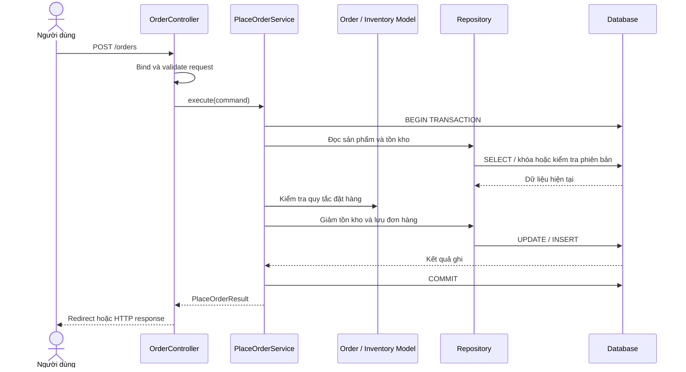
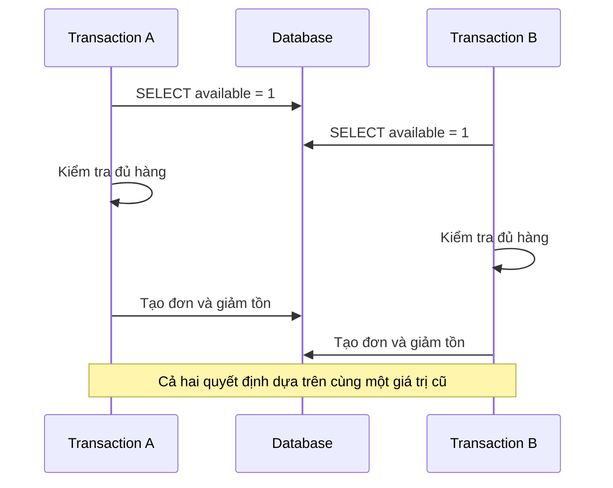
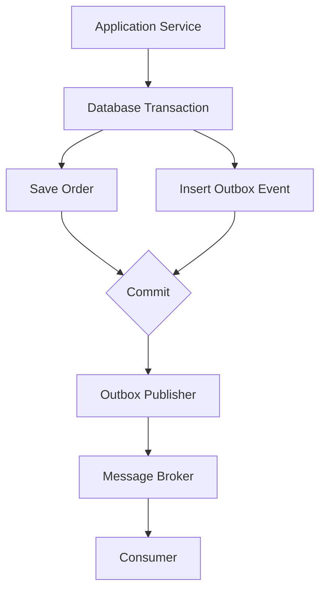

# Điều kiện nghiệp vụ cần được bảo vệ trong giao dịch

Một thao tác trong ứng dụng MVC thường gồm nhiều bước có liên quan: kiểm tra điều kiện nghiệp vụ, đọc dữ liệu, thay đổi trạng thái của một hoặc nhiều đối tượng, ghi kết quả và tạo phản hồi cho người dùng. Nếu một bước ghi thành công nhưng bước tiếp theo thất bại, dữ liệu có thể rơi vào trạng thái không hợp lệ. Ví dụ, hệ thống đã trừ tồn kho nhưng chưa tạo được đơn hàng; hoặc đã ghi nhận khoản chuyển tiền bên gửi nhưng chưa cộng tiền cho bên nhận.

**Giao dịch (transaction)** gom các thao tác lưu trữ có liên quan thành một đơn vị nhất quán. Khi giao dịch commit, các thay đổi được xác nhận; khi rollback, các thay đổi thuộc giao dịch được hoàn tác theo khả năng của hệ quản trị dữ liệu. Trong MVC, ranh giới giao dịch thường được đặt quanh một ca sử dụng ở tầng application service. Controller nhận request và gọi ca sử dụng; dịch vụ phối hợp Model nghiệp vụ cùng repository; tầng persistence thực hiện đọc/ghi trong cùng transaction.

Giao dịch giúp bảo vệ các điều kiện nghiệp vụ (business invariants), nhưng không tự động làm cho mọi quy tắc trở nên đúng. Ứng dụng vẫn phải xác định invariant, kiểm tra chúng tại đúng nơi, xử lý cạnh tranh giữa các request và dùng ràng buộc cơ sở dữ liệu để bảo vệ những điều kiện cần được giữ ngay cả khi có nhiều tiến trình cùng ghi.

## 1. Business invariant là gì?

Business invariant là điều kiện phải luôn đúng đối với trạng thái hợp lệ của miền nghiệp vụ. Invariant thường được diễn đạt như một mệnh đề có thể kiểm tra trước hoặc sau một thao tác.

Ví dụ trong hệ thống bán hàng:

- Số lượng đặt hàng phải lớn hơn 0.
- Tồn kho khả dụng không được âm.
- Một đơn hàng đã giao không thể chuyển sang trạng thái hủy.
- Mỗi mã đơn hàng phải duy nhất trong phạm vi được quy định.
- Tổng tiền của đơn hàng phải nhất quán với các dòng hàng và chính sách giá áp dụng.
- Một dòng hàng phải thuộc về đúng đơn hàng của nó.

Ví dụ trong hệ thống tài khoản:

- Số dư không được thấp hơn hạn mức thấu chi cho phép.
- Một giao dịch chuyển tiền phải ghi nợ và ghi có cùng một lượng tiền.
- Mã tham chiếu giao dịch không được xử lý lặp ngoài ý muốn.

Invariant khác với validation đơn thuần. “Tên người nhận không được để trống” thường là ràng buộc đầu vào. “Tổng tiền không được vượt hạn mức tín dụng của khách hàng” là điều kiện nghiệp vụ cần được kiểm tra trong ngữ cảnh dữ liệu và có thể bị ảnh hưởng bởi các request đồng thời.

### 1.1. Invariant thuộc về đâu?

Không phải mọi điều kiện đều được đặt ở cùng một tầng:

| Loại điều kiện | Nơi thường kiểm tra | Ví dụ |
|---|---|---|
| Cấu trúc request | Controller boundary / validation framework | Trường bắt buộc, kiểu dữ liệu, độ dài chuỗi |
| Quy tắc của một đối tượng miền | Entity hoặc Value Object | Số lượng dương, chuyển trạng thái hợp lệ |
| Quy tắc của ca sử dụng | Application Service | Khách hàng có thể đặt hàng, phối hợp nhiều aggregate |
| Tính duy nhất và tham chiếu dữ liệu | Database constraint và repository | Unique key, foreign key, check constraint |
| Điều kiện phụ thuộc trạng thái đồng thời | Transaction, khóa hoặc cập nhật có điều kiện | Không bán vượt tồn kho khi nhiều request cùng đặt |

Controller có thể kiểm tra dữ liệu đầu vào để phản hồi sớm, nhưng không nên là nơi duy nhất bảo vệ invariant. Cùng một ca sử dụng có thể được gọi từ API khác, tác vụ nền hoặc một adapter khác. Quy tắc nghiệp vụ quan trọng phải được thực thi ở tầng ứng dụng hoặc miền, còn database constraint bảo vệ những điều kiện mà dữ liệu lưu trữ phải luôn tuân thủ.

### 1.2. Invariant đơn đối tượng và invariant nhiều đối tượng

Một invariant đơn giản có thể được bảo vệ bên trong một đối tượng miền. Ví dụ, `OrderLine` không chấp nhận số lượng âm. Một invariant liên quan nhiều đối tượng hoặc nhiều bản ghi cần phối hợp ở cấp aggregate, application service và transaction.

Ví dụ, việc đặt hàng cần kiểm tra tồn kho, tạo đơn và ghi các dòng hàng. Chỉ kiểm tra tồn kho bằng một câu `SELECT` rồi sau đó mới `UPDATE` có thể không đủ khi hai request chạy đồng thời. Cả quy tắc nghiệp vụ lẫn cách ghi dữ liệu cần được thiết kế để không xảy ra bán vượt số lượng còn lại.

## 2. Transaction và các thuộc tính ACID

Transaction là một đơn vị công việc trên dữ liệu. Một transaction thường được mô tả bằng bốn thuộc tính ACID:

| Thuộc tính | Ý nghĩa | Liên hệ với nghiệp vụ |
|---|---|---|
| Atomicity (tính nguyên tử) | Các thay đổi trong giao dịch cùng được xác nhận hoặc cùng bị hoàn tác | Không tạo đơn nửa chừng hoặc chỉ ghi một phía của giao dịch chuyển tiền |
| Consistency (tính nhất quán) | Giao dịch đưa dữ liệu từ một trạng thái hợp lệ sang trạng thái hợp lệ khác theo các ràng buộc đã định nghĩa | Tồn kho, số dư và quan hệ dữ liệu vẫn thỏa invariant |
| Isolation (tính cô lập) | Các giao dịch đồng thời không được làm lộ hoặc tạo ra những kết quả trái với mức cô lập đã chọn | Hai request không cùng bán một đơn vị tồn kho cuối cùng |
| Durability (tính bền vững) | Sau khi commit thành công, dữ liệu được lưu bền vững theo cam kết của hệ quản trị | Đơn hàng đã xác nhận không biến mất sau sự cố thông thường |

ACID không có nghĩa là database tự hiểu quy tắc nghiệp vụ. Hệ quản trị chỉ có thể bảo vệ những điều kiện được thể hiện bằng transaction, isolation, constraint hoặc cơ chế lưu trữ phù hợp. Nếu ứng dụng không định nghĩa invariant hoặc dùng transaction sai phạm vi, dữ liệu vẫn có thể sai dù từng câu SQL đều chạy thành công.

## 3. Đặt transaction boundary quanh ca sử dụng

Trong MVC, Controller nên tập trung nhận request, xác thực đầu vào ở ranh giới, lấy danh tính người dùng và gọi application service. Application service điều phối toàn bộ công việc cần được thực hiện như một đơn vị nghiệp vụ.

Ví dụ luồng tạo đơn hàng:



Ranh giới transaction bao quanh các thay đổi cần cùng thành công: cập nhật tồn kho và lưu đơn hàng. Nếu lưu đơn hàng thất bại sau khi cập nhật tồn kho, transaction rollback để không giữ lại một phần thay đổi.

### 3.1. Vì sao không đặt transaction trong Controller?

Controller là adapter HTTP. Nếu transaction bắt đầu và kết thúc ở Controller, ranh giới dữ liệu bị gắn với một giao thức cụ thể. Tác vụ nền hoặc một adapter khác có thể gọi cùng nghiệp vụ mà không đi qua Controller và vô tình bỏ qua transaction.

Đặt transaction ở application service giúp ca sử dụng sở hữu ranh giới nhất quán. Các repository được gọi bên trong thường tham gia transaction đang hoạt động thông qua transaction manager. Controller chỉ nhận kết quả khi dịch vụ hoàn tất hoặc nhận lỗi được ánh xạ ở ranh giới web.

### 3.2. Một transaction nên bao phủ việc gì?

Một transaction nên đủ lớn để giữ invariant của ca sử dụng, nhưng không nên bao phủ mọi hoạt động của request một cách vô hạn.

Thường nên nằm trong transaction:

- Đọc trạng thái cần thiết để quyết định thay đổi.
- Kiểm tra hoặc áp dụng hành vi nghiệp vụ.
- Ghi tất cả bản ghi cần thay đổi để hoàn tất ca sử dụng.
- Ghi outbox record nếu cần phát sự kiện sau commit.

Thường không nên giữ transaction mở trong lúc:

- Người dùng đang điền biểu mẫu hoặc chờ xác nhận.
- Gọi một dịch vụ ngoài có độ trễ không kiểm soát.
- Gửi email hoặc gọi API thanh toán qua mạng trong thời gian dài.
- Chờ người dùng tương tác tiếp theo.

Transaction dài giữ khóa lâu, làm tăng tranh chấp và nguy cơ timeout. Hãy tách công việc bên ngoài thành bước sau commit hoặc quy trình nhiều bước có trạng thái rõ ràng.

## 4. Ví dụ bảo vệ invariant bằng Spring `@Transactional`

Giả sử một đơn hàng cần giảm tồn kho và được lưu cùng các dòng hàng. Application service điều phối thao tác trong một transaction:

```java
@Service
public class PlaceOrderService {
    private final ProductRepository products;
    private final OrderRepository orders;

    public PlaceOrderService(
            ProductRepository products,
            OrderRepository orders) {
        this.products = products;
        this.orders = orders;
    }

    @Transactional
    public PlaceOrderResult execute(PlaceOrderCommand command) {
        Order order = Order.create(command.customerId());

        for (RequestedOrderLine requested : command.lines()) {
            Product product = products.findById(requested.productId())
                .orElseThrow(ProductNotFoundException::new);

            product.reserve(requested.quantity());
            order.addLine(product, requested.quantity());
        }

        products.saveAllForOrder(order.getProducts());
        orders.save(order);

        return new PlaceOrderResult(order.getId(), order.getStatus());
    }
}
```

Đây là ví dụ khái niệm; tên repository và cách lưu sản phẩm phụ thuộc mô hình persistence của dự án. Điều quan trọng là các lần ghi tồn kho và đơn hàng tham gia cùng transaction. Nếu một thao tác ghi ném lỗi khiến transaction rollback, các thay đổi trước đó trong cùng transaction cũng được hoàn tác.

### 4.1. Hành vi rollback cần được hiểu rõ

Với cấu hình mặc định phổ biến của Spring, `@Transactional` rollback khi phương thức kết thúc bằng `RuntimeException` hoặc `Error`. Checked exception không tự động gây rollback theo mặc định. Nếu nghiệp vụ dùng checked exception để báo một lỗi cần hoàn tác, cần khai báo chính sách rõ ràng, ví dụ:

```java
@Transactional(rollbackFor = OrderRuleViolationException.class)
public PlaceOrderResult execute(PlaceOrderCommand command)
        throws OrderRuleViolationException {
    // Thực hiện ca sử dụng.
}
```

Một phương thức bắt exception rồi trả về kết quả thất bại bình thường có thể khiến transaction commit nếu không đánh dấu rollback. Vì vậy, không nên nuốt lỗi sau khi đã ghi một phần dữ liệu mà không có chính sách rõ ràng. Có thể ném exception phù hợp, đánh dấu rollback-only hoặc dùng cơ chế kết quả kết hợp với rollback được cấu hình có chủ đích.

### 4.2. `@Transactional` và proxy

Trong cấu hình proxy-based phổ biến của Spring, lời gọi đi qua proxy mới được áp dụng transaction advice. Gọi một phương thức `@Transactional` khác bằng `this.someMethod()` trong cùng đối tượng thường không đi qua proxy, nên annotation ở phương thức được gọi có thể không có hiệu lực như mong đợi.

Đặt transaction boundary ở phương thức public của application service được gọi từ bean khác là cách dễ hiểu. Cần lưu ý transaction manager, propagation và cấu hình proxy của dự án; không nên chỉ nhìn thấy annotation rồi mặc định mọi đường gọi đều có transaction.

### 4.3. Read-only transaction

Các use case chỉ đọc có thể dùng `@Transactional(readOnly = true)` để thể hiện ý định và cho phép một số tối ưu tùy persistence provider hoặc transaction manager. Đây thường là hint, không phải cơ chế bảo mật hay bảo đảm tuyệt đối rằng không thể ghi dữ liệu. Nếu một truy vấn cần consistency snapshot cụ thể, vẫn phải chọn isolation phù hợp với hệ quản trị và nhu cầu nghiệp vụ.

## 5. Bảo vệ invariant bằng ràng buộc cơ sở dữ liệu

Kiểm tra ở Java là cần thiết nhưng chưa đủ cho mọi invariant. Nhiều request hoặc tiến trình có thể cùng truy cập dữ liệu. Database constraint là lớp bảo vệ cuối cùng đối với các điều kiện có thể biểu diễn ở tầng lưu trữ.

Ví dụ:

```sql
CREATE TABLE inventory (
    product_id BIGINT PRIMARY KEY,
    available_quantity INTEGER NOT NULL,
    CONSTRAINT ck_inventory_non_negative
        CHECK (available_quantity >= 0)
);

CREATE TABLE orders (
    id BIGINT PRIMARY KEY,
    order_number VARCHAR(40) NOT NULL,
    customer_id BIGINT NOT NULL,
    CONSTRAINT uq_orders_order_number UNIQUE (order_number)
);

CREATE TABLE order_lines (
    id BIGINT PRIMARY KEY,
    order_id BIGINT NOT NULL REFERENCES orders(id),
    product_id BIGINT NOT NULL,
    quantity INTEGER NOT NULL,
    CONSTRAINT ck_order_line_quantity CHECK (quantity > 0)
);
```

Các constraint này bảo vệ số lượng tồn kho không âm, mã đơn duy nhất và số lượng dòng hàng dương ngay cả khi có đường ghi khác ứng dụng Java. Cú pháp và khả năng constraint có thể khác giữa các hệ quản trị; cần kiểm tra đặc tính của database được dùng.

### 5.1. Kiểm tra trước và constraint khi ghi

Có thể kiểm tra trước để tạo thông báo thân thiện, nhưng vẫn cần constraint để xử lý cạnh tranh:

1. Đọc dữ liệu và kiểm tra điều kiện để phản hồi sớm.
2. Thực hiện cập nhật trong transaction với khóa hoặc điều kiện nguyên tử.
3. Database constraint từ chối trạng thái không hợp lệ nếu có đường ghi cạnh tranh.
4. Chuyển lỗi constraint thành lỗi ứng dụng phù hợp, không trả nguyên exception SQL.

Không nên dựa vào một lần `SELECT` đơn lẻ để bảo đảm tính duy nhất. Hai transaction có thể cùng thấy chưa tồn tại rồi cùng chèn. Unique constraint mới là cơ chế quyết định cuối cùng; ứng dụng ánh xạ vi phạm thành lỗi nghiệp vụ như `DuplicateOrderReference`.

## 6. Cạnh tranh giữa các transaction

Transaction không đồng nghĩa mọi giao dịch chạy tuần tự. Nhiều request có thể đọc và ghi cùng một bản ghi trong cùng khoảng thời gian. Nếu không chọn cơ chế đồng thời phù hợp, invariant vẫn có thể bị phá vỡ.

### 6.1. Race condition khi kiểm tra tồn kho

Giả sử một sản phẩm chỉ còn 1 đơn vị. Hai request cùng đọc `available_quantity = 1`, cả hai đều thấy đủ hàng và đều tạo đơn. Nếu mỗi request sau đó giảm số lượng theo cách không an toàn, hệ thống có thể bán vượt tồn kho hoặc ghi đè cập nhật của nhau.

Luồng nguy hiểm:



Giải pháp cần bảo đảm thao tác kiểm tra và cập nhật được phối hợp nguyên tử hoặc được bảo vệ bằng khóa/phiên bản.

### 6.2. Cập nhật có điều kiện (atomic conditional update)

Một cách hiệu quả cho tồn kho là để database thực hiện điều kiện và cập nhật trong cùng câu lệnh:

```sql
UPDATE inventory
SET available_quantity = available_quantity - :quantity
WHERE product_id = :productId
  AND available_quantity >= :quantity;
```

Sau câu lệnh, kiểm tra số dòng được cập nhật:

- Một dòng được cập nhật: giữ chỗ thành công.
- Không có dòng nào được cập nhật: sản phẩm không tồn tại hoặc không đủ tồn kho tại thời điểm cập nhật.

Việc phân biệt hai trường hợp có thể cần truy vấn bổ sung hoặc dùng câu lệnh trả dữ liệu phù hợp với hệ quản trị. Nhưng không được bỏ qua số dòng cập nhật. Đặt thao tác này cùng việc tạo đơn hàng trong một transaction để nếu bước tạo đơn thất bại, phần giảm tồn cũng rollback.

### 6.3. Optimistic locking

Optimistic locking phù hợp khi xung đột không quá thường xuyên. Bản ghi có một trường version. Khi đọc, ứng dụng lấy version hiện tại; khi ghi, database chỉ cập nhật nếu version vẫn bằng giá trị đã đọc. Nếu có transaction khác ghi trước, update không tác động dòng nào và ORM có thể phát hiện optimistic lock conflict.

Ví dụ với JPA:

```java
@Entity
public class InventoryEntity {
    @Id
    private Long productId;

    private int availableQuantity;

    @Version
    private long version;
}
```

Khi cập nhật cùng một bản ghi, JPA dùng version để phát hiện xung đột. Ứng dụng có thể tải lại, thử lại có giới hạn hoặc trả lỗi xung đột để người dùng quyết định. Không nên tự động retry vô hạn vì có thể gây tải lớn và che giấu xung đột liên tục.

### 6.4. Pessimistic locking

Pessimistic locking khóa bản ghi khi transaction đọc hoặc cập nhật để transaction khác phải chờ hoặc bị từ chối tùy loại khóa và database. Trong JPA có thể dùng `LockModeType.PESSIMISTIC_WRITE` cho truy vấn repository.

Cách này phù hợp khi xung đột thường xuyên và việc chờ khóa có thể chấp nhận được. Đổi lại, khóa lâu làm giảm throughput và có thể gây deadlock. Cần truy cập các bản ghi theo thứ tự nhất quán, giữ transaction ngắn và xử lý timeout/deadlock rõ ràng.

### 6.5. Chọn cơ chế theo invariant

| Cơ chế | Phù hợp khi | Lưu ý |
|---|---|---|
| Check constraint / unique / foreign key | Điều kiện có thể biểu diễn trên dữ liệu lưu trữ | Không thay thế toàn bộ quy tắc nghiệp vụ |
| Atomic conditional update | Một điều kiện và cập nhật trên cùng bản ghi | Kiểm tra số dòng cập nhật |
| Optimistic locking | Xung đột hiếm, có thể phát hiện và xử lý lại | Cần chính sách retry hoặc trả conflict |
| Pessimistic locking | Xung đột thường xuyên, cần tuần tự hóa thao tác | Cẩn thận deadlock và thời gian giữ khóa |
| Isolation level cao hơn | Quy tắc phụ thuộc nhiều lần đọc hoặc tập bản ghi | Chi phí và hành vi tùy database; có thể phát sinh serialization failure |

Không có một cơ chế tối ưu cho mọi trường hợp. Chọn theo cách invariant bị ảnh hưởng, tần suất cạnh tranh, khả năng retry và yêu cầu hiệu năng.

## 7. Isolation level và hiện tượng đồng thời

Isolation level quy định mức độ một transaction quan sát được thay đổi của transaction khác. Các hệ quản trị có thể triển khai khác nhau, đặc biệt với `READ COMMITTED`, `REPEATABLE READ` và `SERIALIZABLE`.

Một số hiện tượng cần biết:

- **Dirty read:** đọc dữ liệu chưa commit từ transaction khác.
- **Non-repeatable read:** cùng một hàng được đọc hai lần trong một transaction nhưng giá trị thay đổi do transaction khác commit.
- **Phantom read:** truy vấn cùng điều kiện nhiều lần nhưng tập hàng kết quả thay đổi do transaction khác thêm hoặc xóa hàng phù hợp.
- **Lost update:** hai transaction cùng cập nhật dựa trên giá trị cũ khiến một cập nhật bị ghi đè.

Chọn isolation level cao hơn có thể giảm một số hiện tượng nhưng tăng khóa, retry hoặc chi phí. `SERIALIZABLE` thường cung cấp mức đảm bảo mạnh hơn, nhưng ứng dụng vẫn phải xử lý trường hợp transaction bị từ chối hoặc cần thử lại. Đừng giả định tên isolation level có hành vi giống hệt nhau trên mọi database.

### 7.1. Đọc nhất quán và invariant nhiều bản ghi

Giả sử một khách hàng có hạn mức tín dụng 10 triệu và đang có hai đơn hàng mới cùng yêu cầu sử dụng 7 triệu. Nếu hai transaction cùng đọc tổng dư nợ 0, cả hai có thể cho rằng còn đủ hạn mức. Đây là invariant phụ thuộc tổng hợp nhiều bản ghi.

Một số cách xử lý:

- Lưu hạn mức đã sử dụng trên một bản ghi tài khoản và cập nhật có điều kiện nguyên tử.
- Khóa bản ghi hạn mức trước khi kiểm tra và ghi nhận khoản mới.
- Dùng isolation phù hợp và xử lý serialization failure.
- Thiết kế aggregate hoặc mô hình dữ liệu để invariant có thể được bảo vệ ở một ranh giới nhất quán rõ ràng.

Chỉ tăng isolation level mà không hiểu truy vấn và database chưa chắc đã đủ. Cần xác minh kịch bản đồng thời bằng kiểm thử tích hợp với hệ quản trị thực tế.

## 8. Transaction và các thao tác bên ngoài database

Một database transaction chỉ kiểm soát những tài nguyên tham gia cùng transaction manager. Nó không tự rollback được email đã gửi, HTTP request đã gửi sang dịch vụ thanh toán hoặc thông báo đã phát ra message broker bên ngoài.

Ví dụ không an toàn:

```java
@Transactional
public void placeOrder(PlaceOrderCommand command) {
    Order order = createAndSaveOrder(command);
    paymentGateway.charge(order.total());
    emailSender.sendConfirmation(order);
}
```

Nếu thanh toán thành công nhưng database commit thất bại, hệ thống có thể đã thu tiền nhưng không có đơn hàng được lưu. Nếu email gửi đi rồi transaction rollback, người dùng nhận xác nhận cho một đơn không tồn tại. Annotation transaction không thể hoàn tác các side effect bên ngoài đó.

### 8.1. Tách side effect sau commit

Với thao tác có thể thực hiện sau khi database commit, có thể phát sự kiện sau commit hoặc dùng callback phù hợp. Cách này tránh gửi thông báo thành công trước khi dữ liệu được xác nhận. Tuy nhiên, callback trong bộ nhớ có thể mất nếu tiến trình dừng ngay sau commit nhưng trước khi gửi sự kiện.

### 8.2. Transactional Outbox

Transactional Outbox giải quyết khoảng trống giữa commit dữ liệu và phát sự kiện. Trong cùng database transaction, ứng dụng ghi thay đổi nghiệp vụ và một outbox record. Một tiến trình riêng đọc outbox và gửi message đến broker hoặc dịch vụ ngoài.



Vì order và outbox event được commit cùng nhau, không có trường hợp đơn hàng commit mà outbox record không được lưu do lỗi giữa hai thao tác trong cùng database transaction. Publisher có thể gửi lặp khi không biết broker đã nhận hay chưa, vì vậy consumer cần xử lý idempotent hoặc deduplicate theo event ID.

Outbox không biến broker thành một phần của database transaction. Nó cung cấp cơ chế phát lại đáng tin cậy theo mô hình eventual delivery; cần có retry, theo dõi outbox tồn đọng và xử lý bản ghi lỗi.

### 8.3. Saga cho quy trình nhiều dịch vụ

Nếu một ca sử dụng đi qua nhiều dịch vụ hoặc nhiều database độc lập, không thể mặc định có một transaction ACID duy nhất. Có thể dùng Saga: quy trình gồm các bước cục bộ đã commit riêng, kèm hành động bù trừ (compensation) khi bước sau thất bại.

Ví dụ đặt hàng:

1. Tạo đơn ở trạng thái `PENDING`.
2. Giữ tồn kho.
3. Yêu cầu dịch vụ thanh toán thu tiền.
4. Nếu mọi bước thành công, chuyển đơn sang `CONFIRMED`.
5. Nếu thanh toán thất bại, giải phóng tồn kho và chuyển đơn sang `PAYMENT_FAILED`.

Hành động bù trừ không phải rollback vật lý như database transaction. Nó là một thao tác nghiệp vụ mới để đưa hệ thống về trạng thái chấp nhận được. Các bước cần idempotency, timeout, retry có giới hạn, lưu trạng thái quy trình và xử lý trường hợp kết quả không rõ ràng.

## 9. Idempotency và xử lý request lặp

Client có thể gửi lại request do timeout, người dùng bấm nút nhiều lần hoặc gateway retry. Với thao tác tạo đơn, thanh toán hay chuyển tiền, xử lý lặp có thể tạo tác động trùng.

Idempotency key là một mã duy nhất do client tạo cho một ý định thao tác. Server lưu key cùng kết quả hoặc trạng thái xử lý trong database. Khi nhận lại cùng key:

- Nếu thao tác đã hoàn tất, trả lại kết quả đã lưu theo hợp đồng.
- Nếu thao tác đang xử lý, trả trạng thái phù hợp hoặc cho client thử kiểm tra lại.
- Nếu key được dùng với payload khác, từ chối vì cùng một key không được đại diện cho hai ý định khác nhau.

Việc lưu idempotency record và thay đổi nghiệp vụ cần có transaction hoặc cơ chế đồng bộ phù hợp để hai request cùng key không đồng thời tạo hai tác động. Unique constraint trên key là một phần quan trọng của bảo vệ này.

Idempotency không thay thế invariant. Nó giảm tác động do request lặp; database constraint, transaction và quy tắc miền vẫn phải bảo vệ trạng thái hợp lệ.

## 10. Tích hợp Controller, service và repository

Một cấu trúc trách nhiệm điển hình:

| Thành phần | Vai trò trong transaction |
|---|---|
| Controller | Nhận request, validate cấu trúc, lấy principal và gọi use case |
| Application Service | Xác định transaction boundary và điều phối ca sử dụng |
| Domain Model | Bảo vệ invariant và thực hiện chuyển đổi trạng thái hợp lệ |
| Repository Port | Cung cấp hợp đồng đọc/ghi theo ngôn ngữ ứng dụng hoặc miền |
| Persistence Adapter | Thực hiện SQL/ORM, khóa, mapping và tham gia transaction manager |
| Database | Thực thi constraint, isolation và commit/rollback |

Controller không nên tự mở connection hoặc commit. Repository không nên tự tạo transaction độc lập cho từng câu ghi nếu ca sử dụng cần nhiều thao tác cùng nguyên tử. Application service xác định đơn vị nghiệp vụ; repository tham gia transaction hiện tại theo cấu hình.

### 10.1. Tránh transaction bị chia nhỏ ngoài ý muốn

Nếu mỗi repository method mở và commit transaction riêng, một use case gồm ba lần ghi có thể để lại hai lần ghi đầu dù lần thứ ba thất bại. Cần hiểu propagation của transaction manager. Với Spring, propagation mặc định `REQUIRED` thường tham gia transaction đang có hoặc tạo mới nếu chưa có. Các propagation khác như `REQUIRES_NEW` có ý nghĩa riêng và có thể làm một phần dữ liệu commit độc lập; chỉ dùng khi nghiệp vụ yêu cầu rõ ràng.

Không nên dùng `REQUIRES_NEW` chỉ để “chắc chắn lưu được log” nếu điều đó làm mất tính nguyên tử của nghiệp vụ. Nếu cần audit bền vững, hãy thiết kế ranh giới và chính sách lưu audit phù hợp, có thể dùng outbox hoặc cơ chế audit transaction-aware.

### 10.2. Transaction và nhiều repository

Một application service có thể gọi nhiều repository trong cùng transaction nếu chúng tham gia cùng transaction manager và cùng nguồn dữ liệu được hỗ trợ. Nếu mỗi repository dùng một database hoặc transaction manager khác nhau, `@Transactional` thông thường không tự tạo atomic commit xuyên tất cả nguồn. Khi đó cần kiến trúc distributed transaction được hỗ trợ hoặc quy trình Saga/outbox phù hợp.

## 11. Kiểm thử invariant và transaction

Kiểm thử transaction cần xác minh trạng thái lưu trữ sau các đường thành công, thất bại và cạnh tranh. Unit test thuần cho Model có thể kiểm tra quy tắc, nhưng không chứng minh transaction hoặc isolation của database hoạt động như mong muốn.

| Phạm vi | Nội dung cần kiểm tra | Ví dụ |
|---|---|---|
| Unit test Model | Invariant đơn đối tượng | Không cho phép số lượng dòng hàng bằng 0 |
| Unit test application service | Điều phối và phản ứng với kết quả repository | Không lưu đơn khi sản phẩm không đủ điều kiện |
| Integration test transaction | Commit/rollback của nhiều thao tác | Lỗi khi lưu đơn khiến thay đổi tồn kho được rollback |
| Database constraint test | Constraint từ chối trạng thái không hợp lệ | Tồn kho âm hoặc mã đơn trùng bị từ chối |
| Concurrency test | Hai request cạnh tranh không phá invariant | Hai khách cùng đặt đơn vị hàng cuối cùng, chỉ một request thành công |
| Outbox/Saga test | Phát lại, retry và compensation | Consumer xử lý event trùng mà không tạo tác động lặp |

### 11.1. Kiểm thử rollback

Một integration test có thể cố ý làm bước lưu đơn hàng thất bại sau khi tồn kho đã được cập nhật, sau đó đọc lại database trong transaction mới để xác nhận tồn kho không bị giảm. Cần bảo đảm test thực sự đi qua transaction manager và database được dùng trong môi trường triển khai; test chỉ mock repository không kiểm tra được rollback thật.

### 11.2. Kiểm thử cạnh tranh

Để kiểm tra race condition, chạy hai transaction gần như đồng thời với cùng một dữ liệu ban đầu. Đồng bộ hai luồng tại điểm trước khi cập nhật giúp tái hiện tình huống cạnh tranh. Sau khi cả hai kết thúc, xác minh invariant: số tồn không âm và tổng số lượng đơn đã giữ không vượt số lượng ban đầu.

Các kiểm thử concurrency có thể nhạy với lịch chạy. Dùng barrier/latch và điều kiện đồng bộ rõ ràng thay vì dựa vào `sleep`. Chạy với cùng loại database hoặc Testcontainers tương ứng để tránh khác biệt giữa database kiểm thử và production.

## 12. Những sai lầm thường gặp

**Chỉ kiểm tra invariant trong Controller.** Request từ adapter khác có thể bỏ qua Controller. Hãy bảo vệ quy tắc ở application/domain và dùng constraint phù hợp.

**Đặt transaction quanh từng repository call.** Các bước của một ca sử dụng có thể commit riêng và để lại dữ liệu dở dang. Hãy đặt boundary quanh use case cần nguyên tử.

**Cho rằng `@Transactional` tự bảo vệ khỏi mọi race condition.** Isolation mặc định có thể không đủ cho invariant cụ thể. Hãy chọn conditional update, optimistic/pessimistic locking, constraint hoặc isolation phù hợp.

**Bắt exception rồi trả kết quả thất bại bình thường.** Transaction có thể commit các thay đổi đã thực hiện nếu không có rollback marker. Cần xác định rõ rollback policy.

**Gọi dịch vụ ngoài trong transaction dài.** Network call có thể chậm hoặc không thể rollback, làm khóa bị giữ lâu. Dùng outbox, after-commit hoặc Saga khi phù hợp.

**Dùng `readOnly = true` như một cơ chế cấm ghi.** Đây thường là hint tối ưu, không phải ranh giới bảo mật. Không dựa vào nó để bảo vệ dữ liệu.

**Dùng khóa mà không xét deadlock.** Khóa nhiều bản ghi theo thứ tự khác nhau có thể tạo deadlock. Giữ transaction ngắn, truy cập theo thứ tự nhất quán và xử lý lỗi deadlock/timeout.

**Không xử lý request lặp.** Client retry có thể tạo đơn hoặc thu tiền nhiều lần. Dùng idempotency key và unique constraint cho các thao tác cần chống lặp.

**Coi outbox hoặc Saga là transaction ACID xuyên hệ thống.** Chúng cung cấp giao nhận và điều phối theo mô hình phân tán; cần chấp nhận eventual consistency, retry và xử lý bù trừ.

## 13. Checklist thiết kế transaction cho một use case

Khi thiết kế một thao tác ghi dữ liệu, hãy tự hỏi:

1. Invariant nào phải đúng trước và sau thao tác?
2. Điều kiện nào thuộc Model nghiệp vụ, application service và database constraint?
3. Những lần ghi nào phải cùng commit hoặc cùng rollback?
4. Transaction boundary có nằm quanh ca sử dụng ở tầng application service không?
5. Mọi repository cần thiết có tham gia cùng transaction manager không?
6. Cơ chế rollback có bao phủ các loại exception mà nghiệp vụ sử dụng không?
7. Có request đồng thời nào có thể đọc cùng trạng thái cũ và cùng quyết định ghi không?
8. Nên dùng conditional update, optimistic lock, pessimistic lock hay isolation level nào?
9. Có constraint database bảo vệ unique, foreign key, check và quan hệ bắt buộc không?
10. Có side effect ngoài database cần chuyển sang after-commit, outbox hoặc Saga không?
11. Client retry có thể tạo tác động lặp không; có cần idempotency key không?
12. Integration và concurrency test có chứng minh invariant được giữ sau commit/rollback không?

## Kết luận

Điều kiện nghiệp vụ chỉ được bảo vệ đáng tin cậy khi được đặt đúng ranh giới và kiểm tra trong cả tình huống bình thường lẫn cạnh tranh. Application service xác định transaction boundary cho ca sử dụng; Model nghiệp vụ bảo vệ quy tắc và trạng thái; repository cùng persistence adapter thực hiện thay đổi; database constraint, isolation và locking bảo vệ dữ liệu khi nhiều transaction cùng hoạt động. Các side effect ngoài database cần được xử lý bằng cơ chế phù hợp như outbox hoặc Saga, còn request lặp cần idempotency. Trong MVC, Controller chỉ tiếp nhận và điều phối request; việc bảo vệ invariant thuộc về tầng ứng dụng, miền và persistence phối hợp với nhau.
