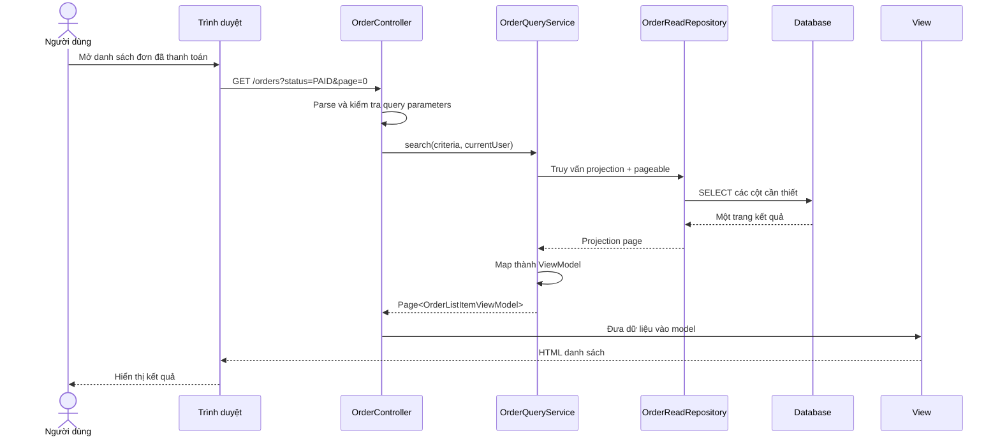

# Đọc dữ liệu theo nhu cầu hiển thị và tránh truy vấn dư thừa

Trong ứng dụng web theo kiến trúc **MODEL_VIEW_CONTROLLER (MVC)**, một request đọc thường bắt đầu ở Controller, đi qua tầng ứng dụng hoặc query service, truy cập repository và cơ sở dữ liệu, sau đó dữ liệu được chuyển thành ViewModel để View trình bày. Cách tổ chức này giúp phân tách nghiệp vụ, giao tiếp và giao diện. Tuy nhiên, nếu mỗi màn hình tải toàn bộ entity cùng mọi quan hệ của nó, ứng dụng có thể thực hiện nhiều truy vấn không cần thiết, lấy quá nhiều cột hoặc tạo ra lượng dữ liệu lớn hơn nhu cầu hiển thị.

**Đọc dữ liệu theo nhu cầu hiển thị** nghĩa là xác định rõ một màn hình hoặc use case cần những dữ liệu nào, rồi thiết kế truy vấn và projection để lấy đúng phần cần thiết. Mục tiêu không phải giảm số truy vấn bằng mọi giá. Mục tiêu là giảm tổng chi phí đọc: số round trip, lượng dữ liệu truyền, công việc ORM, bộ nhớ, CPU và thời gian dựng View, đồng thời vẫn giữ đúng ngữ nghĩa và tính nhất quán của ứng dụng.

Bài học này trình bày cách thiết kế query theo use case MVC, dùng projection/DTO, nhận biết lỗi N+1, chọn fetch plan phù hợp, phân trang an toàn, kiểm soát lazy loading và đo lường truy vấn dư thừa. Ví dụ dùng Java và Spring Data JPA/Hibernate để minh họa; các nguyên tắc cũng áp dụng cho ORM và repository khác.

## 1. Bắt đầu từ nhu cầu của màn hình

Trước khi viết repository query, hãy xác định View cần hiển thị gì và người dùng có thể làm gì với dữ liệu đó.

Ví dụ, trang danh sách đơn hàng có thể chỉ cần:

- Mã đơn hàng.
- Tên khách hàng.
- Ngày tạo.
- Trạng thái.
- Tổng tiền và đơn vị tiền tệ.
- Một số hành động được phép hiển thị.

Trang chi tiết đơn hàng lại cần địa chỉ giao hàng, các dòng hàng, sản phẩm, số lượng và lịch sử. Trang báo cáo doanh thu có thể cần tổng hợp theo ngày hoặc tháng, không cần tải từng entity đơn hàng.

Ba màn hình này dùng cùng dữ liệu nghiệp vụ nhưng có hình dạng đọc khác nhau. Nếu repository luôn trả về toàn bộ `Order` cùng `Customer`, `OrderLine`, `Product`, `Payment` và `AuditLog`, danh sách đơn hàng có thể đọc rất nhiều dữ liệu không bao giờ được hiển thị.

### Xác định hợp đồng đọc

Hãy viết ra các trường cần thiết cho từng use case:

| Use case | Dữ liệu cần đọc | Dữ liệu thường không cần tải |
|---|---|---|
| Danh sách đơn hàng | Mã, ngày tạo, khách hàng, trạng thái, tổng tiền | Toàn bộ dòng hàng, lịch sử thanh toán, audit log |
| Chi tiết đơn hàng | Thông tin đơn, địa chỉ, dòng hàng, tên sản phẩm | Danh sách đơn hàng khác của khách hàng |
| Badge số đơn đang chờ | Một giá trị đếm | Entity đơn hàng đầy đủ |
| Báo cáo doanh thu theo tháng | Tháng, số đơn, tổng doanh thu | Mỗi entity đơn và mọi quan hệ con |
| Form chọn khách hàng | ID và tên hiển thị của khách hàng phù hợp | Địa chỉ, lịch sử giao dịch, thông tin riêng tư khác |

Hợp đồng đọc có thể là một DTO hoặc ViewModel. Nó làm rõ dữ liệu cần thiết trước khi quyết định truy vấn.

## 2. Đọc entity hay đọc projection?

Có hai cách tiếp cận thường gặp:

1. **Đọc entity:** ORM tải một hoặc nhiều entity, sau đó ứng dụng sử dụng các thuộc tính và quan hệ cần thiết.
2. **Đọc projection:** truy vấn chỉ chọn những cột hoặc giá trị cần cho use case và trả về một cấu trúc dữ liệu chuyên biệt.

Không có cách nào luôn đúng. Entity phù hợp khi use case cần hành vi miền hoặc cần thay đổi đối tượng. Projection phù hợp với trang đọc, danh sách, báo cáo và các truy vấn chỉ cần dữ liệu trình bày.

### Entity phù hợp với thao tác nghiệp vụ

Ví dụ, khi xác nhận đơn hàng, application service có thể tải entity `Order` để gọi hành vi `confirm()` và bảo vệ bất biến. Trong trường hợp này, entity cùng những dữ liệu cần thiết cho quy tắc nghiệp vụ là phù hợp.

### Projection phù hợp với màn hình chỉ đọc

Với danh sách đơn hàng, View chỉ cần một vài trường. Thay vì tải entity rồi chuyển đổi, có thể dùng projection:

```java
public record OrderListItemView(
        String orderNumber,
        String customerName,
        Instant createdAt,
        String status,
        BigDecimal total,
        String currency
) {}
```

Projection không phải Domain Object. Nó là kết quả đọc được thiết kế cho nhu cầu cụ thể. Có thể tạo projection bằng JPQL constructor expression, interface projection, native query hoặc cơ chế truy vấn khác.

## 3. Query theo use case thay vì tải mọi thứ

Một repository có thể cung cấp các phương thức đọc chuyên biệt:

```java
public interface OrderRepository extends JpaRepository<Order, OrderId> {

    Page<OrderListItemView> findOrderListItems(
            OrderStatus status,
            Pageable pageable);

    Optional<OrderDetailView> findOrderDetail(OrderId id);

    long countByStatus(OrderStatus status);
}
```

Tên và chữ ký trên minh họa hợp đồng; các query cụ thể sẽ được triển khai bằng `@Query`, projection hoặc custom repository. Điều quan trọng là mỗi phương thức thể hiện một nhu cầu đọc có giới hạn.

Tránh một phương thức kiểu `findAllWithEverything()` rồi để từng View tự chọn trường. Cách đó dễ khiến mọi màn hình phải trả chi phí tải dữ liệu lớn, đồng thời làm khó kiểm soát fetch plan.

### Query service cho màn hình

Trong ứng dụng có nhiều màn hình đọc phức tạp, có thể tổ chức query service riêng:

```java
@Service
class OrderQueryService {

    private final OrderReadRepository readRepository;

    OrderQueryService(OrderReadRepository readRepository) {
        this.readRepository = readRepository;
    }

    Page<OrderListItemView> search(
            OrderSearchCriteria criteria,
            Pageable pageable) {
        return readRepository.search(criteria, pageable);
    }

    OrderDetailView getDetail(OrderId id) {
        return readRepository.findDetail(id)
                .orElseThrow(OrderNotFoundException::new);
    }
}
```

Query service điều phối truy vấn đọc và chuyển kết quả thành hợp đồng cho View. Nó có thể gọi một repository hoặc kết hợp nhiều nguồn dữ liệu. Không cần tạo query service riêng cho mọi CRUD nhỏ; hãy dùng khi nó làm rõ use case và giúp quản lý truy vấn.

## 4. Chỉ chọn các cột cần thiết

Nếu một bảng có 40 cột nhưng màn hình chỉ cần 6 cột, truy vấn `SELECT *` thường lấy dữ liệu dư thừa. Điều này làm tăng lượng dữ liệu từ database, chi phí chuyển đổi ORM và bộ nhớ đối tượng.

Ví dụ JPQL constructor projection:

```java
public record OrderListItemView(
        Long id,
        String orderNumber,
        String customerName,
        Instant createdAt,
        OrderStatus status,
        BigDecimal total
) {}
```

```java
@Query("""
    select new com.example.orders.OrderListItemView(
        o.id,
        o.orderNumber,
        c.name,
        o.createdAt,
        o.status,
        o.total
    )
    from Order o
    join o.customer c
    where (:status is null or o.status = :status)
    order by o.createdAt desc
    """)
Page<OrderListItemView> findListItems(
        @Param("status") OrderStatus status,
        Pageable pageable);
```

Đây là ví dụ minh họa; constructor expression cần tên lớp đầy đủ và kiểu tham số khớp với projection. Cách viết điều kiện optional filter trong JPQL cũng cần cân nhắc hiệu năng và khả năng tối ưu của database; với bộ lọc phức tạp, custom query builder hoặc Specification có thể phù hợp hơn.

### Interface projection

Spring Data JPA hỗ trợ interface projection cho một số dạng truy vấn:

```java
public interface OrderSummaryProjection {
    Long getId();
    String getOrderNumber();
    String getCustomerName();
    BigDecimal getTotal();
}
```

```java
@Query("""
    select o.id as id,
           o.orderNumber as orderNumber,
           c.name as customerName,
           o.total as total
    from Order o
    join o.customer c
    where o.status = :status
    """)
List<OrderSummaryProjection> findSummaries(
        @Param("status") OrderStatus status);
```

Alias trong query cần khớp với tên property getter. Projection lồng nhau hoặc projection mở có thể khiến ORM truy cập thêm thuộc tính; hãy kiểm tra SQL thực tế thay vì giả định rằng mọi interface projection đều chỉ lấy đúng các cột mong muốn.

### Khi nào không nên projection?

Nếu use case cần thay đổi entity, áp dụng nhiều hành vi miền hoặc cần đồng bộ một aggregate trong transaction, hãy cân nhắc tải entity phù hợp. Projection chỉ đọc không nên được dùng làm đối tượng ghi chỉ vì nó nhẹ hơn.

## 5. N+1 query là gì?

Lỗi **N+1 query** xảy ra khi ứng dụng chạy một truy vấn để lấy danh sách N đối tượng, sau đó lại chạy thêm truy vấn riêng cho từng đối tượng để lấy một quan hệ hoặc dữ liệu liên quan.

Ví dụ, lấy 100 đơn hàng rồi đọc tên khách hàng của từng đơn. Nếu ORM tải khách hàng theo kiểu lazy và mỗi đơn có một customer chưa được nạp, có thể phát sinh:

- 1 query lấy 100 đơn hàng.
- N query lấy khách hàng tương ứng.
- Tổng cộng N+1 query, trong trường hợp này là 101.

Mã có thể trông đơn giản:

```java
List<Order> orders = orderRepository.findAll();

for (Order order : orders) {
    System.out.println(order.getCustomer().getName());
}
```

Nhưng nếu `customer` được lazy load và chưa có trong persistence context, mỗi lần gọi `getCustomer().getName()` có thể phát sinh truy vấn riêng. Kết quả thực tế còn phụ thuộc cache cấp một, cache cấp hai, fetch mode, batch size và dữ liệu đã được nạp trước.

### Nhận biết qua SQL log

Trong log SQL, dấu hiệu phổ biến là một câu query lấy danh sách, sau đó lặp đi lặp lại câu query lấy quan hệ với tham số ID khác nhau:

```sql
select ... from orders where ...;
select ... from customers where id = ?;
select ... from customers where id = ?;
select ... from customers where id = ?;
-- lặp lại cho nhiều order
```

Không phải cứ nhiều query là N+1. N+1 là một mẫu truy vấn lặp phát sinh do cách truy cập quan hệ theo từng phần tử. Cần kiểm tra SQL và số lượng round trip trong use case thực tế.

## 6. Cách xử lý N+1

Không có một cách sửa phù hợp với mọi trường hợp. Hãy chọn chiến lược theo hình dạng dữ liệu và nhu cầu của màn hình.

### Cách 1: DTO projection với JOIN

Nếu danh sách chỉ cần tên khách hàng, chọn trực tiếp tên khách hàng trong query:

```java
@Query("""
    select new com.example.orders.OrderListItemView(
        o.id,
        o.orderNumber,
        c.name,
        o.createdAt,
        o.status,
        o.total
    )
    from Order o
    join o.customer c
    where o.status = :status
    """)
List<OrderListItemView> findListItems(
        @Param("status") OrderStatus status);
```

Một query trả về đúng dữ liệu danh sách, không cần nạp entity customer cho từng hàng. Đây thường là lựa chọn gọn cho màn hình đọc.

### Cách 2: Fetch join

Nếu cần entity cùng quan hệ `customer`, JPQL fetch join có thể nạp quan hệ trong cùng query:

```java
@Query("""
    select o
    from Order o
    join fetch o.customer
    where o.status = :status
    """)
List<Order> findWithCustomer(
        @Param("status") OrderStatus status);
```

`join fetch` yêu cầu ORM nạp quan hệ trong query này. Nó phù hợp với quan hệ to-one như `ManyToOne` hoặc `OneToOne` trong nhiều trường hợp. Với collection `OneToMany` hoặc `ManyToMany`, fetch join có thể nhân bản hàng kết quả ở SQL và gây vấn đề với phân trang.

### Cách 3: EntityGraph

Spring Data JPA cho phép khai báo fetch graph theo phương thức repository:

```java
@EntityGraph(attributePaths = {"customer"})
@Query("select o from Order o where o.status = :status")
List<Order> findWithCustomerGraph(
        @Param("status") OrderStatus status);
```

EntityGraph giúp mô tả quan hệ cần nạp cho use case mà không cần viết `join fetch` trực tiếp trong JPQL. SQL thực tế do provider quyết định; hãy kiểm tra để chắc rằng fetch plan đáp ứng nhu cầu và không nạp thêm quan hệ không cần thiết.

### Cách 4: Batch fetching

Batch fetching cho phép ORM gom nhiều khóa cần tải vào một query thay vì chạy một query cho từng đối tượng. Hibernate có thể cấu hình batch size ở cấp mapping hoặc cấu hình session.

Ví dụ đặt annotation Hibernate trên entity được tải theo lô:

```java
@Entity
@BatchSize(size = 50)
class Customer {
    // Các thuộc tính của Customer.
}
```

Khi cần nạp nhiều proxy `Customer`, Hibernate có thể gom các khóa cần tải vào query dạng `where id in (...)` theo từng lô. Với collection, `@BatchSize` cũng có thể được đặt trên mapping collection phù hợp. Batch fetching làm giảm số round trip nhưng vẫn có thể tải entity/quan hệ không cần thiết. Nó là công cụ tối ưu fetch, không thay thế việc xác định đúng dữ liệu màn hình cần.

## 7. Fetch type không phải chiến lược query cho mọi màn hình

JPA có `FetchType.LAZY` và `FetchType.EAGER`. Chọn EAGER toàn cục để tránh N+1 thường dẫn đến over-fetching: một màn hình không cần quan hệ vẫn phải tải chúng. Chọn LAZY giúp trì hoãn tải, nhưng nếu View truy cập quan hệ trong vòng lặp, N+1 có thể xuất hiện.

Một nguyên tắc hữu ích:

- Mapping entity mô tả quan hệ và mặc định fetch phù hợp với mô hình.
- Query/use case xác định dữ liệu cần nạp cho một lần đọc cụ thể.
- ViewModel/projection xác định dữ liệu thực sự cần trình bày.

Không nên đổi mọi quan hệ thành EAGER chỉ để sửa một màn hình. Hãy thiết kế fetch plan theo use case bằng projection, fetch join, EntityGraph hoặc batch fetching khi phù hợp.

## 8. Tránh lazy loading trong View

Một vấn đề thường gặp trong ứng dụng MVC server-rendered là template truy cập entity và vô tình kích hoạt truy vấn:

```html
<span th:text="${order.customer.name}"></span>
<li th:each="line : ${order.lines}">
  <span th:text="${line.product.name}"></span>
</li>
```

Nếu Controller truyền entity trực tiếp vào View, việc render template có thể kích hoạt lazy loading. Khi danh sách có nhiều đơn hàng, mỗi lần truy cập quan hệ có thể tạo thêm query; hoặc nếu persistence context đã đóng, ứng dụng có thể gặp `LazyInitializationException`.

Hãy chuẩn bị ViewModel trong tầng query/application trước khi render:

```java
public record OrderListItemViewModel(
        String orderNumber,
        String customerName,
        String statusLabel,
        String totalText
) {}
```

Controller đưa ViewModel vào Model của MVC. View chỉ đọc các trường đã có, không gọi getter entity để kích hoạt truy vấn.

### Open Session in View

Một số ứng dụng Spring Boot bật Open Session in View (OSIV), giữ persistence context mở trong suốt quá trình render View. Điều này có thể khiến lazy loading hoạt động trong template, nhưng cũng che giấu query phát sinh muộn và làm số truy vấn khó dự đoán.

OSIV không tự giải quyết N+1. Nếu template truy cập quan hệ trong vòng lặp, các truy vấn bổ sung vẫn có thể chạy. Hãy cân nhắc thiết kế query và ViewModel rõ ràng; nếu tắt OSIV, bảo đảm mọi dữ liệu cần thiết đã được tải hoặc projection trước khi transaction kết thúc.

## 9. Truy vấn collection và nguy cơ nhân bản hàng

Fetch join collection có thể tạo ra nhiều hàng SQL cho một entity cha. Ví dụ, một đơn có 4 dòng hàng thì query join có thể trả 4 hàng mang cùng dữ liệu đơn nhưng khác dòng hàng. ORM có thể hợp nhất entity theo identity, nhưng kết quả SQL và chi phí truyền dữ liệu vẫn lớn hơn số entity cha.

Nếu một đơn có nhiều collection như `lines`, `payments` và `events`, join đồng thời có thể tạo tích Descartes. Ví dụ 4 dòng hàng × 3 lần thanh toán × 5 sự kiện có thể tạo 60 hàng cho một đơn.

Hãy cân nhắc:

- Projection chỉ lấy các trường cần hiển thị.
- Tách truy vấn cho các collection độc lập.
- Dùng batch fetching để giảm số round trip.
- Chỉ tải collection ở trang chi tiết khi người dùng thật sự cần.
- Không fetch join nhiều bag collection cùng lúc nếu ORM/provider không hỗ trợ hoặc có nguy cơ nhân bản lớn.

Một query ít hơn chưa chắc nhanh hơn nếu nó trả về hàng nghìn hàng trùng dữ liệu. Hãy đo cả số query lẫn số hàng và lượng dữ liệu được truyền.

## 10. Phân trang và fetch collection

Phân trang giúp giới hạn lượng dữ liệu trả về cho danh sách lớn. Tuy nhiên, kết hợp `Pageable` với fetch join collection cần thận trọng.

Nếu query fetch join `OneToMany` rồi phân trang ở SQL, database phân trang trên hàng đã join chứ không nhất thiết trên số entity cha. Một số ORM có thể phải tải toàn bộ kết quả rồi phân trang trong bộ nhớ hoặc phát cảnh báo; điều này làm mất lợi ích phân trang và có thể tốn bộ nhớ.

### Chiến lược hai bước

Một cách phổ biến cho trang danh sách có chi tiết con là:

1. Truy vấn trang ID của entity cha, dùng điều kiện lọc và thứ tự ổn định.
2. Truy vấn chi tiết/collection cho các ID trong trang đó.
3. Ghép kết quả theo thứ tự ID ban đầu để giữ đúng thứ tự phân trang.

Ví dụ:

```java
@Query("""
    select o.id
    from Order o
    where (:status is null or o.status = :status)
    order by o.createdAt desc, o.id desc
    """)
Page<OrderId> findPageIds(
        @Param("status") OrderStatus status,
        Pageable pageable);

@Query("""
    select distinct o
    from Order o
    left join fetch o.lines
    where o.id in :ids
    """)
List<Order> findWithLines(@Param("ids") Collection<OrderId> ids);
```

Service lấy trang ID rồi truy vấn các đơn cùng dòng hàng. Vì `IN (:ids)` không bảo đảm giữ thứ tự input, service cần lập map theo ID và tái tạo danh sách theo thứ tự `page.getContent()`.

```java
Page<OrderId> idPage = repository.findPageIds(status, pageable);
List<Order> loaded = repository.findWithLines(idPage.getContent());

Map<OrderId, Order> byId = loaded.stream()
        .collect(Collectors.toMap(Order::getId, Function.identity()));

List<Order> ordered = idPage.getContent().stream()
        .map(byId::get)
        .filter(Objects::nonNull)
        .toList();
```

Ví dụ cần điều chỉnh kiểu ID và xử lý trường hợp dữ liệu thay đổi giữa hai query. Nếu yêu cầu snapshot nhất quán, hãy đặt hai query trong transaction/isolation phù hợp. Một phương án khác là dùng DTO projection cho danh sách và query collection riêng khi người dùng mở chi tiết.

### Count query

Spring Data `Page<T>` thường cần thêm count query để tính tổng số trang. Với query join phức tạp, count tự suy diễn có thể sai hoặc tốn kém. Có thể khai báo `countQuery` riêng:

```java
@Query(
    value = """
        select new com.example.orders.OrderListItemView(
            o.id, o.orderNumber, c.name, o.createdAt,
            o.status, o.total)
        from Order o join o.customer c
        where (:status is null or o.status = :status)
        """,
    countQuery = """
        select count(o.id)
        from Order o
        where (:status is null or o.status = :status)
        """
)
Page<OrderListItemView> searchPage(
        @Param("status") OrderStatus status,
        Pageable pageable);
```

Đây là ví dụ giản lược; count query phải phản ánh đúng điều kiện lọc và quan hệ có thể làm thay đổi số bản ghi. Nếu join tạo nhiều hàng cho cùng một đơn, có thể cần `count(distinct o.id)`.

Nếu giao diện chỉ cần nút “Xem thêm” và không cần tổng số trang, `Slice<T>` hoặc keyset pagination có thể tránh truy vấn count tổng, tùy framework và cách triển khai.

## 11. Offset pagination và keyset pagination

### Offset pagination

Offset pagination thường dùng `page` và `size`:

```sql
select id, order_number, created_at
from orders
where status = ?
order by created_at desc, id desc
limit 25 offset 5000;
```

Ưu điểm là dễ hiểu, cho phép nhảy đến một trang bất kỳ và phù hợp với nhiều màn hình quản trị. Nhược điểm là offset lớn có thể khiến database phải duyệt/bỏ qua nhiều hàng; dữ liệu thêm/xóa trong lúc người dùng chuyển trang cũng có thể làm mục bị lặp hoặc bị bỏ qua.

### Keyset/seek pagination

Keyset pagination dùng giá trị của hàng cuối trang trước làm mốc cho trang kế tiếp. Với thứ tự `created_at DESC, id DESC`, query có thể là:

```sql
select id, order_number, created_at
from orders
where status = ?
  and (created_at, id) < (?, ?)
order by created_at desc, id desc
limit 25;
```

Cú pháp tuple comparison tùy database; có thể cần biểu diễn tương đương bằng điều kiện `created_at < ? OR (created_at = ? AND id < ?)`. Keyset phù hợp với danh sách lớn, cuộn liên tục hoặc “load more”, nhưng khó nhảy trực tiếp đến trang bất kỳ và cần khóa sắp xếp ổn định, có tie-breaker duy nhất.

### Chọn theo trải nghiệm

| Yêu cầu giao diện | Lựa chọn thường phù hợp |
|---|---|
| Nhảy đến trang 1, 2, 3... và hiển thị tổng trang | Offset + Page |
| Nút “Xem thêm” hoặc cuộn vô hạn | Keyset hoặc Slice |
| Bảng quản trị nhỏ/vừa | Offset pagination thường đủ |
| Dữ liệu rất lớn, truy cập tuần tự | Keyset pagination đáng cân nhắc |

Không nên dùng keyset chỉ vì nó nghe nhanh hơn; hãy đo truy vấn, xem index và kiểm tra yêu cầu điều hướng thực tế.

## 12. Tránh truy vấn dư thừa ở cấp dữ liệu tổng hợp

Không phải màn hình nào cũng cần tải entity. Với số lượng, tổng tiền hoặc số liệu thống kê, hãy để database thực hiện phép tổng hợp thay vì tải tất cả bản ghi rồi cộng trong Java.

Ví dụ đếm đơn đang chờ:

```java
@Query("select count(o) from Order o where o.status = :status")
long countByStatus(@Param("status") OrderStatus status);
```

Ví dụ tổng doanh thu theo trạng thái:

```java
@Query("""
    select new com.example.reports.RevenueSummary(
        count(o), sum(o.total))
    from Order o
    where o.status = :status
    """)
RevenueSummary summarize(@Param("status") OrderStatus status);
```

Aggregation giảm dữ liệu truyền về ứng dụng. Tuy nhiên, cần hiểu ngữ nghĩa của `NULL`, kiểu dữ liệu trả về, đơn vị tiền tệ và cách nhóm theo múi giờ. Không cộng các khoản tiền khác loại tiền tệ vào cùng một tổng nếu chưa quy đổi theo quy tắc rõ ràng.

## 13. Tối ưu truy vấn mà vẫn giữ đúng ngữ nghĩa

Một query nhanh nhưng trả sai dữ liệu không phải tối ưu tốt. Khi thay đổi projection hoặc fetch plan, cần giữ các điều kiện lọc, quyền truy cập và quy tắc sắp xếp.

### Authorization trong query đọc

Nếu người dùng chỉ được xem đơn thuộc tenant của họ, query cần áp dụng phạm vi đó. Không nên tải mọi đơn rồi lọc ở Java sau khi đã lấy dữ liệu khỏi database, vì cách này vừa tốn tài nguyên vừa có nguy cơ lộ dữ liệu qua log hoặc lỗi xử lý.

### Sort phải có thứ tự ổn định

Khi phân trang, thêm một tie-breaker duy nhất như `id` để hai hàng có cùng `createdAt` vẫn có thứ tự xác định. Nếu không, dữ liệu có thể nhảy giữa các trang.

### Filter và JOIN

JOIN có thể cần thiết để lọc theo quan hệ, nhưng hãy kiểm tra cardinality và duplicate. Dùng `exists` có thể phù hợp hơn khi chỉ cần xác nhận quan hệ tồn tại.

### Chọn index theo truy vấn thực tế

Index nên hỗ trợ các điều kiện lọc và thứ tự sắp xếp thường dùng. Không tạo index cho mọi cột; index làm tăng chi phí ghi và dung lượng lưu trữ. Hãy dùng execution plan của database để xác định bottleneck.

## 14. Đo lường thay vì đoán

Không nên tối ưu chỉ dựa vào số dòng Java hoặc số lần gọi repository. Hãy quan sát SQL thực tế và thời gian của toàn bộ request.

Các chỉ số hữu ích:

- Số câu SQL trên một request.
- Số round trip đến database.
- Thời gian từng query và tổng thời gian chờ database.
- Số hàng trả về và lượng dữ liệu được truyền.
- Số entity được ORM hydrate.
- Số lần truy cập lazy relationship.
- Thời gian mapping và render View.
- Tỷ lệ cache hit/miss nếu có cache.

Với Hibernate, có thể bật SQL logging hoặc statistics trong môi trường phát triển/test. Tránh bật log SQL chi tiết ở production nếu nó làm lộ dữ liệu nhạy cảm hoặc gây overhead. Có thể dùng datasource proxy, APM hoặc tracing để quan sát query count theo request.

### Execution plan

Khi một query chậm, hãy kiểm tra execution plan bằng công cụ của database, ví dụ `EXPLAIN` hoặc `EXPLAIN ANALYZE` khi phù hợp. Xem database có dùng index, scan quá nhiều hàng, sort tốn kém hoặc join không hiệu quả không. Chỉ thêm index sau khi hiểu query pattern và chi phí ghi.

### So sánh trước và sau

Đo cùng một use case với dữ liệu có quy mô gần thực tế. Ghi lại query count, thời gian p50/p95, số hàng và bộ nhớ. Một thay đổi giảm từ 101 query xuống 2 query là đáng chú ý, nhưng vẫn cần kiểm tra hai query mới có tải hàng chục nghìn dòng hoặc tạo kết quả sai hay không.

## 15. Cache không thay thế query tốt

Cache có thể giảm truy vấn lặp, nhưng không nên dùng cache để che một query thiết kế dư thừa.

Cache phù hợp khi:

- Dữ liệu được đọc nhiều và thay đổi ít.
- Có thể xác định rõ key, phạm vi người dùng/tenant và thời hạn.
- Có chính sách invalidation khi dữ liệu thay đổi.
- Chấp nhận được độ trễ nhất định của dữ liệu hoặc có cơ chế đảm bảo nhất quán.

Cache có thể gây rò dữ liệu nếu key không bao gồm tenant hoặc quyền truy cập phù hợp. Cache một ViewModel có dữ liệu riêng tư mà không phân vùng theo người dùng là rủi ro. Với danh sách phân trang và filter nhiều chiều, số lượng cache key cũng có thể tăng nhanh.

Hãy tối ưu projection, fetch plan và index trước; sau đó cân nhắc cache khi đo lường cho thấy truy vấn lặp là bottleneck thực sự.

## 16. Ví dụ luồng đọc hoàn chỉnh trong MVC

Giả sử người dùng mở trang danh sách đơn hàng đã thanh toán. Controller nhận filter và phân trang, query service gọi repository projection, sau đó mapper bổ sung nhãn/định dạng cho ViewModel.



Trong luồng này, View không truy cập entity lazy. Query chỉ lấy trường cần hiển thị, có giới hạn trang và điều kiện quyền. Nếu người dùng mở một đơn cụ thể, use case chi tiết có fetch plan riêng để tải dòng hàng và dữ liệu cần thiết.

## 17. Kiểm thử truy vấn và tránh N+1

Kiểm thử query không chỉ xác minh dữ liệu trả về đúng. Cần có cách phát hiện truy vấn dư thừa và hiệu năng suy giảm.

| Loại kiểm thử | Nội dung cần xác minh | Cách thực hiện |
|---|---|---|
| Repository test | Projection và filter trả đúng trường | Dùng database test và assertion kết quả |
| Integration test | Fetch plan không gây lỗi lazy loading | Đọc dữ liệu trong transaction/use case thực tế |
| Query count test | Số query không tăng tuyến tính theo số hàng | Đo SQL count với 1, 10 và 50 bản ghi |
| Pagination test | Trang và count chính xác, thứ tự ổn định | Dữ liệu có nhiều hàng trùng timestamp |
| Authorization test | Query chỉ trả dữ liệu trong phạm vi được phép | Nhiều tenant/user trong fixture |
| Performance test | Thời gian và lượng dữ liệu phù hợp | Dataset có quy mô gần production |

Một cách phát hiện N+1 là chạy cùng query với số entity khác nhau và so sánh số câu SQL. Nếu số query tăng gần bằng số entity, cần kiểm tra lazy relationship trong vòng lặp.

### Tránh test quá mong manh

Không nên khóa cứng mọi test vào chính xác một câu SQL nếu ORM/provider có thể thay đổi cách triển khai mà không ảnh hưởng hợp đồng. Hãy kiểm tra query count hoặc số round trip trong những use case quan trọng, kết hợp kiểm tra dữ liệu, thời gian và execution plan. Nếu một giới hạn query count là yêu cầu hiệu năng, hãy giải thích lý do trong test.

## 18. Những lỗi thiết kế thường gặp

### Tải toàn bộ entity cho màn hình danh sách

View chỉ cần vài trường nhưng repository tải mọi quan hệ. Hãy dùng projection hoặc fetch plan giới hạn theo use case.

### Đổi tất cả quan hệ thành EAGER

Một màn hình hết lỗi lazy loading nhưng các màn hình khác bị over-fetch. Hãy chọn fetch plan riêng thay vì thay mapping toàn cục để chữa một query.

### Dùng LAZY rồi truy cập trong vòng lặp View

Template kích hoạt N+1 hoặc lỗi khi persistence context đã đóng. Hãy tạo ViewModel trước khi render.

### Fetch join nhiều collection cùng lúc

Kết quả SQL có thể nhân bản rất lớn hoặc gây giới hạn của ORM. Hãy tách query, dùng projection hoặc batch fetching phù hợp.

### Phân trang trực tiếp trên collection fetch join

Database phân trang hàng join chứ không phải entity cha; ORM có thể phải phân trang trong bộ nhớ. Hãy dùng projection hoặc chiến lược hai bước.

### Lấy mọi dữ liệu rồi lọc ở Java

Ứng dụng truyền và hydrate nhiều hàng không cần thiết. Đưa filter, sort và aggregation xuống database khi phù hợp, đồng thời giữ điều kiện authorization.

### Chạy count query không cần thiết

Giao diện chỉ cần “Xem thêm” nhưng query service luôn yêu cầu tổng số bản ghi. Cân nhắc `Slice`, cursor hoặc keyset pagination.

### Tối ưu số query nhưng bỏ qua lượng dữ liệu

Một query join khổng lồ có thể tốn hơn nhiều query nhỏ được kiểm soát. Đo cả số query, số hàng, bytes và thời gian.

### Dùng cache để che N+1

Cache có thể làm vấn đề khó tái hiện nhưng vẫn tồn tại khi cache miss hoặc dữ liệu thay đổi. Hãy sửa query/fetch plan trước rồi mới đánh giá cache.

## 19. Quy trình thiết kế một truy vấn đọc

Khi thêm màn hình hoặc use case đọc dữ liệu, hãy thực hiện theo trình tự:

1. **Liệt kê trường cần hiển thị:** xác định chính xác dữ liệu View cần, không bắt đầu bằng việc tải toàn entity.
2. **Xác định ngữ cảnh quyền:** user/tenant nào được xem dữ liệu nào; đưa phạm vi đó vào query hoặc policy có thẩm quyền.
3. **Chọn hợp đồng đọc:** entity, DTO projection, interface projection, aggregation hoặc ViewModel tùy mục đích.
4. **Thiết kế fetch plan:** quan hệ nào cần nạp, dùng projection, join fetch, EntityGraph hay batch fetching?
5. **Kiểm tra cardinality:** JOIN có nhân bản hàng không, có nhiều collection không, dữ liệu có vượt quá nhu cầu không?
6. **Thiết kế phân trang:** Page, Slice, offset hay keyset; thứ tự có ổn định và có tie-breaker không?
7. **Chuẩn bị ViewModel:** định dạng và tổng hợp dữ liệu trước khi render; tránh lazy loading trong View.
8. **Đo SQL:** query count, round trip, số hàng, thời gian và execution plan.
9. **Kiểm thử quy mô:** chạy với số bản ghi tăng dần để phát hiện N+1 và over-fetch.
10. **Chỉ thêm cache khi cần:** xác định key, quyền, invalidation và mức nhất quán chấp nhận được.

## Kết luận

Đọc dữ liệu theo nhu cầu hiển thị giúp mỗi use case MVC lấy đúng trường, đúng quan hệ và đúng lượng dữ liệu cần thiết. Projection/DTO phù hợp với màn hình đọc; entity phù hợp khi cần hành vi và thay đổi nghiệp vụ. N+1 cần được phát hiện qua SQL thực tế và xử lý bằng projection, fetch join, EntityGraph hoặc batch fetching tùy cấu trúc quan hệ.

Đặc biệt, cần thận trọng khi fetch collection kết hợp phân trang, tránh để View kích hoạt lazy loading và đo cả số truy vấn lẫn lượng dữ liệu được truyền. Query tốt phải giữ đúng quyền truy cập, thứ tự và ngữ nghĩa dữ liệu. Trong MVC, query service/repository chuẩn bị dữ liệu cho ViewModel trước khi render, giúp giao diện không phụ thuộc vào cấu trúc persistence và giúp hiệu năng có thể dự đoán, đo lường và kiểm thử.
