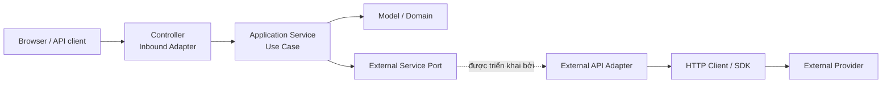
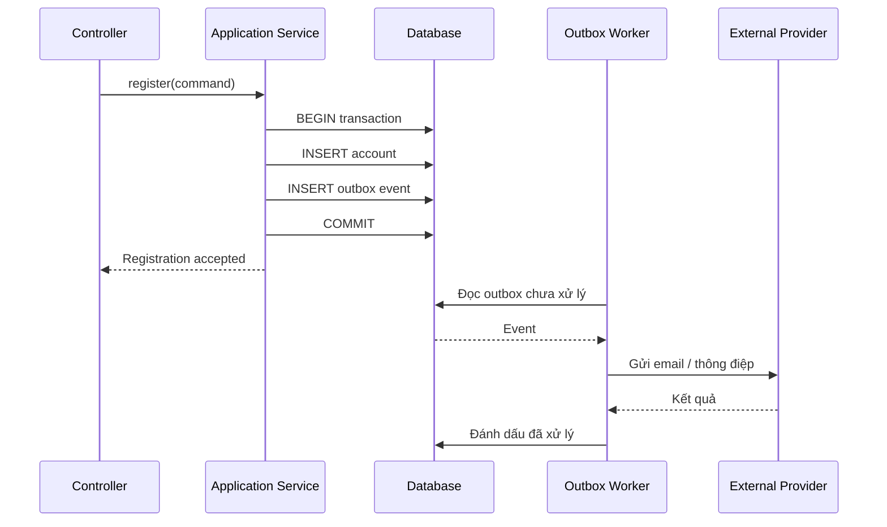

# Tích hợp dịch vụ bên ngoài qua ranh giới rõ ràng

Ứng dụng MVC thường cần giao tiếp với hệ thống nằm ngoài phạm vi của nó: dịch vụ email, cổng thanh toán, hệ thống định danh, API vận chuyển, dịch vụ lưu trữ tệp hoặc một hệ thống nghiệp vụ của đối tác. Controller có thể tiếp nhận request từ người dùng, nhưng không nên trực tiếp gọi SDK của nhà cung cấp hoặc tự xử lý giao thức tích hợp. Application service nên điều phối use case thông qua một hợp đồng do ứng dụng định nghĩa; adapter ở ranh giới hạ tầng chịu trách nhiệm giao tiếp với dịch vụ bên ngoài.

Ranh giới rõ ràng giúp phần nghiệp vụ không phụ thuộc vào tên endpoint, cấu trúc JSON, thư viện HTTP hay mô hình lỗi riêng của nhà cung cấp. Khi đổi đối tác, thay SDK hoặc cần dùng dịch vụ giả trong kiểm thử, thay đổi chủ yếu được giới hạn ở adapter và cấu hình tích hợp.

Ví dụ, khi người dùng đăng ký tài khoản, ứng dụng có thể lưu tài khoản rồi yêu cầu dịch vụ email gửi thư xác minh. Use case đăng ký chỉ cần biết một hợp đồng như `VerificationEmailPort`; adapter cụ thể chuyển yêu cầu đó thành API call đến nhà cung cấp email. Model vẫn quản lý quy tắc tài khoản, còn Controller chỉ chuyển request thành command và chọn response.

## Vì sao cần ranh giới tích hợp?

Một dịch vụ bên ngoài có giao thức, dữ liệu, cách xác thực và hành vi lỗi riêng. Nếu các chi tiết này xuất hiện trực tiếp trong Controller hoặc Model, phần nghiệp vụ sẽ bị gắn với một nhà cung cấp cụ thể.

Ví dụ, nếu `RegistrationController` trực tiếp khởi tạo SDK của nhà cung cấp email, tạo payload JSON, đọc token từ cấu hình và bắt các exception riêng của SDK, lớp Controller đang có nhiều trách nhiệm:

- tiếp nhận HTTP request và kiểm tra dữ liệu;
- điều phối use case đăng ký;
- hiểu giao thức của nhà cung cấp email;
- xử lý xác thực và lỗi mạng;
- chuyển dữ liệu nội bộ sang định dạng riêng của đối tác.

Khi nhà cung cấp thay đổi tên trường hoặc mã lỗi, Controller và có thể cả Model phải thay đổi theo. Nếu cùng chức năng được gọi từ API, tác vụ nền và quy trình quản trị, logic tích hợp còn có nguy cơ bị sao chép.

Một ranh giới tích hợp tốt tạo ra hợp đồng thuộc ngôn ngữ của ứng dụng. Application service chỉ biết hợp đồng đó; adapter dịch giữa hợp đồng nội bộ và API bên ngoài.

## Kiến trúc port và adapter

Trong kiến trúc Ports and Adapters (Hexagonal Architecture), port là hợp đồng mà lõi ứng dụng cung cấp hoặc cần sử dụng; adapter là thành phần nối hợp đồng đó với một cơ chế giao tiếp cụ thể.

Với tích hợp dịch vụ bên ngoài, luồng thường là:

1. Controller hoặc một adapter đầu vào gọi application service.
2. Application service thực hiện các bước của use case và gọi outbound port.
3. Adapter triển khai port, chuyển dữ liệu nội bộ thành request theo giao thức nhà cung cấp.
4. Adapter gửi request, xử lý response hoặc lỗi giao tiếp và chuyển kết quả về kiểu nội bộ.
5. Application service tiếp tục use case dựa trên kết quả của port.



Mũi tên dependency của mã nguồn nên hướng về hợp đồng phía ứng dụng: application service phụ thuộc vào `ExternalServicePort`; adapter bên ngoài triển khai interface đó. Khi chạy, dependency injection cung cấp adapter cụ thể cho service.

### Port nên mô tả nhu cầu của ứng dụng

Tên và kiểu dữ liệu của port nên phản ánh ý nghĩa nghiệp vụ, không sao chép nguyên xi API của nhà cung cấp.

```java
public interface VerificationEmailPort {
    DeliveryResult sendVerificationMessage(
            EmailAddress recipient,
            VerificationLink verificationLink);
}
```

Port này mô tả điều ứng dụng cần: gửi thông điệp xác minh đến một địa chỉ email với một liên kết xác minh. Nó không yêu cầu application service biết endpoint, tên JSON field, mã template hoặc cấu trúc SDK của nhà cung cấp.

Không nên thiết kế một port quá tổng quát như `ExternalApiClient.call(String url, Map<String, Object> body)`. Hợp đồng như vậy làm rò rỉ chi tiết giao thức vào application layer và không diễn đạt được ý nghĩa của use case. Tạo port theo năng lực hoặc mục đích tích hợp sẽ giúp kiểm thử và thay thế dễ hơn.

## Adapter chuyển đổi hợp đồng nội bộ sang API bên ngoài

Adapter chịu trách nhiệm cho các chi tiết ở ranh giới:

- chuyển kiểu nội bộ sang request DTO hoặc payload của đối tác;
- thiết lập URL, HTTP method, header và content type;
- thêm thông tin xác thực theo cấu hình bảo mật;
- áp dụng timeout và giới hạn tài nguyên;
- giải mã response và ánh xạ về kiểu kết quả nội bộ;
- phân loại lỗi mạng, lỗi giao thức và lỗi nghiệp vụ do đối tác trả về;
- ghi log kỹ thuật cần thiết mà không làm lộ bí mật hoặc dữ liệu cá nhân.

Ví dụ, adapter có thể dùng `RestClient` của Spring để gọi một API gửi email:

```java
@Component
public class HttpVerificationEmailAdapter implements VerificationEmailPort {
    private final RestClient restClient;
    private final ProviderEmailMapper mapper;

    public HttpVerificationEmailAdapter(
            RestClient emailRestClient,
            ProviderEmailMapper mapper) {
        this.restClient = emailRestClient;
        this.mapper = mapper;
    }

    @Override
    public DeliveryResult sendVerificationMessage(
            EmailAddress recipient,
            VerificationLink verificationLink) {

        ProviderEmailRequest request = mapper.toProviderRequest(
                recipient, verificationLink);

        ProviderEmailResponse response = restClient.post()
                .uri("/v1/messages")
                .body(request)
                .retrieve()
                .body(ProviderEmailResponse.class);

        return mapper.toDeliveryResult(response);
    }
}
```

Đây là ví dụ cấu trúc, giả định `RestClient` đã được cấu hình base URL, xác thực, timeout và error handling; `ProviderEmailRequest`, `ProviderEmailResponse`, mapper và kiểu miền cần được định nghĩa. Trong ứng dụng thực tế, adapter cũng cần xử lý trường hợp response rỗng, response sai định dạng, timeout và mã HTTP không thành công. Không nên để exception riêng của thư viện HTTP hoặc SDK truyền thẳng vào Model.

### Ánh xạ dữ liệu ở ranh giới

API bên ngoài có thể dùng những khái niệm khác ứng dụng. Ví dụ, nhà cung cấp email trả trạng thái `queued`, `accepted` hoặc `rejected`, trong khi ứng dụng chỉ cần `ACCEPTED`, `TEMPORARILY_UNAVAILABLE` hoặc `PERMANENT_FAILURE`.

Adapter hoặc mapper chuyển đổi những trạng thái đó thành kiểu nội bộ. Nếu nhà cung cấp đổi tên field hoặc thêm trạng thái mới, chỉ phần ánh xạ cần được xem xét. Không nên để application service kiểm tra chuỗi như `"queued"` hoặc import enum từ SDK của đối tác.

```java
public enum DeliveryStatus {
    ACCEPTED,
    TEMPORARILY_UNAVAILABLE,
    PERMANENT_FAILURE
}

public record DeliveryResult(
        DeliveryStatus status,
        String providerMessageId) {
}
```

Chỉ đưa `providerMessageId` vào kết quả nội bộ nếu ứng dụng thực sự cần tham chiếu để tra cứu hoặc đối soát. Không đưa toàn bộ response của nhà cung cấp vào Model chỉ để tránh viết mapper.

## Application service điều phối tích hợp

Application service gọi port như một bước trong use case. Nó quyết định khi nào cần yêu cầu tích hợp, dữ liệu nào được gửi và kết quả tích hợp ảnh hưởng ra sao đến quy trình.

```java
@Service
public class RegisterAccountService {
    private final AccountRepository accountRepository;
    private final VerificationEmailPort verificationEmailPort;
    private final VerificationLinkFactory linkFactory;

    public RegisterAccountService(
            AccountRepository accountRepository,
            VerificationEmailPort verificationEmailPort,
            VerificationLinkFactory linkFactory) {
        this.accountRepository = accountRepository;
        this.verificationEmailPort = verificationEmailPort;
        this.linkFactory = linkFactory;
    }

    public RegistrationResult register(RegisterAccountCommand command) {
        Account account = Account.register(
                command.accountId(), command.email(), command.passwordHash());
        accountRepository.save(account);

        VerificationLink link = linkFactory.createFor(account);
        DeliveryResult delivery = verificationEmailPort
                .sendVerificationMessage(account.email(), link);

        return new RegistrationResult(account.id(), delivery.status());
    }
}
```

Ví dụ này minh họa việc điều phối, nhưng thứ tự lưu tài khoản và gửi email cần được quyết định theo yêu cầu nhất quán. Nếu email provider chậm hoặc không khả dụng, việc đăng ký có nên thất bại hay tài khoản vẫn được tạo ở trạng thái chờ xác minh? Nếu database commit rồi email gửi thất bại, hệ thống có cần retry? Những câu hỏi này quyết định chiến lược transaction và xử lý bất đồng bộ.

Controller chỉ cần gọi use case và ánh xạ kết quả. Nó không cần biết email được gửi qua nhà cung cấp nào hoặc API call có header gì.

## Giao tiếp đồng bộ và bất đồng bộ

Có hai cách thường gặp để tích hợp dịch vụ bên ngoài:

| Cách giao tiếp | Đặc điểm | Phù hợp khi |
|---|---|---|
| Đồng bộ (synchronous) | Use case gọi dịch vụ và chờ response trước khi tiếp tục | Người dùng cần kết quả ngay và thời gian phản hồi có thể kiểm soát |
| Bất đồng bộ (asynchronous) | Use case ghi nhận yêu cầu/sự kiện; worker hoặc message consumer xử lý sau | Tác động có thể hoàn tất sau response, cần retry hoặc không muốn giữ request mở |

Gọi HTTP không tự động có nghĩa là bất đồng bộ. Một lời gọi HTTP đồng bộ vẫn chặn luồng xử lý cho đến khi nhận response hoặc timeout. Ngược lại, đưa công việc vào queue rồi trả về `202 Accepted` là một cách xử lý bất đồng bộ nếu hệ thống thực sự tiếp nhận và theo dõi công việc đó.

### Khi nào nên gọi đồng bộ?

Gọi đồng bộ phù hợp khi kết quả của dịch vụ ngoài là điều kiện cần để hoàn tất use case ngay. Ví dụ, ứng dụng cần xác nhận thanh toán trước khi thông báo đơn hàng đã được thanh toán. Tuy nhiên, cần giới hạn thời gian chờ và xác định rõ cách phản hồi khi provider không sẵn sàng.

Không nên gọi đồng bộ một dịch vụ chậm chỉ để gửi thông báo không quan trọng trong lúc giữ request người dùng và transaction database mở. Điều đó làm tăng độ trễ và giữ tài nguyên lâu hơn cần thiết.

### Khi nào nên xử lý bất đồng bộ?

Gửi email xác nhận, tạo báo cáo, đồng bộ dữ liệu hoặc phát thông báo thường có thể xử lý sau khi use case chính đã được ghi nhận. Ứng dụng có thể lưu một sự kiện hoặc công việc vào outbox/queue, trả response cho client, rồi worker gửi đến provider.

Response `202 Accepted` chỉ nên được dùng khi server đã chấp nhận công việc để xử lý sau và có cách theo dõi trạng thái nếu hợp đồng yêu cầu. Không nên trả `202` sau khi chỉ tạo một thread tạm thời trong bộ nhớ mà không có cơ chế phục hồi khi tiến trình dừng.

## Transaction, Outbox và tính nhất quán

Transaction cơ sở dữ liệu thường không bao trùm được một API call bên ngoài. Database có thể rollback thay đổi nội bộ, nhưng không thể tự hoàn tác một email đã gửi hoặc một giao dịch đã được hệ thống khác xác nhận.

### Vì sao không nên giữ transaction mở trong lúc gọi provider?

Nếu application service mở transaction, cập nhật dữ liệu rồi gọi API bên ngoài trước khi commit, thời gian chờ mạng sẽ kéo dài transaction. Điều đó có thể giữ connection và khóa lâu, tăng tranh chấp và giảm khả năng xử lý đồng thời. Nếu provider thành công nhưng database commit thất bại, hai hệ thống cũng không đồng nhất.

Với tích hợp có thể thực hiện sau, Transactional Outbox là một lựa chọn:

1. Trong một transaction database, lưu thay đổi nghiệp vụ và một bản ghi outbox mô tả sự kiện cần gửi.
2. Commit transaction. Nếu transaction rollback, cả thay đổi nghiệp vụ và bản ghi outbox đều không được ghi.
3. Worker đọc các bản ghi outbox chưa xử lý và gửi đến provider hoặc message broker.
4. Khi gửi thành công, worker đánh dấu bản ghi đã xử lý; khi thất bại tạm thời, worker lên lịch retry theo chính sách.
5. Consumer hoặc adapter cần xử lý khả năng một sự kiện được gửi lặp.



Outbox không làm cho việc gửi đến provider trở thành exactly-once. Worker có thể gửi thành công rồi gặp lỗi trước khi đánh dấu bản ghi, dẫn đến gửi lại. Vì vậy, cần thiết kế idempotency hoặc cơ chế chống trùng ở consumer/provider nếu có thể. Outbox giúp không mất mối liên hệ giữa thay đổi nội bộ và ý định phát sự kiện; nó không tự giải quyết mọi vấn đề nhất quán phân tán.

### Saga và thao tác nhiều bước

Nếu một use case kéo dài qua nhiều dịch vụ độc lập, transaction database đơn lẻ không thể giữ tất cả hệ thống cùng commit. Saga chia quy trình thành các bước có trạng thái và có thể định nghĩa hành động bù trừ (compensation) khi bước sau thất bại.

Ví dụ đặt dịch vụ có thể giữ chỗ, thu tiền và xác nhận. Nếu thu tiền thất bại sau khi giữ chỗ, hệ thống có thể giải phóng chỗ đã giữ. Hành động bù trừ không phải rollback vật lý giống database; nó là một hành động nghiệp vụ mới để đưa hệ thống về trạng thái chấp nhận được.

Không cần triển khai Saga cho một lời gọi email đơn giản. Chỉ dùng khi quy trình nhiều bước, trạng thái kéo dài và yêu cầu phục hồi thực sự cần thiết.

## Timeout, retry và circuit breaker

Dịch vụ bên ngoài có thể chậm, mất kết nối, trả lỗi tạm thời hoặc ngừng hoạt động. Adapter cần áp dụng chính sách phục hồi phù hợp thay vì chờ vô hạn hoặc retry liên tục.

### Timeout

Thiết lập timeout kết nối và timeout đọc/response. Timeout phải phù hợp với ngân sách thời gian của use case và tổng thời gian phản hồi mà người dùng chấp nhận. Nếu có nhiều lời gọi nối tiếp, tổng thời gian timeout không được vượt quá giới hạn của request hoặc worker.

Không nên dùng một timeout rất dài để che giấu provider chậm. Cần theo dõi latency và đặt giới hạn để giải phóng thread, connection và các tài nguyên liên quan.

### Retry

Retry có thể hữu ích với lỗi tạm thời như timeout, lỗi mạng hoặc một số response 5xx. Nhưng retry một thao tác ghi có thể tạo tác dụng phụ lặp nếu provider đã xử lý request nhưng response bị thất lạc.

Trước khi retry, cần xem xét:

- thao tác có idempotent không;
- provider có hỗ trợ idempotency key hay request ID không;
- lỗi có khả năng tạm thời hay là lỗi nghiệp vụ/permanent;
- số lần retry tối đa và thời gian chờ có giới hạn không;
- có dùng exponential backoff và jitter để tránh nhiều client retry cùng lúc không;
- deadline tổng thể của use case còn đủ không.

Không retry vô hạn và không retry tất cả mã lỗi 4xx. Lỗi xác thực, dữ liệu không hợp lệ hoặc quyền bị từ chối thường cần sửa cấu hình/request thay vì gửi lại nguyên trạng.

### Idempotency

Một thao tác idempotent có thể được thực hiện nhiều lần mà kết quả quan sát được vẫn tương đương với thực hiện một lần. Với API tạo thanh toán hoặc gửi yêu cầu có tác động, có thể dùng idempotency key duy nhất cho một ý định nghiệp vụ. Provider hoặc adapter lưu kết quả theo key để request lặp không tạo tác dụng phụ mới.

Idempotency key cần gắn với một thao tác logic, được lưu và kiểm tra an toàn. Không tạo key ngẫu nhiên mới mỗi lần retry vì như vậy provider có thể coi mỗi lần là một yêu cầu khác nhau.

### Circuit breaker và bulkhead

Circuit breaker tạm ngừng gọi provider khi tỷ lệ lỗi vượt ngưỡng, cho hệ thống thời gian phục hồi và tránh làm cạn tài nguyên bởi những lời gọi chắc chắn sẽ thất bại. Sau một khoảng thời gian, cơ chế có thể cho phép một số lời gọi thử nghiệm trước khi đóng mạch trở lại.

Bulkhead giới hạn tài nguyên dành cho một tích hợp, chẳng hạn số request đồng thời hoặc thread pool riêng. Khi provider chậm, nó giúp tránh chiếm hết thread hoặc connection của các chức năng không liên quan.

Những cơ chế này cần cấu hình theo đặc tính provider và yêu cầu nghiệp vụ. Circuit breaker mở không có nghĩa dữ liệu đã được xử lý; application service phải quyết định trả lỗi, xếp hàng xử lý sau hay dùng phương án dự phòng.

## Phân loại lỗi từ dịch vụ bên ngoài

Adapter nên chuyển lỗi kỹ thuật của provider thành các kết quả hoặc exception có ý nghĩa với ứng dụng. Không để application service phụ thuộc trực tiếp vào `HttpClientErrorException`, exception SDK hoặc mã lỗi riêng của nhà cung cấp.

| Nhóm lỗi | Ví dụ | Cách xử lý thường cân nhắc |
|---|---|---|
| Lỗi cấu hình/xác thực tích hợp | API key hết hạn, sai audience | Báo lỗi vận hành, cảnh báo; không retry liên tục |
| Request không được provider chấp nhận | Payload sai schema, thiếu trường | Sửa mapping hoặc hợp đồng; thường không retry nguyên trạng |
| Giới hạn tốc độ | HTTP 429 | Tôn trọng `Retry-After` nếu có, backoff và giới hạn retry |
| Lỗi tạm thời | HTTP 503, lỗi mạng | Retry có giới hạn nếu thao tác an toàn/idempotent |
| Timeout không rõ kết quả | Provider có thể đã xử lý nhưng response bị mất | Tra cứu theo request ID/idempotency key trước khi gửi lại |
| Lỗi nghiệp vụ từ provider | Tài khoản nhận bị khóa hoặc giao dịch bị từ chối | Chuyển thành kết quả nghiệp vụ phù hợp, không coi là lỗi mạng |
| Response sai định dạng | JSON thiếu field bắt buộc hoặc không parse được | Ghi nhận lỗi tích hợp, không giả định thành công |

Controller ánh xạ kết quả use case thành response cho client. Ví dụ, nếu provider gửi email tạm thời không khả dụng nhưng tài khoản đã được tạo và email được xếp hàng retry, response đăng ký có thể vẫn thành công theo hợp đồng. Nếu provider là điều kiện bắt buộc để hoàn tất thanh toán, use case có thể trả trạng thái đang xử lý hoặc lỗi phù hợp.

## Bảo mật khi tích hợp

Tích hợp bên ngoài mở thêm một ranh giới tin cậy. Cần bảo vệ cả thông tin xác thực gửi đi lẫn dữ liệu nhận về:

- **Quản lý secret:** API key, client secret và private key phải nằm trong secret manager hoặc cấu hình môi trường được bảo vệ; không hard-code trong source code, log hoặc file cấu hình được commit.
- **Xoay vòng credential:** hỗ trợ cập nhật và thu hồi credential; tránh phải sửa mã khi token thay đổi.
- **TLS:** xác minh chứng thư và hostname; không tắt kiểm tra TLS để khắc phục lỗi kết nối.
- **Giới hạn quyền:** dùng credential có quyền tối thiểu cần thiết và tách credential giữa môi trường phát triển, staging và production.
- **Kiểm tra response:** xem dữ liệu provider là dữ liệu bên ngoài; kiểm tra kiểu, kích thước, mã trạng thái và các trường cần thiết trước khi sử dụng.
- **Giảm dữ liệu chia sẻ:** chỉ gửi thông tin cần thiết cho mục đích tích hợp; không gửi toàn bộ entity hoặc dữ liệu cá nhân không liên quan.
- **Chống SSRF:** nếu URL provider hoặc webhook target có thể cấu hình từ dữ liệu người dùng, giới hạn host/protocol, chặn địa chỉ nội bộ và kiểm soát redirect theo chính sách.
- **Webhook:** xác minh chữ ký hoặc cơ chế xác thực, kiểm tra timestamp/chống replay và xử lý sự kiện lặp một cách idempotent.
- **Log an toàn:** không ghi token, mật khẩu, nội dung nhạy cảm hoặc toàn bộ payload chứa dữ liệu cá nhân. Dùng correlation ID và mã lỗi đã chuẩn hóa để điều tra.

Không tin webhook chỉ vì request đến đúng URL. Webhook cần được xác thực như một đầu vào bên ngoài khác, sau đó kiểm tra cấu trúc và trạng thái sự kiện trước khi thay đổi Model.

## Quan sát và vận hành tích hợp

Một adapter hoạt động đúng trong môi trường phát triển vẫn có thể thất bại khi provider chậm hoặc giới hạn tốc độ ở production. Cần quan sát hành vi tích hợp bằng các chỉ số và log phù hợp:

- số request gửi đi, tỷ lệ thành công và tỷ lệ lỗi theo nhóm;
- latency trung vị và các percentile cao như p95/p99;
- số lần retry, timeout, circuit breaker mở và hàng đợi tồn đọng;
- tuổi của sự kiện outbox chưa xử lý;
- số webhook không hợp lệ hoặc bị xử lý lặp;
- correlation ID để liên kết request nội bộ với request provider.

Không dùng email, số tài khoản hoặc token làm label metric vì có thể tạo dữ liệu nhạy cảm và cardinality rất lớn. Log cần đủ ngữ cảnh để điều tra nhưng phải lọc secret và thông tin cá nhân.

## Kiểm thử tích hợp qua ranh giới

Port và adapter cho phép kiểm thử ở nhiều mức:

### Unit test application service

Dùng fake hoặc mock port để kiểm tra use case gọi tích hợp đúng lúc, truyền đúng dữ liệu và xử lý kết quả thành công/thất bại. Unit test này không cần truy cập mạng hoặc dùng SDK thật.

Ví dụ, khi đăng ký tài khoản, kiểm tra service gọi `VerificationEmailPort` với địa chỉ và liên kết tương ứng. Khi policy từ chối đăng ký, kiểm tra port không bị gọi.

### Contract test cho adapter

Kiểm tra adapter chuyển đúng request theo hợp đồng provider: HTTP method, path, header, payload, mã trạng thái và cách parse response. Có thể dùng mock HTTP server hoặc công cụ giả lập giao thức để kiểm tra mà không phụ thuộc dịch vụ production.

Nếu provider cung cấp sandbox hoặc contract specification, có thể bổ sung kiểm thử tương thích theo lịch hoặc trong pipeline phù hợp. Không nên để unit test thường xuyên gọi API production.

### Integration test với provider giả

Giả lập các trường hợp:

- response thành công;
- response lỗi 4xx và 5xx;
- timeout và kết nối bị đóng;
- response rỗng hoặc JSON sai;
- HTTP 429 và `Retry-After`;
- provider trả cùng kết quả khi nhận idempotency key lặp.

Kiểm tra adapter chuyển từng trường hợp thành kết quả nội bộ đúng và không để exception thư viện rò ra application layer.

### Kiểm thử webhook và xử lý bất đồng bộ

Kiểm tra chữ ký hợp lệ/không hợp lệ, timestamp quá cũ, event ID lặp, thứ tự sự kiện khác dự kiến và retry khi worker thất bại. Với Outbox, kiểm tra bản ghi được tạo cùng transaction nghiệp vụ và worker có thể tiếp tục xử lý sau khi tiến trình khởi động lại.

## Những lỗi thiết kế thường gặp

- **Controller gọi SDK trực tiếp:** HTTP handler bị gắn với nhà cung cấp. Đưa giao tiếp vào adapter qua port.
- **Model import kiểu của provider:** quy tắc miền phụ thuộc schema ngoài. Ánh xạ về kiểu nội bộ tại adapter.
- **Port sao chép nguyên API provider:** application service biết quá nhiều chi tiết tích hợp. Thiết kế port theo nhu cầu của use case.
- **Không đặt timeout:** request có thể treo và chiếm tài nguyên. Đặt timeout kết nối và response theo ngân sách thời gian.
- **Retry mọi lỗi:** có thể lặp thanh toán, gửi thư hoặc tạo tài nguyên. Chỉ retry lỗi phù hợp và dùng idempotency cho thao tác có tác dụng phụ.
- **Gọi provider trong transaction dài:** giữ khóa và connection trong lúc chờ mạng. Tách tác động bên ngoài khỏi transaction khi nghiệp vụ cho phép.
- **Giả định Outbox bảo đảm exactly-once:** worker có thể gửi lặp. Thiết kế consumer/provider idempotent.
- **Nuốt lỗi tích hợp:** ứng dụng báo thành công dù tác động quan trọng chưa xảy ra. Biểu diễn rõ trạng thái chờ, thất bại hoặc cần thử lại.
- **Ghi payload/secret vào log:** làm lộ credential và dữ liệu cá nhân. Lọc log và dùng correlation ID.
- **Chỉ kiểm thử bằng mock:** không phát hiện lỗi mapping HTTP thực tế. Bổ sung contract test và integration test với provider giả.

## Quy trình thiết kế một tích hợp mới

Khi thêm một dịch vụ ngoài, hãy đi theo các bước:

1. **Xác định mục đích nghiệp vụ:** ứng dụng cần năng lực gì từ provider và use case nào sử dụng nó?
2. **Thiết kế port:** đặt tên theo ngôn ngữ ứng dụng, xác định input, output và lỗi có ý nghĩa.
3. **Quyết định đồng bộ hay bất đồng bộ:** người dùng có cần kết quả ngay không; có cần Outbox hoặc queue không?
4. **Thiết kế adapter:** chọn HTTP client/SDK, mapper, cấu hình URL và credential.
5. **Đặt chính sách độ tin cậy:** timeout, retry, backoff, idempotency, circuit breaker và giới hạn đồng thời.
6. **Xác định nhất quán dữ liệu:** provider call có nằm ngoài transaction không; thất bại thì retry, bù trừ hay đánh dấu chờ xử lý?
7. **Bảo vệ ranh giới:** TLS, secret management, xác thực webhook, giới hạn dữ liệu và log an toàn.
8. **Kiểm thử hợp đồng:** unit test use case, contract test adapter, integration test lỗi mạng và webhook.
9. **Chuẩn bị vận hành:** metric, alert, correlation ID, dashboard và hướng xử lý khi provider gián đoạn.

## Câu hỏi tự đánh giá

Khi review một tích hợp dịch vụ ngoài, hãy tự hỏi:

1. Application service có phụ thuộc vào port do ứng dụng định nghĩa không?
2. Adapter có cô lập URL, SDK, schema và mã lỗi của provider không?
3. Dữ liệu được ánh xạ sang kiểu nội bộ rõ ràng chưa?
4. Đã chọn đồng bộ hay bất đồng bộ dựa trên yêu cầu use case chưa?
5. Timeout, retry và idempotency có phù hợp với tác dụng phụ của thao tác không?
6. Transaction nội bộ có bị giữ trong lúc chờ mạng không?
7. Secret, webhook và dữ liệu cá nhân được bảo vệ thế nào?
8. Có thể kiểm thử lỗi provider mà không gọi hệ thống production không?
9. Có metric và correlation ID để vận hành, điều tra sự cố không?

Trong MVC, Controller tiếp nhận request và gọi use case; application service điều phối nghiệp vụ qua các port; adapter chịu trách nhiệm giao tiếp với hệ thống bên ngoài và chuyển đổi dữ liệu tại ranh giới. Khi hợp đồng nội bộ rõ ràng, ứng dụng có thể thay provider, xử lý lỗi mạng và kiểm thử tích hợp mà không để chi tiết bên ngoài lan vào Model hoặc View.
