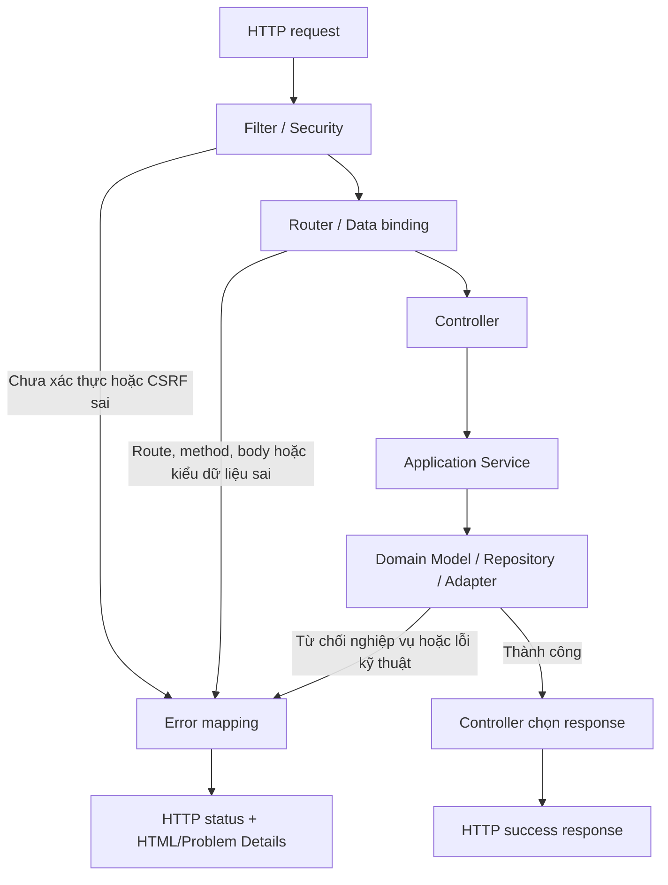

# Ánh xạ lỗi tới trạng thái HTTP trong ứng dụng web

## 1. Vì sao cần ánh xạ lỗi đúng?

Trong ứng dụng MVC, một request có thể thất bại ở nhiều nơi: request không đúng định dạng, người dùng chưa đăng nhập, người dùng không có quyền, tài nguyên không tồn tại, thao tác vi phạm quy tắc nghiệp vụ hoặc hệ thống gặp sự cố kỹ thuật. Mỗi tình huống có ý nghĩa khác nhau đối với client.

**HTTP status code** là một phần của hợp đồng giữa máy chủ và client. Nó cho biết request đã được xử lý như thế nào và giúp trình duyệt, ứng dụng di động, API client, proxy hoặc hệ thống giám sát quyết định bước tiếp theo.

Nếu mọi lỗi đều trả `500 Internal Server Error`, client không thể phân biệt dữ liệu sai với sự cố máy chủ. Nếu mọi lỗi đều trả `200 OK` kèm một trường `success: false`, công cụ HTTP, cache, monitoring và client có thể hiểu nhầm request đã thành công. Ánh xạ status đúng giúp phản hồi nhất quán, dễ xử lý và dễ vận hành.

Trong MVC, trách nhiệm thường được chia như sau:

- **Model / Domain Model** xác định quy tắc nghiệp vụ và có thể từ chối một hành động.
- **Application Service** điều phối use case, quyền truy cập, transaction và kết quả.
- **Controller hoặc exception handler** ánh xạ kết quả sang HTTP status và định dạng response.
- **View** trình bày lỗi theo cách người dùng hiểu được.

Domain Model không nên phụ thuộc vào HTTP status hoặc tên trang lỗi. Một quy tắc như “đơn đã giao không thể hủy” vẫn phải đúng khi use case được gọi từ HTML, REST API hoặc tác vụ nền.

## 2. Phân loại lỗi trước khi chọn status

Không nên chọn mã HTTP chỉ dựa vào tên exception. Trước tiên, xác định lỗi thuộc nhóm nào và client cần biết điều gì.

| Nhóm lỗi | Ví dụ | Nơi phát hiện thường gặp |
|---|---|---|
| Lỗi cú pháp hoặc cấu trúc request | JSON sai định dạng, thiếu tham số bắt buộc, ID không chuyển được thành số | HTTP parser, message converter, binding, Controller |
| Lỗi validation đầu vào | Email sai định dạng, số lượng âm, trường vượt giới hạn | Request DTO, form validation |
| Lỗi xác thực (authentication) | Chưa đăng nhập, token hết hạn hoặc không hợp lệ | Security filter, authentication layer |
| Lỗi phân quyền (authorization) | Đã đăng nhập nhưng không được sửa tài nguyên | Security layer, Application Service, policy |
| Tài nguyên không tồn tại | Không tìm thấy đơn hàng hoặc sản phẩm | Application Service, repository |
| Từ chối nghiệp vụ | Đơn đã giao nên không thể hủy; hạn mức không đủ | Domain Model, Domain Service |
| Xung đột trạng thái hoặc đồng thời | Version đã thay đổi, request khác vừa cập nhật tài nguyên | Domain/application layer, persistence |
| Lỗi hạ tầng hoặc hệ thống | Database lỗi, dịch vụ ngoài không phản hồi | Infrastructure adapter, runtime |

Một lỗi có thể được phát hiện ở nhiều lớp. Ví dụ, thiếu quyền có thể bị chặn bởi security filter trước khi Controller chạy, hoặc được phát hiện trong Application Service khi kiểm tra quyền trên một đơn hàng cụ thể. Dù phát hiện ở đâu, hợp đồng HTTP nên nhất quán.

## 3. Các HTTP status thường dùng

### 3.1. Lỗi phía client và định tuyến

| Status | Tên | Khi nào dùng |
|---|---|---|
| `400 Bad Request` | Request không hợp lệ | JSON sai cú pháp, tham số không chuyển đổi được hoặc request vi phạm cấu trúc đầu vào |
| `404 Not Found` | Không tìm thấy | Route hoặc tài nguyên không tồn tại; đôi khi dùng để che giấu tài nguyên mà người gọi không được phép biết |
| `405 Method Not Allowed` | Method không được hỗ trợ | Có tài nguyên/route nhưng HTTP method gửi đến không được cho phép; response cần có header `Allow` |
| `406 Not Acceptable` | Không có biểu diễn phù hợp | Máy chủ không thể tạo response theo các media type client khai báo trong `Accept` |
| `408 Request Timeout` | Request quá thời gian | Máy chủ không nhận đủ request trong thời hạn cho phép |
| `413 Content Too Large` | Nội dung quá lớn | Body hoặc file upload vượt giới hạn |
| `415 Unsupported Media Type` | Media type không hỗ trợ | Client gửi `Content-Type` mà endpoint không thể đọc, ví dụ gửi XML khi chỉ nhận JSON |
| `422 Unprocessable Content` | Nội dung không thể xử lý theo ngữ nghĩa | Cú pháp request hợp lệ nhưng dữ liệu không đáp ứng quy tắc hoặc ngữ nghĩa được API quy định |
| `429 Too Many Requests` | Quá nhiều request | Người dùng hoặc client vượt giới hạn rate limit |

`400` và `422` có thể được dùng theo các quy ước khác nhau. Nhiều API dùng `400` cho cả lỗi cú pháp và validation; một số API dành `422` cho nội dung hợp lệ về cú pháp nhưng không thể xử lý theo ngữ nghĩa. Điều quan trọng là tài liệu API phải định nghĩa nhất quán.

### 3.2. Xác thực và phân quyền

| Status | Tên | Khi nào dùng |
|---|---|---|
| `401 Unauthorized` | Chưa xác thực hoặc thông tin xác thực không hợp lệ | Người dùng chưa đăng nhập, token hết hạn hoặc credential không hợp lệ |
| `403 Forbidden` | Không được phép | Người dùng đã được xác thực nhưng không có quyền thực hiện hành động |

Tên `401 Unauthorized` dễ gây nhầm: trong ngữ nghĩa HTTP, nó thường có nghĩa client cần cung cấp hoặc làm mới thông tin xác thực. Với cơ chế HTTP authentication, response `401` cần có header `WWW-Authenticate` phù hợp.

`403` biểu thị máy chủ hiểu request nhưng từ chối thực hiện vì quyền của người gọi không đủ. Trong một số hệ thống, có thể trả `404` thay cho `403` để không tiết lộ tài nguyên có tồn tại hay không. Đây là quyết định bảo mật cần được áp dụng nhất quán.

### 3.3. Xung đột nghiệp vụ và trạng thái tài nguyên

| Status | Tên | Khi nào dùng |
|---|---|---|
| `409 Conflict` | Xung đột với trạng thái hiện tại | Đơn đã giao nên không thể hủy; thao tác xung đột với một cập nhật vừa xảy ra; tài nguyên đã ở trạng thái không cho phép hành động |
| `412 Precondition Failed` | Điều kiện request không đạt | Client gửi `If-Match` hoặc điều kiện tương tự nhưng version/ETag hiện tại không khớp |
| `422 Unprocessable Content` | Dữ liệu có ý nghĩa nhưng không được chấp nhận | Giá trị hợp lệ về cú pháp nhưng vi phạm quy tắc nội dung theo hợp đồng API |

Không có một status bắt buộc cho mọi từ chối nghiệp vụ. Chẳng hạn, `409` phù hợp khi trạng thái hiện tại của tài nguyên gây xung đột; `422` có thể phù hợp khi nội dung request không được chấp nhận theo ngữ nghĩa. Chọn theo bản chất lỗi và giữ quy ước ổn định.

### 3.4. Lỗi phía máy chủ và dịch vụ phụ thuộc

| Status | Tên | Khi nào dùng |
|---|---|---|
| `500 Internal Server Error` | Lỗi không dự kiến | Exception không được xử lý, lỗi lập trình hoặc trạng thái nội bộ bất thường |
| `502 Bad Gateway` | Gateway nhận phản hồi không hợp lệ | Proxy/gateway nhận phản hồi lỗi hoặc không hợp lệ từ upstream |
| `503 Service Unavailable` | Dịch vụ tạm thời không sẵn sàng | Ứng dụng quá tải, đang bảo trì hoặc không thể phục vụ tạm thời |
| `504 Gateway Timeout` | Gateway chờ upstream quá lâu | Gateway/proxy không nhận được phản hồi đúng hạn từ dịch vụ upstream |

Nếu ứng dụng gọi một dịch vụ ngoài bị timeout, status trả về phụ thuộc vai trò của ứng dụng và hợp đồng API. Một gateway có thể trả `504`; một API trực tiếp có thể dùng `503` hoặc một mã phù hợp khác theo chính sách. Không ánh xạ mọi timeout thành `500` một cách máy móc.

## 4. Luồng ánh xạ lỗi trong Web MVC

Một lỗi có thể phát sinh trước Controller, trong Controller, trong use case hoặc khi render response.



Trong Spring MVC, các cơ chế thường tham gia gồm:

- Security filter chain xử lý authentication, authorization và CSRF trước khi handler được gọi.
- `DispatcherServlet` và handler mapping tìm Controller phù hợp.
- Argument resolver, message converter và data binder chuyển request thành tham số.
- `@ExceptionHandler`, `@ControllerAdvice` hoặc `@RestControllerAdvice` ánh xạ exception thành response.
- Error handling của Servlet container hoặc Spring Boot xử lý các lỗi chưa được xử lý ở tầng MVC.

Không phải mọi lỗi đều đi qua cùng một `@ControllerAdvice`. Một số lỗi phát sinh trước khi Spring MVC chọn handler, hoặc do reverse proxy/web server từ chối request. Vì vậy, cần kiểm thử cả các lớp biên quan trọng.

## 5. Chọn response HTML hay API error

Một ứng dụng MVC có thể phục vụ cả trang HTML và REST API. Cùng một lỗi nghiệp vụ có thể cần cách trình bày khác nhau tùy client.

| Client | Cách phản hồi thường dùng |
|---|---|
| Trình duyệt tải trang HTML | Render trang lỗi với status phù hợp hoặc redirect đến trang an toàn kèm flash message |
| Biểu mẫu HTML có lỗi validation | Trả lại form cùng lỗi gắn với trường; thường giữ lại dữ liệu đã nhập |
| REST API | Trả status code và body lỗi có cấu trúc như Problem Details |
| AJAX/fetch client | Trả JSON lỗi; component cập nhật trạng thái lỗi tại vùng tương ứng |
| Webhook hoặc service-to-service | Trả status và body theo hợp đồng tích hợp; có thể kèm retry guidance |

Không nên trả HTML login page cho một API client đang chờ JSON. API thường cần `401` hoặc `403` với body lỗi phù hợp; ứng dụng trình duyệt truyền thống có thể redirect đến trang đăng nhập theo thiết kế. Hãy phân biệt các route và loại client.

## 6. Chuẩn hóa body lỗi với Problem Details

Với REST API, có thể dùng **Problem Details** theo RFC 9457, thường được gửi với media type `application/problem+json`. Định dạng này cung cấp cấu trúc thống nhất cho lỗi HTTP.

Các trường chuẩn thường dùng:

| Trường | Ý nghĩa |
|---|---|
| `type` | URI định danh loại vấn đề; nếu không có thông tin cụ thể có thể dùng `about:blank` |
| `title` | Tiêu đề ngắn mô tả loại lỗi |
| `status` | HTTP status code |
| `detail` | Giải thích cụ thể cho lần xảy ra lỗi này, an toàn để gửi client |
| `instance` | URI định danh lần xảy ra lỗi hoặc request cụ thể |

Ứng dụng có thể thêm extension member như `code`, `traceId` hoặc `errors`. Các mã này cần ổn định và được tài liệu hóa.

Ví dụ lỗi xung đột đơn hàng:

```json
{
  "type": "https://api.example.test/problems/order-state-conflict",
  "title": "Không thể hủy đơn hàng",
  "status": 409,
  "detail": "Đơn hàng đã được bàn giao cho đơn vị vận chuyển.",
  "instance": "/api/orders/42/cancel",
  "code": "ORDER_ALREADY_SHIPPED",
  "traceId": "01J8EXAMPLE7Q9"
}
```

`type` trong ví dụ là địa chỉ minh họa; sản phẩm thực tế nên dùng URI định danh do tổ chức kiểm soát hoặc giá trị phù hợp với hợp đồng. Không đưa stack trace, SQL, đường dẫn nội bộ, credential hoặc dữ liệu cá nhân của người khác vào `detail`.

## 7. Ví dụ Spring: ánh xạ exception bằng `@RestControllerAdvice`

Giả sử ứng dụng có các exception nghiệp vụ riêng:

```java
public class ProductNotFoundException extends RuntimeException {
    public ProductNotFoundException(UUID id) {
        super("Product not found: " + id);
    }
}

public class OrderStateConflictException extends RuntimeException {
    public OrderStateConflictException() {
        super("Order cannot be cancelled in its current state");
    }
}
```

Exception nội bộ có thể chứa thông tin để chẩn đoán, nhưng không nên trả nguyên văn message đó cho client.

Một exception handler tập trung có thể ánh xạ chúng:

```java
@RestControllerAdvice
public class ApiExceptionHandler {

    @ExceptionHandler(ProductNotFoundException.class)
    public ResponseEntity<ProblemDetail> handleNotFound(
            ProductNotFoundException exception) {
        ProblemDetail problem = ProblemDetail.forStatusAndDetail(
                HttpStatus.NOT_FOUND,
                "Không tìm thấy sản phẩm được yêu cầu.");
        problem.setTitle("Không tìm thấy tài nguyên");
        problem.setProperty("code", "PRODUCT_NOT_FOUND");
        return ResponseEntity.status(HttpStatus.NOT_FOUND).body(problem);
    }

    @ExceptionHandler(OrderStateConflictException.class)
    public ResponseEntity<ProblemDetail> handleConflict(
            OrderStateConflictException exception) {
        ProblemDetail problem = ProblemDetail.forStatusAndDetail(
                HttpStatus.CONFLICT,
                "Đơn hàng không thể hủy ở trạng thái hiện tại.");
        problem.setTitle("Xung đột trạng thái đơn hàng");
        problem.setProperty("code", "ORDER_STATE_CONFLICT");
        return ResponseEntity.status(HttpStatus.CONFLICT).body(problem);
    }
}
```

`ProblemDetail` được Spring Framework hỗ trợ trong các phiên bản Spring 6 trở lên. Với phiên bản cũ hơn, có thể dùng error DTO riêng hoặc thư viện phù hợp. Các method trên chỉ minh họa hai trường hợp; ứng dụng cần định nghĩa thêm cách xử lý validation, authentication, authorization và lỗi không dự kiến.

### 7.1. Ánh xạ lỗi validation

Ví dụ khi `@Valid @RequestBody` thất bại, Spring MVC có thể ném `MethodArgumentNotValidException`. Handler có thể trả danh sách lỗi theo trường:

```java
@ExceptionHandler(MethodArgumentNotValidException.class)
public ResponseEntity<ProblemDetail> handleValidation(
        MethodArgumentNotValidException exception) {

    List<Map<String, String>> errors = exception.getBindingResult()
            .getFieldErrors()
            .stream()
            .map(error -> Map.of(
                    "field", error.getField(),
                    "code", error.getCode() == null ? "INVALID" : error.getCode()))
            .toList();

    ProblemDetail problem = ProblemDetail.forStatusAndDetail(
            HttpStatus.BAD_REQUEST,
            "Một hoặc nhiều trường đầu vào không hợp lệ.");
    problem.setTitle("Dữ liệu đầu vào không hợp lệ");
    problem.setProperty("code", "VALIDATION_FAILED");
    problem.setProperty("errors", errors);

    return ResponseEntity.badRequest().body(problem);
}
```

Ví dụ dùng `400`; API có thể chọn `422` theo hợp đồng đã công bố. Nên trả mã lỗi trường ổn định thay vì phụ thuộc hoàn toàn vào câu message do validator tạo ra. Câu thông báo có thể được bản địa hóa ở client hoặc lớp trình bày.

## 8. Xử lý lỗi cho biểu mẫu HTML

Với server-rendered MVC, lỗi validation thường được trả lại chính View biểu mẫu để người dùng sửa dữ liệu. Ví dụ:

```java
@PostMapping("/products")
public String create(
        @Valid @ModelAttribute("form") CreateProductForm form,
        BindingResult errors,
        Model model) {

    if (errors.hasErrors()) {
        model.addAttribute("pageTitle", "Tạo sản phẩm");
        return "products/new";
    }

    productService.create(form.toCommand());
    return "redirect:/products";
}
```

Khi trả lại View, Spring giữ `BindingResult` để template có thể hiển thị lỗi theo trường. Với lỗi nghiệp vụ ở cấp toàn thao tác, có thể thêm thông báo tổng quát vào Model hoặc dùng Post/Redirect/Get cùng flash attribute.

Với một trang lỗi như 404 hoặc 500, cần bảo đảm HTTP response thực sự mang status tương ứng. Chỉ trả tên template `error/404` không tự động bảo đảm status là `404`; cách đặt status phụ thuộc controller, exception handler và cấu hình framework.

Thông báo cho người dùng nên nói rõ điều gì có thể làm tiếp theo, ví dụ tải lại dữ liệu nếu có xung đột hoặc liên hệ hỗ trợ nếu thao tác không được phép. Không hiển thị tên exception hoặc stack trace.

## 9. Xử lý lỗi không dự kiến

Không phải mọi exception đều nên được chuyển thành lỗi validation hoặc từ chối nghiệp vụ. Lỗi lập trình, database mất kết nối hoặc trạng thái nội bộ bất thường cần được ghi nhận và trả phản hồi tổng quát.

Ví dụ handler cuối cùng:

```java
@ExceptionHandler(Exception.class)
public ResponseEntity<ProblemDetail> handleUnexpected(Exception exception) {
    String traceId = MDC.get("traceId");
    log.error("Unhandled request failure, traceId={}", traceId, exception);

    ProblemDetail problem = ProblemDetail.forStatusAndDetail(
            HttpStatus.INTERNAL_SERVER_ERROR,
            "Hệ thống chưa thể hoàn thành yêu cầu. Vui lòng thử lại sau.");
    problem.setTitle("Lỗi máy chủ");
    problem.setProperty("code", "INTERNAL_ERROR");
    if (traceId != null) {
        problem.setProperty("traceId", traceId);
    }

    return ResponseEntity.internalServerError().body(problem);
}
```

Đoạn mã giả định ứng dụng đã cấu hình logger và correlation ID trong MDC. Không ghi log cùng một exception ở mọi lớp nếu điều đó tạo nhiều bản ghi trùng lặp. Log cần có quyền truy cập phù hợp và tránh lưu secret hoặc dữ liệu nhạy cảm không cần thiết.

Không dùng `catch (Exception)` để biến mọi lỗi thành `400 Bad Request`. Một lỗi máy chủ không phải lỗi do client gửi request; ánh xạ sai sẽ làm sai số liệu giám sát và khiến client xử lý retry không phù hợp.

## 10. Quy tắc cho một số tình huống cụ thể

### 10.1. Không tìm thấy tài nguyên và không có quyền

Giả sử người dùng truy cập `/orders/42`:

- Nếu đơn không tồn tại, có thể trả `404`.
- Nếu đơn tồn tại nhưng người dùng không có quyền xem, có thể trả `403`.
- Nếu chính sách bảo mật không muốn tiết lộ sự tồn tại của đơn, có thể trả `404` cho cả hai trường hợp.

Điều quan trọng là không để response, thời gian xử lý hoặc thông báo làm lộ thông tin ngoài chính sách.

### 10.2. Tài nguyên đã thay đổi đồng thời

Nếu client đọc một tài nguyên với ETag/version rồi gửi cập nhật kèm `If-Match`, máy chủ có thể trả `412 Precondition Failed` khi version không còn khớp. Nếu API không dùng precondition header mà phát hiện xung đột trạng thái trong use case, `409 Conflict` thường phù hợp.

### 10.3. Rate limit

Khi client vượt giới hạn, trả `429 Too Many Requests`. Nếu biết thời điểm có thể thử lại, có thể gửi header `Retry-After`. Không nên trả `500` cho giới hạn được áp dụng có chủ đích.

### 10.4. Dịch vụ ngoài không sẵn sàng

Nếu ứng dụng không thể hoàn tất request vì dịch vụ phụ thuộc tạm thời không sẵn sàng, có thể trả `503 Service Unavailable`. Gateway chờ upstream quá thời gian có thể trả `504 Gateway Timeout`; gateway nhận phản hồi upstream không hợp lệ có thể trả `502 Bad Gateway`. Cần tránh để client retry ngay lập tức theo cách làm hệ thống quá tải thêm.

## 11. Bảo mật của response lỗi

Response lỗi vẫn là dữ liệu gửi ra ngoài và phải tuân thủ cùng yêu cầu bảo mật như response thành công.

- Không trả stack trace, câu SQL, tên class nội bộ, đường dẫn máy chủ hoặc cấu hình kết nối.
- Không trả token, cookie, password, thông tin thanh toán hoặc dữ liệu của người dùng khác.
- Escape nội dung động khi render HTML để tránh XSS.
- Dùng mã lỗi ổn định, không mã hóa dữ liệu bí mật vào mã lỗi.
- Chỉ cung cấp `detail` mà người gọi được phép biết.
- Với lỗi không dự kiến, trả thông báo chung và một `traceId` để hỗ trợ điều tra.
- Không đưa dữ liệu nhạy cảm vào URL hoặc header tùy tiện khi redirect.

Thông tin chi tiết để chẩn đoán nên nằm trong log phía máy chủ với chính sách lưu giữ và phân quyền phù hợp. Client chỉ cần đủ thông tin để hiểu kết quả và quyết định bước tiếp theo.

## 12. Content negotiation và tính nhất quán của lỗi

Nếu cùng một ứng dụng hỗ trợ HTML và JSON, cần định nghĩa rõ cách chọn định dạng lỗi:

- Route `/api/**` có thể luôn trả JSON hoặc Problem Details.
- Route trang web có thể trả template HTML.
- Nếu dùng `Accept`, handler cần tôn trọng media type mà client yêu cầu.
- Không để một API endpoint trả trang HTML mặc định khi exception xảy ra.
- Response lỗi cần có `Content-Type` đúng với body thực tế.

Một API client nhận HTML login page thay vì JSON có thể không parse được response và báo lỗi khó hiểu. Hãy kiểm thử trường hợp lỗi với đúng header `Accept` của từng loại client.

## 13. Kiểm thử ánh xạ lỗi

Kiểm thử cần xác minh cả nguyên nhân, status, body, headers và dữ liệu có bị thay đổi hay không.

| Trường hợp | Status mong đợi thường gặp | Điều cần xác minh |
|---|---:|---|
| JSON sai cú pháp | 400 | Response có định dạng lỗi thống nhất; Controller/use case không chạy |
| Validation thất bại | 400 hoặc 422 theo hợp đồng | Mã lỗi trường rõ ràng; không lưu dữ liệu |
| Chưa xác thực | 401 hoặc redirect đăng nhập cho HTML | API không nhận HTML ngoài ý muốn; header xác thực phù hợp nếu áp dụng |
| Không đủ quyền | 403 hoặc 404 theo chính sách | Không thay đổi dữ liệu; không lộ tài nguyên trái phép |
| Không tìm thấy tài nguyên | 404 | Body lỗi ổn định, không tiết lộ dữ liệu nội bộ |
| Từ chối nghiệp vụ | 409 hoặc 422 theo ngữ nghĩa | Mã lỗi đúng; trạng thái nghiệp vụ không đổi |
| Version/ETag không khớp | 412 | Client có thể tải lại và giải quyết xung đột |
| Method không hỗ trợ | 405 | Có header `Allow` phù hợp |
| Media type không hỗ trợ | 415 | Body lỗi và status đúng hợp đồng |
| Rate limit | 429 | Có `Retry-After` nếu được cung cấp |
| Lỗi không dự kiến | 500 | Không lộ stack trace; có trace ID; log phía máy chủ được ghi |
| Upstream timeout | 503 hoặc 504 tùy vai trò | Phân biệt lỗi phụ thuộc với lỗi validation/nghiệp vụ |

Với Spring, có thể dùng `MockMvc` để kiểm tra status, header và body của Controller/advice. Cần thêm integration test cho security filter, exception phát sinh trước Controller và lỗi do infrastructure adapter. Không chỉ kiểm tra response: hãy xác minh transaction rollback hoặc không có thay đổi dữ liệu khi request thất bại.

## 14. Các lỗi thiết kế thường gặp

1. **Trả `200 OK` cho mọi lỗi:** client và monitoring không thể phân biệt thành công với thất bại.
2. **Trả `500` cho validation hoặc từ chối nghiệp vụ:** biến lỗi dự kiến thành lỗi máy chủ và làm sai chính sách retry.
3. **Dùng `401` cho mọi trường hợp thiếu quyền:** nhầm lẫn xác thực với phân quyền.
4. **Dùng `404` và `403` tùy tiện:** có thể làm lộ tài nguyên hoặc khiến client không hiểu hợp đồng.
5. **Trả nguyên exception message:** có thể làm lộ SQL, cấu trúc hệ thống hoặc dữ liệu nhạy cảm.
6. **Ánh xạ mọi exception vào một status:** làm mất ngữ nghĩa giữa lỗi client, nghiệp vụ và hạ tầng.
7. **Để Domain Model phụ thuộc HTTP:** khiến quy tắc nghiệp vụ khó tái sử dụng ngoài web.
8. **Chỉ kiểm tra lỗi ở Controller:** bỏ sót lỗi từ security filter, routing, binding hoặc reverse proxy.
9. **Không thống nhất body lỗi:** mỗi endpoint dùng một cấu trúc khác nhau, làm client phải xử lý nhiều trường hợp riêng.
10. **Không kiểm tra status của trang lỗi HTML:** template hiển thị đúng nhưng response vẫn mang `200 OK`.

## 15. Quy trình chọn HTTP status

Khi một use case phát sinh lỗi, có thể thực hiện theo trình tự:

1. Xác định request có được phân tích và bind thành công không.
2. Xác định người gọi đã được xác thực chưa.
3. Xác định người gọi có quyền trên tài nguyên và hành động không.
4. Xác định tài nguyên có tồn tại và trạng thái hiện tại có cho phép hành động không.
5. Phân biệt từ chối nghiệp vụ với xung đột đồng thời và lỗi kỹ thuật.
6. Chọn status theo ngữ nghĩa HTTP và hợp đồng đã công bố.
7. Chọn định dạng HTML hoặc JSON phù hợp với client.
8. Trả mã lỗi ổn định, thông báo an toàn và thông tin truy vết phù hợp.
9. Kiểm tra dữ liệu có giữ được tính nhất quán sau thất bại không.
10. Viết test cho status, body, headers và side effect của use case.

## 16. Kết luận

Ánh xạ lỗi sang HTTP status là một phần của thiết kế hợp đồng Web MVC. Hãy phân biệt lỗi request, validation, authentication, authorization, tài nguyên không tồn tại, từ chối nghiệp vụ, xung đột đồng thời và lỗi hạ tầng trước khi chọn mã phản hồi. `400`, `401`, `403`, `404`, `409`, `422`, `500`, `503` và các mã liên quan có ngữ nghĩa riêng, không nên dùng thay thế tùy tiện.

Giữ quy tắc nghiệp vụ độc lập với HTTP; ánh xạ lỗi ở Controller hoặc exception handler; trả Problem Details hoặc HTML phù hợp; không làm lộ thông tin nội bộ; và kiểm thử cả response lẫn trạng thái dữ liệu. Nhờ đó, client có thể xử lý lỗi đúng cách, người dùng hiểu bước tiếp theo và hệ thống vận hành dễ quan sát hơn.
