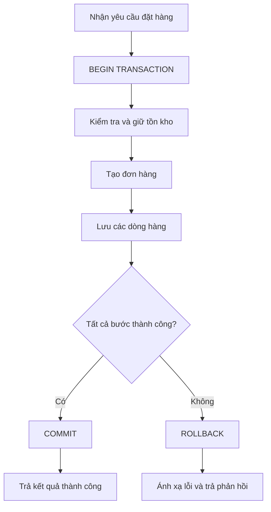
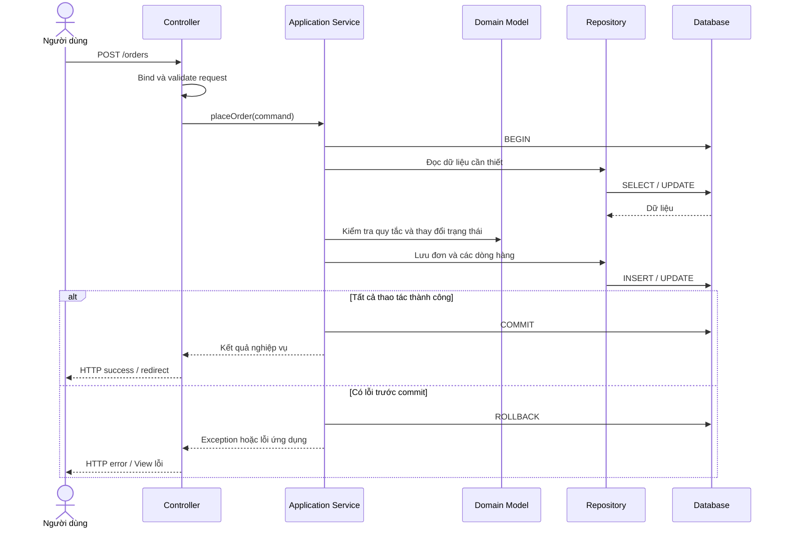
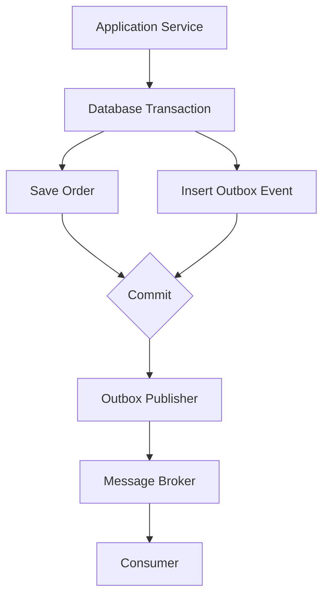

# Đảm bảo giao dịch không để lại thay đổi dở dang

Một request web có thể cần thực hiện nhiều thay đổi liên quan trước khi trả kết quả cho người dùng. Ví dụ, khi đặt hàng, ứng dụng kiểm tra tồn kho, giữ số lượng sản phẩm, tạo đơn hàng và ghi các dòng hàng. Nếu tồn kho đã giảm nhưng việc lưu đơn hàng thất bại, dữ liệu sẽ không còn phản ánh đúng một thao tác nghiệp vụ hoàn chỉnh.

Trong ứng dụng MVC, Controller tiếp nhận request và gọi application service; dịch vụ điều phối Model nghiệp vụ cùng repository; tầng persistence ghi dữ liệu. **Transaction** gom những thay đổi cần cùng thành công thành một đơn vị. Nếu một lỗi làm thao tác không thể hoàn tất, transaction phải rollback để các thay đổi thuộc giao dịch không bị lưu dở dang.

Để đạt được điều đó, cần đặt transaction boundary đúng quanh ca sử dụng, để lỗi đi qua ranh giới transaction theo chính sách rollback, phân biệt lỗi có thể thử lại với lỗi không thể khắc phục bằng retry, và xử lý riêng những tác động nằm ngoài database. Việc trả về một trang lỗi hoặc mã HTTP không tự động hoàn tác dữ liệu; rollback phải được thực hiện ở tầng transaction trước khi Controller tạo phản hồi.

## 1. Thế nào là thay đổi dở dang?

Thay đổi dở dang xảy ra khi một phần thao tác đã được lưu nhưng phần còn lại thất bại, khiến trạng thái cuối cùng không tương ứng với một kết quả nghiệp vụ hợp lệ.

Ví dụ trong ứng dụng bán hàng:

1. Ứng dụng đọc tồn kho và thấy còn 5 sản phẩm.
2. Người dùng đặt 2 sản phẩm; ứng dụng giảm tồn kho còn 3.
3. Việc tạo đơn hàng thất bại do lỗi cơ sở dữ liệu.
4. Nếu phần giảm tồn kho đã commit riêng, hệ thống mất 2 sản phẩm khỏi tồn kho dù không có đơn hàng.

Một số ví dụ khác:

- Chuyển tiền đã ghi nợ tài khoản gửi nhưng chưa ghi có tài khoản nhận.
- Tạo hồ sơ đã lưu bản ghi chính nhưng chưa lưu các thông tin bắt buộc đi kèm.
- Hủy đơn đã đổi trạng thái đơn nhưng chưa giải phóng lượng hàng đã giữ.
- Cập nhật hợp đồng đã ghi phiên bản mới nhưng chưa ghi lịch sử bắt buộc.

Điểm chung là một ca sử dụng gồm nhiều thao tác lưu trữ có quan hệ nhất quán. Nếu các thao tác phải được xem như một kết quả duy nhất, chúng cần nằm trong cùng transaction hoặc được điều phối bằng một quy trình phân tán có cơ chế bù trừ rõ ràng.

### 1.1. Phân biệt lỗi trước khi ghi và lỗi sau khi ghi

Không phải lỗi nào cũng có nguy cơ để lại dữ liệu dở dang:

| Thời điểm | Ví dụ | Cách xử lý thường gặp |
|---|---|---|
| Trước khi bắt đầu thay đổi | Request thiếu trường, sai định dạng | Từ chối request; chưa có thay đổi cần rollback |
| Trong khi kiểm tra nghiệp vụ | Đơn hàng không thể hủy ở trạng thái hiện tại | Trả lỗi nghiệp vụ; nếu chưa ghi dữ liệu thì không có thay đổi dở dang |
| Sau một hoặc nhiều lần ghi trong transaction | Lưu dòng hàng thành công nhưng lưu đơn thất bại | Để lỗi làm transaction rollback toàn bộ thay đổi thuộc giao dịch |
| Khi commit | Deadlock, serialization failure, mất kết nối | Xác định transaction đã commit hay chưa; xử lý retry hoặc kết quả không chắc chắn |
| Sau commit | Gửi email hoặc phát sự kiện thất bại | Dùng outbox, retry hoặc quy trình bù trừ; rollback database đã commit không còn khả thi |

Phân biệt thời điểm lỗi giúp chọn cách khôi phục đúng. Lỗi validation đầu vào thường không cần mở transaction. Lỗi xảy ra sau khi bắt đầu ghi cần chính sách rollback. Lỗi khi gọi dịch vụ ngoài không thể được xử lý như lỗi của một câu SQL trong cùng database transaction.

## 2. Transaction bảo vệ tính nguyên tử

Transaction là đơn vị công việc mà các thay đổi được commit cùng nhau hoặc bị rollback cùng nhau theo khả năng của hệ quản trị. Thuộc tính Atomicity trong ACID bảo vệ tính nguyên tử: không để một nửa thao tác được lưu khi phần còn lại thất bại.

Ví dụ đặt hàng cần ghi:

- Số lượng tồn kho sau khi giữ hàng.
- Bản ghi đơn hàng.
- Các dòng hàng thuộc đơn hàng.
- Bản ghi outbox nếu ứng dụng cần phát sự kiện sau commit.

Nếu tất cả cùng nằm trong một database transaction, lỗi ở bước ghi cuối có thể khiến các bước ghi trước đó bị rollback. Khi transaction commit thành công, toàn bộ thay đổi được xác nhận.



Rollback chỉ hoàn tác các thay đổi thuộc transaction và tài nguyên tham gia transaction đó. Nó không tự hoàn tác email đã gửi, request HTTP đã gửi sang dịch vụ thanh toán hoặc message đã được broker bên ngoài nhận.

### 2.1. Consistency cần được ứng dụng định nghĩa

Transaction không tự hiểu rằng tồn kho không được âm hoặc một đơn đã giao không thể hủy. Ứng dụng cần định nghĩa các invariant và bảo vệ chúng bằng Model nghiệp vụ, application service, database constraint và cơ chế đồng thời phù hợp.

Ví dụ, database có thể đặt `CHECK (available_quantity >= 0)` để từ chối tồn kho âm. Application service vẫn cần kiểm tra quy tắc đặt hàng để trả lỗi có nghĩa cho người dùng. Constraint bảo vệ dữ liệu ngay cả khi có một đường ghi khác bỏ qua ứng dụng.

### 2.2. Một request lỗi không đồng nghĩa transaction đã rollback

HTTP response `400`, `409` hoặc `500` chỉ mô tả kết quả ở ranh giới giao thức. Chúng không tự điều khiển transaction. Nếu Controller trả về trang lỗi sau khi một service đã commit các thay đổi, trang lỗi không thể tự hoàn tác chúng.

Tương tự, việc bắt exception và tạo một đối tượng `FailureResult` không đảm bảo rollback. Cần xem exception xảy ra ở đâu, transaction đang được quản lý bởi ai và chính sách rollback của transaction manager là gì.

## 3. Đặt transaction boundary quanh ca sử dụng

Trong MVC, Controller nên nhận request, kiểm tra cấu trúc dữ liệu đầu vào, lấy danh tính đã xác thực và gọi application service. Application service xác định đơn vị nghiệp vụ cần hoàn tất nguyên tử.



Transaction boundary nên nằm quanh phương thức application service đại diện cho ca sử dụng, thay vì nằm rải rác trong từng Controller hoặc từng repository method.

### 3.1. Vì sao không đặt transaction ở Controller?

Nếu Controller mở transaction, ranh giới dữ liệu bị gắn với HTTP. Cùng một ca sử dụng có thể được gọi từ tác vụ nền, message consumer hoặc một API khác mà không đi qua Controller. Những đường gọi đó có thể quên transaction hoặc tạo ra ranh giới khác nhau.

Application service là nơi phù hợp để điều phối nhiều repository và Model nghiệp vụ thành một thao tác. Controller chỉ quan tâm request và response. Nhờ vậy, các adapter khác nhau có thể dùng chung ca sử dụng với cùng chính sách nhất quán.

### 3.2. Vì sao không commit riêng ở từng repository?

Giả sử một use case gọi ba repository để lưu đơn hàng, dòng hàng và lịch sử. Nếu mỗi phương thức repository tự mở và commit một transaction riêng, hai bước đầu có thể đã commit trước khi bước thứ ba thất bại. Khi đó, việc rollback transaction của bước thứ ba không thể hoàn tác hai lần commit trước.

Repository thường tham gia transaction đang hoạt động do application service mở. Với Spring, propagation mặc định `REQUIRED` thường tham gia transaction hiện tại hoặc tạo transaction mới nếu chưa có. Cần kiểm tra cấu hình transaction manager và nguồn dữ liệu để bảo đảm các repository thật sự dùng chung transaction phù hợp.

## 4. Để exception đi qua transaction boundary

Với Spring, `@Transactional` thường được áp dụng thông qua proxy. Khi một phương thức transaction kết thúc bằng exception phù hợp, transaction interceptor đánh dấu rollback và thực hiện rollback trước khi exception đến caller bên ngoài.

Ví dụ:

```java
@Service
public class PlaceOrderService {
    private final InventoryRepository inventory;
    private final OrderRepository orders;

    public PlaceOrderService(
            InventoryRepository inventory,
            OrderRepository orders) {
        this.inventory = inventory;
        this.orders = orders;
    }

    @Transactional
    public PlaceOrderResult execute(PlaceOrderCommand command) {
        inventory.reserve(
            command.productId(),
            command.quantity()
        );

        Order order = Order.create(command);
        orders.save(order);

        return new PlaceOrderResult(order.getId());
    }
}
```

Nếu `inventory.reserve()` thành công nhưng `orders.save()` ném lỗi runtime, exception thoát khỏi phương thức qua proxy. Spring rollback transaction, bao gồm phần giữ tồn kho và thao tác lưu đơn thuộc cùng transaction. Controller nhận exception sau khi transaction interceptor đã xử lý kết thúc giao dịch.

Ví dụ giả định cả hai repository tham gia cùng transaction manager và không có propagation độc lập. Nếu mỗi repository dùng một nguồn dữ liệu hoặc transaction riêng, cần một giải pháp khác.

### 4.1. Quy tắc rollback mặc định của Spring

Với cấu hình mặc định phổ biến của Spring:

- `RuntimeException` và `Error` làm transaction rollback.
- Checked exception không tự động làm rollback theo mặc định.
- Có thể khai báo `rollbackFor` để chỉ định checked exception cần rollback.
- Có thể khai báo `noRollbackFor`, nhưng chỉ dùng khi nghiệp vụ thực sự muốn transaction commit dù exception đó xảy ra.

Ví dụ:

```java
@Transactional(rollbackFor = InventoryRuleException.class)
public PlaceOrderResult execute(PlaceOrderCommand command)
        throws InventoryRuleException {
    // Các thao tác thuộc cùng ca sử dụng.
}
```

Nếu `InventoryRuleException` là checked exception và xảy ra sau khi đã có thay đổi, `rollbackFor` bảo đảm chính sách rollback được khai báo rõ.

### 4.2. Không bắt lỗi rồi trả kết quả thất bại như bình thường

Một lỗi thường gặp là bắt exception bên trong phương thức transaction rồi trả về kết quả thất bại:

```java
// Không nên: exception bị nuốt bên trong transaction.
@Transactional
public PlaceOrderResult execute(PlaceOrderCommand command) {
    try {
        inventory.reserve(command.productId(), command.quantity());
        orders.save(Order.create(command));
        return PlaceOrderResult.success();
    } catch (DataAccessException exception) {
        return PlaceOrderResult.failure("Không thể lưu đơn hàng");
    }
}
```

Nếu exception không làm transaction tự đánh dấu rollback-only, phương thức kết thúc bình thường và transaction interceptor có thể commit. Một số lỗi từ database hoặc ORM tự đánh dấu transaction rollback-only; khi đó commit có thể thất bại với lỗi unexpected rollback. Không nên phụ thuộc vào hành vi ngầm đó.

Cách đơn giản hơn là để exception đi qua proxy:

```java
@Transactional
public PlaceOrderResult execute(PlaceOrderCommand command) {
    inventory.reserve(command.productId(), command.quantity());
    orders.save(Order.create(command));
    return PlaceOrderResult.success();
}
```

Controller advice xử lý exception sau khi transaction đã rollback và chuyển nó thành phản hồi phù hợp. Nếu cần đổi exception kỹ thuật thành exception ứng dụng, hãy ném exception mới ra khỏi phương thức transaction và giữ nguyên nguyên nhân:

```java
@Transactional
public PlaceOrderResult execute(PlaceOrderCommand command) {
    try {
        inventory.reserve(command.productId(), command.quantity());
        orders.save(Order.create(command));
        return PlaceOrderResult.success();
    } catch (DataIntegrityViolationException exception) {
        throw new OrderPersistenceException(
            "Không thể lưu đơn hàng",
            exception
        );
    }
}
```

`OrderPersistenceException` nên là unchecked exception hoặc được khai báo trong `rollbackFor`. Không trả nội dung SQL hay exception gốc cho người dùng.

### 4.3. Nếu bắt buộc phải bắt exception bên trong transaction

Đôi khi ứng dụng cần ghi nhận lỗi, chuyển đổi kết quả hoặc thực hiện nhánh xử lý trong cùng phương thức. Nếu đã có thay đổi và vẫn muốn trả một kết quả bình thường, phải đánh dấu transaction rollback-only khi thao tác không thể hoàn tất.

```java
@Transactional
public PlaceOrderResult execute(PlaceOrderCommand command) {
    try {
        inventory.reserve(command.productId(), command.quantity());
        orders.save(Order.create(command));
        return PlaceOrderResult.success();
    } catch (RecoverablePersistenceException exception) {
        TransactionAspectSupport.currentTransactionStatus()
            .setRollbackOnly();
        return PlaceOrderResult.failure("Không thể hoàn tất đơn hàng");
    }
}
```

Đây là cách điều khiển ở mức thấp và cần dùng thận trọng. Nếu transaction đã rollback-only do database hoặc ORM, việc tiếp tục truy vấn hay ghi thêm thường không có ý nghĩa. Ưu tiên để exception thoát khỏi transaction boundary; chỉ dùng `setRollbackOnly()` khi thiết kế kết quả trả về yêu cầu rõ ràng và nhóm phát triển hiểu hệ quả của nó.

### 4.4. Transaction proxy và self-invocation

Trong cấu hình proxy-based phổ biến, lời gọi `this.someTransactionalMethod()` bên trong cùng bean không đi qua proxy. Vì vậy, annotation `@Transactional` trên phương thức được gọi có thể không được áp dụng như mong đợi.

Đặt transaction boundary ở phương thức public của application service được gọi từ bean khác, hoặc tổ chức service thành các bean có ranh giới rõ ràng. Không nên chỉ nhìn thấy annotation rồi mặc định mọi đường gọi đều được quản lý transaction.

## 5. Validation và lỗi nghiệp vụ trước khi ghi

Một cách giảm nguy cơ thay đổi dở dang là kiểm tra những điều kiện có thể xác định trước khi thực hiện ghi dữ liệu. Controller có thể kiểm tra cấu trúc request; application service kiểm tra quyền và điều kiện ca sử dụng; Model nghiệp vụ bảo vệ invariant khi thực hiện hành vi.

Ví dụ:

- Trường số lượng bị thiếu hoặc không phải số nguyên: từ chối ở binding/validation.
- Số lượng nhỏ hơn hoặc bằng 0: từ chối ở validation và vẫn bảo vệ trong Model nếu đó là invariant.
- Người dùng không có quyền đặt hàng: từ chối trước khi thay đổi dữ liệu.
- Sản phẩm đã ngừng bán: từ chối trong application/domain trước khi lưu đơn.
- Tồn kho thay đổi ngay sau lần kiểm tra: cần transaction cùng cơ chế concurrency như conditional update hoặc locking.

Kiểm tra sớm giúp giảm số lỗi phát sinh sau khi ghi, nhưng không thay thế transaction. Trạng thái có thể thay đổi giữa lúc kiểm tra và lúc ghi; những điều kiện chịu ảnh hưởng của request đồng thời phải được bảo vệ ở thời điểm cập nhật thực tế.

## 6. Lỗi database và trạng thái rollback-only

Các lỗi persistence có thể xuất hiện khi ghi dữ liệu:

- Vi phạm unique constraint hoặc foreign key.
- Vi phạm check constraint hoặc NOT NULL.
- Deadlock hoặc lock timeout.
- Optimistic locking conflict.
- Kết nối database bị gián đoạn.
- Transaction timeout hoặc serialization failure.

Một số lỗi khiến transaction bị đánh dấu rollback-only. Khi điều đó xảy ra, ứng dụng không nên tiếp tục dùng transaction như thể vẫn còn khả năng commit. Hãy để lỗi truyền tới transaction boundary, rollback và ánh xạ lỗi ở bên ngoài.

### 6.1. Không tiếp tục ghi sau lỗi constraint

Ví dụ, khi chèn một mã đơn trùng và database báo unique violation, transaction có thể đã ở trạng thái không thể commit. Bắt lỗi rồi thử chèn một bản ghi khác trong cùng transaction thường không phải cách phục hồi an toàn. Hãy rollback transaction hiện tại, sau đó nếu nghiệp vụ cho phép thì bắt đầu một transaction mới để thực hiện thao tác khác.

### 6.2. Optimistic locking conflict

Nếu một bản ghi có `@Version` và một transaction khác đã cập nhật trước, lần ghi của transaction hiện tại có thể phát sinh optimistic lock exception. Đây là xung đột dữ liệu, không nhất thiết là lỗi hệ thống.

Ứng dụng có thể:

- Rollback transaction hiện tại.
- Tải lại dữ liệu trong transaction mới.
- Tính lại thao tác nếu có thể làm an toàn.
- Hoặc trả lỗi `409 Conflict` để người dùng xem dữ liệu mới và quyết định lại.

Không nên retry vô hạn hoặc tự động ghi đè dữ liệu mới của người khác.

### 6.3. Deadlock và serialization failure

Database có thể hủy một transaction để giải quyết deadlock hoặc vi phạm isolation. Nếu thao tác có thể thử lại, cần retry toàn bộ ca sử dụng trong transaction mới, không chỉ chạy lại câu lệnh cuối. Retry cần giới hạn số lần, có backoff và chỉ áp dụng khi thao tác idempotent hoặc được bảo vệ khỏi tác động lặp.

## 7. Xử lý lỗi sau transaction tại Controller

Controller không nên vừa bắt lỗi persistence vừa tự quyết định rollback. Khi exception thoát khỏi application service, transaction interceptor đã thực hiện rollback theo chính sách. Lúc đó, adapter web ánh xạ lỗi thành HTTP response hoặc View lỗi.

Ví dụ với Spring MVC:

```java
@RestControllerAdvice
public class ApiExceptionHandler {

    @ExceptionHandler(InsufficientInventoryException.class)
    public ResponseEntity<ApiError> insufficientInventory(
            InsufficientInventoryException exception) {
        return ResponseEntity.status(HttpStatus.CONFLICT)
            .body(new ApiError(
                "INSUFFICIENT_INVENTORY",
                "Sản phẩm không còn đủ số lượng để đặt."
            ));
    }

    @ExceptionHandler(OrderPersistenceException.class)
    public ResponseEntity<ApiError> persistenceFailure(
            OrderPersistenceException exception) {
        return ResponseEntity.status(HttpStatus.INTERNAL_SERVER_ERROR)
            .body(new ApiError(
                "ORDER_NOT_SAVED",
                "Chưa thể lưu đơn hàng. Vui lòng thử lại sau."
            ));
    }
}
```

Đây là ví dụ rút gọn; dự án cần định nghĩa `ApiError`, log exception cùng correlation ID và thống nhất status code. Không đưa SQL, tên bảng, stack trace hoặc thông tin kết nối vào response.

Với HTML server-rendered, `@ControllerAdvice` có thể trả View lỗi hoặc redirect kèm flash message. Nếu validation thất bại trước khi gọi service, nên giữ lại dữ liệu hợp lệ người dùng đã nhập và gắn lỗi vào đúng trường. Nếu lỗi xảy ra sau khi service rollback, View có thể hiển thị thông báo chung và mã tham chiếu để hỗ trợ tra cứu.

### 7.1. Chọn status code theo bản chất lỗi

| Lỗi | Phản hồi HTTP thường dùng | Gợi ý cho View/client |
|---|---|---|
| Request sai cấu trúc hoặc validation | `400 Bad Request` hoặc `422 Unprocessable Content` theo hợp đồng | Hiển thị lỗi trường, yêu cầu sửa dữ liệu |
| Chưa xác thực | `401 Unauthorized` | Yêu cầu đăng nhập lại |
| Không đủ quyền | `403 Forbidden` | Thông báo không thể thực hiện thao tác |
| Không tìm thấy tài nguyên | `404 Not Found` | Hiển thị trang không tìm thấy |
| Xung đột trạng thái hoặc version | `409 Conflict` | Tải lại và xem dữ liệu mới |
| Lỗi tạm thời phía dịch vụ | `503 Service Unavailable` nếu phù hợp | Cho phép thử lại sau, có thể kèm `Retry-After` |
| Lỗi không dự kiến | `500 Internal Server Error` | Thông báo an toàn và mã tham chiếu |

Không nên trả `500` cho lỗi validation hoặc lỗi nghiệp vụ có thể nhận diện. Cũng không nên trả `200 OK` với một body báo thất bại nếu hợp đồng API yêu cầu status phản ánh kết quả thực tế.

## 8. Transaction không rollback được side effect bên ngoài

Database transaction chỉ kiểm soát những thao tác tham gia cùng transaction manager. Nó không thể hoàn tác một email đã gửi, một khoản tiền đã được cổng thanh toán thu hoặc một message đã được hệ thống khác nhận.

Ví dụ không an toàn:

```java
@Transactional
public PlaceOrderResult execute(PlaceOrderCommand command) {
    Order order = orders.save(Order.create(command));
    paymentGateway.charge(order.total());
    emailSender.sendConfirmation(order);
    return new PlaceOrderResult(order.getId());
}
```

Nếu cổng thanh toán đã thu tiền nhưng transaction database rollback, ứng dụng có thể có khoản thu không gắn với đơn hàng đã lưu. Nếu email gửi trước khi commit rồi commit thất bại, người dùng nhận thông báo xác nhận sai.

### 8.1. Phát sự kiện sau commit

Với side effect không cần bảo đảm giao nhận tuyệt đối, có thể đăng ký callback hoặc listener chỉ chạy sau khi transaction commit. Cách này tránh phát thông báo thành công trước khi dữ liệu được lưu.

Tuy nhiên, callback trong bộ nhớ có thể mất nếu tiến trình dừng sau commit nhưng trước khi callback chạy. Vì vậy, after-commit phù hợp với một số thông báo không quan trọng hoặc tác vụ có thể tái tạo; không thay thế outbox cho sự kiện cần bảo đảm bền vững.

### 8.2. Transactional Outbox

Transactional Outbox ghi thay đổi nghiệp vụ và sự kiện cần phát vào cùng database transaction. Một publisher riêng đọc outbox và gửi sự kiện sau commit.



Nếu transaction rollback, cả đơn hàng và outbox record đều không được commit. Nếu commit thành công, publisher có thể gửi lại event khi chưa chắc broker đã nhận. Consumer cần idempotency hoặc deduplication theo event ID để tránh xử lý tác động nhiều lần.

### 8.3. Saga và hành động bù trừ

Với quy trình qua nhiều dịch vụ hoặc database độc lập, không thể mặc định một transaction ACID bao trùm tất cả. Saga chia quy trình thành các transaction cục bộ và định nghĩa hành động bù trừ khi một bước sau thất bại.

Ví dụ:

1. Tạo đơn ở trạng thái `PENDING`.
2. Giữ tồn kho.
3. Yêu cầu cổng thanh toán thu tiền.
4. Nếu thanh toán thành công, xác nhận đơn.
5. Nếu thanh toán thất bại, giải phóng tồn kho và đánh dấu đơn thất bại.

Hành động bù trừ là một thao tác nghiệp vụ mới, không phải rollback vật lý của các database đã commit. Saga cần trạng thái quy trình, timeout, retry có giới hạn, idempotency và xử lý kết quả không chắc chắn.

## 9. Retry an toàn và kết quả không chắc chắn

Không phải cứ nhận lỗi là có thể gửi lại request. Cần phân biệt:

- **Lỗi chắc chắn rollback:** transaction đã rollback; có thể thử lại nếu nguyên nhân tạm thời và thao tác an toàn.
- **Lỗi nghiệp vụ:** thiếu tồn kho, trạng thái không hợp lệ hoặc không đủ quyền; retry nguyên trạng không giải quyết được vấn đề.
- **Lỗi trước khi server nhận request:** client có thể gửi lại nếu request được thiết kế phù hợp.
- **Mất kết nối khi commit hoặc sau commit:** client không biết chắc server đã commit hay chưa.

Trường hợp cuối đặc biệt quan trọng. Server có thể đã commit thành công nhưng response bị mất trên đường truyền. Client thấy timeout và gửi lại; nếu không có idempotency, ứng dụng có thể tạo hai đơn hoặc thu tiền hai lần.

### 9.1. Idempotency key

Với thao tác tạo đơn, thanh toán hoặc chuyển tiền, client có thể gửi một idempotency key cho mỗi ý định thao tác. Server lưu key cùng trạng thái và kết quả. Khi nhận lại cùng key:

- Nếu thao tác đã hoàn tất, trả lại kết quả đã lưu.
- Nếu thao tác đang xử lý, trả trạng thái đang xử lý hoặc hướng dẫn kiểm tra lại.
- Nếu key được dùng với payload khác, từ chối vì một key không đại diện cho hai ý định khác nhau.

Unique constraint trên key và transaction lưu idempotency record cùng thay đổi nghiệp vụ giúp ngăn hai request đồng thời cùng tạo tác động. Chính sách này không thay thế invariant, nhưng giúp retry không tạo ra kết quả trùng.

### 9.2. Retry toàn bộ ca sử dụng trong transaction mới

Khi deadlock hoặc serialization failure làm transaction rollback, retry nên bắt đầu một transaction mới và đọc lại trạng thái mới nhất. Không nên tiếp tục dùng entity hoặc persistence context của transaction đã rollback.

Retry cần:

- Giới hạn số lần và dùng backoff.
- Chỉ áp dụng cho lỗi được phân loại là tạm thời.
- Bảo đảm thao tác idempotent hoặc có idempotency key.
- Không retry lỗi validation, phân quyền hoặc quy tắc nghiệp vụ không đổi.
- Ghi log số lần thử và nguyên nhân cuối cùng.

## 10. Lưu ý về propagation và transaction độc lập

Spring hỗ trợ nhiều kiểu propagation. Cần hiểu chúng vì một transaction phụ có thể commit độc lập với transaction chính.

| Propagation | Hành vi khái quát | Rủi ro cần chú ý |
|---|---|---|
| `REQUIRED` | Tham gia transaction hiện tại hoặc tạo mới nếu chưa có | Thường phù hợp với các bước của cùng use case |
| `REQUIRES_NEW` | Tạm dừng transaction hiện tại và tạo transaction độc lập | Transaction con có thể commit dù transaction ngoài rollback |
| `NESTED` | Có thể dùng savepoint bên trong transaction hiện tại nếu manager/database hỗ trợ | Không phải mọi cấu hình đều hỗ trợ; semantics khác rollback toàn bộ |
| `SUPPORTS` | Tham gia nếu có transaction, nếu không thì chạy không transaction | Cần hiểu hành vi khi được gọi độc lập |

Không nên đặt repository ghi dữ liệu nghiệp vụ quan trọng ở `REQUIRES_NEW` chỉ để “bảo đảm lưu được”. Nếu transaction chính thất bại nhưng transaction con đã commit, dữ liệu vẫn có thể ở trạng thái dở dang. Chỉ dùng transaction độc lập khi nghiệp vụ thực sự muốn dữ liệu đó tồn tại độc lập, chẳng hạn một số bản ghi audit có chính sách riêng.

## 11. Kiểm thử để chứng minh không có thay đổi dở dang

Unit test có thể xác minh Model từ chối trạng thái không hợp lệ, nhưng để chứng minh rollback cần kiểm thử với transaction manager và database thật hoặc môi trường tích hợp tương đương.

| Kiểm thử | Cách thực hiện | Điều cần xác minh |
|---|---|---|
| Rollback sau lần ghi đầu | Cho thao tác thứ hai thất bại sau khi thao tác thứ nhất đã ghi | Không có thay đổi nào thuộc transaction được commit |
| Constraint violation | Tạo dữ liệu vi phạm unique/check/foreign key | Transaction rollback và lỗi được ánh xạ đúng |
| Runtime vs checked exception | Ném từng loại exception trong transaction | Chính sách rollback khớp cấu hình |
| Exception bị bắt | Bắt lỗi bên trong service và kiểm tra rollback-only | Không vô tình commit thay đổi dở dang |
| Concurrency | Hai request cùng cập nhật tồn kho hoặc version | Invariant vẫn đúng sau khi cả hai kết thúc |
| Outbox | Lỗi trước commit và lỗi khi publisher gửi message | Outbox không tồn tại khi rollback; event có thể được retry sau commit |
| Idempotency | Gửi cùng key nhiều lần, kể cả đồng thời | Chỉ có một tác động nghiệp vụ |

### 11.1. Ví dụ kiểm thử rollback

Giả sử use case giảm tồn kho rồi lưu đơn. Test có thể cấu hình repository lưu đơn ném exception sau khi tồn kho đã được cập nhật. Sau khi service kết thúc, đọc tồn kho trong một transaction mới và xác minh giá trị vẫn như ban đầu.

```java
@SpringBootTest
class PlaceOrderTransactionTest {
    @Autowired
    PlaceOrderService placeOrder;

    @Autowired
    InventoryRepository inventory;

    @MockBean
    OrderRepository orders;

    @Test
    void rollsBackInventoryWhenOrderSaveFails() {
        inventory.setAvailableQuantity(10L, 5);
        given(orders.save(any(Order.class)))
            .willThrow(new OrderPersistenceException("write failed"));

        assertThrows(OrderPersistenceException.class,
            () -> placeOrder.execute(commandFor(10L, 2)));

        assertEquals(5, inventory.getAvailableQuantity(10L));
    }
}
```

Đây là phác thảo; test thực tế cần cấu hình repository tồn kho tham gia cùng transaction manager và dùng database kiểm thử. Nếu test method được bọc sẵn trong một transaction do test framework quản lý, cần chú ý thời điểm commit/rollback và cách đọc lại dữ liệu. Mock repository lưu đơn có thể gây exception trước khi SQL của nó chạy, nhưng phần cập nhật tồn kho vẫn phải là thao tác database thật để xác minh rollback.

### 11.2. Không để transaction test che giấu lỗi

Một số framework tự rollback transaction của test sau khi test kết thúc. Điều này không chứng minh service tự rollback đúng lúc. Cần thiết kế test sao cho service được gọi qua proxy và trạng thái được đọc trong transaction độc lập sau khi service đã kết thúc. Có thể dùng `TestTransaction` hoặc một transaction mới tùy cấu hình test.

### 11.3. Kiểm thử lỗi cạnh tranh

Dùng barrier hoặc latch để hai request cùng đọc trạng thái ban đầu trước khi cập nhật. Sau khi cả hai kết thúc, kiểm tra tổng số lượng đã giữ không vượt tồn kho, không có bản ghi đơn trùng và lỗi conflict được ánh xạ phù hợp. Tránh dùng `Thread.sleep` để đoán thời điểm chạy vì test dễ chập chờn.

## 12. Những sai lầm thường gặp

**Trả trang lỗi nhưng transaction đã commit.** HTTP error không rollback database. Hãy bảo đảm lỗi đi qua transaction boundary trước khi được ánh xạ thành response.

**Bắt exception rồi trả kết quả thất bại bình thường.** Transaction có thể commit nếu không bị đánh dấu rollback-only. Hãy để exception thoát khỏi phương thức transaction hoặc đánh dấu rollback có chủ đích.

**Chỉ dùng transaction cho từng câu ghi.** Một ca sử dụng nhiều bước có thể để lại các phần đã commit. Hãy đặt transaction quanh use case cần tính nguyên tử.

**Giả định mọi exception đều rollback.** Spring mặc định xử lý `RuntimeException` và `Error`; checked exception cần chính sách phù hợp. Hãy khai báo `rollbackFor` khi cần.

**Nuốt lỗi database rồi tiếp tục ghi.** Transaction có thể đã rollback-only và persistence context không còn an toàn để tiếp tục. Hãy rollback và bắt đầu transaction mới nếu cần phục hồi.

**Gọi dịch vụ ngoài trong transaction dài.** Email, thanh toán và message broker không tự rollback cùng database. Dùng after-commit, outbox hoặc Saga theo yêu cầu giao nhận.

**Retry mọi lỗi.** Lỗi nghiệp vụ không tự hết khi gửi lại; retry thao tác ghi có thể tạo tác động trùng. Phân loại lỗi và dùng idempotency.

**Dùng `REQUIRES_NEW` để lưu một phần dữ liệu nghiệp vụ.** Transaction độc lập có thể commit dù transaction chính rollback, tạo ra dữ liệu không nhất quán. Chỉ dùng khi tính độc lập là yêu cầu có chủ đích.

**Cho rằng timeout nghĩa là server chưa commit.** Response có thể bị mất sau commit. Dùng idempotency key hoặc endpoint tra cứu trạng thái để xử lý kết quả không chắc chắn.

## 13. Checklist xử lý lỗi và transaction

Khi thiết kế một use case có nhiều thay đổi dữ liệu, hãy tự hỏi:

1. Những thay đổi nào phải cùng thành công hoặc cùng rollback?
2. Transaction boundary đã nằm quanh application use case chưa?
3. Các repository có tham gia cùng transaction manager và nguồn dữ liệu không?
4. Lỗi nào xảy ra trước khi ghi, trong khi ghi, lúc commit hoặc sau commit?
5. Exception có đi qua proxy để kích hoạt rollback không?
6. Checked exception đã có `rollbackFor` phù hợp chưa?
7. Có đoạn catch nào nuốt exception và trả về bình thường sau khi đã ghi không?
8. Database constraint hoặc concurrency control có bảo vệ invariant không?
9. Có side effect ngoài database cần outbox, after-commit hoặc Saga không?
10. Retry có giới hạn và chỉ áp dụng cho lỗi tạm thời không?
11. Request lặp hoặc kết quả timeout không chắc chắn có được bảo vệ bằng idempotency không?
12. Integration test có chứng minh trạng thái database được khôi phục sau lỗi không?

## Kết luận

Để giao dịch không để lại thay đổi dở dang, cần đặt transaction boundary quanh ca sử dụng, cho lỗi đi qua transaction manager theo chính sách rollback và chỉ ánh xạ thành phản hồi sau khi giao dịch đã kết thúc. Controller tiếp nhận và trả lời request; application service điều phối transaction; Model nghiệp vụ bảo vệ quy tắc; repository và database thực hiện các thay đổi nhất quán. Những side effect ngoài database cần after-commit, outbox hoặc Saga; retry cần phân loại lỗi và idempotency. Kiểm thử tích hợp phải chứng minh rằng khi một bước thất bại, không có phần dữ liệu nào của cùng giao dịch bị commit ngoài ý muốn.
