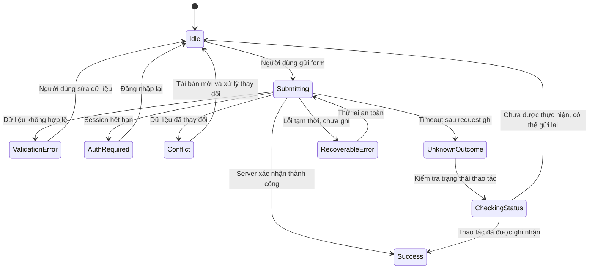
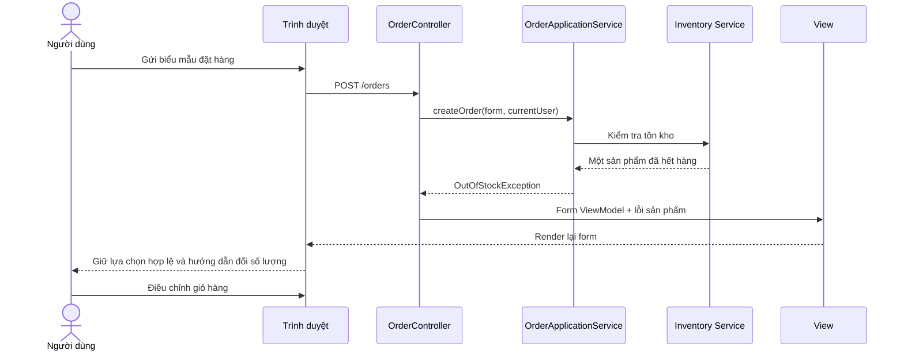

# Phục hồi giao diện và hướng dẫn thao tác tiếp theo

Trong ứng dụng web theo kiến trúc **MODEL_VIEW_CONTROLLER (MVC)**, lỗi có thể xuất hiện khi người dùng nhập dữ liệu, gửi biểu mẫu, truy cập một tài nguyên, thực hiện nghiệp vụ hoặc chờ hệ thống phản hồi. Cách ứng dụng trình bày lỗi ảnh hưởng trực tiếp đến việc người dùng có hiểu chuyện gì đã xảy ra, có giữ được công việc đang làm và có biết bước tiếp theo cần thực hiện hay không.

**Phục hồi giao diện** là thiết kế phản hồi sau lỗi để người dùng có thể tiếp tục một cách an toàn. Một thông báo tốt cần giải thích điều gì đã xảy ra ở mức phù hợp, dữ liệu hoặc thao tác hiện tại có bị ảnh hưởng không và người dùng có thể làm gì tiếp theo. Trong MVC, Controller và tầng ứng dụng xác định kết quả xử lý; ViewModel mang thông tin lỗi và hành động phục hồi; View trình bày hướng dẫn rõ ràng, dễ tiếp cận.

Bài học này tập trung vào trải nghiệm phục hồi: phân loại lỗi, chọn thông điệp và hành động phù hợp, giữ dữ liệu biểu mẫu an toàn, xử lý retry, phiên đăng nhập hết hạn, xung đột dữ liệu, lỗi mạng và lỗi máy chủ; đồng thời trình bày cách tổ chức các luồng này trong MVC.

## 1. Phục hồi lỗi là một phần của luồng nghiệp vụ

Một lỗi không chỉ là một ngoại lệ hoặc mã HTTP. Đó là một điểm mà luồng người dùng không thể tiếp tục theo cách dự kiến. Ứng dụng cần quyết định:

- Thao tác đã được thực hiện hay chưa?
- Dữ liệu người dùng nhập có còn dùng được không?
- Người dùng có thể sửa dữ liệu, thử lại, tải lại hoặc quay lại không?
- Có cần đăng nhập lại hoặc yêu cầu quyền truy cập không?
- Có nguy cơ gửi lặp một thao tác đã được máy chủ xử lý không?
- Có cần cung cấp mã tham chiếu để hỗ trợ điều tra không?

Ví dụ, nếu người dùng gửi biểu mẫu tạo đơn hàng và máy chủ báo lỗi validation, họ cần giữ lại những trường hợp lệ để sửa trường sai. Nếu request bị timeout sau khi gửi thanh toán, người dùng không nên được hướng dẫn nhấn “Thanh toán lại” ngay lập tức vì máy chủ có thể đã xử lý giao dịch nhưng response bị mất.

Vì vậy, hướng dẫn phục hồi phải dựa trên nguyên nhân và trạng thái thực tế của thao tác, không chỉ dựa vào việc request trả về thành công hay thất bại.

## 2. Phân loại lỗi trước khi thiết kế giao diện

Các loại lỗi khác nhau cần hành động phục hồi khác nhau. Không nên hiển thị một thông báo chung “Đã xảy ra lỗi” cho mọi trường hợp.

| Nhóm lỗi | Ví dụ | Hướng phục hồi thường phù hợp |
|---|---|---|
| Lỗi nhập liệu | Thiếu tiêu đề, email sai định dạng | Giữ dữ liệu an toàn, chỉ rõ trường cần sửa |
| Vi phạm quy tắc nghiệp vụ | Đơn đã khóa nên không thể sửa | Giải thích điều kiện và đề xuất thao tác hợp lệ |
| Chưa xác thực | Session hết hạn | Đăng nhập lại, sau đó quay về nơi phù hợp nếu an toàn |
| Không đủ quyền | Người dùng không được sửa hồ sơ này | Giải thích quyền bị giới hạn và hướng đến người có thẩm quyền |
| Không tìm thấy | Tài nguyên đã bị xóa hoặc URL không còn hợp lệ | Quay về danh sách hoặc trang chủ phù hợp |
| Xung đột dữ liệu | Người khác đã cập nhật trước | Tải bản mới, so sánh hoặc hợp nhất thay đổi |
| Giới hạn tần suất | Gửi quá nhiều request | Chờ theo hướng dẫn hoặc thử lại sau thời gian được chỉ định |
| Lỗi mạng/timeout | Mất kết nối khi gửi form | Kiểm tra trạng thái thao tác trước khi gửi lại |
| Lỗi máy chủ | Exception không dự kiến | Thử lại sau nếu thao tác an toàn; cung cấp mã tham chiếu |
| Dịch vụ phụ thuộc lỗi | Dịch vụ vận chuyển hoặc thanh toán không phản hồi | Thông báo phần nào chưa hoàn tất và bước tiếp theo được hỗ trợ |

Phân loại ở đây là phục vụ thiết kế sản phẩm. Một lỗi có thể cần xử lý ở nhiều lớp: Controller nhận lỗi giao thức, application service phát hiện lỗi use case, Domain Model bảo vệ bất biến và View trình bày kết quả.

## 3. Một thông báo lỗi có thể hành động

Thông báo hữu ích thường trả lời ba câu hỏi:

1. **Điều gì đã xảy ra?** Mô tả ngắn gọn, cụ thể và không đổ lỗi cho người dùng.
2. **Điều đó ảnh hưởng thế nào đến thao tác?** Ví dụ, dữ liệu chưa được lưu, thay đổi đã được lưu một phần hay trạng thái chưa xác định.
3. **Người dùng có thể làm gì tiếp theo?** Sửa trường nào, tải lại, đăng nhập, chờ, kiểm tra trạng thái hoặc liên hệ hỗ trợ.

Ví dụ:

| Thông báo yếu | Thông báo hữu ích hơn |
|---|---|
| Có lỗi xảy ra | Chưa thể lưu hồ sơ. Thông tin bạn nhập vẫn còn; hãy kiểm tra email và thử lại. |
| Invalid input | Số lượng phải lớn hơn 0. Hãy nhập một số nguyên từ 1 trở lên. |
| Access denied | Bạn không có quyền chỉnh sửa đơn hàng này. Hãy liên hệ người quản lý đơn hàng nếu cần thay đổi. |
| Conflict | Đơn hàng đã được cập nhật ở một cửa sổ khác. Tải bản mới nhất trước khi tiếp tục. |
| Server error | Hệ thống chưa thể hoàn tất yêu cầu. Hãy thử lại sau ít phút; nếu lỗi tiếp tục, gửi mã tham chiếu `R-7K2P` cho bộ phận hỗ trợ. |
| Request timeout | Chưa nhận được xác nhận. Kiểm tra trạng thái đơn hàng trước khi gửi lại để tránh tạo thao tác trùng. |

Mã `R-7K2P` chỉ là ví dụ về mã tham chiếu do máy chủ tạo; không dùng mã giả cố định trong sản phẩm.

### Viết thông báo rõ ràng

- Dùng từ ngữ gần với công việc người dùng đang làm, chẳng hạn “đơn hàng”, “hồ sơ” hoặc “bản nháp”.
- Nêu điều kiện cụ thể nếu người dùng có thể tự sửa.
- Nói rõ khi dữ liệu chưa được lưu hoặc kết quả chưa xác định.
- Đưa hành động tiếp theo gần thông báo, ví dụ nút “Tải bản mới nhất” hoặc liên kết “Đăng nhập lại”.
- Không đưa stack trace, SQL, tên lớp, đường dẫn nội bộ hoặc thông tin nhạy cảm vào nội dung hiển thị.
- Tránh các câu buộc tội như “Bạn đã làm sai” hoặc thông báo kỹ thuật khó hiểu như “NullPointerException”.

Không phải lỗi nào cũng cần hiển thị chi tiết. Với lỗi xác thực hoặc tài nguyên riêng tư, thông báo cần đủ hữu ích nhưng không tiết lộ liệu một tài khoản hay đối tượng có tồn tại hay không nếu chính sách bảo mật yêu cầu che giấu.

## 4. Chọn hành động phục hồi phù hợp

Một nút “Thử lại” không phải lúc nào cũng là lựa chọn đúng. Hãy gắn hành động với loại lỗi và trạng thái của thao tác.

| Trạng thái sau lỗi | Hành động nên cung cấp |
|---|---|
| Dữ liệu chưa hợp lệ, chưa ghi | Sửa trường lỗi và gửi lại |
| Chưa đăng nhập, thao tác chưa chạy | Đăng nhập lại rồi quay về trang phù hợp |
| Không có quyền | Quay lại hoặc liên hệ người quản lý |
| Tài nguyên không tồn tại | Về danh sách hoặc tìm tài nguyên khác |
| Dữ liệu đã thay đổi | Tải bản mới, so sánh hoặc nhập lại thay đổi |
| Request đọc bị lỗi tạm thời | Thử tải lại |
| Request ghi có thể đã được xử lý | Kiểm tra trạng thái trước khi gửi lại |
| Hệ thống giới hạn tần suất | Chờ thời gian được chỉ định rồi thử lại |
| Lỗi không phục hồi được ở giao diện | Lưu mã tham chiếu và liên hệ hỗ trợ |

Chỉ hiển thị hành động mà hệ thống thực sự hỗ trợ. Không đưa ra nút “Hoàn tác” nếu backend không có khả năng hoàn tác; không hứa dữ liệu đã được lưu nếu transaction chưa commit.

## 5. Giữ dữ liệu biểu mẫu khi có lỗi

Khi validation thất bại, người dùng thường cần giữ lại những gì đã nhập. Nếu ứng dụng xóa toàn bộ form, họ phải nhập lại và có thể bỏ dở công việc.

Trong MVC server-rendered, Controller có thể render lại cùng View với Form Object và lỗi binding/validation:

```java
@PostMapping("/profile")
String updateProfile(
        @Valid @ModelAttribute("form") UpdateProfileForm form,
        BindingResult errors,
        Model model) {

    if (errors.hasErrors()) {
        model.addAttribute("countries", queryService.getCountries());
        return "profile/edit";
    }

    profileService.update(form);
    return "redirect:/profile";
}
```

Khi lỗi, View nhận lại các giá trị đã bind cùng `BindingResult`. Controller cần nạp lại dữ liệu phụ trợ như danh sách quốc gia, loại tài khoản hoặc lựa chọn dự án để form render đầy đủ.

### Chỉ giữ dữ liệu an toàn

Không nên giữ lại mọi trường một cách máy móc. Các trường như mật khẩu, mã OTP, token bí mật, dữ liệu thanh toán hoặc thông tin nhạy cảm cần được xóa khỏi form khi trả lỗi. Chỉ giữ những dữ liệu cần thiết và được phép lưu tạm.

Với form nhiều bước, có thể lưu một bản nháp phía server có thời hạn và quyền truy cập rõ ràng. Khi người dùng quay lại, server tải draft theo định danh, kiểm tra chủ sở hữu và trạng thái hết hạn trước khi khôi phục.

### Không bind trực tiếp vào entity để giữ form

Form Object hoặc Request DTO nên tách khỏi Domain Object. Khi dữ liệu không hợp lệ, giữ lại form object giúp người dùng sửa tiếp mà không làm entity miền rơi vào trạng thái sai hoặc nhận các trường nội bộ không được phép thay đổi.

## 6. Hiển thị lỗi ở cấp trường và cấp biểu mẫu

Với biểu mẫu có nhiều trường, nên có cả thông báo tổng quát và lỗi gắn với từng trường:

- **Tóm tắt lỗi:** giúp người dùng biết form có vấn đề và có thể điều hướng đến trường lỗi.
- **Lỗi theo trường:** giải thích chính xác trường nào sai và cách sửa.
- **Thông báo nghiệp vụ:** giải thích điều kiện không thể hoàn thành, ví dụ mã giảm giá đã hết hạn.

Ví dụ HTML:

```html
<div class="error-summary" role="alert" tabindex="-1" aria-labelledby="error-title">
  <h2 id="error-title">Chưa thể lưu biểu mẫu</h2>
  <p>Hãy kiểm tra các mục sau:</p>
  <ul>
    <li><a href="#email">Địa chỉ email chưa đúng định dạng</a></li>
    <li><a href="#phone">Số điện thoại chưa hợp lệ</a></li>
  </ul>
</div>

<label for="email">Địa chỉ email</label>
<input
  id="email"
  name="email"
  type="email"
  aria-invalid="true"
  aria-describedby="email-error">
<p id="email-error">Hãy nhập địa chỉ email hợp lệ.</p>
```

Sau khi render lại form có lỗi, ứng dụng có thể đưa focus đến vùng tóm tắt để người dùng biết có lỗi và điều hướng đến trường cần sửa. Không nên tự động focus một cách gây bất ngờ nếu lỗi xuất hiện trong một tương tác nền; hãy chọn hành vi theo ngữ cảnh.

## 7. Mô hình hóa trạng thái giao diện sau lỗi

Với giao diện có tương tác bất đồng bộ, nên biểu diễn trạng thái request một cách rõ ràng thay vì chỉ bật/tắt một biến `hasError`.

Ví dụ một state machine đơn giản:



`UnknownOutcome` rất quan trọng với thao tác ghi. Timeout không chứng minh rằng server chưa xử lý request. UI nên hiển thị trạng thái chưa xác định và hướng người dùng kiểm tra kết quả trước khi gửi lại.

### Trạng thái tải, lỗi và rỗng không giống nhau

| Trạng thái | Ý nghĩa | Phản hồi giao diện |
|---|---|---|
| Loading | Đang chờ kết quả | Spinner hoặc thông báo đang tải |
| Success with data | Đã đọc được dữ liệu | Hiển thị nội dung |
| Empty | Request thành công nhưng không có kết quả | Giải thích chưa có dữ liệu và cách tạo/lọc |
| Validation error | Request ghi chưa được chấp nhận do đầu vào | Giữ form và hiển thị lỗi |
| Recoverable error | Tạm thời không hoàn tất | Hướng dẫn thử lại hoặc thao tác khác |
| Fatal/unavailable | Không thể tiếp tục trong ngữ cảnh hiện tại | Trang lỗi có điều hướng hoặc hỗ trợ |

Không hiển thị “Không có dữ liệu” khi thực tế API bị lỗi. Empty state là kết quả hợp lệ; error state là một request không hoàn thành như mong đợi.

## 8. Phục hồi theo mã HTTP

Mã HTTP giúp Controller và client thống nhất loại kết quả. View không nên chỉ hiển thị số mã; nó cần ánh xạ mã và lỗi miền sang thông điệp, hành động phù hợp.

| HTTP status | Ý nghĩa thường gặp | Hướng dẫn người dùng thường phù hợp |
|---|---|---|
| `400 Bad Request` | Request sai cấu trúc hoặc không thể xử lý | Kiểm tra dữ liệu hoặc tải lại form mới |
| `401 Unauthorized` | Chưa xác thực hoặc session không còn hợp lệ | Đăng nhập lại |
| `403 Forbidden` | Đã xác thực nhưng không có quyền | Quay lại hoặc liên hệ người có quyền |
| `404 Not Found` | Không tìm thấy tài nguyên | Về danh sách hoặc kiểm tra liên kết |
| `409 Conflict` | Xung đột với trạng thái hiện tại | Tải bản mới hoặc xử lý xung đột |
| `410 Gone` | Tài nguyên không còn được cung cấp | Quay về nơi thay thế |
| `422 Unprocessable Content` | Dữ liệu đúng cú pháp nhưng không thỏa điều kiện xử lý | Sửa trường hoặc điều kiện được nêu |
| `429 Too Many Requests` | Gửi quá nhiều request | Chờ theo `Retry-After` nếu có |
| `500 Internal Server Error` | Lỗi máy chủ không dự kiến | Thử lại sau nếu an toàn; dùng mã tham chiếu khi liên hệ |
| `502/503/504` | Gateway, dịch vụ hoặc upstream tạm thời lỗi | Thử lại sau theo hướng dẫn; kiểm tra trạng thái thao tác ghi |

Các mã trên là quy ước phổ biến, nhưng hợp đồng API và chính sách bảo mật có thể quy định chi tiết khác. Ví dụ, ứng dụng có thể trả 404 thay vì 403 để không tiết lộ tài nguyên có tồn tại hay không.

## 9. Phục hồi khi session hết hạn

Session hết hạn có thể xảy ra khi người dùng mở form lâu, chuyển sang công việc khác hoặc quay lại sau thời gian dài. Nếu POST bị từ chối vì chưa xác thực, ứng dụng cần giải thích rằng phiên đã hết hạn và hướng dẫn đăng nhập lại.

Một luồng hợp lý:

1. Người dùng gửi request.
2. Server xác định session không còn hợp lệ và trả kết quả yêu cầu xác thực.
3. Giao diện thông báo phiên làm việc đã hết hạn.
4. Người dùng đăng nhập lại.
5. Ứng dụng quay về trang phù hợp nếu URL đích được kiểm tra và thao tác vẫn còn hợp lệ.

Không đưa dữ liệu form nhạy cảm vào query string để giữ qua đăng nhập. Nếu cần tiếp tục bản nháp, lưu dữ liệu được phép vào draft phía server với thời hạn và quyền sở hữu; sau khi đăng nhập, xác minh lại người dùng được phép truy cập draft đó.

### An toàn với return URL

Nếu ứng dụng giữ URL ban đầu để quay lại sau đăng nhập, chỉ chấp nhận đích nội bộ hoặc một danh sách route được phép. Không chuyển hướng đến URL tùy ý từ query parameter do người dùng kiểm soát vì có thể tạo open redirect.

### Không lặp lại thao tác ghi tự động

Sau khi đăng nhập lại, không tự động phát lại một POST thanh toán, tạo đơn hoặc xóa tài nguyên nếu không có cơ chế idempotency và xác minh trạng thái. Có thể đưa người dùng về form hoặc trang trạng thái để họ xác nhận bước tiếp theo.

## 10. Xử lý xung đột dữ liệu và thao tác đồng thời

Người dùng có thể mở một bản ghi trong hai tab hoặc một người khác có thể cập nhật cùng lúc. Nếu server chỉ ghi đè dữ liệu mới nhất bằng form cũ, thay đổi trước đó có thể bị mất.

Với optimistic locking, entity có trường version:

```java
@Version
private long version;
```

Khi lưu, ORM kiểm tra version hiện tại. Nếu một request khác đã cập nhật, ứng dụng phát hiện xung đột và có thể trả `409 Conflict` hoặc render lại form với thông báo phù hợp.

### Hướng dẫn phục hồi khi conflict

Không chỉ hiển thị “Conflict”. Hãy giải thích:

- Dữ liệu đã thay đổi kể từ khi người dùng mở form.
- Thay đổi đang nhập chưa được áp dụng.
- Người dùng có thể tải bản mới, xem các trường đã thay đổi và nhập lại hoặc hợp nhất.

Với một số form đơn giản, có thể giữ bản người dùng đang nhập ở vùng tạm và cung cấp nút “Tải bản mới nhất”. Với dữ liệu phức tạp, giao diện so sánh hai phiên bản có thể giúp người dùng quyết định trường nào cần giữ.

Không tự động merge mọi trường. Những thay đổi ảnh hưởng tài chính, quyền, trạng thái phê duyệt hoặc dữ liệu quan trọng cần chính sách rõ ràng.

## 11. Retry: khi nào nên và không nên thử lại?

Retry là hành động lặp lại một request sau khi lỗi tạm thời. Nó hữu ích với thao tác đọc hoặc thao tác ghi được thiết kế idempotent. Tuy nhiên, retry không an toàn nếu lần đầu có thể đã tạo side effect.

| Tình huống | Retry tự động có phù hợp? | Lưu ý |
|---|---|---|
| GET danh sách bị lỗi mạng tạm thời | Thường có | Có thể retry với giới hạn và backoff |
| GET chi tiết trả 503 | Thường có | Hiển thị trạng thái đang thử lại nếu cần |
| POST tạo đơn chưa rõ kết quả do timeout | Không nên tùy tiện | Kiểm tra trạng thái hoặc dùng idempotency key |
| PUT đặt một giá trị cụ thể | Có thể, nếu endpoint thực sự idempotent | Vẫn cần xử lý version và quyền |
| POST gửi email hoặc thanh toán | Không tự động nếu chưa có bảo vệ | Dùng idempotency và trạng thái giao dịch |
| 400/422 do dữ liệu sai | Không | Người dùng cần sửa dữ liệu |
| 401/403 | Không | Cần xác thực hoặc quyền phù hợp |
| 429 | Chỉ sau thời gian phù hợp | Tôn trọng `Retry-After` nếu server cung cấp |

### Backoff và giới hạn retry

Với lỗi tạm thời, client có thể dùng exponential backoff và jitter để tránh nhiều client cùng retry một lúc. Cần đặt số lần thử tối đa, thời gian tổng và điều kiện dừng. Không retry liên tục vô hạn hoặc giữ giao diện ở trạng thái loading mà không thông báo.

### Idempotency key cho thao tác ghi

Với thao tác tạo hoặc thanh toán, client có thể gửi idempotency key cho một ý định duy nhất. Server lưu kết quả theo key và trả lại kết quả trước đó khi nhận request trùng. Thiết kế cần xử lý request đồng thời cùng key, payload khác nhau và thời hạn lưu key.

PRG giúp tránh refresh gửi lại POST sau khi redirect, nhưng không thay thế idempotency. Double-click, retry từ mạng hoặc mất response vẫn có thể làm server nhận nhiều request.

## 12. Timeout và kết quả chưa xác định

Timeout có hai tình huống khác nhau:

- Request chưa đến server hoặc server chưa xử lý.
- Server đã xử lý và commit, nhưng response không đến được trình duyệt đúng hạn.

Client thường không thể phân biệt hai trường hợp chỉ từ lỗi mạng. Với thao tác đọc, tải lại thường an toàn. Với thao tác ghi, hãy hiển thị thông báo trung thực như “Chưa nhận được xác nhận” thay vì khẳng định “Không lưu được”.

Một luồng phục hồi có thể là:

1. Gửi request ghi với request ID/idempotency key nếu use case hỗ trợ.
2. Nếu timeout, hiển thị trạng thái chưa xác định.
3. Gọi endpoint đọc trạng thái thao tác hoặc tài nguyên liên quan.
4. Nếu đã hoàn tất, hiển thị kết quả.
5. Nếu chắc chắn chưa thực hiện, cho phép gửi lại theo hợp đồng an toàn.
6. Nếu không thể xác định, hướng dẫn người dùng chờ hoặc liên hệ hỗ trợ với mã tham chiếu.

Không dùng `AbortController.abort()` ở client như bằng chứng server đã hủy transaction. Hủy request ở trình duyệt không bảo đảm side effect phía server được rollback.

## 13. Lỗi mạng và trạng thái offline

Ứng dụng có thể mất mạng khi người dùng đang đọc hoặc gửi form. Giao diện nên phân biệt:

- Chưa có kết nối.
- Request đang chờ quá lâu.
- Server phản hồi lỗi.
- Server đã xác nhận nhưng client chưa cập nhật được giao diện.

Với trang đọc, có thể giữ dữ liệu đã tải trước đó và thông báo rằng nội dung có thể chưa mới nhất. Với form, có thể giữ bản nháp không nhạy cảm trong bộ nhớ hoặc storage phù hợp; khi kết nối trở lại, người dùng cần biết dữ liệu nào sẽ được gửi.

Không tự động đồng bộ bản nháp cũ lên server mà không kiểm tra quyền, version và xung đột. Nếu sản phẩm hỗ trợ offline-first, cần thiết kế queue đồng bộ, idempotency, conflict resolution và chính sách xóa dữ liệu riêng.

## 14. Lỗi máy chủ và mã tham chiếu hỗ trợ

Với lỗi không dự kiến, người dùng không cần xem stack trace. Họ cần biết hệ thống chưa thể hoàn tất yêu cầu, dữ liệu có thể bị ảnh hưởng ra sao và cách tiếp tục.

Một mã tham chiếu ngắn có thể giúp nhóm hỗ trợ tìm log tương ứng:

```text
Chúng tôi chưa thể tải báo cáo lúc này.
Hãy thử lại sau ít phút. Nếu lỗi tiếp tục, gửi mã tham chiếu R-7K2P cho bộ phận hỗ trợ.
```

Mã tham chiếu nên được tạo ở phía server, gắn với log/trace và không chứa thông tin cá nhân. Không dùng session ID, access token hoặc dữ liệu bí mật làm mã tham chiếu hiển thị.

Log phía server có thể lưu exception, route, user/tenant ID theo chính sách, request ID và thông tin chẩn đoán cần thiết. Cần loại bỏ mật khẩu, token, dữ liệu thanh toán và payload nhạy cảm. Log không nên trở thành bản sao đầy đủ của biểu mẫu người dùng.

## 15. Tổ chức xử lý lỗi trong MVC

Một cách phân chia trách nhiệm hữu ích:

| Thành phần | Trách nhiệm |
|---|---|
| View | Hiển thị lỗi, giữ giá trị an toàn, hướng dẫn và hành động phục hồi |
| Controller | Nhận lỗi binding, chọn HTTP status/view/redirect và chuẩn bị ViewModel lỗi |
| Application service | Điều phối use case, kiểm tra quyền và phát sinh lỗi ứng dụng có ý nghĩa |
| Domain Model | Bảo vệ bất biến và từ chối chuyển trạng thái không hợp lệ |
| Repository/infrastructure | Chuyển lỗi persistence hoặc tích hợp thành lỗi kỹ thuật có thể xử lý ở tầng trên |
| Exception handler | Ánh xạ exception sang response nhất quán và ghi log phù hợp |

Không nên để View tự suy luận từ tên exception hoặc để Controller chứa toàn bộ logic phục hồi. Application service nên cung cấp kết quả/exception có ý nghĩa với use case; adapter web quyết định cách trình bày trên HTTP.

### Ví dụ xử lý lỗi tập trung với Spring MVC

`@ControllerAdvice` có thể xử lý exception dùng chung cho nhiều Controller:

```java
@ControllerAdvice
class WebExceptionHandler {

    @ExceptionHandler(OrderNotFoundException.class)
    ModelAndView handleNotFound(OrderNotFoundException exception) {
        ModelAndView view = new ModelAndView("errors/not-found");
        view.setStatus(HttpStatus.NOT_FOUND);
        view.addObject("message", "Không tìm thấy đơn hàng này.");
        view.addObject("nextAction", "Quay lại danh sách đơn hàng.");
        return view;
    }

    @ExceptionHandler(ConcurrentUpdateException.class)
    ModelAndView handleConflict(ConcurrentUpdateException exception) {
        ModelAndView view = new ModelAndView("errors/conflict");
        view.setStatus(HttpStatus.CONFLICT);
        view.addObject("message", "Dữ liệu đã được cập nhật ở nơi khác.");
        view.addObject("nextAction", "Tải bản mới nhất trước khi tiếp tục.");
        return view;
    }
}
```

Đây là ví dụ server-rendered. Trong ứng dụng thực tế, cần bảo đảm các exception handler không vô tình ghi đè lỗi validation cần render lại form; có thể xử lý `MethodArgumentNotValidException`, `BindException` hoặc `HandlerMethodValidationException` theo phiên bản Spring đang dùng. Với API, dùng `@RestControllerAdvice` và response lỗi có cấu trúc phù hợp.

### Response lỗi cho API

Spring Framework hỗ trợ `ProblemDetail` trong các phiên bản phù hợp. Một response lỗi có thể chứa status, title, detail và extension field như mã tham chiếu:

```java
@RestControllerAdvice
class ApiExceptionHandler {

    @ExceptionHandler(OrderNotFoundException.class)
    ResponseEntity<ProblemDetail> handleNotFound() {
        ProblemDetail problem = ProblemDetail.forStatusAndDetail(
                HttpStatus.NOT_FOUND,
                "Không tìm thấy đơn hàng được yêu cầu.");
        problem.setTitle("Không tìm thấy tài nguyên");
        problem.setProperty("code", "ORDER_NOT_FOUND");

        return ResponseEntity.status(HttpStatus.NOT_FOUND).body(problem);
    }
}
```

Không đưa exception message kỹ thuật thô vào `detail`. Thông tin hiển thị nên được kiểm soát và không chứa SQL, stack trace hoặc dữ liệu nhạy cảm.

## 16. Phục hồi theo luồng: ví dụ tạo đơn hàng

Giả sử người dùng tạo đơn hàng và server từ chối vì một sản phẩm vừa hết hàng. Giao diện nên giữ các lựa chọn còn hợp lệ, chỉ rõ sản phẩm không thể đặt và hướng dẫn người dùng cập nhật giỏ hàng.



Nếu đơn hàng chưa được tạo, thông báo có thể nói rõ “Đơn hàng chưa được tạo vì sản phẩm X vừa hết hàng”. Nếu hệ thống đã tạo đơn nhưng một bước phụ thất bại, thông báo cần phân biệt trạng thái đơn và bước phụ đó. Không nói “Đặt hàng thất bại” nếu đơn đã được lưu thành công.

## 17. Phân biệt lỗi, trạng thái rỗng và trạng thái không có quyền

Ba tình huống có thể trông giống nhau trên giao diện nhưng ý nghĩa khác nhau:

- **Empty state:** request thành công, người dùng có quyền truy cập nhưng chưa có dữ liệu phù hợp.
- **Error state:** request không hoàn thành do lỗi mạng, server hoặc điều kiện xử lý.
- **No access state:** người dùng không được phép xem tài nguyên hoặc thao tác.

Ví dụ trang danh sách đơn hàng:

| Kết quả | Nội dung giao diện |
|---|---|
| Không có đơn nào | “Bạn chưa có đơn hàng nào. Bắt đầu bằng cách tạo đơn mới.” |
| Bộ lọc không có kết quả | “Không tìm thấy đơn hàng phù hợp. Thử xóa bớt bộ lọc.” |
| API lỗi | “Chưa thể tải danh sách đơn hàng. Hãy thử lại sau.” |
| Không có quyền | “Bạn không có quyền xem danh sách này.” hoặc 404 theo chính sách bảo mật |

Không hiển thị empty state khi truy vấn thất bại; điều đó khiến người dùng nghĩ dữ liệu đã bị mất. Cũng không hiển thị nút tạo mới nếu người dùng không có quyền tạo.

## 18. Khả năng tiếp cận của giao diện lỗi

Người dùng có thể dùng bàn phím, trình đọc màn hình, phóng to hoặc công nghệ hỗ trợ khác. Thông báo lỗi cần hoạt động với các phương thức này.

- Gắn lỗi với trường qua `aria-describedby`.
- Đặt `aria-invalid="true"` trên trường không hợp lệ.
- Dùng tiêu đề rõ ràng cho vùng tóm tắt lỗi.
- Cung cấp liên kết đến trường lỗi khi form có nhiều trường.
- Đảm bảo focus di chuyển hợp lý sau submit lỗi.
- Không dùng màu sắc làm dấu hiệu duy nhất.
- Dùng `role="status"` cho thông báo trạng thái thông thường và `role="alert"` có chọn lọc cho lỗi cần được thông báo ngay.
- Không tạo nhiều live region cùng đọc một nội dung khiến người dùng bị lặp thông báo.
- Giữ thứ tự tab và nhãn điều khiển rõ ràng.

Ví dụ với lỗi bất đồng bộ:

```html
<div id="save-status" role="status" aria-live="polite"></div>
<div id="save-error" role="alert" hidden>
  Chưa thể lưu thay đổi. Hãy kiểm tra kết nối rồi thử lại.
</div>
```

Không nên dùng `role="alert"` cho mọi cập nhật nhỏ. Thông báo liên tục có thể làm gián đoạn người dùng trình đọc màn hình.

## 19. Bảo mật khi trình bày và ghi log lỗi

Lỗi là nơi dễ vô tình tiết lộ chi tiết nội bộ. Hãy phân biệt thông tin cho người dùng với thông tin chẩn đoán dành cho đội kỹ thuật.

### Không tiết lộ chi tiết nội bộ

Không hiển thị stack trace, SQL, tên bảng, đường dẫn máy chủ, biến môi trường, phiên bản thư viện hoặc thông tin cấu hình. Những chi tiết này có thể giúp kẻ tấn công hiểu cấu trúc hệ thống.

### Không lộ dữ liệu nhạy cảm trong thông báo và log

Không ghi mật khẩu, OTP, token, cookie, dữ liệu thanh toán hoặc toàn bộ payload form vào log. Nếu cần chẩn đoán, ghi request ID, loại lỗi, route và các thuộc tính đã được lọc theo chính sách.

### Escape nội dung do người dùng cung cấp

Nếu thông báo lỗi chứa giá trị người dùng nhập, phải escape theo ngữ cảnh HTML. Không nối chuỗi không tin cậy vào `innerHTML` hoặc render raw HTML trong template.

### Không dùng lỗi để xác nhận tài khoản tồn tại

Với luồng đăng nhập hoặc khôi phục mật khẩu, thông báo có thể cần giống nhau giữa tài khoản không tồn tại và mật khẩu sai để tránh dò tìm tài khoản. Hướng dẫn phục hồi phải cân bằng giữa tính hữu ích và chính sách bảo mật.

### Không biến mã tham chiếu thành bí mật xác thực

Request ID hoặc mã hỗ trợ chỉ dùng để tra cứu log; không được cấp quyền truy cập tài nguyên chỉ vì người dùng biết mã đó.

## 20. Kiểm thử khả năng phục hồi

Kiểm thử cần xác minh cả trạng thái backend lẫn điều người dùng nhìn thấy sau lỗi.

| Loại kiểm thử | Nội dung cần xác minh | Ví dụ |
|---|---|---|
| Unit test | Lỗi nghiệp vụ và mapping lỗi | Hết hàng tạo lỗi có mã ổn định |
| Controller test | HTTP status, View, ViewModel và redirect | 404 render trang không tìm thấy |
| Validation test | Dữ liệu form được giữ an toàn | Trường hợp lệ còn nguyên, mật khẩu bị xóa |
| Integration test | Transaction và side effect | Lỗi trước commit không tạo đơn dở dang |
| Security test | Không lộ chi tiết nội bộ hoặc dữ liệu nhạy cảm | Response không chứa stack trace/token |
| Concurrency test | Xung đột được phát hiện | Version cũ trả 409 và không ghi đè |
| Browser test | Hành động phục hồi hoạt động | Nút tải lại, đăng nhập lại và liên kết lỗi điều hướng đúng |
| Accessibility test | Lỗi được nhận biết bằng bàn phím/trình đọc màn hình | Focus đến summary và field có mô tả lỗi |

Các kịch bản nên có:

1. Form thiếu trường bắt buộc: giữ dữ liệu an toàn và chỉ rõ trường cần sửa.
2. Server trả 500: hiển thị thông báo thân thiện và mã tham chiếu; không hiển thị stack trace.
3. Session hết hạn: hướng dẫn đăng nhập lại và không tự phát lại POST nhạy cảm.
4. Request ghi timeout: trạng thái được hiển thị là chưa xác định; không tự gửi lại tạo trùng.
5. Hai người sửa cùng tài nguyên: xung đột được phát hiện và hướng dẫn tải bản mới.
6. API trả 429: client tôn trọng thời gian chờ.
7. Tài nguyên đã xóa: người dùng được hướng đến danh sách hoặc nơi phù hợp.
8. Nội dung người dùng nhập chứa HTML/script: khi render lỗi không thực thi mã.
9. Người dùng bàn phím gửi form lỗi: focus và thứ tự điều hướng vẫn hợp lý.
10. Empty state: không bị dùng thay cho lỗi server.

## 21. Những lỗi thiết kế thường gặp

### Dùng một thông báo cho mọi lỗi

Người dùng không biết nên sửa, chờ, đăng nhập hay liên hệ hỗ trợ. Hãy phân loại lỗi và cung cấp hành động phù hợp.

### Hiển thị exception kỹ thuật

Stack trace và thông báo database không giúp người dùng phục hồi, đồng thời có thể lộ thông tin nội bộ. Hãy ánh xạ sang thông điệp an toàn.

### Xóa toàn bộ dữ liệu form sau validation lỗi

Người dùng phải nhập lại. Hãy giữ các trường không nhạy cảm và gắn lỗi với trường tương ứng.

### Luôn có nút “Thử lại”

Retry có thể tạo giao dịch trùng nếu request đầu đã commit. Chỉ cho retry khi thao tác an toàn hoặc có idempotency và kiểm tra trạng thái.

### Khẳng định thất bại khi chỉ bị timeout

Server có thể đã xử lý nhưng response bị mất. Hãy thông báo kết quả chưa xác định và cung cấp cách kiểm tra trạng thái.

### Chuyển mọi lỗi thành trang 500

Validation, không có quyền, không tìm thấy và xung đột đều có ngữ nghĩa khác nhau. Ánh xạ đúng lỗi giúp client và người dùng phục hồi chính xác.

### Hiển thị empty state khi API lỗi

Người dùng có thể hiểu nhầm dữ liệu đã biến mất. Phân biệt rõ request thành công không có kết quả với request thất bại.

### Để View tự truy cập exception hoặc entity

View không nên quyết định cách xử lý lỗi kỹ thuật hoặc truy cập lazy entity. Hãy đưa dữ liệu lỗi và hướng dẫn đã chuẩn bị qua ViewModel.

## 22. Quy trình thiết kế phục hồi giao diện

Khi thêm một luồng lỗi, hãy xác định:

1. **Nguyên nhân:** lỗi nhập liệu, quy tắc nghiệp vụ, quyền, tài nguyên, xung đột, mạng hay máy chủ?
2. **Trạng thái thao tác:** chưa chạy, đã rollback, đã commit hay chưa xác định?
3. **Dữ liệu cần giữ:** trường nào an toàn để giữ, trường nào phải xóa?
4. **Thông điệp:** điều gì xảy ra và ảnh hưởng ra sao?
5. **Hành động tiếp theo:** sửa, tải lại, đăng nhập, chờ, kiểm tra trạng thái hay liên hệ hỗ trợ?
6. **Mã HTTP và ViewModel:** response có phản ánh đúng loại lỗi không?
7. **Bảo mật:** thông báo, URL, flash state và log có làm lộ dữ liệu không?
8. **Khả năng tiếp cận:** lỗi có được đọc, focus và điều hướng đúng không?
9. **Retry/idempotency:** thao tác có thể gửi lại an toàn không?
10. **Kiểm thử:** xác minh cả kết quả backend, giao diện và các trường hợp bất thường.

## Kết luận

Phục hồi giao diện giúp người dùng hiểu lỗi, giữ được công việc hợp lệ và tiếp tục bằng một hành động an toàn. Thông báo cần nói rõ điều gì xảy ra, thao tác có bị ảnh hưởng không và bước tiếp theo là gì. Cách phục hồi phải dựa trên loại lỗi và trạng thái thực tế: sửa dữ liệu, đăng nhập lại, tải bản mới, chờ, kiểm tra kết quả hoặc liên hệ hỗ trợ.

Trong MVC, tầng ứng dụng và Domain Model xác định lỗi theo ngữ nghĩa nghiệp vụ; Controller hoặc exception handler ánh xạ lỗi sang HTTP response và ViewModel; View trình bày hướng dẫn có thể tiếp cận. Giữ dữ liệu form an toàn, phân biệt lỗi với trạng thái rỗng, xử lý xung đột và chỉ retry khi an toàn giúp ứng dụng vừa dễ dùng vừa bảo vệ tính nhất quán của dữ liệu.
