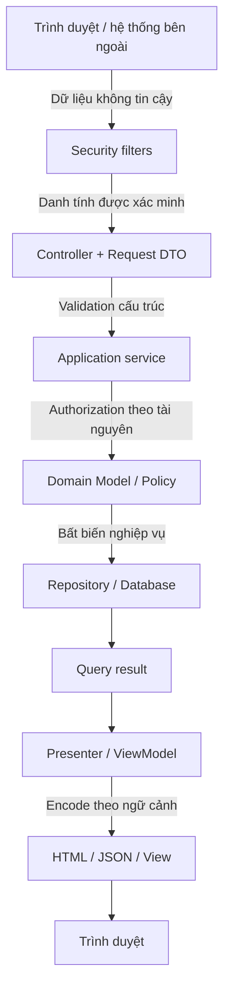

# Ranh giới tin cậy từ đầu vào tới dữ liệu hiển thị

Trong kiến trúc Model–View–Controller (MVC), dữ liệu đi qua nhiều thành phần trước khi trở thành nội dung người dùng nhìn thấy. Một giá trị có thể bắt đầu từ URL, biểu mẫu, cookie, header hoặc một hệ thống bên ngoài; đi qua Controller, dịch vụ ứng dụng, Model và cơ sở dữ liệu; sau đó được truy vấn, chuyển thành ViewModel và render thành HTML hoặc JSON. Ở mỗi chặng, ứng dụng phải xác định dữ liệu đến từ đâu, ai được phép sử dụng nó và cách biểu diễn nó an toàn.

**Ranh giới tin cậy** là điểm mà dữ liệu hoặc hành động đi từ một vùng có mức tin cậy này sang vùng khác. Trong ứng dụng web, trình duyệt và mọi dữ liệu do client gửi đều nằm ngoài vùng kiểm soát của máy chủ. Việc một trường được ẩn trong giao diện, có kiểu dữ liệu đúng hoặc đã từng được máy chủ gửi xuống không khiến giá trị gửi ngược trở thành đáng tin.

Một thiết kế MVC an toàn giữ các kiểm tra tại đúng lớp: Controller kiểm tra cấu trúc request, lớp bảo mật xác thực và phân quyền, Model bảo vệ bất biến nghiệp vụ, tầng lưu trữ dùng truy vấn có tham số, còn View mã hóa dữ liệu theo ngữ cảnh hiển thị. Không một bước đơn lẻ nào thay thế được các bước còn lại.

## 1. Nhận diện các ranh giới tin cậy

Các nguồn dữ liệu đầu vào phổ biến gồm:

- Path parameter và query parameter được client điều khiển; fragment chỉ tồn tại ở phía trình duyệt, không được gửi trong HTTP request nhưng có thể ảnh hưởng logic giao diện.
- Form field, JSON body, multipart file upload và nội dung rich text.
- Header HTTP, cookie, user agent, origin và referer.
- Giá trị hidden, dữ liệu trong localStorage, sessionStorage hoặc JavaScript state.
- Webhook, message queue, dữ liệu nhập từ CSV/Excel và hệ thống tích hợp.
- Dữ liệu đọc từ cơ sở dữ liệu nếu trước đó nó được tạo từ đầu vào không tin cậy.

Ngay cả dữ liệu lấy từ cơ sở dữ liệu cũng không tự động an toàn. Một tên khách hàng có thể chứa chuỗi HTML độc hại được lưu từ một request trước đó. Khi hiển thị lại, đây vẫn là dữ liệu không tin cậy và cần được xử lý theo ngữ cảnh đầu ra.



Sơ đồ mô tả các lớp kiểm soát thường gặp. Thứ tự cụ thể có thể khác tùy framework: security filter thường chạy trước Controller; validation có thể được kích hoạt bởi framework; transaction bao quanh application service. Điều quan trọng là không để dữ liệu vượt qua ranh giới mà không có kiểm tra phù hợp.

### Dữ liệu không tin cậy không đồng nghĩa dữ liệu xấu

Một email, tên hiển thị hoặc ghi chú do người dùng nhập có thể hoàn toàn hợp lệ. Gọi dữ liệu là “không tin cậy” chỉ có nghĩa ứng dụng chưa thể giả định nó an toàn hoặc đúng quyền sử dụng. Nó cần được kiểm tra theo mục đích trước khi dùng.

| Dữ liệu | Điều cần xác minh |
|---|---|
| orderId từ URL | Có đúng định dạng không, đơn hàng có tồn tại và người dùng có quyền truy cập không |
| quantity từ biểu mẫu | Có phải số nguyên trong miền cho phép không, tồn kho và quy tắc đặt hàng có đáp ứng không |
| role từ request | Client có được phép thay đổi vai trò này không; thông thường không được nhận từ client |
| returnUrl | Có phải đích điều hướng nội bộ được phép không |
| comment lưu trong database | Có được mã hóa khi render HTML không |
| Tên file tải lên | Có nằm trong chính sách loại file, kích thước và nội dung được phép không |

## 2. Phân biệt xác thực, phân quyền và validation

Ba hoạt động này giải quyết ba câu hỏi khác nhau:

- **Authentication (xác thực):** request đến từ ai? Ví dụ, session hoặc token có xác định được người dùng không?
- **Authorization (phân quyền):** người dùng đó có được phép thực hiện hành động trên tài nguyên cụ thể không?
- **Validation (kiểm tra dữ liệu):** dữ liệu có đúng cấu trúc, kiểu, định dạng và giới hạn được chấp nhận không?

Một request có thể vượt qua một bước nhưng thất bại ở bước khác. Người dùng đã đăng nhập vẫn có thể gửi một UUID không tồn tại; một biểu mẫu có dữ liệu đúng định dạng vẫn có thể cố sửa đơn hàng của người khác; một người có quyền xem đơn hàng vẫn không được xác nhận đơn đã hủy.

| Câu hỏi | Ví dụ | Cơ chế thường dùng |
|---|---|---|
| Ai đang gửi? | Người dùng đã đăng nhập | Session, cookie xác thực, token |
| Có quyền với tài nguyên? | Người dùng là chủ đơn hoặc nhân viên có quyền | Policy, permission check, method security |
| Dữ liệu có đúng hình thức? | Ghi chú không quá 300 ký tự | Bean Validation, parser, allowlist |
| Hành động có hợp lệ theo nghiệp vụ? | Chỉ đơn DRAFT mới được xác nhận | Domain Model / application service |

Không nên gộp cả ba thành một câu lệnh kiểm tra ở giao diện. Client có thể bị sửa hoặc bỏ qua hoàn toàn; các quyết định bảo mật và nghiệp vụ phải được xác minh ở máy chủ.

## 3. Tiếp nhận dữ liệu bằng Request DTO/Form

Controller là biên tiếp nhận request HTTP. Nên bind dữ liệu vào một DTO hoặc form chỉ chứa những trường mà client được phép gửi cho hành động đó. Không nên bind trực tiếp request vào entity có nhiều trường nội bộ.

Ví dụ, người dùng chỉ được nhập ghi chú khi xác nhận đơn:

```java
public record ConfirmOrderForm(
    @NotBlank
    @Size(max = 300)
    String note
) {}
```

Controller kiểm tra cấu trúc đầu vào rồi chuyển dữ liệu được phép sang application service:

```java
@Controller
@RequiredArgsConstructor
@RequestMapping("/orders")
public class OrderController {
    private final OrderApplicationService orderService;

    @PostMapping("/{id}/confirm")
    public String confirm(
            @PathVariable UUID id,
            @Valid @ModelAttribute("form") ConfirmOrderForm form,
            BindingResult errors,
            @AuthenticationPrincipal AppPrincipal principal,
            RedirectAttributes redirectAttributes) {

        if (errors.hasErrors()) {
            return "orders/confirm";
        }

        orderService.confirm(new ConfirmOrderCommand(
            id, principal.userId(), form.note()
        ));

        redirectAttributes.addFlashAttribute(
            "message", "Đơn hàng đã được xác nhận"
        );
        return "redirect:/orders/" + id;
    }
}
```

Trong Spring MVC, BindingResult đặt ngay sau tham số được validate để Controller đọc lỗi binding và validation. principal.userId() lấy danh tính đã được security layer xác thực, thay vì nhận userId do client tự gửi.

### Vì sao không bind trực tiếp Entity?

Giả sử Order có các trường:

```java
public class Order {
    private UUID id;
    private UUID ownerId;
    private OrderStatus status;
    private BigDecimal total;
    private boolean approved;
    private String internalNote;
}
```

Nếu Controller bind trực tiếp entity, client có thể thêm các trường ownerId, status, total hoặc approved vào request dù giao diện không hiển thị chúng. Đây là dạng lỗi mass assignment / over-posting. DTO hẹp giới hạn những gì request có thể đề xuất; Model vẫn quyết định trạng thái cuối cùng theo quy tắc nghiệp vụ.

### Validation cần có giới hạn thực tế

Nên xác định:

- Trường bắt buộc, độ dài tối đa và kiểu dữ liệu.
- Miền giá trị cho số lượng, giá, ngày và trạng thái được phép nhập.
- Định dạng mã định danh, email hoặc số điện thoại theo yêu cầu nghiệp vụ.
- Số lượng phần tử trong danh sách và kích thước payload.
- Những trường nào được phép xuất hiện trong từng command.

Validation ở client giúp phản hồi nhanh, nhưng máy chủ phải kiểm tra lại. Không nên chỉ dùng regex khổng lồ hoặc cố “lọc sạch” mọi chuỗi; hãy xác định rõ định dạng được phép và mục đích sử dụng của từng trường.

## 4. Chuẩn hóa dữ liệu trước khi kiểm tra và sử dụng

Một số dữ liệu có thể có nhiều biểu diễn cho cùng một giá trị. Ví dụ, khoảng trắng đầu/cuối email, Unicode normalization, đường dẫn file hoặc URL có thể tạo ra cách so sánh không nhất quán.

Quy trình nên cân nhắc:

1. Giải mã request theo đúng encoding và parser của giao thức.
2. Chuẩn hóa theo quy tắc xác định cho trường dữ liệu đó.
3. Kiểm tra định dạng và miền giá trị.
4. Kiểm tra quyền và quy tắc nghiệp vụ.
5. Lưu dữ liệu theo dạng chuẩn đã thống nhất.
6. Mã hóa khi xuất ra đúng ngữ cảnh.

Không giải mã hoặc encode tùy tiện nhiều lần. Double decoding có thể làm một chuỗi tưởng như vô hại trở thành ký tự điều khiển hoặc dấu phân cách sau bước tiếp theo. Hãy để framework xử lý parsing giao thức, chỉ chuẩn hóa những giá trị có quy tắc rõ ràng.

### Allowlist và denylist

**Allowlist** mô tả các giá trị hoặc định dạng được phép; **denylist** cố liệt kê các giá trị bị cấm. Với dữ liệu có miền hữu hạn như sort field, trạng thái hoặc loại báo cáo, allowlist thường dễ kiểm soát hơn.

Ví dụ:

```java
public enum OrderSort {
    CREATED_DESC,
    CREATED_ASC,
    TOTAL_DESC
}
```

Controller chuyển query parameter sang enum đã biết thay vì nối trực tiếp tên cột do client gửi vào câu SQL. Với tên trường động, hướng sắp xếp hoặc loại template, hãy ánh xạ từ lựa chọn đã cho phép sang biểu thức cố định trong mã.

## 5. Phân quyền tại đúng tài nguyên

Xác thực người dùng không có nghĩa họ được truy cập mọi ID. Nếu endpoint nhận /orders/{id}, máy chủ phải kiểm tra quyền trên đúng đơn hàng. Không được dựa vào việc UUID khó đoán hoặc nút liên kết chỉ xuất hiện với chủ đơn.

Ví dụ application service:

```java
@Service
@RequiredArgsConstructor
public class OrderApplicationService {
    private final OrderRepository orders;
    private final OrderAccessPolicy accessPolicy;

    @Transactional
    public void confirm(ConfirmOrderCommand command) {
        Order order = orders.findById(command.orderId())
            .orElseThrow(() -> new OrderNotFoundException(command.orderId()));

        accessPolicy.ensureCanConfirm(command.actorId(), order);
        order.confirm(command.note());
        orders.save(order);
    }
}
```

OrderAccessPolicy kiểm tra quan hệ giữa người dùng và tài nguyên, chẳng hạn người dùng là chủ đơn hoặc có quyền nhân viên phù hợp. Sau đó Order.confirm() kiểm tra bất biến miền như trạng thái hiện tại và điều kiện xác nhận.

Có thể dùng method security như @PreAuthorize cho các quyền ở mức phương thức hoặc vai trò. Tuy nhiên, kiểm tra vai trò chung như ROLE_USER không thay thế kiểm tra quyền trên từng tài nguyên. Với truy vấn danh sách, nên giới hạn dữ liệu ngay trong query theo người dùng hoặc phạm vi tổ chức được phép.

### IDOR và BOLA

Insecure Direct Object Reference (IDOR), còn được gọi trong ngữ cảnh API là Broken Object Level Authorization (BOLA), xảy ra khi client có thể thay ID để đọc hoặc thay đổi tài nguyên của người khác. Cách phòng tránh là kiểm tra quyền ở máy chủ cho từng thao tác đọc và ghi, không chỉ ở trang chi tiết.

Ví dụ, việc trang danh sách chỉ hiển thị đơn hàng của người dùng hiện tại là chưa đủ. Endpoint GET /orders/{id}, POST /orders/{id}/confirm, PATCH /orders/{id} và endpoint tải file đính kèm đều phải kiểm tra quyền tương ứng.

## 6. Giữ quy tắc nghiệp vụ trong Model

Controller không nên tự quyết định trạng thái hợp lệ dựa trên dữ liệu gửi từ trình duyệt. Quy tắc phải được bảo vệ trong Model hoặc policy nghiệp vụ để mọi kênh truy cập đều tuân thủ.

```java
public class Order {
    private OrderStatus status;
    private List<OrderLine> lines;

    public void confirm(String note) {
        if (status != OrderStatus.DRAFT) {
            throw new InvalidOrderStateException();
        }
        if (lines == null || lines.isEmpty()) {
            throw new EmptyOrderException();
        }

        status = OrderStatus.CONFIRMED;
    }
}
```

Ẩn nút xác nhận trong View chỉ là hỗ trợ trải nghiệm. Người dùng có thể gọi endpoint trực tiếp, sửa HTML hoặc gửi request bằng công cụ khác. Model vẫn phải từ chối chuyển trạng thái không hợp lệ.

Với thao tác liên quan nhiều bản ghi, dùng transaction phù hợp và cơ chế kiểm soát cập nhật đồng thời. Nếu dữ liệu có thể thay đổi giữa lúc đọc và ghi, cân nhắc optimistic locking hoặc khóa phù hợp để tránh race condition.

## 7. Ngăn SQL Injection và injection ở tầng truy vấn

SQL injection xuất hiện khi dữ liệu không tin cậy được ghép trực tiếp vào câu lệnh SQL như một phần cú pháp. Không nối chuỗi để tạo điều kiện truy vấn:

```java
// Không an toàn: dữ liệu client trở thành một phần câu SQL.
String sql = "SELECT * FROM orders WHERE order_number = '" + orderNumber + "'";
```

Hãy dùng prepared statement hoặc API truy vấn có tham số:

```java
String sql = "SELECT * FROM orders WHERE order_number = ?";
PreparedStatement statement = connection.prepareStatement(sql);
statement.setString(1, orderNumber);
ResultSet result = statement.executeQuery();
```

Với Spring Data JPA:

```java
@Query("select o from Order o where o.orderNumber = :number")
Optional<Order> findByOrderNumber(@Param("number") String number);
```

Tham số hóa bảo vệ giá trị dữ liệu khỏi bị diễn giải như cú pháp SQL. Nó không tự bảo vệ những phần cú pháp không thể bind như tên cột, tên bảng hoặc hướng sắp xếp. Với các phần đó, dùng enum hoặc allowlist và ánh xạ sang biểu thức cố định.

Tương tự, tránh nối chuỗi không tin cậy vào biểu thức JPQL, HQL, Mongo query, LDAP filter hoặc lệnh shell. Mỗi hệ thống có API tham số hóa và quy tắc escape riêng; không dùng một hàm sanitize chung cho mọi loại injection.

## 8. Chống CSRF cho request thay đổi trạng thái

Với ứng dụng dùng cookie/session để xác thực, trình duyệt tự động gửi cookie theo quy tắc của nó. Kẻ tấn công có thể dụ người dùng đang đăng nhập mở một trang khác và khiến trình duyệt gửi request đến ứng dụng. Nếu không có biện pháp chống Cross-Site Request Forgery (CSRF), request có thể được xử lý bằng phiên hợp lệ của người dùng.

Các nguyên tắc cơ bản:

- Không dùng GET cho hành động thay đổi trạng thái.
- Bật CSRF protection cho các luồng xác thực bằng cookie/session.
- Đưa CSRF token vào form hoặc header theo cơ chế framework hỗ trợ.
- Kiểm tra token ở máy chủ cho request thay đổi trạng thái.
- Không loại bỏ CSRF protection chỉ vì endpoint là AJAX hoặc vì form được tạo bởi JavaScript.
- Cấu hình cookie Secure, HttpOnly và SameSite phù hợp; các thuộc tính này bổ trợ chứ không thay thế toàn bộ CSRF defense.

Trong Spring Security, CSRF protection thường được bật mặc định cho cấu hình web dùng session. Khi xây dựng API stateless hoặc dùng bearer token không tự động gửi bởi trình duyệt, cần đánh giá mô hình xác thực và nguy cơ CSRF cụ thể trước khi cấu hình. Không nên tắt bảo vệ theo thói quen mà không hiểu cách credential được trình duyệt gửi.

## 9. Mã hóa đầu ra và ngăn Cross-Site Scripting (XSS)

XSS xảy ra khi dữ liệu không tin cậy được trình duyệt diễn giải thành mã thực thi thay vì nội dung. Dữ liệu nguy hiểm có thể đến trực tiếp từ request hoặc được lưu trong database rồi hiển thị lại sau này (stored XSS).

**Validation đầu vào không thay thế output encoding.** Một chuỗi có thể hợp lệ làm tên hiển thị nhưng vẫn chứa ký tự đặc biệt cần được mã hóa khi đặt vào HTML. Output encoding phải phù hợp với ngữ cảnh:

- HTML text node.
- HTML attribute.
- JavaScript string hoặc JSON.
- URL component.
- CSS value.

Không có một hàm escape duy nhất an toàn cho tất cả ngữ cảnh.

### Dùng cơ chế escape của template

Với Thymeleaf, th:text escape nội dung theo ngữ cảnh HTML:

```html
<p th:text="${order.customerName}">Tên khách hàng</p>
```

Nếu tên khách hàng là chuỗi `<script>alert(1)</script>`, nó được hiển thị như văn bản thay vì được chạy như script.

Tránh dùng th:utext với dữ liệu do người dùng hoặc hệ thống bên ngoài cung cấp:

```html
<!-- Không an toàn nếu comment chưa được làm sạch bằng quy trình HTML sanitizer phù hợp. -->
<div th:utext="${order.customerComment}"></div>
```

th:utext chèn nội dung không escape. Chỉ dùng khi thật sự cần render HTML đã được kiểm soát bằng một HTML sanitizer đáng tin cậy, có allowlist thẻ và thuộc tính rõ ràng. Không tự viết regex để lọc HTML.

### Không nối dữ liệu vào JavaScript hoặc HTML thô

Tránh tạo script bằng cách ghép chuỗi từ dữ liệu người dùng. Nếu cần truyền dữ liệu từ server sang JavaScript, dùng cơ chế JSON serialization an toàn của framework hoặc tải dữ liệu qua endpoint JSON và parse bằng response.json(). Khi đưa dữ liệu vào thuộc tính HTML, dùng template binding có escape và tránh event handler inline chứa dữ liệu.

Content Security Policy (CSP) có thể giảm tác động của một số XSS bằng cách giới hạn nguồn script và chặn inline script không được phép. CSP là lớp phòng thủ bổ sung; nó không thay thế escape đúng ngữ cảnh và loại bỏ sink nguy hiểm.

## 10. Giới hạn dữ liệu đưa vào View

ViewModel nên chứa đúng các trường mà người dùng hiện tại được phép xem. Không gửi toàn bộ entity rồi dựa vào CSS hoặc điều kiện template để ẩn dữ liệu.

Ví dụ, entity đơn hàng có thể chứa internalNote, paymentReference và thông tin khách hàng. Trang khách hàng có thể chỉ nhận:

```java
public record CustomerOrderView(
    String orderNumber,
    String statusLabel,
    String totalText
) {}
```

Trang quản trị có thể có một ViewModel riêng chứa ghi chú nội bộ nếu người xem có quyền. Quyền cần được xác minh trước khi query hoặc tạo dữ liệu trình bày. Việc ẩn một phần tử HTML không bảo vệ dữ liệu nếu trường đó vẫn nằm trong response hoặc JavaScript state.

Ngoài quyền truy cập, hãy áp dụng nguyên tắc tối thiểu:

- Không đưa mật khẩu, token, secret hoặc dữ liệu xác thực vào ViewModel.
- Không trả trường nội bộ chỉ vì entity đã có sẵn.
- Không đưa stack trace, SQL hoặc chi tiết hạ tầng vào thông báo lỗi.
- Giới hạn số lượng bản ghi, độ dài nội dung và kích thước response.
- Với danh sách lớn, dùng query có phân trang thay vì tải toàn bộ dữ liệu.

## 11. Xử lý URL, redirect và tài nguyên bên ngoài

Một URL do người dùng nhập không phải lúc nào cũng an toàn để redirect hoặc để máy chủ tự truy cập.

### Open redirect

Nếu endpoint đăng nhập nhận returnUrl=https://example-attacker.invalid, rồi redirect trực tiếp đến giá trị đó, người dùng có thể bị đưa đến trang giả mạo sau khi đăng nhập. Hãy chỉ cho phép đường dẫn nội bộ hoặc dùng allowlist route. Không dựa vào kiểm tra chuỗi đơn giản như “URL có chứa tên miền của mình” vì cách đó dễ bị vượt qua bằng hostname hoặc encoding khác.

### Server-Side Request Forgery (SSRF)

Nếu ứng dụng nhận URL rồi tải nội dung từ URL đó, người dùng có thể khiến máy chủ truy cập địa chỉ nội bộ, metadata service hoặc hệ thống không được công khai. Nếu tính năng buộc phải tải URL:

- Chỉ cho phép scheme và host cần thiết.
- Chặn loopback, private, link-local và địa chỉ nội bộ theo chính sách mạng.
- Kiểm tra lại địa chỉ sau DNS resolution và xử lý redirect an toàn.
- Đặt timeout, giới hạn kích thước response và loại nội dung.
- Dùng egress network policy để giới hạn đích truy cập.

Đừng dùng URL từ client làm đường dẫn file hoặc đích mạng mà không có quy tắc rõ ràng.

## 12. Xử lý file upload như dữ liệu không tin cậy

Tên file, phần mở rộng, MIME type và nội dung file đều có thể bị giả mạo. Không chỉ kiểm tra phần mở rộng do client gửi.

Một quy trình upload nên cân nhắc:

1. Yêu cầu người dùng có quyền upload vào tài nguyên đích.
2. Giới hạn kích thước, số file và thời gian xử lý.
3. Kiểm tra loại nội dung bằng cách kết hợp allowlist phần mở rộng, MIME và chữ ký file khi phù hợp.
4. Tạo tên lưu trữ ngẫu nhiên phía máy chủ; không dùng trực tiếp tên file làm đường dẫn.
5. Lưu ngoài web root hoặc vùng không thực thi được.
6. Quét malware hoặc xử lý cách ly nếu yêu cầu hệ thống cần.
7. Khi tải xuống, kiểm tra quyền trên file và đặt content disposition/content type phù hợp.

Không hiển thị file bằng cách ghép đường dẫn client gửi vào filesystem. Tránh path traversal bằng cách ánh xạ ID file sang vị trí lưu trữ phía máy chủ và kiểm tra quyền trước khi trả nội dung.

## 13. Lỗi, thông báo và logging

Phản hồi cho người dùng cần hữu ích nhưng không tiết lộ chi tiết nội bộ. Ví dụ, khi đơn hàng không thể xác nhận, có thể hiển thị “Đơn hàng hiện không thể xác nhận. Hãy tải lại để xem trạng thái mới.” Log phía máy chủ có thể lưu exception type, correlation ID và thông tin chẩn đoán cần thiết theo chính sách.

Không ghi vào log:

- Password, access token, refresh token, session ID hoặc CSRF token.
- Toàn bộ cookie hoặc header xác thực.
- Dữ liệu thanh toán hoặc thông tin cá nhân không cần thiết.
- Nội dung bí mật từ request body nếu không có lý do và biện pháp bảo vệ phù hợp.

Log cũng là một sink cần bảo vệ. Chuỗi do người dùng nhập có thể chứa ký tự xuống dòng hoặc ký tự điều khiển để làm giả cấu trúc log. Hãy dùng structured logging, encode/escape trường phù hợp và giới hạn độ dài.

Một bộ xử lý lỗi API có thể ánh xạ lỗi nghiệp vụ thành response ổn định:

```java
@RestControllerAdvice
public class ApiExceptionHandler {
    @ExceptionHandler(InvalidOrderStateException.class)
    public ResponseEntity<ApiError> invalidOrderState() {
        return ResponseEntity.status(HttpStatus.CONFLICT)
            .body(new ApiError(
                "INVALID_ORDER_STATE",
                "Đơn hàng hiện không thể thực hiện thao tác này"
            ));
    }
}
```

Không trả exception.getMessage() một cách máy móc nếu message có thể chứa SQL, đường dẫn nội bộ hoặc dữ liệu do client kiểm soát. Hãy ánh xạ sang mã lỗi và thông báo công khai được thiết kế trước.

## 14. Một luồng MVC an toàn từ đầu vào tới View

Xét chức năng cập nhật địa chỉ giao hàng:

1. Trình duyệt gửi POST /orders/{id}/shipping-address cùng form DTO và CSRF token.
2. Security filter xác thực session và kiểm tra CSRF.
3. Controller bind request vào UpdateShippingAddressForm; Bean Validation kiểm tra trường bắt buộc, độ dài và định dạng.
4. Controller lấy user ID từ principal đã xác thực, không nhận ID người thao tác từ body.
5. Application service tải đơn hàng, kiểm tra quyền truy cập trên đúng đơn và xác định trạng thái có cho phép đổi địa chỉ không.
6. Model kiểm tra bất biến và cập nhật địa chỉ nếu hợp lệ.
7. Repository lưu thay đổi trong transaction.
8. Query service lấy dữ liệu được phép hiển thị và presenter tạo ViewModel.
9. Controller trả redirect hoặc JSON response theo hợp đồng.
10. View escape dữ liệu theo ngữ cảnh HTML; các hành động tiếp theo vẫn được xác minh ở server.

Luồng này cho thấy bảo mật không nằm ở một lớp security duy nhất. Mỗi thành phần có trách nhiệm riêng và phải giữ ranh giới tin cậy khi chuyển dữ liệu.

## 15. Kiểm thử ranh giới tin cậy

Kiểm thử cần xác minh dữ liệu bị từ chối đúng lúc và không thể vượt qua bằng cách bỏ qua giao diện.

| Nhóm kiểm thử | Kịch bản | Kết quả mong đợi |
|---|---|---|
| Request validation | Gửi chuỗi quá dài hoặc sai định dạng | Trả lỗi validation; nghiệp vụ không được gọi |
| Mass assignment | Thêm ownerId, status hoặc approved vào body | Các trường ngoài DTO bị bỏ qua hoặc request bị từ chối; không thay đổi quyền/trạng thái |
| Authentication | Gửi request không có session/token hợp lệ | Security layer từ chối |
| Authorization | Người dùng A truy cập ID của người dùng B | Không đọc hoặc sửa được tài nguyên |
| Domain invariant | Xác nhận đơn đã hủy | Model từ chối chuyển trạng thái |
| SQL injection | Gửi payload có dấu nháy và cú pháp SQL vào tham số | Giá trị được xử lý như dữ liệu, không đổi cấu trúc truy vấn |
| CSRF | Gửi request thay đổi trạng thái thiếu token hợp lệ | Request bị từ chối |
| XSS | Tên hoặc comment chứa markup/script | Nội dung hiển thị như văn bản, không thực thi |
| Data exposure | Người dùng không có quyền xem ghi chú nội bộ | Trường nhạy cảm không xuất hiện trong response |
| File upload | Upload file sai loại, quá lớn hoặc tên có path traversal | Bị từ chối hoặc cách ly theo chính sách |
| Redirect | Gửi return URL trỏ ra ngoài | Chỉ redirect đến đích nội bộ được phép |
| Logging | Request chứa token hoặc chuỗi điều khiển | Secret không xuất hiện; log có cấu trúc an toàn |

Với Spring MVC, có thể dùng MockMvc để kiểm tra request binding, status, response body và CSRF. Dùng Spring Security Test để mô phỏng user và authority. Kiểm thử template cần kiểm tra nội dung đã escape. Các kiểm thử tích hợp nên xác minh dữ liệu trong database không thay đổi khi validation, authorization hoặc domain rule thất bại.

## 16. Checklist bảo mật MVC

- Mọi nguồn đầu vào từ client và hệ thống bên ngoài có được coi là không tin cậy không?
- Request DTO/Form chỉ chứa các trường client được phép đề xuất không?
- Validation có kiểm tra kiểu, độ dài, miền giá trị và kích thước payload không?
- Danh tính được lấy từ security context thay vì trường do client tự khai báo không?
- Quyền có được kiểm tra trên từng tài nguyên và hành động không?
- Model có bảo vệ bất biến dù request bỏ qua View hoặc Controller khác không?
- Query có dùng tham số; các tên cột và hướng sort động có allowlist không?
- CSRF protection có phù hợp với cách trình duyệt gửi credential không?
- Dữ liệu có được encode theo đúng ngữ cảnh đầu ra không?
- ViewModel chỉ chứa trường cần thiết và được phép xem không?
- Redirect, URL tải từ server và file upload có được giới hạn theo chính sách không?
- Response lỗi và log có tránh tiết lộ secret hoặc chi tiết nội bộ không?
- Có kiểm thử mass assignment, IDOR/BOLA, SQL injection, CSRF, XSS và lộ dữ liệu không?

## Kết luận

Ranh giới tin cậy trong MVC kéo dài từ lúc request đi vào đến khi dữ liệu được render hoặc trả về client. Controller giới hạn và kiểm tra hình thức đầu vào; security layer xác thực; application service và policy kiểm tra quyền trên tài nguyên; Model bảo vệ quy tắc nghiệp vụ; repository tham số hóa truy vấn; presenter tạo dữ liệu tối thiểu; View mã hóa theo ngữ cảnh. Khi mỗi lớp giữ đúng trách nhiệm, dữ liệu không thể tự nâng mức tin cậy chỉ vì đã đi qua một thành phần nội bộ, và ứng dụng có thể bảo vệ nhất quán cả luồng đọc lẫn luồng ghi.
