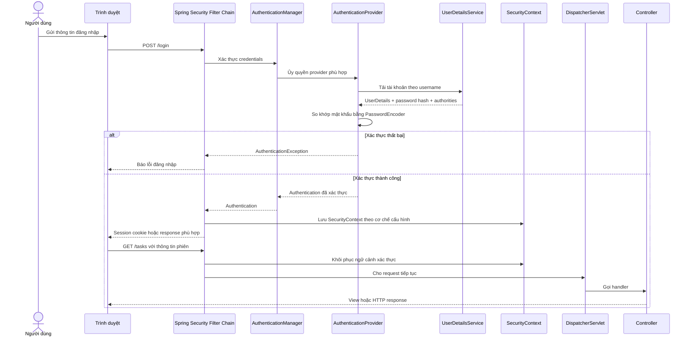

# Xác thực danh tính và truyền ngữ cảnh người dùng

Trong ứng dụng MVC, Controller cần biết request hiện tại được gửi bởi ai để gọi đúng ca sử dụng, giới hạn dữ liệu được xem và ghi nhận người thực hiện hành động. Thông tin đó phải đến từ một cơ chế xác thực đáng tin cậy, chẳng hạn session đã được máy chủ xác minh hoặc access token có chữ ký hợp lệ. Controller không được coi `userId`, `role` hay `isAdmin` do client gửi trong form, query string hoặc header tùy ý là danh tính đã được xác thực.

Xác thực danh tính (authentication) trả lời câu hỏi **“request này thuộc về ai?”**. Sau đó, phân quyền (authorization) trả lời câu hỏi **“người đó có được thực hiện hành động này trên tài nguyên này không?”**. Hai bước phối hợp nhưng không thay thế nhau. Một người dùng đăng nhập thành công vẫn có thể không được phép sửa công việc của người khác hoặc thực hiện một hành động không phù hợp với trạng thái nghiệp vụ.

Trong MVC trên web, cơ chế bảo mật thường xác thực request trước khi request đi vào Controller. Framework tạo ngữ cảnh bảo mật chứa principal và authorities; Controller lấy danh tính đã xác thực từ ngữ cảnh đó rồi truyền một định danh hoặc actor context tối thiểu vào application service. Cách làm này giữ Controller ở ranh giới HTTP, còn Model và dịch vụ nghiệp vụ có thể kiểm tra quyền trên tài nguyên và bảo vệ quy tắc mà không cần phụ thuộc trực tiếp vào session hay token.

## Authentication, Authorization và User Context

Ba khái niệm thường xuất hiện cùng nhau:

| Khái niệm | Câu hỏi | Ví dụ |
|---|---|---|
| Authentication | Ai đang gửi request? | Người dùng được xác định từ session hoặc access token hợp lệ |
| Authorization | Chủ thể đó được phép làm gì? | Có authority `task:write` hoặc là người quản lý dự án chứa công việc |
| User context | Thông tin nào về chủ thể cần dùng trong request/use case? | `UserId`, tenant hiện hành, authorities và correlation ID |

User context là dữ liệu ngữ cảnh được ứng dụng sử dụng sau khi danh tính đã được xác minh. Nó có thể gồm định danh người dùng, tổ chức hoặc tenant đang hoạt động, quyền đã được cấp và một số thông tin phục vụ audit. Không nên đưa toàn bộ đối tượng session, access token hoặc thông tin xác thực vào mọi tầng của ứng dụng. Chỉ truyền dữ liệu tối thiểu mà use case cần.

Một `UserId` đáng tin cậy vẫn không tự chứng minh người dùng có quyền trên mọi tài nguyên. Ví dụ, biết người thực hiện là `user-42` không đồng nghĩa người đó được phép hoàn thành `task-99`. Dịch vụ nghiệp vụ phải kiểm tra quan hệ giữa actor và tài nguyên theo chính sách của hệ thống.

## Luồng xác thực trong ứng dụng web MVC

Với ứng dụng Spring Security dùng form login, request thường đi qua security filter chain trước khi đến `DispatcherServlet` và Controller. Bộ lọc kiểm tra thông tin xác thực, gọi cơ chế xác thực phù hợp và lưu `Authentication` thành công vào `SecurityContext`. Khi request được phép đi tiếp, Controller có thể nhận principal đã xác thực.



Sơ đồ mô tả các vai trò chính, không phải mọi request đều gửi username/password. Sau khi đăng nhập bằng session, trình duyệt thường gửi cookie phiên; với API bearer token, filter/resource server xác minh token trên mỗi request. Chi tiết filter và cách lưu `SecurityContext` phụ thuộc loại ứng dụng và cấu hình Spring Security.

### Các thành phần xác thực thường gặp

- **Security filter chain:** chặn request tại ranh giới web, áp dụng chính sách bảo mật và gọi cơ chế xác thực khi cần.
- **AuthenticationManager:** điều phối việc xác thực đến một hoặc nhiều `AuthenticationProvider`.
- **AuthenticationProvider:** kiểm tra loại credentials cụ thể, ví dụ username/password hoặc token.
- **UserDetailsService:** thường được dùng để tải thông tin tài khoản cho xác thực username/password bằng `DaoAuthenticationProvider`.
- **PasswordEncoder:** so khớp mật khẩu người dùng nhập với password hash đã lưu.
- **SecurityContext:** chứa đối tượng `Authentication` của request hiện tại.
- **SecurityContextHolder:** cung cấp cách truy cập `SecurityContext` trong luồng xử lý hiện tại; mặc định Spring Security thường dùng `ThreadLocal` strategy.

Không phải ứng dụng nào cũng cần tự viết tất cả các thành phần này. Spring Security đã cung cấp nhiều implementation; ứng dụng chủ yếu cấu hình cơ chế xác thực, nguồn tài khoản, chính sách truy cập và cách lưu ngữ cảnh phù hợp.

## Cấu hình bảo vệ endpoint với Spring Security

Với ứng dụng web dùng form login, có thể khai báo các route công khai và route yêu cầu đăng nhập trong `SecurityFilterChain`:

```java
@Configuration
@EnableWebSecurity
public class SecurityConfiguration {

    @Bean
    SecurityFilterChain webSecurity(HttpSecurity http) throws Exception {
        return http
                .authorizeHttpRequests(auth -> auth
                        .requestMatchers("/login", "/assets/**").permitAll()
                        .requestMatchers("/admin/**").hasRole("ADMIN")
                        .anyRequest().authenticated())
                .formLogin(Customizer.withDefaults())
                .build();
    }

    @Bean
    PasswordEncoder passwordEncoder() {
        return new BCryptPasswordEncoder();
    }
}
```

Ví dụ giả định các dependency Spring Security tương ứng đã được thêm. `hasRole("ADMIN")` thường kiểm tra authority `ROLE_ADMIN`; `hasAuthority("task:write")` kiểm tra đúng chuỗi authority được khai báo. Quy ước role và authority cần nhất quán với dữ liệu người dùng được nạp.

Spring Security bật CSRF protection theo cấu hình web thông thường. Không nên tắt CSRF chỉ để làm cho một request POST chạy được; hãy tích hợp CSRF token vào form hoặc dùng cấu hình phù hợp với loại client và cơ chế gửi credentials.

### Lưu mật khẩu an toàn

Không lưu mật khẩu dạng văn bản và không dùng mã hóa có thể giải mã ngược để lưu mật khẩu. Hãy dùng thuật toán băm mật khẩu thích ứng như bcrypt, Argon2 hoặc PBKDF2 qua `PasswordEncoder` phù hợp với nền tảng và chính sách vận hành.

Khi đăng ký hoặc đổi mật khẩu, ứng dụng gọi `passwordEncoder.encode(rawPassword)` rồi chỉ lưu kết quả hash. Khi đăng nhập, provider dùng `matches(rawPassword, storedHash)` để so khớp. Không tự so sánh chuỗi mật khẩu và không ghi mật khẩu hoặc hash vào log. Cần có chính sách nâng cấp hash khi thuật toán hoặc tham số chi phí thay đổi.

Ví dụ tạo hash:

```java
String passwordHash = passwordEncoder.encode(request.password());
accountRepository.save(Account.register(request.email(), passwordHash));
```

Mật khẩu thô chỉ nên tồn tại trong phạm vi xử lý ngắn để xác thực hoặc băm. Sau khi xác thực, credentials nhạy cảm nên được xóa khỏi đối tượng `Authentication` khi cơ chế framework hỗ trợ; không đưa chúng vào principal hoặc user context.

## Principal và SecurityContext

Sau khi xác thực thành công, Spring Security biểu diễn danh tính bằng `Authentication`. Đối tượng này thường chứa:

- **Principal:** đại diện cho người dùng hoặc chủ thể đã xác thực, thường là `UserDetails`, custom principal hoặc tên người dùng.
- **Authorities:** tập quyền/authority mà chủ thể có trong ngữ cảnh xác thực.
- **Credentials:** thông tin dùng để xác thực; thường được làm sạch sau khi xác thực thành công.
- **Authenticated flag:** cho biết kết quả xác thực đã được chấp nhận hay chưa.

`SecurityContext` chứa `Authentication` hiện tại. `SecurityContextHolder` cho phép framework và mã ứng dụng truy cập ngữ cảnh đó trong luồng xử lý. Trong ứng dụng Spring MVC, filter chain quản lý việc nạp và dọn ngữ cảnh theo vòng đời request; không nên tự lưu `Authentication` vào field của Controller hoặc service singleton.

### Dùng custom principal tối thiểu

Principal nên cung cấp những thông tin cần thiết cho ứng dụng, ví dụ ID nội bộ, username và authorities. Không nên đặt toàn bộ entity ORM hoặc dữ liệu cá nhân không cần thiết vào principal.

```java
public record AppPrincipal(
        UserId userId,
        String username,
        Set<String> authorities) {
}
```

Trong thực tế, custom principal có thể triển khai `UserDetails` hoặc được tạo bởi một `AuthenticationProvider` riêng. Ví dụ trên chỉ minh họa dữ liệu ứng dụng muốn truy xuất sau khi xác thực; việc chuyển đổi từ tài khoản lưu trữ sang principal thuộc authentication adapter.

## Truyền danh tính từ Controller vào use case

Controller có thể nhận principal qua `@AuthenticationPrincipal` hoặc `Principal`, sau đó lấy định danh nội bộ để truyền tường minh vào application service.

```java
@Controller
@RequestMapping("/tasks")
public class TaskController {
    private final CompleteTaskUseCase completeTask;

    public TaskController(CompleteTaskUseCase completeTask) {
        this.completeTask = completeTask;
    }

    @PostMapping("/{id}/complete")
    public String complete(
            @PathVariable long id,
            @AuthenticationPrincipal AppPrincipal principal,
            RedirectAttributes redirectAttributes) {

        completeTask.handle(new CompleteTaskCommand(
                new TaskId(id), principal.userId()));

        redirectAttributes.addFlashAttribute(
                "message", "Đã hoàn thành công việc");
        return "redirect:/tasks/" + id;
    }
}
```

Command biểu diễn rõ ai là người yêu cầu hành động:

```java
public record CompleteTaskCommand(
        TaskId taskId,
        UserId actorId) {
}
```

Application service tải tài nguyên và kiểm tra quyền theo dữ liệu đáng tin cậy:

```java
@Service
public class CompleteTaskService implements CompleteTaskUseCase {
    private final TaskRepository taskRepository;
    private final TaskAccessPolicy accessPolicy;

    public CompleteTaskService(
            TaskRepository taskRepository,
            TaskAccessPolicy accessPolicy) {
        this.taskRepository = taskRepository;
        this.accessPolicy = accessPolicy;
    }

    @Override
    @Transactional
    public void handle(CompleteTaskCommand command) {
        Task task = taskRepository.findById(command.taskId())
                .orElseThrow(TaskNotFoundException::new);

        accessPolicy.ensureCanComplete(command.actorId(), task);
        task.complete();
        taskRepository.save(task);
    }
}
```

Controller chuyển danh tính đã xác thực thành `actorId`; service kiểm tra quyền trên đúng công việc; Model bảo vệ chuyển trạng thái bằng `task.complete()`. Việc có quyền hoàn thành và việc trạng thái có cho phép hoàn thành là hai điều kiện riêng. Cả hai đều phải được kiểm tra phía máy chủ.

### Vì sao nên truyền ID hoặc Actor Context tường minh?

Truyền `UserId` hoặc một `ActorContext` nhỏ qua command có một số lợi ích:

- use case thể hiện rõ nó cần biết ai là người thực hiện;
- unit test có thể tạo actor cụ thể mà không cần dựng `SecurityContextHolder`;
- nghiệp vụ không phụ thuộc Spring Security, Servlet API hoặc HTTP session;
- cùng use case có thể được gọi từ REST Controller, message consumer hoặc tác vụ nền;
- audit có thể ghi nhận actor theo hợp đồng rõ ràng.

Nếu nhiều use case cần cùng tập dữ liệu, có thể định nghĩa một kiểu bất biến:

```java
public record ActorContext(
        UserId userId,
        TenantId tenantId,
        Set<String> authorities,
        String correlationId) {
}
```

Chỉ đưa trường thực sự cần thiết vào `ActorContext`. Không truyền access token, password, cookie hoặc toàn bộ `Authentication` xuống domain model. Authorities có thể hỗ trợ quyết định ở application layer, nhưng các quy tắc trên tài nguyên vẫn cần được kiểm tra dựa trên trạng thái hiện tại và chính sách đáng tin cậy.

## Truy cập SecurityContext trực tiếp hay truyền context?

Spring cho phép lấy authentication từ `SecurityContextHolder`:

```java
Authentication authentication =
        SecurityContextHolder.getContext().getAuthentication();
```

Cách này có thể phù hợp ở adapter hoặc thành phần tích hợp chặt với Spring Security. Tuy nhiên, nếu entity hoặc domain service gọi trực tiếp `SecurityContextHolder`, phần nghiệp vụ sẽ phụ thuộc framework và khó chạy trong test, tác vụ nền hoặc kênh gọi khác.

Nên ưu tiên:

- dùng `@AuthenticationPrincipal` hoặc `Principal` tại Controller;
- chuyển principal thành `UserId` hoặc `ActorContext`;
- truyền context qua command hoặc tham số use case;
- giữ Spring Security API ở ranh giới web/security adapter.

Nếu ứng dụng có nhiều Controller và cần abstraction lấy người dùng hiện tại, có thể tạo một port như `CurrentActorProvider` ở tầng ứng dụng và implementation ở adapter web. Tuy nhiên, không nên ẩn dependency danh tính nếu use case cần biết rõ actor; tham số tường minh thường dễ hiểu và dễ kiểm thử hơn.

## Session-based authentication và token-based authentication

Hai cách phổ biến có vòng đời ngữ cảnh khác nhau.

| Tiêu chí | Session-based | Bearer token / JWT |
|---|---|---|
| Client gửi gì? | Cookie chứa session identifier | Token trong `Authorization: Bearer ...` hoặc cơ chế được quy định |
| Trạng thái xác thực | Thường được lưu phía máy chủ trong session/security context repository | Token được xác minh trên mỗi request; context được tạo cho request đó |
| Thu hồi | Có thể vô hiệu hóa session phía máy chủ | JWT đã phát hành khó thu hồi tức thời nếu không có denylist hoặc cơ chế kiểm tra trạng thái bổ sung |
| Phù hợp | Web app render phía máy chủ, session login | API, mobile client, service-to-service theo OAuth2/OIDC |
| Cần chú ý | Cookie, session fixation, CSRF, timeout | Chữ ký, issuer, audience, expiration, key rotation, replay và lưu trữ token |

### Session-based authentication

Sau khi đăng nhập thành công, server tạo hoặc thay đổi session và gửi cookie chứa session ID cho trình duyệt. Trên các request tiếp theo, trình duyệt gửi cookie; server tìm session và khôi phục `SecurityContext` tương ứng.

Cookie phiên nên có các thuộc tính phù hợp như `Secure`, `HttpOnly` và `SameSite` theo mô hình triển khai. `Secure` giới hạn cookie gửi qua HTTPS; `HttpOnly` ngăn JavaScript đọc cookie trực tiếp; `SameSite` giúp kiểm soát một số request cross-site. Các thuộc tính này không thay thế CSRF token khi ứng dụng cần bảo vệ request thay đổi trạng thái.

Sau đăng nhập, cần bảo vệ session khỏi session fixation bằng cơ chế đổi session ID phù hợp; khi logout, vô hiệu hóa session và xóa cookie theo cấu hình. Đặt thời gian hết hạn theo rủi ro và nhu cầu sử dụng, tránh session tồn tại vô thời hạn.

### Bearer token và JWT

Với API dùng OAuth2 Resource Server, client gửi access token trong header `Authorization`. Server xác minh token và tạo `Authentication` cho request. Nếu token là JWT, việc xác minh cần kiểm tra chữ ký bằng key tin cậy cùng các claim quan trọng như issuer, audience, expiration và not-before theo chính sách.

Không chỉ decode JWT rồi tin payload. Chữ ký phải được xác minh; thuật toán và key phải được cấu hình an toàn. JWT thường được mã hóa Base64URL chứ không mặc định được mã hóa bí mật, vì vậy không đưa password, secret hoặc dữ liệu cá nhân không cần thiết vào claim.

Với Spring Security, có thể cấu hình resource server thay vì tự viết bộ lọc xác minh token:

```java
@Bean
SecurityFilterChain apiSecurity(HttpSecurity http) throws Exception {
    return http
            .securityMatcher("/api/**")
            .authorizeHttpRequests(auth -> auth
                    .anyRequest().authenticated())
            .oauth2ResourceServer(oauth2 -> oauth2.jwt(Customizer.withDefaults()))
            .build();
}
```

Ví dụ cần cấu hình `JwtDecoder` hoặc issuer/JWK phù hợp và có thể cần một `SecurityFilterChain` riêng cho API. Không sao chép cấu hình này một cách máy móc vào ứng dụng session-based; CSRF, CORS và cách lưu token phụ thuộc nơi client giữ credentials. JWT lưu trong cookie vẫn có thể chịu rủi ro CSRF vì trình duyệt tự gửi cookie.

## Truyền ngữ cảnh qua nhiều request

Trong ứng dụng web, request thường độc lập. Session hoặc token giúp server nhận diện cùng một chủ thể ở request tiếp theo, nhưng không có nghĩa toàn bộ object Java từ request trước được giữ lại.

Mỗi request cần:

1. xác minh cookie hoặc token;
2. tạo/khôi phục `Authentication` và `SecurityContext`;
3. kiểm tra quyền truy cập endpoint;
4. Controller lấy principal và tạo command/query có actor phù hợp;
5. application service tải trạng thái mới nhất và kiểm tra quyền trên tài nguyên;
6. sau khi xử lý, framework dọn context theo vòng đời request.

Không nên cache quyền truy cập của người dùng trong một field singleton rồi dùng lại cho request khác. Quyền có thể thay đổi; dữ liệu tài nguyên có thể được chuyển chủ sở hữu hoặc bị thu hồi quyền giữa hai request. Khi cần, hãy tải hoặc kiểm tra quyền tại thời điểm thực hiện hành động.

## Truyền ngữ cảnh sang tác vụ bất đồng bộ

`SecurityContextHolder` mặc định gắn ngữ cảnh với thread xử lý. Khi dùng `@Async`, executor riêng hoặc message queue, công việc có thể chạy trên thread khác và không tự động nhận cùng context theo cách mà mã đồng bộ đang chạy.

Có hai nhu cầu cần phân biệt:

- **Cần tiếp tục kiểm tra bảo mật trong một tác vụ nội bộ ngắn:** Spring Security cung cấp các cơ chế như `DelegatingSecurityContextExecutor` hoặc executor tương ứng để truyền context có kiểm soát.
- **Cần ghi nhận ai khởi tạo một công việc nền:** nên lưu `actorId`, mã use case và correlation ID như dữ liệu của công việc; worker xác định rõ nó chạy dưới danh tính người dùng hay danh tính hệ thống.

Ví dụ, khi người dùng yêu cầu tạo báo cáo, ứng dụng có thể lưu `requestedBy=UserId` cùng công việc. Worker không cần giữ nguyên access token hoặc session của người dùng. Khi worker thực hiện hành động có quyền riêng, cần xác định chính sách: quyền được đánh giá tại thời điểm yêu cầu hay thời điểm thực thi, và worker dùng service identity nào.

Không truyền nguyên `Authentication` hoặc token qua message broker nếu không có nhu cầu và chính sách bảo vệ rõ ràng. Token có thể hết hạn, bị thu hồi hoặc chứa dữ liệu nhạy cảm. Với tác vụ chạy theo lịch, dùng danh tính hệ thống được giới hạn quyền thay vì giả làm một người dùng bất kỳ.

### Không lưu user context trong field của singleton

Service Spring thường là singleton. Đoạn mã sau không an toàn:

```java
@Service
public class UnsafeTaskService {
    private UserId currentActor;

    public void complete(TaskId taskId, UserId actorId) {
        currentActor = actorId;
        // Một request đồng thời có thể ghi đè currentActor.
        // Các bước tiếp theo có thể dùng nhầm actor.
    }
}
```

Hãy truyền actor qua tham số hoặc command:

```java
@Service
public class TaskService {
    public void complete(TaskId taskId, UserId actorId) {
        // Mỗi lần gọi sử dụng actor của chính use case này.
    }
}
```

Không dùng `ThreadLocal` tự tạo để lưu danh tính mà không có cơ chế dọn dẹp. Nếu thread được tái sử dụng trong thread pool và context không được xóa đúng lúc, dữ liệu của request trước có thể rò sang request sau.

## Tenant và ngữ cảnh tổ chức

Trong hệ thống multi-tenant, user context có thể gồm `TenantId` hoặc organization ID. Tuy nhiên, không được tin một header như `X-Tenant-ID` chỉ vì client gửi nó. Nếu người dùng có thể chọn tenant đang hoạt động, server phải kiểm tra người đó thực sự là thành viên và có quyền trong tenant đó.

Một quy trình an toàn thường là:

1. xác thực người dùng từ session hoặc token;
2. đọc tenant được yêu cầu từ route/header nếu hợp đồng cho phép chọn;
3. kiểm tra membership và quyền truy cập tenant từ nguồn dữ liệu đáng tin cậy;
4. tạo `ActorContext` với `UserId` và `TenantId` đã được chấp nhận;
5. mọi truy vấn và thay đổi dữ liệu đều giới hạn theo tenant phù hợp.

Không chỉ lọc tenant ở View. Repository/query cần bảo vệ ranh giới tenant để tránh truy cập chéo dữ liệu. Nếu tenant ID là claim trong token, vẫn cần xác minh token, issuer/audience và chính sách lựa chọn tenant; claim cũ có thể không phản ánh membership vừa bị thu hồi.

## Lỗi xác thực và lỗi phân quyền

Phản hồi cần phân biệt người dùng chưa được xác thực với người dùng đã xác thực nhưng không đủ quyền:

| Tình huống | HTTP/API thường dùng | Web form thường gặp |
|---|---|---|
| Chưa đăng nhập hoặc token không hợp lệ | `401 Unauthorized` | Chuyển đến trang đăng nhập hoặc hiển thị lỗi đăng nhập |
| Đã đăng nhập nhưng không có quyền | `403 Forbidden` | Trang truy cập bị từ chối |
| Tài nguyên không tồn tại | `404 Not Found` | Trang không tìm thấy; đôi khi chính sách che giấu tài nguyên cũng trả 404 |
| Credentials đăng nhập sai | Thường không tiết lộ username có tồn tại hay không | Thông báo chung để tránh dò tài khoản |

Với API bearer token, `401` thường đi kèm `WWW-Authenticate` challenge phù hợp. Với form login, framework có thể redirect đến login page thay vì trả JSON. Không nên tiết lộ lý do quá chi tiết như “email này tồn tại nhưng mật khẩu sai” nếu điều đó hỗ trợ dò tài khoản.

## Các biện pháp bảo vệ liên quan

Xác thực danh tính chỉ là một phần của bảo mật MVC. Cần phối hợp thêm:

- **CSRF:** với cookie/session, bảo vệ request thay đổi trạng thái bằng token hoặc cơ chế tương đương. Không coi `SameSite` là biện pháp duy nhất cho mọi hệ thống.
- **CORS:** cấu hình origin, method và header được phép cho browser client. CORS không phải cơ chế xác thực hoặc phân quyền.
- **Session fixation:** đổi session ID sau đăng nhập hoặc thay đổi mức đặc quyền theo cơ chế framework.
- **Cookie:** dùng HTTPS và thuộc tính `Secure`, `HttpOnly`, `SameSite` thích hợp.
- **MFA:** yêu cầu yếu tố bổ sung cho tài khoản hoặc hành động có rủi ro cao khi chính sách cần.
- **Rate limiting:** giới hạn thử đăng nhập và các endpoint nhạy cảm; tránh khóa tài khoản dễ bị lợi dụng để gây từ chối dịch vụ.
- **Audit:** ghi nhận actor, hành động, tài nguyên, kết quả và thời điểm theo chính sách; không ghi password, session ID, bearer token hoặc secret.
- **Logout và thu hồi:** vô hiệu hóa session; với token, áp dụng thời hạn ngắn, rotation và cơ chế thu hồi phù hợp với mức rủi ro.

## Kiểm thử authentication và user context

Kiểm thử cần xác minh danh tính được tạo đúng, truyền đúng và không bị giả mạo.

### Kiểm thử endpoint

- request không đăng nhập bị chặn ở endpoint yêu cầu authentication;
- request có principal hợp lệ đi đến Controller;
- authority không phù hợp bị từ chối;
- role/authority được ánh xạ đúng;
- endpoint công khai vẫn truy cập được theo cấu hình.

Spring Security Test hỗ trợ `@WithMockUser` để kiểm thử quyền với một user giả lập:

```java
@Test
@WithMockUser(username = "alice", roles = "ADMIN")
void adminCanOpenAdminPage() throws Exception {
    mockMvc.perform(get("/admin"))
            .andExpect(status().isOk());
}
```

Với custom principal, có thể dùng `@WithUserDetails` nếu test context cấu hình được `UserDetailsService`, hoặc tạo `Authentication` phù hợp trong request test. `@WithMockUser` mặc định tạo principal dạng `UserDetails` chuẩn, nên không tự động tạo `AppPrincipal` tùy chỉnh.

### Kiểm thử truyền actor vào use case

Khi Controller nhận principal, xác minh command được tạo với đúng `UserId` từ principal. Gửi thêm `userId` giả trong body hoặc query không được làm thay đổi actor. Điều này kiểm tra rằng danh tính lấy từ security context chứ không từ dữ liệu do client tự khai báo.

### Kiểm thử phân quyền tài nguyên

- người dùng A không thể xem hoặc sửa tài nguyên chỉ thuộc người dùng B nếu chính sách không cho phép;
- người dùng có role chung nhưng không có membership tenant không được truy cập tenant đó;
- quyền bị thu hồi được phản ánh theo chính sách kiểm tra hiện hành;
- trạng thái nghiệp vụ không hợp lệ vẫn bị từ chối dù người dùng có quyền gọi endpoint.

### Kiểm thử session, token và tác vụ nền

- session hết hạn hoặc logout không còn được chấp nhận;
- token sai chữ ký, sai issuer/audience hoặc hết hạn bị từ chối;
- request đồng thời không làm trộn actor context;
- tác vụ async nhận đúng actor hoặc system identity theo thiết kế;
- worker không phụ thuộc vào session hoặc token đã hết hạn từ request gốc.

Không chỉ kiểm tra status code. Với các thao tác thay đổi dữ liệu, hãy đọc lại trạng thái lưu trữ để xác minh người dùng không thể ghi đè owner, tenant, role hoặc trạng thái nhạy cảm bằng cách giả mạo request.

## Những sai lầm thường gặp

- **Tin `userId` từ request:** client có thể giả danh người khác. Lấy danh tính từ principal đã xác thực.
- **Nhầm authentication với authorization:** đăng nhập thành công không có nghĩa được truy cập mọi tài nguyên. Kiểm tra quyền ở endpoint và đối tượng.
- **Dùng username làm định danh nghiệp vụ:** username có thể đổi hoặc không duy nhất giữa tenant. Dùng ID nội bộ ổn định.
- **Đưa Spring Security vào domain model:** entity phụ thuộc `SecurityContextHolder` và khó tái sử dụng. Truyền actor rõ ràng qua use case.
- **Lưu actor trong field singleton:** request đồng thời có thể ghi đè context. Dùng tham số/command bất biến.
- **Đưa toàn bộ User entity vào principal:** tăng dữ liệu nhạy cảm, tạo trạng thái cũ và phụ thuộc persistence. Dùng principal tối thiểu.
- **Tự giải mã JWT rồi tin claim:** payload chưa được xác minh chữ ký và issuer. Dùng resource server hoặc thư viện được cấu hình đúng.
- **Truyền nguyên token vào queue:** token có thể hết hạn và bị lộ. Truyền actor ID cùng metadata tối thiểu, dùng service identity khi phù hợp.
- **Dựa vào CORS để bảo vệ API:** CORS chỉ là chính sách browser. Vẫn cần authentication và authorization.
- **Tắt CSRF cho mọi endpoint:** có thể mở đường cho request giả mạo khi credentials được trình duyệt tự gửi. Chọn cấu hình theo cơ chế xác thực thực tế.
- **Ghi token/session vào log:** làm lộ thông tin cho phép chiếm phiên. Chỉ log mã tương quan và thông tin đã lọc.

## Quy trình thiết kế user context cho một use case

Khi thêm chức năng cần biết người thực hiện, hãy lần theo các bước:

1. **Xác định cơ chế authentication:** session, OAuth2/OIDC bearer token hay cơ chế phù hợp khác.
2. **Xác định principal tối thiểu:** ID ổn định, authorities và tenant context nếu thực sự cần.
3. **Bảo vệ endpoint:** quy định route công khai, route cần đăng nhập và authority cần thiết.
4. **Lấy actor ở ranh giới:** Controller nhận principal từ framework; không lấy danh tính từ form hoặc query.
5. **Truyền actor vào use case:** dùng `UserId` hoặc `ActorContext` bất biến trong command.
6. **Kiểm tra quyền trên tài nguyên:** application service/policy tải dữ liệu và kiểm tra actor có quyền thực hiện hành động không.
7. **Bảo vệ quy tắc miền:** Model kiểm tra trạng thái và bất biến trước khi thay đổi.
8. **Xác định vòng đời context:** request, session hay tác vụ async; quy định cách truyền và dọn context.
9. **Ghi audit an toàn:** ghi actor và hành động cần thiết, không ghi credentials.
10. **Kiểm thử giả mạo và truy cập chéo:** thay ID, tenant, role trong request và xác minh chúng không vượt qua cơ chế bảo vệ.

## Câu hỏi tự đánh giá

Khi review luồng xác thực và truyền ngữ cảnh, hãy tự hỏi:

1. Danh tính được xác minh từ session hoặc token nào?
2. Principal có chứa đúng lượng dữ liệu cần thiết và không chứa credentials không?
3. Controller lấy actor từ security context hay từ dữ liệu client gửi?
4. Use case có nhận actor tường minh để kiểm tra quyền và audit không?
5. Quyền trên endpoint có được phân biệt với quyền trên tài nguyên không?
6. Tenant context được xác minh từ membership đáng tin cậy chưa?
7. Context có bị lưu trong field singleton hoặc truyền sang thread khác thiếu kiểm soát không?
8. Session, token, CSRF, logout và thu hồi được xử lý theo cơ chế xác thực đã chọn chưa?
9. Kiểm thử có bao gồm request giả mạo actor và truy cập chéo tài nguyên không?

Trong MVC, cơ chế bảo mật xác thực request trước khi Controller xử lý; Controller lấy principal đã xác thực và chuyển định danh người thực hiện vào use case; application service kiểm tra quyền trên tài nguyên; Model bảo vệ quy tắc trạng thái. Khi user context được truyền tường minh và có phạm vi rõ ràng, ứng dụng tránh phụ thuộc bảo mật vào dữ liệu client, hỗ trợ kiểm thử tốt hơn và giữ danh tính nhất quán qua các kênh tương tác.
