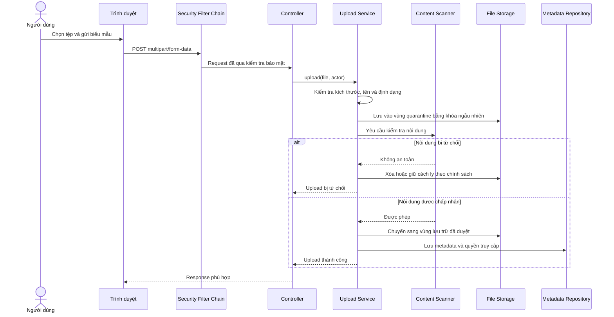

# Xử lý tệp tải lên và liên kết chuyển hướng không đáng tin cậy

Trong ứng dụng MVC, tệp tải lên và URL chuyển hướng thường được nhận từ request, nên cả hai đều phải được xem là dữ liệu không đáng tin cậy. Một biểu mẫu có thể gửi ảnh đại diện, tài liệu hoặc tệp đính kèm; một tham số như `returnUrl` có thể yêu cầu ứng dụng chuyển người dùng về trang trước đó. Nếu chỉ tin tên tệp, phần mở rộng, MIME type hoặc URL do client gửi, ứng dụng có thể mở đường cho ghi tệp ngoài thư mục dự kiến, tải nội dung độc hại, lộ dữ liệu hoặc chuyển hướng người dùng đến trang giả mạo.

Trong MVC, Controller tiếp nhận multipart request hoặc tham số điều hướng, kiểm tra hợp đồng đầu vào và gọi use case chuyên trách. Dịch vụ ứng dụng phối hợp chính sách bảo mật, lưu trữ và metadata; adapter lưu tệp hoặc quét nội dung xử lý chi tiết hạ tầng. Khi trả response, Controller chỉ cung cấp liên kết tải xuống hoặc đích chuyển hướng đã được ứng dụng xác minh. View có thể hiển thị tên tệp và liên kết, nhưng không quyết định tệp có an toàn hay URL có đáng tin cậy hay không.

## Hai bề mặt tấn công thường gặp

| Đầu vào | Rủi ro khi tin dữ liệu client | Hậu quả có thể xảy ra |
|---|---|---|
| Tệp multipart | Tên tệp chứa đường dẫn, nội dung không đúng định dạng khai báo, kích thước quá lớn hoặc nội dung chủ động | Path traversal, ghi đè tệp, malware, XSS khi mở nội dung, cạn tài nguyên |
| URL chuyển hướng | URL tuyệt đối hoặc dạng `//host`, scheme nguy hiểm, URL đã mã hóa hoặc đường dẫn vượt khỏi phạm vi cho phép | Open redirect, phishing, lạm dụng luồng đăng nhập và rò rỉ dữ liệu trong URL |

Hai vấn đề có cùng nguyên tắc: **không dùng trực tiếp dữ liệu do client cung cấp làm đường dẫn hệ thống tệp hoặc đích điều hướng**. Hãy chuyển nó qua một hợp đồng hẹp, kiểm tra theo allowlist và tạo giá trị an toàn phía máy chủ.

## Nhận tệp tải lên trong MVC

### Multipart request hoạt động thế nào?

Trình duyệt thường gửi tệp qua `multipart/form-data`. Mỗi phần của request có thể chứa một trường biểu mẫu hoặc một tệp, cùng metadata như tên trường, tên tệp và content type do client khai báo. Framework web phân tích multipart body và cung cấp một đối tượng đại diện cho tệp, chẳng hạn `MultipartFile` trong Spring MVC.



Luồng thực tế có thể quét đồng bộ hoặc bất đồng bộ. Với tệp lớn hoặc hệ thống quét chậm, ứng dụng có thể lưu vào vùng cách ly, ghi trạng thái `PENDING_SCAN` và trả kết quả đang xử lý. Chỉ khi tệp đạt chính sách, hệ thống mới đánh dấu tệp sẵn sàng để tải hoặc sử dụng.

### Giới hạn kích thước trước khi xử lý

Không chờ đến lúc lưu xong mới kiểm tra kích thước. Multipart parser có thể đã phải đọc và lưu tạm request trước khi Controller được gọi. Hãy đặt giới hạn ở nhiều lớp:

- giới hạn tổng request body;
- giới hạn kích thước mỗi tệp;
- giới hạn số lượng tệp trong một request;
- giới hạn kích thước trường văn bản multipart;
- giới hạn quota theo người dùng, tenant hoặc chức năng;
- giới hạn thời gian nhận request và số request tải lên đồng thời.

Ví dụ cấu hình Spring Boot:

```properties
spring.servlet.multipart.max-file-size=10MB
spring.servlet.multipart.max-request-size=12MB
spring.servlet.multipart.file-size-threshold=1MB
```

Các giá trị trên chỉ minh họa. Hãy chọn giới hạn theo loại tệp, hạ tầng proxy, bộ nhớ, dung lượng tạm và nhu cầu sản phẩm. Cấu hình reverse proxy hoặc API gateway cũng cần có giới hạn tương ứng; nếu proxy cho phép body lớn hơn nhiều so với ứng dụng, request vẫn có thể tiêu tốn tài nguyên trước khi đến Controller.

Controller nên kiểm tra lại `file.isEmpty()` và `file.getSize()` theo chính sách use case. Tuy nhiên, kiểm tra tại Controller không thay thế giới hạn ở tầng HTTP/multipart parser.

## Không tin tên tệp gốc

Tên tệp do client gửi có thể chứa đường dẫn, ký tự điều khiển, dấu phân cách khác nhau giữa hệ điều hành, ký tự Unicode gây nhầm lẫn hoặc chuỗi rất dài. Ví dụ:

```text
../../../../var/www/app/shell.jsp
..\..\private\config.yml
report.pdf.exe
invoice.pdf%00.jsp
```

Không dùng `getOriginalFilename()` làm đường dẫn lưu trữ. Không nối tên tệp gốc với thư mục upload rồi gọi `Files.write()` hoặc `new File(...)`. Ngay cả khi đã loại bỏ `../`, các khác biệt về chuẩn hóa đường dẫn, ký tự Unicode và dấu phân cách vẫn có thể tạo lỗ hổng.

### Sinh tên lưu trữ phía máy chủ

Tạo khóa lưu trữ ngẫu nhiên hoặc ID do máy chủ sinh, ví dụ UUID. Tên tệp gốc chỉ nên được giữ như metadata hiển thị sau khi giới hạn độ dài và loại bỏ ký tự điều khiển. Khi cần giữ phần mở rộng, chỉ lấy phần mở rộng đã được kiểm tra theo allowlist; không dùng nó làm căn cứ duy nhất để quyết định loại nội dung.

```java
String storageKey = UUID.randomUUID().toString();
```

Đường dẫn lưu trữ nên được xây dựng từ thư mục gốc cấu hình tin cậy và khóa do máy chủ tạo. Không lấy `storageKey` hoặc thư mục gốc từ request.

```java
Path target = storageRoot.resolve(storageKey).normalize();
if (!target.startsWith(storageRoot.normalize())) {
    throw new IllegalStateException("Đường dẫn lưu trữ nằm ngoài vùng cho phép");
}
```

Kiểm tra `startsWith` ở đây là lớp phòng vệ bổ sung khi đường dẫn đích được tạo từ khóa máy chủ sinh. Không được dùng phép kiểm tra chuỗi tương tự để xác thực URL redirect. Thư mục gốc cần được chuẩn hóa một lần từ cấu hình đáng tin cậy, quyền truy cập filesystem phải giới hạn cho tiến trình ứng dụng, và thao tác tạo tệp nên dùng chế độ không ghi đè tệp đã tồn tại như `CREATE_NEW`.

### Tách tên hiển thị khỏi khóa lưu trữ

Metadata có thể lưu:

| Trường | Ý nghĩa |
|---|---|
| `fileId` | ID công khai hoặc ID nội bộ của bản ghi tệp |
| `storageKey` | Khóa ngẫu nhiên dùng để tìm nội dung trong storage |
| `originalName` | Tên gốc đã được lọc để hiển thị hoặc tải xuống |
| `detectedType` | Loại nội dung được xác định bởi server |
| `size` | Kích thước thực tế đã xác minh |
| `ownerId` / `tenantId` | Chủ sở hữu và phạm vi dữ liệu |
| `scanStatus` | Trạng thái kiểm tra nội dung |
| `createdAt` | Thời điểm server ghi nhận |

Không nên dùng `originalName` làm khóa hoặc đường dẫn. Cũng không nên công khai `storageKey` nếu việc đoán hoặc truy cập trực tiếp nó có thể bỏ qua kiểm tra quyền.

## Xác minh loại nội dung của tệp

### Phần mở rộng và MIME type không đủ tin cậy

Phần mở rộng như `.pdf`, `.png` hoặc `.jpg` do client kiểm soát. `MultipartFile.getContentType()` cũng thường phản ánh header `Content-Type` mà client gửi. Người dùng có thể đổi tên một tệp thực thi thành `report.pdf` hoặc khai báo MIME type giả.

Vì vậy, hãy kết hợp nhiều tín hiệu:

1. **Allowlist phần mở rộng:** chỉ chấp nhận những loại sản phẩm thực sự cần, ví dụ `.pdf`, `.png`, `.jpg`.
2. **MIME type khai báo:** dùng như tín hiệu ban đầu, không phải bằng chứng cuối cùng.
3. **File signature / magic bytes:** kiểm tra chữ ký nhị phân hoặc dùng thư viện nhận diện nội dung đáng tin cậy.
4. **Parser theo định dạng:** nếu cần, thử phân tích nội dung bằng thư viện phù hợp và giới hạn tài nguyên.
5. **Quét malware hoặc kiểm tra nội dung:** áp dụng theo mức rủi ro và loại tệp.

Ví dụ, một tệp PNG hợp lệ bắt đầu bằng chữ ký byte đặc trưng; PDF thường bắt đầu bằng `%PDF-`. Kiểm tra vài byte đầu có thể loại bỏ một số trường hợp giả mạo đơn giản nhưng không chứng minh toàn bộ tệp an toàn. Nội dung có thể chứa dữ liệu phụ, cấu trúc lỗi hoặc payload độc hại ở phía sau.

### Chỉ chấp nhận định dạng cần thiết

Không bật mọi định dạng chỉ vì thư viện có thể đọc chúng. Nếu chức năng chỉ cần ảnh đại diện, hãy giới hạn ở JPEG, PNG hoặc WebP theo nhu cầu; không nhận HTML, SVG hoặc tệp thực thi. SVG là định dạng XML có thể chứa nội dung chủ động hoặc tham chiếu bên ngoài, vì vậy không nên coi nó tương đương ảnh raster an toàn khi hiển thị trực tiếp.

Với ảnh, cân nhắc giải mã rồi mã hóa lại thành định dạng raster được hỗ trợ. Việc tái tạo ảnh có thể loại bỏ metadata hoặc cấu trúc bất thường, nhưng parser ảnh vẫn cần giới hạn kích thước pixel và bộ nhớ để tránh decompression bomb.

### Kiểm tra kích thước sau giải nén

Kích thước tệp nén không phản ánh kích thước tài nguyên sau khi giải nén. Một ảnh có kích thước byte nhỏ có thể khai báo chiều rộng/chiều cao rất lớn; một tệp ZIP nhỏ có thể bung ra hàng gigabyte hoặc chứa hàng triệu entry.

Nếu nhận archive, hãy giới hạn:

- tổng số entry;
- tổng dung lượng giải nén;
- kích thước tối đa của mỗi entry;
- tỷ lệ nén tối đa;
- độ sâu thư mục và thời gian xử lý;
- tên entry và đường dẫn sau chuẩn hóa.

Khi giải nén, không ghép tên entry trực tiếp vào thư mục đích. Kiểm tra đường dẫn đã chuẩn hóa vẫn nằm trong thư mục gốc, từ chối đường dẫn tuyệt đối, `..`, symlink hoặc entry có hành vi vượt khỏi vùng giải nén. Đây là rủi ro Zip Slip.

## Lưu tệp an toàn

### Lưu ngoài web root

Không lưu tệp người dùng tải lên trong thư mục có thể được web server phục vụ trực tiếp như `static`, `public`, `webroot` hoặc thư mục chứa ứng dụng. Nếu tệp HTML hoặc SVG độc hại được phục vụ cùng origin với ứng dụng, trình duyệt có thể thực thi nội dung trong ngữ cảnh tin cậy của site.

Ưu tiên lưu ở:

- thư mục riêng ngoài web root, có quyền filesystem tối thiểu;
- object storage riêng tư, không bật public access mặc định;
- vùng quarantine tách biệt trước khi quét và duyệt nội dung.

Tệp nên được tải qua endpoint có kiểm tra quyền hoặc URL có chữ ký thời hạn ngắn do server cấp sau khi xác minh quyền. Không dùng đường dẫn tệp vật lý làm URL công khai.

### Ví dụ Controller chỉ tiếp nhận và gọi use case

```java
@Controller
@RequestMapping("/documents")
public class DocumentUploadController {
    private final UploadDocumentUseCase uploadDocument;

    public DocumentUploadController(UploadDocumentUseCase uploadDocument) {
        this.uploadDocument = uploadDocument;
    }

    @PostMapping(consumes = MediaType.MULTIPART_FORM_DATA_VALUE)
    public String upload(
            @RequestParam("file") MultipartFile file,
            @AuthenticationPrincipal AppPrincipal principal,
            RedirectAttributes redirectAttributes) {

        UploadResult result = uploadDocument.handle(
                new UploadDocumentCommand(
                        file,
                        principal.userId()));

        redirectAttributes.addFlashAttribute(
                "message", "Đã tiếp nhận tệp " + result.fileId());
        return "redirect:/documents";
    }
}
```

Đoạn mã minh họa ranh giới MVC. Trong thiết kế chặt chẽ hơn, application layer không nên phụ thuộc `MultipartFile`; Controller có thể chuyển stream, metadata cần thiết hoặc một abstraction `UploadedContent` sang use case. Với tệp lớn, tránh đọc toàn bộ nội dung vào `byte[]` nếu không cần thiết.

### Ví dụ dịch vụ lưu bằng khóa do server sinh

```java
public UploadResult store(
        InputStream content,
        long size,
        DetectedFileType detectedType,
        UserId ownerId) throws IOException {

    String storageKey = UUID.randomUUID().toString();
    Path root = storageRoot.toAbsolutePath().normalize();
    Files.createDirectories(root);

    Path target = root.resolve(storageKey).normalize();
    if (!target.startsWith(root)) {
        throw new IllegalStateException("Đường dẫn lưu trữ không hợp lệ");
    }

    try (InputStream input = content) {
        // Không ghi đè nếu khóa lưu trữ đã tồn tại.
        Files.copy(input, target);
    }

    metadataRepository.save(new StoredFile(
            storageKey, ownerId, detectedType, size, ScanStatus.PENDING));

    return new UploadResult(storageKey, ScanStatus.PENDING);
}
```

Đây là mã phác thảo; `Files.copy(InputStream, Path)` thất bại nếu đích đã tồn tại, nhờ đó không ghi đè khóa cũ. Triển khai thực tế cần kiểm tra kích thước thực tế trong lúc stream, xóa tệp nếu lưu metadata thất bại, đặt quyền file hạn chế và xử lý tính nhất quán giữa filesystem/object storage với database. Phần quan trọng là tên lưu trữ do server tạo, storage root do cấu hình tin cậy cung cấp và tệp chưa được công bố khi đang ở trạng thái chờ quét.

### Đồng bộ giữa tệp và metadata

Filesystem hoặc object storage thường không tham gia cùng transaction với database. Nếu ghi tệp thành công nhưng lưu metadata thất bại, có thể xuất hiện tệp mồ côi. Nếu metadata được lưu trước nhưng upload thất bại, có thể có bản ghi trỏ đến nội dung không tồn tại.

Hãy thiết kế quy trình có thể phục hồi:

- tạo metadata ở trạng thái `PENDING` hoặc `UPLOADING`;
- ghi nội dung vào vùng tạm bằng khóa ngẫu nhiên;
- xác minh kích thước và nội dung;
- chuyển sang vùng lưu trữ chính thức hoặc cập nhật trạng thái;
- đánh dấu `AVAILABLE` chỉ sau khi mọi bước bắt buộc hoàn tất;
- dọn tệp tạm và metadata mồ côi bằng job định kỳ có kiểm soát.

Với object storage, có thể dùng multipart upload và finalize/complete operation. Hãy bảo đảm người dùng không thể tải tệp khi trạng thái còn `PENDING_SCAN`, `REJECTED` hoặc `FAILED`.

## Quét malware và xử lý nội dung chủ động

Không có một kiểm tra đơn giản nào chứng minh mọi tệp an toàn. Tùy chức năng, có thể kết hợp antivirus scanner, sandbox, Content Disarm and Reconstruction (CDR) hoặc parser chuyên dụng. Tệp từ bên ngoài cần được coi là nội dung thụ động chưa tin cậy cho đến khi vượt qua chính sách.

Một số điểm cần cân nhắc:

- quét tệp trước khi cho tải hoặc xử lý bởi hệ thống khác;
- cách ly tệp đang chờ quét;
- giới hạn thời gian và tài nguyên của scanner;
- xử lý scanner không khả dụng như trạng thái chưa được duyệt, không mặc định là an toàn;
- ghi nhận phiên bản engine, kết quả và thời điểm quét nếu cần audit;
- có quy trình quét lại khi chữ ký malware được cập nhật;
- không mở trực tiếp tài liệu Office, PDF hoặc HTML trên máy chủ chỉ để kiểm tra.

Nếu hệ thống cần trích xuất nội dung từ PDF, Office hoặc archive, hãy dùng thư viện cập nhật, chạy trong môi trường giới hạn quyền và giới hạn CPU, bộ nhớ, thời gian. Một tài liệu hợp lệ về cấu trúc vẫn có thể khai thác lỗi parser.

## Phục vụ và tải xuống tệp

Upload an toàn chưa đủ; endpoint tải xuống cũng phải kiểm tra quyền và xử lý header phù hợp.

- xác minh người dùng có quyền xem đúng bản ghi tệp và tenant;
- chỉ phục vụ tệp ở trạng thái `AVAILABLE`;
- lấy content type từ kết quả phát hiện phía server, không tin header ban đầu của client;
- ưu tiên `Content-Disposition: attachment` cho tài liệu không cần render inline;
- đặt `X-Content-Type-Options: nosniff`;
- mã hóa tên tệp trong `Content-Disposition` theo chuẩn để tránh header injection;
- không trả đường dẫn filesystem hoặc storage key nội bộ;
- với nội dung có thể thực thi như HTML/SVG, không phục vụ cùng origin tin cậy nếu không có biện pháp cô lập phù hợp.

Nếu cần hiển thị ảnh inline, chỉ cho phép loại đã xác minh và cân nhắc phục vụ từ origin riêng không chia sẻ cookie với ứng dụng. Không nên dùng `Content-Type` do client gửi để quyết định trình duyệt sẽ thực thi hay hiển thị tệp thế nào.

## Liên kết chuyển hướng không đáng tin cậy

### Open redirect là gì?

Open redirect xảy ra khi ứng dụng nhận URL từ người dùng rồi chuyển hướng trình duyệt đến URL đó mà không xác minh đích. Kẻ tấn công có thể tạo một liên kết bắt đầu bằng domain hợp pháp của ứng dụng nhưng sau khi mở lại đưa người dùng đến trang giả mạo.

Ví dụ endpoint đăng nhập:

```text
/login?returnUrl=https://attacker.example/fake-login
```

Nếu sau đăng nhập ứng dụng thực hiện `redirect:` với giá trị `returnUrl` nguyên trạng, người dùng nhìn thấy domain hợp pháp trước khi bị chuyển sang trang khác. Open redirect cũng có thể bị lợi dụng trong email, OAuth callback, luồng đặt lại mật khẩu hoặc liên kết chia sẻ.

### Các dạng URL cần cảnh giác

```text
https://attacker.example/path
//attacker.example/path
\\attacker.example\path
javascript:alert(1)
data:text/html,...
/%2f%2fattacker.example/path
/\attacker.example/path
```

Không chỉ kiểm tra URL có bắt đầu bằng `/` hay không. URL có thể chứa scheme, authority, dấu gạch chéo ngược, ký tự điều khiển hoặc dạng mã hóa khiến cách kiểm tra chuỗi đơn giản bị vượt qua. Một URL tương đối cũng có thể được trình duyệt diễn giải theo quy tắc khác với dự kiến nếu có `//`, backslash hoặc canonicalization không nhất quán.

## Cách an toàn nhất: chọn đích từ allowlist phía máy chủ

Nếu ứng dụng chỉ cần đưa người dùng về một số trang đã biết, hãy nhận một khóa đích thay vì nhận URL tùy ý:

```java
public enum ReturnDestination {
    TASKS,
    PROFILE,
    DASHBOARD
}
```

```java
private static final Map<ReturnDestination, String> RETURN_PATHS = Map.of(
        ReturnDestination.TASKS, "/tasks",
        ReturnDestination.PROFILE, "/profile",
        ReturnDestination.DASHBOARD, "/dashboard");

public String resolveReturnPath(ReturnDestination destination) {
    return RETURN_PATHS.getOrDefault(destination, "/");
}
```

Client gửi `destination=TASKS`; server ánh xạ thành một đường dẫn cố định. Client không thể cung cấp host hoặc scheme tùy ý. Đây là lựa chọn phù hợp cho luồng đăng nhập, hoàn tất biểu mẫu và các hành động chỉ có vài đích điều hướng hợp lệ.

Nếu ứng dụng thực sự cần giữ đường dẫn nội bộ trước đó, hãy dùng một hàm kiểm tra tập trung, giới hạn rõ đường dẫn được chấp nhận và chỉ tạo redirect sau khi xác minh.

### Ví dụ kiểm tra đường dẫn nội bộ nghiêm ngặt

Ví dụ dưới đây chỉ cho phép một tập đường dẫn chính xác, không chấp nhận query, fragment hoặc URL tuyệt đối:

```java
private static final Set<String> SAFE_RETURN_PATHS = Set.of(
        "/tasks",
        "/profile",
        "/dashboard");

public String safeInternalReturnPath(String candidate) {
    if (candidate == null || candidate.isBlank()) {
        return "/";
    }

    if (candidate.length() > 200
            || candidate.contains("\\")
            || candidate.contains("//")
            || candidate.chars().anyMatch(Character::isISOControl)) {
        return "/";
    }

    try {
        URI uri = new URI(candidate);
        if (uri.isAbsolute()
                || uri.getRawAuthority() != null
                || uri.getRawQuery() != null
                || uri.getRawFragment() != null) {
            return "/";
        }

        String path = uri.getRawPath();
        return SAFE_RETURN_PATHS.contains(path) ? path : "/";
    } catch (URISyntaxException ex) {
        return "/";
    }
}
```

Allowlist chính xác này cố ý hạn chế. Nếu ứng dụng cần các đường dẫn động như `/tasks/42`, tốt hơn là nhận ID có kiểu rồi tự xây dựng đường dẫn từ route cố định. Nếu cần hỗ trợ nhiều đường dẫn, phải phân tích URI, giải mã/chuẩn hóa theo một quy tắc nhất quán, từ chối segment `.`/`..`, encoded slash/backslash và chỉ cho phép các route có cấu trúc đã định. Không mở rộng bằng một phép `startsWith("/tasks")` đơn giản vì nó có thể chấp nhận cả `/tasks-evil` hoặc các biến thể ngoài dự kiến.

Ví dụ tạo đường dẫn từ ID:

```java
public String taskReturnPath(TaskId taskId) {
    return "/tasks/" + taskId.value();
}
```

`TaskId` cần được parse và kiểm tra trước; đường dẫn được tạo bởi server từ route cố định, không lấy trực tiếp từ `returnUrl` của client.

## Khi bắt buộc chuyển hướng đến host bên ngoài

Một số sản phẩm cần điều hướng đến một hệ thống đối tác hoặc trang thanh toán. Khi đó, dùng allowlist origin được cấu hình phía máy chủ. Kiểm tra scheme, host và port bằng parser URI; so sánh host chính xác sau chuẩn hóa. Không dùng kiểm tra chuỗi như `url.contains("trusted.example")` hoặc `url.endsWith("trusted.example")` vì có thể bị vượt qua bằng host như `trusted.example.attacker.test` hoặc userinfo.

```java
private static final Set<String> ALLOWED_HOSTS = Set.of(
        "payments.example.com",
        "identity.example.com");

public URI safeExternalRedirect(String candidate) {
    try {
        URI uri = new URI(candidate);
        String scheme = uri.getScheme();
        String host = uri.getHost();
        int port = uri.getPort();

        if (!"https".equalsIgnoreCase(scheme)
                || host == null
                || uri.getRawUserInfo() != null
                || uri.getRawFragment() != null
                || !(port == -1 || port == 443)) {
            throw new IllegalArgumentException("Đích chuyển hướng không hợp lệ");
        }

        String normalizedHost = IDN.toASCII(host).toLowerCase(Locale.ROOT);
        if (!ALLOWED_HOSTS.contains(normalizedHost)) {
            throw new IllegalArgumentException("Host không được phép");
        }

        return uri;
    } catch (URISyntaxException ex) {
        throw new IllegalArgumentException("URL không hợp lệ", ex);
    }
}
```

Ví dụ này giả định ứng dụng có import `java.net.URI`, `java.net.URISyntaxException`, `java.net.IDN`, `java.util.Locale` và `java.util.Set`. Trong triển khai thực tế, hãy kiểm tra thêm path được phép cho từng host, query parameter nhạy cảm và chính sách redirect của provider. Chỉ cho phép `https`; nếu dùng port tùy chỉnh, khai báo rõ từng origin được phép thay vì mở mọi port.

So sánh host chính xác là quan trọng. Không chấp nhận subdomain tùy ý bằng phép so sánh hậu tố trừ khi chính sách có ranh giới domain được kiểm soát chặt. Với IDN, chuẩn hóa hostname theo một quy tắc duy nhất và cân nhắc hiển thị punycode để tránh nhầm lẫn ký tự Unicode.

Nếu có thể, không nhận URL ngoài từ client. Nhận một `provider` hoặc `destination` enum, rồi server lấy URL đã cấu hình cho đối tác tương ứng. Cách này giảm đáng kể diện tấn công.

## Bảo vệ redirect trong luồng đăng nhập và OAuth

Luồng đăng nhập thường có tham số `returnUrl`, `continue`, `next` hoặc `redirect_uri`. Đây là vị trí open redirect thường xuất hiện.

- Với trang đăng nhập nội bộ, chỉ chuyển đến route nội bộ được allowlist hoặc dùng một khóa đích.
- Với OAuth2/OIDC, `redirect_uri` phải khớp URI đã đăng ký trước với authorization server/client registration; không tự động chuyển tiếp URL tùy ý từ query string.
- Dùng `state` để liên kết callback với yêu cầu đăng nhập ban đầu và chống CSRF trong authorization flow; xác minh state trước khi dùng dữ liệu điều hướng gắn với nó.
- Không đặt token, authorization code hoặc dữ liệu nhạy cảm vào URL chuyển hướng ngoài phạm vi giao thức và chính sách đã định.
- Không dùng URL redirect làm cơ chế phân quyền. Đích hợp lệ không chứng minh người dùng được phép truy cập tài nguyên đó.

Nếu cần lưu trang đích trước đăng nhập, có thể lưu một route key hoặc đường dẫn đã xác minh trong session phía máy chủ, gắn với phiên đăng nhập và thời hạn ngắn. Sau khi xác thực thành công, lấy lại giá trị đã xác minh; không đọc một tham số mới từ request mà không kiểm tra.

## Tích hợp redirect với Controller và Post/Redirect/Get

Sau khi xử lý form thành công, Controller thường redirect để tránh gửi lại POST khi người dùng refresh. Hãy tạo đích từ route nội bộ hoặc từ kết quả use case:

```java
@PostMapping("/tasks")
public String create(
        @Valid @ModelAttribute("form") CreateTaskForm form,
        BindingResult errors,
        RedirectAttributes redirectAttributes) {

    if (errors.hasErrors()) {
        return "tasks/new";
    }

    TaskId id = createTask.handle(toCommand(form));
    redirectAttributes.addFlashAttribute("message", "Đã tạo công việc");
    return "redirect:/tasks/" + id.value();
}
```

Ở đây, ID được tạo và kiểm tra bởi ứng dụng, còn prefix `/tasks/` là route cố định. Không thay bằng `return "redirect:" + request.getParameter("returnUrl")`.

`RedirectAttributes` giúp truyền flash attribute hoặc query parameter theo hợp đồng framework. Không đưa dữ liệu nhạy cảm vào query string vì URL có thể xuất hiện trong browser history, access log, analytics hoặc header `Referer`.

## Header và phản hồi khi phục vụ tệp

Khi trả tệp về trình duyệt, ngoài quyền truy cập cần chú ý header:

| Header / thuộc tính | Mục đích |
|---|---|
| `Content-Type` | Kiểu nội dung đã được server xác định |
| `Content-Disposition: attachment` | Yêu cầu tải xuống thay vì render inline |
| `X-Content-Type-Options: nosniff` | Ngăn trình duyệt tự suy đoán MIME type trong một số ngữ cảnh |
| `Cache-Control` | Kiểm soát cache, đặc biệt với nội dung riêng tư |
| Tên tệp trong `Content-Disposition` | Hiển thị tên tải xuống đã được mã hóa theo chuẩn |

Không ghép trực tiếp tên tệp gốc vào header. Ký tự xuống dòng hoặc dấu nháy có thể tạo lỗi header hoặc injection nếu không được encode đúng. Dùng API/framework hỗ trợ `ContentDisposition` hoặc thư viện tuân theo RFC phù hợp.

Với tệp riêng tư, thường đặt `Cache-Control: private, no-store` hoặc chính sách cache được thiết kế rõ. Không cho phép truy cập chỉ vì người dùng biết URL; endpoint cần xác minh quyền trên bản ghi tệp ở mỗi lần tải, trừ khi dùng URL ký có thời hạn và phạm vi truy cập được giới hạn.

## Kiểm thử bảo mật cho upload và redirect

Kiểm thử cần bao gồm cả dữ liệu hợp lệ, dữ liệu bất thường và các đường đi vòng qua giao diện.

### Kiểm thử upload

| Đầu vào / tình huống | Kết quả mong đợi |
|---|---|
| Tệp đúng định dạng, trong giới hạn | Được tiếp nhận và chuyển sang trạng thái chờ/đã quét |
| Tệp rỗng | Bị từ chối theo hợp đồng |
| Kích thước vượt giới hạn | Bị từ chối trước hoặc tại tầng multipart/server |
| Phần mở rộng hợp lệ nhưng magic bytes sai | Bị từ chối |
| MIME type khai báo giả | Không được coi là loại nội dung đã xác minh |
| Tên tệp chứa `../` hoặc backslash | Không ảnh hưởng storage path; tên hiển thị được lọc |
| Tên tệp quá dài hoặc chứa ký tự điều khiển | Bị giới hạn hoặc chuẩn hóa an toàn |
| Tệp chưa quét hoặc bị scanner từ chối | Không thể tải xuống như tệp khả dụng |
| Người dùng khác truy cập file ID | Bị từ chối theo kiểm tra quyền |
| Archive có Zip Slip hoặc decompression bomb | Bị từ chối, không ghi ngoài vùng giải nén và không vượt quota |

Kiểm tra cả filesystem/object storage để xác minh tệp không được tạo ngoài vùng cho phép. Chỉ kiểm tra HTTP status là chưa đủ; có thể response báo lỗi nhưng tệp đã bị ghi trước đó.

### Kiểm thử redirect

| Giá trị `returnUrl` | Kết quả mong đợi |
|---|---|
| `/tasks` trong allowlist | Được chấp nhận |
| `https://attacker.example/` | Bị từ chối hoặc fallback về trang mặc định |
| `//attacker.example/` | Bị từ chối |
| `\\attacker.example\` | Bị từ chối |
| `javascript:alert(1)` | Bị từ chối |
| `/\attacker.example/` | Bị từ chối |
| `/%2f%2fattacker.example/` | Bị từ chối sau quy trình chuẩn hóa an toàn |
| `https://trusted.example.attacker.test/` | Bị từ chối nếu không đúng host allowlist |
| URL chứa userinfo hoặc port không cho phép | Bị từ chối |
| URL quá dài hoặc có ký tự điều khiển | Bị từ chối |

Với redirect ngoài, kiểm thử scheme, hostname, port, userinfo, path và các biến thể mã hóa. Với luồng đăng nhập, kiểm tra cả callback và trạng thái `state`, không chỉ trang redirect cuối.

### Kiểm thử ở nhiều lớp

- **Controller test:** gửi multipart request và `returnUrl` bất thường qua MockMvc; xác minh Controller gọi đúng use case hoặc từ chối trước khi gọi.
- **Service test:** kiểm tra allowlist định dạng, quota, quyền sở hữu, trạng thái scan và chính sách đích điều hướng.
- **Adapter test:** kiểm tra lưu tệp không ghi đè, đường dẫn nằm trong storage root, scanner timeout và lỗi storage.
- **Integration test:** xác minh cấu hình multipart limit, quyền tải xuống, header response, redirect Location và dọn tệp mồ côi.
- **Security test:** gửi request trực tiếp không qua giao diện, thử ID của người dùng khác và thử các biến thể open redirect.

## Những sai lầm thường gặp

- **Dùng tên tệp gốc làm đường dẫn:** tạo nguy cơ path traversal và ghi đè. Dùng storage key do server sinh.
- **Chỉ kiểm tra phần mở rộng:** tệp có thể giả mạo định dạng. Kết hợp allowlist, magic bytes và parser phù hợp.
- **Tin MIME type của request:** header do client khai báo. Xác định loại nội dung ở phía server.
- **Lưu tệp vào web root:** nội dung chủ động có thể được thực thi cùng origin. Lưu ngoài web root hoặc object storage riêng tư.
- **Cho tải ngay khi upload:** tệp chưa quét có thể được mở. Dùng trạng thái quarantine/pending.
- **Không giới hạn giải nén:** archive có thể làm cạn CPU, bộ nhớ hoặc dung lượng. Đặt quota và giới hạn entry.
- **Dùng URL `returnUrl` nguyên trạng:** gây open redirect. Chọn đích từ allowlist hoặc route key.
- **Kiểm tra host bằng chuỗi con:** có thể chấp nhận domain giả. Parse URI và so sánh origin chính xác.
- **Cho phép URL chỉ vì bắt đầu bằng `/`:** `//host` hoặc biến thể backslash có thể thoát khỏi origin. Phân tích và giới hạn đường dẫn chặt chẽ.
- **Chỉ ẩn nút tải xuống trên View:** người dùng vẫn có thể gọi endpoint trực tiếp. Kiểm tra quyền trên mỗi request tải.
- **Coi URL khó đoán là quyền truy cập:** ID ngẫu nhiên không thay thế authorization và thời hạn truy cập.

## Quy trình thiết kế an toàn

Khi thêm chức năng upload hoặc redirect, hãy xác định rõ:

1. **Mục đích:** chức năng cần nhận loại tệp nào hoặc chuyển hướng đến những trang nào?
2. **Hợp đồng đầu vào:** trường multipart, số lượng, kích thước, kiểu và tham số redirect được chấp nhận.
3. **Allowlist:** phần mở rộng, định dạng nội dung, route nội bộ hoặc origin ngoài được phép.
4. **Nguồn giá trị tin cậy:** storage root, storage key, detected type, owner, tenant và redirect destination phải được server xác định hoặc xác minh.
5. **Cách lưu và kiểm tra:** quarantine, scan, quota, xử lý lỗi và đồng bộ metadata.
6. **Quyền truy cập:** ai được upload, xem, tải, xóa hoặc chuyển hướng trong từng use case?
7. **Response an toàn:** content type, disposition, cache, redirect status và Location header.
8. **Khả năng phục hồi:** xử lý tệp mồ côi, scanner lỗi, upload dở dang và retry.
9. **Kiểm thử lạm dụng:** path traversal, MIME giả, archive bomb, open redirect, truy cập chéo và request trực tiếp.

## Câu hỏi tự đánh giá

1. Tên tệp gốc có được dùng làm đường dẫn hoặc khóa lưu trữ không?
2. Giới hạn multipart được đặt ở cả proxy và ứng dụng chưa?
3. Loại tệp được xác định từ nội dung phía server hay chỉ từ phần mở rộng/MIME header?
4. Tệp có được cách ly và quét trước khi cho tải xuống không?
5. Tệp được lưu ngoài web root và có quyền filesystem tối thiểu không?
6. Endpoint tải xuống có kiểm tra quyền trên file ID và tenant không?
7. `returnUrl` được ánh xạ từ route key/allowlist hay dùng trực tiếp từ client?
8. URL ngoài có được kiểm tra scheme, host và port chính xác không?
9. Các biến thể `//host`, backslash, encoded slash và ký tự điều khiển đã được kiểm thử chưa?
10. Tệp và metadata có thể phục hồi nhất quán khi một bước upload thất bại không?

Trong MVC, Controller là ranh giới nhận dữ liệu và điều hướng; application service thực hiện chính sách upload hoặc use case chuyển trang; adapter xử lý filesystem, object storage, scanner và tích hợp bên ngoài. Tên tệp, nội dung multipart và URL do client gửi chỉ là dữ liệu đầu vào. Khi server tự sinh khóa lưu trữ, xác minh loại nội dung, kiểm soát quyền và chọn đích redirect từ allowlist, ứng dụng giảm nguy cơ path traversal, tải nội dung độc hại và open redirect.
