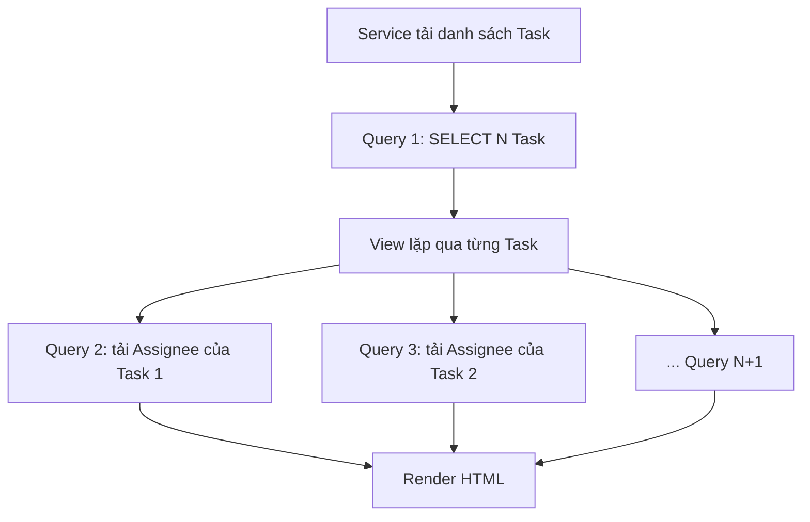
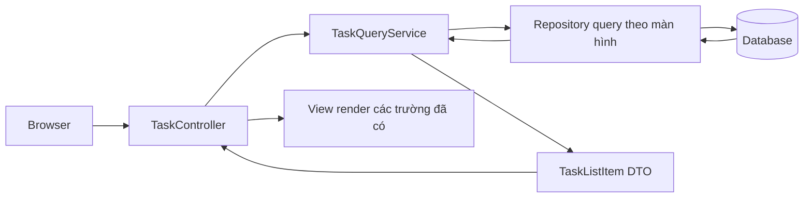

# Giảm truy vấn lặp và hiện tượng N+1

Một trang danh sách công việc có thể chỉ hiển thị 20 dòng, nhưng máy chủ lại gửi hơn 20 câu truy vấn đến cơ sở dữ liệu. Nguyên nhân thường không nằm ở số lượng phần tử HTML mà ở cách ORM tải các quan hệ. Ứng dụng lấy danh sách công việc bằng một truy vấn, sau đó mỗi lần đọc người phụ trách hoặc bình luận của một công việc lại phát sinh thêm một truy vấn. Đây là hiện tượng **N+1 query**.

Trong ứng dụng Model–View–Controller (MVC), N+1 thường xuất hiện khi Service trả entity có quan hệ lazy, rồi Controller hoặc View truy cập quan hệ đó trong vòng lặp. Trang vẫn hiển thị đúng, nhưng thời gian phản hồi tăng theo số bản ghi. Khi dữ liệu tăng từ 10 lên 100 hoặc 1.000 dòng, số lần trao đổi với database có thể tăng tương ứng.

Bài học dùng Spring MVC, Spring Data JPA và Hibernate để giải thích cách phát hiện và giảm truy vấn lặp. Trọng tâm là chọn dữ liệu phù hợp với màn hình, tải quan hệ có chủ đích, phân trang an toàn và đo số truy vấn thực tế.

## 1. N+1 query là gì?

N+1 là mẫu truy vấn trong đó ứng dụng thực hiện:

1. Một truy vấn lấy danh sách N bản ghi chính.
2. N truy vấn bổ sung, thường là một truy vấn cho mỗi bản ghi để lấy dữ liệu liên quan.

Tổng số truy vấn xấp xỉ `1 + N`. Nếu một màn hình có nhiều quan hệ được tải riêng, số truy vấn có thể còn cao hơn.

Ví dụ, trang danh sách công việc cần hiển thị tiêu đề và tên người phụ trách. Mã truy vấn ban đầu chỉ lấy các công việc:

```java
List<Task> tasks = taskRepository.findByProjectId(projectId);
```

Entity `Task` có quan hệ lazy đến `User`:

```java
@Entity
public class Task {
    @Id
    private Long id;

    private String title;

    @ManyToOne(fetch = FetchType.LAZY)
    private User assignee;
}
```

Khi View đọc `task.getAssignee().getDisplayName()` cho từng dòng, Hibernate có thể phát sinh SQL như sau:

```sql
-- Truy vấn 1: lấy N công việc
SELECT t.id, t.title, t.assignee_id
FROM task t
WHERE t.project_id = ?;

-- Truy vấn 2: lấy người phụ trách của công việc thứ nhất
SELECT u.id, u.display_name
FROM app_user u
WHERE u.id = ?;

-- Truy vấn 3: lấy người phụ trách của công việc thứ hai
SELECT u.id, u.display_name
FROM app_user u
WHERE u.id = ?;

-- ... tiếp tục cho các công việc còn lại
```

Nếu danh sách có 50 công việc và mỗi công việc tham chiếu đến một người phụ trách khác nhau, ứng dụng có thể thực hiện khoảng 51 truy vấn. Nếu nhiều công việc cùng tham chiếu một người dùng, persistence context cấp một có thể tái sử dụng entity đã tải và số truy vấn thực tế giảm xuống; tuy vậy, số truy vấn vẫn có thể tăng theo số quan hệ khác nhau.



Vấn đề chính là số lượt trao đổi với database tăng theo số dòng. Mỗi truy vấn riêng có thể rất nhanh, nhưng tổng độ trễ mạng, chi phí chuẩn bị statement, lập kế hoạch và chuyển dữ liệu làm request chậm đi.

## 2. N+1 thường xuất hiện ở đâu trong MVC?

N+1 có thể xuất hiện ở bất kỳ nơi nào truy cập quan hệ chưa được tải, nhưng một số mẫu rất phổ biến trong ứng dụng MVC.

**Trong Service:** lấy danh sách entity rồi lặp qua từng entity để gọi repository lấy dữ liệu liên quan.

```java
List<Task> tasks = taskRepository.findByProjectId(projectId);

for (Task task : tasks) {
    User assignee = userRepository.findById(task.getAssigneeId()).orElse(null);
    // Chuẩn bị dữ liệu cho View.
}
```

**Trong View/template:** Controller đưa entity vào Model, template đọc thuộc tính quan hệ lazy trong vòng lặp.

```html
<tr th:each="task : ${tasks}">
    <td th:text="${task.title}"></td>
    <td th:text="${task.assignee.displayName}"></td>
</tr>
```

**Trong mapper:** mapper chuyển entity sang DTO nhưng lại truy cập từng collection hoặc quan hệ lazy.

```java
return tasks.stream()
        .map(task -> new TaskRow(
                task.getId(),
                task.getTitle(),
                task.getComments().size()))
        .toList();
```

Nếu `comments` là collection lazy, việc gọi `size()` có thể khiến mỗi công việc phát sinh một truy vấn riêng.

**Trong serializer:** API trả entity trực tiếp; Jackson hoặc serializer truy cập getter của quan hệ để tạo JSON. Việc serialize vô tình kích hoạt lazy loading và có thể gây N+1, vòng lặp quan hệ hoặc lỗi lazy initialization.

Điểm chung là mã hiển thị hoặc chuyển đổi dữ liệu không nhận ra rằng một getter có thể thực hiện truy vấn database. Vì vậy, cần xác định rõ dữ liệu nào phải được tải trước khi đi qua ranh giới Controller–View.

## 3. Đừng nhầm N+1 với mọi trường hợp có nhiều truy vấn

Không phải một request thực hiện nhiều truy vấn là thiết kế kém. Một trang có thể cần:

- Một truy vấn lấy danh sách công việc.
- Một truy vấn đếm tổng số bản ghi để phân trang.
- Một truy vấn lấy thống kê tổng hợp.

Đây có thể là số truy vấn hợp lý và ổn định, không tăng theo số dòng. Điều đáng lo là một truy vấn bổ sung bị thực hiện lặp lại cho từng entity.

| Dạng truy vấn | Số lượng thường thấy | Đánh giá |
|---|---:|---|
| Một truy vấn danh sách | 1 | Bình thường |
| Truy vấn danh sách và truy vấn count | 2 | Thường hợp lý với `Page` |
| Một truy vấn danh sách cộng một truy vấn cho mỗi dòng | `1 + N` | Dấu hiệu N+1 |
| Một truy vấn danh sách cộng một batch truy vấn cho mỗi nhóm 32 dòng | Khoảng `1 + ceil(N/32)` | Có thể là batch fetching; cần đo và đánh giá |
| Một truy vấn join lấy dữ liệu cần hiển thị | 1 | Có thể tốt, nhưng phải xem kích thước kết quả và phép join |

Mục tiêu không phải ép mọi request xuống đúng một câu SQL. Mục tiêu là số truy vấn có chủ đích, không tăng tuyến tính ngoài dự kiến theo số phần tử, đồng thời không tạo join quá lớn hoặc tải dữ liệu thừa.

## 4. Thiết kế dữ liệu cho màn hình thay vì trả entity tùy ý

Trong MVC, View thường chỉ cần một tập trường cụ thể. Ví dụ, danh sách công việc chỉ cần ID, tiêu đề, tên người phụ trách, trạng thái và ngày đến hạn. View không cần toàn bộ entity `User`, danh sách quyền của người đó hoặc toàn bộ bình luận.

Một cách thiết kế rõ ràng là tạo **ViewModel** hoặc DTO dành cho màn hình:

```java
public record TaskListItem(
        Long id,
        String title,
        String assigneeName,
        TaskStatus status,
        LocalDate dueDate) {
}
```

Luồng MVC khi đó là:



View không truy cập repository và không cần kích hoạt lazy loading. Service gọi một truy vấn được thiết kế cho màn hình rồi trả DTO đã đủ dữ liệu.

Ví dụ Controller và Service:

```java
@GetMapping("/projects/{projectId}/tasks")
public String list(
        @PathVariable long projectId,
        Model model) {
    model.addAttribute("tasks", taskQueryService.getTaskList(projectId));
    return "tasks/list";
}
```

```java
@Transactional(readOnly = true)
public List<TaskListItem> getTaskList(long projectId) {
    return taskRepository.findTaskListItems(projectId);
}
```

DTO projection thường là lựa chọn tốt cho màn hình đọc dữ liệu vì nó thể hiện chính xác dữ liệu cần lấy, giảm số cột và không mang theo quan hệ lazy.

## 5. Cách 1: dùng DTO projection để lấy đúng trường cần thiết

Với Spring Data JPA, có thể dùng JPQL constructor expression để trả DTO trực tiếp:

```java
public interface TaskRepository extends JpaRepository<Task, Long> {

    @Query("""
        select new com.example.tasks.TaskListItem(
            t.id,
            t.title,
            a.displayName,
            t.status,
            t.dueDate
        )
        from Task t
        left join t.assignee a
        where t.project.id = :projectId
        order by t.createdAt desc
        """)
    List<TaskListItem> findTaskListItems(@Param("projectId") long projectId);
}
```

Tên lớp trong `select new` phải là tên đầy đủ của DTO và constructor phải khớp thứ tự, kiểu dữ liệu các biểu thức. Ví dụ dùng `record`, có constructor canonical tương ứng.

SQL được tạo sẽ có dạng join người phụ trách trong cùng truy vấn:

```sql
SELECT t.id, t.title, u.display_name, t.status, t.due_date
FROM task t
LEFT JOIN app_user u ON u.id = t.assignee_id
WHERE t.project_id = ?
ORDER BY t.created_at DESC;
```

Đối với danh sách chỉ đọc, projection có các ưu điểm:

- Chỉ lấy cột mà màn hình cần.
- Không trả entity để View vô tình truy cập quan hệ lazy.
- Không cần duy trì toàn bộ graph entity trong persistence context.
- Có thể đặt phép join, phép tổng hợp và điều kiện lọc ngay trong query.
- Dễ kiểm thử hợp đồng dữ liệu của màn hình.

Projection không phải lúc nào cũng cần thiết. Nếu nghiệp vụ cần thay đổi aggregate, cần gọi hành vi Model hoặc lưu entity, hãy tải aggregate phù hợp rồi thao tác trong transaction. Đừng dùng DTO projection để thay thế việc bảo vệ bất biến của Model.

## 6. Cách 2: dùng fetch join cho quan hệ cần tải cùng

Khi cần entity và một số quan hệ cụ thể, JPQL `join fetch` yêu cầu Hibernate tải quan hệ ngay trong truy vấn chính.

Ví dụ danh sách công việc cần `assignee`:

```java
@Query("""
    select t
    from Task t
    left join fetch t.assignee
    where t.project.id = :projectId
    order by t.createdAt desc
    """)
List<Task> findAllWithAssignee(@Param("projectId") long projectId);
```

Khi `Task` được tải, `assignee` đã có trong kết quả join. Nếu View đọc `task.getAssignee().getDisplayName()`, Hibernate không cần phát thêm một truy vấn cho mỗi công việc.

Fetch join phù hợp khi:

- Màn hình hoặc ca sử dụng biết rõ quan hệ cần dùng.
- Số quan hệ được tải có kiểm soát.
- Dữ liệu trả về không tạo ra quá nhiều dòng do join collection.
- Vòng đời truy cập entity nằm trong transaction phù hợp.

Không nên thêm `fetch` cho tất cả quan hệ chỉ để tránh lazy loading. Việc tải nhiều quan hệ không cần thiết làm tăng dữ liệu truyền, bộ nhớ và độ phức tạp SQL.

### Phân biệt quan hệ to-one và collection

Fetch join `@ManyToOne` hoặc `@OneToOne` thường không nhân số dòng gốc vì mỗi entity chỉ tham chiếu tối đa một entity ở phía quan hệ. Đây là lựa chọn tương đối an toàn cho danh sách có phân trang, miễn là quan hệ thực sự có tính duy nhất đúng như mapping.

Fetch join collection như `@OneToMany` có đặc điểm khác. Một công việc có thể có nhiều bình luận, nên kết quả SQL có nhiều dòng cho cùng một công việc. Hibernate phải gom các dòng lại thành entity gốc và collection tương ứng.

Ví dụ:

```java
@Query("""
    select distinct t
    from Task t
    left join fetch t.comments
    where t.project.id = :projectId
    """)
List<Task> findAllWithComments(long projectId);
```

`distinct` giúp kết quả entity ở tầng JPA không lặp cùng một `Task`; nó không làm biến mất lượng dòng SQL phát sinh từ các bình luận. Nếu một công việc có 20 bình luận, một task vẫn tạo khoảng 20 dòng kết quả join.

## 7. Cẩn thận khi fetch collection cùng phân trang

Không nên kết hợp tùy tiện `join fetch` collection với `Pageable`.

Giả sử cần lấy 20 công việc, mỗi công việc có nhiều bình luận. Database phân trang trên các dòng sau join, không phải trên 20 entity gốc. Kết quả có thể cắt giữa các bình luận của cùng một công việc hoặc buộc Hibernate tải nhiều dòng rồi phân trang trong bộ nhớ. Điều này làm sai kỳ vọng hiệu năng và có thể tiêu tốn rất nhiều RAM.

Trong Hibernate, truy vấn phân trang collection fetch có thể phát cảnh báo về việc áp dụng pagination trong bộ nhớ. Có thể bật cấu hình fail-fast trong môi trường phát triển/test:

```yaml
spring:
  jpa:
    properties:
      hibernate.query.fail_on_pagination_over_collection_fetch: true
```

Hành vi và cách cấu hình có thể phụ thuộc phiên bản Hibernate; cần kiểm tra cảnh báo của phiên bản đang dùng.

### Cách xử lý thứ nhất: projection cho danh sách

Nếu trang chỉ cần số bình luận, không cần toàn bộ collection. Có thể dùng một query tổng hợp theo task:

```java
@Query(value = """
    select new com.example.tasks.TaskListItemWithCommentCount(
        t.id,
        t.title,
        a.displayName,
        t.status,
        count(c.id)
    )
    from Task t
    left join t.assignee a
    left join t.comments c
    where t.project.id = :projectId
    group by t.id, t.title, a.displayName, t.status
    order by t.id desc
    """,
    countQuery = """
        select count(t)
        from Task t
        where t.project.id = :projectId
    """)
Page<TaskListItemWithCommentCount> findTaskRows(
        @Param("projectId") long projectId,
        Pageable pageable);
```

Ví dụ này chỉ join một collection và nhóm theo các trường được chọn. Khi cần nhiều collection, hãy đánh giá nguy cơ nhân chéo số dòng: join 10 bình luận với 5 tệp đính kèm có thể tạo 50 dòng cho một task. Khi đó, nên tách truy vấn tổng hợp hoặc dùng các projection riêng thay vì join mọi collection trong một query.

### Cách xử lý thứ hai: phân trang ID rồi tải dữ liệu cho trang đó

Một chiến lược khác là:

1. Query thứ nhất lấy trang ID công việc theo thứ tự mong muốn và count tổng số bản ghi.
2. Query thứ hai tải các công việc trong tập ID đó cùng các quan hệ cần thiết.
3. Sắp xếp lại kết quả theo thứ tự ID của trang đầu, vì `IN (:ids)` không bảo đảm thứ tự.
4. Nếu cần collection lớn, tải bằng batch hoặc query riêng có kiểm soát.

Ví dụ repository:

```java
@Query("""
    select t.id
    from Task t
    where t.project.id = :projectId
    order by t.createdAt desc
    """)
Page<Long> findTaskIds(@Param("projectId") long projectId, Pageable pageable);

@Query("""
    select distinct t
    from Task t
    left join fetch t.assignee
    where t.id in :ids
    """)
List<Task> findTasksWithAssignee(@Param("ids") Collection<Long> ids);
```

Service có thể giữ thứ tự trang:

```java
@Transactional(readOnly = true)
public Page<TaskListItem> getTaskPage(long projectId, Pageable pageable) {
    Page<Long> idPage = taskRepository.findTaskIds(projectId, pageable);
    if (idPage.isEmpty()) {
        return new PageImpl<>(List.of(), pageable, idPage.getTotalElements());
    }

    List<Task> loaded = taskRepository.findTasksWithAssignee(idPage.getContent());
    Map<Long, Task> byId = loaded.stream()
            .collect(Collectors.toMap(Task::getId, Function.identity()));

    List<TaskListItem> rows = idPage.getContent().stream()
            .map(byId::get)
            .filter(Objects::nonNull)
            .map(taskMapper::toListItem)
            .toList();

    return new PageImpl<>(rows, pageable, idPage.getTotalElements());
}
```

Đây là phác thảo để minh họa chiến lược; trong mã thực tế cần bảo đảm `pageable` đã được chuẩn hóa và giữ metadata của trang ID. Query tải chi tiết chỉ fetch quan hệ to-one; collection cần thiết nên được xử lý riêng bằng batch hoặc query tổng hợp. Nếu dữ liệu có thể bị thay đổi giữa hai query và yêu cầu snapshot nhất quán, cần chọn isolation/transaction phù hợp.

### Cách xử lý thứ ba: dùng `Slice` khi không cần tổng số trang

Nếu giao diện chỉ cần nút “Tiếp theo” và không cần biết tổng số bản ghi, `Slice` có thể tránh truy vấn count. Spring Data thường lấy thêm một dòng để xác định còn trang tiếp theo hay không. Đây là cách giảm một query ổn định, nhưng không phải giải pháp cho N+1.

## 8. Cách 3: dùng `@EntityGraph` trong Spring Data JPA

`@EntityGraph` khai báo những quan hệ cần được tải cùng với truy vấn repository mà không phải viết `join fetch` trực tiếp trong JPQL.

Ví dụ:

```java
@EntityGraph(attributePaths = "assignee")
Page<Task> findByProjectIdOrderByCreatedAtDesc(
        long projectId,
        Pageable pageable);
```

Entity graph giúp diễn đạt nhu cầu tải quan hệ ở cấp repository. Nó có thể được dùng cho một phương thức cụ thể mà không thay đổi fetch strategy mặc định của entity.

Ưu điểm:

- Khai báo rõ quan hệ cần tải cho một use case.
- Không cần đổi mọi quan hệ thành `EAGER`.
- Có thể kết hợp với query method của Spring Data.
- Giảm nguy cơ View truy cập một quan hệ to-one chưa được tải.

Lưu ý:

- Entity graph là chỉ dẫn về fetch plan; provider có thể triển khai bằng join hoặc các truy vấn bổ sung.
- Graph chứa collection vẫn có nguy cơ nhân dòng và vấn đề phân trang tương tự fetch join collection.
- Cần kiểm tra SQL thực tế và số query của phương thức cụ thể, không giả định `@EntityGraph` luôn tạo đúng một câu SQL.
- Không nên tạo một entity graph khổng lồ dùng cho mọi màn hình.

## 9. Cách 4: batch fetching để gom các lần tải lazy

Khi không thể hoặc không nên join tất cả quan hệ, Hibernate có thể gom nhiều lần tải lazy thành một truy vấn dùng `IN`.

Ví dụ, thay vì:

```sql
SELECT * FROM task_comment WHERE task_id = 1;
SELECT * FROM task_comment WHERE task_id = 2;
SELECT * FROM task_comment WHERE task_id = 3;
-- ...
```

Hibernate có thể tải một nhóm:

```sql
SELECT *
FROM task_comment
WHERE task_id IN (1, 2, 3, ..., 32);
```

Có thể cấu hình kích thước batch toàn cục:

```yaml
spring:
  jpa:
    properties:
      hibernate.default_batch_fetch_size: 32
```

Hoặc cấu hình ở entity/collection:

```java
@Entity
@BatchSize(size = 32)
public class User {
    // Các thuộc tính của User.
}
```

```java
@OneToMany(mappedBy = "task", fetch = FetchType.LAZY)
@BatchSize(size = 32)
private List<TaskComment> comments = new ArrayList<>();
```

Đối với entity proxy, đặt `@BatchSize` trên entity có thể cho phép Hibernate tải nhiều proxy cùng loại. Đối với collection, đặt annotation trên thuộc tính collection để gom việc tải các collection của nhiều owner. Tên annotation thuộc Hibernate (`org.hibernate.annotations.BatchSize`), không phải JPA chuẩn.

Batch fetching thường giảm số query từ gần `1 + N` xuống xấp xỉ `1 + ceil(N / B)`, với `B` là batch size, tùy loại quan hệ, số ID cần tải, persistence context và giới hạn của database. Nó là cách giảm số lượt truy vấn, không biến N+1 thành một truy vấn duy nhất.

Chọn batch size bằng đo lường. Batch quá nhỏ vẫn tạo nhiều round trip; batch quá lớn tạo câu `IN` dài, dùng nhiều bộ nhớ hoặc vượt giới hạn tham số của database. Batch fetching hữu ích khi cần giữ lazy loading nhưng biết trước một nhóm entity/collection thường được truy cập cùng nhau.

## 10. Cách 5: subselect fetching cho collection

Hibernate có chiến lược `SUBSELECT` cho collection. Khi một collection của một entity trong nhóm được tải, Hibernate có thể dùng một subquery để tải collection tương ứng cho các entity cha đã được truy vấn trong persistence context.

Ví dụ:

```java
@OneToMany(mappedBy = "task", fetch = FetchType.LAZY)
@Fetch(FetchMode.SUBSELECT)
private List<TaskComment> comments = new ArrayList<>();
```

Thay vì một query cho từng task, Hibernate có thể tải các comment bằng một query có điều kiện dựa trên truy vấn cha trước đó.

Subselect fetching có thể hữu ích khi một trang tải một tập entity cha tương đối rõ ràng và phần lớn collection tương ứng đều được truy cập. Tuy nhiên:

- Đây là tính năng riêng của Hibernate.
- Có thể tải nhiều collection hơn nhu cầu thực tế.
- Phạm vi entity cha trong persistence context ảnh hưởng tập dữ liệu được tải.
- Không thay thế projection nếu màn hình chỉ cần số lượng hoặc một vài trường của collection.
- Cần đo SQL thực tế để xác nhận lợi ích.

## 11. Tránh đổi `LAZY` thành `EAGER` để chữa N+1

Một cách xử lý dễ gây vấn đề là đổi mọi quan hệ từ `LAZY` sang `EAGER`. Cách này có thể làm truy vấn hiện tại bớt N+1, nhưng khiến mọi use case đều tải quan hệ ngay cả khi không cần.

Hậu quả có thể gồm:

- Tải dữ liệu lớn hơn cho màn hình chỉ cần vài trường.
- Một entity kéo theo nhiều quan hệ và làm graph dữ liệu khó kiểm soát.
- ORM phải dùng truy vấn bổ sung hoặc join phức tạp để thỏa eager graph.
- Các truy vấn khác chậm đi dù không hiển thị quan hệ đó.
- Tăng nguy cơ vòng lặp khi serialize entity thành JSON.

Với JPA, `@ManyToOne` và `@OneToOne` mặc định là `EAGER`, còn `@OneToMany` và `@ManyToMany` mặc định là `LAZY`. Trong ứng dụng cần kiểm soát hiệu năng, thường nên khai báo fetch mặc định một cách thận trọng rồi chọn fetch plan theo use case bằng projection, fetch join hoặc entity graph.

`EAGER` không đồng nghĩa với “một query join”. Nó chỉ quy định quan hệ phải được khởi tạo khi entity được tải; provider có thể dùng cách thực thi khác nhau. Luôn xem SQL thực tế.

## 12. Đặt ranh giới transaction và tránh lazy loading trong View

Trong Spring Boot web application, Open Session in View (OSIV) có thể giữ persistence context mở trong suốt quá trình xử lý request và render View. Nhờ đó, template có thể truy cập quan hệ lazy sau khi Service kết thúc transaction. Điều này tiện trong phát triển ban đầu nhưng dễ che giấu N+1: mỗi lần template đọc một quan hệ có thể phát sinh SQL ngay trong lúc render.

Một cách tổ chức rõ ràng hơn là tải và chuyển đổi dữ liệu trong Service, rồi đưa DTO/ViewModel đã hoàn chỉnh cho Controller:

```java
@Transactional(readOnly = true)
public List<TaskListItem> getTaskList(long projectId) {
    return taskRepository.findTaskListItems(projectId);
}
```

Với cách này, View chỉ đọc các trường có sẵn và không cần truy cập persistence context. Có thể tắt OSIV trong Spring Boot:

```yaml
spring:
  jpa:
    open-in-view: false
```

Khi tắt OSIV, phải bảo đảm Service tải đủ dữ liệu và tạo DTO trước khi transaction kết thúc. Nếu View truy cập quan hệ lazy chưa tải, ứng dụng có thể gặp `LazyInitializationException`. Đây là tín hiệu cho thấy fetch plan hoặc ranh giới dữ liệu chưa rõ, không phải lý do để bật EAGER cho toàn bộ entity.

`@Transactional(readOnly = true)` diễn đạt một use case đọc và có thể giúp provider tối ưu theo cấu hình. Nó không tự động ngăn N+1 và cũng không thay thế query được thiết kế tốt.

## 13. Nhiều quan hệ có thể tạo ra tích Descartes

Giảm số câu SQL không có nghĩa là join càng nhiều càng tốt. Giả sử một trang cần cả comments và attachments của mỗi task. Nếu join hai collection trong cùng query, số dòng có thể là tích số phần tử của hai collection.

Ví dụ một task có 10 comments và 4 attachments có thể tạo 40 dòng join cho riêng task đó. Với nhiều task, dữ liệu trung gian tăng nhanh dù chỉ có vài chục entity gốc.

Các hướng xử lý:

- Dùng DTO projection cho các trường hiển thị chính.
- Lấy số lượng collection bằng query tổng hợp thay vì tải toàn bộ phần tử.
- Tải mỗi collection bằng query riêng theo tập ID của trang, không query từng task.
- Dùng batch fetching khi collection thực sự cần được khởi tạo.
- Chia màn hình: chỉ tải chi tiết comments/attachments khi người dùng mở phần tương ứng.

Ví dụ, danh sách có thể hiển thị `commentCount` bằng một truy vấn group theo `task_id`, sau đó ghép kết quả theo ID. Đây vẫn là một truy vấn bổ sung ổn định theo trang, không phải một truy vấn cho từng dòng.

## 14. Đo và phát hiện N+1

Không thể xác nhận đã loại bỏ N+1 chỉ bằng cách đọc code. Cần quan sát số SQL được thực thi khi dữ liệu có đủ số lượng và quan hệ.

### Bật log SQL trong môi trường phát triển

Với Hibernate, có thể bật log SQL:

```yaml
logging:
  level:
    org.hibernate.SQL: DEBUG
    org.hibernate.orm.jdbc.bind: TRACE
```

Log bind parameter hữu ích khi điều tra nhưng có thể chứa dữ liệu nhạy cảm. Chỉ bật có kiểm soát ở môi trường phù hợp; không ghi toàn bộ giá trị request hoặc thông tin cá nhân vào log production.

### Dùng Hibernate Statistics

Trong môi trường kiểm thử, có thể bật statistics:

```yaml
spring:
  jpa:
    properties:
      hibernate.generate_statistics: true
```

Sau đó lấy `SessionFactory` và kiểm tra số prepared statement:

```java
SessionFactory sessionFactory = entityManagerFactory
        .unwrap(SessionFactory.class);
Statistics statistics = sessionFactory.getStatistics();

entityManager.flush();
entityManager.clear();
statistics.clear();

Page<TaskListItem> page = taskQueryService.getPage(projectId, pageable);

long statementCount = statistics.getPrepareStatementCount();
assertThat(statementCount).isLessThanOrEqualTo(2L);
```

Ví dụ giả định test dùng một `EntityManagerFactory` riêng, dữ liệu kiểm thử đã được tạo trước khi xóa statistics và phương thức trả `Page` cần một query dữ liệu cùng một query count. Với `Slice` hoặc projection không cần tổng số trang, số query có thể khác. Không dùng một ngưỡng cố định nếu repository có thêm truy vấn hợp lệ mà test chưa tính đến.

`getPrepareStatementCount()` là thống kê ở mức SessionFactory và có thể bị ảnh hưởng bởi truy vấn từ test khác nếu chạy song song. Cần cô lập test, xóa statistics đúng thời điểm và không tính truy vấn setup. Có thể dùng datasource proxy hoặc công cụ quan sát SQL để kiểm tra query count ở cấp request.

### Dùng dữ liệu đủ lớn

Một danh sách chỉ có một công việc không làm lộ rõ N+1. Hãy tạo dữ liệu với nhiều bản ghi và quan hệ khác nhau, ví dụ 30–100 task với assignee và comments riêng. So sánh số query khi tăng số dòng từ 10 lên 50 rồi 100.

Nếu số query tăng gần tuyến tính theo số dòng, hãy kiểm tra vòng lặp, template, mapper và quan hệ lazy. Nếu query count ổn định nhưng thời gian vẫn cao, cần xem execution plan, index, lượng dữ liệu trả về, lock hoặc thời gian của dịch vụ phụ thuộc.

## 15. Đánh giá hiệu năng không chỉ bằng số lượng query

Giảm N+1 là quan trọng, nhưng một query join rất lớn vẫn có thể chậm hơn vài query nhỏ được tối ưu tốt. Khi so sánh các phương án, cần xem:

- **Query count:** số lần gửi SQL trong một request.
- **Total database time:** tổng thời gian database xử lý các truy vấn.
- **Rows returned:** số dòng trung gian và số dòng cuối cùng.
- **Bytes transferred:** lượng dữ liệu truyền giữa database và ứng dụng.
- **Execution plan:** database dùng index, join order và scan nào.
- **Application mapping time:** thời gian ORM hydrate entity, tạo DTO và render template.
- **Latency percentile:** p50, p95, p99 dưới tải đại diện.
- **Memory:** số entity và collection được giữ trong persistence context.

Một query có nhiều join và nhiều cột có thể giảm round trip nhưng tăng chi phí đọc và hydrate. Ngược lại, nhiều query nhỏ có thể bị chi phối bởi latency mạng. Chọn phương án dựa trên đo lường với dữ liệu và tải gần thực tế.

## 16. Index và truy vấn có điều kiện phù hợp

Sau khi giảm N+1, truy vấn chính có thể trở thành nút thắt. Hãy xem điều kiện lọc và thứ tự sắp xếp của màn hình.

Ví dụ:

```sql
SELECT id, title, status, created_at
FROM task
WHERE project_id = ?
ORDER BY created_at DESC
LIMIT ? OFFSET ?;
```

Một index phù hợp có thể bắt đầu bằng `project_id` rồi đến `created_at`, tùy hệ quản trị và điều kiện truy vấn:

```sql
CREATE INDEX idx_task_project_created
ON task (project_id, created_at DESC);
```

Đây chỉ là ví dụ, không phải index mặc định cho mọi hệ thống. Cần dùng `EXPLAIN` hoặc `EXPLAIN ANALYZE` trên database thật để xem index có được sử dụng, chi phí sort và số dòng ước lượng/thực tế. Index tăng tốc đọc theo một số mẫu nhưng làm chậm ghi và tốn dung lượng; chỉ thêm khi có bằng chứng.

## 17. Cache có thể hỗ trợ nhưng không thay thế fetch plan

Hibernate first-level cache trong persistence context có thể tránh tải lại cùng một entity trong cùng phiên làm việc. Second-level cache hoặc application cache có thể giảm truy vấn lặp giữa các request nếu dữ liệu phù hợp.

Tuy nhiên, cache không phải giải pháp đầu tiên cho N+1:

- Cache miss vẫn có thể tạo một loạt query.
- Cache có thể che giấu query shape kém trong môi trường ít tải.
- Cần chiến lược invalidation và nhất quán dữ liệu.
- Quan hệ collection và dữ liệu thay đổi thường xuyên có thể không phù hợp để cache rộng.
- Query cache không tự bảo đảm các quan hệ lazy được tải theo cách hiệu quả.

Trước tiên hãy xác định dữ liệu cần cho màn hình và chọn query/fetch plan phù hợp. Sau đó mới đánh giá cache cho dữ liệu đọc nhiều, ít thay đổi và có chính sách hết hạn rõ ràng.

## 18. Các mẫu thiết kế nên tránh

| Mẫu | Vì sao gây vấn đề | Cách cải thiện |
|---|---|---|
| Controller trả entity trực tiếp cho template | View có thể kích hoạt lazy loading và N+1 | Trả ViewModel/DTO đã chuẩn bị |
| Lặp entity rồi gọi repository trong từng vòng | Tạo một query bổ sung cho mỗi dòng | Dùng projection, fetch plan hoặc batch query |
| Đổi mọi quan hệ thành `EAGER` | Tải dữ liệu thừa cho mọi use case | Giữ fetch mặc định thận trọng, chọn theo màn hình |
| Fetch join nhiều collection | Nhân dòng và tăng dữ liệu trung gian | Tách query, projection hoặc batch fetching |
| Fetch collection cùng Pageable | Phân trang trên dòng join hoặc tải phân trang trong bộ nhớ | Projection hoặc phân trang ID trước |
| Tắt OSIV nhưng không chuẩn bị DTO | View gặp `LazyInitializationException` | Tải và map dữ liệu trong transaction của Service |
| Chỉ kiểm tra query khi danh sách có một dòng | Không phát hiện query tăng theo N | Test với tập dữ liệu nhiều entity và quan hệ |
| Thêm cache để che query lặp | Cache miss vẫn chậm và khó nhất quán | Sửa query shape trước, cache sau khi đo |

## 19. Quy trình xử lý một màn hình có dấu hiệu N+1

Khi một trang danh sách hoặc API chậm dần theo số bản ghi, hãy làm theo trình tự:

1. Xác định request cụ thể và tập dữ liệu mà màn hình cần hiển thị.
2. Bật SQL log hoặc datasource instrumentation ở môi trường kiểm thử.
3. Tạo dữ liệu đủ lớn, sau đó đo query count và thời gian xử lý.
4. Tìm truy vấn lặp theo từng ID trong log; lần ngược về Service, mapper, template hoặc serializer đã kích hoạt nó.
5. Xác định quan hệ nào thực sự cần cho màn hình và trường nào có thể bỏ.
6. Ưu tiên DTO projection cho danh sách đọc; dùng fetch join hoặc `@EntityGraph` cho quan hệ phù hợp.
7. Với collection, cân nhắc batch fetching, query tổng hợp hoặc phân trang ID trước khi tải chi tiết.
8. Kiểm tra nguy cơ nhân dòng, truy vấn count và thứ tự kết quả sau khi dùng `IN`.
9. Đo lại query count, total database time, số dòng và p95 với dữ liệu tương đương.
10. Thêm integration test để bảo vệ giới hạn truy vấn của use case.

N+1 là vấn đề về cách dữ liệu được tải qua ranh giới ORM, thường lộ ra khi View hoặc mapper truy cập quan hệ lazy theo từng dòng. Cách xử lý bền vững là để Service lấy dữ liệu theo nhu cầu của màn hình, ưu tiên projection cho danh sách đọc, dùng fetch join hoặc entity graph có chọn lọc, và dùng batch fetching khi cần giữ lazy loading. Với collection và phân trang, phải kiểm soát số dòng join và cách database áp dụng limit. Cuối cùng, đo SQL và kiểm thử với dữ liệu đủ lớn để xác nhận số truy vấn không tăng bất ngờ theo số bản ghi.
