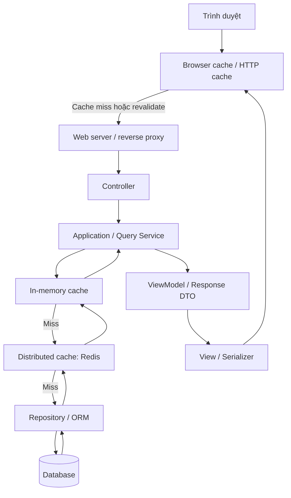
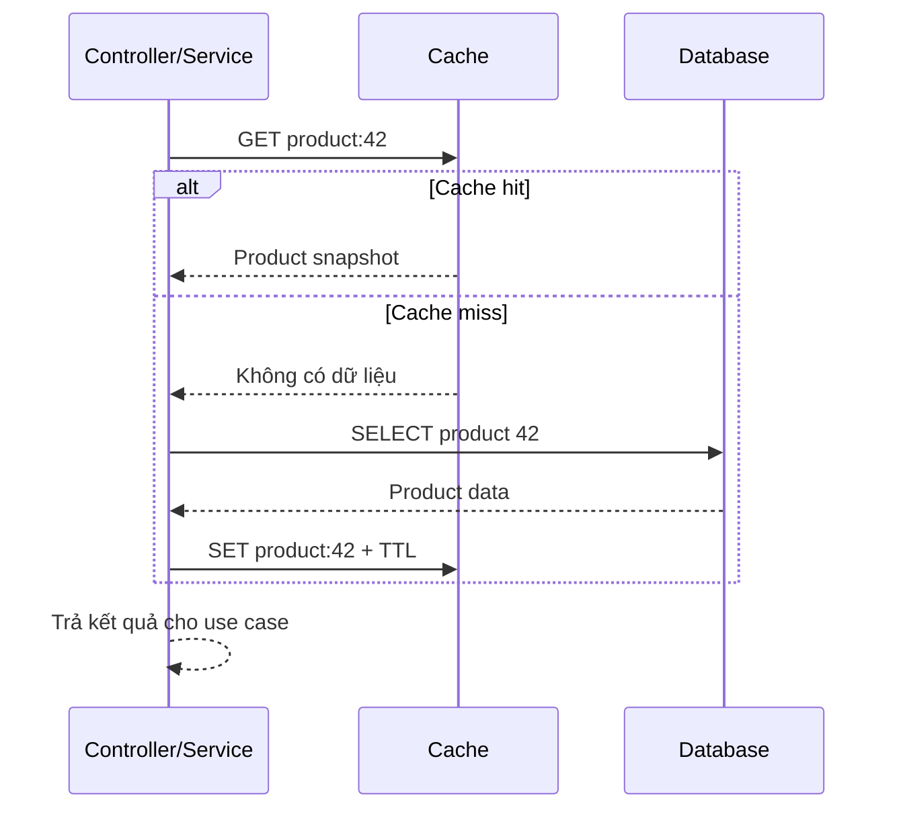

# Bộ nhớ đệm cho dữ liệu nghiệp vụ và dữ liệu trình bày

Trong ứng dụng web theo kiến trúc **MODEL_VIEW_CONTROLLER (MVC)**, một request thường đọc dữ liệu từ kho lưu trữ, chuyển dữ liệu qua tầng ứng dụng rồi dựng ViewModel hoặc response để trả về trình duyệt. Khi nhiều request lặp lại cùng một phép đọc, ứng dụng có thể phải truy vấn cơ sở dữ liệu, gọi dịch vụ bên ngoài, tính toán hoặc render cùng một nội dung nhiều lần. **Bộ nhớ đệm (cache)** giúp giữ lại kết quả có thể tái sử dụng để giảm thời gian phản hồi và tải cho các thành phần phía sau.

Cache có thể chứa dữ liệu nghiệp vụ như thông tin sản phẩm, danh mục hoặc cấu hình; cũng có thể chứa dữ liệu trình bày như ViewModel, kết quả tổng hợp, fragment HTML hoặc response HTTP. Hai loại dữ liệu này có vòng đời, yêu cầu nhất quán và phạm vi người dùng khác nhau. Chọn sai dữ liệu hoặc cache key có thể làm giao diện hiển thị thông tin cũ, lộ dữ liệu giữa người dùng hoặc khiến thao tác nghiệp vụ dựa trên một trạng thái không còn đúng.

Bài học này trình bày cách phân biệt cache nghiệp vụ và cache trình bày, các tầng cache trong ứng dụng MVC, chiến lược đọc/ghi, TTL và invalidation, kiểm soát dữ liệu cũ, xử lý cache stampede, bảo mật cache key và cách triển khai bằng Spring Cache/Redis.

## 1. Cache giải quyết vấn đề gì?

Cache lưu một bản sao kết quả đã được tính hoặc đọc trước đó để lần truy cập sau có thể lấy nhanh hơn. Thay vì mỗi request đều đi đến database hoặc dịch vụ bên ngoài, ứng dụng kiểm tra cache trước. Nếu có dữ liệu phù hợp và còn hiệu lực, ứng dụng sử dụng kết quả đó; nếu không, nó tải từ nguồn chính rồi có thể lưu vào cache.

Ví dụ:

- Trang danh mục sản phẩm được nhiều người truy cập nhưng dữ liệu chỉ thay đổi vài lần mỗi ngày.
- Menu điều hướng được dựng từ cấu hình giống nhau cho nhiều request.
- Trang chi tiết sản phẩm cần dữ liệu từ nhiều bảng và một dịch vụ đánh giá.
- Dashboard cần tính tổng số đơn theo trạng thái, phép tính tốn kém nhưng không cần cập nhật từng mili giây.
- Một ViewModel có cùng nội dung cho nhiều request trong cùng ngôn ngữ và cùng phạm vi quyền.

Cache có thể giảm:

- Số lần truy vấn database hoặc gọi dịch vụ phụ thuộc.
- Độ trễ mạng giữa các thành phần.
- CPU dành cho tính toán và chuyển đổi dữ liệu lặp lại.
- Thời gian dựng response nếu có thể tái sử dụng một biểu diễn đã tạo.
- Tải đỉnh lên hệ thống khi nhiều người đọc cùng dữ liệu.

Cache cũng có chi phí: bộ nhớ, serialization, quản lý key, đồng bộ, invalidation, vận hành Redis hoặc cache server và nguy cơ dữ liệu lỗi thời. Cache không tự làm ứng dụng nhanh hơn nếu dữ liệu ít được tái sử dụng hoặc chi phí tra cứu cache cao hơn chi phí đọc nguồn.

## 2. Phân biệt cache dữ liệu nghiệp vụ và cache dữ liệu trình bày

### Cache dữ liệu nghiệp vụ

Cache dữ liệu nghiệp vụ lưu dữ liệu gần với mô hình miền hoặc kết quả đọc nghiệp vụ, thường được nhiều use case sử dụng. Ví dụ:

- Thông tin sản phẩm, giá niêm yết hoặc danh mục.
- Cấu hình thuế, quy tắc vận chuyển hoặc bảng mã.
- Hồ sơ công khai của tổ chức.
- Kết quả tra cứu quyền hoặc chính sách nếu có chiến lược cập nhật phù hợp.
- Dữ liệu tham chiếu ít thay đổi như quốc gia, loại tiền tệ hoặc danh sách trạng thái.

Cache nghiệp vụ cần được thiết kế theo ý nghĩa và độ mới của dữ liệu. Nếu giá, tồn kho hoặc trạng thái đơn hàng có thể thay đổi thường xuyên và ảnh hưởng đến quyết định ghi, không nên dùng một bản cache cũ làm căn cứ cuối cùng để xác nhận giao dịch.

### Cache dữ liệu trình bày

Cache dữ liệu trình bày lưu kết quả đã được chuẩn bị cho một View hoặc response cụ thể. Ví dụ:

- ViewModel trang chi tiết sản phẩm.
- Danh sách sản phẩm đã phân trang và sắp xếp.
- Kết quả tổng hợp dùng cho dashboard.
- Fragment HTML hoặc nội dung menu.
- Response JSON đã định dạng theo locale.

Cache trình bày có thể phụ thuộc vào nhiều yếu tố ngoài dữ liệu nghiệp vụ: ngôn ngữ, múi giờ, quyền, vai trò, tenant, bộ lọc, phân trang, theme hoặc feature flag. Nếu cache key không phản ánh các yếu tố ảnh hưởng đến nội dung, người dùng có thể nhận nhầm biểu diễn hoặc xem dữ liệu không thuộc quyền của họ.

### So sánh

| Tiêu chí | Cache dữ liệu nghiệp vụ | Cache dữ liệu trình bày |
|---|---|---|
| Nội dung | Dữ liệu hoặc kết quả đọc gần miền nghiệp vụ | ViewModel, DTO, fragment hoặc response |
| Người dùng | Có thể được nhiều use case tái sử dụng | Thường gắn với một màn hình hoặc hợp đồng response |
| Phụ thuộc | ID, tenant, phiên bản dữ liệu, trạng thái miền | Dữ liệu nguồn cộng locale, quyền, filter, sort, page và cấu hình giao diện |
| Vòng đời | Theo chính sách cập nhật dữ liệu nghiệp vụ | Theo độ mới mà giao diện chấp nhận |
| Rủi ro chính | Dùng dữ liệu miền cũ trong quyết định nghiệp vụ | Hiển thị sai nội dung, lẫn người dùng hoặc lộ dữ liệu |
| Ví dụ | `product:42` | `product-detail:42:vi-VN:public:v3` |

Hai nhóm không hoàn toàn tách biệt về kỹ thuật. Một projection có thể vừa là kết quả đọc nghiệp vụ vừa là đầu vào để dựng ViewModel. Điều quan trọng là xác định ai sử dụng dữ liệu, dữ liệu phụ thuộc vào yếu tố nào và yêu cầu nhất quán ra sao.

## 3. Cache nằm ở đâu trong kiến trúc MVC?

Một ứng dụng web có thể có nhiều tầng cache. Chúng phục vụ những mục đích khác nhau và không thay thế lẫn nhau.



Sơ đồ là mô hình khái quát; một request không nhất thiết đi qua tất cả các tầng. Ví dụ, HTTP cache có thể trả response mà không gọi Controller; cache trong application service có thể trả projection trước khi repository truy vấn database.

### Các tầng thường gặp

| Tầng | Vị trí | Ví dụ | Phạm vi |
|---|---|---|---|
| Browser cache | Trình duyệt | CSS, JavaScript, ảnh, response có cache header | Một trình duyệt/người dùng |
| HTTP/reverse proxy cache | CDN hoặc proxy | Trang công khai, ảnh, response GET công khai | Có thể dùng chung nhiều người |
| Application cache | Service hoặc query layer | Dữ liệu tham chiếu, projection | Một instance hoặc nhiều instance |
| Distributed cache | Redis/Memcached | Dữ liệu dùng chung giữa các instance | Cụm ứng dụng |
| ORM first-level cache | Persistence context/session | Entity đã tải trong transaction/session | Một persistence context |
| ORM second-level/query cache | ORM/provider | Entity hoặc kết quả query theo cấu hình | Có thể chia sẻ giữa session trong cùng hệ thống |

Không nên bật tất cả các tầng cache theo mặc định. Mỗi tầng cần một mục tiêu, chính sách hết hạn và cách xử lý khi dữ liệu thay đổi.

## 4. Chọn dữ liệu nào đáng cache?

Một dữ liệu phù hợp để cache thường có một hoặc nhiều đặc điểm:

- Được đọc thường xuyên hơn nhiều so với được ghi.
- Chi phí đọc hoặc tính toán cao.
- Nhiều request cần cùng một kết quả.
- Dữ liệu thay đổi có thể nhận biết và có cách invalidation.
- Ứng dụng chấp nhận được một khoảng thời gian dữ liệu chưa phản ánh thay đổi mới nhất.

Trước khi cache, hãy đo:

1. Request nào đang chậm và phần thời gian nào dành cho database, dịch vụ ngoài, CPU hoặc render?
2. Cùng một dữ liệu có được đọc lặp lại không?
3. Tỷ lệ hit dự kiến có đủ cao để bù chi phí cache không?
4. Khi dữ liệu thay đổi, cần cập nhật cache ngay hay có thể chấp nhận stale trong một khoảng thời gian?
5. Dữ liệu có phụ thuộc vào người dùng, tenant hoặc quyền không?
6. Cache miss hoặc cache server không khả dụng thì hệ thống có thể tiếp tục không?

Không cache chỉ vì một phương thức được gọi nhiều lần. Nếu truy vấn đã rất nhanh, dữ liệu ít lặp lại hoặc cache key có cardinality rất lớn, cache có thể làm hệ thống phức tạp hơn mà không đem lại lợi ích đáng kể.

## 5. Cache-aside (lazy loading)

Cache-aside là chiến lược phổ biến trong ứng dụng: tầng ứng dụng chủ động kiểm tra cache; nếu miss thì đọc nguồn chính, đưa kết quả vào cache rồi trả về.



Ưu điểm:

- Chỉ dữ liệu thực sự được đọc mới có cơ hội vào cache.
- Ứng dụng kiểm soát rõ lúc nào tải và lúc nào ghi cache.
- Cache có thể bị xóa hoặc mất mà dữ liệu chính vẫn còn ở database.
- Dễ áp dụng cho query service và repository đọc.

Nhược điểm:

- Lần đọc đầu tiên sau khi miss vẫn phải truy vấn nguồn.
- Nhiều request đồng thời cùng miss có thể cùng tải một dữ liệu.
- Ứng dụng phải quản lý invalidation khi dữ liệu được cập nhật.
- Có thể có khoảng thời gian cache cũ sau khi database đã commit.

### Ví dụ cache-aside bằng Spring Cache

```java
@Service
class ProductQueryService {

    private final ProductRepository repository;

    ProductQueryService(ProductRepository repository) {
        this.repository = repository;
    }

    @Cacheable(cacheNames = "productDetails", key = "#productId")
    public ProductViewData getProduct(String productId) {
        return repository.findViewDataById(productId)
                .orElseThrow(ProductNotFoundException::new);
    }
}
```

Khi cache đã có key, Spring Cache có thể trả giá trị mà không gọi thân phương thức. Khi miss, phương thức được thực thi và kết quả được lưu theo cấu hình cache manager. Ví dụ giả định `ProductViewData` là một DTO bất biến phù hợp để serialize/cache; không nên mặc định lưu entity JPA đang được quản lý cùng proxy lazy.

Spring Cache dùng proxy/interceptor trong cấu hình phổ biến. Gọi một phương thức `@Cacheable` từ phương thức khác trong cùng instance (self-invocation) thường không đi qua proxy, nên annotation có thể không được áp dụng. Hãy gọi qua bean được proxy hoặc dùng API cache rõ ràng nếu cần.

## 6. Read-through, write-through và write-behind

Ngoài cache-aside, có những chiến lược khác. Tên gọi có thể khác đôi chút giữa sản phẩm cache, nhưng ý nghĩa chung như sau:

| Chiến lược | Khi đọc | Khi ghi | Đặc điểm |
|---|---|---|---|
| Cache-aside | Ứng dụng kiểm tra cache, miss thì đọc nguồn | Ứng dụng ghi nguồn rồi cập nhật/xóa cache | Linh hoạt, ứng dụng quản lý cache |
| Read-through | Cache tự lấy từ loader khi miss | Ghi theo chiến lược khác | Logic tải được tích hợp với cache layer |
| Write-through | Đọc từ cache sau khi có dữ liệu | Ghi qua cache và cập nhật nguồn theo cơ chế đồng bộ | Đơn giản cho caller nhưng cần phối hợp độ bền và lỗi |
| Write-behind/write-back | Đọc từ cache | Cache nhận ghi trước, cập nhật nguồn sau | Có thể giảm độ trễ ghi nhưng rủi ro mất dữ liệu và phức tạp cao |

### Read-through

Read-through phù hợp khi cache layer có loader để tự tải dữ liệu khi key chưa tồn tại. Caller chỉ yêu cầu đọc; cache quyết định gọi nguồn. Nó có thể giảm mã lặp, nhưng cần hiểu cơ chế loader, timeout, lỗi và đồng bộ của sản phẩm cache.

### Write-through

Write-through thường ghi cache và nguồn dữ liệu như một phần của thao tác ghi. Tuy nhiên, nếu database và cache là hai hệ thống độc lập, không thể mặc định một lệnh ghi đơn giản tạo ra transaction nguyên tử xuyên cả hai. Cần xác định điều gì xảy ra khi database thành công nhưng cache thất bại hoặc ngược lại.

### Write-behind

Write-behind trì hoãn ghi xuống nguồn chính. Nó có thể hữu ích trong một số hệ thống có yêu cầu throughput cao và chấp nhận cơ chế durability riêng, nhưng không phù hợp làm lựa chọn mặc định cho dữ liệu nghiệp vụ quan trọng. Nếu cache mất trước khi ghi xuống database, dữ liệu có thể mất. Cần queue bền vững, retry, ordering và giám sát.

Với nhiều ứng dụng MVC thông thường, cache-aside cùng invalidation sau commit là lựa chọn dễ kiểm soát hơn.

## 7. Cache dữ liệu nghiệp vụ

Cache nghiệp vụ nên chứa dữ liệu có ý nghĩa rõ ràng và có thể tái sử dụng giữa các use case. Ví dụ, thông tin sản phẩm công khai có thể được cache theo `productId` và phiên bản dữ liệu.

```java
public record ProductSnapshot(
        String id,
        String name,
        String description,
        String categoryId,
        String currency,
        long version
) {}
```

Snapshot là bản dữ liệu đọc; nó không phải entity đang được quản lý bởi ORM. Khi use case cần thay đổi sản phẩm, application service vẫn tải hoặc xác minh entity mới nhất và áp dụng hành vi miền.

### Không dùng cache cũ để quyết định giao dịch quan trọng

Các dữ liệu như tồn kho, số dư, hạn mức, giá chốt đơn hoặc trạng thái thanh toán có thể ảnh hưởng trực tiếp đến tính đúng đắn của giao dịch. Cache có thể hữu ích cho hiển thị sơ bộ, nhưng trước khi commit cần xác minh ở nguồn có thẩm quyền và áp dụng transaction/locking/constraint phù hợp.

Ví dụ, trang sản phẩm có thể hiển thị số lượng còn hàng từ cache với độ trễ vài giây. Khi người dùng đặt hàng, service phải kiểm tra và giữ/giảm tồn kho bằng thao tác có tính nhất quán ở backend. Không chỉ đọc số lượng từ cache rồi kết luận rằng đơn chắc chắn có thể được tạo.

### Cache dữ liệu tham chiếu

Danh sách quốc gia, loại tiền tệ, loại sản phẩm hoặc cấu hình ít thay đổi thường phù hợp hơn. Có thể đặt TTL dài và xóa cache khi quản trị viên cập nhật cấu hình.

## 8. Cache ViewModel và dữ liệu trình bày

Cache ViewModel có thể giảm chi phí tổng hợp dữ liệu, định dạng hoặc gọi nhiều query cho một màn hình. Tuy nhiên, ViewModel thường chứa các yếu tố phụ thuộc vào người dùng và ngữ cảnh hiển thị.

Ví dụ một trang tổng quan công khai có thể được tạo từ:

- Tên và mô tả sản phẩm.
- Tên danh mục.
- Nhãn trạng thái đã dịch.
- Tổng số đánh giá.
- URL ảnh.

Nếu cùng một nội dung được hiển thị cho nhiều người dùng, có thể cache ViewModel theo ID sản phẩm và locale. Nhưng nếu ViewModel có `showEditButton`, giá riêng theo nhóm khách hàng hoặc dữ liệu chỉ một tenant được xem, cache key phải phản ánh đúng phạm vi đó hoặc dữ liệu không nên được cache dùng chung.

### Ví dụ cache ViewModel theo locale

```java
@Service
class ProductPageService {

    @Cacheable(
        cacheNames = "productPages",
        key = "#productId + ':' + #locale.toLanguageTag()"
    )
    public ProductPageViewModel getPage(
            String productId,
            Locale locale) {
        ProductSnapshot product = productQuery.getProduct(productId);
        return pageMapper.toViewModel(product, locale);
    }
}
```

Ví dụ này phù hợp khi nội dung không phụ thuộc vào quyền riêng tư khác của người dùng. Nếu có giá theo tenant, nội dung theo vai trò hoặc feature flag, cần bổ sung các yếu tố đó vào key hoặc tách phần cá nhân hóa khỏi phần dùng chung.

### Cache fragment thay vì toàn trang

Một trang có thể kết hợp phần công khai và phần cá nhân hóa. Thay vì cache toàn bộ HTML, có thể cache phần menu công khai hoặc danh sách danh mục, rồi render phần thông tin tài khoản riêng theo request. Cách này giảm nguy cơ cache nhầm nội dung giữa người dùng.

## 9. Thiết kế cache key

Cache key xác định một mục dữ liệu. Key cần:

- Có namespace để phân biệt loại dữ liệu.
- Chứa định danh của tài nguyên hoặc query.
- Bao gồm mọi yếu tố làm thay đổi kết quả.
- Có dạng chuẩn để tránh nhiều key cho cùng một ý nghĩa.
- Không chứa bí mật hoặc dữ liệu cá nhân nhạy cảm.

Ví dụ:

| Dữ liệu | Key có thể dùng |
|---|---|
| Snapshot sản phẩm | `product:v2:{productId}` |
| Danh sách công khai theo locale | `catalog:list:{locale}:{category}:{page}:{sort}` |
| ViewModel dashboard theo tenant | `dashboard:{tenantId}:{period}:{locale}` |
| Menu theo vai trò | `navigation:{role}:{locale}:v3` |
| Cấu hình thuế theo vùng | `tax-config:{region}:{version}` |

Nếu kết quả phụ thuộc vào `tenantId`, `locale`, `role`, `currency`, `page`, `size`, `sort`, filter hoặc feature flag, key cần thể hiện các yếu tố ảnh hưởng đó. Không nên ghép mọi giá trị tùy tiện; hãy chuẩn hóa thứ tự filter và encoding để hai request tương đương tạo cùng key.

### Không đưa dữ liệu nhạy cảm vào key

Tránh dùng email, số điện thoại, access token hoặc session ID nguyên dạng trong key. Key có thể xuất hiện trong công cụ quản trị cache, log hoặc metric. Nếu cần phân vùng theo người dùng, dùng ID nội bộ không nhạy cảm hoặc một định danh đã được chuẩn hóa và bảo vệ phù hợp.

### Key cardinality

Nếu key chứa quá nhiều tham số tự do, cache có thể tạo vô số mục ít khi được dùng lại. Ví dụ, cache từng URL có timestamp hoặc query parameter ngẫu nhiên làm hit rate thấp và bộ nhớ tăng. Hãy chỉ đưa vào key những yếu tố thực sự làm thay đổi kết quả và chuẩn hóa giá trị mặc định.

## 10. TTL và độ mới của dữ liệu

**TTL (time to live)** là khoảng thời gian một mục cache được giữ trước khi hết hạn. TTL giúp giới hạn thời gian dữ liệu có thể cũ nếu invalidation không xảy ra.

TTL không tự bảo đảm dữ liệu luôn mới. Nếu database thay đổi ngay sau khi cache được tạo, cache có thể vẫn trả bản cũ cho đến khi bị xóa hoặc hết TTL.

Ví dụ chính sách tham khảo:

| Loại dữ liệu | TTL tham khảo | Lý do |
|---|---:|---|
| Danh mục ít thay đổi | Vài phút đến vài giờ | Ít ghi, nhiều đọc |
| Thông tin sản phẩm công khai | Vài chục giây đến vài phút | Có thể chấp nhận trễ ngắn |
| ViewModel dashboard | Vài chục giây đến vài phút | Chi phí tổng hợp cao, cần cập nhật định kỳ |
| Bộ lọc tĩnh/quốc gia | Vài giờ hoặc lâu hơn | Thay đổi hiếm |
| Quyền truy cập | Ngắn hoặc theo phiên bản/chính sách | Thay đổi quyền cần có hiệu lực phù hợp |
| Số dư hoặc tồn kho dùng để commit | Không dựa vào TTL cache làm quyết định cuối | Cần nguồn có thẩm quyền tại thời điểm ghi |

Các khoảng thời gian trên chỉ là ví dụ để bắt đầu thảo luận. TTL thực tế phải dựa vào tần suất cập nhật, mức chấp nhận stale, tải hệ thống và yêu cầu nghiệp vụ.

### TTL cố định và jitter

Nếu hàng nghìn key được tạo cùng thời điểm với TTL giống nhau, chúng có thể hết hạn cùng lúc và gây tải đột biến lên database. Có thể thêm jitter ngẫu nhiên nhỏ vào TTL để phân tán thời điểm hết hạn.

### Stale-while-revalidate

Với dữ liệu công khai không yêu cầu tức thời, có thể tiếp tục phục vụ bản cache cũ trong một khoảng ngắn trong khi một request nền tải dữ liệu mới. Cách này giảm độ trễ và tránh nhiều request cùng chờ refresh. Cần xác định rõ khoảng stale tối đa và không áp dụng tùy tiện cho dữ liệu nhạy cảm hoặc giao dịch quan trọng.

## 11. Invalidation khi dữ liệu thay đổi

Cache invalidation là việc xóa hoặc cập nhật cache khi nguồn dữ liệu thay đổi. Đây thường là phần khó nhất của thiết kế cache.

Các chiến lược phổ biến:

1. **TTL-based:** để mục tự hết hạn. Dễ triển khai nhưng có thể phục vụ dữ liệu cũ đến hết TTL.
2. **Explicit eviction:** sau khi cập nhật hoặc xóa dữ liệu, xóa các key liên quan.
3. **Update-in-place:** ghi giá trị mới vào cache sau khi nguồn chính đã cập nhật.
4. **Versioned key:** đưa version vào key; dữ liệu mới dùng key mới, key cũ tự hết hạn.
5. **Event-driven invalidation:** phát sự kiện sau commit để các instance xóa hoặc cập nhật cache.

### Ví dụ xóa cache sau cập nhật

```java
@Service
class ProductCommandService {

    private final ProductRepository repository;
    private final ApplicationEventPublisher events;

    ProductCommandService(
            ProductRepository repository,
            ApplicationEventPublisher events) {
        this.repository = repository;
        this.events = events;
    }

    @Transactional
    public void rename(String productId, String newName) {
        Product product = repository.findById(productId)
                .orElseThrow(ProductNotFoundException::new);

        product.rename(newName);
        events.publishEvent(new ProductChanged(productId));
    }
}
```

```java
@Component
class ProductCacheInvalidator {

    private final CacheManager cacheManager;

    ProductCacheInvalidator(CacheManager cacheManager) {
        this.cacheManager = cacheManager;
    }

    @TransactionalEventListener(phase = TransactionPhase.AFTER_COMMIT)
    public void onProductChanged(ProductChanged event) {
        Cache cache = cacheManager.getCache("productDetails");
        if (cache != null) {
            cache.evict(event.productId());
        }
    }
}
```

Ví dụ minh họa invalidation sau commit trong cùng ứng dụng Spring. Nó giả định key của cache tương ứng đúng bằng `productId`. Nếu cache có key phiên bản, locale hoặc tenant, cần xóa đúng tập key hoặc dùng versioning/tagging phù hợp. `AFTER_COMMIT` tránh xóa cache khi transaction rollback; tuy nhiên, nó không bảo đảm sự kiện được giao bền vững nếu process dừng đúng thời điểm sau commit. Với invalidation quan trọng giữa nhiều service/instance, cân nhắc transactional outbox hoặc cơ chế event bền vững.

### Vì sao không xóa cache trước khi commit?

Nếu xóa cache trước khi database commit, request khác có thể thấy cache miss, đọc database khi transaction ghi chưa commit và nạp lại dữ liệu cũ vào cache. Sau đó transaction đầu commit nhưng cache lại chứa bản cũ. Thời điểm invalidation và khả năng đọc đồng thời cần được thiết kế cẩn thận.

Ngay cả xóa sau commit cũng có một khoảng đua nhỏ giữa commit và lúc invalidation được thực thi. Nếu yêu cầu nhất quán nghiêm ngặt, có thể dùng versioned key, đồng bộ qua transaction/outbox hoặc đọc từ nguồn chính cho thao tác quan trọng.

## 12. Cache stampede, penetration và avalanche

### Cache stampede

Stampede xảy ra khi một key phổ biến hết hạn hoặc bị xóa, nhiều request đồng thời cùng cache miss và cùng truy vấn database. Điều này có thể tạo tải đột biến đúng lúc hệ thống đang cần giảm tải.

Biện pháp thường dùng:

- Single-flight/request coalescing: chỉ một request tải dữ liệu; các request khác chờ kết quả chung.
- Distributed lock có thời hạn để một instance làm nhiệm vụ refresh.
- TTL jitter để phân tán thời điểm hết hạn.
- Stale-while-revalidate để tiếp tục phục vụ bản cũ trong giới hạn cho phép.
- Pre-warm key phổ biến trước thời điểm tải cao nếu có dữ liệu dự đoán được.

Lock cần timeout, xử lý chủ sở hữu và cơ chế tránh giữ khóa vô hạn. Không dùng distributed lock nếu chi phí/độ phức tạp lớn hơn vấn đề cần giải quyết.

### Cache penetration

Penetration xảy ra khi request liên tục hỏi key không tồn tại; mỗi lần đều miss và truy vấn nguồn. Có thể cache kết quả âm (negative caching) trong thời gian ngắn cho một số trường hợp “không tìm thấy”.

Negative cache cần phân biệt “không tồn tại” với “lỗi database” hoặc “không có quyền”. Không cache lỗi hạ tầng như thể tài nguyên không tồn tại. Cũng cần TTL ngắn để tài nguyên vừa được tạo không bị ẩn quá lâu.

### Cache avalanche

Avalanche xảy ra khi nhiều key hết hạn cùng lúc hoặc cache server gặp sự cố, làm lượng lớn request dồn về database. Jitter, giới hạn tải, fallback có kiểm soát, circuit breaker và khả năng chịu tải của nguồn chính giúp giảm tác động.

## 13. Cache và tính nhất quán

Cache là bản sao của nguồn dữ liệu. Khi nguồn thay đổi, các bản sao có thể chưa được cập nhật ngay. Hãy xác định mức nhất quán mà use case yêu cầu.

| Mức yêu cầu | Ví dụ | Chiến lược có thể phù hợp |
|---|---|---|
| Có thể stale trong thời gian ngắn | Menu, danh mục công khai | TTL và invalidation định kỳ |
| Cần cập nhật nhanh sau ghi | Trang hồ sơ vừa sửa | Evict/update sau commit, đọc lại từ nguồn hoặc dùng version |
| Cần tránh dùng dữ liệu cũ để ghi | Tồn kho, số dư, trạng thái thanh toán | Kiểm tra nguồn chính trong transaction, locking/constraint |
| Cần đồng bộ nhiều instance | Cấu hình dùng chung | Distributed cache và event invalidation |
| Chấp nhận eventual consistency | Dashboard tổng hợp | Refresh nền, TTL, hiển thị thời điểm cập nhật |

Không nên hứa rằng cache sẽ đồng bộ tức thời nếu cơ chế thực tế chỉ dùng TTL. Nếu giao diện hiển thị số liệu tổng hợp có thể trễ, có thể kèm thời điểm dữ liệu được cập nhật để người dùng hiểu ngữ cảnh.

### Read-your-writes

Sau khi người dùng cập nhật dữ liệu, họ thường mong trang tiếp theo phản ánh thay đổi vừa lưu. Nếu response GET đọc từ cache cũ, trải nghiệm có thể gây mất tin cậy. Các lựa chọn gồm:

- Xóa hoặc cập nhật cache sau commit.
- Với request ngay sau ghi, đọc trực tiếp từ nguồn chính.
- Đưa version mới vào URL/key để tránh lấy snapshot cũ.
- Trả dữ liệu vừa lưu trong redirect flow nếu phù hợp, nhưng GET đích vẫn cần có cách đọc nhất quán.

## 14. Bảo mật và phân vùng cache

Cache có thể dùng chung giữa nhiều người dùng hoặc tenant. Nếu cache key thiếu thông tin phân vùng, dữ liệu riêng tư có thể bị trả nhầm cho người khác.

Ví dụ, một `OrderDetailViewModel` chứa địa chỉ giao hàng của khách hàng không nên cache chỉ theo `orderId` nếu nội dung còn phụ thuộc vào quyền xem hoặc cách che dữ liệu theo vai trò. Nếu hai vai trò nhìn thấy các trường khác nhau, cache key phải phản ánh phạm vi quyền hoặc cache dữ liệu chung trước rồi áp dụng lọc quyền ở bước sau.

Các nguyên tắc:

- Xác định tenant và quyền trước khi trả dữ liệu từ cache.
- Không dùng cache key có thể đoán để thay thế authorization.
- Phân vùng key theo tenant khi dữ liệu không được chia sẻ giữa tenant.
- Không cache response riêng tư trong shared HTTP cache/CDN.
- Tránh lưu token, mật khẩu, session secret hoặc dữ liệu nhạy cảm trong cache không có kiểm soát.
- Bảo vệ Redis bằng network isolation, authentication, TLS khi phù hợp và quyền truy cập tối thiểu.
- Không ghi giá trị cache nhạy cảm hoặc key chứa dữ liệu cá nhân vào log.
- Đặt TTL và chính sách xóa dữ liệu phù hợp với yêu cầu lưu giữ.

Cache hit không có nghĩa người dùng được quyền xem dữ liệu. Authorization phải được thực hiện độc lập và đúng phạm vi.

## 15. HTTP caching cho response và tài nguyên tĩnh

Browser và proxy có thể cache response HTTP dựa trên header. Đây là một lớp khác với cache trong application service.

### Cache-Control

Một số chỉ thị thường gặp:

| Chỉ thị | Ý nghĩa khái quát |
|---|---|
| `public` | Response có thể được cache bởi shared cache nếu các điều kiện khác cho phép |
| `private` | Chỉ cache riêng của client, không dành cho shared cache |
| `no-cache` | Có thể lưu nhưng phải revalidate trước khi dùng lại |
| `no-store` | Không lưu response trong cache theo chính sách HTTP |
| `max-age=60` | Fresh trong 60 giây kể từ thời điểm phù hợp |
| `s-maxage=60` | Fresh lifetime dành cho shared cache |
| `must-revalidate` | Khi stale, cần revalidate theo quy tắc trước khi dùng |

Ví dụ:

```http
Cache-Control: public, max-age=3600
```

Có thể phù hợp với ảnh hoặc tài nguyên tĩnh có tên file gắn content hash. Với response cá nhân hóa, thường cần `private` hoặc `no-store` tùy mức nhạy cảm và yêu cầu sản phẩm.

### ETag và conditional request

Server có thể trả `ETag` đại diện cho một phiên bản response. Client gửi `If-None-Match` ở request sau; nếu nội dung chưa đổi, server trả `304 Not Modified` và client dùng bản đã cache.

```http
HTTP/1.1 200 OK
ETag: "product-42-v7"
Cache-Control: private, max-age=0, must-revalidate
```

Request tiếp theo:

```http
GET /products/42
If-None-Match: "product-42-v7"
```

Nếu representation chưa đổi và validator còn phù hợp, server có thể trả 304. ETag cần đại diện đúng nội dung theo phạm vi người dùng/locale; không dùng cùng ETag cho các representation khác nhau nếu điều đó làm sai kết quả revalidation.

### Vary

`Vary` chỉ ra header request nào ảnh hưởng đến representation, ví dụ `Accept-Encoding` hoặc trong một số thiết kế `Accept-Language`. Shared cache cần phân biệt các biến thể tương ứng. Không thêm `Vary` tùy tiện để che một thiết kế cache key thiếu; hãy hiểu rõ nội dung response phụ thuộc vào header nào.

### Không cache response riêng tư ở shared cache

Trang chứa thông tin tài khoản, đơn hàng hoặc dữ liệu theo quyền không nên bị CDN/shared proxy cache dùng chung cho người khác. Dùng header phù hợp và kiểm thử hành vi qua proxy/CDN thực tế, không chỉ kiểm tra response trong localhost.

## 16. ORM cache và application cache

### First-level cache

JPA persistence context (thường gắn với một transaction/session) giữ identity map của entity đã tải. Nếu cùng entity được truy cập nhiều lần trong cùng persistence context, ORM thường không cần tạo một lần load entity mới từ database cho mỗi lần truy cập.

Đây là cache phạm vi ngắn, không thay thế cache dùng chung giữa request hoặc instance. Khi persistence context kết thúc, cache cấp một cũng kết thúc.

### Second-level cache

ORM có thể hỗ trợ cache cấp hai cho entity hoặc collection giữa nhiều session. Phạm vi và consistency phụ thuộc provider, region, concurrency strategy và cấu hình. Không nên bật cache cấp hai cho mọi entity mà chưa xem xét tần suất ghi, quan hệ và cách đồng bộ.

### Query cache

Một số ORM có query cache để giữ kết quả định danh hoặc kết quả truy vấn. Query cache thường phụ thuộc vào cache entity/region và cơ chế invalidation của provider; nó không nhất thiết lưu toàn bộ kết quả như một DTO độc lập. Hãy đọc tài liệu provider và đo thực tế trước khi sử dụng.

### Không cache entity đang được quản lý một cách tùy tiện

Entity JPA có thể chứa proxy, lazy relationship, trạng thái thay đổi trong persistence context và tham chiếu đến graph lớn. Đưa entity trực tiếp vào distributed cache có thể gây lỗi serialization, dữ liệu stale khó kiểm soát hoặc lộ quan hệ không cần thiết.

Với application cache, thường nên lưu snapshot/DTO bất biến được thiết kế rõ ràng. Khi cần thay đổi nghiệp vụ, tải entity phù hợp trong transaction và áp dụng hành vi miền.

## 17. Ví dụ Spring Cache với Redis

Spring Cache cung cấp abstraction để ứng dụng dùng annotation hoặc API cache mà không phụ thuộc trực tiếp vào một nhà cung cấp. Redis có thể được dùng làm distributed cache khi nhiều instance cần chia sẻ dữ liệu.

Một cấu hình khái niệm:

```java
@Configuration
@EnableCaching
class CacheConfiguration {

    @Bean
    RedisCacheManager cacheManager(RedisConnectionFactory connectionFactory) {
        RedisCacheConfiguration defaults = RedisCacheConfiguration
                .defaultCacheConfig()
                .entryTtl(Duration.ofMinutes(5))
                .disableCachingNullValues();

        return RedisCacheManager.builder(connectionFactory)
                .cacheDefaults(defaults)
                .withCacheConfiguration(
                        "productDetails",
                        defaults.entryTtl(Duration.ofMinutes(2)))
                .withCacheConfiguration(
                        "referenceData",
                        defaults.entryTtl(Duration.ofHours(6)))
                .build();
    }
}
```

Ví dụ cần các dependency Spring Data Redis và cấu hình `RedisConnectionFactory` phù hợp môi trường. TTL là ví dụ minh họa; cần chọn theo yêu cầu freshness của từng cache. Nếu serializer dùng JSON, hãy cấu hình type handling an toàn và tương thích phiên bản; tránh deserialize dữ liệu không tin cậy bằng cơ chế có thể khởi tạo kiểu tùy ý.

### `@Cacheable`, `@CachePut` và `@CacheEvict`

| Annotation | Hành vi |
|---|---|
| `@Cacheable` | Kiểm tra cache; nếu hit thì trả giá trị cache, nếu miss thì chạy phương thức và lưu kết quả |
| `@CachePut` | Luôn chạy phương thức rồi cập nhật kết quả vào cache |
| `@CacheEvict` | Xóa một key hoặc toàn bộ cache theo cấu hình |

Ví dụ:

```java
@Service
class ProductService {

    private final ProductRepository repository;

    ProductService(ProductRepository repository) {
        this.repository = repository;
    }

    @Cacheable(cacheNames = "productDetails", key = "#id")
    public ProductViewData get(String id) {
        return repository.findViewData(id)
                .orElseThrow(ProductNotFoundException::new);
    }

    @CacheEvict(cacheNames = "productDetails", key = "#id")
    public void evict(String id) {
        // Phương thức này chỉ dùng để kích hoạt eviction.
    }
}
```

Đoạn code chỉ minh họa annotation; không nên gọi `evict` trước khi transaction ghi dữ liệu commit. Trong luồng thực tế, có thể phát sự kiện sau commit và xử lý invalidation, hoặc dùng API cache trong application service với thứ tự được kiểm soát.

`@CachePut` không nên được dùng một cách máy móc trên phương thức cập nhật nếu kết quả được đưa vào cache trước khi transaction commit hoặc nếu response không chứa snapshot đầy đủ. Hãy kiểm soát thời điểm cập nhật cache và lỗi giữa database/cache.

## 18. Cache key trong Spring và phân quyền

Spring Cache hỗ trợ biểu thức SpEL để tạo key. Ví dụ:

```java
@Cacheable(
    cacheNames = "tenantProductLists",
    key = "#tenantId + ':' + #locale.toLanguageTag() + ':' + #categoryId"
)
public List<ProductListItem> list(
        String tenantId,
        Locale locale,
        String categoryId) {
    return repository.findVisibleProducts(tenantId, categoryId);
}
```

Ví dụ chỉ đúng nếu `tenantId` được xác định từ ngữ cảnh đã xác thực hoặc đã được kiểm tra quyền; không được tin một giá trị tenant tùy ý do client gửi. Nếu kết quả còn phụ thuộc vai trò hoặc chính sách visibility, key hoặc bước lọc cần phản ánh điều đó.

Không cache một response cá nhân hóa bằng key chỉ gồm `resourceId`. Ví dụ, nếu quản trị viên thấy trường nội bộ còn khách hàng chỉ thấy thông tin công khai, phải tách representation hoặc phân vùng cache theo quyền phù hợp.

## 19. Cache lỗi và negative caching

Cache kết quả “không tìm thấy” có thể hữu ích khi nhiều request hỏi cùng một ID không tồn tại. Tuy nhiên, cần TTL ngắn và phân biệt rõ loại kết quả.

Không nên cache:

- Timeout hoặc lỗi database như thể tài nguyên không tồn tại.
- Lỗi authorization dùng chung giữa người dùng có quyền khác nhau.
- Exception tạm thời của dịch vụ phụ thuộc.
- Kết quả lỗi có chứa dữ liệu riêng tư hoặc thông tin không ổn định.

Nếu một tài nguyên vừa được tạo, negative cache cũ có thể tiếp tục trả “không tìm thấy” đến khi hết TTL. Vì vậy, khi tạo tài nguyên, cần xóa negative cache tương ứng hoặc dùng version/key phù hợp.

## 20. Cache khi hệ thống lỗi hoặc Redis không khả dụng

Cache thường là thành phần hỗ trợ, không phải nguồn dữ liệu chính. Hãy quyết định trước ứng dụng phải làm gì khi cache không truy cập được:

- Với dữ liệu không quan trọng, có thể bỏ qua cache và đọc nguồn chính nếu nguồn còn khả dụng.
- Với dữ liệu có chi phí cao, có thể dùng stale value trong giới hạn cho phép.
- Với cache miss hàng loạt, cần giới hạn concurrency để không làm database quá tải.
- Với dữ liệu nhạy cảm hoặc quyết định giao dịch, không trả stale value vượt chính sách chỉ để giữ tốc độ.
- Theo dõi lỗi cache riêng với lỗi database để phân biệt nguyên nhân.

Không biến lỗi cache thành lỗi toàn bộ request nếu use case có thể tiếp tục an toàn bằng nguồn chính. Ngược lại, không âm thầm dùng dữ liệu cũ khi yêu cầu nghiệp vụ cần freshness.

## 21. Quan sát và đo hiệu quả cache

Sau khi triển khai, cần xác minh cache thực sự giúp ích và không làm sai dữ liệu.

Các chỉ số thường theo dõi:

| Chỉ số | Ý nghĩa |
|---|---|
| Hit rate | Tỷ lệ yêu cầu lấy được dữ liệu từ cache |
| Miss rate | Tỷ lệ phải tải từ nguồn chính |
| Eviction/expiration | Số mục bị xóa hoặc hết hạn |
| Cache latency | Thời gian đọc/ghi cache |
| Backend query count | Số truy vấn database trước và sau cache |
| Load time p50/p95/p99 | Độ trễ tổng thể của request |
| Memory usage | Dung lượng cache và xu hướng tăng |
| Serialization time/size | Chi phí chuyển đổi và kích thước value |
| Error/timeout rate | Lỗi khi truy cập cache hoặc nguồn |
| Stale response rate | Tần suất trả dữ liệu cũ nếu có đo lường |

Hit rate cao không tự động chứng minh cache tốt. Một cache có hit rate 99% nhưng trả dữ liệu sai hoặc lộ thông tin giữa tenant là không chấp nhận được. Hãy đo cả độ trễ, tải nguồn, tính đúng đắn và sự cố.

### Kiểm thử cache

- Cache miss: phương thức đọc nguồn chính và ghi kết quả vào cache.
- Cache hit: phương thức tải nguồn không được gọi lại.
- TTL: mục hết hạn và được tải lại.
- Invalidation: sau cập nhật/xóa, lần đọc tiếp theo nhận dữ liệu phù hợp.
- Tenant/role/locale: key không trộn representation hoặc quyền.
- Redis lỗi: fallback đúng chính sách.
- Stampede: nhiều request đồng thời không tạo tải không kiểm soát.
- Serialization: value đọc được sau khi ứng dụng restart hoặc deploy phiên bản tương thích.
- Negative cache: tài nguyên vừa tạo không bị ẩn bởi kết quả âm cũ.

Test cache cần kiểm tra cả cache và nguồn dữ liệu. Không chỉ mock cache rồi kết luận invalidation hoạt động trong Redis thực tế.

## 22. Những lỗi thiết kế thường gặp

### Cache mọi thứ

Cache làm tăng độ phức tạp và tạo nhiều bản sao dữ liệu. Chỉ cache use case có lợi ích đo được và có chính sách freshness rõ ràng.

### Dùng TTL như cơ chế nhất quán duy nhất

TTL chỉ giới hạn thời gian stale tối đa theo cấu hình, không bảo đảm thay đổi được phản ánh ngay. Với dữ liệu cần cập nhật nhanh, cần invalidation hoặc versioning.

### Cache entity JPA đang được quản lý

Entity có proxy, lazy relationship và trạng thái persistence. Hãy cân nhắc cache snapshot/DTO bất biến thay vì serialize entity graph tùy tiện.

### Thiếu tenant, locale hoặc quyền trong cache key

Người dùng có thể nhận nội dung của tenant/ngôn ngữ/vai trò khác. Hãy liệt kê mọi yếu tố ảnh hưởng đến representation và phân vùng key đúng cách.

### Xóa cache trước khi transaction commit

Request khác có thể nạp lại dữ liệu cũ trước khi transaction đầu commit. Hãy xác định invalidation sau commit và xử lý khoảng đua theo yêu cầu nhất quán.

### Coi Redis là nguồn sự thật

Cache có thể hết hạn, bị eviction hoặc mất dữ liệu. Dữ liệu nghiệp vụ có thẩm quyền cần được lưu trong nguồn bền vững và được kiểm tra khi ghi.

### Retry vô hạn khi cache lỗi

Retry không giới hạn có thể làm sự cố lan rộng. Hãy đặt timeout, giới hạn retry, backoff và fallback.

### Không đo hit rate và độ trễ

Cache có thể không được sử dụng như dự kiến hoặc chi phí serialization cao hơn lợi ích. Hãy quan sát trước và sau triển khai.

## 23. Quy trình thiết kế cache cho một use case MVC

Khi muốn thêm cache cho một màn hình hoặc service, hãy đi theo trình tự:

1. **Xác định bottleneck:** đo request, query, gọi dịch vụ và thời gian render.
2. **Xác định dữ liệu:** cache snapshot nghiệp vụ, projection, ViewModel, fragment hay HTTP response?
3. **Xác định người dùng:** dữ liệu công khai, theo tenant, theo vai trò hay theo từng cá nhân?
4. **Thiết kế key:** đưa vào các yếu tố thực sự làm thay đổi kết quả và tránh dữ liệu nhạy cảm.
5. **Chọn tầng cache:** browser, HTTP proxy, application, distributed cache hay ORM.
6. **Chọn chiến lược:** cache-aside, read-through, write-through hoặc một cách khác phù hợp.
7. **Đặt freshness:** TTL, jitter, stale window và yêu cầu read-your-writes.
8. **Thiết kế invalidation:** sau commit, event, version key hoặc TTL; xác định hành vi khi event thất lạc.
9. **Xử lý tải đồng thời:** stampede, negative cache, fallback và giới hạn retry.
10. **Bảo vệ dữ liệu:** authorization, tenant isolation, HTTP cache headers và cleanup.
11. **Đo lường:** hit/miss, latency, memory, backend query count và lỗi.
12. **Kiểm thử:** cache hit/miss, stale, invalidation, quyền và cache server unavailable.

## Kết luận

Cache giúp ứng dụng MVC tái sử dụng dữ liệu và kết quả đọc để giảm tải database, dịch vụ phụ thuộc và chi phí dựng giao diện. Cache dữ liệu nghiệp vụ thường phục vụ nhiều use case; cache dữ liệu trình bày phục vụ một View hoặc response và có thể phụ thuộc locale, filter, tenant hoặc quyền. Cần chọn đúng tầng cache, thiết kế key đầy đủ và đặt TTL/invalidation theo mức độ mới mà use case chấp nhận.

Cache là bản sao tăng tốc, không phải nguồn có thẩm quyền thay thế Domain Model hoặc database. Với thao tác nghiệp vụ quan trọng, server phải xác minh dữ liệu mới nhất và quyền trong luồng ghi. Theo dõi stampede, stale data, bảo mật key, hành vi khi cache lỗi và các chỉ số hit/miss giúp cache cải thiện hiệu năng mà không làm giảm tính đúng đắn của ứng dụng.
