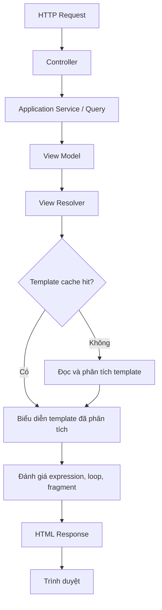
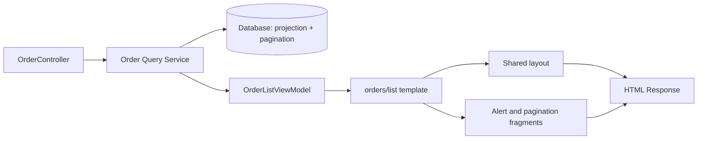

# Chi phí kết xuất khuôn mẫu và tái sử dụng thành phần

Trong ứng dụng MVC server-rendered, View thường được tạo từ một khuôn mẫu (template) cùng dữ liệu do Controller chuẩn bị. Một trang có thể ghép layout, header, navigation, form, bảng dữ liệu và nhiều thành phần dùng chung. Tái sử dụng template fragment hoặc component giúp giao diện nhất quán và giảm mã lặp, nhưng mỗi lần phân giải template, đánh giá biểu thức, lặp dữ liệu và ghép thành phần đều có chi phí.

Tối ưu hiệu năng không có nghĩa là loại bỏ mọi fragment hoặc viết toàn bộ HTML vào một file lớn. Cần chọn ranh giới component hợp lý, để View chỉ trình bày dữ liệu đã chuẩn bị, tận dụng cache đúng tầng và đo thời gian render trong bối cảnh request thực tế. Trong MVC, Controller điều phối request, Model và dịch vụ ứng dụng cung cấp dữ liệu, còn View chịu trách nhiệm tạo nội dung phản hồi. Khi các trách nhiệm rõ ràng, có thể xác định chi phí nằm ở truy vấn, ánh xạ dữ liệu, template hay kích thước phản hồi.

## 1. Vòng đời kết xuất View

Một request server-rendered thường đi qua các bước:

1. Trình duyệt gửi HTTP request.
2. Controller gọi application service hoặc query service để lấy dữ liệu.
3. Dữ liệu được chuyển thành View Model phù hợp với màn hình.
4. View resolver xác định template cần render.
5. Template engine phân tích hoặc lấy biểu diễn đã phân tích từ cache.
6. Engine đánh giá biểu thức, điều kiện, vòng lặp và các fragment được sử dụng.
7. HTML được tạo, escape dữ liệu theo ngữ cảnh và ghi vào response.
8. Trình duyệt nhận HTML rồi tiếp tục tải CSS, JavaScript, ảnh và các tài nguyên khác.



Tùy engine, bước phân tích có thể là parse thành cấu trúc nội bộ, biên dịch hoặc chuẩn bị một biểu diễn có thể tái sử dụng. Không phải template engine nào cũng biên dịch thành bytecode. Cần phân biệt chi phí lần đầu với chi phí render các request tiếp theo khi template đã nằm trong cache.

### 1.1. Những thành phần tạo nên thời gian phản hồi

Thời gian request có thể được nhìn theo mô hình khái quát:

\[
T_{response} = T_{controller} + T_{service} + T_{database} + T_{mapping} + T_{render} + T_{network}
\]

Đây là cách phân rã để điều tra, không phải công thức cộng chính xác trong mọi hệ thống vì một số công việc có thể chồng lấp hoặc bị đo ở tầng khác nhau. `T_render` thường gồm:

- Tìm và phân giải template.
- Phân tích template nếu chưa có cache.
- Đánh giá biểu thức và điều kiện.
- Duyệt danh sách và render từng phần tử.
- Phân giải và ghép fragment hoặc layout.
- Escape dữ liệu và tạo chuỗi HTML.

Kích thước HTML ảnh hưởng đến thời gian truyền mạng và xử lý ở trình duyệt. Nó không hoàn toàn là chi phí template engine, nhưng vẫn là một phần của hiệu năng người dùng cảm nhận.

### 1.2. Render lần đầu và render lặp lại

Request đầu tiên sau khi ứng dụng khởi động có thể phải đọc và phân tích template. Những request tiếp theo có thể dùng cấu trúc đã phân tích nếu engine bật template cache. Vì vậy, phép đo ngay sau khi khởi động có thể cao hơn đáng kể so với tải ổn định.

Khi đo, nên ghi nhận riêng:

- Cold start hoặc request đầu sau khi cache bị xóa.
- Warm request sau khi template cache đã được làm nóng.
- Hành vi khi thay đổi template trong môi trường phát triển.
- Hành vi khi cache bị giới hạn hoặc bị loại bỏ do áp lực bộ nhớ.

Không nên kết luận template chậm chỉ từ một request đầu tiên. Ngược lại, cũng không nên chỉ đo warm cache nếu hệ thống thường xuyên khởi động lại hoặc có nhiều template hiếm khi được truy cập.

## 2. Những yếu tố làm template render chậm

### 2.1. Phân tích và phân giải template quá thường xuyên

Nếu engine phải đọc và parse template ở mọi request, chi phí I/O và phân tích sẽ lặp lại. Trong môi trường production, thường nên bật cơ chế cache biểu diễn template đã phân tích theo khuyến nghị của engine.

Một số engine có cache template riêng; cấu hình và hành vi cache khác nhau giữa Thymeleaf, FreeMarker, Mustache, JSP và các công cụ khác. Cần kiểm tra cấu hình thực tế của framework, không mặc định chỉ vì ứng dụng dùng Spring MVC thì mọi template đều tự động được cache giống nhau.

Trong môi trường phát triển, tắt cache có thể giúp thấy thay đổi template ngay mà không restart. Cấu hình này nên được tách khỏi production để tránh vô tình làm tăng chi phí render ở môi trường thật.

### 2.2. Quá nhiều biểu thức và logic trong template

Template nên mô tả cách trình bày dữ liệu. Nếu mỗi dòng HTML gọi các hàm phức tạp, tính toán nhiều lần hoặc chứa nhiều nhánh nghiệp vụ, chi phí đánh giá biểu thức sẽ tăng và khó xác định lỗi.

Ví dụ không nên:

```html
<tr th:each="order : ${orders}">
  <td th:text="${order.customer.account.profile.fullName}"></td>
  <td th:text="${order.calculateTaxForCurrentRegion()}"></td>
  <td th:text="${order.loadPaymentHistory().size()}"></td>
</tr>
```

Biểu thức trên có thể đi qua nhiều quan hệ lazy, gọi phép tính lặp lại hoặc kích hoạt truy vấn khi render. Template cũng đang phụ thuộc sâu vào cấu trúc domain.

Nên chuẩn bị dữ liệu trình bày trước:

```java
public record OrderRowViewModel(
    String orderNumber,
    String customerName,
    String formattedTax,
    int paymentCount
) {}

public record OrderListViewModel(
    List<OrderRowViewModel> rows,
    int page,
    int totalPages
) {}
```

Query service hoặc mapper tạo `OrderListViewModel` với dữ liệu cần thiết. Template chỉ lặp qua `rows` và hiển thị các trường đã có. Cách này giúp chi phí truy vấn và mapping được kiểm soát ở tầng ứng dụng, đồng thời giảm logic trong View.

### 2.3. N+1 query phát sinh trong lúc render

Một vấn đề phổ biến là Controller tải danh sách entity, nhưng template truy cập một quan hệ lazy cho từng dòng. Nếu có N đơn hàng, engine có thể kích hoạt thêm N truy vấn lấy khách hàng hoặc thông tin liên quan. Thời gian tưởng như thuộc `T_render` thực chất đang bao gồm truy vấn database.

Ví dụ, template lặp qua 50 đơn và đọc `order.customer.name`; nếu quan hệ customer chưa được tải, ORM có thể thực hiện thêm truy vấn cho từng đơn. Để tránh N+1:

- Dùng projection hoặc query trả đúng trường View cần.
- Chọn fetch join hoặc entity graph phù hợp với use case.
- Batch fetch quan hệ khi cần và khi ORM hỗ trợ.
- Đo số lượng query của request, không chỉ đo thời gian render.
- Không gọi repository hoặc service có truy vấn từ template.

Không nên dùng fetch join một cách máy móc cho mọi quan hệ. Fetch nhiều collection cùng lúc có thể nhân số dòng kết quả, gây dữ liệu lặp hoặc làm phân trang không đúng. Với danh sách lớn, projection và truy vấn theo trang thường dễ kiểm soát hơn.

### 2.4. Vòng lặp lớn và HTML quá nhiều

Một template có thể render hàng nghìn dòng trong một response. Chi phí lặp, tạo chuỗi, bộ nhớ và kích thước HTML tăng theo số phần tử. Trình duyệt cũng phải parse và layout một DOM lớn.

Với danh sách lớn, hãy cân nhắc:

- Phân trang ở database và chỉ render một trang dữ liệu.
- Tìm kiếm và lọc ở server thay vì tải toàn bộ rồi lọc trong template.
- Giới hạn số cột hoặc trường cần hiển thị.
- Dùng tải thêm hoặc endpoint bất đồng bộ cho vùng dữ liệu phụ.
- Với SPA hoặc danh sách phía client rất lớn, cân nhắc virtualization để chỉ render phần tử đang nhìn thấy.

Phân trang cần có thứ tự ổn định, chẳng hạn sắp xếp thêm theo khóa duy nhất, để tránh bản ghi trùng hoặc bị bỏ sót khi dữ liệu thay đổi giữa các trang.

### 2.5. Quá nhiều fragment lồng nhau

Fragment giúp tái sử dụng layout và component, nhưng một cây template quá sâu hoặc có nhiều lần include động sẽ làm việc theo dõi luồng render khó hơn. Mỗi fragment có thể cần phân giải tên, truyền tham số và đánh giá nội dung riêng.

Không có ngưỡng số fragment cố định phù hợp mọi engine. Một trang có nhiều fragment đơn giản vẫn có thể render nhanh nhờ cache; một fragment duy nhất chứa truy vấn và logic phức tạp vẫn có thể rất chậm. Hãy đo theo template và theo fragment có chi phí lớn thay vì chỉ đếm số file.

## 3. Tái sử dụng thành phần giao diện đúng mức

Tái sử dụng thành phần giúp các trang dùng chung bố cục, quy tắc trình bày và hành vi. Trong server-side template, thành phần có thể là layout, fragment, macro, partial hoặc component tùy engine.

Ví dụ các phần thường có thể tái sử dụng:

- Header, navigation và footer.
- Breadcrumb và tiêu đề trang.
- Thông báo thành công hoặc lỗi.
- Trường biểu mẫu có label, hint và validation message.
- Badge trạng thái, nút hành động và phân trang.
- Hàng dữ liệu hoặc card có cấu trúc ổn định.

### 3.1. Tách component theo ý nghĩa giao diện

Một component nên đại diện cho một khối giao diện có ý nghĩa, có đầu vào và trách nhiệm rõ ràng. Ví dụ `field-error` nhận thông điệp lỗi và hiển thị cạnh trường; `pagination` nhận trang hiện tại, tổng số trang và URL hoặc callback phù hợp.

Không nên tách mọi thẻ HTML thành một file fragment riêng. Nếu một fragment chỉ được dùng một lần, không có ý nghĩa độc lập và không giúp kiểm soát độ phức tạp, việc tách nó có thể làm luồng render khó theo dõi hơn.

### 3.2. Truyền dữ liệu tường minh

Component nên nhận các giá trị nó cần thay vì phụ thuộc vào toàn bộ model toàn cục hoặc tự đọc dữ liệu từ session. Đầu vào tường minh giúp component dễ kiểm thử, tái sử dụng ở nhiều trang và tránh vô tình hiển thị dữ liệu sai người dùng.

Ví dụ với Thymeleaf:

```html
<!-- fragments/alerts.html -->
<div th:fragment="notice(message, kind)"
     th:class="|notice notice-${kind}|"
     role="status">
  <span th:text="${message}">Thông báo</span>
</div>
```

Trang gọi fragment và truyền đúng dữ liệu:

```html
<div th:replace="~{fragments/alerts :: notice(${successMessage}, 'success')}"></div>
```

Ví dụ minh họa cách truyền tham số fragment trong Thymeleaf; cú pháp cụ thể có thể thay đổi theo phiên bản và cách tổ chức template. Giá trị `kind` nên đến từ tập giá trị do ứng dụng kiểm soát, không nhận class CSS tùy ý từ người dùng. Nội dung thông báo được render bằng `th:text` để engine escape văn bản.

### 3.3. Dùng layout cho cấu trúc chung

Layout giúp các trang chia sẻ phần khung như header, navigation, vùng nội dung và footer. Mỗi trang cung cấp phần nội dung riêng theo một hợp đồng rõ ràng. Khi thay đổi navigation hoặc footer, chỉ cần cập nhật layout dùng chung.

```text
templates/
├── layout/
│   └── main.html
├── fragments/
│   ├── navigation.html
│   ├── alerts.html
│   └── pagination.html
└── orders/
    ├── list.html
    └── detail.html
```

Không nên để layout tự tải dữ liệu phức tạp hoặc gọi dịch vụ. Controller hoặc một thành phần chuẩn bị model cho request cần cung cấp dữ liệu layout cần, ví dụ tên người dùng đã xác thực và các mục navigation phù hợp. Dữ liệu cá nhân vẫn phải được kiểm soát theo quyền.

## 4. Chi phí và lợi ích của fragment/component

Tách component có lợi ích về bảo trì, nhưng cũng có chi phí. Cần cân bằng theo số lần tái sử dụng, độ ổn định của giao diện và độ phức tạp khi truyền dữ liệu.

| Cách tổ chức | Lợi ích | Chi phí hoặc rủi ro |
|---|---|---|
| Một template lớn | Luồng render trực tiếp, ít include | Mã lặp, khó bảo trì, dễ tạo file quá phức tạp |
| Fragment dùng chung | Tái sử dụng, nhất quán, sửa một nơi | Phải phân giải fragment và quản lý tham số |
| Component quá nhỏ | Có thể tái sử dụng từng phần | Nhiều file, nhiều tầng gọi, khó tìm luồng hiển thị |
| Layout + fragment theo chức năng | Tách phần chung và phần riêng rõ ràng | Cần quy ước dữ liệu và cấu trúc thư mục |

### 4.1. Khi nào nên trích xuất component?

Nên cân nhắc trích xuất khi:

- Cùng một cấu trúc xuất hiện ở nhiều trang.
- Một khối có hành vi hoặc quy tắc hiển thị riêng.
- Component có đầu vào ổn định và có thể kiểm thử độc lập.
- Việc sửa một nơi giúp giảm lỗi không nhất quán.
- Component giúp trang chính dễ đọc hơn mà không tạo quá nhiều gián đoạn.

Chưa cần trích xuất khi:

- Đoạn mã rất nhỏ và chỉ xuất hiện một lần.
- Component chỉ bọc một thẻ mà không tạo ra hợp đồng có ý nghĩa.
- Component cần quá nhiều tham số đặc biệt để phục vụ một trang duy nhất.
- Việc tách khiến người đọc phải mở nhiều file mới hiểu được một khối đơn giản.

### 4.2. Tránh component phụ thuộc ngầm

Một fragment phụ thuộc vào biến toàn cục như `currentUser`, `request`, `orders` hoặc `errors` mà không khai báo rõ có thể khó tái sử dụng. Khi dùng ở trang khác, fragment có thể thiếu dữ liệu hoặc vô tình hiển thị giá trị từ model không phù hợp.

Hãy định nghĩa tham số cần thiết, quy định kiểu dữ liệu và cách xử lý khi thiếu. Với component quan trọng, có thể tạo View Model riêng thay vì truyền một map chứa nhiều khóa không được kiểm soát.

## 5. Chuẩn bị dữ liệu trước khi render

Một nguyên tắc quan trọng để giữ View nhanh là Controller hoặc presenter chỉ chuyển dữ liệu đã được chuẩn bị sang template. View không nên:

- Gọi repository hoặc thực hiện truy vấn database.
- Tính toán nghiệp vụ như thuế, giá hoặc quyền phê duyệt.
- Gọi dịch vụ ngoài.
- Tự tải dữ liệu bổ sung cho từng phần tử trong vòng lặp.
- Truy cập sâu vào entity ORM và kích hoạt lazy loading không kiểm soát.

Ví dụ Controller:

```java
@Controller
@RequestMapping("/orders")
public class OrderController {
    private final OrderListQueryService orderList;

    public OrderController(OrderListQueryService orderList) {
        this.orderList = orderList;
    }

    @GetMapping
    public String list(
            @RequestParam(defaultValue = "0") int page,
            Model model) {

        OrderListViewModel viewModel = orderList.getPage(page, 20);
        model.addAttribute("orders", viewModel);
        return "orders/list";
    }
}
```

Query service thực hiện phân trang và trả projection/View Model chỉ gồm dữ liệu cần hiển thị. Template không cần truy cập entity hoặc gọi service cho từng hàng.

### 5.1. Chọn dữ liệu đúng nhu cầu View

Nếu trang danh sách chỉ cần mã đơn, tên khách hàng, trạng thái và ngày tạo, query nên trả đúng các trường đó. Không tải toàn bộ lịch sử thanh toán, địa chỉ, danh sách sản phẩm và quan hệ không được hiển thị.

Projection giảm lượng dữ liệu đọc và tránh tải đồ thị entity lớn. Tuy nhiên, không nên tạo một projection riêng cho mọi thẻ nhỏ nếu các trường giống nhau và không có lý do thay đổi độc lập. Chọn hợp đồng dữ liệu theo use case và trang.

### 5.2. Phân trang ở tầng truy vấn

Không nên tải toàn bộ danh sách rồi dùng template chỉ hiển thị 20 phần tử đầu. Khi số bản ghi tăng, database, bộ nhớ ứng dụng và render vẫn phải xử lý dữ liệu không cần thiết.

Hãy truyền page, size và sort đã được kiểm tra vào query service. Giới hạn kích thước trang tối đa, dùng thứ tự ổn định và chỉ truy vấn tổng số bản ghi nếu giao diện thực sự cần. Với dữ liệu lớn hoặc cập nhật liên tục, cursor/keyset pagination có thể phù hợp hơn offset pagination.

## 6. Các lớp cache liên quan đến View

Không phải mọi cache đều cache HTML. Cần phân biệt cache template, cache dữ liệu, cache fragment đã render và HTTP/browser cache.

| Loại cache | Nội dung được lưu | Lợi ích | Rủi ro chính |
|---|---|---|---|
| Template cache | Cấu trúc template đã parse/compile | Tránh đọc và phân tích template lặp lại | Cấu hình phát triển/production sai; cache chiếm bộ nhớ |
| Data/query cache | Kết quả truy vấn hoặc dữ liệu tham chiếu | Giảm truy vấn lặp và tải database | Dữ liệu cũ, key thiếu tenant hoặc quyền |
| Fragment/output cache | HTML đã render của một component hoặc vùng | Tránh render lại nội dung ít thay đổi | Cache nhầm nội dung cá nhân, locale hoặc quyền |
| HTTP response cache | Response theo URL/header và chính sách cache | Giảm tải server và mạng | Lộ dữ liệu cá nhân hoặc trả nội dung cũ |
| Browser/static asset cache | CSS, JavaScript, ảnh, font | Giảm tải tài nguyên tĩnh | Cache cũ nếu versioning không rõ |

### 6.1. Template cache

Template cache thường lưu biểu diễn đã phân tích để engine không phải đọc và parse file ở mỗi request. Đây là cache tương đối an toàn vì nó lưu cấu trúc template, không lưu nội dung cá nhân đã render.

Trong production, nên dùng cấu hình cache theo khuyến nghị của template engine. Trong development, có thể tắt hoặc rút ngắn thời gian cache để thay đổi template được nhận biết nhanh. Không nên dùng cùng một cấu hình cho mọi môi trường nếu nhu cầu khác nhau.

Template cache không làm biến mất chi phí đánh giá biểu thức, lặp danh sách hoặc truy vấn phát sinh trong lúc render. Nếu một trang vẫn chậm khi cache đã warm, cần đo các bước render và dữ liệu thay vì chỉ bật thêm cache.

### 6.2. Data cache

Cache dữ liệu thường đặt ở service hoặc query layer. Ví dụ, danh sách quốc gia, loại sản phẩm hoặc cấu hình ít thay đổi có thể được cache để tránh truy vấn lặp. Key cần chứa các yếu tố làm thay đổi kết quả như tenant, locale, quyền hoặc phiên bản dữ liệu nếu các yếu tố đó ảnh hưởng kết quả.

Không nên cache một đối tượng `HttpServletRequest`, `ModelAndView` hoặc View Model chứa dữ liệu cá nhân mà không có khóa phân vùng chính xác. Cache dùng chung giữa người dùng có thể làm lộ dữ liệu của người khác.

### 6.3. Fragment cache

Fragment cache lưu HTML đã render của một vùng. Nó hữu ích với component tốn chi phí render và ít thay đổi, chẳng hạn một khối nội dung công khai hoặc navigation chung.

Cache key phải bao gồm mọi đầu vào ảnh hưởng nội dung:

- Locale hoặc ngôn ngữ hiển thị.
- Tenant hoặc phạm vi tổ chức.
- Vai trò và quyền nếu nội dung phụ thuộc quyền.
- Người dùng nếu component chứa dữ liệu cá nhân.
- Bộ lọc, tham số trang hoặc feature flag.
- Phiên bản dữ liệu hoặc mốc thời gian cần làm mới.

Nếu không thể xây key an toàn hoặc nội dung chứa dữ liệu nhạy cảm, không nên cache fragment dùng chung. Một TTL ngắn không tự loại bỏ nguy cơ lộ dữ liệu giữa người dùng.

### 6.4. HTTP response cache

HTTP cache có thể được điều khiển bằng `Cache-Control`, `ETag`, `Last-Modified` và `Vary`. Trang công khai ít thay đổi có thể cho phép cache ở proxy hoặc browser. Trang cá nhân hoặc có dữ liệu nhạy cảm thường cần chính sách `private` hoặc `no-store` tùy yêu cầu.

Ví dụ:

```http
Cache-Control: public, max-age=300
ETag: "catalog-v42"
Vary: Accept-Language
```

Ví dụ này phù hợp với nội dung catalog công khai có biến thể theo ngôn ngữ, nếu chính sách ứng dụng cho phép cache. Với trang tài khoản, hồ sơ hoặc biểu mẫu chứa token theo phiên, không nên áp dụng cùng chính sách public. Nếu locale được chọn bằng cookie thay vì header, phải cân nhắc cách cache phân biệt biến thể; `Vary: Accept-Language` không đủ khi nội dung phụ thuộc cookie.

`ETag` giúp client hoặc cache trung gian hỏi liệu nội dung có thay đổi không. Nó không tự làm cho response an toàn để cache công khai; vẫn phải xác định phạm vi người dùng và quyền truy cập.

### 6.5. Cache invalidation sau khi dữ liệu thay đổi

Khi người dùng cập nhật sản phẩm hoặc đơn hàng, cache liên quan có thể trở nên cũ. Có thể dùng TTL, xóa key theo sự kiện hoặc versioned key. Chính sách cần cân bằng độ mới của dữ liệu và chi phí truy vấn.

Với dữ liệu quan trọng như số dư hoặc trạng thái đơn hàng, không nên hiển thị kết quả cache cũ như trạng thái đã xác nhận. Cần xác định use case nào chấp nhận eventual consistency và use case nào phải đọc dữ liệu mới nhất.

## 7. Tối ưu render mà vẫn giữ giao diện dễ bảo trì

Một số thực hành hữu ích:

- Bật template cache trong production theo cấu hình engine.
- Dùng View Model/projection để template nhận đúng dữ liệu cần.
- Tránh truy vấn hoặc gọi service từ biểu thức template.
- Phân trang dữ liệu lớn trước khi render.
- Giữ component có giao diện đầu vào rõ ràng và mức tái sử dụng thực tế.
- Dùng layout cho cấu trúc trang chung, fragment cho khối có ý nghĩa độc lập.
- Tránh include động hoặc cây fragment quá sâu nếu không có lợi ích rõ.
- Chỉ cache output khi key bao phủ mọi yếu tố làm thay đổi nội dung.
- Nén response và cache tài nguyên tĩnh bằng version/hash phù hợp ở tầng HTTP/CDN.
- Đo số query, thời gian render và kích thước HTML riêng để xác định đúng nút thắt.

Không nên tối ưu bằng cách bỏ escape dữ liệu, bỏ validation hoặc đưa logic nghiệp vụ vào template. Những thay đổi đó có thể làm giảm một phần chi phí nhưng tạo lỗi bảo mật và khó bảo trì.

## 8. Đo lường chi phí render

Tối ưu cần bắt đầu từ số liệu. Nếu request chậm chủ yếu do database, việc rút một fragment khỏi template có thể không tạo khác biệt đáng kể. Nếu thời gian render cao vì một danh sách lớn, tối ưu query mà không giảm số phần tử HTML vẫn chưa giải quyết được toàn bộ vấn đề.

### 8.1. Các chỉ số nên theo dõi

| Chỉ số | Ý nghĩa |
|---|---|
| Tổng thời gian request (p50, p95, p99) | Trải nghiệm phản hồi ở các mức tải khác nhau |
| Thời gian service/query | Chi phí lấy dữ liệu và xử lý nghiệp vụ |
| Thời gian render View | Chi phí template engine tạo response |
| Số truy vấn và thời gian truy vấn | Phát hiện N+1 và truy vấn chậm |
| Số lần resolve/include fragment | Tìm template có cấu trúc lặp hoặc lồng quá sâu |
| Kích thước HTML response | Chi phí bộ nhớ, truyền mạng và parse DOM |
| CPU, allocation và GC | Phát hiện render tạo nhiều đối tượng hoặc chuỗi lớn |
| Template cache hit/miss | Xác định chi phí parse có lặp lại không |

Không phải template engine nào cũng cung cấp metric fragment trực tiếp. Có thể dùng profiler, tracing hoặc instrument tại View rendering boundary để đo theo template. Tránh ghi dữ liệu cá nhân hoặc toàn bộ HTML vào log chỉ để đo hiệu năng.

### 8.2. Quy trình đo

1. Chọn một trang có lưu lượng hoặc thời gian phản hồi đáng quan tâm.
2. Dùng dữ liệu đại diện, gồm cả trang ít và nhiều bản ghi.
3. Chạy ở cấu hình gần production và làm nóng JVM/template cache.
4. Đo tổng request, thời gian query, mapping, render và kích thước response.
5. Kiểm tra số query để tìm N+1 hoặc truy vấn phát sinh từ template.
6. Thay đổi một yếu tố, ví dụ projection, phân trang hoặc fragment composition.
7. Đo lại cùng điều kiện và so sánh p95/p99, CPU, query count và output size.
8. Kiểm tra nội dung, quyền và locale sau tối ưu để bảo đảm cache/render vẫn đúng.

### 8.3. Phân biệt tối ưu hóa thật với thay đổi không có tác dụng

Nếu thời gian render giảm 2 ms nhưng database chiếm 300 ms, lợi ích tổng thể có thể không đáng kể. Nếu fragment được tái sử dụng giúp giảm lỗi giao diện nhưng thời gian render gần như không đổi, đó vẫn có thể là một cải thiện bảo trì có giá trị. Hãy đánh giá cả mục tiêu hiệu năng và mục tiêu cấu trúc mã, không dùng số lượng fragment làm thước đo duy nhất.

## 9. Ví dụ tổng hợp: danh sách đơn hàng

Giả sử trang `/orders` hiển thị 20 đơn mỗi trang, có trạng thái, khách hàng và tổng tiền. Một thiết kế dễ gây chậm là Controller tải danh sách entity, template truy cập từng quan hệ lazy, fragment của mỗi dòng lại gọi formatter hoặc service, và pagination render toàn bộ số trang không giới hạn.

Một thiết kế có ranh giới rõ hơn:

1. Controller đọc page và filter, kiểm tra giới hạn đầu vào.
2. Query service truy vấn projection với các trường cần thiết và thứ tự ổn định.
3. Mapper tạo `OrderRowViewModel`, gồm nhãn trạng thái và số tiền đã định dạng.
4. Controller đưa `OrderListViewModel` vào View.
5. Template dùng layout chung, fragment cho thông báo và phân trang, lặp qua 20 dòng.
6. Template cache cấu trúc được bật trong production.
7. Chỉ cache dữ liệu tham chiếu ít thay đổi; không cache HTML chứa thông tin đơn hàng theo user bằng key dùng chung.
8. Theo dõi query count, thời gian render và response size để xác định bước tiếp theo.



Kết quả là template không truy cập entity hoặc database; fragment được dùng ở nơi có ý nghĩa; số dòng được giới hạn trước khi render; và mỗi tầng có thể được đo riêng.

## 10. Những sai lầm thường gặp

**Cho rằng nhiều fragment luôn chậm.** Số fragment không phản ánh đầy đủ chi phí. Template cache, độ phức tạp biểu thức, dữ liệu và engine đều ảnh hưởng. Hãy đo thời gian render thực tế.

**Cho rằng template cache giải quyết mọi vấn đề.** Cache parse không loại bỏ vòng lặp lớn, truy vấn N+1 hoặc logic phức tạp. Cần đo cả cache hit và thời gian render warm.

**Đặt truy vấn hoặc logic nghiệp vụ trong template.** Điều này làm View khó kiểm soát và có thể kích hoạt truy vấn cho từng dòng. Hãy chuẩn bị View Model ở tầng ứng dụng.

**Tách component quá nhỏ.** Quá nhiều file fragment và tầng lồng làm luồng hiển thị khó đọc. Trích xuất theo ý nghĩa và nhu cầu tái sử dụng.

**Truyền toàn bộ Model vào component.** Component phụ thuộc ngầm vào biến toàn cục, khó tái sử dụng và có thể hiển thị dữ liệu sai. Truyền tham số tường minh.

**Cache HTML cá nhân bằng key chung.** Nội dung có thể bị dùng nhầm giữa user, tenant hoặc locale. Chỉ cache output khi key bao phủ mọi yếu tố liên quan và chính sách quyền cho phép.

**Dùng cache public cho trang có token hoặc dữ liệu nhạy cảm.** CSRF token, thông tin tài khoản và nội dung riêng tư không nên bị lưu trong cache công khai. Chọn `private` hoặc `no-store` theo yêu cầu.

**Tải tất cả dữ liệu rồi mới phân trang trong template.** Chi phí query, bộ nhớ và render vẫn tăng theo toàn bộ dữ liệu. Phân trang ở query layer.

**Tối ưu mà không đo.** Thay đổi cấu trúc có thể làm code phức tạp nhưng không cải thiện response. Hãy có baseline và so sánh cùng điều kiện.

## 11. Checklist tối ưu template và component

Khi review một trang MVC, hãy kiểm tra:

1. Template cache có được cấu hình phù hợp với production không?
2. Có phân biệt cold render và warm render khi đo không?
3. Template có chỉ trình bày View Model thay vì gọi repository hoặc logic nghiệp vụ không?
4. Có quan hệ lazy nào bị truy cập trong vòng lặp và gây N+1 không?
5. Danh sách lớn đã được phân trang hoặc giới hạn ở query layer chưa?
6. Fragment/component có đại diện cho khối giao diện có ý nghĩa và đầu vào rõ ràng không?
7. Có fragment quá nhỏ, quá sâu hoặc include động không cần thiết không?
8. Component có phụ thuộc ngầm vào model toàn cục, session hoặc request không?
9. Template cache, data cache, fragment cache và HTTP cache đã được phân biệt chưa?
10. Cache key có bao gồm user, tenant, locale, quyền và filter khi các yếu tố đó ảnh hưởng nội dung không?
11. Response cá nhân và token có bị cache công khai không?
12. Đã đo thời gian render, query count, response size và p95/p99 trước/sau thay đổi chưa?

## Kết luận

Chi phí kết xuất View phụ thuộc vào cách template được phân tích, số biểu thức và vòng lặp, việc ghép fragment, dữ liệu cần render và các truy vấn có thể phát sinh trong lúc truy cập entity. Tái sử dụng component giúp giao diện nhất quán và giảm mã lặp khi component có ranh giới, đầu vào rõ ràng; tách quá nhỏ hoặc lồng quá sâu có thể làm luồng khó theo dõi. Trong MVC, hãy chuẩn bị View Model ở tầng ứng dụng, tránh truy vấn trong template, phân trang dữ liệu lớn, bật template cache phù hợp và phân biệt cache template với cache dữ liệu, fragment và HTTP response. Đo thời gian render cùng query count và kích thước phản hồi trước khi tối ưu để cải thiện hiệu năng mà vẫn giữ cấu trúc View dễ bảo trì.
