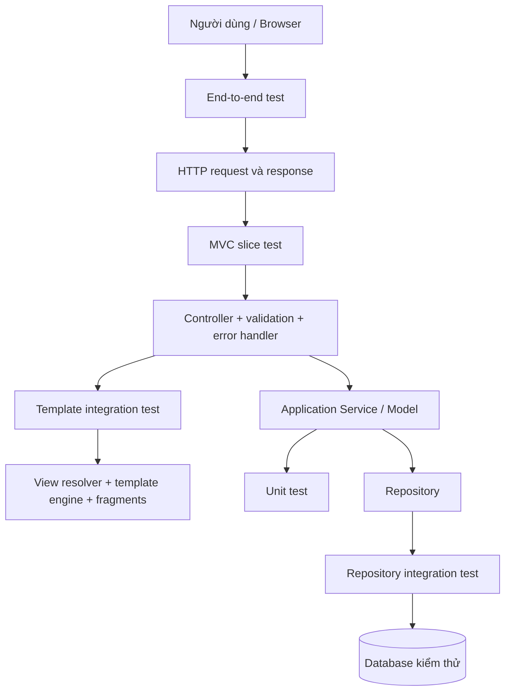

# Kiểm thử khuôn mẫu, nội dung và trạng thái lỗi

Trong ứng dụng MVC, kiểm thử một endpoint không chỉ là xác nhận Controller trả về HTTP status mong đợi. Với ứng dụng server-rendered, View còn phải chọn đúng khuôn mẫu, nhận đủ dữ liệu, hiển thị đúng nội dung và biểu diễn chính xác các trạng thái như danh sách rỗng, validation thất bại, không tìm thấy tài nguyên hoặc lỗi hệ thống. Một endpoint có thể trả `200 OK` nhưng vẫn hiển thị sai trang, thiếu thông báo hoặc làm lộ dữ liệu nội bộ.

Kiểm thử khuôn mẫu (template testing), nội dung (content testing) và trạng thái lỗi (error-state testing) giúp xác minh hợp đồng từ request đến phản hồi mà người dùng thực sự nhìn thấy. Trong MVC, Controller điều phối request, Model và dịch vụ ứng dụng cung cấp kết quả, còn View trình bày dữ liệu. Kiểm thử nên xác nhận từng ranh giới và ít nhất một số luồng tích hợp để phát hiện lỗi chỉ xuất hiện khi các phần được ghép lại.

## 1. Phạm vi cần kiểm thử

Một trang danh sách đơn hàng có thể có nhiều kết quả hợp lệ:

- Có dữ liệu: hiển thị tiêu đề, các dòng đơn hàng và điều khiển phân trang.
- Không có dữ liệu: hiển thị trạng thái rỗng cùng hướng dẫn phù hợp.
- Request không hợp lệ: hiển thị lỗi tại trường và giữ lại dữ liệu người dùng đã nhập.
- Không đủ quyền: hiển thị phản hồi phù hợp mà không tiết lộ nội dung bị hạn chế.
- Không tìm thấy đơn hàng: trả trang hoặc response 404 đúng hợp đồng.
- Lỗi hệ thống: hiển thị thông báo an toàn, không để lộ stack trace hoặc câu SQL.

Vì vậy, một bộ kiểm thử tốt cần bao phủ cả trạng thái thành công và các nhánh lỗi. Có thể chia phạm vi thành bốn câu hỏi:

1. **Template:** framework có tìm đúng template và ghép layout/fragment đúng không?
2. **Model dữ liệu cho View:** Controller có đưa đủ dữ liệu và đúng kiểu vào View không?
3. **Nội dung:** HTML có chứa đúng văn bản, trường, liên kết và cấu trúc cần thiết không?
4. **Trạng thái lỗi:** lỗi được ánh xạ thành status, trang, thông báo và hành vi phù hợp không?

Không phải mọi chi tiết HTML đều cần kiểm thử ở mọi tầng. Nên kiểm tra hợp đồng có ý nghĩa với người dùng và giữ cho test ít phụ thuộc vào cách triển khai nội bộ của template.

## 2. Các tầng kiểm thử trong MVC

Các loại kiểm thử khác nhau phát hiện các nhóm lỗi khác nhau:

| Loại kiểm thử | Phạm vi | Có thể xác minh | Không nên dùng làm bằng chứng duy nhất cho |
|---|---|---|---|
| Unit test Model/service | Một lớp hoặc một ca sử dụng với dependency giả | Quy tắc nghiệp vụ, kết quả và loại lỗi | Template thật hoặc HTTP routing |
| MVC slice test | Controller, binding, validation, advice và cấu hình web cần thiết | Route, status, model, View name, response body | Toàn bộ cấu hình production và database thật |
| Template integration test | Controller, View resolver và template engine thật | Template tồn tại, fragment/layout được ghép, nội dung HTML được render | Mọi hành vi JavaScript trên trình duyệt |
| Repository integration test | Repository và database kiểm thử | Truy vấn, mapping và dữ liệu trả về cho View | Cách người dùng nhìn thấy HTML |
| End-to-end test | Trình duyệt đi qua ứng dụng đã chạy | Luồng thực tế, điều hướng, form và trạng thái hiển thị | Mọi tổ hợp dữ liệu và mọi nhánh hiếm nếu chỉ có ít kịch bản |

Sơ đồ quan hệ:



Unit test thường nhanh và tập trung; MVC slice test kiểm tra ranh giới HTTP; template integration test xác minh HTML thực tế; E2E kiểm tra trải nghiệm trên trình duyệt. Một bộ test cân bằng dùng nhiều tầng thay vì cố gắng kiểm tra mọi thứ bằng E2E hoặc chỉ mock tất cả dependency.

## 3. Kiểm thử Controller và hợp đồng View

Controller thường chịu trách nhiệm:

- Ánh xạ URL và HTTP method đến thao tác phù hợp.
- Bind path variable, query parameter và form/request body.
- Kích hoạt validation ở ranh giới.
- Gọi application service hoặc query service.
- Đưa dữ liệu vào Model/View Model.
- Chọn View logic hoặc response DTO và status phù hợp.

MVC slice test có thể xác minh các hành vi này mà không cần khởi chạy toàn bộ ứng dụng. Với Spring MVC, `@WebMvcTest` kết hợp `MockMvc` thường phù hợp cho Controller và cấu hình web.

Ví dụ Controller:

```java
@Controller
@RequestMapping("/orders")
public class OrderController {
    private final OrderQueryService orders;

    public OrderController(OrderQueryService orders) {
        this.orders = orders;
    }

    @GetMapping
    public String list(Model model) {
        model.addAttribute("orders", orders.findAll());
        return "orders/list";
    }
}
```

Test có thể xác minh Controller gọi đúng dịch vụ, đặt thuộc tính `orders` vào Model và chọn View logic `orders/list`:

```java
@WebMvcTest(OrderController.class)
class OrderControllerMvcTest {
    @Autowired
    MockMvc mockMvc;

    @MockBean
    OrderQueryService orders;

    @Test
    void returnsOrderListViewAndModel() throws Exception {
        given(orders.findAll()).willReturn(List.of(
            new OrderRowViewModel("ORD-1001", "Đang xử lý"),
            new OrderRowViewModel("ORD-1002", "Đã giao")
        ));

        mockMvc.perform(get("/orders"))
            .andExpect(status().isOk())
            .andExpect(view().name("orders/list"))
            .andExpect(model().attributeExists("orders"));
    }
}
```

Đây là ví dụ minh họa; `OrderRowViewModel` và chữ ký `findAll()` cần được định nghĩa theo dự án. `@MockBean` có thể được thay bằng annotation mock bean tương ứng với phiên bản Spring đang dùng. Nếu mục tiêu chỉ là kiểm tra Controller contract, không cần dựng database thật.

### 3.1. Kiểm tra dữ liệu được đưa vào View

Không chỉ kiểm tra thuộc tính có tồn tại; với những hợp đồng quan trọng, hãy xác minh nội dung và kiểu dữ liệu. Ví dụ:

```java
mockMvc.perform(get("/orders"))
    .andExpect(status().isOk())
    .andExpect(model().attribute("orders", hasSize(2)))
    .andExpect(model().attribute("orders", hasItem(
        hasProperty("orderNumber", is("ORD-1001"))
    )));
```

Matcher phụ thuộc kiểu collection và cấu trúc View Model thực tế. Nên kiểm tra những trường ảnh hưởng đến nội dung trang, tránh xác minh mọi thuộc tính nội bộ không thuộc hợp đồng hiển thị.

### 3.2. Phân biệt View name với HTML đã render

`view().name("orders/list")` chỉ xác minh Controller chọn đúng tên View logic. Nó không chứng minh file template tồn tại, cú pháp template hợp lệ hoặc fragment được render đúng.

Để kiểm tra các điều đó, cần một test có View resolver và template engine thật. Có thể dùng `@SpringBootTest` cùng `@AutoConfigureMockMvc` để gửi request qua ứng dụng Spring đã cấu hình template engine. Test sẽ nhận HTML được render thay vì chỉ xác minh tên View.

## 4. Kiểm thử template thực tế

Template integration test cần xác minh rằng:

- View resolver tìm đúng file template.
- Layout và fragment được ghép theo cấu trúc mong đợi.
- Biểu thức template đọc đúng thuộc tính View Model.
- Điều kiện hiển thị hoạt động với cả dữ liệu có và không có.
- Nội dung động được escape đúng ngữ cảnh.
- Không có biến bắt buộc bị thiếu khiến render thất bại.

Ví dụ template Thymeleaf rút gọn:

```html
<main>
  <h1>Đơn hàng</h1>

  <section th:if="${#lists.isEmpty(orders)}" id="empty-state">
    <p>Chưa có đơn hàng nào.</p>
    <a href="/products">Khám phá sản phẩm</a>
  </section>

  <table th:unless="${#lists.isEmpty(orders)}" id="order-table">
    <thead>
      <tr><th>Mã đơn</th><th>Trạng thái</th></tr>
    </thead>
    <tbody>
      <tr th:each="order : ${orders}">
        <td th:text="${order.orderNumber}">ORD-1001</td>
        <td th:text="${order.statusLabel}">Đang xử lý</td>
      </tr>
    </tbody>
  </table>
</main>
```

Với dữ liệu không rỗng, test nên xác nhận bảng có các dòng và không hiển thị empty state. Với danh sách rỗng, test nên xác nhận hướng dẫn trống được hiển thị và bảng dữ liệu không xuất hiện.

### 4.1. Test với template engine thật

Ví dụ dùng `MockMvc` qua cấu hình ứng dụng:

```java
@SpringBootTest
@AutoConfigureMockMvc
class OrderTemplateIntegrationTest {
    @Autowired
    MockMvc mockMvc;

    @MockBean
    OrderQueryService orders;

    @Test
    void rendersRowsWhenOrdersExist() throws Exception {
        given(orders.findAll()).willReturn(List.of(
            new OrderRowViewModel("ORD-1001", "Đang xử lý")
        ));

        mockMvc.perform(get("/orders"))
            .andExpect(status().isOk())
            .andExpect(content().contentTypeCompatibleWith(
                MediaType.TEXT_HTML
            ))
            .andExpect(content().string(containsString("Đơn hàng")))
            .andExpect(content().string(containsString("ORD-1001")))
            .andExpect(content().string(containsString("Đang xử lý")))
            .andExpect(content().string(not(containsString("empty-state"))));
    }

    @Test
    void rendersEmptyStateWhenNoOrdersExist() throws Exception {
        given(orders.findAll()).willReturn(List.of());

        mockMvc.perform(get("/orders"))
            .andExpect(status().isOk())
            .andExpect(content().string(containsString("empty-state")))
            .andExpect(content().string(containsString("Chưa có đơn hàng nào.")))
            .andExpect(content().string(not(containsString("order-table"))));
    }
}
```

Ví dụ giả định test context có template engine và controller thật được đăng ký. Nếu `@SpringBootTest` dùng database thật hoặc các service khác, có thể thay riêng query service bằng mock để tập trung vào render; nếu muốn kiểm tra cả truy vấn, hãy dùng repository và database kiểm thử thay vì mock. Cú pháp matcher có thể cần điều chỉnh theo Hamcrest/JUnit version của dự án.

### 4.2. Kiểm tra cấu trúc HTML thay vì chỉ tìm chuỗi

`containsString()` hữu ích cho những nội dung đơn giản, nhưng không xác minh văn bản nằm đúng phần tử. Với test cần kiểm tra cấu trúc, có thể dùng Jsoup để parse HTML:

```java
MvcResult result = mockMvc.perform(get("/orders"))
    .andExpect(status().isOk())
    .andReturn();

Document document = Jsoup.parse(
    result.getResponse().getContentAsString()
);

assertEquals("Đơn hàng", document.selectFirst("h1").text());
assertEquals(1, document.select("#order-table tbody tr").size());
assertEquals("ORD-1001",
    document.selectFirst("#order-table tbody tr td").text());
```

Jsoup là thư viện bổ sung nếu dự án chưa có. Dùng selector theo cấu trúc ngữ nghĩa hoặc ID ổn định do ứng dụng chủ động cung cấp; tránh phụ thuộc vào class CSS phục vụ trang trí nếu class đó có thể đổi mà không ảnh hưởng chức năng.

### 4.3. Kiểm thử layout và fragment dùng chung

Fragment thường không cần test độc lập nếu chỉ có thể được sử dụng qua một trang. Hãy render trang thực tế có sử dụng fragment và xác minh:

- Header hoặc navigation xuất hiện đúng một lần.
- Nội dung trang được đặt trong layout chung.
- Thông báo thành công/lỗi được truyền đúng tham số.
- Fragment xử lý đúng khi giá trị tùy chọn bị thiếu hoặc rỗng.
- Không có nội dung từ trang khác bị render nhầm.

Nếu fragment là component có nhiều biến thể và được tái sử dụng rộng, có thể tạo một template test chuyên biệt với dữ liệu đại diện. Nhưng cần giữ test ở mức hợp đồng component, không kiểm tra từng thẻ HTML không có ý nghĩa với người dùng.

## 5. Kiểm thử nội dung hiển thị

Content testing xác minh thông tin người dùng nhìn thấy là đúng và đủ. Nội dung có thể bao gồm tiêu đề, nhãn, thông báo, trạng thái, ngày giờ, số tiền, liên kết, tên nút và hướng dẫn.

Một số loại assertion hữu ích:

| Nội dung | Điều cần xác minh |
|---|---|
| Tiêu đề trang | Đúng trang và đúng ngữ cảnh |
| Nhãn trường | Nhãn gắn với input tương ứng |
| Dữ liệu động | Mã đơn, tên hoặc trạng thái đúng với View Model |
| Empty state | Có hướng dẫn tiếp theo, không chỉ là vùng trống |
| Link/button | Văn bản và đích đến phù hợp với hành động |
| Thông báo lỗi | Nêu đúng vấn đề, không dùng câu chung chung hoặc kỹ thuật |
| Nội dung đã dịch | Locale được chọn tạo ra đúng ngôn ngữ |
| Dữ liệu nhạy cảm | Không xuất hiện trong HTML nếu người dùng không được phép xem |

### 5.1. Kiểm tra dữ liệu động và escape

Nội dung do người dùng nhập phải được render an toàn. Với Thymeleaf, `th:text` escape văn bản theo cơ chế mặc định; `th:utext` xuất nội dung không escape và cần được dùng rất thận trọng.

Test có thể đưa một chuỗi giống HTML vào dữ liệu:

```java
String untrusted = "<script>alert('x')</script>";
given(orders.findAll()).willReturn(List.of(
    new OrderRowViewModel("ORD-X", untrusted)
));

MvcResult result = mockMvc.perform(get("/orders"))
    .andExpect(status().isOk())
    .andReturn();

String html = result.getResponse().getContentAsString();
assertThat(html, containsString("&lt;script&gt;"));
assertThat(html, not(containsString("<script>alert('x')</script>")));
```

Ví dụ minh họa nguyên tắc; chuỗi HTML được escape cụ thể có thể khác tùy serializer và vị trí nội dung. Test cần xác minh payload không trở thành phần tử thực thi trong HTML, không chỉ dựa vào một cách mã hóa duy nhất. Nếu dữ liệu được đặt trong thuộc tính, JavaScript hoặc URL, cần kiểm tra escape theo đúng ngữ cảnh đó.

### 5.2. Kiểm tra nội dung theo quyền

Một trang có thể hiển thị nút “Hủy đơn” chỉ khi người dùng có quyền và đơn đang ở trạng thái cho phép. Test nên xác minh cả hai phía:

- Người có quyền và trạng thái phù hợp nhìn thấy hành động.
- Người không có quyền hoặc đơn không còn phù hợp không nhìn thấy hành động.
- Gửi trực tiếp request dù nút bị ẩn vẫn bị server từ chối.

Việc ẩn nút là hành vi trình bày, không thay thế authorization ở server. Test chỉ kiểm tra HTML mà không gửi request không chứng minh tài nguyên được bảo vệ.

### 5.3. Kiểm tra ngày giờ, số tiền và định dạng

Nội dung định dạng có thể thay đổi theo locale, timezone và currency. Nên kiểm thử bằng dữ liệu cố định:

- Dùng `Clock` hoặc thời điểm cố định để tránh test phụ thuộc thời gian hiện tại.
- Xác định timezone dùng cho màn hình.
- Đặt currency rõ ràng cho giá trị tiền.
- Kiểm tra locale đại diện, chẳng hạn `vi-VN` và `en-US`.
- Không kiểm thử bằng cách so sánh một chuỗi định dạng phụ thuộc môi trường nếu ứng dụng chưa cố định locale.

## 6. Kiểm thử trạng thái lỗi của biểu mẫu

Biểu mẫu thường có nhiều trạng thái: chưa gửi, đang xử lý, validation thất bại, lỗi nghiệp vụ và thành công. Với server-rendered MVC, trạng thái lỗi thường được biểu diễn qua `BindingResult`, View Model hoặc flash message.

Ví dụ Controller:

```java
@PostMapping
public String create(
        @Valid @ModelAttribute("form") CreateOrderForm form,
        BindingResult errors,
        Model model) {

    if (errors.hasErrors()) {
        return "orders/new";
    }

    createOrder.execute(toCommand(form));
    return "redirect:/orders";
}
```

`BindingResult` cần nằm ngay sau tham số được validate để Spring gắn lỗi với đối tượng tương ứng. Khi lỗi validation, Controller trả lại form và template hiển thị thông báo. Khi thành công, Post/Redirect/Get giúp tránh gửi lại form khi người dùng refresh.

### 6.1. Kiểm tra lỗi gắn với trường

Ví dụ test với `MockMvc`:

```java
@WebMvcTest(OrderController.class)
class OrderFormValidationTest {
    @Autowired
    MockMvc mockMvc;

    @MockBean
    CreateOrderService createOrder;

    @Test
    void returnsFormWithEmailFieldError() throws Exception {
        mockMvc.perform(post("/orders")
                .param("email", "not-an-email")
                .param("shippingAddress", "12 Nguyễn Huệ"))
            .andExpect(status().isOk())
            .andExpect(view().name("orders/new"))
            .andExpect(model().attributeHasFieldErrors("form", "email"));

        then(createOrder).shouldHaveNoInteractions();
    }
}
```

Ví dụ giả định `CreateOrderForm` có trường `email` với annotation validation và Controller đặt tên model attribute là `form`. Nếu Spring Security bật CSRF protection, POST test cần thêm token, ví dụ `.with(csrf())`, và cấu hình user phù hợp khi endpoint yêu cầu xác thực.

Ngoài việc kiểm tra `BindingResult`, template integration test nên xác minh thông báo thực tế xuất hiện cạnh trường, input có trạng thái lỗi và giá trị hợp lệ đã nhập được giữ lại.

### 6.2. Kiểm tra lỗi tổng thể

Một lỗi có thể không thuộc riêng trường nào, ví dụ thời gian giao hàng không còn khả dụng hoặc phiên làm việc hết hạn. Test nên xác minh lỗi được đưa vào vùng thông báo chung và không bị gắn nhầm vào trường.

Nếu form có nhiều lỗi, nên kiểm tra số lượng và mã lỗi quan trọng thay vì chỉ tìm một câu. Có thể xác minh phần tóm tắt lỗi liên kết đến các trường tương ứng.

### 6.3. Kiểm tra giữ lại dữ liệu sau lỗi

Khi validation thất bại, người dùng không nên phải nhập lại toàn bộ biểu mẫu. Test nên xác minh các trường không nhạy cảm vẫn giữ giá trị đã gửi. Mật khẩu, token hoặc dữ liệu bí mật không nên được đưa trở lại HTML sau lỗi.

Với lỗi nghiệp vụ, kiểm tra dữ liệu form được giữ lại nếu điều đó giúp người dùng sửa yêu cầu. Không giữ các giá trị không còn an toàn hoặc đã hết hiệu lực.

## 7. Kiểm thử trạng thái lỗi nghiệp vụ và HTTP

Ngoài validation, cần kiểm thử các lỗi do use case trả về:

| Tình huống | Kết quả HTTP/View thường gặp | Nội dung cần kiểm tra |
|---|---|---|
| Không tìm thấy đơn | 404 hoặc View not found | Không hiển thị dữ liệu giả hoặc thông tin đơn khác |
| Không đủ quyền | 403 hoặc 404 theo chính sách | Thông báo an toàn, không tiết lộ tài nguyên |
| Trạng thái không cho phép thao tác | 409 Conflict hoặc form error | Giải thích trạng thái và hành động tiếp theo |
| Dữ liệu đầu vào sai | 400/422 hoặc render lại form | Lỗi gắn đúng trường và giữ dữ liệu phù hợp |
| Lỗi hệ thống | 500/503 hoặc error page | Thông báo chung, không lộ exception |

Ví dụ test API khi dịch vụ ném lỗi nghiệp vụ:

```java
@WebMvcTest(OrderApiController.class)
class OrderApiErrorTest {
    @Autowired
    MockMvc mockMvc;

    @MockBean
    CancelOrderService cancelOrder;

    @Test
    void mapsAlreadyShippedToConflict() throws Exception {
        willThrow(new OrderAlreadyShippedException("ORD-1001"))
            .given(cancelOrder)
            .cancel("ORD-1001");

        mockMvc.perform(post("/api/orders/ORD-1001/cancel"))
            .andExpect(status().isConflict())
            .andExpect(jsonPath("$.code").value("ORDER_ALREADY_SHIPPED"));
    }
}
```

Ví dụ giả định `@RestControllerAdvice` ánh xạ exception thành JSON có mã lỗi ổn định. Nếu Spring Security bảo vệ endpoint, bổ sung CSRF token hoặc cấu hình test phù hợp. Không nên chỉ kiểm tra status; cần xác minh mã lỗi và nội dung phản hồi để tránh mọi lỗi cùng bị ánh xạ thành một response chung.

### 7.1. Kiểm tra trang lỗi không tiết lộ chi tiết nội bộ

Với lỗi 500, test nên xác minh response không chứa:

- Tên lớp exception hoặc stack trace.
- Câu SQL, tên bảng hoặc tên cột nội bộ.
- Đường dẫn file hệ thống hoặc cấu trúc thư mục triển khai.
- Token, mật khẩu hoặc thông tin kết nối.
- Dữ liệu của người dùng khác.

Thay vào đó, View có thể hiển thị thông báo chung và mã tham chiếu. Chi tiết kỹ thuật được ghi vào log phía server theo correlation ID, với chính sách che dữ liệu nhạy cảm.

### 7.2. Kiểm tra fallback khi template lỗi

Nếu template lỗi cú pháp hoặc không tồn tại, ứng dụng có thể trả lỗi server. Đây thường là lỗi triển khai cần được phát hiện sớm bằng template integration test hoặc smoke test khi khởi động. Không nên viết test phụ thuộc vào stack trace cụ thể của template engine; hãy xác minh ứng dụng không phục vụ nội dung sai và hệ thống giám sát nhận biết lỗi.

## 8. Kiểm thử nội dung đa ngôn ngữ

Nếu ứng dụng hỗ trợ nhiều locale, cùng một lỗi hoặc trạng thái có thể xuất hiện bằng nhiều ngôn ngữ. Test nên kiểm tra:

- Locale được chọn theo chính sách của ứng dụng.
- Message key có bản dịch ở các locale được hỗ trợ.
- Placeholder được truyền đủ và đúng thứ tự/ý nghĩa.
- Nội dung fallback khi thiếu bản dịch an toàn.
- Ngày, số và tiền tệ được định dạng đúng theo locale và dữ liệu.
- Nhãn, mô tả trợ năng và thông báo lỗi dùng cùng ngôn ngữ.

Ví dụ:

```java
@Test
void rendersValidationMessageInEnglish() throws Exception {
    mockMvc.perform(post("/orders")
            .header("Accept-Language", "en")
            .param("email", "invalid"))
        .andExpect(status().isOk())
        .andExpect(content().string(
            containsString("Enter a valid email address")
        ));
}
```

Test cần xác minh `LocaleResolver` của ứng dụng thực sự đọc `Accept-Language`. Nếu người dùng chọn locale qua cookie hoặc session, hãy thiết lập đúng nguồn đó thay vì giả định header luôn có ưu tiên cao nhất.

Có thể bổ sung test kiểm tra tất cả message key bắt buộc tồn tại trong từng bundle và các placeholder tương ứng không bị thiếu. Những kiểm tra này thường phù hợp với test nội dung hoặc bước kiểm tra tài nguyên trong CI.

## 9. Kiểm thử accessibility của nội dung và lỗi

Một trang có thể đúng về mặt dữ liệu nhưng khó sử dụng với bàn phím hoặc trình đọc màn hình. Template test có thể kiểm tra các thuộc tính ngữ nghĩa cơ bản:

- Input có label gắn đúng `for` và `id`.
- Trường lỗi có `aria-invalid="true"` khi phù hợp.
- `aria-describedby` trỏ đến phần tử chứa thông báo lỗi.
- Vùng thông báo quan trọng có `role="alert"` hoặc semantics phù hợp.
- Link và nút có tên dễ hiểu, không chỉ có biểu tượng không nhãn.
- Heading phản ánh cấu trúc nội dung.

Ví dụ HTML:

```html
<label for="email">Địa chỉ email</label>
<input id="email"
       name="email"
       aria-invalid="true"
       aria-describedby="email-error">
<p id="email-error" class="field-error">
  Địa chỉ email chưa đúng định dạng.
</p>
```

Test có thể parse HTML và xác minh quan hệ giữa label, input và error element. E2E test nên kiểm tra focus sau khi gửi form lỗi và hành vi bàn phím. Không thể chứng minh đầy đủ accessibility chỉ bằng cách kiểm tra chuỗi HTML; cần thêm công cụ tự động và kiểm tra thủ công cho luồng quan trọng.

## 10. Kiểm thử bảo mật nội dung

Template có trách nhiệm render dữ liệu an toàn. Các test quan trọng gồm:

- Dữ liệu người dùng được escape theo ngữ cảnh.
- Nội dung HTML chỉ được render không escape khi đã qua quy trình sanitize đáng tin cậy và có lý do rõ ràng.
- Trang không hiển thị trường nội bộ hoặc dữ liệu của tenant/người dùng khác.
- CSRF protection được kiểm tra với các request thay đổi trạng thái.
- Lỗi authorization không tiết lộ sự tồn tại hoặc chi tiết tài nguyên ngoài chính sách.
- Response không cache công khai nội dung cá nhân nếu không được phép.

Một test quyền nên gửi request trực tiếp, không chỉ kiểm tra nút có bị ẩn. Một test XSS nên kiểm tra dữ liệu độc hại không trở thành script hoặc thuộc tính HTML thực thi. Một test tenant isolation nên xác minh dữ liệu của tenant khác không xuất hiện trong HTML.

## 11. Tránh test dễ vỡ

Template có thể thay đổi class CSS, khoảng trắng hoặc cách lồng thẻ mà không làm thay đổi nội dung và hành vi. Nếu test so sánh toàn bộ HTML, thay đổi trình bày nhỏ cũng có thể làm hàng loạt test thất bại.

Một số nguyên tắc:

- Ưu tiên assertion theo status, View contract, nội dung có ý nghĩa và cấu trúc ngữ nghĩa.
- Dùng ID hoặc data attribute ổn định khi cần định vị component.
- Không phụ thuộc vào thứ tự thuộc tính HTML hoặc khoảng trắng không có ý nghĩa.
- Không kiểm tra mọi class CSS nếu class chỉ phục vụ trang trí.
- Dùng snapshot/golden file cho những vùng có lý do cần kiểm tra toàn bộ, và review thay đổi snapshot như một thay đổi sản phẩm.
- Dùng fixture nhỏ, rõ nghĩa và có thể tái tạo.
- Mock service ở MVC slice test; dùng dependency thật ở integration test phù hợp.

### 11.1. Tránh mock quá sâu

Nếu mock cả template engine, View resolver, controller và service, test không còn kiểm tra được template thật. Ngược lại, nếu mọi test đều khởi chạy toàn bộ ứng dụng và database, bộ test có thể chậm và khó chẩn đoán.

Chọn tầng theo câu hỏi cần trả lời: MVC slice để kiểm tra điều phối; template integration để kiểm tra render thật; repository integration để kiểm tra dữ liệu; E2E để xác minh trải nghiệm xuyên suốt.

### 11.2. Dùng dữ liệu test ổn định

Không dùng ngày giờ hiện tại, số ngẫu nhiên hoặc dữ liệu phụ thuộc môi trường nếu không cần thiết. Dùng fixture cố định, `Clock` giả hoặc dữ liệu được tạo rõ ràng. Test không nên phụ thuộc vào thứ tự bản ghi database nếu truy vấn không có `ORDER BY` ổn định.

## 12. Tổ chức bộ test theo trạng thái

Với mỗi trang hoặc use case, có thể lập ma trận test:

| Trạng thái | Setup | Assertion tối thiểu |
|---|---|---|
| Có dữ liệu | Service trả một hoặc nhiều bản ghi | Đúng View, đúng tiêu đề, dòng dữ liệu và hành động phù hợp |
| Rỗng | Service trả collection rỗng | Empty state xuất hiện, bảng/danh sách không hiển thị dữ liệu giả |
| Validation lỗi | Gửi thiếu hoặc sai trường | Trả form/400 theo hợp đồng, lỗi đúng trường, không gọi use case |
| Lỗi nghiệp vụ | Service ném lỗi miền | Status hoặc View đúng, mã và thông điệp đúng |
| Không tìm thấy | Query service trả not found | 404 hoặc trang không tìm thấy, không lộ dữ liệu khác |
| Không đủ quyền | Principal không có quyền | 403/404 theo chính sách, không có nội dung bị hạn chế |
| Lỗi hệ thống | Dependency ném lỗi không dự kiến | Trang lỗi an toàn, không lộ chi tiết nội bộ |
| Locale khác | Gửi request với locale khác | Nhãn và thông báo được dịch đúng |

Không phải mọi trang đều cần tất cả trạng thái. Chọn các nhánh có thể xảy ra theo hợp đồng của endpoint, nhưng luôn kiểm tra ít nhất thành công, dữ liệu rỗng nếu có thể và các lỗi quan trọng.

## 13. Ví dụ kế hoạch kiểm thử một trang đơn hàng

Giả sử trang `/orders` có danh sách, trạng thái rỗng, form hủy đơn và thông báo lỗi. Có thể chia test như sau:

1. **Unit test Model/service:** đơn đã giao không thể hủy; người dùng không sở hữu đơn không thể xem.
2. **MVC slice test:** GET `/orders` chọn `orders/list`, đặt `orders` vào Model; POST form lỗi trả lại `orders/new` với field error.
3. **Template integration test:** HTML có tiêu đề, bảng hoặc empty state; fragment thông báo xuất hiện đúng; dữ liệu động được escape.
4. **Error handler test:** `OrderAlreadyShipped` ánh xạ thành 409 hoặc View lỗi theo hợp đồng; lỗi hệ thống không lộ exception.
5. **Locale test:** thông báo validation hiển thị bằng tiếng Việt hoặc tiếng Anh theo locale request.
6. **E2E test:** người dùng mở trang, gửi form không hợp lệ, sửa dữ liệu và hoàn tất thao tác; trình duyệt hiển thị đúng lỗi và kết quả.

Các test này bổ sung cho nhau. Unit test không cần database; template integration cần template engine thật; E2E chỉ nên tập trung vào các luồng quan trọng để giữ tốc độ và độ ổn định.

## 14. Những sai lầm thường gặp

**Chỉ kiểm tra HTTP 200.** Response có thể chọn sai template hoặc render nội dung rỗng. Hãy kiểm tra View name, Model và HTML thực tế ở các tầng phù hợp.

**Chỉ kiểm tra View name.** Tên `orders/list` đúng không chứng minh template tồn tại hoặc fragment render đúng. Cần template integration test.

**So sánh toàn bộ HTML cho mọi trường hợp.** Test dễ vỡ trước thay đổi khoảng trắng hoặc CSS. Ưu tiên nội dung và cấu trúc có ý nghĩa.

**Chỉ kiểm thử trạng thái thành công.** Lỗi validation, quyền, not found và system failure thường là nơi giao diện dễ sai. Lập ma trận trạng thái để không bỏ sót.

**Mock template engine trong test render.** Test không còn xác minh template thật. Dùng template engine thật ở integration test.

**Kiểm tra nút bị ẩn rồi kết luận authorization an toàn.** Người dùng có thể gửi request trực tiếp. Hãy test cả server-side authorization.

**Bỏ qua escape dữ liệu động.** Nội dung có thể hiển thị đúng nhưng chứa XSS. Dùng payload test và xác minh output an toàn theo ngữ cảnh.

**Không kiểm tra bản dịch và fallback.** Một locale có thể thiếu message key hoặc placeholder. Thêm test catalog và request với locale đại diện.

**Dùng E2E cho mọi assertion nhỏ.** Bộ test chậm và khó chẩn đoán. Chuyển phần lớn kiểm tra logic và hợp đồng xuống unit/MVC slice/template integration.

## 15. Checklist review kiểm thử template và lỗi

Khi review một bộ test MVC, hãy tự hỏi:

1. Có kiểm tra Controller chọn đúng View và cung cấp đủ Model attribute không?
2. Có ít nhất một test dùng template engine thật để xác minh HTML được render không?
3. Có kiểm tra cả dữ liệu có và trạng thái rỗng không?
4. Nội dung động, link, label và trạng thái có được xác minh theo hợp đồng không?
5. Có kiểm tra field error và global error của biểu mẫu không?
6. Có kiểm tra các lỗi nghiệp vụ, not found, authorization và lỗi hệ thống quan trọng không?
7. HTTP status, mã lỗi và thông báo có nhất quán không?
8. HTML có escape dữ liệu không tin cậy và tránh tiết lộ thông tin nội bộ không?
9. Locale, placeholder và fallback có được kiểm tra không?
10. Label, `aria-invalid`, `aria-describedby` và vùng thông báo có semantics phù hợp không?
11. Test có tránh phụ thuộc vào class CSS, khoảng trắng và toàn bộ snapshot không cần thiết không?
12. Mỗi test có chạy ở tầng phù hợp và dùng fixture ổn định không?

## Kết luận

Kiểm thử khuôn mẫu, nội dung và trạng thái lỗi cần xác minh điều người dùng thực sự nhận được từ một luồng MVC: đúng template, đúng dữ liệu, đúng nội dung và phản hồi đúng khi có lỗi. MVC slice test kiểm tra Controller và hợp đồng View; template integration test xác minh HTML từ template engine thật; unit, repository và E2E test bổ sung bằng chứng ở các ranh giới khác. Hãy bao phủ trạng thái có dữ liệu, rỗng, validation, lỗi nghiệp vụ, không tìm thấy, không đủ quyền và lỗi hệ thống; đồng thời kiểm tra escape, locale và accessibility. Assertion theo nội dung và cấu trúc ngữ nghĩa giúp test bền vững hơn trước thay đổi trình bày, trong khi vẫn bảo vệ trải nghiệm và hợp đồng của ứng dụng.
