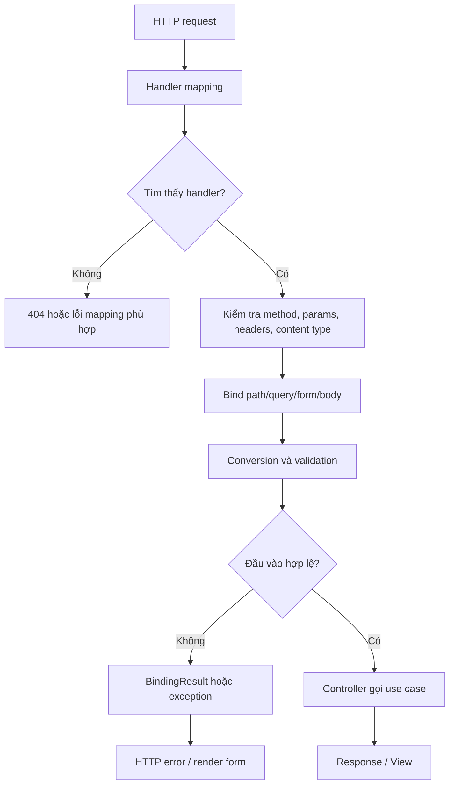

# Kiểm thử định tuyến, liên kết dữ liệu và kiểm tra đầu vào

Trong ứng dụng web theo kiến trúc **MODEL_VIEW_CONTROLLER (MVC)**, Controller là ranh giới tiếp nhận HTTP request và điều phối request đến use case phù hợp. Một request cần được định tuyến đúng handler, dữ liệu từ URL hoặc body cần được bind vào đúng tham số, giá trị cần được chuyển đổi đúng kiểu và đầu vào không hợp lệ phải được từ chối theo hợp đồng đã thiết kế.

Kiểm thử các phần này giúp phát hiện lỗi trước khi chúng xuất hiện ở giao diện hoặc trong dữ liệu nghiệp vụ. Một route sai có thể trả nhầm trang; một tham số không bind đúng có thể làm truy vấn thiếu điều kiện; một lỗi conversion không được xử lý có thể biến thành HTTP 500; một DTO nhận trường ngoài ý muốn có thể tạo ra lỗ hổng mass assignment.

Bài học này tập trung vào cách kiểm thử định tuyến, liên kết dữ liệu và validation trong Spring MVC. Nội dung bao gồm route mapping, path/query/form/body binding, kiểu dữ liệu và định dạng, lỗi HTTP, `MockMvc`, controller slice test, integration test và các kiểm tra bảo mật cần thiết.

## 1. Những gì cần được kiểm thử ở ranh giới MVC

Một HTTP request đi qua nhiều bước trước khi Controller gọi tầng ứng dụng:



Các nhóm kiểm thử chính:

| Nhóm | Câu hỏi cần xác minh | Ví dụ |
|---|---|---|
| Định tuyến | URL và HTTP method có chọn đúng handler không? | `GET /orders/42` gọi handler chi tiết |
| Điều kiện mapping | `params`, `headers`, `consumes`, `produces` có được áp dụng không? | JSON endpoint từ chối XML nếu không hỗ trợ |
| Binding | Dữ liệu đến từ path, query, form hay body có vào đúng tham số không? | `page=2` bind thành số nguyên 2 |
| Conversion | Chuỗi có được chuyển thành UUID, enum, ngày hoặc số đúng không? | Ngày sai định dạng trả lỗi 400 |
| Validation | Ràng buộc đầu vào có được thực thi không? | Tiêu đề rỗng bị từ chối |
| Error handling | Lỗi được ánh xạ sang status và nội dung phù hợp không? | Không tìm thấy đơn trả 404 |
| Security | Request giả mạo có vượt qua CSRF, authentication hoặc authorization không? | Người dùng không có quyền nhận 403 |

Kiểm thử ranh giới HTTP không thay thế kiểm thử Domain Model hoặc Application Service. Mỗi lớp cần kiểm thử đúng trách nhiệm của nó.

## 2. Ví dụ Controller làm cơ sở kiểm thử

Giả sử ứng dụng quản lý đơn hàng có API đọc danh sách, đọc chi tiết và tạo mới. Controller có thể được viết như sau:

```java
@RestController
@RequestMapping("/api/orders")
class OrderController {

    private final OrderQueryService queryService;
    private final CreateOrderUseCase createOrder;

    OrderController(
            OrderQueryService queryService,
            CreateOrderUseCase createOrder) {
        this.queryService = queryService;
        this.createOrder = createOrder;
    }

    @GetMapping
    Page<OrderSummaryResponse> search(
            @RequestParam(required = false) OrderStatus status,
            @RequestParam(defaultValue = "0") int page,
            @RequestParam(defaultValue = "20") int size) {
        return queryService.search(status, page, size);
    }

    @GetMapping("/{id}")
    OrderDetailResponse detail(@PathVariable UUID id) {
        return queryService.getDetail(id);
    }

    @PostMapping(consumes = MediaType.APPLICATION_JSON_VALUE)
    ResponseEntity<OrderDetailResponse> create(
            @Valid @RequestBody CreateOrderRequest request) {
        OrderDetailResponse created = createOrder.create(request);
        return ResponseEntity
                .created(URI.create("/api/orders/" + created.id()))
                .body(created);
    }
}
```

Các kiểu `OrderQueryService`, `CreateOrderUseCase` và response DTO là thành phần minh họa. Trong dự án thực tế, route và kiểu trả về phải tuân theo hợp đồng API của ứng dụng. Mục đích của ví dụ là làm rõ những điểm mà test cần quan sát: mapping, binding, validation, lời gọi use case và response.

Request DTO:

```java
public record CreateOrderRequest(
        @NotBlank
        @Size(max = 120)
        String reference,

        @NotEmpty
        List<@Valid CreateOrderLineRequest> lines
) {}

public record CreateOrderLineRequest(
        @NotNull
        UUID productId,

        @Min(1)
        @Max(1000)
        int quantity
) {}
```

Test cần xác minh cả request hợp lệ và các trường hợp thiếu, sai kiểu hoặc vi phạm giới hạn.

## 3. Kiểm thử định tuyến (route mapping)

Định tuyến xác định Controller method nào sẽ xử lý request. Trong Spring MVC, các annotation như `@RequestMapping`, `@GetMapping`, `@PostMapping`, `@PutMapping`, `@PatchMapping` và `@DeleteMapping` mô tả các điều kiện mapping.

Một route có thể phụ thuộc vào:

- Path: `/orders/{id}`.
- HTTP method: `GET`, `POST`, `PUT`, `PATCH`, `DELETE`.
- Query parameter: `?view=compact`.
- Header: `Accept`, `X-API-Version`.
- Content type: `Content-Type: application/json`.
- Kiểu dữ liệu response được hỗ trợ qua `produces`.

### Kiểm tra đúng path và method

```java
@WebMvcTest(OrderController.class)
class OrderControllerRoutingTest {

    @Autowired
    MockMvc mockMvc;

    @MockitoBean
    OrderQueryService queryService;

    @MockitoBean
    CreateOrderUseCase createOrder;

    @Test
    @WithMockUser
    void getOrderByIdRoutesToDetailHandler() throws Exception {
        UUID id = UUID.fromString("d6d3c3d7-7b5d-4b87-8c2b-6f1d3f0f4b10");
        given(queryService.getDetail(id)).willReturn(
                new OrderDetailResponse(id, "ORD-42", "PAID"));

        mockMvc.perform(get("/api/orders/{id}", id)
                        .accept(MediaType.APPLICATION_JSON))
                .andExpect(status().isOk())
                .andExpect(jsonPath("$.id").value(id.toString()))
                .andExpect(jsonPath("$.reference").value("ORD-42"));

        then(queryService).should().getDetail(id);
    }
}
```

Ví dụ dùng `@MockitoBean` của các phiên bản Spring Framework mới. Với dự án Spring Boot/Spring Framework cũ hơn, có thể dùng `@MockBean` theo phiên bản đang sử dụng. Test xác minh request đến đúng handler thông qua kết quả và lời gọi service.

### Kiểm tra HTTP method không được hỗ trợ

Nếu endpoint chỉ khai báo `GET`, gửi `POST` đến cùng path thường nhận `405 Method Not Allowed` khi path khớp nhưng method không phù hợp. Hãy kiểm thử để bảo đảm endpoint không vô tình chấp nhận phương thức ngoài hợp đồng.

```java
@Test
@WithMockUser
void unsupportedMethodReturns405() throws Exception {
    mockMvc.perform(delete("/api/orders/{id}", UUID.randomUUID())
                    .with(csrf()))
            .andExpect(status().isMethodNotAllowed());
}
```

Kết quả chính xác có thể chịu ảnh hưởng bởi security filter hoặc cấu hình exception handler. Nếu security chặn request trước khi handler mapping xử lý, status có thể khác; test cần phản ánh cấu hình ứng dụng thực tế.

### Route tĩnh và route có biến

Các route như `/orders/search` và `/orders/{id}` có thể gây nhầm lẫn nếu mapping không được thiết kế rõ. Hãy kiểm thử các path dễ va chạm:

```java
@GetMapping("/search")
OrderSearchResponse search(@RequestParam String q) { ... }

@GetMapping("/{id}")
OrderDetailResponse detail(@PathVariable UUID id) { ... }
```

Test nên xác minh `/search` đi vào handler tìm kiếm và ID không hợp lệ không bị xử lý nhầm như một đơn hàng. Với Spring MVC, quy tắc path matching và conversion quyết định kết quả cuối cùng; đừng dựa vào giả định thứ tự khai báo method.

## 4. Kiểm thử điều kiện mapping

Spring MVC cho phép giới hạn handler theo query parameter, header, `consumes` và `produces`. Các điều kiện này là một phần của hợp đồng route và nên có test riêng.

### Mapping theo query parameter

```java
@GetMapping(value = "/report", params = "format=summary")
ReportSummary summary() { ... }
```

Test:

```java
mockMvc.perform(get("/api/orders/report")
        .param("format", "summary"))
    .andExpect(status().isOk());
```

Nếu thiếu hoặc truyền giá trị khác, request không thỏa điều kiện mapping có thể trả 400 hoặc 404 tùy cấu hình và các mapping còn lại. Hãy kiểm tra response thực tế thay vì gắn một mã cứng không phù hợp với ứng dụng.

### Mapping theo header và content negotiation

```java
@GetMapping(value = "/export", produces = MediaType.APPLICATION_JSON_VALUE)
OrderExportResponse exportJson() { ... }

@PostMapping(consumes = MediaType.APPLICATION_JSON_VALUE)
void importJson(@RequestBody ImportOrdersRequest request) { ... }
```

Các tình huống cần kiểm tra:

| Request | Kết quả cần xác minh |
|---|---|
| `Accept: application/json` | Response JSON đúng schema |
| `Accept` không tương thích với `produces` | `406 Not Acceptable` nếu không có representation phù hợp |
| `Content-Type: application/json` | Body được đọc qua JSON converter |
| `Content-Type: text/plain` gửi đến JSON-only endpoint | `415 Unsupported Media Type` nếu không có converter/mapping phù hợp |
| Header phiên bản API hợp lệ | Handler/representation đúng phiên bản |

Ví dụ:

```java
@Test
@WithMockUser
void rejectsUnsupportedContentType() throws Exception {
    mockMvc.perform(post("/api/orders")
            .with(csrf())
            .contentType(MediaType.TEXT_PLAIN)
            .content("not-json"))
        .andExpect(status().isUnsupportedMediaType());

    then(createOrder).shouldHaveNoInteractions();
}
```

Nếu ứng dụng có exception handler tùy chỉnh, hãy kiểm tra cả cấu trúc response lỗi.

## 5. Kiểm thử PathVariable binding

`@PathVariable` lấy dữ liệu từ một đoạn path. Test cần xác minh:

- Giá trị hợp lệ được chuyển thành đúng kiểu.
- Giá trị không parse được tạo lỗi phù hợp.
- Thiếu segment hoặc sai cấu trúc URL không gọi use case.
- ID được chuyển đúng, không bị thay đổi hoặc nhầm với tham số khác.

Ví dụ với UUID:

```java
@Test
@WithMockUser
void invalidUuidDoesNotCallQueryService() throws Exception {
    mockMvc.perform(get("/api/orders/not-a-uuid"))
            .andExpect(status().isBadRequest());

    then(queryService).shouldHaveNoInteractions();
}
```

Mặc định Spring MVC thường ánh xạ lỗi conversion của path variable thành 400. Nếu ứng dụng định nghĩa converter hoặc exception handler riêng, hãy kiểm thử quy ước đã chọn.

Với ID dạng số, cần chú ý tràn số và giá trị âm. Với UUID, cần chú ý chuỗi sai định dạng. Với slug, cần xác định rõ ký tự hợp lệ và cách chuẩn hóa.

## 6. Kiểm thử RequestParam binding

`@RequestParam` lấy giá trị từ query string hoặc form parameter. Những thuộc tính cần kiểm thử gồm `required`, `defaultValue`, kiểu dữ liệu và nhiều giá trị cùng tên.

Ví dụ:

```java
@GetMapping
Page<OrderSummaryResponse> search(
        @RequestParam(required = false) OrderStatus status,
        @RequestParam(defaultValue = "0") int page,
        @RequestParam(defaultValue = "20") int size) {
    return queryService.search(status, page, size);
}
```

Test mặc định và query cụ thể:

```java
@Test
@WithMockUser
void usesDefaultPageAndSize() throws Exception {
    given(queryService.search(null, 0, 20))
            .willReturn(Page.empty());

    mockMvc.perform(get("/api/orders"))
            .andExpect(status().isOk());

    then(queryService).should().search(null, 0, 20);
}

@Test
@WithMockUser
void bindsQueryParameters() throws Exception {
    given(queryService.search(OrderStatus.PAID, 2, 10))
            .willReturn(Page.empty());

    mockMvc.perform(get("/api/orders")
                    .param("status", "PAID")
                    .param("page", "2")
                    .param("size", "10"))
            .andExpect(status().isOk());

    then(queryService).should().search(OrderStatus.PAID, 2, 10);
}
```

### Giá trị sai kiểu và tham số bị thiếu

Nếu `page=abc`, conversion sang `int` thất bại. Nếu một tham số `required=true` không có, Spring MVC có thể trả 400. Test cần xác minh lỗi không gọi service với giá trị mặc định ngoài ý muốn.

```java
@Test
@WithMockUser
void rejectsNonNumericPage() throws Exception {
    mockMvc.perform(get("/api/orders").param("page", "abc"))
            .andExpect(status().isBadRequest());

    then(queryService).shouldHaveNoInteractions();
}
```

Ngoài việc kiểm tra conversion, cần kiểm thử giới hạn nghiệp vụ của pagination. `page=-1` có thể chuyển đổi thành công nhưng vẫn là giá trị không được phép. `size=1000000` là số nguyên hợp lệ nhưng có thể gây tải quá lớn. Những điều kiện này cần được kiểm tra ở Controller boundary hoặc tầng ứng dụng theo hợp đồng.

## 7. Kiểm thử Form Data và ModelAttribute

Trong ứng dụng server-rendered, `@ModelAttribute` thường bind request parameter vào Form Object. Test cần xác minh dữ liệu form được bind đúng, validation lỗi được giữ lại và View nhận đúng lỗi.

Form object:

```java
public class UpdateProfileForm {
    @NotBlank
    @Size(max = 80)
    private String displayName;

    @Email
    @NotBlank
    private String email;

    // Getter và setter phục vụ data binding.
}
```

Controller:

```java
@Controller
class ProfileController {

    private final ProfileService profileService;

    ProfileController(ProfileService profileService) {
        this.profileService = profileService;
    }

    @PostMapping("/profile")
    String update(
            @Valid @ModelAttribute("form") UpdateProfileForm form,
            BindingResult errors,
            Model model) {

        if (errors.hasErrors()) {
            return "profile/edit";
        }

        profileService.update(form);
        return "redirect:/profile";
    }
}
```

Test lỗi validation:

```java
@WebMvcTest(ProfileController.class)
class ProfileControllerTest {

    @Autowired
    MockMvc mockMvc;

    @MockitoBean
    ProfileService profileService;

    @Test
    @WithMockUser
    void invalidFormReturnsEditViewAndKeepsFieldErrors() throws Exception {
        mockMvc.perform(post("/profile").with(csrf())
                .param("displayName", "")
                .param("email", "not-an-email"))
            .andExpect(status().isOk())
            .andExpect(view().name("profile/edit"))
            .andExpect(model().attributeHasFieldErrors(
                    "form", "displayName", "email"));

        then(profileService).shouldHaveNoInteractions();
    }
}
```

Khi test thành công, xác minh service nhận đúng dữ liệu đã bind và Controller redirect theo hợp đồng. Không chỉ kiểm tra view name; cần kiểm tra lời gọi use case để phát hiện trường bị đảo hoặc bị mất.

### BindingResult phải ở đúng vị trí

Với tham số `@Valid` hoặc `@Validated`, `BindingResult` cần nằm ngay sau tham số được validate nếu Controller muốn tự xử lý lỗi. Nếu đặt sai vị trí, Spring có thể ném exception thay vì đi vào nhánh xử lý lỗi dự kiến. Đây là lỗi chữ ký handler mà một test MVC có thể phát hiện.

## 8. Kiểm thử JSON RequestBody binding

Với API JSON, `@RequestBody` dùng message converter để đọc body thành DTO. Test cần kiểm tra:

- Body JSON hợp lệ được deserialize đúng.
- Trường thiếu hoặc `null` được xử lý theo validation.
- Sai kiểu JSON tạo lỗi đọc body.
- Content-Type không được hỗ trợ bị từ chối.
- Trường không thuộc DTO không thể thay đổi dữ liệu nội bộ.
- Response thành công có đúng status, header và JSON schema.

Ví dụ:

```java
    @Test
    @WithMockUser
    void createsOrderFromValidJson() throws Exception {
    UUID id = UUID.fromString("d6d3c3d7-7b5d-4b87-8c2b-6f1d3f0f4b10");
    given(createOrder.create(any(CreateOrderRequest.class)))
            .willReturn(new OrderDetailResponse(id, "ORD-42", "DRAFT"));

    mockMvc.perform(post("/api/orders").with(csrf())
            .contentType(MediaType.APPLICATION_JSON)
            .accept(MediaType.APPLICATION_JSON)
            .content("""
                {
                  "reference": "ORD-42",
                  "lines": [
                    {
                      "productId": "d6d3c3d7-7b5d-4b87-8c2b-6f1d3f0f4b10",
                      "quantity": 2
                    }
                  ]
                }
                """))
        .andExpect(status().isCreated())
        .andExpect(header().string(
                HttpHeaders.LOCATION, "/api/orders/" + id))
        .andExpect(jsonPath("$.reference").value("ORD-42"));

    then(createOrder).should().create(any(CreateOrderRequest.class));
    }
```

Text block yêu cầu Java 15 trở lên. Nếu dự án dùng Java cũ hơn, thay bằng chuỗi JSON phù hợp hoặc fixture file. Không cần kiểm thử cách Jackson hoạt động nội bộ; hãy kiểm tra hợp đồng deserialize và kết quả ứng dụng.

### Body sai cấu trúc

Ví dụ gửi chuỗi vào trường UUID hoặc gửi JSON không đóng ngoặc. Những trường hợp này thường tạo `HttpMessageNotReadableException` và response 400. Test nên xác minh service không được gọi và lỗi trả về không chứa stack trace.

```java
@Test
@WithMockUser
void malformedJsonReturns400() throws Exception {
    mockMvc.perform(post("/api/orders").with(csrf())
            .contentType(MediaType.APPLICATION_JSON)
            .content("{\"reference\":"))
        .andExpect(status().isBadRequest());

    then(createOrder).shouldHaveNoInteractions();
}
```

## 9. Kiểm thử validation đầu vào

Validation thường bao gồm nhiều loại điều kiện:

- Trường bắt buộc: `@NotNull`, `@NotBlank`, `@NotEmpty`.
- Độ dài: `@Size`, `@Length` tùy thư viện.
- Số: `@Min`, `@Max`, `@Positive`, `@DecimalMin`.
- Định dạng: `@Email`, `@Pattern`.
- Lồng nhau: `@Valid` trên object hoặc phần tử collection.
- Điều kiện liên trường: custom class-level constraint hoặc validator chuyên biệt.

### Kiểm thử biên

Nếu trường có giới hạn từ 2 đến 80 ký tự, nên kiểm tra:

| Giá trị | Kết quả kỳ vọng |
|---|---|
| `null` | Tùy annotation; `@Size` có thể bỏ qua null, `@NotNull`/`@NotBlank` mới bắt buộc |
| Chuỗi rỗng | Bị từ chối nếu dùng `@NotBlank` |
| Một ký tự | Bị từ chối vì dưới min |
| Hai ký tự | Được chấp nhận nếu các điều kiện khác đúng |
| 80 ký tự | Được chấp nhận |
| 81 ký tự | Bị từ chối |
| Chỉ có khoảng trắng | Bị từ chối với `@NotBlank` |

Đừng chỉ test một ví dụ lỗi và một ví dụ thành công. Giá trị biên thường phát hiện sai khác giữa validation client và server.

### Kiểm thử validation lồng nhau

Với `List<@Valid CreateOrderLineRequest>`, test cần gửi ít nhất một dòng hàng có quantity bằng 0 hoặc product ID sai để xác minh lỗi lồng nhau được phát hiện. Nếu thiếu `@Valid`, validation trên phần tử có thể không được kích hoạt.

### Kiểm thử custom validator

Nếu form yêu cầu ngày kết thúc sau ngày bắt đầu, hãy test:

- Ngày kết thúc trước ngày bắt đầu.
- Hai ngày bằng nhau theo quy tắc đã chọn.
- Ngày kết thúc sau ngày bắt đầu.
- Một trong hai giá trị bị thiếu.

Custom validator nên có unit test riêng cho logic điều kiện và một MVC test để xác minh lỗi được đưa về đúng response hoặc field.

## 10. Kiểm thử conversion: ngày, giờ, enum và locale

Dữ liệu HTTP thường là chuỗi. Spring cần chuyển chuỗi thành kiểu Java thông qua converter hoặc formatter. Đây là nơi dễ xuất hiện lỗi định dạng và lệch múi giờ.

Ví dụ query parameter:

```java
@GetMapping("/by-date")
List<OrderSummaryResponse> byDate(
        @RequestParam
        @DateTimeFormat(iso = DateTimeFormat.ISO.DATE)
        LocalDate date) {
    return queryService.findByDate(date);
}
```

Test định dạng ISO:

```java
mockMvc.perform(get("/api/orders/by-date").with(user("reader"))
        .param("date", "2026-11-19"))
    .andExpect(status().isOk());
```

Và test giá trị sai:

```java
mockMvc.perform(get("/api/orders/by-date").with(user("reader"))
        .param("date", "19/11/2026"))
    .andExpect(status().isBadRequest());
```

Nếu API chấp nhận nhiều định dạng hoặc dùng locale cụ thể, phải khai báo rõ và test từng định dạng. Không phụ thuộc vào locale mặc định của máy chạy test.

### Múi giờ

Phân biệt `LocalDate`, `LocalDateTime`, `OffsetDateTime` và `Instant`. Một ngày nghiệp vụ như ngày sinh thường là `LocalDate`; thời điểm giao dịch cần một mốc thời gian có múi giờ hoặc UTC như `Instant`. Test nên xác minh giá trị chuyển đổi đúng, không lệch ngày khi chạy ở môi trường timezone khác.

### Enum

Nếu query nhận `OrderStatus`, hãy test cả giá trị hợp lệ và không hợp lệ. Có thể chọn trả 400 với mã lỗi rõ ràng thay vì để lỗi conversion trở thành trang lỗi chung.

## 11. Kiểm thử lỗi và HTTP status

Một hợp đồng Controller nên ánh xạ các trường hợp phổ biến thành status phù hợp:

| Trường hợp | Status thường dùng |
|---|---|
| Request hợp lệ đọc dữ liệu | `200 OK` |
| Tạo mới thành công | `201 Created` |
| Xóa thành công không có body | `204 No Content` |
| Binding hoặc cú pháp request sai | `400 Bad Request` |
| Chưa xác thực | `401 Unauthorized` |
| Không đủ quyền | `403 Forbidden` hoặc `404` theo chính sách che giấu tài nguyên |
| Không tìm thấy tài nguyên | `404 Not Found` |
| HTTP method không được hỗ trợ | `405 Method Not Allowed` |
| Không có representation phù hợp | `406 Not Acceptable` |
| Content-Type không hỗ trợ | `415 Unsupported Media Type` |
| Xung đột trạng thái | `409 Conflict` |
| Nội dung đúng cú pháp nhưng không thỏa điều kiện | `422 Unprocessable Content` theo hợp đồng API |

Không nên dùng một status duy nhất cho mọi lỗi. Test phải xác minh cả status lẫn response body/headers theo hợp đồng.

### Kiểm thử ControllerAdvice

Nếu ứng dụng dùng `@ControllerAdvice` hoặc `@RestControllerAdvice`, hãy test rằng exception nghiệp vụ được chuyển thành response đúng. Ví dụ, `OrderNotFoundException` trả 404 với mã `ORDER_NOT_FOUND`; lỗi version trả 409; lỗi không dự kiến trả 500 nhưng không lộ stack trace.

Controller slice test cần import advice nếu nó không được nạp tự động trong cấu hình test. Integration test có thể xác minh toàn bộ cấu hình exception handler của ứng dụng.

## 12. Kiểm thử mass assignment và trường ngoài hợp đồng

Một request có thể gửi thêm các trường không xuất hiện trong form. Nếu Controller bind trực tiếp vào entity hoặc DTO có quá nhiều setter, người dùng có thể thay đổi trường nội bộ ngoài ý muốn.

Ví dụ request giả mạo:

```json
{
  "displayName": "An",
  "email": "an@example.com",
  "role": "ADMIN",
  "enabled": true
}
```

Nếu hợp đồng chỉ cho phép cập nhật `displayName` và `email`, test cần xác minh `role` và `enabled` không thể thay đổi. Cách phòng vệ chính là dùng request DTO giới hạn trường, mapping có chủ đích và kiểm tra quyền ở server.

```java
public record UpdateProfileRequest(
        @NotBlank @Size(max = 80) String displayName,
        @NotBlank @Email String email
) {}
```

Test nên gửi trường thừa và kiểm tra đối tượng/command chuyển vào service chỉ chứa trường được phép. Tùy cấu hình Jackson, trường không biết có thể bị bỏ qua hoặc bị từ chối; điều quan trọng là nó không được áp dụng vào trạng thái nghiệp vụ.

## 13. Kiểm thử bảo mật tại ranh giới Controller

Validation đúng không có nghĩa request an toàn. Một số kiểm tra cần có ở lớp web:

- CSRF token cho request thay đổi dữ liệu khi ứng dụng dùng cookie/session authentication.
- Authentication cho endpoint cần đăng nhập.
- Authorization theo hành động, tài nguyên và tenant.
- Giới hạn kích thước request và upload.
- Không tin `ownerId`, `tenantId`, `role`, `price` hoặc `status` từ client nếu server phải tự xác định.
- Không trả stack trace hoặc dữ liệu nhạy cảm trong lỗi.
- Không dùng GET để thực hiện thay đổi trạng thái nghiệp vụ.

### Kiểm thử CSRF

Với Spring Security Test, có thể gửi token hợp lệ bằng `csrf()`:

```java
@Test
@WithMockUser(username = "editor")
void updateRequiresValidCsrfToken() throws Exception {
    mockMvc.perform(post("/profile")
            .param("displayName", "An"))
        .andExpect(status().isForbidden());

    mockMvc.perform(post("/profile")
            .with(csrf())
            .param("displayName", "An"))
        .andExpect(status().is3xxRedirection());
}
```

Test này giả định CSRF được bật và request hợp lệ với các điều kiện khác. Nếu ứng dụng dùng stateless bearer-token API và cấu hình CSRF khác, test phải phản ánh chính sách thực tế. Không tắt security filter trong toàn bộ test chỉ để tránh xử lý CSRF.

### Kiểm thử authorization

Một test nên xác minh người dùng đã đăng nhập nhưng không có quyền vẫn không thể truy cập hoặc sửa tài nguyên. Dùng `@WithMockUser` với role/authority phù hợp và kiểm tra 403 hoặc 404 theo chính sách ứng dụng. Đồng thời xác minh application service không thực hiện lệnh ghi khi quyền bị từ chối.

## 14. Dùng MockMvc để kiểm thử MVC

`MockMvc` thực thi Spring MVC request handling mà không cần mở HTTP server thật. Nó cho phép tạo request, chạy qua DispatcherServlet và các thành phần web được cấu hình trong test context, sau đó kiểm tra status, header, body, model và view.

Các request builder thường dùng:

| Builder | Mục đích |
|---|---|
| `get()` | HTTP GET |
| `post()` | HTTP POST |
| `put()` | HTTP PUT |
| `patch()` | HTTP PATCH |
| `delete()` | HTTP DELETE |
| `multipart()` | Multipart form/file upload |
| `.param()` | Query/form parameter |
| `.content()` | Request body |
| `.contentType()` | Content-Type |
| `.accept()` | Accept header |
| `.header()` | Header tùy chỉnh |
| `.with(csrf())` | CSRF token trong Spring Security Test |

Các matcher thường dùng:

- `status()` kiểm tra HTTP status.
- `header()` kiểm tra response header.
- `content()` kiểm tra content type hoặc body.
- `jsonPath()` kiểm tra JSON response.
- `model()` kiểm tra model attribute.
- `view()` kiểm tra view name.
- `redirectedUrl()` kiểm tra redirect URL.
- `flash()` kiểm tra flash attribute.
- `handler()` kiểm tra handler method nếu cần xác minh mapping cụ thể.

Ví dụ kiểm tra handler:

```java
mockMvc.perform(get("/api/orders/{id}", id))
    .andExpect(handler().methodName("detail"));
```

Không nên kiểm tra quá nhiều chi tiết nội bộ của Controller nếu hợp đồng bên ngoài đã đủ chứng minh hành vi. Kiểm tra handler method hữu ích khi có nhiều route gần giống và nguy cơ mapping nhầm.

## 15. Chọn loại test: WebMvcTest, standaloneSetup hay integration test

Không phải mọi bài test Controller đều cần khởi động toàn bộ ứng dụng.

| Loại test | Phạm vi | Khi phù hợp | Giới hạn |
|---|---|---|---|
| `@WebMvcTest` | MVC slice: Controller, converter, validation, advice và cấu hình web được chọn | Kiểm tra mapping, binding, validation, response | Dependency tầng ứng dụng thường cần mock/import |
| `MockMvcBuilders.standaloneSetup` | Một hoặc vài Controller được đăng ký thủ công | Test nhỏ, nhanh, ít phụ thuộc Spring context | Không tự nạp toàn bộ cấu hình MVC, converter, security hoặc advice của ứng dụng |
| `@SpringBootTest` + `@AutoConfigureMockMvc` | Application context rộng hơn, không cần server thật | Xác minh wiring, filter, security và exception handling tích hợp | Chạy chậm hơn, cần quản lý dependency và fixture |
| HTTP end-to-end test | Client gửi HTTP đến server đang chạy | Kiểm tra proxy, server/container và triển khai gần thực tế | Chậm hơn, nhiều yếu tố môi trường |

### Ví dụ `@WebMvcTest`

```java
@WebMvcTest(OrderController.class)
class OrderControllerTest {

    @Autowired
    MockMvc mockMvc;

    @MockitoBean
    OrderQueryService queryService;

    @MockitoBean
    CreateOrderUseCase createOrder;
}
```

Đây là lựa chọn phù hợp để test route và binding mà không cần database thật. Mock các dependency mà Controller sử dụng, sau đó kiểm tra request/response và tương tác cần thiết.

### Khi cần integration test

Nếu mục tiêu là xác minh custom converter, `ControllerAdvice`, Spring Security, cấu hình `WebDataBinder` hoặc message converter của ứng dụng hoạt động cùng nhau, hãy dùng context rộng hơn. Nếu test chỉ dùng standalone setup, cấu hình quan trọng có thể không được nạp nên kết quả khác production.

## 16. Kiểm thử multipart và file upload

Với form upload, cần kiểm tra:

- Multipart request được định tuyến đúng.
- Tên part và kiểu dữ liệu được bind đúng.
- File rỗng hoặc vượt giới hạn bị từ chối.
- Content type và nội dung thực tế được kiểm tra ở server.
- Tên file không được dùng trực tiếp làm đường dẫn lưu.
- Lỗi upload không làm lộ đường dẫn nội bộ.

Ví dụ MockMvc:

```java
@Test
@WithMockUser
void uploadsDocument() throws Exception {
    MockMultipartFile file = new MockMultipartFile(
            "document",
            "invoice.pdf",
            MediaType.APPLICATION_PDF_VALUE,
            "%PDF-1.7".getBytes(StandardCharsets.UTF_8));

    mockMvc.perform(multipart("/api/documents").with(csrf())
            .file(file)
            .param("category", "INVOICE"))
        .andExpect(status().isCreated());
}
```

Nội dung `%PDF-1.7` chỉ là vài byte minh họa cho request multipart, không phải một PDF đầy đủ để kiểm tra parser. Test xác minh định tuyến và binding cần dùng fixture phù hợp; test xác minh nội dung file phải dùng tệp hợp lệ và kiểm tra chữ ký/nội dung thực tế.

## 17. Kiểm thử lỗi validation trong response

Với API, lỗi validation nên có cấu trúc ổn định để client biết trường nào cần sửa. Ví dụ:

```json
{
  "type": "validation_error",
  "title": "Dữ liệu chưa hợp lệ",
  "status": 400,
  "errors": {
    "reference": ["Vui lòng nhập mã tham chiếu"],
    "lines[0].quantity": ["Số lượng phải lớn hơn 0"]
  }
}
```

Test có thể dùng `jsonPath()` để xác minh status, mã lỗi và đường dẫn field. Không khóa test vào câu văn dịch nếu sản phẩm cho phép thay đổi ngôn ngữ; có thể kiểm tra error code ổn định và một số nội dung quan trọng.

Với server-rendered MVC, test nên kiểm tra `BindingResult` có lỗi đúng field và View được render lại. Cũng cần xác minh các lựa chọn phụ trợ của form được nạp lại và dữ liệu nhạy cảm không được trả lại.

## 18. Kiểm thử binding allowlist và DataBinder

Spring `WebDataBinder` có cơ chế kiểm soát trường được bind. Dù dùng allowlist hay DTO hẹp, hãy kiểm thử rằng request không thể thay đổi thuộc tính ngoài hợp đồng.

Ví dụ nếu form chỉ nhận `displayName`:

```java
@InitBinder("form")
void configureBinder(WebDataBinder binder) {
    binder.setAllowedFields("displayName");
}
```

Test gửi thêm `role` hoặc `enabled` và xác minh các trường này không được áp dụng. Lưu ý `BindingResult` có thể ghi nhận suppressed fields; ứng dụng cần quyết định có từ chối request khi có trường bị loại bỏ hay không. Với API JSON, dùng DTO giới hạn thuộc tính và kiểm tra unknown property theo chính sách serialization.

Đừng dùng `setDisallowedFields` như danh sách chặn duy nhất khi entity có nhiều thuộc tính mới được thêm sau này; allowlist hẹp hoặc DTO riêng thường an toàn hơn.

## 19. Kiểm thử tham số sắp xếp và phân trang

Query parameter `sort`, `page` và `size` thường được dùng để điều khiển truy vấn. Test cần bao gồm:

- Giá trị mặc định.
- Page âm hoặc vượt giới hạn.
- Size bằng 0 hoặc quá lớn.
- Tên trường sort không được phép.
- Hướng sort không hợp lệ.
- Tham số trùng lặp hoặc nhiều giá trị.
- Thứ tự ổn định khi nhiều bản ghi có cùng timestamp.

Không nối trực tiếp chuỗi sort từ request vào SQL. Hãy ánh xạ giá trị được allowlist sang thuộc tính hoặc `Sort` đã xác định. Test cần xác minh giá trị không hợp lệ bị từ chối hoặc chuẩn hóa theo đúng hợp đồng.

## 20. Kiểm thử routing và binding với Spring Security

Spring Security filter chạy trước hoặc bao quanh việc xử lý MVC. Vì vậy, một request có thể bị chặn trước khi đến Controller. Test cần xác minh kết quả bảo mật thay vì tắt toàn bộ filter mặc định.

Các kịch bản:

| Người gọi | Endpoint | Kết quả mong đợi |
|---|---|---|
| Anonymous | Route công khai | Được truy cập |
| Anonymous | Route yêu cầu đăng nhập | 401 hoặc redirect login theo kiểu ứng dụng |
| User đã đăng nhập | Đọc tài nguyên được phép | 200 |
| User đã đăng nhập | Sửa tài nguyên không thuộc quyền | 403 hoặc 404 theo chính sách |
| User có role phù hợp | Thực hiện thao tác được phép | Thành công |
| Request thiếu CSRF token | POST form có CSRF protection | Bị từ chối |

Nếu dùng `@WebMvcTest`, cấu hình security có thể vẫn được nạp. Dùng `@WithMockUser`, `.with(user(...))` và `.with(csrf())` khi phù hợp. Chỉ tắt filter trong test tập trung vào logic Controller và ghi rõ phạm vi test; cần có test khác bao phủ security thực tế.

## 21. Tổ chức test theo hợp đồng thay vì kiểm tra implementation

Một test tốt tập trung vào điều người gọi có thể quan sát:

- Route nào được hỗ trợ?
- Tham số nào bắt buộc và mặc định là gì?
- Body phải có schema nào?
- Dữ liệu sai tạo status và error body nào?
- Service có được gọi khi request hợp lệ không?
- Service không được gọi khi binding/validation thất bại không?
- Người dùng không đủ quyền có bị từ chối không?

Tránh kiểm tra chi tiết không ổn định như thứ tự gọi getter, tên biến cục bộ hoặc mọi dòng SQL khi test Controller. Nếu cần xác minh repository query hoặc transaction, hãy viết test ở tầng tương ứng.

## 22. Ma trận kiểm thử cho một endpoint

Với endpoint `POST /api/orders`, một ma trận cơ bản có thể là:

| Trường hợp | Input | Kết quả cần xác minh |
|---|---|---|
| Thành công | JSON hợp lệ, user có quyền, CSRF phù hợp | 201, Location và response DTO đúng |
| Thiếu reference | `reference` rỗng | 400/validation error; use case không được gọi |
| Reference quá dài | Vượt `@Size(max=120)` | 400; lỗi gắn đúng field |
| Không có lines | Danh sách rỗng | Bị validation từ chối |
| Quantity bằng 0 | Dòng hàng không hợp lệ | 400; không tạo đơn |
| Product ID sai kiểu | Chuỗi không phải UUID | 400 binding error |
| JSON sai cú pháp | Body không parse được | 400; không gọi use case |
| Content-Type sai | `text/plain` | 415 |
| Accept không hỗ trợ | Header không có representation phù hợp | 406 nếu endpoint chỉ hỗ trợ JSON |
| Chưa đăng nhập | Anonymous request | 401 hoặc login redirect theo cấu hình |
| Không có quyền | User không được tạo đơn | 403/404 theo chính sách |
| Thiếu CSRF | POST form/session request không token | Bị security từ chối |
| Trường thừa | Có `status=PAID` hoặc `ownerId` | Không thay đổi trường ngoài hợp đồng |

Ma trận cần điều chỉnh theo loại ứng dụng. Ví dụ, stateless API dùng bearer token có thể có chính sách CSRF khác server-rendered form dùng cookie/session.

## 23. Những lỗi kiểm thử thường gặp

### Chỉ kiểm tra status 200

Test không chứng minh route, binding hoặc dữ liệu response đúng. Hãy kiểm tra body, header, lời gọi service và trường hợp lỗi.

### Chỉ test dữ liệu hợp lệ

Lỗi thường nằm ở giá trị thiếu, sai kiểu hoặc biên giới hạn. Hãy test cả giá trị hợp lệ, không hợp lệ và giá trị biên.

### Mock quá nhiều thành phần

Nếu mock converter, validator hoặc handler mapping, test không còn kiểm tra được các thành phần MVC cần xác minh. Dùng `@WebMvcTest` hoặc integration test để giữ các thành phần web thực.

### Dùng standalone setup nhưng giả định có toàn bộ cấu hình ứng dụng

Standalone setup không tự nạp mọi filter, converter, advice hoặc binder. Khi kiểm tra hành vi phụ thuộc cấu hình, hãy dùng test context phù hợp.

### Tắt security trong mọi test

Test có thể bỏ sót CSRF, authentication và authorization. Giữ security trong test cần xác minh và tạo test riêng cho logic không liên quan security khi cần.

### Không xác minh service không được gọi khi request sai

Một request validation lỗi vẫn có thể đi tiếp nếu Controller xử lý sai. Dùng `verifyNoInteractions` hoặc kiểm tra tương đương để chứng minh use case không chạy.

### Chỉ kiểm tra form HTML không có trường nhạy cảm

Client có thể tự thêm trường. Hãy gửi request giả mạo và xác minh server không áp dụng thuộc tính ngoài hợp đồng.

### Kiểm tra câu thông báo thay vì error code ổn định

Văn bản có thể được dịch hoặc chỉnh sửa. Hãy kiểm tra error code và cấu trúc hợp đồng; kiểm tra text khi nó là yêu cầu sản phẩm.

## 24. Quy trình xây dựng bộ test cho route và binding

Khi thêm một endpoint MVC, hãy thực hiện theo trình tự:

1. **Ghi hợp đồng route:** path, HTTP method, query, header, `consumes` và `produces`.
2. **Xác định nguồn dữ liệu:** path variable, query parameter, form field, multipart hay JSON body.
3. **Xác định kiểu và conversion:** UUID, enum, ngày, số, locale và timezone.
4. **Liệt kê validation:** trường bắt buộc, độ dài, giới hạn, lồng nhau và điều kiện liên trường.
5. **Xác định quyền:** anonymous, authenticated, role và quyền trên từng tài nguyên/tenant.
6. **Viết test thành công:** đúng route, bind đúng dữ liệu, gọi đúng use case và trả đúng response.
7. **Viết test lỗi:** route sai, method sai, thiếu/sai kiểu, validation, content type và accept.
8. **Kiểm tra không có side effect:** request không hợp lệ hoặc không có quyền không gọi use case ghi.
9. **Kiểm tra response lỗi:** status, error code, field path và không lộ chi tiết nội bộ.
10. **Chọn phạm vi test:** controller slice cho MVC contract; integration cho cấu hình web/security thực tế.

## Kết luận

Kiểm thử định tuyến, liên kết dữ liệu và validation xác minh rằng ranh giới HTTP của ứng dụng MVC hoạt động đúng như hợp đồng. Route phải chọn đúng handler theo path, method và điều kiện mapping; dữ liệu từ path, query, form hoặc body phải được bind và chuyển đổi chính xác; đầu vào sai phải bị từ chối trước khi use case thực hiện thay đổi.

`MockMvc` cùng `@WebMvcTest` phù hợp để kiểm tra phần lớn hành vi Controller mà không cần khởi động server thật. Integration test cần thiết khi muốn xác minh converter, exception handler, filter và security configuration cùng hoạt động. Kết hợp test thành công, test biên, test lỗi, test authorization và test trường ngoài hợp đồng giúp phát hiện lỗi binding và validation trước khi chúng ảnh hưởng đến dữ liệu nghiệp vụ hoặc trải nghiệm người dùng.
