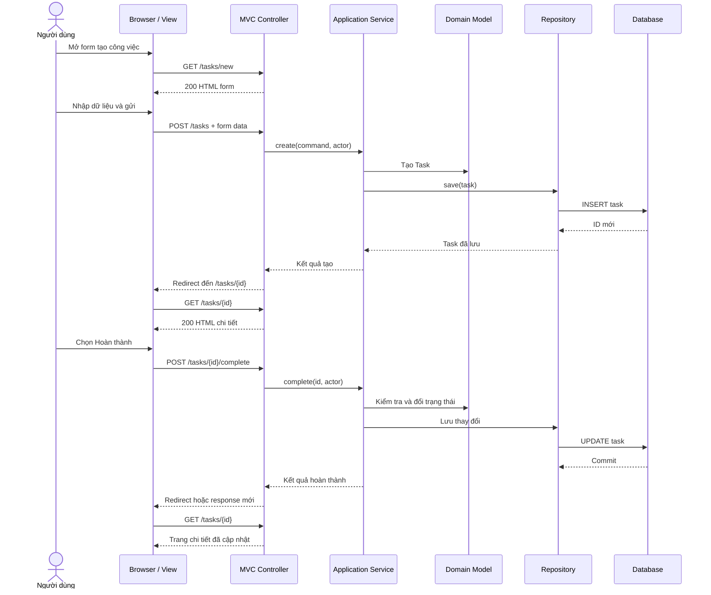

# Kiểm thử luồng người dùng xuyên suốt

Một chức năng MVC chỉ thực sự hoàn thành khi người dùng có thể đi qua toàn bộ hành trình của nó: mở màn hình, nhập dữ liệu, gửi biểu mẫu, nhận phản hồi, xem kết quả và tiếp tục thao tác. Một unit test cho Service có thể chứng minh quy tắc nghiệp vụ hoạt động, nhưng chưa cho biết URL có được ánh xạ đúng, form có bind đúng trường, CSRF có được xử lý, redirect có dẫn đến trang mong muốn hay dữ liệu có thực sự được lưu.

**Kiểm thử luồng người dùng xuyên suốt** (end-to-end user flow testing) xác nhận một hành trình có ý nghĩa từ điểm bắt đầu mà người dùng nhìn thấy đến kết quả cuối cùng mà họ quan sát được. Trong ứng dụng Model–View–Controller (MVC), hành trình đó thường đi qua View, Controller, Application Service, Model, Repository, cơ sở dữ liệu và quay trở lại response HTML hoặc JSON.

Bài học dùng một ứng dụng quản lý công việc làm ví dụ. Người dùng đăng nhập, tạo công việc, xem chi tiết, hoàn thành công việc và xác nhận trạng thái mới. Ta sẽ phân biệt các mức kiểm thử, xây dựng một bài kiểm thử MVC tích hợp bằng Spring MockMvc, rồi kiểm tra tương tác trình duyệt thật bằng Playwright.

## 1. Một luồng người dùng xuyên suốt gồm những gì?

Hãy xem hành trình tạo và hoàn thành công việc:

1. Người dùng mở trang danh sách công việc.
2. Chọn **Tạo công việc** để mở biểu mẫu.
3. Nhập tiêu đề và mô tả rồi gửi form.
4. Server kiểm tra dữ liệu, tạo công việc và chuyển hướng đến trang chi tiết.
5. Người dùng xem nội dung đã lưu.
6. Chọn **Hoàn thành**.
7. Server kiểm tra quyền và trạng thái, cập nhật Model, lưu dữ liệu.
8. Trang chi tiết hiển thị trạng thái hoàn thành.

Luồng này chạm đến nhiều ranh giới:

| Ranh giới | Điều cần xác nhận |
|---|---|
| Browser → View | Điều khiển hiển thị, nhãn và trạng thái có thể thao tác |
| View → Controller | URL, HTTP method và dữ liệu form đúng hợp đồng |
| Controller → Service | Tham số, danh tính người dùng và hành động được truyền đúng |
| Service → Model | Quy tắc nghiệp vụ và chuyển trạng thái được áp dụng |
| Model/Repository → Database | Dữ liệu được lưu bền vững và nhất quán |
| Controller → Response | Status, redirect, header, View hoặc JSON đúng |
| Response → Browser | Người dùng nhìn thấy kết quả và có thể tiếp tục hành trình |



Một bài kiểm thử xuyên suốt không nhất thiết phải xác minh mọi dòng code ở từng tầng. Nó cần chứng minh hành trình quan trọng hoạt động qua các ranh giới thực tế và dữ liệu cuối cùng đúng.

## 2. Phân biệt unit test, integration test và end-to-end test

Không nên dùng một loại test duy nhất để kiểm tra mọi thứ. Mỗi mức có chi phí và khả năng phát hiện lỗi khác nhau.

| Mức kiểm thử | Phạm vi | Công cụ Java/Spring thường dùng | Lỗi có thể phát hiện |
|---|---|---|---|
| Unit test | Một lớp hoặc một hành vi nhỏ | JUnit, Mockito, AssertJ | Quy tắc nghiệp vụ, nhánh điều kiện, chuyển trạng thái |
| MVC slice test | Controller và hạ tầng Spring MVC cần thiết | `@WebMvcTest`, MockMvc | Route, binding, validation, status, View, JSON |
| Integration test | Nhiều lớp cùng chạy với database hoặc dependency thật/giả lập | `@SpringBootTest`, Testcontainers, MockMvc | Mapping, transaction, repository, migration, bảo mật |
| Browser E2E test | Ứng dụng chạy thật qua trình duyệt | Playwright, Selenium | JavaScript, điều hướng, form, focus, render và hành trình người dùng |

### Unit test vẫn cần thiết

Unit test cho `Task.complete()` có thể kiểm tra công việc đang thực hiện chuyển sang hoàn thành và công việc đã hủy bị từ chối. Test chạy nhanh, dễ bao phủ nhiều trường hợp biên.

### MVC slice test kiểm tra ranh giới web

`@WebMvcTest` chỉ nạp phần MVC cần thiết và thường mock Service. Nó phù hợp để xác nhận Controller nhận request, bind dữ liệu và tạo response đúng. Vì Service/repository thường được mock, test này không chứng minh dữ liệu đã được ghi vào database thật.

### Integration test kiểm tra nhiều lớp cùng phối hợp

`@SpringBootTest` kết hợp MockMvc có thể nạp ứng dụng Spring đầy đủ, gọi qua DispatcherServlet và chạy Service/Repository thật. Nếu dùng database kiểm thử tương thích với production, test có thể xác nhận dữ liệu được commit và đọc lại.

### Browser E2E test xác nhận trải nghiệm thực

MockMvc không chạy trình duyệt, CSS hoặc JavaScript. Browser E2E test mở ứng dụng bằng trình duyệt thật, thao tác theo nhãn và vai trò truy cập, rồi quan sát trang sau mỗi hành động. Đây là mức gần với hành vi người dùng nhất nhưng cũng chậm và dễ bị ảnh hưởng bởi môi trường hơn.

Một bộ kiểm thử cân bằng thường có nhiều unit test, một số MVC/integration test cho các ranh giới quan trọng và một tập E2E nhỏ cho các hành trình có giá trị cao.

## 3. Chọn hành trình có giá trị để kiểm thử

Không cần viết một E2E test cho mọi tổ hợp dữ liệu. Hãy bắt đầu từ các hành trình quan trọng với sản phẩm và rủi ro của chúng.

Ví dụ cho ứng dụng quản lý công việc:

| Hành trình | Vì sao quan trọng | Kết quả cần xác nhận |
|---|---|---|
| Tạo công việc hợp lệ | Luồng tạo dữ liệu cốt lõi | Công việc được lưu và trang chi tiết hiển thị đúng |
| Gửi form thiếu tiêu đề | Kiểm tra trải nghiệm validation | Có lỗi ở trường tiêu đề, dữ liệu không hợp lệ không được lưu |
| Hoàn thành công việc | Kiểm tra chuyển trạng thái | Trạng thái cuối là `COMPLETED` |
| Người không có quyền sửa công việc | Kiểm tra phân quyền | Request bị từ chối, dữ liệu không đổi |
| Công việc không tồn tại | Kiểm tra lỗi tài nguyên | Trang hoặc API trả kết quả `404` theo hợp đồng |
| Hai người cùng sửa | Kiểm tra xung đột | Không ghi đè dữ liệu mới bằng bản cũ |

Ưu tiên các luồng tạo hoặc thay đổi dữ liệu, xác thực/phân quyền, thanh toán hoặc hành động khó đảo ngược, cùng những chức năng có nhiều lớp phối hợp. Những phép tính nhỏ và các biến thể đầu vào có thể được kiểm tra ở unit test thay vì lặp lại bằng trình duyệt.

## 4. Viết kịch bản theo góc nhìn người dùng

Một kịch bản tốt mô tả điều kiện ban đầu, hành động và kết quả quan sát được. Có thể dùng cấu trúc **Given – When – Then**:

```text
Given: Người dùng Alice đã đăng nhập và có quyền tạo công việc trong dự án.
When: Alice mở form, nhập tiêu đề "Chuẩn bị báo cáo" và gửi.
Then: Công việc được tạo, trình duyệt chuyển đến trang chi tiết và tiêu đề được hiển thị.

When: Alice chọn "Hoàn thành".
Then: Trạng thái công việc được lưu là COMPLETED và trang hiển thị trạng thái hoàn thành.
```

Kịch bản cần nói rõ kết quả có thể quan sát hoặc kiểm chứng. Chỉ kiểm tra rằng một nút đã được nhấn là chưa đủ; cần xác nhận trạng thái cuối hoặc response đúng.

Một kịch bản không nên phụ thuộc vào chi tiết triển khai như tên method nội bộ, thứ tự gọi repository hoặc cấu trúc DOM không có ý nghĩa với người dùng. Những chi tiết đó thuộc unit test hoặc test tích hợp chuyên biệt.

## 5. Kiểm thử luồng MVC bằng Spring MockMvc và database thật

MockMvc thực hiện request qua hạ tầng Spring MVC trong cùng tiến trình kiểm thử. Khi kết hợp `@SpringBootTest`, Controller, Service, Repository và cấu hình MVC có thể hoạt động như ứng dụng thật, trong khi không cần mở cổng HTTP.

Ví dụ dưới đây giả định ứng dụng có:

- `POST /tasks` nhận form `title` và `description`, sau khi tạo thành công sẽ redirect đến `/tasks/{id}`.
- `GET /tasks/{id}` kết xuất template `tasks/detail`.
- `POST /tasks/{id}/complete` hoàn thành công việc rồi redirect.
- Spring Security bật xác thực và CSRF cho request thay đổi dữ liệu.
- `TaskRepository` có thể đọc lại dữ liệu đã lưu.

```java
@SpringBootTest
@AutoConfigureMockMvc
class TaskJourneyMvcIT {

    @Autowired
    MockMvc mockMvc;

    @Autowired
    TaskRepository taskRepository;

    @Test
    @WithMockUser(username = "alice", roles = "USER")
    void userCreatesViewsAndCompletesTask() throws Exception {
        String title = "task-" + UUID.randomUUID();

        MvcResult createResult = mockMvc.perform(post("/tasks")
                        .with(csrf())
                        .contentType(MediaType.APPLICATION_FORM_URLENCODED)
                        .param("title", title)
                        .param("description", "Tài liệu cần được chuẩn bị"))
                .andExpect(status().is3xxRedirection())
                .andReturn();

        String redirectedUrl = createResult.getResponse().getRedirectedUrl();
        assertThat(redirectedUrl).isNotNull();
        String detailPath = URI.create(redirectedUrl).getPath();
        long taskId = Long.parseLong(
                detailPath.substring(detailPath.lastIndexOf('/') + 1));

        mockMvc.perform(get(detailPath))
                .andExpect(status().isOk())
                .andExpect(view().name("tasks/detail"))
                .andExpect(content().string(containsString(title)));

        mockMvc.perform(post("/tasks/{id}/complete", taskId)
                        .with(csrf()))
                .andExpect(status().is3xxRedirection());

        Task saved = taskRepository.findById(taskId).orElseThrow();
        assertThat(saved.getStatus()).isEqualTo(TaskStatus.COMPLETED);

        mockMvc.perform(get(detailPath))
                .andExpect(status().isOk())
                .andExpect(view().name("tasks/detail"));
    }
}
```

Đây là ví dụ khung; tên route, form field, template và enum cần khớp với ứng dụng. Test dùng `@WithMockUser` để tạo danh tính Spring Security và `.with(csrf())` cho các request POST. Nếu Controller nhận một principal tùy chỉnh như `AppUserPrincipal`, hãy dùng `@WithUserDetails`, custom `WithSecurityContext` hoặc request post-processor cung cấp đúng kiểu principal đó.

`status().is3xxRedirection()` phù hợp khi hợp đồng chỉ yêu cầu redirect. Nếu ứng dụng quy định cụ thể `303 See Other`, hãy kiểm tra chính xác status đó. Redirect sau POST thường được dùng trong mẫu Post/Redirect/Get để refresh trang kết quả không gửi lại form.

Test không gắn `@Transactional` ở cấp phương thức. Điều này giúp request đi qua transaction của Service và commit như một request bình thường; sau đó repository có thể đọc lại dữ liệu đã lưu. Để giữ test độc lập, hãy dùng database riêng cho test, dữ liệu định danh duy nhất và bước dọn dữ liệu rõ ràng. Không dùng chung database production.

## 6. Kiểm thử nhánh validation của biểu mẫu

Luồng xuyên suốt cần kiểm tra cả trường hợp người dùng nhập sai. Với form HTML, validation thường trả lại template cùng lỗi trường thay vì tạo dữ liệu.

```java
@Test
@WithMockUser(username = "alice", roles = "USER")
void invalidTitleReturnsFormWithFieldError() throws Exception {
    mockMvc.perform(post("/tasks")
                    .with(csrf())
                    .contentType(MediaType.APPLICATION_FORM_URLENCODED)
                    .param("title", " ")
                    .param("description", "Mô tả"))
            .andExpect(status().isOk())
            .andExpect(view().name("tasks/form"))
            .andExpect(model().attributeHasFieldErrors("form", "title"));
}
```

Test này kiểm tra ranh giới Controller–View: request được bind, validation được chạy và lỗi được đưa vào model. Để chứng minh không có dữ liệu sai được lưu, có thể kiểm tra repository theo dữ liệu định danh của test hoặc dùng một database test được làm sạch giữa các test. Tránh dựa vào tổng số bản ghi toàn hệ thống nếu các test có thể chạy song song.

Với API JSON, kiểm tra status và schema lỗi thay vì tên template:

```java
mockMvc.perform(post("/api/tasks")
        .with(csrf())
        .contentType(MediaType.APPLICATION_JSON)
        .content("""
            {"title":" ","description":"Mô tả"}
            """))
    .andExpect(status().isBadRequest())
    .andExpect(jsonPath("$.code").value("VALIDATION_FAILED"))
    .andExpect(jsonPath("$.errors[0].field").value("title"));
```

## 7. Kiểm tra dữ liệu bền vững, không chỉ response

Một endpoint có thể trả redirect hoặc `200 OK` nhưng không lưu dữ liệu đúng. Vì vậy, với hành trình thay đổi dữ liệu, nên kiểm tra ít nhất một kết quả ở tầng lưu trữ hoặc truy vấn lại qua endpoint đọc.

Có ba cách xác nhận thường dùng:

1. **Đọc qua repository:** phù hợp với integration test cần xác nhận trạng thái database.
2. **Gửi GET tiếp theo:** xác nhận dữ liệu mà ứng dụng trình bày cho người dùng sau khi thao tác.
3. **Kiểm tra side effect có kiểm soát:** xác nhận sự kiện outbox, email giả lập hoặc thông điệp được phát đúng theo hợp đồng.

Không nên chỉ xác nhận Service mock đã được gọi. Một MVC slice test có thể xác nhận Controller gọi đúng Service, nhưng để kiểm tra lưu trữ thật cần một integration test dùng repository và database.

Với dữ liệu cần bền vững qua nhiều request, hãy để các request đi qua transaction thông thường và đọc lại sau khi thao tác kết thúc. Một test được bao bởi transaction ngoài có thể khiến thao tác trong request tham gia cùng transaction kiểm thử, làm mờ ranh giới commit. Hãy chọn transaction test có chủ đích và hiểu cách framework quản lý transaction trong từng loại test.

## 8. Kiểm thử luồng qua trình duyệt thật

MockMvc không thực thi JavaScript hoặc layout trong browser. Để xác nhận người dùng thực sự có thể thao tác, dùng công cụ browser automation như Playwright hoặc Selenium.

Ví dụ Playwright Java minh họa một hành trình tạo công việc:

```java
class TaskJourneyE2ETest {

    @Test
    void userCreatesTaskThroughBrowser() {
        try (Playwright playwright = Playwright.create()) {
            Browser browser = playwright.chromium().launch(
                    new BrowserType.LaunchOptions().setHeadless(true));
            BrowserContext context = browser.newContext();
            Page page = context.newPage();

            String baseUrl = System.getProperty(
                    "app.baseUrl", "http://localhost:8080");
            String title = "task-" + UUID.randomUUID();

            page.navigate(baseUrl + "/login");
            page.getByLabel("Tên đăng nhập").fill("e2e-user");
            page.getByLabel("Mật khẩu").fill(
                    System.getenv("E2E_USER_PASSWORD"));
            page.getByRole(AriaRole.BUTTON,
                    new Page.GetByRoleOptions().setName("Đăng nhập")).click();

            page.waitForURL("**/tasks");
            page.getByRole(AriaRole.LINK,
                    new Page.GetByRoleOptions().setName("Tạo công việc")).click();
            page.getByLabel("Tiêu đề").fill(title);
            page.getByLabel("Mô tả").fill("Tạo qua trình duyệt thật");
            page.getByRole(AriaRole.BUTTON,
                    new Page.GetByRoleOptions().setName("Lưu")).click();

            page.waitForURL("**/tasks/*");
            PlaywrightAssertions.assertThat(
                    page.getByRole(AriaRole.HEADING,
                            new Page.GetByRoleOptions().setName(title)))
                    .isVisible();

            browser.close();
        }
    }
}
```

Ví dụ giả định ứng dụng đã được khởi động bằng test profile, đăng nhập thành công sẽ chuyển đến `/tasks`, tài khoản `e2e-user` được tạo trong database kiểm thử và biến môi trường `E2E_USER_PASSWORD` được cấp an toàn. Tên nhãn, route và tiêu đề phải khớp giao diện thật. Các import và dependency Playwright cần được bổ sung trong module test tương ứng.

Playwright cho phép tìm điều khiển theo role và label. Cách này thường bền hơn selector dựa trên cấu trúc DOM hoặc class CSS nội bộ, đồng thời khuyến khích giao diện có tên truy cập phù hợp. `waitForURL` và assertion trên trạng thái hiển thị chờ điều kiện thực tế; tránh dùng `Thread.sleep()` để đoán khi nào trang tải xong.

### Khi nào cần kiểm thử trình duyệt?

Browser E2E đặc biệt hữu ích khi hành trình phụ thuộc vào:

- JavaScript validation hoặc cập nhật giao diện bất đồng bộ.
- Menu, modal, tab, drag-and-drop hoặc tương tác nhiều bước.
- Điều hướng, cookie, session và redirect thực tế.
- Focus, bàn phím, thông báo động và khả năng truy cập.
- Cách HTML/CSS hiển thị trên trình duyệt mục tiêu.

Không cần đưa mọi trường hợp validation hoặc mọi giá trị biên vào browser test. Hãy giữ E2E tập trung vào một số hành trình quan trọng, còn chi tiết validation và logic có thể kiểm tra nhanh hơn ở MVC/integration/unit test.

## 9. Kiểm thử bảo mật trong hành trình người dùng

Một hành trình thành công với người dùng hợp lệ chưa chứng minh ứng dụng an toàn. Cần kiểm tra các nhánh liên quan đến danh tính và quyền.

Ví dụ:

- Người chưa đăng nhập mở trang được bảo vệ phải được yêu cầu xác thực.
- Người dùng thường không thể truy cập hành động chỉ dành cho quản trị viên.
- Người dùng A không thể sửa công việc thuộc phạm vi riêng của người dùng B chỉ bằng cách đổi ID trên URL.
- Request POST thiếu CSRF token bị từ chối khi ứng dụng dùng cookie session và CSRF protection.
- Response không để lộ dữ liệu của tài nguyên mà người dùng không có quyền xem.

MockMvc có thể kiểm tra security filter chain với Spring Security Test:

```java
@Test
@WithMockUser(username = "bob", roles = "USER")
void userCannotCompleteAnotherUsersTask() throws Exception {
    mockMvc.perform(post("/tasks/{id}/complete", taskOwnedByAlice)
                    .with(csrf()))
            .andExpect(status().isForbidden());

    Task unchanged = taskRepository.findById(taskOwnedByAlice).orElseThrow();
    assertThat(unchanged.getStatus()).isEqualTo(TaskStatus.IN_PROGRESS);
}
```

Test giả định `taskOwnedByAlice` đã được tạo bởi fixture và chính sách ứng dụng trả `403`. Một ứng dụng có thể trả `404` để không tiết lộ sự tồn tại của tài nguyên; test phải khớp chính sách đã công bố. Nếu endpoint chỉ cho phép một role cụ thể, hãy kiểm tra cả trường hợp role hợp lệ và không hợp lệ.

Không chỉ kiểm tra nút bị ẩn trong View. Quyền phải được xác minh ở server trên mỗi request và theo tài nguyên cụ thể.

## 10. Kiểm thử lỗi và khả năng phục hồi của luồng

Hành trình người dùng cần tiếp tục xử lý hợp lý khi có lỗi:

| Tình huống | Hành vi mong đợi |
|---|---|
| Validation thất bại | Giữ dữ liệu đã nhập, chỉ rõ trường sai, không tạo bản ghi |
| Session hết hạn khi gửi form | Chuyển đến đăng nhập hoặc trả `401` theo hợp đồng |
| Tài nguyên bị xóa bởi người khác | Hiển thị không tìm thấy hoặc thông báo phù hợp |
| Trạng thái thay đổi đồng thời | Báo xung đột, cho phép tải lại dữ liệu |
| Dịch vụ phụ thuộc tạm thời lỗi | Hiển thị lỗi có thể hiểu, không báo thành công giả |
| Người dùng nhấn gửi nhiều lần | UI phản hồi rõ; server không tạo hiệu lực trùng nếu hành động cần idempotency |

Test nên xác nhận cả phản hồi và dữ liệu sau lỗi. Ví dụ, khi hoàn thành một công việc đã hủy, response có thể là `409 Conflict`, nhưng quan trọng hơn là trạng thái lưu trữ vẫn là `CANCELLED` và không phát sinh side effect hoàn thành.

Với tác vụ bất đồng bộ, cần chờ trạng thái hoàn tất bằng polling có giới hạn hoặc đợi sự kiện test hook. Không dùng sleep dài cố định. Với email hoặc webhook, dùng SMTP sink, WireMock hoặc fake adapter để kiểm tra số lần gửi và nội dung mà không gọi dịch vụ production.

## 11. Chuẩn bị dữ liệu kiểm thử đáng tin cậy

Một E2E test thường cần người dùng, dự án, quyền và tài nguyên ban đầu. Nếu dữ liệu phụ thuộc vào test chạy trước, thứ tự test hoặc database dùng chung, kết quả sẽ không ổn định.

Các nguyên tắc hữu ích:

- Tạo fixture qua factory hoặc API setup rõ ràng.
- Với browser E2E, có thể chuẩn bị người dùng và dữ liệu nền bằng fixture hoặc API test riêng; chỉ hành động thuộc hành trình đang kiểm thử mới cần thực hiện qua giao diện.
- Dùng ID và tên duy nhất, chẳng hạn UUID, để tránh va chạm giữa các lần chạy.
- Seed dữ liệu cần thiết trước mỗi test hoặc dùng database riêng cho từng suite.
- Làm sạch dữ liệu sau test bằng transaction, truncate có kiểm soát hoặc database dùng một lần.
- Dùng migration thật để schema kiểm thử giống production.
- Tránh phụ thuộc vào dữ liệu mẫu ngẫu nhiên hoặc môi trường cá nhân.
- Không dùng tài khoản, token hoặc dữ liệu khách hàng production trong test.

Với Spring Boot, Testcontainers có thể khởi tạo PostgreSQL hoặc hệ quản trị tương ứng trong quá trình kiểm thử. Dùng đúng loại database với production giúp phát hiện khác biệt về SQL, kiểu dữ liệu, collation và transaction mà H2 có thể không tái hiện.

Ví dụ khái quát:

```java
@Testcontainers
@SpringBootTest
@AutoConfigureMockMvc
class TaskJourneyDatabaseIT {

    @Container
    static PostgreSQLContainer<?> database =
            new PostgreSQLContainer<>("postgres:16-alpine");

    @DynamicPropertySource
    static void configureDatabase(DynamicPropertyRegistry registry) {
        registry.add("spring.datasource.url", database::getJdbcUrl);
        registry.add("spring.datasource.username", database::getUsername);
        registry.add("spring.datasource.password", database::getPassword);
    }
}
```

Đoạn mã chỉ minh họa cấu hình container; dependency Testcontainers, driver JDBC và chiến lược migration phải được khai báo trong dự án. Phiên bản image nên được pin theo chính sách cập nhật của nhóm. Không dùng `latest` cho test cần tái lập.

## 12. Cô lập test và tránh phụ thuộc thứ tự chạy

E2E test có thể chạy song song trong CI. Nếu hai test cùng sửa một tài khoản hoặc cùng dùng một tên công việc cố định, chúng có thể gây xung đột.

Hãy bảo đảm:

- Mỗi test sở hữu dữ liệu riêng hoặc có namespace riêng.
- Test không phụ thuộc test trước đã đăng nhập hoặc tạo dữ liệu.
- Browser context/session được tạo riêng cho mỗi test.
- Database cleanup không xóa dữ liệu của test đang chạy song song.
- Test không dùng cổng, file hoặc queue dùng chung nếu không có cơ chế cô lập.
- Test thất bại vẫn thu thập được log, screenshot và trace để chẩn đoán.

Đừng dùng `@DirtiesContext` sau mọi test để giải quyết vấn đề dữ liệu. Nó làm khởi tạo lại Spring context tốn thời gian và che khuất việc quản lý fixture. Chỉ dùng khi test thực sự làm thay đổi trạng thái context không thể khôi phục theo cách khác.

## 13. Làm cho browser test ổn định

Test E2E dễ thất bại ngẫu nhiên nếu dựa vào timing hoặc selector mong manh.

**Chờ điều kiện, không chờ thời gian.** Dùng `waitForURL`, assertion về visibility, response hoặc trạng thái ứng dụng thay cho `sleep` cố định.

**Dùng selector có ý nghĩa.** Ưu tiên role, label và accessible name. Nếu cần `data-testid`, dùng cho thành phần không có định danh truy cập phù hợp và giữ tên ổn định.

**Tránh phụ thuộc thứ tự hiển thị không cần thiết.** Tìm bản ghi theo tiêu đề duy nhất thay vì luôn chọn dòng đầu tiên.

**Kiểm soát dữ liệu và thời gian.** Dùng dữ liệu cố định, clock có thể điều khiển ở test tích hợp khi nghiệp vụ phụ thuộc thời gian, và tránh phụ thuộc múi giờ máy chạy CI.

**Ghi lại bằng chứng khi thất bại.** Thu thập screenshot, trace, console log và request thất bại. Bằng chứng giúp phân biệt lỗi ứng dụng, lỗi test và lỗi môi trường.

**Giữ test ngắn và có mục đích.** Một test dài 30 bước rất khó tìm điểm hỏng. Có thể chia hành trình thành các scenario độc lập, mỗi scenario bắt đầu từ fixture rõ ràng.

## 14. Kiểm tra accessibility trong hành trình

Luồng người dùng không chỉ dành cho thao tác chuột. Một số kiểm tra có thể đưa vào E2E:

- Có thể điều hướng form bằng bàn phím và submit bằng Enter.
- Mỗi input có label được liên kết.
- Nút có tên truy cập mô tả hành động.
- Lỗi validation được liên kết với trường tương ứng.
- Khi mở dialog, focus đi vào dialog và khi đóng được trả về điều khiển đã mở.
- Thông báo thành công hoặc lỗi động được công nghệ hỗ trợ nhận biết.
- Focus không bị mất khi View cập nhật một phần.

Browser test không thay thế đánh giá accessibility chuyên sâu, nhưng có thể kiểm tra các hành vi thiết yếu trong những hành trình quan trọng.

## 15. Kiểm thử hiệu năng của một hành trình

Một luồng có thể đúng về chức năng nhưng chậm đến mức người dùng không thể hoàn thành. Sau khi hành trình ổn định, có thể đo các điểm quan trọng:

- Thời gian mở form và danh sách.
- Thời gian phản hồi sau khi gửi form.
- Thời gian tải trang chi tiết sau redirect.
- Số truy vấn SQL trong request.
- Thời gian p50/p95/p99 khi có tải đại diện.
- Thời gian chờ các dependency bên ngoài.

Không nên dùng browser E2E đơn lẻ làm benchmark tải. Kiểm thử tải cần công cụ chuyên dụng, dữ liệu đại diện và môi trường kiểm soát. E2E có thể xác nhận ngân sách thời gian cho một số thao tác quan trọng và phát hiện hồi quy lớn.

## 16. Tổ chức bộ test trong dự án MVC

Một cấu trúc tham khảo:

```text
src/test/java/com/example/
  domain/
    TaskTest.java
  application/
    TaskServiceTest.java
  web/
    TaskControllerWebTest.java
  integration/
    TaskJourneyMvcIT.java
    TaskRepositoryIT.java
  support/
    TaskTestDataFactory.java
    SecurityTestSupport.java

e2e/
  task-journey.spec.ts
```

Tên thư mục chỉ là gợi ý. Có thể dùng JUnit và Playwright Java trong cùng dự án hoặc tách browser suite ra thư mục riêng. Điều quan trọng là phân biệt rõ test nào mock Service, test nào dùng database thật và test nào mở trình duyệt.

Một pipeline CI thường có thể chạy theo thứ tự:

1. Compile và unit test nhanh.
2. MVC slice test cho route, binding, validation và security.
3. Integration test với database/container.
4. Browser E2E cho một số hành trình chính.
5. Thu thập báo cáo, screenshot và trace nếu có lỗi.

Không nhất thiết phải chạy browser suite cho mọi commit nếu chi phí cao; có thể chạy smoke E2E trên pull request và bộ đầy đủ theo lịch hoặc trước phát hành. Tuy nhiên, các luồng cốt lõi cần được bảo vệ thường xuyên.

## 17. Những lỗi thường gặp khi kiểm thử luồng người dùng

| Lỗi | Hệ quả | Cách cải thiện |
|---|---|---|
| Chỉ kiểm tra nút hoặc method đã được gọi | Không chứng minh người dùng nhận được kết quả đúng | Kiểm tra response, trang tiếp theo và dữ liệu cuối |
| Dùng toàn mock trong test gọi là end-to-end | Không kiểm tra tích hợp thật giữa các lớp | Gọi qua MVC với Service/Repository thật cho luồng cần xác nhận |
| Chỉ dùng MockMvc cho JavaScript flow | Không phát hiện lỗi trình duyệt, focus hoặc JS | Bổ sung browser E2E có chọn lọc |
| Dùng database H2 dù production dùng PostgreSQL mà không kiểm tra khác biệt | Bỏ sót lỗi SQL, kiểu dữ liệu và transaction | Dùng Testcontainers với engine tương thích |
| Bao test bằng transaction ngoài nhưng muốn kiểm tra commit | Kết quả có thể chưa phản ánh ranh giới commit thật | Để request dùng transaction riêng và dọn fixture rõ ràng |
| Dữ liệu test cố định và dùng chung | Test chạy song song gây xung đột | Tạo fixture riêng và ID duy nhất |
| Dùng `Thread.sleep()` | Test chậm và vẫn có thể race | Chờ URL, response hoặc điều kiện giao diện |
| Selector dựa trên class CSS nội bộ | Thay đổi giao diện nhỏ làm test hỏng | Dùng role, label hoặc test ID có chủ đích |
| Chỉ test happy path | Không phát hiện lỗi validation, quyền và xung đột | Thêm scenario lỗi có rủi ro cao |
| Gọi dịch vụ ngoài thật trong CI | Test chập chờn, tốn chi phí và có thể gây side effect | Dùng WireMock, fake adapter hoặc sandbox riêng |

## 18. Quy trình xây dựng một bài kiểm thử xuyên suốt

Khi thêm một chức năng MVC, có thể thực hiện theo các bước:

1. Mô tả hành trình từ góc nhìn người dùng bằng Given–When–Then.
2. Xác định điểm bắt đầu, hành động, response và trạng thái cuối cần xác nhận.
3. Liệt kê các ranh giới MVC được đi qua và rủi ro ở từng ranh giới.
4. Viết unit test cho quy tắc Model và Service.
5. Viết MVC test cho route, binding, validation, status, redirect và error contract.
6. Viết integration test dùng database phù hợp để xác nhận dữ liệu bền vững.
7. Viết một browser E2E cho hành trình cốt lõi nếu giao diện hoặc JavaScript có ảnh hưởng đáng kể.
8. Thêm scenario quan trọng cho phân quyền, lỗi và xung đột.
9. Chuẩn bị fixture độc lập, dữ liệu duy nhất và cleanup an toàn.
10. Chạy test trong CI, lưu bằng chứng khi thất bại và theo dõi thời gian chạy.

Kiểm thử luồng người dùng xuyên suốt xác nhận các phần của MVC phối hợp để hoàn thành một công việc có ý nghĩa. Unit test bảo vệ quy tắc; MockMvc xác nhận hợp đồng web; integration test kiểm tra transaction và lưu trữ; browser E2E chứng minh người dùng có thể thao tác qua giao diện thật. Khi mỗi test có phạm vi rõ, dữ liệu độc lập và kết quả được kiểm tra ở cả response lẫn trạng thái cuối, bộ kiểm thử sẽ phát hiện được lỗi tích hợp mà vẫn đủ nhanh và ổn định để chạy thường xuyên.
