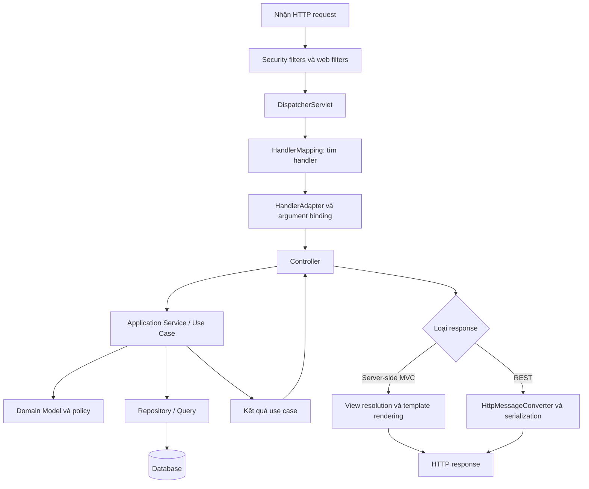
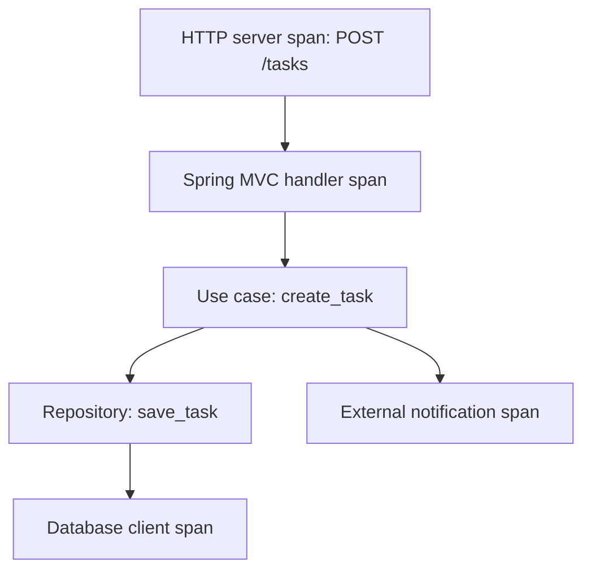

# Đo thời gian định tuyến, nghiệp vụ, truy vấn và kết xuất

Một request MVC có thể đi qua nhiều giai đoạn: máy chủ nhận request, bộ định tuyến tìm handler, Controller chuyển dữ liệu và gọi use case, dịch vụ nghiệp vụ đọc hoặc ghi dữ liệu, sau đó ứng dụng tạo response hoặc kết xuất View. Khi người dùng báo một trang chậm, chỉ biết tổng thời gian request chưa đủ để xác định nguyên nhân. Độ trễ có thể nằm ở bước tìm route, xử lý nghiệp vụ, chờ connection database, thực thi truy vấn, chuyển đổi dữ liệu hoặc render template.

Đo thời gian theo từng ranh giới giúp trả lời các câu hỏi cụ thể: endpoint nào chậm, use case nào chiếm nhiều thời gian, repository nào phát sinh truy vấn lâu, template nào tốn công kết xuất và request đang chờ ở đâu. Trong ứng dụng MVC, nên kết hợp metric ở cấp request, observation/trace ở các bước quan trọng và log có ngữ cảnh tương quan. Mỗi phép đo cần có định nghĩa rõ ràng về điểm bắt đầu, điểm kết thúc và phần công việc được bao gồm.

## Nhìn request như một chuỗi giai đoạn

Một request đồng bộ trong ứng dụng Spring MVC có thể được hình dung theo trình tự:



Các giai đoạn có thể lồng nhau. Ví dụ, thời gian application service bao gồm những repository call mà nó thực hiện; thời gian HTTP request bao gồm hầu hết các bước xử lý đồng bộ bên trong. Không cộng tất cả các số đo lại như thể chúng là những khoảng thời gian độc lập. Hãy dùng chúng để tìm phần chiếm thời gian trong một trace hoặc để so sánh xu hướng theo từng ranh giới.

| Phép đo | Khoảng thời gian cần quan sát | Câu hỏi được trả lời |
|---|---|---|
| HTTP request | Từ lúc server bắt đầu xử lý đến khi response hoàn tất theo instrumentation | Người dùng/API client phải chờ bao lâu? |
| Route mapping | Thời gian `HandlerMapping` tìm handler phù hợp | Việc chọn handler có bất thường hoặc tốn thời gian không? |
| Handler/Controller | Từ lúc handler được gọi đến khi xử lý handler kết thúc | Binding, Controller và các lời gọi đồng bộ mất bao lâu? |
| Business use case | Thời gian thực hiện một hành động ứng dụng | Use case nào là điểm nghẽn? |
| Repository/database | Thời gian chờ connection, thực thi truy vấn và lấy kết quả | Độ trễ nằm ở pool, database hay xử lý dữ liệu? |
| View rendering | Từ lúc Controller trả `ModelAndView` đến khi View được render xong | Template hoặc dữ liệu trình bày có chậm không? |
| Response serialization | Thời gian chuyển đối tượng thành JSON/XML hoặc ghi body | REST response có tốn thời gian chuyển đổi không? |

## Phân biệt metric, trace và log

Ba loại dữ liệu quan sát bổ sung cho nhau:

- **Metric** là số liệu tổng hợp theo thời gian, ví dụ số request mỗi giây, tỷ lệ lỗi, độ trễ p95 hoặc thời gian truy vấn trung bình. Metric phù hợp với dashboard, cảnh báo và phát hiện xu hướng.
- **Trace** ghi lại đường đi của một request qua nhiều thành phần bằng các span có quan hệ cha/con. Trace giúp tìm bước nào trong một request cụ thể chiếm nhiều thời gian và dịch vụ nào gây chậm.
- **Log** ghi lại sự kiện có ngữ cảnh, chẳng hạn route, mã lỗi, query timeout hoặc trạng thái use case. Log hỗ trợ điều tra chi tiết khi đã có trace ID hoặc correlation ID.

Ví dụ, metric cho thấy p95 của `POST /tasks` tăng từ 250 ms lên 1,8 giây. Trace của một request chậm cho thấy span `task.repository.save` mất 1,4 giây. Log có cùng trace ID cho biết database đang chờ lock. Metric phát hiện vấn đề; trace định vị bước chậm; log bổ sung lý do.

Không nên chọn một loại dữ liệu để thay thế hai loại còn lại. Log mọi request không phải cách thay thế metric; metric trung bình không đủ để điều tra một request cá biệt; trace không phù hợp để lưu mọi dữ liệu nghiệp vụ chi tiết.

## Bắt đầu từ thời gian HTTP request

HTTP request là phép đo tổng quan quan trọng nhất đối với ứng dụng web. Với Spring Boot có Actuator và Micrometer, Spring MVC có thể tự động ghi nhận metric server request như `http.server.requests`. Metric thường có các tag giới hạn như method, status, URI template, outcome và exception tùy phiên bản/cấu hình.

URI template là điều quan trọng: request `/tasks/42` và `/tasks/87` nên được nhóm dưới route `/tasks/{id}`. Nếu dùng URL thô làm tag, mỗi ID có thể tạo một chuỗi thời gian riêng, làm tăng cardinality và tiêu tốn bộ nhớ/chi phí hệ thống metric.

Các chỉ số request cơ bản cần theo dõi:

- số request và throughput theo route, method;
- tỷ lệ response thành công, lỗi client và lỗi server;
- thời gian phản hồi p50, p90, p95 và p99;
- số request đang xử lý;
- timeout, request bị hủy và lỗi kết nối;
- kích thước request/response nếu có ý nghĩa vận hành.

Không nên chỉ xem trung bình. Một endpoint có phần lớn request mất 50 ms nhưng một nhóm nhỏ mất 8 giây vẫn có thể tạo trải nghiệm xấu. Percentile giúp thấy phần đuôi phân phối. p95 là ngưỡng mà 95% quan sát có thời gian bằng hoặc thấp hơn; p99 thể hiện nhóm request chậm hơn nữa.

### Dùng metric HTTP có sẵn trước khi tự đo lại

Nếu Spring Boot Actuator đã cung cấp `http.server.requests`, hãy dùng metric này làm baseline. Tránh tạo một filter đo tổng request trùng lặp nếu chưa có nhu cầu rõ ràng. Một filter tự viết có thể đo thời gian từ vị trí filter được đăng ký đến lúc chain trả về, nhưng vị trí của filter quyết định nó có bao gồm Spring Security, proxy integration hoặc các filter khác hay không.

Nếu cần custom filter, có thể dùng `System.nanoTime()` để đo khoảng thời gian vì đây là đồng hồ monotonic phù hợp cho duration:

```java
@Component
public class RequestDurationFilter extends OncePerRequestFilter {
    private final MeterRegistry meterRegistry;

    public RequestDurationFilter(MeterRegistry meterRegistry) {
        this.meterRegistry = meterRegistry;
    }

    @Override
    protected void doFilterInternal(
            HttpServletRequest request,
            HttpServletResponse response,
            FilterChain filterChain) throws ServletException, IOException {

        long startedAt = System.nanoTime();
        try {
            filterChain.doFilter(request, response);
        } finally {
            long elapsed = System.nanoTime() - startedAt;
            Timer.builder("mvc.request.filter.duration")
                    .tag("method", request.getMethod())
                    .tag("status", Integer.toString(response.getStatus()))
                    .register(meterRegistry)
                    .record(elapsed, TimeUnit.NANOSECONDS);
        }
    }
}
```

Ví dụ chỉ đo thời gian trong phạm vi filter này. Nó không tự động đại diện cho toàn bộ thời gian từ lúc request rời trình duyệt đến khi người dùng nhận đủ dữ liệu; mạng, reverse proxy và client nằm ngoài phép đo. Trong triển khai thực tế, cần quyết định cách xử lý async dispatch, error dispatch và streaming response. `OncePerRequestFilter` có các hook cấu hình riêng cho async/error dispatch; không nên giả định `finally` ở lần dispatch đầu tiên bao trùm toàn bộ công việc bất đồng bộ.

## Đo thời gian định tuyến và xử lý handler

### Route mapping không giống thời gian Controller

Trong Spring MVC, `DispatcherServlet` hỏi các `HandlerMapping` để tìm handler phù hợp với request. Việc tìm handler xảy ra trước khi `HandlerInterceptor.preHandle()` được gọi. Vì vậy, thời gian từ `preHandle()` đến `postHandle()` không bao gồm thời gian route mapping.

Muốn đo riêng route mapping, cần instrument quanh lời gọi tìm handler của `HandlerMapping` hoặc dùng observation/span mà framework cung cấp ở đúng ranh giới đó. Một decorator/wrapper cho `HandlerMapping` có thể ghi thời gian của `getHandler(request)` và tag bằng loại mapping hoặc route pattern sau khi tìm được handler. Cách triển khai phải giữ nguyên thứ tự ưu tiên của các mapping và không làm thay đổi kết quả chọn handler.

Không nên suy ra “route mapping mất 20 ms” chỉ vì metric có tag `uri=/tasks/{id}`. Tag URI mô tả route đã khớp; nó không phải phép đo riêng thời gian tìm route.

### Đo handler bằng HandlerInterceptor

`HandlerInterceptor` có thể đo khoảng thời gian từ lúc handler sắp được gọi đến khi handler kết thúc. `preHandle()` chạy trước handler; `postHandle()` chạy sau khi handler xử lý xong nhưng trước khi render View; `afterCompletion()` chạy sau khi quá trình xử lý và render đồng bộ hoàn tất.

Ví dụ đơn giản cho request đồng bộ và server-side MVC:

```java
@Component
public class MvcTimingInterceptor implements HandlerInterceptor {
    private static final String START = "mvc.handler.startedAt";
    private static final String HANDLER_RECORDED = "mvc.handler.recorded";
    private static final String VIEW_START = "mvc.view.startedAt";

    private final MeterRegistry meterRegistry;

    public MvcTimingInterceptor(MeterRegistry meterRegistry) {
        this.meterRegistry = meterRegistry;
    }

    @Override
    public boolean preHandle(
            HttpServletRequest request,
            HttpServletResponse response,
            Object handler) {
        request.setAttribute(START, System.nanoTime());
        return true;
    }

    @Override
    public void postHandle(
            HttpServletRequest request,
            HttpServletResponse response,
            Object handler,
            ModelAndView modelAndView) {

        Object started = request.getAttribute(START);
        if (started instanceof Long startedAt) {
            recordHandlerDuration(handler, System.nanoTime() - startedAt, "success");
            request.setAttribute(HANDLER_RECORDED, Boolean.TRUE);
        }

        if (modelAndView != null) {
            request.setAttribute(VIEW_START, System.nanoTime());
        }
    }

    @Override
    public void afterCompletion(
            HttpServletRequest request,
            HttpServletResponse response,
            Object handler,
            Exception exception) {

        Object started = request.getAttribute(START);
        if (started instanceof Long startedAt
                && !Boolean.TRUE.equals(request.getAttribute(HANDLER_RECORDED))) {
            recordHandlerDuration(
                    handler,
                    System.nanoTime() - startedAt,
                    exception == null ? "success" : "error");
        }

        Object viewStarted = request.getAttribute(VIEW_START);
        if (viewStarted instanceof Long startedAt) {
            Timer.builder("mvc.view.render.duration")
                    .tag("outcome", exception == null ? "success" : "error")
                    .register(meterRegistry)
                    .record(System.nanoTime() - startedAt, TimeUnit.NANOSECONDS);
        }
    }

    private void recordHandlerDuration(
            Object handler, long elapsedNanos, String outcome) {
        String handlerType = handler instanceof HandlerMethod method
                ? method.getBeanType().getSimpleName()
                : "other";

        Timer.builder("mvc.handler.duration")
                .tag("handler", handlerType)
                .tag("outcome", outcome)
                .register(meterRegistry)
                .record(elapsedNanos, TimeUnit.NANOSECONDS);
    }
}
```

Đây là ví dụ minh họa; cần bổ sung import Spring MVC, Servlet, Micrometer và đăng ký interceptor qua `WebMvcConfigurer#addInterceptors`. `handlerType` là tên class có tập giá trị hữu hạn trong ứng dụng. Nếu tag bằng method, route pattern hoặc view name, hãy bảo đảm các giá trị đó đến từ mapping tĩnh và không chứa dữ liệu do người dùng kiểm soát.

Khoảng `preHandle()` đến `postHandle()` bao gồm argument binding, gọi Controller và các lời gọi đồng bộ mà Controller thực hiện, như application service và repository. Nó không phải thời gian thuần của method Controller. Vì vậy, hãy đặt metric riêng ở application service và repository để chia nhỏ phần đó.

Ví dụ trên chỉ phù hợp với request đồng bộ. Với async MVC (`Callable`, `DeferredResult`, streaming hoặc async dispatch), callback vòng đời có thể đi qua nhiều thread và nhiều lần dispatch; cần dùng `AsyncHandlerInterceptor`, observation context propagation hoặc instrumentation phù hợp với async lifecycle. Không dùng mẫu đồng bộ này để kết luận thời gian hoàn tất của tác vụ async.

## Đo thời gian nghiệp vụ ở Application Service

Application service là ranh giới tốt để đo một use case vì nó đại diện cho hành động ứng dụng như tạo công việc, hoàn thành đơn hàng hoặc phê duyệt yêu cầu. Đo ở đây cho biết người dùng đang chờ use case nào, đồng thời không gắn metric với một Controller cụ thể.

Có thể dùng `Timer` của Micrometer:

```java
@Service
public class CompleteTaskService {
    private final TaskRepository taskRepository;
    private final MeterRegistry meterRegistry;

    public CompleteTaskService(
            TaskRepository taskRepository,
            MeterRegistry meterRegistry) {
        this.taskRepository = taskRepository;
        this.meterRegistry = meterRegistry;
    }

    public void complete(CompleteTaskCommand command) {
        Timer.Sample sample = Timer.start(meterRegistry);
        String outcome = "success";

        try {
            Task task = taskRepository.findById(command.taskId())
                    .orElseThrow(TaskNotFoundException::new);
            task.complete();
            taskRepository.save(task);
        } catch (TaskRuleViolation ex) {
            outcome = "rejected";
            throw ex;
        } catch (RuntimeException ex) {
            outcome = "error";
            throw ex;
        } finally {
            sample.stop(Timer.builder("mvc.business.usecase.duration")
                    .tag("use_case", "complete_task")
                    .tag("outcome", outcome)
                    .register(meterRegistry));
        }
    }
}
```

Timer này đo toàn bộ use case, bao gồm repository call đồng bộ. Nếu cần biết phần nào chiếm thời gian, hãy đo thêm repository hoặc tạo trace span con. Không trừ một cách máy móc tổng query time khỏi business time vì các thao tác có thể lồng nhau hoặc chạy song song.

Tag `use_case` phải là tên cố định như `complete_task`, không dùng ID công việc, email, username hoặc tên khách hàng. `outcome` nên có số lượng giá trị hữu hạn như `success`, `rejected`, `not_found` hoặc `error`. Không đưa thông điệp exception tùy ý vào tag.

### Dùng Micrometer Observation để kết hợp metric và trace

`Observation` cung cấp một abstraction để ghi nhận một hoạt động; registry và các handler đã cấu hình có thể tạo timer, span hoặc cả hai. Ví dụ:

```java
public TaskDetails handle(GetTaskDetailsQuery query) {
    return Observation.createNotStarted(
                    "mvc.business.usecase", observationRegistry)
            .lowCardinalityKeyValue("use_case", "get_task_details")
            .observe(() -> taskRepository.findDetails(query.taskId())
                    .orElseThrow(TaskNotFoundException::new));
}
```

Tên observation và low-cardinality key/value nên ổn định qua các lần triển khai. Với Spring Boot và Micrometer Tracing, observation có thể được kết nối với hệ thống trace như OpenTelemetry/OTLP tùy cấu hình exporter và backend. Nếu chỉ cần metric, có thể dùng `Timer`; nếu cần cả đường đi request, hãy cấu hình tracing và propagation context.

## Đo thời gian truy vấn và persistence

Database có thể chiếm phần lớn thời gian use case, nhưng “thời gian database” không chỉ là thời gian chạy SQL. Một repository call có thể bao gồm:

- chờ lấy connection từ connection pool;
- chuẩn bị statement và bind parameter;
- thời gian database thực thi truy vấn;
- truyền dữ liệu qua mạng;
- đọc result set;
- ánh xạ row thành entity hoặc projection;
- lazy loading phát sinh thêm truy vấn;
- flush và đồng bộ thay đổi trước commit.

Nếu chỉ đo tổng thời gian repository method, ta biết method chậm nhưng chưa chắc biết chậm ở đâu. Khi cần điều tra, hãy phân biệt thời gian chờ pool, thời gian query, số row trả về, thời gian mapping và thời gian flush/commit.

### Đo ở repository boundary

Một cách đơn giản là đo từng phương thức repository có ý nghĩa nghiệp vụ:

```java
public Optional<Task> findById(TaskId id) {
    return Observation.createNotStarted(
                    "mvc.repository.find_task", observationRegistry)
            .lowCardinalityKeyValue("repository", "task")
            .observe(() -> jpaRepository.findById(id.value())
                    .map(mapper::toDomain));
}
```

Phép đo này bao gồm phần gọi Spring Data và mapper trong lambda. Nó không nhất thiết chỉ là thời gian SQL. Nếu cần phân tích sâu, dùng instrumentation ở JDBC/ORM hoặc tracing database để tạo span cho truy vấn thực tế.

### Theo dõi query count và N+1

Một trang danh sách có thể chỉ gọi một repository method nhưng ORM phát sinh nhiều SQL query do lazy loading trong vòng lặp. Vì vậy, ngoài latency cần theo dõi số query trên request hoặc use case, đặc biệt với màn hình có collection lồng nhau.

Ví dụ N+1: ứng dụng tải 50 công việc bằng một query, sau đó mỗi lần render lại truy cập `task.owner.name`, làm phát sinh thêm 50 query. Tổng thời gian tăng theo số bản ghi dù query ban đầu nhanh.

Các cách điều tra:

- bật thống kê query ở môi trường kiểm thử hoặc staging;
- dùng JDBC/ORM instrumentation hoặc datasource proxy để ghi nhận số lượng và thời gian query;
- xem execution plan cho truy vấn chậm;
- kiểm tra index, điều kiện lọc, sort và phân trang;
- dùng projection, fetch join hoặc entity graph có chủ đích để tránh lazy loading lặp;
- xác minh template không vô tình truy cập quan hệ lazy sau khi service trả về.

Không bật log toàn bộ SQL kèm parameter nhạy cảm ở production chỉ để tìm một vấn đề. Có thể dùng slow query log, sampling hoặc metric tổng hợp; khi cần log chi tiết, lọc dữ liệu và giới hạn thời gian.

### Không gắn SQL hoặc ID vào metric tag

Không dùng raw SQL, giá trị bind parameter, tên bảng động, `taskId`, `userId` hoặc tenant ID làm tag metric. Mỗi truy vấn hoặc ID có thể tạo một time series mới, gây cardinality rất cao và làm backend metric quá tải. Hãy dùng tên thao tác cố định như `find_task_by_id`, `list_tasks_page` hoặc loại repository.

Nếu cần biết truy vấn cụ thể nào chậm, dùng trace span, slow query log đã lọc hoặc công cụ database monitoring. Dữ liệu chi tiết có thể được sampling và giữ thời gian ngắn hơn metric tổng hợp.

## Đo thời gian kết xuất View

### Server-side rendering

Với server-side MVC, sau khi Controller trả về `ModelAndView`, Spring MVC chọn View và gọi renderer/template engine để tạo response body. Đây là giai đoạn riêng với việc thực thi handler. Template có thể chậm vì logic trình bày phức tạp, dữ liệu quá lớn, truy cập lazy relation hoặc cache template chưa nóng.

Trong luồng đồng bộ Spring MVC, `HandlerInterceptor.postHandle()` được gọi sau khi handler xử lý xong và trước khi View render; `afterCompletion()` được gọi sau khi quá trình dispatch/render hoàn tất. Vì vậy, chênh lệch giữa hai mốc có thể dùng làm ước lượng thời gian render cho response có `ModelAndView`, như ví dụ interceptor ở trên.

Đây là phép đo gần đúng của khoảng render trong DispatcherServlet, không nhất thiết là thời gian thuần của template engine. Nó có thể bao gồm view resolution, interceptor hoặc xử lý phụ quanh render. Nếu cần tách riêng template engine, hãy instrument `ViewResolver`, `View.render()` hoặc observation hook tương ứng với công nghệ template đang dùng.

Gắn tag bằng view name tĩnh như `tasks/detail` hoặc `orders/list`, không dùng tên do người dùng gửi hoặc dữ liệu trong model. Nếu view name có thể phát sinh vô hạn, chuẩn hóa về nhóm template.

### REST response không có View template

Với `@RestController` hoặc handler dùng `@ResponseBody`, Spring MVC thường chuyển đối tượng trả về thành JSON/XML thông qua `HttpMessageConverter` ngay trong quá trình handler adapter xử lý. `ModelAndView` thường là `null`, nên không có khoảng template render như server-side MVC.

Trong API, phần cần đo riêng có thể là serialization và ghi response body. Nếu đây là điểm nghẽn, instrument message converter hoặc dùng trace span ở tầng HTTP serialization. Đừng đặt tên metric này là `view.render` nếu nó thực chất đo JSON serialization.

### Kết xuất phía client

Nếu ứng dụng MVC trả HTML rồi trình duyệt thực hiện JavaScript, hydration hoặc tải tài nguyên, thời gian template phía server không phản ánh thời gian người dùng nhìn thấy nội dung hoàn chỉnh. Để đo trải nghiệm đầu cuối, cần thêm Real User Monitoring hoặc browser performance API ở client, với các chỉ số như navigation timing, Largest Contentful Paint và interaction latency. Các phép đo client cần được thu thập và bảo vệ dữ liệu theo chính sách riêng.

## Dùng trace để thấy quan hệ cha/con

Metric trả lời xu hướng; trace cho thấy một request cụ thể đã đi qua đâu. Một trace MVC có thể có cấu trúc:



Mỗi span có thời điểm bắt đầu, thời lượng, trạng thái và một số thuộc tính. Span con thường nằm trong khoảng thời gian của span cha. Nếu một request gọi nhiều dịch vụ song song, các span có thể chồng lấp; tổng thời gian span con vì thế có thể lớn hơn thời gian span cha.

Trong hệ sinh thái Spring, Micrometer Observation/Tracing có thể kết hợp với OpenTelemetry bridge/exporter và gửi trace đến backend tương thích OTLP. Có thể dùng OpenTelemetry Java agent để instrument một số thư viện tự động, hoặc instrument thủ công ở use case đặc biệt. Tránh tạo span cho mọi getter hoặc từng dòng code; chọn các ranh giới giúp trả lời câu hỏi vận hành.

### Context propagation

Trace ID và span ID cần được truyền qua các lời gọi đồng bộ và qua giao thức hỗ trợ propagation. Với HTTP service-to-service, W3C Trace Context thường được truyền qua header `traceparent` và `tracestate` theo cấu hình. Với message queue hoặc tác vụ bất đồng bộ, cần inject/extract context qua metadata của message hoặc tạo trace liên kết phù hợp.

Không lưu trace ID trong field mutable của Controller/service singleton. Dùng context propagation do Micrometer/OpenTelemetry cung cấp. Với thread pool tự quản lý hoặc `@Async`, xác minh context được truyền và dọn đúng cách; nếu không, trace có thể bị đứt hoặc gắn nhầm request.

### Sampling

Ghi mọi trace ở lưu lượng lớn có thể tốn dung lượng và chi phí. Sampling chọn một phần request để lưu trace chi tiết. Có thể ưu tiên giữ trace lỗi hoặc request chậm theo khả năng của backend/tail-based sampling. Dù sampling, metric tổng hợp vẫn nên ghi nhận toàn bộ hoặc theo chính sách metric để không bỏ sót xu hướng.

Không nên đặt sampling rate quá thấp mà không kiểm tra khả năng tìm request hiếm; cũng không cần giữ mọi payload. Trace attribute cần tránh thông tin cá nhân, token, nội dung biểu mẫu hoặc dữ liệu bí mật.

## Chọn metric có cardinality thấp

Metric backend lưu mỗi tổ hợp tên metric và tag như một time series. Nếu tag có hàng triệu giá trị khác nhau, cardinality tăng rất nhanh.

| Tag thường an toàn khi được chuẩn hóa | Tag không nên dùng |
|---|---|
| HTTP method (`GET`, `POST`) | Raw URL có ID hoặc query string |
| URI template (`/tasks/{id}`) | `taskId`, `userId`, `email` |
| Status code hoặc outcome | Exception message tùy ý |
| Use case cố định (`complete_task`) | Tên khách hàng hoặc dữ liệu request |
| Repository operation cố định | Raw SQL và bind parameter |
| View name từ tập template tĩnh | Tên tệp hoặc đường dẫn do người dùng gửi |
| Loại lỗi chuẩn hóa | Stack trace hoặc request body |

Nếu cần tra cứu một request cụ thể, dùng trace ID trong log hoặc trace backend. Không biến ID duy nhất thành metric tag.

## Đo phân phối và đặt mục tiêu độ trễ

Một `Timer` của Micrometer ghi nhận số lần đo và tổng thời gian, đồng thời có thể xuất histogram/percentile theo cấu hình registry. Histogram giúp backend tính percentile trên tập quan sát; percentile phía client và percentile phía server có thể khác nhau do cách tổng hợp.

Khi đặt mục tiêu độ trễ, hãy định nghĩa:

- endpoint hoặc nhóm use case nào nằm trong phạm vi;
- khoảng thời gian đo, ví dụ 5 phút hoặc 30 ngày;
- percentile cần theo dõi;
- loại request nào được loại trừ, như health check hoặc streaming;
- response thành công và lỗi có được tính chung không;
- mục tiêu là SLO người dùng hay ngưỡng cảnh báo vận hành.

Ví dụ SLO có thể yêu cầu 95% request đọc chi tiết hoàn tất dưới 300 ms trong cửa sổ 30 ngày. Đây chỉ là ví dụ; ngưỡng phải dựa trên yêu cầu sản phẩm, trải nghiệm người dùng và năng lực hệ thống. Không lấy một ngưỡng chung áp cho mọi route: upload tệp, báo cáo lớn và đọc chi tiết có đặc tính khác nhau.

### Histogram và percentile

Với histogram, backend có thể tổng hợp bucket từ nhiều instance để tính percentile. Client-side percentile được tính tại từng instance thường không thể tổng hợp chính xác bằng cách lấy trung bình các percentile. Khi cần dashboard phân tán, cấu hình histogram phù hợp với backend và dùng hàm truy vấn đúng với loại dữ liệu.

Không bật histogram cho mọi metric có cardinality cao mà không xem xét chi phí. Chọn những metric cần SLO hoặc điều tra latency, giới hạn số tag và theo dõi số time series được tạo.

## Đo thời gian bất đồng bộ và streaming

Một request có thể trả response trước khi công việc nghiệp vụ hoàn tất. Ví dụ, endpoint nhận yêu cầu tạo báo cáo trả `202 Accepted`, sau đó worker tạo báo cáo trong 30 giây. HTTP request có thể chỉ mất 80 ms; nếu chỉ nhìn metric HTTP, ta không thấy thời gian chờ báo cáo.

Hãy đo riêng:

- thời gian tiếp nhận và xếp hàng công việc;
- thời gian chờ trong queue;
- thời gian worker thực thi;
- thời gian từ lúc yêu cầu được nhận đến khi công việc hoàn tất;
- số công việc lỗi, retry hoặc tồn đọng.

Với `Callable`, `DeferredResult`, SSE hoặc streaming response, thời điểm handler trả về có thể khác thời điểm response hoàn tất. Cần chọn instrumentation hỗ trợ async lifecycle và ghi nhận đúng khi tác vụ/stream kết thúc hoặc bị hủy. Không dùng một timer quanh method trả `DeferredResult` rồi coi đó là thời gian hoàn tất nghiệp vụ.

Streaming response có thể mở kết nối lâu nhưng truyền dữ liệu nhỏ và đều. Phân tích nó bằng duration, active connections, bytes sent, lỗi ghi và thời gian idle; không so sánh trực tiếp với latency của request JSON ngắn.

## Log có cấu trúc và tương quan request

Log nên giúp nối một lỗi với request và trace tương ứng. Các trường hữu ích gồm:

- timestamp và log level;
- service name, environment và instance;
- trace ID, span ID hoặc correlation ID;
- HTTP method và URI template;
- status code và outcome;
- use case hoặc operation cố định;
- duration và mã lỗi chuẩn hóa.

Ví dụ log cấu trúc:

```json
{
  "timestamp": "2026-11-19T10:15:30Z",
  "level": "WARN",
  "service": "task-web",
  "traceId": "4bf92f3577b34da6a3ce929d0e0e4736",
  "spanId": "00f067aa0ba902b7",
  "route": "/tasks/{id}",
  "useCase": "get_task_details",
  "durationMs": 842,
  "outcome": "success"
}
```

Giá trị trong ví dụ chỉ minh họa cấu trúc. Không ghi token, session ID, mật khẩu, dữ liệu biểu mẫu, nội dung tài liệu hoặc thông tin cá nhân nhạy cảm vào log. Nếu cần định danh tài nguyên để điều tra, dùng mã đã được chính sách cho phép, hạn chế quyền truy cập log và đặt thời gian lưu phù hợp.

### Correlation ID và Trace ID

Correlation ID là mã ứng dụng dùng để nối các log hoặc sự kiện trong một quy trình. Trace ID là định danh của distributed trace theo mô hình tracing. Có thể dùng trace ID làm correlation ID nếu hệ thống đã chuẩn hóa propagation; nếu dùng mã riêng, hãy ghi cả hai và quy định cách tạo, xác thực và truyền.

Không tin một header correlation ID tùy ý để dùng làm danh tính hoặc quyền truy cập. Client có thể gửi mã trùng hoặc nội dung độc hại; hãy giới hạn độ dài/ký tự, tạo ID mới nếu không hợp lệ và không dùng nó để quyết định authorization.

## Dashboard theo từng tầng MVC

Một dashboard vận hành hữu ích nên cho phép chuyển từ tổng quan đến chi tiết:

| Khu vực | Metric hoặc biểu đồ | Điều cần phát hiện |
|---|---|---|
| HTTP | Request rate, error rate, p95/p99 theo route | Endpoint chậm hoặc lỗi tăng |
| Routing/handler | Handler duration, mapping duration nếu có instrument | Route matching hoặc handler bất thường |
| Use case | Duration và outcome theo tên use case | Hành động nghiệp vụ cụ thể chậm hoặc bị từ chối tăng |
| Database | Query duration, query count, pool active/pending, timeout | Query chậm, N+1, pool cạn hoặc lock contention |
| View/serialization | Template render hoặc JSON serialization duration | Dữ liệu trình bày quá lớn hoặc template chậm |
| Async | Queue depth, wait time, job duration, retry count | Worker chậm hoặc backlog tăng |
| Runtime | CPU, heap, GC pause, thread pool, connection pool | Tài nguyên cạn hoặc ứng dụng bị nghẽn |

Dashboard nên có bộ lọc theo environment, service, instance và route đã chuẩn hóa. Tránh biến mỗi user hoặc ID thành một lựa chọn filter từ metric tag.

## Cảnh báo theo triệu chứng và SLO

Alert tốt phản ánh tác động đến người dùng hoặc nguy cơ vận hành, không chỉ báo mọi metric vượt một con số bất kỳ.

Ví dụ:

- tỷ lệ lỗi 5xx tăng cao trong một khoảng thời gian;
- p95 của route quan trọng vượt SLO liên tục;
- pool database có nhiều request chờ connection;
- queue backlog tăng và tuổi công việc lâu nhất vượt giới hạn;
- tỷ lệ timeout của một provider tăng;
- ứng dụng gần hết heap hoặc thread pool bão hòa.

Nên dùng cửa sổ thời gian và ngưỡng đủ ổn định để tránh alert chập chờn. Với SLO dài hạn, có thể dùng error budget/burn rate để phát hiện tốc độ tiêu hao ngân sách lỗi bất thường. Alert cần chỉ rõ dashboard, trace/log liên quan và bước điều tra tiếp theo.

Không tạo alert riêng cho mọi query hoặc mọi route hiếm. Ưu tiên endpoint quan trọng và dấu hiệu có thể hành động. Health check cũng cần được tách khỏi metric người dùng nếu lưu lượng health check làm méo phân phối.

## Quy trình điều tra một request MVC chậm

Khi p95 tăng hoặc có phản ánh trang chậm, có thể điều tra theo thứ tự:

1. **Xác định phạm vi:** route, method, môi trường, instance, thời điểm và nhóm người dùng bị ảnh hưởng.
2. **Kiểm tra HTTP metric:** độ trễ tăng ở p50 hay chỉ p95/p99; error rate và throughput thay đổi ra sao?
3. **Mở trace đại diện:** chọn request chậm và xem span nào chiếm thời gian lớn nhất.
4. **Kiểm tra handler/use case:** xác định thời gian binding/controller và application service; so sánh với baseline.
5. **Kiểm tra database:** xem query count, query duration, connection pool wait, lock và execution plan.
6. **Kiểm tra View hoặc serialization:** xác định template render, lazy loading hoặc JSON conversion có tốn thời gian không.
7. **Kiểm tra hạ tầng:** CPU, heap, GC, thread pool, network, reverse proxy và dependency bên ngoài.
8. **Đối chiếu log:** dùng trace/correlation ID để tìm timeout, retry hoặc lỗi có cùng thời điểm.
9. **Xác minh sau thay đổi:** so sánh cùng route, percentile, tải và khoảng thời gian trước/sau khi sửa.

Ví dụ: nếu request mất 1,2 giây, use case span mất 1,1 giây, repository span mất 900 ms và query count tăng từ 2 lên 52, dấu hiệu gợi ý N+1 hoặc lazy loading. Nếu repository chỉ mất 40 ms nhưng View render mất 700 ms, hãy kiểm tra template và dữ liệu được truyền đến View. Nếu mọi span ứng dụng đều ngắn nhưng HTTP request vẫn dài, xem filter, response streaming, proxy hoặc network.

## Những sai lầm khi đo thời gian

- **Chỉ đo tổng request:** không chỉ ra giai đoạn chậm. Thêm span/timer ở use case, repository và rendering quan trọng.
- **Nhầm route tag với thời gian routing:** URI template chỉ xác định route đã khớp. Instrument đúng quanh `HandlerMapping` nếu cần duration riêng.
- **Cộng các timer lồng nhau:** business time đã chứa repository time. Dùng trace để hiểu quan hệ, không cộng thành tổng giả.
- **Dùng `currentTimeMillis()` để đo duration:** đồng hồ hệ thống có thể thay đổi. Dùng `System.nanoTime()` hoặc Timer/Observation.
- **Đo Controller method rồi gọi đó là thời gian nghiệp vụ:** handler duration bao gồm binding và các lời gọi đồng bộ. Đo use case riêng.
- **Đo `postHandle` đến `afterCompletion` cho mọi response rồi gọi là View render:** REST response có thể không có View; async có vòng đời khác. Chỉ áp dụng cho server-side `ModelAndView` đồng bộ.
- **Dùng raw URL/ID/SQL làm metric tag:** cardinality tăng rất nhanh. Dùng route template và operation cố định.
- **Chỉ xem trung bình:** phần đuôi latency bị che khuất. Theo dõi histogram và percentile.
- **Bật log SQL toàn bộ ở production:** có thể lộ dữ liệu và tạo I/O lớn. Dùng sampling, slow query log và lọc dữ liệu.
- **Không tính async job:** HTTP response nhanh không có nghĩa công việc đã hoàn tất. Đo queue và worker riêng.
- **Không đo trải nghiệm client:** server render nhanh chưa chắc trình duyệt hiển thị nhanh. Bổ sung RUM khi cần đánh giá trải nghiệm đầu cuối.

## Checklist thiết kế instrumentation

Trước khi thêm metric hoặc span, hãy xác định:

1. **Câu hỏi vận hành:** cần biết request, route, use case, query hay render nào đang chậm?
2. **Ranh giới đo:** thời điểm bắt đầu/kết thúc là gì và những bước nào được bao gồm?
3. **Loại tín hiệu:** metric để theo dõi xu hướng, trace để phân rã request hay log để ghi sự kiện?
4. **Tên và tag:** có ổn định, ít giá trị và không chứa dữ liệu người dùng không?
5. **Async:** phép đo có kết thúc khi công việc thực sự hoàn tất không?
6. **Chi phí:** instrumentation, histogram, sampling và log có ảnh hưởng hiệu năng không?
7. **Bảo mật:** có vô tình ghi token, dữ liệu cá nhân, SQL parameter hoặc payload không?
8. **Dashboard/alert:** số liệu sẽ được xem ở đâu và ngưỡng nào cần hành động?
9. **Xác minh:** có thể tạo request mẫu, trace và kiểm tra số đo có đúng ranh giới không?

## Câu hỏi tự đánh giá

1. Metric HTTP request bao gồm những giai đoạn nào trong cấu hình ứng dụng hiện tại?
2. Vì sao URI template an toàn hơn raw URL khi làm metric tag?
3. `HandlerInterceptor.preHandle()` bắt đầu sau hay trước bước tìm handler?
4. Khoảng `preHandle()` đến `postHandle()` có bao gồm application service đồng bộ không?
5. Vì sao `postHandle()` đến `afterCompletion()` chỉ là ước lượng render cho server-side MVC đồng bộ?
6. REST serialization được đo ở đâu khi không có View template?
7. Làm thế nào phân biệt query chậm với thời gian chờ connection pool?
8. Vì sao query count cần được theo dõi cùng latency để phát hiện N+1?
9. Metric, trace và log hỗ trợ nhau thế nào khi điều tra request chậm?
10. Cần đo những gì riêng cho tác vụ bất đồng bộ và streaming response?

Đo thời gian theo từng ranh giới giúp ứng dụng MVC chuyển từ nhận biết “request chậm” sang xác định phần việc gây chậm. HTTP metric cho biết xu hướng tổng thể; instrumentation quanh HandlerMapping, handler, use case, repository và View giúp chia nhỏ thời gian; trace thể hiện quan hệ giữa các bước; log cung cấp ngữ cảnh điều tra. Khi định nghĩa đúng ranh giới, giới hạn cardinality và xử lý riêng async/streaming, số liệu sẽ đủ tin cậy để cải thiện hiệu năng và vận hành mà không tạo thêm tải quan sát không cần thiết.
