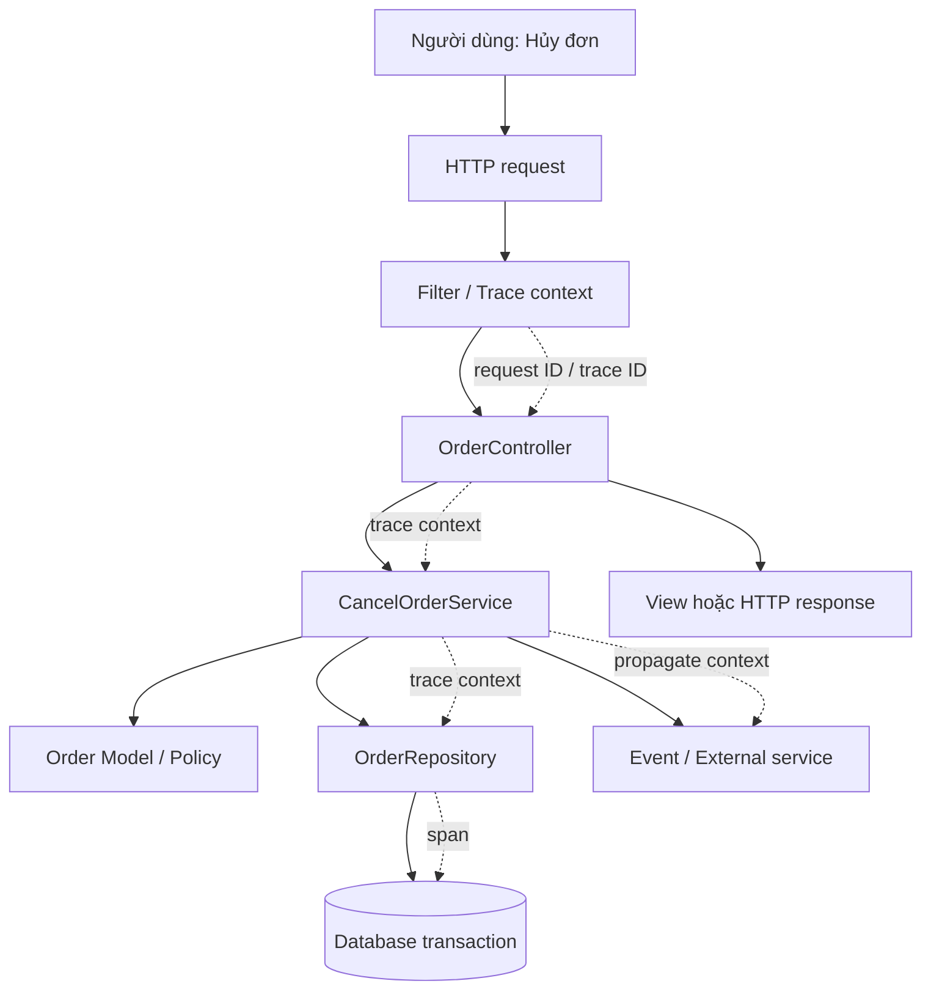
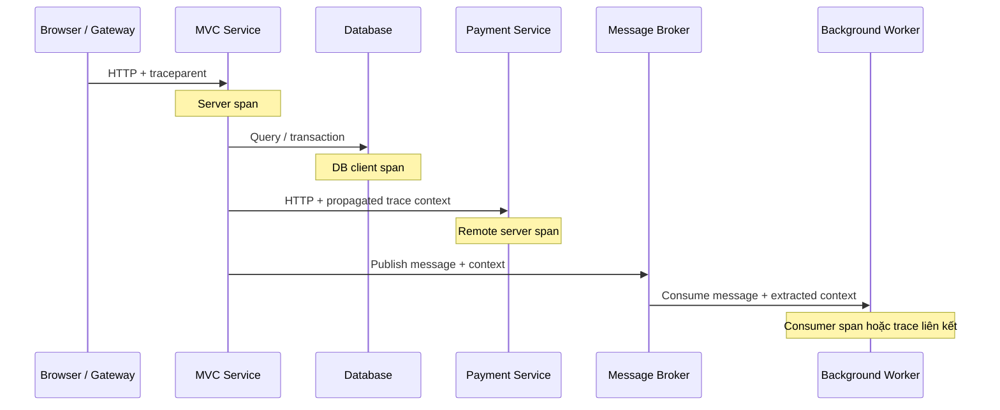

# Chẩn đoán lỗi theo dấu vết của một thao tác người dùng

Khi người dùng báo rằng một thao tác thất bại, chỉ biết URL và thời điểm xảy ra thường chưa đủ để tìm nguyên nhân. Một thao tác trong ứng dụng MVC có thể đi qua Controller, application service, Model nghiệp vụ, repository, database và một hoặc nhiều dịch vụ bên ngoài. Lỗi có thể xuất hiện ở bất kỳ chặng nào; log rời rạc hoặc thiếu ngữ cảnh khiến việc nối các sự kiện thành một câu chuyện trở nên khó khăn.

Chẩn đoán theo dấu vết (trace-based diagnosis) là cách lần theo một thao tác từ lúc request được tiếp nhận đến khi ứng dụng trả kết quả, bằng cách liên kết log, span và dữ liệu vận hành có cùng ngữ cảnh. Trace ID giúp tìm toàn bộ dấu vết phân tán; span ID xác định từng công đoạn; request ID hoặc correlation ID giúp đối chiếu với log và hệ thống hỗ trợ. Khi được thiết kế đúng, người vận hành có thể xác định request đã đi qua những thành phần nào, mất thời gian ở đâu, lỗi bắt đầu từ chặng nào và liệu lỗi đó có ảnh hưởng đến dữ liệu hay người dùng khác không.

Trong MVC, Controller là ranh giới HTTP, application service điều phối use case, Model bảo vệ quy tắc nghiệp vụ, repository/persistence truy cập dữ liệu và View tạo phản hồi. Quan sát cần nối được các ranh giới này mà không biến log thành nơi lưu dữ liệu nhạy cảm hoặc tạo quá nhiều sự kiện gây nhiễu.

## 1. Từ một thao tác người dùng đến một trace

Giả sử người dùng chọn “Hủy đơn hàng” trên trang chi tiết. Trình duyệt gửi `POST /orders/ORD-1001/cancel`. Request đi qua các bước:

1. Web server tiếp nhận request và tạo hoặc tiếp nhận ngữ cảnh trace.
2. Filter/interceptor ghi nhận request ID, route, method và thời điểm bắt đầu.
3. `OrderController` xác thực đầu vào và gọi `CancelOrderService`.
4. Application service kiểm tra quyền và trạng thái đơn.
5. Model nghiệp vụ quyết định đơn có được hủy hay không.
6. Repository cập nhật đơn và giải phóng lượng hàng đã giữ trong transaction.
7. Sau commit, ứng dụng phát sự kiện hoặc tạo thông báo theo cơ chế phù hợp.
8. Controller hoặc exception handler tạo redirect, View lỗi hoặc HTTP response.

Nếu database timeout ở bước 6, một trace tốt cho thấy request đã qua Controller và service, bước truy cập persistence thất bại, transaction bị rollback và response cuối cùng là lỗi. Nếu chỉ có một dòng `Request failed`, người vận hành không biết lỗi bắt đầu ở đâu.



Sơ đồ mô tả luồng khái niệm. Một trace thực tế có thể có nhiều span con, nhánh song song hoặc công việc bất đồng bộ diễn ra sau khi HTTP response đã hoàn tất.

## 2. Phân biệt request ID, correlation ID, trace ID và span ID

Các định danh này có liên quan nhưng không đồng nghĩa. Dùng đúng loại giúp tìm kiếm và đối chiếu dữ liệu chính xác.

| Định danh | Phạm vi | Mục đích |
|---|---|---|
| Request ID | Một request HTTP hoặc một lần tiếp nhận thông điệp | Tra cứu log của lần xử lý cụ thể |
| Correlation ID | Một thao tác hoặc quy trình nghiệp vụ có thể kéo dài qua nhiều request | Liên kết các bước cùng một ý định, kể cả khi có redirect, retry hoặc message bất đồng bộ |
| Trace ID | Một distributed trace gồm nhiều span liên quan | Tìm toàn bộ đường đi qua các service và dependency được instrument |
| Span ID | Một công đoạn bên trong trace | Xác định Controller, service call, truy vấn hoặc lời gọi HTTP cụ thể |
| Business/operation ID | Một thực thể hoặc ý định nghiệp vụ, ví dụ order ID hay payment attempt ID | Đối chiếu với dữ liệu nghiệp vụ và audit theo quyền truy cập |

Ví dụ: một thao tác thanh toán có thể tạo một trace cho request ban đầu, sau đó phát message để worker xử lý. Correlation ID hoặc payment operation ID có thể nối request, message và lần retry sau đó; mỗi lần xử lý có thể có trace riêng hoặc span được liên kết theo mô hình tracing. Không nên giả định một trace HTTP luôn sống suốt vòng đời nghiệp vụ kéo dài nhiều giờ.

### 2.1. Trace ID và span ID

Trace ID nhận diện toàn bộ trace. Span ID nhận diện một đơn vị công việc trong trace. Một span thường có:

- Tên thao tác, ví dụ `HTTP POST /orders/{id}/cancel` hoặc `db.query`.
- Thời điểm bắt đầu và thời lượng.
- Parent span hoặc quan hệ liên kết.
- Thuộc tính như service, route, status và loại dependency.
- Event hoặc exception xảy ra trong khoảng thời gian đó.

Span cha thể hiện công việc tổng thể; span con thể hiện các bước bên trong. Nhờ đó, người vận hành có thể thấy request mất 900 ms, trong đó 700 ms nằm ở database và 150 ms ở lời gọi dịch vụ ngoài.

### 2.2. W3C Trace Context

Các dịch vụ có thể truyền ngữ cảnh trace qua header chuẩn W3C Trace Context. Header `traceparent` có dạng khái quát:

```text
traceparent: 00-<trace-id-32-hex>-<parent-span-id-16-hex>-<trace-flags>
```

`tracestate` có thể mang thông tin dành riêng cho hệ thống tracing. Thư viện instrumentation thường tự inject và extract các header này khi gọi HTTP client hoặc nhận request. Nếu tự triển khai, cần tuân thủ chuẩn, xác thực cú pháp và không tự tạo trace ID theo cách phá vỡ quan hệ parent/child.

Không đưa thông tin cá nhân, token, email hoặc dữ liệu nhạy cảm vào `tracestate` hay baggage. Baggage có thể được truyền qua nhiều service và làm tăng phạm vi rò rỉ dữ liệu.

### 2.3. Correlation ID không thay thế distributed tracing

Correlation ID hữu ích để nối các sự kiện nghiệp vụ hoặc các request có quan hệ. Nhưng chỉ có một chuỗi ID trong log không cho biết thời lượng từng chặng, quan hệ cha-con hoặc nhánh song song. Trace cung cấp cấu trúc đó.

Ngược lại, trace có thể kết thúc khi một công việc bất đồng bộ được đưa vào queue. Correlation ID nghiệp vụ vẫn có thể nối sự kiện tạo yêu cầu với kết quả xử lý sau đó. Nhiều hệ thống dùng cả hai với mục đích riêng.

## 3. Ba nguồn tín hiệu: logs, metrics và traces

Observability thường kết hợp ba loại tín hiệu. Mỗi loại trả lời một câu hỏi khác nhau.

| Tín hiệu | Trả lời câu hỏi | Ví dụ |
|---|---|---|
| Logs | Điều gì đã xảy ra? | Đơn `ORD-1001` bị từ chối vì trạng thái hiện tại không cho phép hủy |
| Metrics | Tình trạng đang diễn biến thế nào trên toàn hệ thống? | Tỷ lệ lỗi hủy đơn tăng từ 0,2% lên 8% |
| Traces | Một request cụ thể đã đi qua đâu và chậm/lỗi ở bước nào? | Span `inventory.release` thất bại sau 620 ms |

Không nên dùng log thay cho metric. Đếm số dòng log bằng cách quét hệ thống vừa tốn kém vừa khó định nghĩa chính xác. Cũng không nên dùng metric để lưu ID từng người dùng hoặc từng đơn hàng; metric cần nhãn có cardinality thấp. Trace không thay thế audit log vì trace có thể được sampling và thường không được thiết kế làm hồ sơ pháp lý về mọi thay đổi nghiệp vụ.

## 4. Đặt điểm quan sát theo ranh giới MVC

Quan sát nên đặt ở nơi có ý nghĩa về vận hành và nghiệp vụ, tránh ghi cùng một thông tin lặp lại ở mọi lớp.

| Thành phần | Nên quan sát | Ví dụ thuộc tính/sự kiện |
|---|---|---|
| HTTP filter/interceptor | Request bắt đầu/kết thúc, route, method, status, duration | `http.route`, `http.request.method`, `http.response.status_code`, `request_id` |
| Controller | Kết quả điều phối và loại phản hồi khi cần ngữ cảnh web | `view.name`, `response.kind`, `error.code` |
| Application service | Bắt đầu/kết thúc use case, quyết định nghiệp vụ quan trọng | `operation=order.cancel`, `outcome=rejected`, `reason=already_shipped` |
| Domain Model | Chuyển trạng thái hoặc vi phạm invariant có ý nghĩa | `order.status.from`, `order.status.to`, `rule.code` |
| Repository/persistence | Thời gian truy vấn, lỗi database, transaction outcome | `db.operation`, `db.system`, `transaction.outcome` |
| HTTP/message client | Dependency, thời lượng, retry và kết quả | `server.address`, `messaging.destination`, `retry.count` |
| Error handler | Ánh xạ lỗi thành HTTP status và mã lỗi công khai | `exception.type`, `error.code`, `http.response.status_code` |

Không nhất thiết phải ghi một log ở mọi dòng code. Một request log ở biên HTTP, một số event nghiệp vụ quan trọng và span tự động cho dependency thường đủ để bắt đầu. Chỉ thêm log chi tiết khi có câu hỏi vận hành cụ thể cần trả lời.

### 4.1. Request boundary

Filter hoặc interceptor là nơi phù hợp để ghi nhận metadata chung của request: request ID, trace ID, route template, method, status và thời gian. Nên dùng route template như `/orders/{orderId}` thay vì URL đầy đủ có ID hoặc query string tùy ý; cách này giảm cardinality và tránh ghi dữ liệu nhạy cảm trong URL.

Ghi một log kết thúc request sau khi response status đã được xác định giúp có một bản ghi tổng hợp. Không cần ghi stack trace ở filter cho mọi exception nếu error handler hoặc tầng service đã log cùng exception; nếu không, một lỗi có thể tạo nhiều bản ghi giống nhau.

### 4.2. Controller boundary

Controller nên log các sự kiện có ích để hiểu kết quả điều phối, chẳng hạn request bị từ chối vì thiếu điều kiện ở ranh giới hoặc chọn loại response. Không log toàn bộ body request mặc định. Body có thể chứa mật khẩu, token, dữ liệu cá nhân hoặc file.

Nếu request hợp lệ và use case được gọi, span HTTP cùng span application service thường đã thể hiện quan hệ. Log thêm chỉ khi có ý nghĩa nghiệp vụ hoặc giúp chẩn đoán một nhánh khó quan sát.

### 4.3. Application service và Model

Application service biết ý nghĩa của thao tác, nên có thể ghi event như `order.cancelled`, `order.cancel.rejected` hoặc `payment.authorized`. Event nên chứa mã nghiệp vụ đã được cho phép, kết quả và mã lý do ổn định.

Model nghiệp vụ không nên phụ thuộc trực tiếp vào logger, HTTP request hoặc tracing SDK. Hãy để application service hoặc adapter ghi nhận kết quả sau khi gọi Model. Cách này giữ domain độc lập và tránh làm unit test bị phụ thuộc vào hạ tầng logging.

### 4.4. Repository và database

Instrumentation của ORM, JDBC hoặc database client có thể tạo span cho truy vấn và ghi nhận thời lượng. Cần cẩn thận với SQL statement, bind parameter và dữ liệu trả về: không bật chế độ log toàn bộ tham số ở production nếu chúng có thể chứa thông tin cá nhân hoặc bí mật.

Khi một transaction thất bại, trace nên giúp phân biệt lỗi truy vấn, lock timeout, deadlock, constraint violation và lỗi kết nối. Không nhất thiết ghi nội dung SQL đầy đủ vào log ứng dụng; tên thao tác, loại database và exception type thường an toàn hơn.

## 5. Log có cấu trúc để tìm một thao tác

Log có cấu trúc lưu các trường riêng biệt thay vì chỉ ghép mọi thứ vào một câu văn. Hệ thống log có thể lọc theo `trace_id`, `request_id`, service, route, error code hoặc operation.

Ví dụ một log JSON:

```json
{
  "timestamp": "2026-11-19T10:15:30.412Z",
  "level": "ERROR",
  "service.name": "order-service",
  "event.name": "order.cancel.failed",
  "request_id": "req-7f3a",
  "trace_id": "4bf92f3577b34da6a3ce929d0e0e4736",
  "span_id": "00f067aa0ba902b7",
  "http.request.method": "POST",
  "http.route": "/orders/{orderId}/cancel",
  "http.response.status_code": 500,
  "error.code": "ORDER_PERSISTENCE_FAILURE",
  "exception.type": "DataAccessResourceFailureException",
  "duration_ms": 842
}
```

Đây là ví dụ về schema, không phải dữ liệu của hệ thống cụ thể. Một số field có thể được đặt theo semantic conventions của OpenTelemetry để các công cụ khác nhau hiểu thống nhất.

### 5.1. Trường nên có

Một log request hoặc event vận hành thường cần:

- `timestamp`: thời điểm sự kiện, thống nhất timezone và độ chính xác.
- `level`: mức độ nghiêm trọng.
- `service.name` và môi trường triển khai.
- `event.name`: tên sự kiện ổn định.
- `trace_id`, `span_id` nếu có ngữ cảnh trace.
- `request_id` hoặc `correlation_id` nếu có.
- `http.route`, method và status cho sự kiện HTTP.
- `duration_ms` hoặc thời lượng theo đơn vị nhất quán.
- `error.code` và `exception.type` khi có lỗi.
- `operation` hoặc mã nghiệp vụ được phép ghi.

Không phải event nào cũng cần tất cả trường. Nên có schema chung cho metadata và bổ sung trường theo ngữ cảnh.

### 5.2. Mức log và nơi ghi exception

Một quy ước đơn giản:

| Mức | Trường hợp | Ví dụ |
|---|---|---|
| DEBUG | Chi tiết chẩn đoán chỉ bật khi cần | Nhánh mapper hoặc quyết định cache trong môi trường kiểm thử |
| INFO | Sự kiện bình thường có ý nghĩa vận hành/nghiệp vụ | Use case hoàn tất, request kết thúc thành công |
| WARN | Điều kiện bất thường nhưng đã được xử lý | Retry thành công, request bị từ chối theo quy tắc |
| ERROR | Thao tác thất bại và cần điều tra | Không thể commit transaction hoặc dependency không khả dụng |

Không nên ghi mọi lỗi validation người dùng thành `ERROR`; chúng có thể là kết quả bình thường của tương tác. Không nên log cùng stack trace ở Controller, service và global exception handler. Chọn một nơi sở hữu việc ghi exception đầy đủ, các lớp khác có thể bổ sung context có cấu trúc mà không lặp stack trace.

### 5.3. Ví dụ SLF4J key-value

Với SLF4J 2.x, có thể ghi các trường key-value:

```java
logger.atInfo()
    .addKeyValue("event.name", "order.cancelled")
    .addKeyValue("order.id", orderId.value())
    .addKeyValue("outcome", "success")
    .log("Order cancellation completed");
```

Với lỗi:

```java
logger.atError()
    .addKeyValue("event.name", "order.cancel.failed")
    .addKeyValue("error.code", "ORDER_PERSISTENCE_FAILURE")
    .addKeyValue("order.id", orderId.value())
    .setCause(exception)
    .log("Order cancellation failed");
```

Ví dụ giả định `orderId` là định danh nội bộ được phép ghi theo chính sách dữ liệu. Nếu ID có thể được dùng để truy cập dữ liệu nhạy cảm hoặc không nên xuất hiện trong log, hãy dùng mã tham chiếu đã được phê duyệt hoặc loại bỏ trường đó. Logger phải được cấu hình encoder JSON nếu muốn các key-value trở thành field có cấu trúc trong hệ thống tập trung.

## 6. Request ID và MDC trong ứng dụng Spring MVC

MDC (Mapped Diagnostic Context) của SLF4J/Logback cho phép gắn metadata vào các log phát ra trên thread hiện tại. Một filter có thể tạo request ID, đặt vào MDC và trả lại ID trong response header để người dùng gửi cho bộ phận hỗ trợ.

Ví dụ đơn giản cho request đồng bộ:

```java
@Component
public class RequestIdFilter extends OncePerRequestFilter {

    @Override
    protected void doFilterInternal(
            HttpServletRequest request,
            HttpServletResponse response,
            FilterChain filterChain)
            throws ServletException, IOException {

        String requestId = UUID.randomUUID().toString();
        response.setHeader("X-Request-ID", requestId);
        MDC.put("request_id", requestId);

        try {
            filterChain.doFilter(request, response);
        } finally {
            MDC.remove("request_id");
        }
    }
}
```

Ví dụ này minh họa request đồng bộ và tạo ID ở server. Nếu cần chấp nhận ID từ reverse proxy hoặc API gateway, chỉ tin cậy header từ proxy được cấu hình tin cậy, kiểm tra độ dài/ký tự và tránh cho client tùy ý giả mạo ID dùng để truy cập log của người khác. Có thể giữ ID bên ngoài trong một field riêng và vẫn tạo request ID nội bộ.

### 6.1. Dọn MDC trong mọi đường thoát

MDC thường gắn với thread. Thread pool tái sử dụng thread giữa nhiều request; nếu không xóa giá trị trong `finally`, request sau có thể nhận nhầm request ID hoặc user context của request trước. Luôn dọn các trường do request đặt, kể cả khi filter chain ném exception.

Không dùng `MDC.clear()` một cách tùy tiện nếu framework hoặc thư viện khác đang quản lý các trường MDC khác. Xóa đúng key do filter sở hữu hoặc lưu/khôi phục context trước và sau request.

### 6.2. Bất đồng bộ và thread pool

MDC không tự động đi theo mọi thread mới. Khi Controller trả `Callable`, dùng `DeferredResult`, `@Async`, executor hoặc message listener, công việc có thể chạy trên thread khác. Nếu chỉ dựa vào `ThreadLocal`, log ở thread đó có thể thiếu request ID hoặc trace context.

Hãy dùng cơ chế context propagation được hỗ trợ bởi Micrometer Context Propagation, Micrometer Tracing, OpenTelemetry hoặc `TaskDecorator` cho executor phù hợp. Context cần được capture khi submit và restore/clear khi task kết thúc. Không truyền toàn bộ `HttpServletRequest` hoặc session vào background task chỉ để giữ correlation.

Với Reactor hoặc hệ thống reactive, context thường được quản lý bằng Reactor Context; không giả định MDC thread-local luôn đúng khi execution đổi thread.

### 6.3. Request ID không phải Trace ID

Filter ở ví dụ trên tạo `request_id`, còn trace instrumentation quản lý `trace_id` và `span_id`. Một request thường có cả hai. Nếu cần liên kết log với trace, logger/appender có thể lấy trace context hiện hành và đưa trace ID/span ID vào log. Không tự gán cùng một UUID cho tất cả các loại ID vì chúng có vòng đời khác nhau.

## 7. Instrumentation và truyền trace context

Để trace nối được nhiều thành phần, các điểm vào/ra cần tạo hoặc tiếp tục span theo cùng context.



### 7.1. Instrument inbound HTTP

Web instrumentation tạo server span cho request và ghi route template, method, status cùng thời lượng. Với Spring Boot, Micrometer Observation/Tracing hoặc OpenTelemetry Java agent có thể tự instrument một số thành phần web và client. Chọn một chiến lược instrumentation thống nhất để tránh tạo span trùng lặp cho cùng thao tác.

### 7.2. Instrument service và thao tác nghiệp vụ

Span tùy chỉnh hữu ích khi cần phân biệt các bước có ý nghĩa, chẳng hạn `order.validate`, `inventory.reserve` hoặc `payment.authorize`. Không tạo span cho mọi method nhỏ; quá nhiều span làm trace lớn, tốn chi phí và khó đọc.

Span name nên ổn định và có cardinality thấp. Đưa ID bản ghi vào attribute khi chính sách cho phép, không đưa ID đó vào span name. Tránh ghi dữ liệu nhạy cảm vào attribute vì trace thường được gửi đến hệ thống tập trung và có quyền truy cập rộng.

### 7.3. Truyền context qua HTTP client

HTTP client được instrument có thể inject `traceparent` và các header context cần thiết khi gọi dịch vụ khác. Dịch vụ nhận extract context để tạo span con hoặc span liên quan. Nếu tự thêm header bằng tay, dễ tạo trace đứt đoạn hoặc sai parent; ưu tiên instrumentation chuẩn của thư viện.

### 7.4. Truyền context qua message broker

Khi publish message, producer có thể inject trace context vào metadata/header của message. Consumer extract context và tạo consumer span. Nếu message được xử lý sau thời gian dài hoặc có nhiều consumer, có thể dùng span link thay vì ép mọi hoạt động thành một cây cha-con kéo dài.

Correlation ID nghiệp vụ nên được truyền riêng khi cần nối quy trình. Không dùng trace context làm khóa idempotency hoặc khóa nghiệp vụ.

## 8. Metrics để phát hiện vấn đề trước khi có báo cáo

Metrics tổng hợp tình trạng hệ thống theo thời gian. Với MVC, các metric hữu ích gồm:

- Số request theo route template, method và status class.
- Tỷ lệ lỗi 4xx/5xx.
- Histogram thời gian phản hồi, đặc biệt p50, p95 và p99.
- Số request đang xử lý và kích thước hàng đợi.
- Thời lượng truy vấn database và số connection đang sử dụng.
- Tỷ lệ lỗi và latency của dependency bên ngoài.
- Số lần retry, timeout, transaction rollback hoặc optimistic lock conflict.

Ví dụ dashboard cho thao tác hủy đơn có thể hiển thị request rate, p95 latency, tỷ lệ 409 nghiệp vụ, tỷ lệ 5xx và thời lượng database. Nếu 409 tăng nhưng 5xx ổn định, có thể là thay đổi trạng thái nghiệp vụ hoặc người dùng thao tác lặp; nếu 5xx và database latency cùng tăng, cần điều tra persistence.

### 8.1. Cardinality của metric

Không dùng `user_id`, `order_id`, `request_id`, `trace_id`, email hoặc URL đầy đủ làm label metric. Mỗi giá trị mới có thể tạo một time series mới, làm tăng bộ nhớ và chi phí hệ thống monitoring.

Ưu tiên label có tập giá trị giới hạn như:

- `http.route=/orders/{orderId}/cancel`
- `http.method=POST`
- `status_class=2xx|4xx|5xx`
- `operation=order.cancel`
- `outcome=success|rejected|error`
- `dependency=database|payment-service`

Trace và log dùng để tra từng request; metric dùng để nhìn xu hướng và cảnh báo tổng thể.

### 8.2. Histogram và percentile

Trung bình có thể che giấu nhóm request rất chậm. Theo dõi p95/p99 hoặc histogram để biết tail latency. Cần chọn bucket và thời gian lưu phù hợp với SLA/SLO. Với metric histogram dạng bucket, hệ thống có thể tính percentile gần đúng trên tập request; cách tính phụ thuộc backend metrics.

## 9. Sampling và chi phí quan sát

Không phải lúc nào cũng lưu mọi trace. Ở tải cao, tracing đầy đủ có thể tốn CPU, bộ nhớ, băng thông và dung lượng lưu trữ. Sampling chọn một phần trace để gửi đi.

- Head-based sampling quyết định ở đầu trace; đơn giản và giảm chi phí sớm nhưng có thể bỏ qua trace lỗi nếu lỗi chỉ xuất hiện về sau.
- Tail-based sampling quyết định sau khi đã quan sát trace; có thể ưu tiên giữ trace lỗi hoặc chậm nhưng cần collector giữ trạng thái và tốn tài nguyên hơn.
- Sampling theo route hoặc môi trường có thể giúp tập trung vào luồng quan trọng.

Không nên dựa vào sampling để ghi audit bắt buộc. Nếu cần lưu mọi thay đổi nghiệp vụ, dùng audit log hoặc event store có chính sách bền vững riêng. Traces là dữ liệu chẩn đoán, có thể bị sampling và retention khác nhau.

Khi dùng sampling, metrics vẫn cần ghi nhận đầy đủ ở mức tổng hợp. Log lỗi có thể được giữ theo chính sách riêng, nhưng cần kiểm soát volume và dữ liệu nhạy cảm.

## 10. Đọc trace để chẩn đoán một lỗi

Khi nhận báo cáo “Tôi không hủy được đơn hàng”, có thể làm theo quy trình:

1. Lấy thời điểm gần đúng, route và mã request hiển thị cho người dùng nếu có.
2. Tìm log theo `request_id` hoặc `trace_id`; xác nhận service, môi trường và thời điểm.
3. Mở trace và xem server span tổng thể.
4. Xác định span có lỗi hoặc thời lượng bất thường; xem quan hệ cha-con và dependency.
5. Đối chiếu log cùng `trace_id`/`span_id` để đọc error code và ngữ cảnh đã được phép ghi.
6. Kiểm tra metric cùng khoảng thời gian để biết lỗi chỉ xảy ra với một request hay đang tăng trên diện rộng.
7. Xác định transaction đã commit, rollback hay kết quả chưa rõ; đối chiếu dữ liệu nghiệp vụ bằng công cụ có quyền phù hợp.
8. Ghi nhận nguyên nhân, phạm vi ảnh hưởng và hành động tiếp theo trong incident/ticket.

### 10.1. Ví dụ đọc một trace

Giả sử trace có các span:

| Span | Thời lượng | Kết quả |
|---|---:|---|
| `HTTP POST /orders/{id}/cancel` | 910 ms | 500 |
| `OrderController.cancel` | 904 ms | Exception propagated |
| `CancelOrderService.execute` | 890 ms | Failed |
| `OrderRepository.update` | 720 ms | Database timeout |
| `InventoryRepository.release` | Không chạy | Bị bỏ qua sau lỗi |

Trace cho thấy thời gian chủ yếu nằm ở cập nhật đơn hàng. Log cùng span có `exception.type=QueryTimeoutException` và `error.code=ORDER_PERSISTENCE_FAILURE`. Nếu transaction boundary bao quanh cả cập nhật đơn và giải phóng tồn kho, cần xác minh rollback đã xảy ra trước khi kết luận dữ liệu không đổi. Trace chỉ cho biết luồng thực thi; nó không tự chứng minh trạng thái commit/rollback nếu instrumentation không ghi nhận kết quả transaction.

### 10.2. Phân biệt lỗi người dùng với lỗi hệ thống

Một request có thể thất bại vì quy tắc nghiệp vụ, ví dụ đơn đã giao nên không thể hủy. Đây có thể là kết quả 409 được dự kiến, không phải sự cố hệ thống. Ngược lại, database timeout hoặc lỗi kết nối payment service là vấn đề vận hành.

Metrics nên tách outcome nghiệp vụ khỏi lỗi kỹ thuật. Log nên dùng error code ổn định. Dashboard không nên coi mọi response 4xx là incident; cảnh báo cần phản ánh SLO và mức ảnh hưởng thực tế.

## 11. Alerting và SLO theo hành vi người dùng

Quan sát chỉ hữu ích khi giúp phát hiện và xử lý vấn đề. Alert nên gắn với trải nghiệm người dùng hoặc mục tiêu dịch vụ, thay vì cảnh báo mọi exception.

Ví dụ SLI/SLO:

| SLI | Cách đo | Ví dụ mục tiêu minh họa |
|---|---|---|
| Availability của thao tác xem đơn | Tỷ lệ request hợp lệ hoàn tất không có lỗi hệ thống | 99,9% trong cửa sổ 30 ngày |
| Latency của thao tác hủy đơn | Tỷ lệ request hoàn tất dưới ngưỡng đã chọn | 95% dưới 1 giây |
| Tỷ lệ lỗi kỹ thuật | 5xx và lỗi dependency trên tổng request đủ điều kiện | Dưới ngưỡng theo SLO |
| Queue processing delay | Thời gian từ publish đến consumer xử lý | Trong giới hạn quy trình |

Các con số chỉ là ví dụ để minh họa; mục tiêu thật cần dựa trên kỳ vọng sản phẩm, tải và năng lực vận hành. Không đưa lỗi validation hoặc xung đột nghiệp vụ dự kiến vào mẫu số availability nếu chúng không phản ánh lỗi dịch vụ.

Alert nên có:

- Điều kiện và ngưỡng có ý nghĩa.
- Mức độ ưu tiên và phạm vi ảnh hưởng.
- Dashboard hoặc trace query liên quan.
- Hướng dẫn chẩn đoán ban đầu/runbook.
- Người hoặc nhóm chịu trách nhiệm.

Tránh alert theo từng exception đơn lẻ nếu exception đó đã được xử lý và không ảnh hưởng người dùng. Alert theo tỷ lệ lỗi, latency hoặc error budget thường giúp phân biệt sự cố thực với nhiễu.

## 12. Bảo mật và quyền riêng tư của dữ liệu quan sát

Log, trace và metric có thể chứa dữ liệu nhạy cảm hoặc định danh người dùng. Cần áp dụng chính sách ngay từ lúc instrument:

- Không ghi password, access token, cookie, session ID hoặc nội dung xác thực.
- Không ghi toàn bộ request/response body mặc định.
- Hạn chế email, số điện thoại, địa chỉ, dữ liệu thanh toán và thông tin cá nhân.
- Dùng route template thay URL có query string hoặc ID tùy ý.
- Chỉ đưa business ID vào log/trace khi chính sách cho phép và có mục đích rõ.
- Giới hạn quyền đọc log/trace theo vai trò và môi trường.
- Đặt retention, masking và quy trình xóa theo chính sách dữ liệu.
- Chống log injection bằng cách dùng structured logging và kiểm soát ký tự/giá trị đầu vào.

Trace baggage và span attributes có thể lan sang nhiều dịch vụ; không dùng chúng làm kho chứa dữ liệu người dùng. Nếu cần tìm theo khách hàng, ưu tiên mã tham chiếu đã được phê duyệt, quyền truy cập có kiểm soát và công cụ tra cứu nghiệp vụ riêng.

## 13. Kiểm thử observability

Không cần kiểm tra mọi dòng log hoặc timestamp chính xác trong unit test. Nên kiểm thử những hợp đồng quan sát có giá trị:

| Phạm vi | Điều cần xác minh |
|---|---|
| Request ID filter | Response có request ID; MDC được dọn sau request |
| Trace propagation | Context được truyền qua HTTP client hoặc message instrumentation |
| Error logging | Exception được ghi một lần ở ranh giới phù hợp với error code và trace context |
| Metrics | Request và lỗi cập nhật metric có nhãn cardinality thấp |
| Async work | Context cần thiết được truyền sang executor/consumer và được dọn sau task |
| Data protection | Log/trace không chứa token, mật khẩu hoặc request body nhạy cảm |
| Error response | Response có mã tham chiếu an toàn nhưng không lộ stack trace |

### 13.1. Kiểm thử request ID và MDC cleanup

Có thể dùng `MockMvc` gửi hai request liên tiếp và xác minh mỗi response có request ID hợp lệ, không bị dùng lại ngoài chính sách. Để xác minh MDC cleanup, có thể kiểm tra log event qua appender test hoặc gọi một request kế tiếp trên cùng executor/thread được kiểm soát và xác nhận không còn giá trị cũ.

Không nên khẳng định MDC đã được dọn chỉ vì response header có ID. Hai hành vi này cần được kiểm tra riêng nếu chúng là yêu cầu vận hành.

### 13.2. Kiểm thử trace với test exporter

Nếu dùng OpenTelemetry SDK, test có thể cấu hình in-memory exporter để thu spans và xác minh:

- Có server span cho request.
- Span service là con hoặc có quan hệ đúng với span request.
- Exception được ghi vào span phù hợp.
- Context được truyền qua dependency được instrument.
- Span không chứa attribute nhạy cảm.

Tránh kiểm tra trace ID cố định hoặc thời lượng chính xác vì chúng thay đổi theo lần chạy. Kiểm tra quan hệ, tên span và các thuộc tính hợp đồng cần thiết.

## 14. Những sai lầm thường gặp

**Chỉ log một câu lỗi không có ngữ cảnh.** Người vận hành không biết request, service hoặc công đoạn nào thất bại. Hãy bổ sung trace/request ID, route, error code và event name.

**Dùng request ID thay cho trace ID.** Một request ID không tự nối được span qua nhiều service. Dùng distributed tracing và truyền trace context chuẩn.

**Dùng trace ID làm business ID.** Trace có thể bị sampling và có vòng đời kỹ thuật. Dùng correlation ID hoặc operation ID cho quy trình nghiệp vụ kéo dài.

**Log ở mọi lớp và lặp stack trace.** Log bị nhiễu, khó tìm nguyên nhân. Xác định nơi sở hữu event và nơi ghi exception đầy đủ.

**Đặt user ID hoặc order ID làm metric label.** Cardinality tăng không giới hạn và làm hệ thống metrics quá tải. Dùng metric label có tập giá trị nhỏ; tra từng thao tác qua log/trace.

**Giữ MDC mà không dọn.** Thread pool có thể làm request sau nhận context cũ. Luôn restore/clear trong `finally` và cấu hình context propagation cho async.

**Giả định context tự truyền qua mọi executor.** Thread-local không tự đi qua thread mới hoặc Reactor scheduler. Dùng cơ chế propagation được hỗ trợ.

**Ghi toàn bộ request body và SQL parameters.** Log có thể chứa token, mật khẩu và dữ liệu cá nhân. Chỉ ghi metadata cần thiết và che dữ liệu theo chính sách.

**Coi trace là audit log.** Sampling và retention khiến trace không bảo đảm ghi nhận mọi thay đổi. Dùng audit log riêng cho yêu cầu truy vết nghiệp vụ bắt buộc.

**Cảnh báo mọi exception.** Lỗi validation hoặc xung đột nghiệp vụ có thể là kết quả dự kiến. Alert theo SLO, tỷ lệ lỗi kỹ thuật và ảnh hưởng người dùng.

## 15. Checklist chẩn đoán một thao tác người dùng

Khi điều tra một lỗi MVC, hãy kiểm tra:

1. Có thời điểm, route, method và request ID hoặc mã tham chiếu từ người dùng không?
2. Có trace ID để mở toàn bộ distributed trace không?
3. Trace có server span và các span service, database, HTTP client cần thiết không?
4. Correlation ID/operation ID có nối được công việc bất đồng bộ hoặc lần retry không?
5. Log có event name, error code, exception type và outcome đủ rõ không?
6. Có biết transaction đã commit, rollback hay kết quả chưa xác định không?
7. Metrics cùng thời điểm cho thấy lỗi đơn lẻ hay sự cố diện rộng?
8. Có dependency nào chậm, timeout hoặc retry bất thường không?
9. Context có được truyền qua executor, message broker và HTTP client không?
10. Log/trace có tránh token, body nhạy cảm và dữ liệu cá nhân không?
11. Sampling và retention có giữ đủ dữ liệu để điều tra theo chính sách không?
12. Kết quả điều tra có được ghi thành nguyên nhân, phạm vi ảnh hưởng và hành động tiếp theo không?

## Kết luận

Chẩn đoán lỗi theo dấu vết của một thao tác người dùng cần nối được request HTTP với các công đoạn trong Controller, application service, Model, repository và dependency bên ngoài. Request ID hỗ trợ tìm log của một request; correlation ID nối quy trình nghiệp vụ; trace ID và span ID mô tả đường đi cùng thời lượng của từng công đoạn. Log có cấu trúc cho biết điều gì đã xảy ra, metrics cho thấy xu hướng và mức ảnh hưởng, còn traces giúp xác định chặng bắt đầu lỗi hoặc chậm. Khi context được truyền đúng qua HTTP và message, MDC được dọn an toàn, dữ liệu nhạy cảm được loại bỏ và alert gắn với SLO, nhóm vận hành có thể điều tra nhanh hơn mà vẫn giữ kiến trúc MVC tách biệt và dễ kiểm thử.
