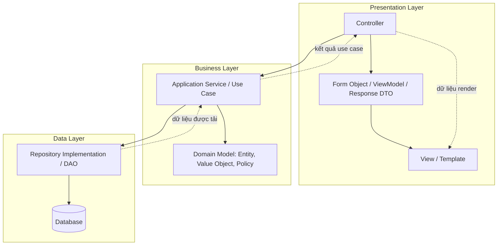
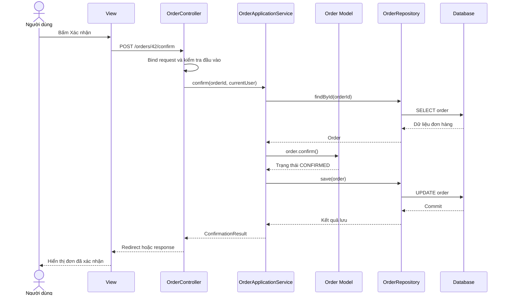
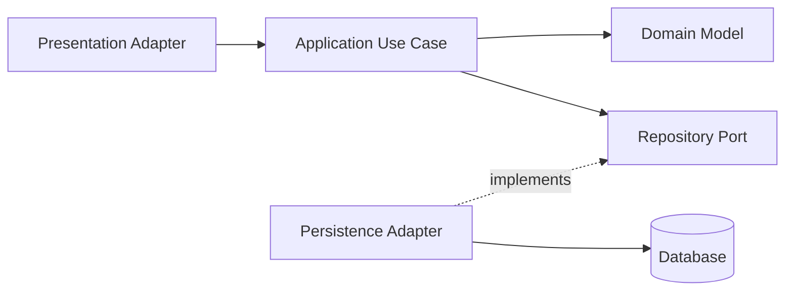
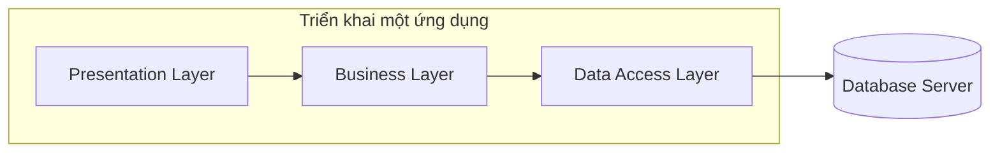

# Phân biệt ba vai trò MVC và ba tầng trình bày, nghiệp vụ, dữ liệu

Trong phát triển ứng dụng web, hai cách tổ chức thường xuất hiện cùng lúc là **Model–View–Controller (MVC)** và kiến trúc **ba tầng trình bày, nghiệp vụ, dữ liệu**. Vì cả hai đều có ba thành phần hoặc ba phần, người học dễ cho rằng Model là tầng nghiệp vụ, View là tầng trình bày và Controller là tầng dữ liệu hoặc cho rằng mỗi thành phần MVC tương ứng chính xác với một tầng.

Thực tế, hai cách tổ chức này giải quyết hai câu hỏi khác nhau. MVC phân chia trách nhiệm trong cách ứng dụng tiếp nhận tương tác, quản lý dữ liệu hiển thị và tạo phản hồi. Kiến trúc ba tầng phân chia hệ thống theo trách nhiệm kỹ thuật và nghiệp vụ: giao tiếp với người dùng, xử lý use case/quy tắc và truy cập nơi lưu trữ. Vì vậy, **MVC và kiến trúc ba tầng có thể kết hợp với nhau, nhưng không ánh xạ một-một**.

Bài học này giải thích từng vai trò, từng tầng, mối quan hệ giữa chúng và luồng request trong ứng dụng Java/Spring MVC. Mục tiêu là giúp thiết kế ranh giới rõ ràng: Controller điều phối request, View trình bày, Model đại diện trạng thái và khái niệm miền; tầng nghiệp vụ xử lý use case và quy tắc; tầng dữ liệu chịu trách nhiệm lưu trữ và truy xuất.

## 1. Hai cách chia hệ thống, hai mục tiêu khác nhau

### MVC trả lời câu hỏi gì?

MVC là một architectural pattern tổ chức phần tương tác của ứng dụng thành ba vai trò:

- **Model:** biểu diễn dữ liệu, trạng thái và các khái niệm/hành vi mà ứng dụng làm việc cùng.
- **View:** trình bày dữ liệu cho người dùng hoặc một client.
- **Controller:** tiếp nhận input, diễn giải hành động và điều phối việc cập nhật Model hoặc chọn View/response.

MVC giúp giảm sự phụ thuộc trực tiếp giữa giao diện, xử lý tương tác và trạng thái ứng dụng. Khi người dùng bấm nút, gửi form hoặc mở một URL, Controller xác định hành động cần thực hiện; Model cung cấp hoặc thay đổi dữ liệu theo quy tắc; View trình bày kết quả.

### Kiến trúc ba tầng trả lời câu hỏi gì?

Kiến trúc ba tầng chia ứng dụng theo trách nhiệm:

1. **Tầng trình bày (Presentation Layer):** nhận request, xác thực dữ liệu giao tiếp, điều phối tương tác và tạo response.
2. **Tầng nghiệp vụ (Business Layer):** thực hiện use case, chính sách và quy tắc nghiệp vụ; bảo đảm các điều kiện của miền.
3. **Tầng dữ liệu (Data Layer):** truy xuất, lưu trữ và tích hợp với cơ sở dữ liệu hoặc nguồn dữ liệu khác.

Cách chia này giúp kiểm soát nơi đặt logic, thay đổi công nghệ giao diện hoặc persistence mà không làm toàn bộ ứng dụng bị ảnh hưởng.

### Bảng phân biệt nhanh

| Khía cạnh | MVC | Kiến trúc ba tầng |
|---|---|---|
| Thành phần | Model, View, Controller | Presentation, Business, Data |
| Trọng tâm | Tổ chức tương tác và trình bày | Phân chia trách nhiệm của ứng dụng |
| Câu hỏi chính | Ai nhận input, ai giữ/trình bày trạng thái? | Logic giao tiếp, nghiệp vụ và lưu trữ nằm ở đâu? |
| Phạm vi thường gặp | Web/UI adapter hoặc phần tương tác | Toàn bộ ứng dụng hoặc một service |
| Quan hệ | Có thể nằm trong tầng trình bày và kết nối với Model nghiệp vụ | Có thể chứa một ứng dụng MVC ở tầng trình bày |
| Ánh xạ | Không tương đương từng thành phần với từng tầng | Là cách phân chia theo trách nhiệm khác với MVC |

## 2. Ba vai trò trong MVC

### Model: dữ liệu, trạng thái và khái niệm ứng dụng

Model đại diện cho thông tin mà ứng dụng quản lý hoặc thao tác. Tùy biến thể MVC và framework, Model có thể bao gồm:

- Đối tượng miền như `Order`, `Customer`, `Product`.
- Value Object như `Money`, `Address`, `DateRange`.
- Trạng thái ứng dụng cần được trình bày hoặc thay đổi.
- Các quy tắc và hành vi liên quan đến đối tượng miền.
- Dữ liệu đọc được tổng hợp để phục vụ một use case hoặc màn hình.

Trong thiết kế hướng miền, Domain Model chứa trạng thái và bất biến nghiệp vụ. Ví dụ, `Order` có thể biết cách thêm dòng hàng, tính tổng và chuyển từ bản nháp sang trạng thái xác nhận hợp lệ.

```java
public final class Order {
    private final OrderId id;
    private final List<OrderLine> lines = new ArrayList<>();
    private OrderStatus status = OrderStatus.DRAFT;

    public void addLine(OrderLine line) {
        if (status != OrderStatus.DRAFT) {
            throw new IllegalStateException("Order is no longer editable");
        }
        lines.add(Objects.requireNonNull(line));
    }

    public void confirm() {
        if (status != OrderStatus.DRAFT || lines.isEmpty()) {
            throw new IllegalStateException("Order cannot be confirmed");
        }
        status = OrderStatus.CONFIRMED;
    }
}
```

Đây là ví dụ rút gọn về hành vi miền. Model không cần biết HTTP method, tên input HTML, template engine hay cách database lưu từng cột.

Trong ứng dụng Spring MVC, thuật ngữ `Model` còn được dùng cho đối tượng `org.springframework.ui.Model`, nơi Controller đặt thuộc tính để View render. Đối tượng framework này là **mô hình dữ liệu dành cho lần render hiện tại**, không đồng nghĩa với toàn bộ Domain Model. Cần phân biệt tên gọi theo ngữ cảnh để tránh nhầm lẫn.

### View: trình bày dữ liệu

View chịu trách nhiệm hiển thị dữ liệu và tạo ra giao diện cho người dùng. Ví dụ:

- Template Thymeleaf hoặc JSP tạo HTML.
- React/Vue component hiển thị JSON từ backend.
- Trang danh sách, trang chi tiết, form chỉnh sửa.
- JSON/XML response cho client API, nếu xem response representation là phần trình bày của adapter.

View có thể định dạng dữ liệu, hiển thị nhãn, thông báo và điều khiển tương tác. View không nên tự quyết định quy tắc nghiệp vụ như một đơn hàng có được hủy hay không, giá cuối cùng là bao nhiêu hoặc người dùng có quyền phê duyệt hay không.

### Controller: tiếp nhận và điều phối tương tác

Controller nhận request hoặc input, chuyển đổi chúng thành dữ liệu đầu vào phù hợp, gọi use case và chọn response. Trong web MVC, Controller thường thực hiện:

- Ánh xạ URL và HTTP method đến handler.
- Bind path variable, query parameter, form field hoặc request body.
- Kiểm tra định dạng và validation đầu vào ở ranh giới giao tiếp.
- Lấy danh tính người dùng từ security context.
- Gọi application service/use case.
- Chọn View, redirect hoặc HTTP status/response DTO.
- Chuyển lỗi ứng dụng thành phản hồi phù hợp.

Controller nên giữ vai trò điều phối. Nếu nó tự tính giá, quyết định mọi quy tắc trạng thái, truy vấn SQL và dựng HTML bằng chuỗi, nhiều trách nhiệm đã bị dồn vào sai chỗ.

## 3. Ba tầng trong kiến trúc ứng dụng

### Tầng trình bày (Presentation Layer)

Tầng trình bày là ranh giới giao tiếp giữa ứng dụng và người dùng/client. Trong ứng dụng Spring MVC, tầng này thường chứa:

- `@Controller` hoặc `@RestController`.
- Form Object và Request DTO.
- Response DTO và ViewModel.
- Template, View, serializer hoặc response renderer.
- Binding, conversion và validation đầu vào.
- Cấu hình web, HTTP exception mapping và một phần authentication/authorization adapter.

Tầng này biết về HTTP, URL, session, header, cookie và định dạng giao tiếp. Nó chuyển request thành lời gọi use case và chuyển kết quả thành response. Nó không nên chứa quy tắc nghiệp vụ cốt lõi.

### Tầng nghiệp vụ (Business Layer)

Tầng nghiệp vụ thực hiện mục tiêu mà người dùng hoặc hệ thống muốn đạt được. Nó thường bao gồm:

- Application Service hoặc Use Case.
- Domain Entity và Value Object.
- Domain Service hoặc Policy.
- Quy tắc chuyển trạng thái và bất biến.
- Điều phối transaction ở ranh giới use case.
- Kiểm tra quyền nghiệp vụ và điều kiện xử lý cần thiết.

Ví dụ use case `ConfirmOrder` kiểm tra đơn có dòng hàng, kiểm tra quyền xác nhận, kiểm tra điều kiện nghiệp vụ và yêu cầu repository lưu thay đổi. Tầng nghiệp vụ không cần biết thao tác được kích hoạt từ form HTML, REST API, batch job hay message queue.

### Tầng dữ liệu (Data Layer)

Tầng dữ liệu cung cấp khả năng đọc/ghi dữ liệu và giao tiếp với nguồn lưu trữ. Nó thường bao gồm:

- Repository implementation và DAO.
- ORM mapping như JPA/Hibernate entity persistence.
- SQL, query builder và database client.
- Migration, transaction persistence và mapping dữ liệu.
- Adapter kết nối hệ thống ngoài khi chúng đóng vai trò nguồn dữ liệu.

Tầng dữ liệu chịu trách nhiệm kỹ thuật về lưu trữ. Nó không nên tự quyết định một đơn hàng có được xác nhận theo chính sách nghiệp vụ hay không. Tầng nghiệp vụ đưa ra yêu cầu; tầng dữ liệu thực hiện truy vấn và lưu trữ theo hợp đồng.

## 4. MVC không ánh xạ một-một với ba tầng

Đây là điểm quan trọng nhất của bài học. Không thể kết luận Model = Business, View = Presentation và Controller = Data. View và Controller thường nằm trong tầng trình bày, trong khi Model có thể trải qua nhiều khía cạnh của ứng dụng.

| Thành phần MVC | Vị trí thường gặp trong kiến trúc ba tầng | Giải thích |
|---|---|---|
| View | Tầng trình bày | Render HTML hoặc representation cho client |
| Controller | Tầng trình bày | Nhận HTTP request, bind input và gọi use case |
| Domain Model | Tầng nghiệp vụ | Biểu diễn khái niệm, trạng thái và quy tắc nghiệp vụ |
| Application Model/ViewModel | Thường ở ranh giới trình bày hoặc ứng dụng | Chứa dữ liệu cần cho một response hoặc màn hình |
| Repository/DAO | Tầng dữ liệu (implementation) | Đọc/ghi nguồn dữ liệu |
| Repository interface/port | Thường được định nghĩa ở tầng nghiệp vụ hoặc application | Nêu hợp đồng mà use case cần; implementation nằm ở tầng dữ liệu |

Model là thuật ngữ rộng trong MVC. Một Domain Model có thể thuộc tầng nghiệp vụ; một ViewModel có thể thuộc tầng trình bày; dữ liệu của Model được tải qua repository ở tầng dữ liệu. Không có lý do để gom tất cả vào một package hoặc một class tên `Model`.

### Sơ đồ kết hợp hai cách tổ chức



Sơ đồ thể hiện đường gọi phổ biến trong ứng dụng phân tầng đơn giản. Trong thiết kế Dependency Inversion, tầng nghiệp vụ có thể định nghĩa repository interface/port mà nó cần; tầng dữ liệu triển khai interface đó. Vì vậy, hướng gọi lúc chạy và hướng phụ thuộc mã nguồn không nhất thiết giống nhau.

## 5. Luồng request qua MVC và ba tầng

Ví dụ người dùng xác nhận một đơn hàng:



Mỗi tầng thực hiện một phần khác nhau:

1. View tạo hành động gửi request.
2. Controller nhận request và chuyển dữ liệu sang use case.
3. Application service điều phối thao tác và lấy Model từ repository.
4. Domain Model kiểm tra bất biến và thay đổi trạng thái.
5. Repository implementation lưu thay đổi xuống database.
6. Controller chọn response và View trình bày kết quả.

Nếu đơn không thể xác nhận, Domain Model hoặc application service trả lỗi nghiệp vụ. Controller ánh xạ lỗi đó sang trang lỗi, thông báo hoặc HTTP response. View không tự suy luận trạng thái đơn từ dữ liệu gửi lên.

## 6. Ví dụ Java/Spring MVC theo ba tầng

Một cách triển khai có thể tổ chức các thành phần như sau.

### Controller ở tầng trình bày

```java
@Controller
@RequestMapping("/orders")
class OrderController {

    private final ConfirmOrderUseCase confirmOrder;

    OrderController(ConfirmOrderUseCase confirmOrder) {
        this.confirmOrder = confirmOrder;
    }

    @PostMapping("/{id}/confirm")
    String confirm(
            @PathVariable UUID id,
            Principal principal,
            RedirectAttributes redirectAttributes) {

        confirmOrder.execute(new ConfirmOrderCommand(
                new OrderId(id), principal.getName()));

        redirectAttributes.addFlashAttribute(
                "notice", "Đơn hàng đã được xác nhận.");
        return "redirect:/orders/" + id;
    }
}
```

Controller không tự tải entity, tự cập nhật trạng thái hoặc viết SQL. Nó tạo command từ dữ liệu request và danh tính đã xác thực, gọi use case rồi chọn redirect.

### Use case ở tầng nghiệp vụ

```java
public record ConfirmOrderCommand(OrderId orderId, String actorId) {}

public interface ConfirmOrderUseCase {
    void execute(ConfirmOrderCommand command);
}

@Service
class ConfirmOrderService implements ConfirmOrderUseCase {

    private final OrderRepository orders;
    private final OrderPermissionPolicy permissionPolicy;

    ConfirmOrderService(
            OrderRepository orders,
            OrderPermissionPolicy permissionPolicy) {
        this.orders = orders;
        this.permissionPolicy = permissionPolicy;
    }

    @Transactional
    public void execute(ConfirmOrderCommand command) {
        Order order = orders.findById(command.orderId())
                .orElseThrow(OrderNotFoundException::new);

        permissionPolicy.checkCanConfirm(command.actorId(), order);
        order.confirm();
        orders.save(order);
    }
}
```

Application service điều phối use case. Nó kiểm tra quyền nghiệp vụ thông qua policy, tải Model, gọi hành vi miền và yêu cầu lưu. Trong dự án thực tế, có thể không cần gọi `save` tường minh nếu ORM dùng dirty checking; ví dụ giữ lời gọi để làm rõ ý định lưu.

### Domain Model

`Order` chứa trạng thái và hành vi `confirm()`. Nó không phụ thuộc vào Spring MVC, HTTP, Thymeleaf hoặc JDBC.

### Repository port và implementation

Tầng nghiệp vụ có thể định nghĩa hợp đồng:

```java
public interface OrderRepository {
    Optional<Order> findById(OrderId id);
    Order save(Order order);
}
```

Tầng dữ liệu triển khai hợp đồng này bằng JPA:

```java
@Repository
class JpaOrderRepository implements OrderRepository {

    private final SpringDataOrderJpaRepository jpaRepository;
    private final OrderMapper mapper;

    JpaOrderRepository(
            SpringDataOrderJpaRepository jpaRepository,
            OrderMapper mapper) {
        this.jpaRepository = jpaRepository;
        this.mapper = mapper;
    }

    @Override
    public Optional<Order> findById(OrderId id) {
        return jpaRepository.findById(id.value())
                .map(mapper::toDomain);
    }

    @Override
    public Order save(Order order) {
        OrderEntity entity = mapper.toEntity(order);
        return mapper.toDomain(jpaRepository.save(entity));
    }
}
```

Ví dụ mapper/entity được rút gọn để tập trung vào ranh giới. Dự án có thể dùng JPA entity làm chính Domain Entity nếu mô hình phù hợp; điều cần tránh là để Controller hoặc View phụ thuộc trực tiếp vào chi tiết persistence.

### View hiển thị kết quả

Controller có thể tải `OrderDetailViewModel` qua query service rồi render template. View chỉ đọc trường đã chuẩn bị như mã đơn, trạng thái và thông báo; không gọi repository hoặc thay đổi Domain Model.

## 7. Phân biệt các loại Model trong ứng dụng thực tế

Từ “Model” được dùng cho nhiều khái niệm. Cần đặt tên cụ thể để tránh gộp trách nhiệm.

| Loại | Mục đích | Ví dụ | Vị trí thường gặp |
|---|---|---|---|
| Domain Entity | Đối tượng nghiệp vụ có identity | `Order`, `Customer` | Business/domain |
| Value Object | Giá trị được định nghĩa bằng thuộc tính | `Money`, `Address` | Business/domain |
| Persistence Entity | Ánh xạ bảng/quan hệ database | `OrderEntity` có `@Entity` | Data/infrastructure |
| Request DTO/Form Object | Nhận dữ liệu từ client | `CreateOrderRequest` | Presentation adapter |
| Response DTO | Hợp đồng dữ liệu trả về API | `OrderResponse` | Presentation/API adapter |
| ViewModel | Dữ liệu được chuẩn bị cho một View | `OrderDetailViewModel` | Presentation |
| Spring `Model` | Container chứa attribute cho template | `model.addAttribute(...)` | Presentation framework |

Trong một ứng dụng nhỏ, Domain Entity và JPA Entity có thể là cùng một class. Trong ứng dụng phức tạp, tách chúng giúp Domain Model không phụ thuộc ORM và cho phép persistence schema tiến hóa độc lập. Quyết định tách hay dùng chung cần dựa trên sự khác nhau về trách nhiệm, vòng đời và yêu cầu thay đổi, không phải chỉ vì muốn có nhiều class.

## 8. Hướng phụ thuộc giữa các tầng

Một kiến trúc phân tầng cần quy định rõ ai được phụ thuộc vào ai. Nếu mọi package có thể gọi mọi package, ba tầng chỉ còn là tên thư mục.

### Luồng gọi phổ biến

Trong một ứng dụng MVC đơn giản, luồng xử lý thường đi từ presentation đến business rồi đến data:

```text
Presentation -> Business -> Data
```

Đây là luồng gọi thường thấy: Controller gọi application service; service gọi repository; repository truy cập database.

### Dependency Inversion

Khi áp dụng Dependency Inversion Principle, business/application không cần phụ thuộc trực tiếp vào implementation persistence. Nó định nghĩa abstraction mà nó cần, còn tầng data triển khai abstraction đó:



Ở đây, lời gọi lúc chạy vẫn đi từ use case đến repository implementation, nhưng dependency mã nguồn hướng vào abstraction do application/business sở hữu. Cách tổ chức này giúp thay JPA bằng một nguồn dữ liệu khác mà không buộc use case phụ thuộc vào framework persistence.

### Không để tầng dữ liệu điều khiển nghiệp vụ

Repository có thể cung cấp query, lưu entity và xử lý concurrency ở mức persistence. Nhưng các quyết định như “đơn đã thanh toán có được hủy không?” hoặc “khách hàng có được dùng ưu đãi này không?” thuộc quy tắc nghiệp vụ, không nên ẩn trong SQL trigger hoặc Controller.

## 9. MVC kết hợp với các kiến trúc khác

MVC không phải kiến trúc tổng thể duy nhất của ứng dụng. Nó có thể kết hợp với nhiều cách tổ chức khác:

- **Layered Architecture:** Controller/View nằm ở presentation; use case/domain ở business; repository implementation ở data.
- **Hexagonal Architecture (Ports and Adapters):** Controller là inbound adapter; repository/database là outbound adapter; application/domain nằm ở lõi.
- **Clean Architecture:** web controller và presenter nằm ở vòng ngoài; use case và entity nằm ở vòng trong; dependency hướng vào trong.
- **Modular Monolith:** mỗi module nghiệp vụ có controller, application service, domain và persistence riêng; MVC được dùng ở giao diện web của từng module.
- **Microservices:** mỗi service có thể có endpoint/controller theo MVC và các tầng nội bộ; giao tiếp service-to-service không làm MVC biến mất.

Vì vậy, không cần lựa chọn “MVC hay layered architecture” như hai phương án loại trừ. MVC có thể là pattern tổ chức adapter trình bày trong một kiến trúc phân tầng hoặc hexagonal.

## 10. Tổ chức package theo tầng hoặc theo tính năng

### Tổ chức theo tầng kỹ thuật

```text
com.example.shop
├── presentation
│   ├── controller
│   ├── form
│   ├── dto
│   ├── viewmodel
│   └── view
├── business
│   ├── application
│   ├── domain
│   └── policy
└── data
    ├── repository
    ├── persistence
    └── integration
```

Cấu trúc này dễ thấy ranh giới kỹ thuật và phù hợp với ứng dụng nhỏ hoặc nhóm có trách nhiệm theo tầng. Khi ứng dụng lớn, mỗi package có thể chứa nhiều tính năng không liên quan, khiến một thay đổi nghiệp vụ phải đi qua nhiều thư mục xa nhau.

### Tổ chức theo feature/module

```text
com.example.shop
├── orders
│   ├── presentation
│   │   ├── OrderController.java
│   │   └── OrderDetailViewModel.java
│   ├── application
│   │   ├── ConfirmOrderService.java
│   │   └── CreateOrderUseCase.java
│   ├── domain
│   │   ├── Order.java
│   │   └── OrderStatus.java
│   └── infrastructure
│       └── JpaOrderRepository.java
├── catalog
│   ├── presentation
│   ├── application
│   ├── domain
│   └── infrastructure
└── customers
    ├── presentation
    ├── application
    ├── domain
    └── infrastructure
```

Tổ chức theo feature giúp gom mã liên quan đến cùng một khả năng nghiệp vụ. Có thể kết hợp cả hai: chia module theo feature, rồi bên trong module chia presentation/application/domain/infrastructure.

Không có cấu trúc package bắt buộc cho mọi dự án. Điều quan trọng là ranh giới có thể nhận biết và kiểm tra được, không phải tên thư mục cụ thể.

## 11. Ví dụ đối chiếu: một chức năng, hai cách nhìn

Giả sử người dùng cập nhật địa chỉ giao hàng của đơn hàng.

| Công việc | Nhìn theo MVC | Nhìn theo ba tầng |
|---|---|---|
| Người dùng nhập địa chỉ | View | Presentation |
| Request `POST /orders/42/shipping-address` | Controller nhận input | Presentation |
| Bind `shippingAddress` và validate định dạng | Controller/Form Object | Presentation boundary |
| Xác minh người dùng có quyền sửa đơn | Controller có thể xác thực danh tính; policy/use case quyết định quyền nghiệp vụ | Business (cùng security adapter ở presentation) |
| Kiểm tra trạng thái đơn có cho sửa địa chỉ không | Model/domain behavior | Business |
| Lưu địa chỉ mới | Model thay đổi trạng thái | Business điều phối, Data lưu trữ |
| Ghi dữ liệu vào database | Không phải trách nhiệm của View/Controller | Data |
| Hiển thị địa chỉ mới và thông báo | View | Presentation |

Bảng này cho thấy một thao tác MVC đi qua cả ba tầng. Một vai trò MVC không đại diện cho toàn bộ một tầng. Controller và View chủ yếu thuộc presentation; Model miền thường ở business; việc lưu Model đi qua data layer.

## 12. Những dấu hiệu cho thấy ranh giới đang bị trộn lẫn

### Fat Controller

Controller chứa truy vấn database, tính toán giá, kiểm tra quyền phức tạp, thay đổi trạng thái và xử lý nhiều nhánh nghiệp vụ. Hãy chuyển use case sang application service và quy tắc bất biến sang Domain Model hoặc policy phù hợp.

### View chứa logic nghiệp vụ

Template tự quyết định một đơn có được hủy bằng cách kiểm tra chuỗi trạng thái hoặc tổng tiền. View có thể ẩn/hiện hành động theo dữ liệu được cung cấp, nhưng backend phải kiểm tra lại quyền và điều kiện khi nhận request.

### Domain Model phụ thuộc giao diện

Entity có các trường `activeTab`, `successMessage`, `selectedCssClass` hoặc import `HttpServletRequest`. Đây là trạng thái giao diện hoặc giao thức, không phải khái niệm miền. Đưa chúng vào ViewModel hoặc presentation adapter.

### Business layer gọi trực tiếp template

Application service trả về tên file HTML hoặc tự tạo chuỗi response. Điều này khiến nghiệp vụ phụ thuộc vào cách trình bày. Hãy trả kết quả/DTO phù hợp để presentation chọn representation.

### Controller truy cập trực tiếp database

Controller gọi `EntityManager`, viết SQL hoặc tự điều khiển transaction. Hãy chuyển truy cập dữ liệu qua repository/query service và use case để dễ kiểm thử, tái sử dụng và bảo vệ quy tắc.

### Repository chứa quy tắc use case

Repository tự quyết định quyền phê duyệt hoặc trạng thái nghiệp vụ. Hãy giữ repository tập trung vào truy xuất/lưu trữ và đưa quyết định vào application/domain.

### Coi `Model` của Spring là toàn bộ Domain Model

`org.springframework.ui.Model` chỉ là container dữ liệu để render View. Đừng đặt toàn bộ nghiệp vụ hoặc entity graph vào đó rồi coi như đã thiết kế Domain Model.

## 13. Kiểm thử theo ranh giới MVC và ba tầng

Hai cách tổ chức tạo ra các nhóm test bổ trợ nhau:

| Phạm vi | Nội dung kiểm thử | Ví dụ |
|---|---|---|
| View/Presentation | Render đúng dữ liệu và thông báo | ViewModel có nhãn trạng thái phù hợp |
| Controller | Route, binding, validation, status, redirect | `MockMvc` kiểm tra POST gọi đúng use case |
| Application/Business | Luồng use case và điều phối | Xác nhận đơn gọi policy và repository đúng thứ tự |
| Domain Model | Bất biến và hành vi | Đơn rỗng không thể xác nhận |
| Data/Repository | Query, mapping và persistence | Lưu rồi tải lại đơn giữ đúng trạng thái |
| Architecture test | Ranh giới phụ thuộc | Domain không import Spring Web hoặc JPA nếu thiết kế yêu cầu độc lập |

Test Controller nên mock use case để tập trung vào hợp đồng HTTP. Test nghiệp vụ nên gọi service/domain mà không cần khởi động web server. Test repository cần database phù hợp để xác minh query và mapping. Integration test kiểm tra các tầng được wiring đúng với nhau.

## 14. Kiểm thử ranh giới phụ thuộc

Nếu dự án muốn bảo đảm Domain Model không phụ thuộc Spring MVC hoặc persistence, có thể dùng ArchUnit hoặc công cụ architecture test để kiểm tra package dependency.

Ví dụ ý tưởng với ArchUnit:

```java
@AnalyzeClasses(packages = "com.example.shop")
class ArchitectureRulesTest {

    @ArchTest
    static final ArchRule domainShouldNotDependOnWeb =
            noClasses()
                    .that().resideInAPackage("..domain..")
                    .should().dependOnClassesThat()
                    .resideInAnyPackage("org.springframework.web..", "jakarta.servlet..");
}
```

Đây là ví dụ minh họa cú pháp ArchUnit; cần thêm dependency và điều chỉnh package theo dự án. Có thể tạo thêm rule để domain không phụ thuộc vào package infrastructure/persistence nếu mục tiêu là giữ domain thuần.

Không nên tạo rule quá cứng khi kiến trúc thực tế cho phép một số dependency có chủ đích. Architecture test cần thể hiện quyết định kiến trúc đã thống nhất, không chỉ kiểm tra tên package.

## 15. Phân biệt logical layer và physical tier

Trong tài liệu kiến trúc, từ “layer” và “tier” đôi khi được dùng thay thế nhau, nhưng có thể phân biệt:

- **Layer (tầng logic):** nhóm trách nhiệm trong thiết kế mã nguồn, ví dụ presentation, business và data.
- **Tier (tầng triển khai):** ranh giới process hoặc máy chủ, ví dụ web server, application server và database server.

Một ứng dụng có ba logical layer nhưng triển khai trong một process duy nhất. Đây vẫn là kiến trúc phân tầng, nhưng chưa phải hệ thống ba physical tier tách biệt.

Ngược lại, một hệ thống có web server và database server riêng nhưng logic nghiệp vụ vẫn bị đặt trong Controller thì việc tách máy chủ không tự tạo ra ranh giới nghiệp vụ tốt.

Ví dụ:



Trong ví dụ này, ba layer logic có thể cùng nằm trong một ứng dụng Spring Boot, còn database là một physical tier riêng. Tách process chỉ nên thực hiện khi có lý do về mở rộng, bảo mật, vận hành, độ tin cậy hoặc quyền sở hữu dữ liệu.

## 16. Khi nào nên dùng MVC cùng kiến trúc ba tầng?

Cách kết hợp này phù hợp với nhiều ứng dụng web nghiệp vụ:

- Controller và View quản lý HTTP/UI.
- Application service điều phối hành động của người dùng.
- Domain Model bảo vệ quy tắc và trạng thái nghiệp vụ.
- Repository/DAO quản lý lưu trữ.
- DTO/ViewModel xác định hợp đồng dữ liệu giữa các ranh giới.

Với ứng dụng nhỏ, có thể bắt đầu bằng một Controller, một service và một repository cho mỗi tính năng. Khi quy tắc phức tạp hơn, tách Domain Model, policy và port phù hợp. Không cần tạo đủ interface, mapper và lớp trung gian nếu chúng không tạo ra ranh giới có giá trị.

Với ứng dụng lớn, có thể tổ chức theo feature/module hoặc dùng Hexagonal/Clean Architecture. MVC vẫn là cách tổ chức adapter web ở bên ngoài.

## 17. Quy trình xác định một thành phần thuộc đâu

Khi thêm class hoặc phương thức mới, hãy tự hỏi:

1. **Nó có nhận hoặc trả dữ liệu giao thức không?** Nếu có, nhiều khả năng thuộc presentation adapter.
2. **Nó có quyết định một use case được thực hiện như thế nào không?** Nếu có, xem xét application/business layer.
3. **Nó có bảo vệ bất biến của khái niệm miền không?** Nếu có, đặt hành vi trong Domain Model hoặc domain service phù hợp.
4. **Nó có đọc/ghi database hoặc gọi công nghệ persistence không?** Nếu có, đó là trách nhiệm data/infrastructure.
5. **Nó có định dạng dữ liệu riêng cho một màn hình không?** Nếu có, cân nhắc ViewModel/DTO ở presentation.
6. **Nó có phụ thuộc framework web hoặc ORM không?** Xác định xem dependency đó có được phép ở tầng hiện tại không.
7. **Có thể kiểm thử thành phần độc lập không?** Ranh giới tốt thường cho phép test mà không cần khởi động toàn bộ hệ thống.

Một ví dụ lựa chọn nhanh:

| Thành phần cần tạo | Nơi thường phù hợp |
|---|---|
| `OrderController` nhận `POST /orders` | Presentation / Controller |
| `CreateOrderForm` nhận dữ liệu form | Presentation / Form Object |
| `OrderDetailViewModel` cung cấp dữ liệu cho template | Presentation / ViewModel |
| `CreateOrderService` điều phối tạo đơn | Business / Application |
| `Order.confirm()` bảo vệ chuyển trạng thái | Business / Domain Model |
| `OrderRepository` interface mà use case cần | Business/Application port |
| `JpaOrderRepository` thực thi query | Data / Infrastructure |
| `OrderEntity` ánh xạ bảng persistence | Data / Persistence |

## Kết luận

MVC và kiến trúc ba tầng là hai cách chia trách nhiệm ở hai góc nhìn khác nhau. MVC tổ chức tương tác thành Model, View và Controller; kiến trúc ba tầng tổ chức ứng dụng thành Presentation, Business và Data. View và Controller thường nằm trong tầng trình bày; Domain Model thường thuộc tầng nghiệp vụ; repository implementation thuộc tầng dữ liệu. ViewModel, DTO và các dạng Model khác nằm ở ranh giới phù hợp với mục đích sử dụng.

Khi kết hợp hai cách tổ chức, request đi từ Controller đến use case, use case làm việc với Domain Model và repository, rồi kết quả được chuyển thành dữ liệu cho View. Giữ rõ ranh giới giúp Controller không phình to, View không quyết định nghiệp vụ, Domain Model không phụ thuộc giao diện và Data Layer không nắm quyền quyết định quy tắc. Đây là nền tảng để ứng dụng MVC dễ kiểm thử, dễ thay đổi công nghệ và phát triển theo quy mô.
