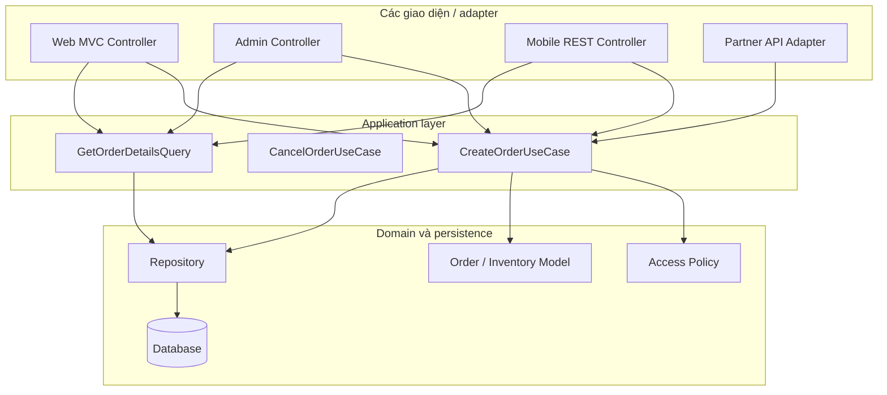

# Nhiều giao diện dùng chung một tập ca sử dụng

Một ứng dụng có thể cung cấp cùng một nghiệp vụ qua nhiều giao diện: khách hàng đặt hàng trên website, nhân viên xử lý đơn trong trang quản trị, ứng dụng di động tạo đơn qua API, hoặc một hệ thống đối tác gửi yêu cầu tích hợp. Các giao diện khác nhau về cách tiếp nhận dữ liệu, xác thực, điều hướng và trình bày kết quả, nhưng có thể cùng cần những hành vi nghiệp vụ như tạo đơn, hủy đơn, xem chi tiết hoặc tra cứu trạng thái.

Nếu mỗi giao diện tự triển khai lại quy tắc nghiệp vụ, các phiên bản dễ lệch nhau: website kiểm tra tồn kho nhưng API quên kiểm tra; trang quản trị cập nhật trạng thái theo một cách còn ứng dụng di động theo cách khác; lỗi và quyền truy cập cũng trở nên không nhất quán. Một thiết kế tốt cho phép các Controller hoặc adapter riêng chuyển request thành lệnh của ứng dụng, sau đó gọi chung ca sử dụng (use case). Phần nghiệp vụ và transaction được thực hiện một lần ở application layer; từng giao diện tự chuyển kết quả thành HTML, JSON hoặc định dạng phù hợp.

Trong MVC, Controller là ranh giới giữa giao diện và phần xử lý. Khi có nhiều giao diện, mỗi giao diện có thể có Controller riêng, nhưng các Controller không cần sở hữu bản sao logic nghiệp vụ. Chúng cùng sử dụng một tập hợp các ca sử dụng có hợp đồng rõ ràng.

## 1. Bài toán nhiều giao diện

Hãy xét một hệ thống quản lý đơn hàng có bốn giao diện:

| Giao diện | Người dùng | Cách tương tác |
|---|---|---|
| Website khách hàng | Khách mua hàng | HTML form, session, redirect |
| Trang quản trị | Nhân viên vận hành | HTML, bảng dữ liệu, thao tác quản trị |
| Ứng dụng di động | Khách hàng | JSON API, token, response có cấu trúc |
| API đối tác | Hệ thống bên ngoài | API key/OAuth, hợp đồng và version riêng |

Cả bốn giao diện có thể cần tạo đơn hàng. Tuy nhiên, dữ liệu vào và kết quả đầu ra khác nhau:

- Website có thể hiển thị form, lỗi validation cạnh trường nhập và chuyển hướng đến trang chi tiết.
- Ứng dụng di động gửi JSON và mong nhận `201 Created` cùng mã đơn.
- Trang quản trị có thể cho phép nhân viên tạo đơn thay khách hàng nếu có quyền tương ứng.
- API đối tác cần kiểm tra tenant, mã tham chiếu ngoài và quy tắc retry.

Điểm chung là nghiệp vụ tạo đơn phải nhất quán: kiểm tra quyền, sản phẩm, giá, tồn kho, bất biến đơn hàng, ghi dữ liệu và phát các sự kiện cần thiết. Những khác biệt về HTTP, form và cách trình bày thuộc adapter của từng giao diện.

## 2. Phân chia trách nhiệm

Một cách tổ chức thường dùng là tách thành ba vùng:

1. **Giao diện và adapter:** nhận request, xác thực theo cơ chế của kênh, bind dữ liệu, chuyển đổi thành command/query và trình bày response.
2. **Application layer:** cung cấp ca sử dụng, điều phối quy trình, kiểm tra quyền theo ngữ cảnh, quản lý transaction và gọi domain/repository.
3. **Domain và persistence:** giữ quy tắc nghiệp vụ, trạng thái và tính nhất quán dữ liệu.



Các adapter gọi cùng hợp đồng use case. Application layer không cần biết request đến từ Thymeleaf, JSON, mobile hay hệ thống đối tác. Nó nhận dữ liệu nghiệp vụ đã được chuyển thành kiểu đầu vào của ứng dụng và thực hiện cùng quy tắc.

Đây là cách kết hợp MVC với tư duy Ports and Adapters: MVC tổ chức phần trình bày và điều khiển request; application use case tạo ranh giới cho hành vi mà nhiều adapter có thể gọi. Không bắt buộc mọi dự án phải triển khai đầy đủ kiến trúc hexagonal, nhưng hợp đồng use case độc lập giao diện giúp giảm phụ thuộc vào framework.

## 3. Không đồng nhất Controller với ca sử dụng

Controller xử lý giao thức và điều phối request. Ca sử dụng mô tả một mục tiêu mà người dùng hoặc hệ thống muốn hoàn thành.

Ví dụ:

- `POST /orders` là một route HTTP.
- `CreateOrderUseCase` là hành vi tạo đơn.
- `CreateOrderCommand` là dữ liệu đầu vào của hành vi.
- `CreateOrderResult` là kết quả ứng dụng trả về.

Một ca sử dụng có thể được gọi từ nhiều route hoặc nhiều giao diện. Ngược lại, một giao diện có thể gọi nhiều ca sử dụng. Không nên đặt logic nghiệp vụ vào từng phương thức Controller chỉ vì route có tên khác nhau.

### So sánh hai cách tổ chức

| Cách tổ chức | Hệ quả |
|---|---|
| Mỗi Controller tự kiểm tra giá, tồn kho, quyền và cập nhật đơn | Logic bị sao chép; các giao diện có thể hành xử khác nhau |
| Mỗi Controller chuyển request sang use case dùng chung | Quy tắc và transaction có một nơi điều phối; adapter tập trung vào giao thức |

Không có nghĩa mọi giao diện phải dùng cùng một Controller. Controller của HTML cần `Model`, `BindingResult`, flash attribute và redirect; REST Controller cần status, header và JSON. Chúng có vòng đời và hợp đồng riêng.

## 4. Thiết kế hợp đồng use case

Hợp đồng use case nên diễn tả một hành động cụ thể, không phụ thuộc `HttpServletRequest`, `Model`, `ResponseEntity` hoặc lớp framework của giao diện.

Ví dụ lệnh tạo đơn:

```java
public record CreateOrderLine(
    UUID productId,
    int quantity
) {}

public record CreateOrderCommand(
    UUID customerId,
    List<CreateOrderLine> lines,
    String note
) {}

public record CreateOrderResult(
    UUID orderId,
    String orderNumber,
    OrderStatus status,
    BigDecimal total,
    String currencyCode
) {}

public interface CreateOrderUseCase {
    CreateOrderResult execute(CreateOrderCommand command);
}
```

Command là hợp đồng nội bộ của application layer. Form HTML và JSON request không nhất thiết phải có cấu trúc giống command; mỗi adapter có thể nhận dữ liệu riêng rồi ánh xạ sang command.

### Không đưa dữ liệu giao thức vào use case

Tránh các kiểu thiết kế như:

```java
// Không nên: application layer phụ thuộc trực tiếp HTTP và MVC.
public interface CreateOrderUseCase {
    ResponseEntity<?> execute(HttpServletRequest request, Model model);
}
```

Hợp đồng như vậy khiến use case khó được gọi từ mobile, message consumer, batch job hoặc test độc lập. Application layer nên dùng kiểu dữ liệu và exception của ứng dụng; adapter chịu trách nhiệm chuyển đổi chúng thành HTTP response hoặc View.

### Dùng command và query riêng

Lệnh thay đổi trạng thái thường được biểu diễn bằng command:

- `CreateOrderCommand`
- `CancelOrderCommand`
- `ConfirmOrderCommand`

Truy vấn đọc có thể được biểu diễn bằng query:

- `GetOrderDetailsQuery`
- `ListCustomerOrdersQuery`
- `GetOrderSummaryQuery`

Command và query có thể có DTO riêng. Không cần áp dụng CQRS đầy đủ cho mọi ứng dụng; tách hợp đồng đọc/ghi đã đủ giúp làm rõ ý định và quyền truy cập.

## 5. Danh tính và phân quyền khi có nhiều kênh

Các giao diện có thể dùng cơ chế xác thực khác nhau:

- Website dùng session và cookie.
- Ứng dụng di động dùng access token.
- Đối tác dùng OAuth client credentials hoặc API key.
- Tác vụ nền dùng service identity.

Application layer nên nhận được danh tính đã được xác minh thông qua một abstraction ổn định. Không nhận `actorId`, role hoặc tenant do client tự khai báo trong JSON rồi coi đó là sự thật.

Ví dụ một cổng lấy danh tính hiện tại:

```java
public record Actor(
    UUID id,
    UUID tenantId
) {}

public interface CurrentActor {
    Actor get();
}
```

Adapter bảo mật của ứng dụng triển khai `CurrentActor` dựa trên security context. Với một kênh dùng cơ chế xác thực khác, phần tích hợp của kênh đó ánh xạ danh tính đã xác minh vào cùng abstraction. Nếu tác vụ chạy nền, nó có thể cung cấp service actor riêng.

Không đưa kiểu `Authentication`, `Principal` hoặc `SecurityContext` của Spring vào application contract. Nếu use case được gọi từ message consumer, scheduled job hoặc luồng bất đồng bộ không có request context, không giả định `CurrentActor` dựa trên thread-local vẫn tồn tại. Khi đó có thể truyền một `Actor` đã được xác minh rõ ràng vào đầu vào use case hoặc thiết lập service actor trong một execution scope được quản lý và dọn dẹp sau khi xử lý.

Application service có thể dùng actor và policy:

```java
@Service
@RequiredArgsConstructor
public class CreateOrderService implements CreateOrderUseCase {
    private final CurrentActor currentActor;
    private final CustomerAccessPolicy customerAccess;
    private final ProductRepository products;
    private final OrderRepository orders;

    @Override
    @Transactional
    public CreateOrderResult execute(CreateOrderCommand command) {
        Actor actor = currentActor.get();
        customerAccess.ensureCanCreateFor(actor, command.customerId());

        List<OrderLine> lines = command.lines().stream()
            .map(line -> {
                Product product = products.findById(line.productId())
                    .orElseThrow(ProductNotFoundException::new);
                return OrderLine.create(product, line.quantity());
            })
            .toList();

        Order order = Order.place(command.customerId(), lines, command.note());
        orders.save(order);

        return new CreateOrderResult(
            order.getId(),
            order.getOrderNumber(),
            order.getStatus(),
            order.getTotal(),
            order.getCurrencyCode()
        );
    }
}
```

Đây là ví dụ minh họa; constructor, factory và repository cần khớp với domain model thực tế. Điểm quan trọng là quyền được kiểm tra trong luồng use case, danh tính lấy từ nguồn đã xác thực, còn quy tắc về số lượng, trạng thái và tổng tiền vẫn được domain bảo vệ.

### Quyền theo kênh và quyền theo nghiệp vụ

Adapter có thể kiểm tra quyền truy cập endpoint, ví dụ chỉ nhân viên được gọi route quản trị. Application layer vẫn cần kiểm tra quyền trên tài nguyên và hành động cụ thể.

Ví dụ, nhân viên có thể truy cập trang quản trị nhưng chỉ được tạo đơn cho khách hàng thuộc chi nhánh mình quản lý. Đối tác chỉ được tạo đơn trong tenant đã cấp. Không được suy ra quyền truy cập dữ liệu chỉ từ việc request đã qua authentication.

## 6. Mỗi giao diện có request DTO riêng

Một command nghiệp vụ không nhất thiết là hợp đồng công khai. Hãy để adapter định nghĩa dữ liệu đầu vào phù hợp với giao diện.

Form cho website:

```java
public record CreateOrderLineForm(
    @NotNull UUID productId,
    @Positive int quantity
) {}

public record CreateOrderForm(
    @NotNull UUID customerId,
    @NotEmpty List<@Valid CreateOrderLineForm> lines,
    @Size(max = 500) String note
) {}
```

Request cho REST API:

```java
public record CreateOrderLineRequest(
    @NotNull UUID productId,
    @Positive int quantity
) {}

public record CreateOrderRequest(
    @NotNull UUID customerId,
    @NotEmpty List<@Valid CreateOrderLineRequest> items,
    @Size(max = 500) String note
) {}
```

Adapter chuyển đổi dữ liệu:

Các kiểu public trong ví dụ được đặt ở những file Java riêng theo quy ước của dự án; chúng được gom trong một khối mã để dễ theo dõi.

```java
@Component
public class CreateOrderFormMapper {
    public CreateOrderCommand toCommand(CreateOrderForm form) {
        List<CreateOrderLine> lines = form.lines().stream()
            .map(line -> new CreateOrderLine(
                line.productId(), line.quantity()
            ))
            .toList();

        return new CreateOrderCommand(
            form.customerId(), lines, form.note()
        );
    }
}

@Component
public class CreateOrderRequestMapper {
    public CreateOrderCommand toCommand(CreateOrderRequest request) {
        List<CreateOrderLine> lines = request.items().stream()
            .map(item -> new CreateOrderLine(
                item.productId(), item.quantity()
            ))
            .toList();

        return new CreateOrderCommand(
            request.customerId(), lines, request.note()
        );
    }
}
```

REST request có thể dùng tên `items` trong JSON còn form dùng `lines`; khác biệt đó không cần lan vào application layer. DTO của giao diện có thể thay đổi theo version API hoặc trải nghiệm form mà không buộc domain command đổi theo.

### Validation ở từng lớp

- Adapter/DTO kiểm tra cú pháp, kiểu, trường bắt buộc, độ dài và cấu trúc request.
- Application layer kiểm tra điều kiện của use case và quyền truy cập.
- Domain model kiểm tra bất biến và chuyển trạng thái hợp lệ.
- Database constraint bảo vệ tính nhất quán cuối cùng.

Không nên dựa vào Bean Validation ở một giao diện rồi cho rằng giao diện khác cũng đã kiểm tra. API đối tác và form HTML phải cùng đi qua application/domain rule.

## 7. Một use case, nhiều Controller

Website MVC có thể gọi use case rồi chuyển hướng sau khi thành công:

```java
@Controller
@RequiredArgsConstructor
@RequestMapping("/orders")
public class OrderPageController {
    private final CreateOrderUseCase createOrder;
    private final CreateOrderFormMapper formMapper;

    @PostMapping
    public String create(
            @Valid @ModelAttribute("form") CreateOrderForm form,
            BindingResult errors,
            RedirectAttributes redirect) {

        if (errors.hasErrors()) {
            return "orders/new";
        }

        CreateOrderResult result = createOrder.execute(formMapper.toCommand(form));
        redirect.addFlashAttribute("message", "Đã tạo đơn hàng");
        return "redirect:/orders/" + result.orderId();
    }
}
```

REST Controller gọi cùng use case nhưng trả response theo hợp đồng API:

```java
@RestController
@RequiredArgsConstructor
@RequestMapping("/api/v1/orders")
public class OrderApiController {
    private final CreateOrderUseCase createOrder;
    private final CreateOrderRequestMapper requestMapper;

    @PostMapping
    public ResponseEntity<OrderApiResponse> create(
            @Valid @RequestBody CreateOrderRequest request) {

        CreateOrderResult result = createOrder.execute(requestMapper.toCommand(request));

        URI location = URI.create("/api/v1/orders/" + result.orderId());
        OrderApiResponse response = new OrderApiResponse(
            result.orderId(),
            result.orderNumber(),
            result.status().name(),
            result.total(),
            result.currencyCode()
        );
        return ResponseEntity.created(location).body(response);
    }
}
```

Hai Controller dùng cùng `CreateOrderUseCase`, nên logic tạo đơn không bị nhân đôi. Website dùng redirect và flash message; API trả `201 Created`, `Location` và JSON. Ứng dụng di động có thể dùng API này hoặc một adapter khác nếu hợp đồng mobile có yêu cầu riêng.

Không nên tạo một Controller khổng lồ với nhánh `if (isMobile)`, `if (isAdmin)` để trả nhiều loại response. Mỗi adapter nên rõ ràng về giao thức, quyền ở biên và cách chuyển đổi dữ liệu.

## 8. Kết quả ứng dụng và Presenter riêng cho từng giao diện

Use case trả kết quả ứng dụng có kiểu ổn định. Presenter hoặc adapter chuyển kết quả đó thành hình dạng mà từng giao diện cần.

Ví dụ:

| Thành phần | Dữ liệu đầu ra |
|---|---|
| Use case | `CreateOrderResult` với ID, mã đơn, trạng thái, tổng tiền |
| Website Presenter | `OrderCreatedPageView` với tiêu đề, nhãn trạng thái, URL điều hướng |
| Mobile API adapter | `CreateOrderResponse` với JSON fields và `Location` |
| Admin Presenter | `AdminOrderCreatedView` có thêm thông tin vận hành nếu được phép |

Không nên trả trực tiếp entity JPA từ Controller. Entity có thể chứa quan hệ lazy, trường nội bộ, trạng thái kỹ thuật hoặc dữ liệu không được phép công khai.

### ViewModel không cần giống nhau

Website có thể cần `statusLabel`, `totalText` và `createdAtText` đã định dạng theo locale. Mobile API thường nên nhận mã trạng thái, số tiền dạng số và mã tiền tệ để tự trình bày. Admin có thể cần thêm thông tin audit.

Các hợp đồng có thể khác nhau:

```java
public record OrderPageView(
    String orderNumber,
    String customerName,
    String statusLabel,
    String totalText
) {}

public record OrderApiResponse(
    UUID id,
    String orderNumber,
    String status,
    BigDecimal total,
    String currencyCode
) {}
```

Chia sẻ use case không có nghĩa phải chia sẻ ViewModel hoặc JSON schema. Chia sẻ nghiệp vụ; giữ hợp đồng trình bày phù hợp từng client.

## 9. Dùng chung truy vấn đọc nhưng giữ hợp đồng đầu ra riêng

Nhiều giao diện có thể cần đọc cùng dữ liệu đơn hàng. Có thể dùng một query service hoặc query use case chung:

```java
public record GetOrderDetailsQuery(UUID orderId) {}

public record OrderLineData(
    UUID productId,
    String productName,
    int quantity,
    BigDecimal lineTotal
) {}

public record OrderDetailsData(
    UUID id,
    String orderNumber,
    OrderStatus status,
    BigDecimal total,
    String currencyCode,
    List<OrderLineData> lines
) {}

public interface GetOrderDetailsUseCase {
    OrderDetailsData execute(GetOrderDetailsQuery query);
}
```

Query service kiểm tra quyền truy cập và lấy dữ liệu cần thiết. Sau đó website presenter tạo page ViewModel; API adapter tạo JSON response. Nếu một giao diện cần dữ liệu khác hoặc tối ưu truy vấn riêng, có thể tạo query projection riêng nhưng vẫn giữ cùng chính sách truy cập.

Không nên ép mọi màn hình dùng một DTO lớn chứa tất cả trường. Điều đó dễ tạo overfetch và vô tình lộ thông tin. Cũng không nên tạo một query cho mỗi pixel giao diện; hãy tách theo use case và nhu cầu dữ liệu có ý nghĩa.

## 10. Khi nào các giao diện cần use case khác nhau?

Không phải mọi thao tác có tên gần giống đều có cùng ngữ nghĩa.

Ví dụ:

- Khách hàng hủy đơn theo chính sách tự phục vụ.
- Nhân viên hủy đơn sau khi xác minh lý do vận hành.
- Hệ thống đối tác yêu cầu hủy theo mã tham chiếu ngoài.

Nếu các hành động có quyền, điều kiện hoặc tác động khác nhau, hãy mô hình hóa use case riêng hoặc command có ngữ nghĩa rõ:

- `CancelOwnOrder`
- `CancelOrderForCustomer`
- `RequestPartnerOrderCancellation`

Không nên tạo một `updateOrder(status, actorId, isAdmin, force, source)` tổng quát với nhiều cờ boolean. Một hợp đồng mơ hồ khiến policy khó đọc và dễ bỏ qua kiểm tra. Chỉ chia sẻ phần domain behavior thực sự giống nhau bên trong các use case chuyên biệt.

### Tránh service tổng hợp quá rộng

Một class `OrderService` có thể chứa hàng chục phương thức tạo, sửa, hủy, tìm kiếm, báo cáo và gửi lại hóa đơn. Điều này không tự động sai, nhưng nếu nó trở thành nơi mọi Controller phụ thuộc, ranh giới use case sẽ khó nhận biết.

Có thể tổ chức theo mục tiêu:

```text
orders/
  application/
    create/
      CreateOrderUseCase
      CreateOrderService
      CreateOrderCommand
    cancel/
      CancelOrderUseCase
      CancelOrderService
    query/
      GetOrderDetailsUseCase
      ListOrdersUseCase
  web/
    OrderPageController
    OrderPagePresenter
  api/
    OrderApiController
    OrderApiMapper
```

Đây là một ví dụ tổ chức thư mục, không phải quy tắc bắt buộc. Dự án có thể nhóm theo feature hoặc module, miễn hợp đồng và trách nhiệm rõ ràng.

## 11. Transaction và side effect dùng chung

Transaction thường nên được mở tại ranh giới application use case. Khi website và API gọi cùng use case, cả hai nhận cùng cách bảo vệ tính nhất quán:

```java
@Transactional
public CreateOrderResult execute(CreateOrderCommand command) {
    // Kiểm tra quyền, tạo aggregate, lưu dữ liệu.
}
```

Controller không nên tự mở transaction rồi gọi nhiều repository trực tiếp. Nếu mỗi giao diện có một transaction implementation riêng, hành vi có thể lệch và test trở nên khó hơn.

### Gửi thông báo và sự kiện

Sau khi tạo đơn, ứng dụng có thể cần gửi email, push notification hoặc message sang hệ thống khác. Không nên để mỗi Controller tự gửi side effect vì một giao diện có thể quên hoặc gửi hai lần.

Application use case phát domain event hoặc ghi outbox trong cùng transaction với dữ liệu nghiệp vụ. Worker xử lý outbox sau commit và cần có cơ chế retry/deduplication. Từng giao diện có thể chọn cách thông báo cho người dùng, nhưng tác động nghiệp vụ chung được khởi tạo tại cùng một điểm.

Nếu website cần gửi email còn mobile cần push notification, đó là khác biệt ở subscriber hoặc notification adapter. Việc đơn hàng được tạo, tồn kho được cập nhật và sự kiện nghiệp vụ được ghi nhận vẫn thuộc cùng use case.

Không giữ database transaction mở trong lúc gọi dịch vụ mạng lâu. Dùng outbox hoặc quy trình phối hợp phù hợp để tránh giữ khóa và connection trong thời gian chờ bên ngoài.

## 12. Chuẩn hóa lỗi ở application layer, ánh xạ theo giao diện

Use case có thể phát sinh các lỗi có ý nghĩa ứng dụng:

- `OrderNotFoundException`
- `CustomerAccessDeniedException`
- `InsufficientInventoryException`
- `InvalidOrderStateException`
- `ConcurrentUpdateException`

Adapter chuyển lỗi thành phản hồi phù hợp:

| Lỗi ứng dụng | Website HTML | REST API |
|---|---|---|
| Không tìm thấy đơn | Trang 404 | `404 Not Found` |
| Không đủ quyền | Trang 403 hoặc trang không tiết lộ tài nguyên | `403 Forbidden` hoặc `404` theo chính sách |
| Dữ liệu form sai | Render lại form với lỗi cạnh trường | `400` hoặc `422` theo hợp đồng |
| Tồn kho không đủ | Thông báo có thể tiếp tục mua hàng khác | `409 Conflict` hoặc mã lỗi nghiệp vụ đã quy định |
| Cập nhật đồng thời | Trang thông báo tải lại dữ liệu | `409 Conflict` |

Không để application service trả `ModelAndView`, redirect string hoặc HTTP status. Những khái niệm đó thuộc adapter. Cũng không nên trả exception nội bộ nguyên văn cho người dùng; adapter ánh xạ sang mã và thông báo công khai đã thiết kế.

## 13. Versioning và tiến hóa hợp đồng

Khi có nhiều giao diện, mỗi hợp đồng có thể thay đổi theo nhịp riêng:

- Website nội bộ có thể cập nhật đồng thời với backend.
- Mobile app cũ có thể còn được sử dụng nhiều tháng.
- API đối tác có thể cần thời gian thông báo và chuyển version.
- Trang quản trị có thể triển khai theo chu kỳ khác.

Giữ command nội bộ ổn định trong phạm vi cần thiết và để adapter xử lý khác biệt của wire contract. Với API công khai, cân nhắc versioning rõ ràng, backward compatibility và thời gian deprecation.

Không đưa trực tiếp JSON DTO của `/api/v1` vào application command rồi buộc toàn bộ nghiệp vụ theo schema công khai. Một thay đổi tên trường API không nên buộc domain hoặc use case đổi theo nếu ý nghĩa nghiệp vụ không thay đổi.

### Khi nào cần Backend for Frontend (BFF)?

Nếu mobile và web cần cách tổng hợp dữ liệu, cache hoặc điều phối nhiều backend rất khác nhau, một BFF riêng cho từng trải nghiệm có thể hữu ích. BFF là adapter/orchestration ở biên; nó vẫn nên gọi các use case hoặc service dùng chung thay vì sao chép quy tắc nghiệp vụ.

Không cần BFF chỉ vì có hai giao diện. Nếu một REST API và một MVC Controller có thể gọi use case trực tiếp, thêm lớp BFF có thể làm tăng hop và độ phức tạp không cần thiết.

## 14. Kiểm thử khi nhiều giao diện dùng chung use case

Tách use case khỏi giao diện giúp kiểm thử theo trách nhiệm:

| Loại test | Điều cần chứng minh |
|---|---|
| Unit test use case | Quy tắc điều phối, quyền, kết quả và lỗi nghiệp vụ |
| Domain test | Bất biến và chuyển trạng thái đúng |
| Controller test cho web | Form binding, validation, redirect và flash message |
| Controller test cho API | JSON contract, status, header và lỗi |
| Security test | Danh tính và quyền của từng kênh được ánh xạ đúng |
| Integration test | Transaction, repository và constraint hoạt động |
| Contract test | API response tương thích với client hoặc đối tác |
| End-to-end test | Mỗi giao diện thực hiện được hành trình của nó |

### Kiểm thử use case một lần cho nhiều adapter

Unit test có thể gọi trực tiếp hợp đồng use case với `CurrentActor` giả:

```java
@Test
void createsOrderForAuthorizedCustomer() {
    given(currentActor.get()).willReturn(
        new Actor(actorId, tenantId)
    );
    willDoNothing().given(customerAccess)
        .ensureCanCreateFor(new Actor(actorId, tenantId), customerId);

    CreateOrderResult result = useCase.execute(command);

    assertNotNull(result.orderId());
    then(customerAccess).should()
        .ensureCanCreateFor(new Actor(actorId, tenantId), customerId);
    verify(orders).save(any(Order.class));
}
```

Ví dụ minh họa; policy có thể được thiết kế theo kiểu trả về hoặc ném exception. Test cần xác minh cả trường hợp không đủ quyền, tồn kho không đủ và trạng thái không hợp lệ.

### Kiểm thử từng adapter riêng

Web Controller test xác minh form được chuyển thành command và thành công dẫn đến redirect. API Controller test xác minh JSON request được ánh xạ đúng, trả `201 Created` và header `Location`. Có thể mock use case trong các test adapter để tập trung vào giao thức; integration test riêng chứng minh wiring thực tế gọi đúng use case.

### Kiểm thử không bị bỏ qua khi thêm giao diện

Khi thêm mobile hoặc partner API, cần xác minh:

- Adapter mới gọi cùng use case hoặc use case chuyên biệt có chủ đích.
- Không có bản sao quy tắc tồn kho, giá hoặc trạng thái trong Controller.
- Danh tính và tenant được xác minh từ credential.
- Lỗi và side effect tuân theo cùng quy tắc.
- Contract test xác minh dữ liệu không vượt phạm vi quyền.

## 15. Những lỗi thiết kế thường gặp

| Lỗi | Hệ quả | Cách cải thiện |
|---|---|---|
| Mỗi giao diện tự viết lại nghiệp vụ | Quy tắc lệch nhau theo kênh | Dùng application use case chung |
| Dùng một Controller cho mọi giao thức | Nhiều nhánh điều kiện và response khó bảo trì | Controller/adapter riêng theo giao diện |
| Application service phụ thuộc `HttpServletRequest` | Không gọi được từ giao diện khác hoặc test độc lập | Hợp đồng command/query thuần ứng dụng |
| Dùng chung một DTO cho form, JSON và View | Wire contract bị ràng buộc vào UI nội bộ | Mapper giữa DTO giao diện và command/result |
| Trả entity trực tiếp cho mọi client | Lộ dữ liệu, lazy loading và coupling ORM | Response/ViewModel riêng |
| Tin actorId hoặc role trong request body | Giả mạo danh tính và quyền | Lấy actor từ security context đã xác minh |
| Chỉ kiểm tra quyền ở Controller | Adapter khác có thể quên kiểm tra | Policy ở application/domain boundary |
| Một `update` tổng quát cho mọi hành động | Ngữ nghĩa và quyền khó kiểm soát | Use case cụ thể theo mục tiêu |
| Mỗi Controller tự gửi email hoặc message | Side effect không nhất quán và có thể lặp | Domain event/outbox trong application flow |
| Ép mọi client dùng cùng response shape | Overfetch hoặc trải nghiệm kém phù hợp | Presenter/response mapper theo kênh |
| Thêm BFF không có nhu cầu rõ | Tăng hop và lớp cần vận hành | Chỉ thêm khi cần orchestration riêng |

## 16. Quy trình đưa giao diện mới vào hệ thống

Giả sử ứng dụng đã có website MVC và cần bổ sung mobile API:

1. **Liệt kê hành trình mobile.** Xác định các mục tiêu như tạo đơn, xem chi tiết, hủy đơn và theo dõi trạng thái.
2. **Đối chiếu use case hiện có.** Tìm hành vi nghiệp vụ tương ứng; xác định điểm nào thực sự khác về quyền hoặc quy tắc.
3. **Thiết kế API contract.** Tạo request/response DTO, status, error code và version phù hợp.
4. **Xây adapter.** Controller nhận JSON, xác thực token, validate cấu trúc và map sang command/query.
5. **Gọi use case.** Tái sử dụng application service, policy, transaction và domain model.
6. **Tạo response riêng.** Presenter/mapper trả dữ liệu vừa đủ cho mobile; không serialize entity.
7. **Kiểm thử.** Unit test use case, controller/security test, integration test và contract test.
8. **Quan sát sau triển khai.** Theo dõi lỗi theo adapter, use case, correlation ID và phiên bản client.

Nếu mobile cần hành vi nghiệp vụ mới, tạo use case mới với tên và quyền rõ ràng. Không sửa use case cũ chỉ để phù hợp một giao thức mới khi ngữ nghĩa của nó không thay đổi.

## 17. Checklist kiến trúc nhiều giao diện

- Mỗi giao diện có adapter/Controller phù hợp với giao thức của nó chưa?
- Các Controller có gọi application use case thay vì tự triển khai nghiệp vụ không?
- Hợp đồng command/query có độc lập HTTP, template và framework không?
- Request DTO và response/ViewModel có được thiết kế theo nhu cầu từng giao diện không?
- Danh tính và tenant có đến từ credential đã xác minh không?
- Policy có kiểm tra quyền trên từng tài nguyên và hành động không?
- Domain model có bảo vệ bất biến dù use case được gọi từ bất kỳ kênh nào không?
- Transaction và side effect có nằm trong cùng application flow không?
- Lỗi ứng dụng có được ánh xạ riêng thành HTML hoặc HTTP response phù hợp không?
- API có versioning và backward compatibility khi cần không?
- Test use case có độc lập giao diện và test adapter có xác minh hợp đồng riêng không?
- Có đo lường và correlation để theo dõi request từ từng giao diện tới use case không?

## Kết luận

Nhiều giao diện có thể cùng sử dụng một tập ca sử dụng nếu Controller hoặc adapter chỉ chịu trách nhiệm tiếp nhận, xác thực ở biên, chuyển đổi dữ liệu và trình bày kết quả. Application layer cung cấp command/query và điều phối nghiệp vụ; domain model giữ bất biến; repository và transaction bảo vệ dữ liệu. Mỗi giao diện vẫn có request DTO, response, presenter, điều hướng và cách ánh xạ lỗi riêng. Cách tổ chức này giúp website, quản trị, mobile và tích hợp đối tác có trải nghiệm phù hợp mà vẫn dùng chung một nguồn quy tắc nghiệp vụ và được kiểm thử theo ranh giới rõ ràng.
