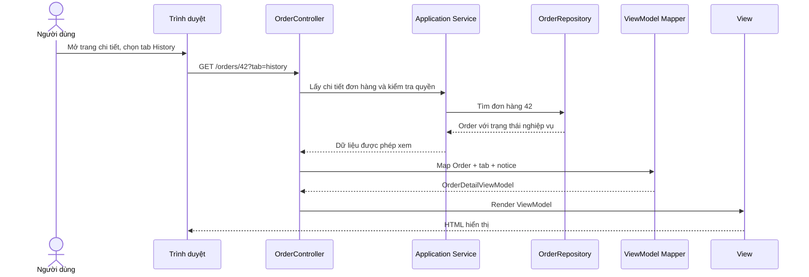
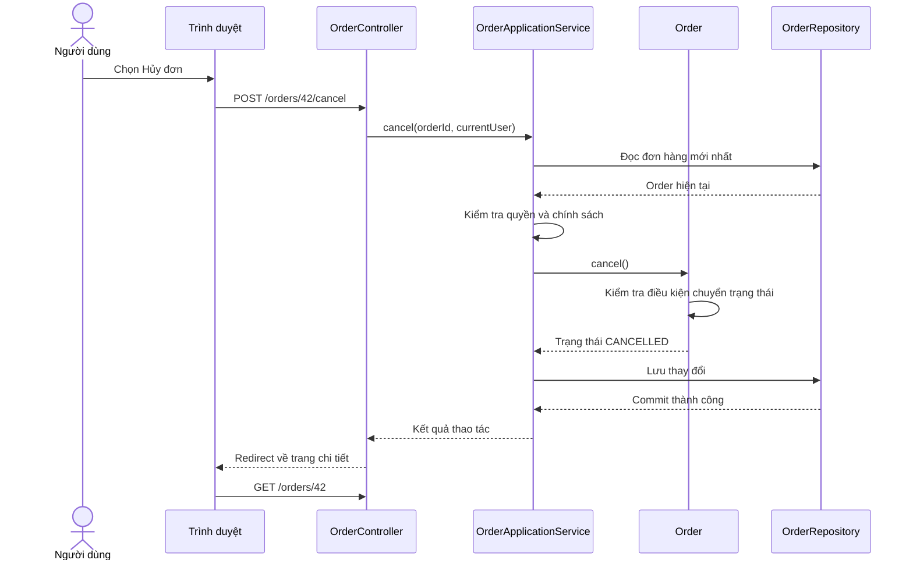

# Phân biệt trạng thái nghiệp vụ và trạng thái trình bày

Trong kiến trúc **MODEL_VIEW_CONTROLLER (MVC)**, ứng dụng được tổ chức để tách phần trạng thái và quy tắc của ứng dụng, phần trình bày dữ liệu và phần tiếp nhận, điều phối tương tác. Module này giúp người học theo dõi luồng request, thiết kế hợp đồng dữ liệu, xử lý biểu mẫu, lỗi, bảo mật và kiểm thử MVC trong ứng dụng web. Muốn giữ được ranh giới đó, trước hết cần phân biệt hai loại trạng thái thường xuất hiện cùng lúc trên một màn hình: **trạng thái nghiệp vụ** và **trạng thái trình bày**.

Một trang chi tiết đơn hàng có thể hiển thị trạng thái “Đã xác nhận”, một nút “Hủy đơn”, tab “Lịch sử” đang được chọn và thông báo “Đã lưu thay đổi”. Những thông tin này cùng xuất hiện trong giao diện, nhưng chúng không có cùng ý nghĩa. “Đã xác nhận” phản ánh vòng đời thật của đơn hàng. Tab đang chọn chỉ mô tả cách người dùng đang xem trang. Thông báo thành công chỉ phục vụ phản hồi cho một thao tác vừa diễn ra. Nếu gộp tất cả vào một đối tượng hoặc lưu chúng cùng một cách, ứng dụng dễ phát sinh lỗi về tính nhất quán, bảo mật và khả năng kiểm thử.

## 1. Hai khái niệm và mục đích của chúng

### Trạng thái nghiệp vụ

**Trạng thái nghiệp vụ (business state)** là tập hợp các dữ kiện có ý nghĩa đối với hoạt động của hệ thống và các đối tượng nghiệp vụ. Nó trả lời những câu hỏi như: đơn hàng đang ở giai đoạn nào, hóa đơn đã thanh toán chưa, tài khoản có đang bị khóa không, yêu cầu hoàn tiền đã được duyệt chưa.

Trạng thái nghiệp vụ thường có các đặc điểm sau:

- Có ý nghĩa độc lập với một màn hình cụ thể. Đơn hàng vẫn ở trạng thái đã xác nhận dù người dùng xem nó trên trang web, ứng dụng di động hay báo cáo.
- Được thay đổi bởi các hành động nghiệp vụ hợp lệ. Ví dụ, đơn hàng chuyển từ `DRAFT` sang `CONFIRMED` khi thỏa điều kiện xác nhận.
- Phải tuân thủ các quy tắc và bất biến của miền nghiệp vụ. Một đơn đã thanh toán có thể không được hủy theo quy trình thông thường.
- Thường cần được lưu trữ để các request sau, người dùng khác hoặc tiến trình nền có thể đọc được cùng một kết quả.
- Có thể ảnh hưởng đến quyền thực hiện hành động tiếp theo, nghĩa vụ tài chính, quy trình xử lý hoặc dữ liệu của đối tượng khác.

Trạng thái nghiệp vụ thường nằm trong mô hình miền (domain model), được thao tác thông qua lớp dịch vụ ứng dụng hoặc miền và được lưu qua repository. Cơ sở dữ liệu có thể lưu trạng thái đó, nhưng bản thân một cột trong cơ sở dữ liệu chưa định nghĩa đầy đủ quy tắc nghiệp vụ. Ví dụ, cột `status = 'PAID'` cho biết giá trị hiện tại; quy tắc “đơn đã thanh toán không được hủy trực tiếp” phải được bảo vệ trong logic nghiệp vụ.

### Trạng thái trình bày

**Trạng thái trình bày (presentation state)** mô tả cách dữ liệu được tổ chức, hiển thị hoặc tương tác trong một ngữ cảnh giao diện cụ thể. Nó trả lời những câu hỏi như: người dùng đang mở tab nào, danh sách đang sắp xếp theo cột nào, trang hiện tại là trang số mấy, một vùng nội dung có đang được mở rộng không, hoặc giao diện cần hiển thị thông báo nào.

Ví dụ về trạng thái trình bày:

- Tab đang chọn: `DETAILS`, `HISTORY` hoặc `PAYMENTS`.
- Bộ lọc, từ khóa tìm kiếm, thứ tự sắp xếp và số trang của một danh sách.
- Trạng thái mở rộng hoặc thu gọn của một vùng nội dung.
- Giá trị đang nhập trong biểu mẫu trước khi người dùng gửi đi.
- Thông báo thành công, thông báo lỗi có thể hiển thị, nhãn trạng thái và kiểu hiển thị của huy hiệu.
- Trạng thái tải dữ liệu, trạng thái một nút đang bị vô hiệu hóa hoặc trạng thái rỗng của một vùng giao diện.

Trạng thái trình bày thường có vòng đời ngắn hơn và phụ thuộc vào màn hình, request, phiên làm việc hoặc thiết bị. Tùy yêu cầu, nó có thể được giữ trong URL, request, session, bộ nhớ của trình duyệt hoặc một ViewModel được tạo cho lần render hiện tại. Một số tùy chọn giao diện như ngôn ngữ, kích thước trang mặc định hoặc chế độ sáng/tối có thể được lưu lâu dài theo hồ sơ người dùng. Việc được lưu lâu dài không tự động biến một tùy chọn giao diện thành trạng thái nghiệp vụ; cần xét ý nghĩa và quy tắc chi phối dữ liệu đó.

### So sánh nhanh

| Tiêu chí | Trạng thái nghiệp vụ | Trạng thái trình bày |
|---|---|---|
| Câu hỏi chính | Đối tượng hoặc quy trình đang ở tình trạng nào? | Người dùng đang xem hoặc tương tác theo cách nào? |
| Phạm vi ý nghĩa | Độc lập với một màn hình | Gắn với ngữ cảnh trình bày hoặc tương tác |
| Nơi thường quản lý | Domain Model, application service, repository | ViewModel, request, URL, session hoặc trạng thái phía trình duyệt |
| Quy tắc thay đổi | Quy tắc miền, quyền hạn và bất biến nghiệp vụ | Hành vi điều hướng, hiển thị và tương tác |
| Lưu trữ | Thường cần lưu bền vững | Thường tạm thời; có thể lưu tùy trải nghiệm |
| Ví dụ | Đơn hàng đã xác nhận, hóa đơn đã thanh toán | Tab đang chọn, bộ lọc đang dùng, thông báo thành công |
| Hậu quả khi sai | Dữ liệu và quy trình nghiệp vụ mất nhất quán | Giao diện gây nhầm lẫn hoặc trải nghiệm không liền mạch |

Hai loại trạng thái có liên quan nhưng không thể thay thế cho nhau. Giao diện thường đọc trạng thái nghiệp vụ để quyết định cần trình bày gì; tương tác trên giao diện có thể gửi một yêu cầu làm thay đổi trạng thái nghiệp vụ. Tuy nhiên, việc người dùng nhìn thấy một nút hoặc thay đổi một trường trên màn hình không có nghĩa là thay đổi nghiệp vụ đã được chấp nhận.

## 2. Vị trí của hai loại trạng thái trong MVC

Trong MVC, **Model** đại diện cho dữ liệu và hành vi mà ứng dụng cần quản lý. Ở một ứng dụng web có miền nghiệp vụ rõ ràng, phần Model có thể bao gồm mô hình miền, dịch vụ ứng dụng và các thành phần truy cập dữ liệu. **View** chịu trách nhiệm trình bày dữ liệu. **Controller** tiếp nhận request, chuyển dữ liệu đầu vào thành lời gọi phù hợp, điều phối xử lý và chọn kết quả phản hồi.

Ranh giới quan trọng không nằm ở tên lớp mà nằm ở trách nhiệm:

- Mô hình miền và dịch vụ nghiệp vụ bảo vệ trạng thái nghiệp vụ cùng các quy tắc chuyển trạng thái.
- ViewModel hoặc presentation DTO đóng gói dữ liệu đã chuẩn bị cho một View cụ thể.
- Controller chuyển đổi giữa giao thức HTTP, dữ liệu đầu vào và các thao tác ứng dụng; controller không nên trở thành nơi chứa toàn bộ quy tắc nghiệp vụ.
- View hiển thị dữ liệu và thu nhận tương tác; nó không phải nguồn có thẩm quyền để xác nhận một giao dịch nghiệp vụ.

Không nên hiểu rằng mọi thứ có tên `Model` đều là entity trong cơ sở dữ liệu, hoặc mọi dữ liệu được gửi đến View đều là trạng thái nghiệp vụ. Một ViewModel có thể chứa cả dữ liệu được đọc từ miền nghiệp vụ lẫn trạng thái trình bày như tab đang chọn, thông báo hoặc cờ quyết định có hiển thị một thao tác hay không. ViewModel là hợp đồng dữ liệu phục vụ trình bày; nó không trở thành đối tượng miền chỉ vì có chứa dữ liệu nghiệp vụ.

## 3. Ví dụ: trang chi tiết đơn hàng

Giả sử hệ thống có đối tượng `Order` với các trạng thái nghiệp vụ:

```java
enum OrderStatus {
    DRAFT,
    CONFIRMED,
    PAID,
    CANCELLED
}
```

Đơn hàng có thể được xác nhận, thanh toán hoặc hủy theo những điều kiện do miền nghiệp vụ quy định. Các trạng thái này phải nhất quán dù request đến từ trang chi tiết, API dành cho ứng dụng di động hay một tác vụ nền.

Trong khi đó, trang chi tiết có thể cần các dữ liệu trình bày như:

```java
// Ví dụ dùng record, yêu cầu Java 16 trở lên.
record OrderDetailViewModel(
    String orderNumber,
    String statusLabel,
    String statusBadgeStyle,
    boolean showCancelAction,
    String activeTab,
    String notice
) {}
```

`statusLabel` và `statusBadgeStyle` là cách giao diện diễn đạt trạng thái nghiệp vụ. `activeTab` và `notice` là trạng thái trình bày. `showCancelAction` là gợi ý cho View về việc có nên hiển thị thao tác hay không; nó không phải bằng chứng rằng request hủy đơn sẽ được chấp nhận.

Một mapper có thể chuyển dữ liệu miền thành ViewModel:

```java
final class OrderDetailMapper {

    OrderDetailViewModel toViewModel(
            Order order,
            boolean userMayRequestCancellation,
            String activeTab,
            String notice) {

        String label = switch (order.getStatus()) {
            case DRAFT -> "Bản nháp";
            case CONFIRMED -> "Đã xác nhận";
            case PAID -> "Đã thanh toán";
            case CANCELLED -> "Đã hủy";
        };

        String badgeStyle = switch (order.getStatus()) {
            case DRAFT -> "neutral";
            case CONFIRMED -> "info";
            case PAID -> "success";
            case CANCELLED -> "muted";
        };

        boolean showCancelAction =
                userMayRequestCancellation
                && order.getStatus() != OrderStatus.PAID
                && order.getStatus() != OrderStatus.CANCELLED;

        return new OrderDetailViewModel(
                order.getNumber(),
                label,
                badgeStyle,
                showCancelAction,
                activeTab,
                notice
        );
    }
}
```

Đoạn mã minh họa cho thấy một giá trị nghiệp vụ có thể được biểu diễn bằng nhiều dữ liệu trình bày. `OrderStatus.CONFIRMED` được ánh xạ thành nhãn “Đã xác nhận” và kiểu huy hiệu `info`. Nhãn và kiểu huy hiệu có thể thay đổi theo ngôn ngữ hoặc thiết kế giao diện mà không cần thay đổi trạng thái của đơn hàng.

Trong thực tế, điều kiện hiển thị thao tác nên được tính từ chính sách quyền và trạng thái hiện tại ở phía máy chủ. Nếu View ẩn nút hủy, đó chỉ là hỗ trợ trải nghiệm. Khi nhận request hủy, hệ thống vẫn phải kiểm tra quyền và điều kiện nghiệp vụ lần nữa.

## 4. Luồng đọc và thay đổi trạng thái

### Khi hiển thị một trang

Khi người dùng mở trang chi tiết, controller nhận mã đơn hàng cùng các tham số trình bày như tab hoặc trang con. Ứng dụng truy vấn đơn hàng, kiểm tra quyền xem, sau đó mapper tạo ViewModel cho View.



Trong luồng này, `Order` cung cấp dữ liệu nghiệp vụ. `tab=history` là trạng thái điều hướng/trình bày. Mapper kết hợp chúng để tạo dữ liệu cho View. Thay đổi tab không làm thay đổi trạng thái đơn hàng và thường không cần ghi một giao dịch nghiệp vụ vào cơ sở dữ liệu.

### Khi người dùng gửi một thao tác

Giả sử người dùng chọn “Hủy đơn”. Trình duyệt gửi một request mang ý định hủy. Controller phân tích request và gọi dịch vụ ứng dụng. Dịch vụ tải trạng thái hiện tại, kiểm tra quyền, yêu cầu đối tượng nghiệp vụ thực hiện chuyển trạng thái và lưu kết quả trong một giao dịch phù hợp.



Một thao tác trên giao diện chỉ tạo ra **yêu cầu** thay đổi nghiệp vụ. Trạng thái chỉ thay đổi sau khi máy chủ xác thực request, kiểm tra quyền, áp dụng quy tắc và lưu thành công. Nếu đơn hàng đã thanh toán hoặc người dùng không có quyền hủy, dịch vụ phải từ chối thao tác và trả kết quả phù hợp.

Với ứng dụng dùng mô hình Post/Redirect/Get, controller có thể chuyển hướng về trang chi tiết sau khi xử lý POST. Một thông báo ngắn như “Đơn hàng đã được hủy” có thể được truyền qua flash attribute hoặc cơ chế tương đương. Thông báo đó là trạng thái trình bày; nó không thay thế trạng thái `CANCELLED` đã được lưu.

## 5. Xử lý biểu mẫu và lỗi đúng ranh giới

Dữ liệu người dùng nhập vào biểu mẫu ban đầu là dữ liệu request. Nó chưa phải trạng thái nghiệp vụ đã được chấp nhận. Ví dụ, người dùng gửi địa chỉ giao hàng mới. Ứng dụng cần phân biệt ít nhất ba bước:

1. **Đọc và kiểm tra hình thức đầu vào:** trường bắt buộc có được nhập không, email có đúng định dạng không, số lượng có phải số dương không. Lỗi ở bước này thường gắn với trường biểu mẫu và được trình bày ngay trên View.
2. **Kiểm tra quy tắc nghiệp vụ:** địa chỉ có thuộc khu vực giao hàng không, đơn hàng có còn được phép đổi địa chỉ không, số lượng có vượt giới hạn tồn kho không. Các quy tắc này phải được thực thi ở phía máy chủ trong tầng nghiệp vụ phù hợp.
3. **Ghi nhận thay đổi:** chỉ khi các điều kiện cần thiết được thỏa mãn, ứng dụng mới cập nhật trạng thái nghiệp vụ và lưu giao dịch.

Có thể phân biệt hai nhóm lỗi như sau:

| Loại lỗi | Ví dụ | Nơi chịu trách nhiệm chính | Cách trình bày thường gặp |
|---|---|---|---|
| Lỗi dữ liệu đầu vào | Thiếu họ tên, email sai định dạng | Ràng buộc đầu vào/validation của request | Lỗi cạnh trường nhập |
| Lỗi quy tắc nghiệp vụ | Đơn đã thanh toán nên không thể hủy | Domain Model hoặc application service | Thông báo nghiệp vụ, trạng thái trang được cập nhật |
| Lỗi hạ tầng | Không kết nối được cơ sở dữ liệu | Tầng hạ tầng và xử lý lỗi của ứng dụng | Trang lỗi chung hoặc thông báo có thể thử lại |

Thông tin lỗi được đưa vào ViewModel để hiển thị là dữ liệu trình bày. Nhưng quyết định một thao tác có hợp lệ hay không phải đến từ kiểm tra phía máy chủ. Không được dựa vào việc JavaScript đã đánh dấu biểu mẫu hợp lệ hoặc nút gửi đang bị vô hiệu hóa để bỏ qua validation ở backend.

## 6. Lưu trữ trạng thái ở đâu?

Không nên quyết định nơi lưu chỉ dựa vào việc dữ liệu xuất hiện trên màn hình. Hãy hỏi dữ liệu đó có ý nghĩa gì, ai cần dùng lại, cần tồn tại bao lâu và có ảnh hưởng đến nghiệp vụ không.

| Loại dữ liệu | Cách lưu thường phù hợp | Lý do |
|---|---|---|
| Trạng thái đơn hàng, số tiền đã thanh toán | Cơ sở dữ liệu qua repository và giao dịch | Cần nhất quán giữa request, người dùng và tiến trình |
| Tab đang chọn có thể chia sẻ/bookmark | Query parameter trong URL | Có thể tải lại hoặc chia sẻ đúng ngữ cảnh xem |
| Từ khóa lọc danh sách | Query parameter hoặc trạng thái phía trình duyệt | Phụ thuộc vào trải nghiệm điều hướng và yêu cầu tải lại |
| Vùng nội dung đang mở rộng | Bộ nhớ giao diện hoặc local storage | Thường chỉ phục vụ trải nghiệm trên thiết bị |
| Thông báo sau redirect | Flash/session ngắn hạn | Chỉ cần tồn tại qua lần điều hướng kế tiếp |
| Ngôn ngữ hoặc chế độ giao diện ưa thích | Hồ sơ người dùng hoặc thiết lập phía trình duyệt | Có thể cần giữ qua nhiều phiên nhưng không phải trạng thái của đơn hàng |

Đây là các lựa chọn phổ biến, không phải quy tắc cứng. Ví dụ, bộ lọc có thể cần lưu vào hồ sơ nếu sản phẩm yêu cầu khôi phục tùy chọn trên nhiều thiết bị. Ngược lại, không nên lưu một tab đang chọn vào cơ sở dữ liệu của đơn hàng nếu lựa chọn đó không có ý nghĩa với những người dùng khác.

Một nguyên tắc hữu ích là **lưu dữ liệu ở nơi có vòng đời và phạm vi phù hợp với ý nghĩa của nó**. Trạng thái nghiệp vụ phải có nguồn sự thật đáng tin cậy. Trạng thái trình bày có thể được tái tạo từ URL, request hoặc dữ liệu nghiệp vụ khi cần; không nhất thiết mọi trạng thái giao diện đều phải lưu.

## 7. Bảo mật và tính nhất quán

Ranh giới giữa hai loại trạng thái cũng là ranh giới bảo mật. Trình duyệt nằm ngoài vùng tin cậy của máy chủ. Người dùng có thể sửa HTML, gọi endpoint trực tiếp, thay đổi hidden input hoặc gửi request cũ sau khi dữ liệu đã thay đổi.

Vì vậy:

- Không tin `status`, `price`, `ownerId` hoặc các trường quyết định quyền được gửi từ trình duyệt. Máy chủ phải đọc dữ liệu có thẩm quyền và áp dụng quy tắc tương ứng.
- Không coi `showCancelAction = false` trong ViewModel là cơ chế bảo vệ endpoint. Endpoint hủy đơn phải tự xác thực người dùng và kiểm tra quyền trên tài nguyên.
- Không cho phép View tự đặt trạng thái nghiệp vụ bằng cách gửi một chuỗi như `status=PAID`. Hãy nhận một lệnh có ý nghĩa, ví dụ `confirmOrder`, rồi để dịch vụ và mô hình miền quyết định chuyển trạng thái hợp lệ.
- Kiểm tra lại trạng thái hiện tại khi xử lý lệnh. Người dùng có thể mở trang khi đơn còn ở trạng thái `CONFIRMED`, nhưng trước khi họ gửi lệnh hủy, một tiến trình khác đã thanh toán đơn.
- Với các thao tác đồng thời, dùng giao dịch và cơ chế kiểm soát đồng thời thích hợp, chẳng hạn optimistic locking bằng version, để tránh ghi đè thay đổi mới hơn.
- Với biểu mẫu thay đổi dữ liệu, áp dụng biện pháp bảo vệ request phù hợp với nền tảng, chẳng hạn CSRF token cho ứng dụng web dùng cookie phiên.

Những kiểm tra này bảo vệ trạng thái nghiệp vụ ngay cả khi trạng thái trình bày đã cũ, bị sửa hoặc được tạo từ một request không hợp lệ.

## 8. Những cách thiết kế dễ gây lỗi

### Đưa trạng thái giao diện vào entity nghiệp vụ

Nếu entity `Order` có các thuộc tính như `selectedTab`, `isExpanded` hoặc `lastToastMessage`, mô hình miền sẽ phụ thuộc vào cách một màn hình cụ thể được dựng. Các thuộc tính này không giúp xác định đơn hàng có hợp lệ hay không và thường không nên được lưu cùng entity. Hãy chuyển chúng sang ViewModel hoặc cơ chế quản lý giao diện.

### Để giao diện quyết định trạng thái nghiệp vụ

Nếu frontend tự đổi nhãn từ “Chưa thanh toán” sang “Đã thanh toán” ngay sau khi người dùng bấm nút, giao diện có thể hiển thị thành công dù giao dịch bị từ chối hoặc thất bại. Có thể dùng optimistic UI để phản hồi nhanh, nhưng phải có cơ chế đồng bộ với kết quả có thẩm quyền từ máy chủ và khôi phục khi thao tác thất bại.

### Dùng session làm nguồn sự thật cho nghiệp vụ

Session phù hợp để giữ một số dữ liệu tạm thời của người dùng, nhưng không nên là nơi duy nhất lưu trạng thái đơn hàng, thanh toán hoặc quyền sở hữu tài nguyên. Session có thể hết hạn, bị tạo ở nhiều thiết bị hoặc không đồng bộ với tiến trình nền. Dữ liệu nghiệp vụ cần được quản lý bởi tầng nghiệp vụ và kho lưu trữ phù hợp.

### Đặt toàn bộ quy tắc trong controller

Controller có thể kiểm tra request thiếu trường hoặc chuyển đổi kiểu dữ liệu. Nhưng nếu quy tắc “không thể hủy đơn đã thanh toán” chỉ tồn tại trong một controller, một endpoint khác có thể vô tình bỏ qua nó. Quy tắc đó cần được bảo vệ ở miền nghiệp vụ hoặc dịch vụ ứng dụng dùng chung.

### Truyền entity trực tiếp cho View

Đưa nguyên entity vào template có thể khiến View phụ thuộc vào cấu trúc miền, vô tình truy cập quan hệ dữ liệu không cần thiết hoặc làm lộ trường nội bộ. ViewModel giúp chọn rõ trường nào được phép trình bày, định dạng ra sao và dữ liệu tương tác nào thuộc về trang.

## 9. Kiểm thử hai loại trạng thái

Phân biệt đúng trạng thái giúp chọn đúng cấp độ kiểm thử:

| Phần cần kiểm thử | Nội dung nên xác minh | Dạng kiểm thử phù hợp |
|---|---|---|
| Domain Model | Chuyển trạng thái hợp lệ, từ chối chuyển trạng thái sai, bảo toàn bất biến | Unit test |
| Application service | Kiểm tra quyền, điều phối repository, giao dịch và kết quả lệnh | Unit test hoặc integration test |
| Mapper/ViewModel | Nhãn, kiểu hiển thị, tab, thông báo và cờ trình bày được ánh xạ đúng | Unit test |
| Controller | Đọc request, validation, gọi đúng dịch vụ, trả view/redirect và mã phản hồi phù hợp | MVC/controller test |
| Tích hợp lưu trữ | Trạng thái nghiệp vụ được lưu và đọc lại nhất quán | Integration test |
| Luồng giao diện | Người dùng thấy đúng thông tin, lỗi và trạng thái tương tác | Browser/end-to-end test |

Ví dụ, kiểm thử quy tắc hủy đơn nên gọi mô hình miền hoặc dịch vụ ứng dụng để chứng minh đơn đã thanh toán không thể bị hủy. Kiểm thử mapper nên xác minh đơn `PAID` được chuyển thành nhãn “Đã thanh toán” và không hiển thị thao tác hủy. Hai kiểm thử này xác minh hai trách nhiệm khác nhau; một kiểm thử giao diện không thể thay thế kiểm thử quy tắc miền.

## 10. Quy trình xác định một trường thuộc loại trạng thái nào

Khi thiết kế một thuộc tính mới, hãy lần lượt đặt các câu hỏi:

1. **Nếu thay giao diện, giá trị này có còn ý nghĩa không?** Nếu có, nó có khả năng là dữ liệu nghiệp vụ. Trạng thái thanh toán vẫn có ý nghĩa dù ứng dụng đổi từ trang web sang ứng dụng di động.
2. **Giá trị này có ảnh hưởng đến quyết định hoặc hành động nghiệp vụ không?** Nếu có, phải quản lý và kiểm tra nó ở phía máy chủ trong tầng nghiệp vụ thích hợp.
3. **Nó có chỉ mô tả cách người dùng đang xem hoặc thao tác không?** Nếu có, nó thường là trạng thái trình bày, chẳng hạn tab, bộ lọc hoặc vùng đang mở rộng.
4. **Ai cần dùng lại và trong bao lâu?** Câu trả lời giúp chọn URL, request, session, bộ nhớ trình duyệt, hồ sơ người dùng hay cơ sở dữ liệu nghiệp vụ.
5. **Máy chủ có thể tái tạo giá trị này từ nguồn đáng tin cậy không?** Nếu có, nên cân nhắc dẫn xuất thay vì lưu trùng lặp. Ví dụ, nhãn “Đã thanh toán” nên được tạo từ `OrderStatus.PAID` thay vì lưu một cột nhãn riêng.

Một thuộc tính có thể cần được biểu diễn ở nhiều lớp, nhưng mỗi lớp phải có vai trò rõ ràng. Ví dụ, `OrderStatus` là giá trị nghiệp vụ; `statusLabel` là cách trình bày; request `cancel` là ý định của người dùng; kết quả của lệnh mới quyết định trạng thái nghiệp vụ tiếp theo.

## Kết luận

Trạng thái nghiệp vụ mô tả sự thật và vòng đời của đối tượng trong hệ thống; trạng thái trình bày mô tả cách một ngữ cảnh giao diện hiển thị hoặc hỗ trợ người dùng tương tác với sự thật đó. Trong MVC, tầng nghiệp vụ chịu trách nhiệm bảo vệ quy tắc và thay đổi trạng thái nghiệp vụ, còn ViewModel và View chịu trách nhiệm tổ chức dữ liệu cho trải nghiệm trình bày. Controller kết nối hai phía qua request và kết quả xử lý.

Giữ ranh giới này giúp ứng dụng tránh phụ thuộc nghiệp vụ vào một màn hình, ngăn giao diện trở thành nguồn sự thật, xử lý lỗi và quyền hạn nhất quán, đồng thời kiểm thử từng trách nhiệm ở đúng cấp độ.
