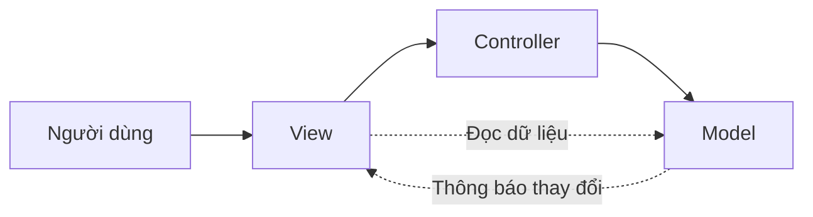
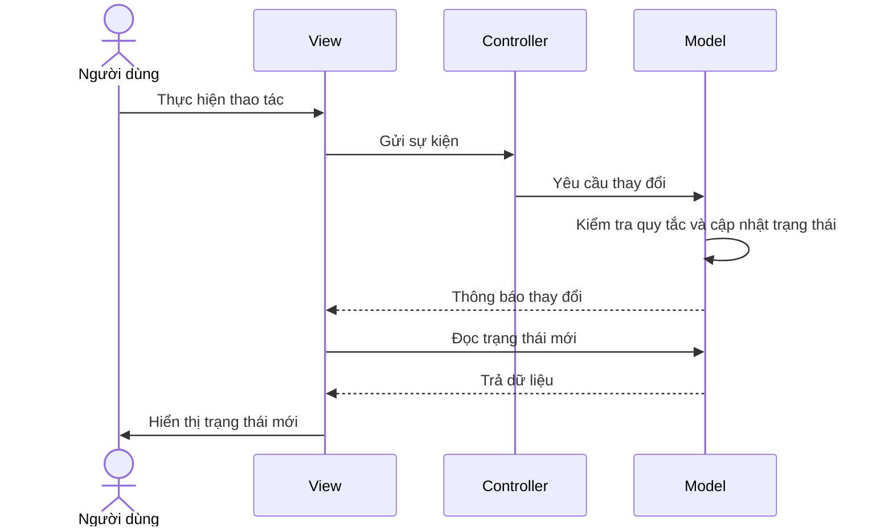
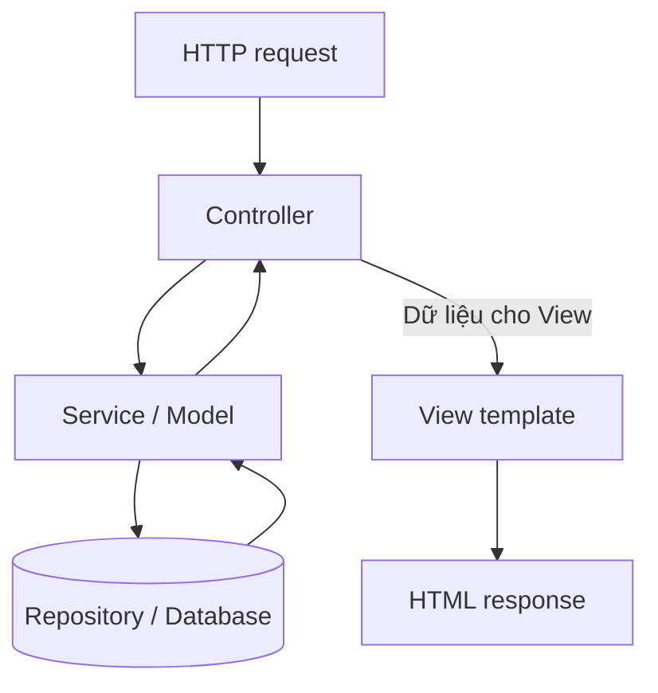
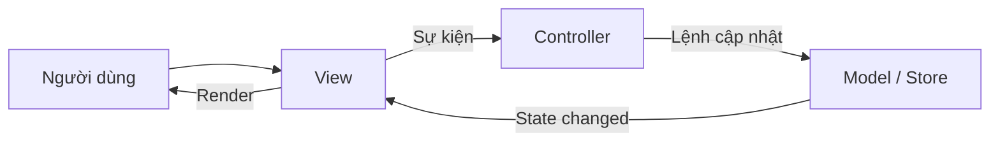

# Quan hệ giữa View và Model trong các biến thể MVC

## 1. Vì sao cần xem xét quan hệ giữa View và Model?

Trong MVC, **Model** nắm giữ trạng thái và quy tắc nghiệp vụ, còn **View** trình bày thông tin đó cho người dùng. Hai thành phần cần phối hợp để giao diện phản ánh đúng trạng thái hiện tại của ứng dụng. Tuy nhiên, cách chúng trao đổi dữ liệu thay đổi theo môi trường triển khai và biến thể MVC.

Ở một giao diện desktop tồn tại liên tục, View có thể theo dõi Model và tự làm mới khi Model thay đổi. Trong ứng dụng web phía máy chủ, mỗi HTTP request thường tạo ra một lượt xử lý mới: Controller lấy dữ liệu rồi chuyển cho template dựng HTML. Với ứng dụng web phía trình duyệt, Model thường tồn tại lâu hơn một request và có thể phát thông báo khi trạng thái thay đổi.

Vì vậy, khi thiết kế quan hệ View–Model, cần trả lời ba câu hỏi:

1. View lấy dữ liệu từ Model bằng cách nào?
2. View biết khi nào Model thay đổi bằng cách nào?
3. Khi người dùng thao tác, thay đổi đi qua Controller hay được đồng bộ trực tiếp bằng cơ chế binding?

Điểm cốt lõi là giữ cho Model không phụ thuộc vào chi tiết giao diện, đồng thời bảo đảm View luôn nhận được dữ liệu đúng và chỉ có thể yêu cầu những thay đổi hợp lệ.

## 2. Nguyên tắc phụ thuộc giữa View và Model

Quan hệ View–Model có thể cho phép View đọc dữ liệu từ Model, nhưng không nên khiến Model phụ thuộc vào một màn hình hoặc công nghệ trình bày cụ thể.

- View được phép đọc trạng thái hoặc nhận một bản dữ liệu đã chuẩn bị từ Model.
- View có thể đăng ký nhận thông báo thay đổi nếu biến thể MVC sử dụng cơ chế quan sát.
- Model không nên tạo HTML, gọi hàm hiển thị, điều khiển widget hoặc tham chiếu trực tiếp đến một View cụ thể.
- Việc thay đổi trạng thái phải tuân theo quy tắc nghiệp vụ. Một thao tác trên View không đồng nghĩa dữ liệu đã hợp lệ hoặc đã được lưu thành công.

Sơ đồ khái quát:



Sơ đồ thể hiện một cách triển khai có quan sát: View đọc dữ liệu và có thể nhận thông báo từ Model; thao tác của người dùng được chuyển đến Controller. Không phải mọi framework MVC đều triển khai đầy đủ hai mũi tên giữa View và Model. Trong MVC web phía máy chủ, dữ liệu thường được chuyển một chiều từ Controller sang View trong từng request.

## 3. MVC cổ điển: View quan sát Model

Trong cách tổ chức MVC cổ điển thường gắn với Smalltalk-80, View có thể gắn với một Model và theo dõi trạng thái của Model. Khi Model thay đổi, nó thông báo cho các đối tượng quan sát; View nhận thông báo, đọc trạng thái mới và cập nhật phần trình bày.

### 3.1. Cơ chế Observer

Quan hệ này thường được triển khai bằng mẫu thiết kế **Observer (Quan sát)**:

1. View đăng ký với Model để nhận thông báo.
2. Controller tiếp nhận thao tác người dùng và yêu cầu Model thực hiện thay đổi.
3. Model kiểm tra quy tắc, cập nhật trạng thái nếu hợp lệ.
4. Model phát thông báo cho các View đang quan sát.
5. Mỗi View đọc dữ liệu mới và cập nhật phần hiển thị của mình.



Ví dụ, một màn hình quản lý sản phẩm có thể có hai View: một View hiển thị danh sách và một View hiển thị chi tiết sản phẩm đang chọn. Khi Controller yêu cầu Model cập nhật giá, Model phát thông báo. Cả hai View đều có thể đọc trạng thái mới và cập nhật phần trình bày tương ứng. Model không cần biết có bao nhiêu View đang quan sát nó.

### 3.2. Ví dụ mã giả

Ví dụ sau mô tả ý tưởng, không phụ thuộc vào một thư viện giao diện cụ thể:

```java
interface ModelListener {
    void modelChanged();
}

class ProductModel {
    private String name;
    private final List<ModelListener> listeners = new ArrayList<>();

    void addListener(ModelListener listener) {
        listeners.add(listener);
    }

    void rename(String newName) {
        if (newName == null || newName.isBlank()) {
            throw new IllegalArgumentException("Tên sản phẩm không hợp lệ");
        }

        this.name = newName;
        for (ModelListener listener : listeners) {
            listener.modelChanged();
        }
    }

    String getName() {
        return name;
    }
}

class ProductView implements ModelListener {
    private final ProductModel model;

    ProductView(ProductModel model) {
        this.model = model;
        model.addListener(this);
    }

    @Override
    public void modelChanged() {
        render(model.getName());
    }

    private void render(String name) {
        System.out.println("Tên sản phẩm: " + name);
    }
}
```

Ở ví dụ này, Model chỉ biết hợp đồng `ModelListener`, không biết `ProductView` cụ thể. View đăng ký lắng nghe và đọc lại tên sản phẩm khi nhận thông báo. Trong ứng dụng thực tế, cần xử lý thêm việc hủy đăng ký khi View bị đóng, đồng bộ trên đúng luồng giao diện và tránh gửi thông báo khi trạng thái không đổi.

### 3.3. Ưu điểm và điểm cần chú ý

Observer giúp nhiều View cùng phản ánh một trạng thái, đồng thời giảm phụ thuộc trực tiếp giữa Model và từng View. Tuy vậy, cơ chế này cần quản lý vòng đời đăng ký. Nếu View đã bị hủy nhưng vẫn còn được Model giữ tham chiếu, có thể xảy ra rò rỉ bộ nhớ. Nếu một thay đổi tạo ra nhiều thông báo liên tiếp, giao diện có thể cập nhật dư thừa hoặc hiển thị trạng thái trung gian.

## 4. MVC phía máy chủ: Controller chuyển dữ liệu cho View

Trong ứng dụng web render HTML ở máy chủ, quan hệ View–Model thường mang tính **mỗi request một lượt**. View template không sống liên tục để đăng ký theo dõi một đối tượng Model trong bộ nhớ máy chủ. Thay vào đó, Controller gọi lớp nghiệp vụ lấy dữ liệu, chuẩn bị các thuộc tính cần hiển thị rồi chọn View.



Ví dụ với Spring MVC:

```java
@Controller
@RequestMapping("/products")
public class ProductController {
    private final ProductService productService;

    public ProductController(ProductService productService) {
        this.productService = productService;
    }

    @GetMapping
    public String list(Model viewModel) {
        List<ProductListItem> products = productService.findAllForDisplay();
        viewModel.addAttribute("products", products);
        return "products/index";
    }
}
```

Trong ví dụ này, `org.springframework.ui.Model` là đối tượng chứa các thuộc tính mà View template sẽ sử dụng. Nó thường hoạt động như một vùng dữ liệu truyền từ Controller sang View. Đây không nhất thiết là Domain Model và cũng không có nghĩa template đang quan sát trực tiếp các đối tượng nghiệp vụ.

Template `products/index` có thể lặp qua thuộc tính `products` để hiển thị danh sách. Sau khi máy chủ tạo HTML và gửi response, lượt xử lý kết thúc. Khi người dùng tải lại hoặc chuyển trang, trình duyệt gửi request mới và Controller chuẩn bị dữ liệu cho lượt mới.

Với kiểu MVC này, View thường nhận dữ liệu đã chuẩn bị thay vì tự gọi repository hoặc tự quyết định quy tắc nghiệp vụ. Việc tách `ProductListItem` khỏi entity cũng giúp giới hạn dữ liệu đưa ra giao diện, tránh vô tình hiển thị các trường nội bộ.

## 5. MVC phía trình duyệt: Model tồn tại lâu và View cập nhật theo trạng thái

Trong ứng dụng chạy chủ yếu ở trình duyệt, Model và View thường tồn tại trong suốt thời gian người dùng tương tác với màn hình. View có thể đăng ký sự kiện thay đổi, dùng cơ chế pub/sub hoặc nhận dữ liệu từ một bộ quản lý trạng thái. Khi Model thay đổi, View render lại phần giao diện liên quan.



Ví dụ, trong màn hình giỏ hàng:

1. View hiển thị các sản phẩm và số lượng hiện tại.
2. Người dùng nhấn nút tăng số lượng.
3. View gửi sự kiện `increaseQuantity(productId)` đến Controller.
4. Controller gọi hành vi cập nhật giỏ hàng trong Model.
5. Model kiểm tra số lượng hợp lệ, cập nhật trạng thái và phát thông báo.
6. View nhận trạng thái mới và render lại số lượng cùng tổng tiền.

Một số framework hỗ trợ data binding để tự đồng bộ dữ liệu và giao diện. Dù dùng Observer, pub/sub hay binding, cần xác định rõ nơi chịu trách nhiệm kiểm tra đầu vào, áp dụng quy tắc nghiệp vụ và xử lý lỗi. Việc giao diện tự cập nhật khi một biến đổi chỉ chứng minh dữ liệu hiển thị đã đổi; nó không chứng minh thao tác đã được máy chủ chấp nhận hoặc lưu bền vững.

## 6. So sánh các cách kết nối View–Model

| Cách kết nối | Cách View nhận dữ liệu | Cách View biết dữ liệu đổi | Môi trường thường gặp |
|---|---|---|---|
| Đọc trực tiếp / truy vấn trạng thái | View đọc trạng thái Model khi cần | View tự được yêu cầu render hoặc truy vấn lại | UI đơn giản, một số MVC cổ điển |
| Observer / Pub-sub | View đọc Model sau khi nhận sự kiện | Model hoặc store phát thông báo | Desktop UI, client-side MVC |
| Controller chuyển dữ liệu | Controller chuẩn bị dữ liệu và truyền cho View | Request mới tạo lượt render mới | Server-side web MVC |
| Data binding | Framework liên kết thuộc tính dữ liệu với giao diện | Binding engine theo dõi thay đổi | Một số framework UI và web |

Không có một cơ chế đồng bộ duy nhất bắt buộc cho mọi ứng dụng MVC. Chọn cách kết nối dựa trên vòng đời của giao diện, yêu cầu cập nhật tức thời, độ phức tạp của trạng thái và khả năng kiểm soát luồng dữ liệu.

## 7. Phân biệt Domain Model, View Model và đối tượng Model của framework

Tên gọi *Model* thường được dùng ở nhiều tầng khác nhau. Nếu không phân biệt, nhóm phát triển dễ để View phụ thuộc vào cấu trúc dữ liệu nội bộ hoặc hiểu nhầm đối tượng trung gian là toàn bộ mô hình nghiệp vụ.

| Loại đối tượng | Trách nhiệm | View có nên phụ thuộc trực tiếp? |
|---|---|---|
| Domain Model | Trạng thái và quy tắc của miền nghiệp vụ | Có thể đọc dữ liệu cần thiết, nhưng nên hạn chế phụ thuộc vào cấu trúc nội bộ |
| View Model / Presentation Model | Cung cấp dữ liệu và trạng thái được thiết kế riêng cho giao diện | Có; đây thường là hợp đồng gần View nhất |
| Framework request Model | Vùng chứa thuộc tính Controller chuyển cho template, ví dụ `org.springframework.ui.Model` | View template đọc các thuộc tính được đưa vào |
| Entity / ORM Model | Biểu diễn dữ liệu được ánh xạ với cơ chế lưu trữ | Tránh để View phụ thuộc trực tiếp nếu có thể lộ dữ liệu hoặc kéo theo hành vi truy cập dữ liệu |

Ví dụ, Domain Model `Order` có thể chứa danh sách dòng hàng, quy tắc tính tổng và hành vi hủy đơn. View chi tiết đơn hàng có thể chỉ cần `orderNumber`, `items`, `formattedTotal` và `canCancel`. Một `OrderDetailViewModel` chứa đúng các trường này giúp giao diện không phải biết toàn bộ cấu trúc nội bộ của `Order`.

## 8. Binding một chiều và hai chiều

**Binding một chiều** đưa dữ liệu từ Model sang View. Khi trạng thái thay đổi, View được cập nhật theo. Người dùng muốn thay đổi dữ liệu sẽ gửi một hành động riêng qua Controller hoặc một command handler. Cách này giúp luồng thay đổi rõ ràng và dễ kiểm tra.

**Binding hai chiều** đồng bộ cả hai hướng: thay đổi Model cập nhật View, còn thao tác nhập trên View có thể cập nhật thuộc tính dữ liệu được bind. Cách này tiện cho biểu mẫu và giao diện tương tác, nhưng cần xác định thời điểm commit, quy tắc validation và cách xử lý lỗi. Không nên để binding hai chiều ghi trực tiếp vào các trường nhạy cảm hoặc bất biến nghiệp vụ.

Ví dụ, trường nhập tên sản phẩm có thể hiển thị giá trị hiện tại và ghi nhận nội dung người dùng đang nhập vào một đối tượng form. Khi người dùng nhấn Lưu, Controller gửi dữ liệu đó đến lớp nghiệp vụ. Lớp nghiệp vụ kiểm tra tên có hợp lệ không rồi mới cập nhật Domain Model. Như vậy, trạng thái nhập tạm thời của biểu mẫu không bị nhầm với trạng thái nghiệp vụ đã được chấp nhận.

Binding hai chiều là kỹ thuật đồng bộ dữ liệu của framework; tự nó không biến ứng dụng thành MVVM. Cần phân loại kiến trúc dựa trên vai trò thực tế của Model, View và thành phần điều phối, thay vì chỉ dựa vào việc có binding hay không.

## 9. Lựa chọn cách kết nối phù hợp

Khi thiết kế một chức năng, có thể cân nhắc theo các tiêu chí sau:

- **Vòng đời View:** View được tạo và hủy theo từng request hay tồn tại lâu trong một phiên tương tác?
- **Tần suất thay đổi:** dữ liệu có cần cập nhật tức thời khi nhiều thành phần cùng quan sát không?
- **Số lượng View:** một Model có được dùng bởi nhiều màn hình hoặc nhiều vùng giao diện không?
- **Độ phức tạp của trạng thái:** có cần quản lý trạng thái tải dữ liệu, lỗi, dữ liệu tạm và dữ liệu đã lưu riêng biệt không?
- **Khả năng kiểm thử:** có thể kiểm thử quy tắc Model mà không khởi chạy giao diện không, và có thể kiểm tra View bằng dữ liệu giả lập không?
- **Ranh giới bảo mật:** dữ liệu nào được phép đưa ra View, dữ liệu nào chỉ được thay đổi qua hành động đã xác thực và phân quyền?

Với trang HTML được dựng ở máy chủ, Controller chuyển DTO hoặc View Model cho template thường là đủ. Với ứng dụng desktop hoặc giao diện trình duyệt cần phản hồi liên tục, Observer hoặc cơ chế state subscription có thể phù hợp hơn. Với biểu mẫu có binding hai chiều, nên dùng đối tượng form riêng và chỉ chuyển sang Model nghiệp vụ sau khi xác thực và kiểm tra quy tắc.

## 10. Lỗi thiết kế thường gặp

1. **Model phụ thuộc trực tiếp vào View cụ thể:** ví dụ Model gọi `view.refresh()` hoặc tạo component giao diện. Điều này khiến Model khó tái sử dụng và kiểm thử độc lập.
2. **View tự truy cập cơ sở dữ liệu:** View trở thành nơi chứa truy vấn và nghiệp vụ, làm luồng xử lý khó kiểm soát.
3. **View sửa trực tiếp trạng thái nghiệp vụ:** thao tác giao diện có thể bỏ qua validation, phân quyền hoặc bất biến của Model.
4. **Nhầm dữ liệu truyền cho template với Domain Model:** đối tượng `Model` của Spring MVC là nơi đặt thuộc tính cho View, không đồng nghĩa toàn bộ mô hình miền.
5. **Không hủy đăng ký Observer:** View đã đóng vẫn bị Model giữ tham chiếu và tiếp tục nhận sự kiện.
6. **Dùng binding hai chiều cho mọi trường:** có thể khiến dữ liệu nhạy cảm hoặc trường chỉ đọc bị cập nhật ngoài ý muốn.
7. **Coi trạng thái giao diện là kết quả lưu trữ:** giao diện hiển thị thành công trước khi máy chủ xác nhận có thể tạo cảm giác dữ liệu đã được lưu dù request thất bại.

## 11. Kiểm thử quan hệ View–Model

Có thể chia kiểm thử theo hợp đồng giữa các thành phần:

| Phạm vi | Điều cần xác minh |
|---|---|
| Model | Quy tắc cập nhật đúng; trạng thái không hợp lệ bị từ chối; sự kiện chỉ phát khi có thay đổi cần thông báo |
| Observer / Store | View đăng ký nhận sự kiện, cập nhật đúng và hủy đăng ký khi kết thúc vòng đời |
| Controller | Sự kiện đầu vào được ánh xạ đúng thành hành động nghiệp vụ; lỗi được chuyển thành phản hồi phù hợp |
| View | Hiển thị đúng dữ liệu, trạng thái rỗng, đang tải và lỗi; không tự chứa quy tắc nghiệp vụ |
| Tích hợp | Thay đổi Model dẫn đến phản hồi hoặc giao diện đúng trong toàn luồng |

Ví dụ, có thể kiểm thử Model đổi tên sản phẩm với tên hợp lệ và không hợp lệ mà không cần dựng giao diện. Một kiểm thử View có thể dùng dữ liệu giả để xác minh tên và giá được trình bày đúng. Với ứng dụng dùng Observer, kiểm thử thêm trường hợp View hủy đăng ký để bảo đảm không nhận sự kiện sau khi bị đóng.

## 12. Kết luận

Quan hệ giữa View và Model trong MVC phụ thuộc vào vòng đời giao diện và cách ứng dụng đồng bộ trạng thái. MVC cổ điển thường cho phép View quan sát Model; MVC phía máy chủ thường để Controller chuẩn bị dữ liệu cho View trong từng HTTP request; MVC phía trình duyệt có thể dùng Observer, pub/sub hoặc data binding để cập nhật giao diện liên tục.

Dù chọn cơ chế nào, Model cần giữ độc lập với công nghệ trình bày, View chỉ nên hiển thị dữ liệu và gửi ý định thao tác, còn thay đổi nghiệp vụ phải đi qua đường xử lý có kiểm tra. Phân biệt rõ Domain Model, View Model và đối tượng Model của framework sẽ giúp hợp đồng dữ liệu dễ hiểu, an toàn và dễ kiểm thử hơn.
