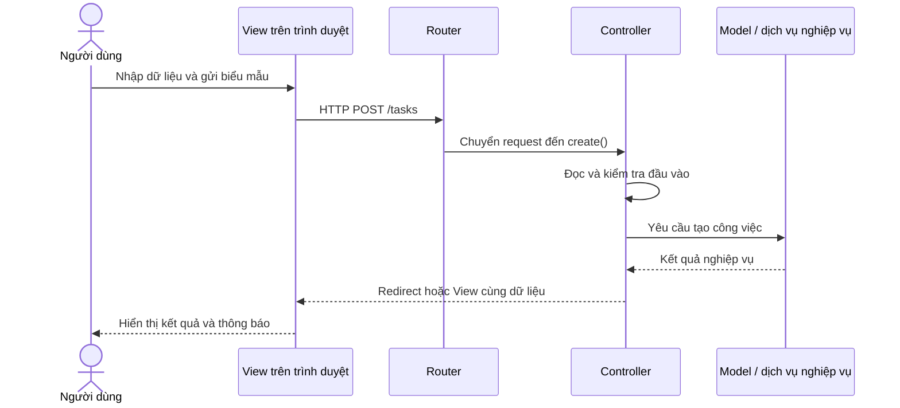

# Quan hệ giữa View và Controller khi tiếp nhận thao tác

Trong MVC, View là nơi người dùng quan sát thông tin và thực hiện thao tác; Controller tiếp nhận ý định đó, diễn giải nó thành một hành động của ứng dụng rồi điều phối xử lý. Hai thành phần liên hệ chặt chẽ trong một vòng tương tác, nhưng giữ hai trách nhiệm khác nhau: View mô tả cách tương tác được trình bày, còn Controller quyết định ứng dụng phải xử lý tương tác ấy như thế nào.

Với ứng dụng web, quan hệ này thường được thể hiện qua request và response HTTP. Người dùng bấm liên kết, gửi biểu mẫu hoặc chọn một thao tác trên giao diện. Trình duyệt gửi request đến URL tương ứng; router chuyển request đến Controller; Controller kiểm tra đầu vào, gọi Model hoặc dịch vụ nghiệp vụ, rồi trả về View, chuyển hướng hoặc response dữ liệu. View sau đó trình bày kết quả để người dùng tiếp tục tương tác.

## Vai trò của View trong việc phát sinh tương tác

View cung cấp các thành phần mà người dùng có thể thao tác, chẳng hạn liên kết, nút bấm, biểu mẫu, ô tìm kiếm, bộ lọc và điều khiển phân trang. Mỗi thành phần cần biểu đạt rõ hành động mà người dùng muốn thực hiện và cung cấp dữ liệu đầu vào cần thiết.

Ví dụ, trang danh sách công việc có thể cung cấp các tương tác sau:

| Thành phần trong View | Ý định của người dùng | Request thường gặp |
|---|---|---|
| Liên kết “Xem chi tiết” | Mở một công việc | `GET /tasks/42` |
| Biểu mẫu tìm kiếm | Tìm công việc theo từ khóa | `GET /tasks?q=report` |
| Biểu mẫu tạo công việc | Gửi dữ liệu để tạo mới | `POST /tasks` |
| Nút hoàn thành | Đổi trạng thái công việc | `POST /tasks/42/complete` hoặc phương thức phù hợp theo API |
| Liên kết phân trang | Xem một trang kết quả khác | `GET /tasks?page=2` |

View có thể kiểm tra một số điều kiện để hỗ trợ trải nghiệm, ví dụ đánh dấu trường bắt buộc hoặc vô hiệu hóa nút khi biểu mẫu chưa có nội dung. Những kiểm tra phía giao diện giúp người dùng phát hiện lỗi sớm, nhưng không phải nguồn xác thực đáng tin cậy. Request có thể được tạo thủ công hoặc gửi mà không qua giao diện, vì vậy Controller và tầng nghiệp vụ vẫn phải kiểm tra dữ liệu và quyền thực hiện hành động.

View cần biết địa chỉ hoặc cơ chế gửi thao tác theo hợp đồng mà ứng dụng cung cấp. View không cần biết câu lệnh SQL, cách lưu dữ liệu hay các bước nghiệp vụ phía sau thao tác đó.

## Vai trò của Controller khi tiếp nhận thao tác

Controller là điểm vào của luồng xử lý tương tác. Trong ứng dụng web, request thường đi qua router trước khi đến một phương thức Controller. Controller đọc thông tin cần thiết từ request, chuyển dữ liệu về dạng phù hợp, gọi phần nghiệp vụ và quyết định loại response cần trả về.

Các trách nhiệm thường thuộc Controller gồm:

- nhận request được định tuyến đến hành động tương ứng;
- đọc path variable, query parameter, header, session hoặc dữ liệu biểu mẫu cần thiết;
- kiểm tra định dạng và ràng buộc đầu vào ở ranh giới HTTP;
- xác định ngữ cảnh người dùng và phối hợp kiểm tra quyền theo chính sách bảo mật của ứng dụng;
- gọi Model hoặc dịch vụ nghiệp vụ để thực hiện hành động;
- chuyển kết quả, lỗi và trạng thái xử lý thành response phù hợp;
- chọn View và cung cấp dữ liệu cho View, hoặc trả về redirect, JSON hay một dạng response khác.

Controller đóng vai trò điều phối. Nó không nên biến thành nơi chứa toàn bộ quy tắc nghiệp vụ, truy vấn phức tạp hoặc mã dựng giao diện. Khi Controller phải biết quá nhiều chi tiết bên trong Model hoặc View, hai phía đã phụ thuộc vào nhau quá chặt.

## Vòng tương tác giữa View và Controller

Một vòng tương tác điển hình có thể chia thành hai chiều. Chiều thứ nhất mang ý định và dữ liệu từ View đến Controller. Chiều thứ hai mang kết quả xử lý từ Controller trở lại View thông qua response.



Trong kiến trúc web phía máy chủ, View ban đầu thường là HTML đã được render. Khi người dùng thao tác, trình duyệt gửi một request mới. Controller không nhất thiết giữ tham chiếu trực tiếp đến đối tượng View đang hiển thị; hai phía trao đổi qua URL, phương thức HTTP, dữ liệu request và response. Đây là điểm khác biệt cần nhớ khi so sánh web MVC với một số ứng dụng desktop MVC, nơi Controller có thể đăng ký lắng nghe sự kiện trực tiếp từ View.

### Chiều View gửi thao tác đến Controller

View biểu diễn thao tác bằng một liên kết, biểu mẫu hoặc lời gọi HTTP từ mã JavaScript. Đích đến và dữ liệu gửi đi tạo thành hợp đồng đầu vào của hành động Controller.

Ví dụ một biểu mẫu tạo công việc:

```html
<form action="/tasks" method="post">
  <label for="title">Tên công việc</label>
  <input id="title" name="title" type="text" required>
  <button type="submit">Tạo công việc</button>
</form>
```

Khi người dùng gửi biểu mẫu, trình duyệt gửi trường `title` đến `POST /tasks`. View không quyết định việc tạo công việc có hợp lệ về nghiệp vụ hay không; nó chỉ thu thập và gửi dữ liệu theo hợp đồng.

### Chiều Controller trả kết quả cho View

Sau khi xử lý, Controller chọn cách phản hồi dựa trên kết quả và loại ứng dụng:

- **Trả về View:** Controller cung cấp dữ liệu để template dựng trang HTML, thường dùng khi cần hiển thị biểu mẫu cùng lỗi hoặc một trang kết quả.
- **Chuyển hướng:** Controller trả response redirect để trình duyệt gửi request đến một URL khác, thường dùng sau khi thao tác thay đổi dữ liệu thành công.
- **Trả dữ liệu:** Controller trả JSON hoặc định dạng khác khi View là ứng dụng JavaScript hoặc một client riêng.
- **Trả lỗi HTTP:** Controller hoặc cơ chế xử lý lỗi chung trả trạng thái như 400, 401, 403, 404 hoặc 500 khi phù hợp.

Không phải mọi hành động đều cần một trang HTML mới. Một giao diện dùng JavaScript có thể gửi request bất đồng bộ và cập nhật một phần màn hình từ JSON. Dù dùng cách nào, View vẫn chịu trách nhiệm trình bày kết quả; Controller chịu trách nhiệm tiếp nhận và điều phối hành động.

## Thiết kế hợp đồng giữa View và Controller

Hợp đồng giữa hai thành phần cần mô tả rõ cách gọi hành động, dữ liệu được gửi và kết quả có thể nhận. Một hợp đồng dễ hiểu giúp View ít phụ thuộc vào chi tiết nội bộ của Controller, đồng thời giúp Controller có thể thay đổi cách xử lý mà không buộc giao diện phải biết toàn bộ quy trình.

Một hợp đồng request thường xác định:

1. **Đích đến:** URL hoặc route nhận thao tác.
2. **Phương thức HTTP:** `GET` để truy xuất dữ liệu; `POST`, `PUT`, `PATCH` hoặc `DELETE` cho các thao tác thay đổi trạng thái tùy thiết kế API và cơ chế hỗ trợ của framework.
3. **Dữ liệu đầu vào:** tên trường, kiểu dữ liệu, trường bắt buộc, giới hạn và cách mã hóa.
4. **Ngữ cảnh:** thông tin xác thực, phiên làm việc hoặc token bảo vệ request nếu cần.
5. **Kết quả:** View hoặc URL đích, dữ liệu response, trạng thái HTTP và cấu trúc lỗi.

Ví dụ, hợp đồng tạo công việc có thể được mô tả như sau:

| Thuộc tính | Quy ước |
|---|---|
| Route | `POST /tasks` |
| Đầu vào | `title`: chuỗi, bắt buộc, giới hạn độ dài theo quy tắc ứng dụng |
| Thành công | Tạo công việc và chuyển hướng đến `GET /tasks` |
| Lỗi đầu vào | Trả lại biểu mẫu cùng lỗi gắn với trường tương ứng |
| Lỗi quyền | Trả response bị từ chối theo chính sách truy cập |
| Lỗi hệ thống | Được xử lý bởi cơ chế lỗi chung và ghi log phù hợp |

Tên trường trong View phải khớp với cấu trúc nhận dữ liệu mà Controller hỗ trợ. Nếu đổi `name="title"` thành `name="taskTitle"` mà không cập nhật hợp đồng phía máy chủ, Controller có thể nhận giá trị rỗng hoặc không ánh xạ được dữ liệu. Vì vậy, thay đổi route hoặc cấu trúc form cần được xem là thay đổi hợp đồng giữa hai thành phần.

### Dùng DTO hoặc form object cho dữ liệu đầu vào

Không nên buộc View gửi toàn bộ đối tượng miền hoặc entity lưu trữ chỉ vì form cần cập nhật một vài trường. Một form object giới hạn dữ liệu mà hành động chấp nhận và làm rõ ý nghĩa của đầu vào.

```java
public class CreateTaskForm {
    @NotBlank
    @Size(max = 120)
    private String title;

    public String getTitle() {
        return title;
    }

    public void setTitle(String title) {
        this.title = title;
    }
}
```

Form object này chỉ nhận tiêu đề. Người dùng không thể dùng chính biểu mẫu đó để tự đặt các thuộc tính nội bộ như `ownerId`, `completed` hoặc `role`. Tầng nghiệp vụ vẫn phải xác định chủ sở hữu và trạng thái theo danh tính, quyền hạn và quy tắc của ứng dụng.

## Ví dụ Controller tiếp nhận biểu mẫu trong Spring MVC

Đoạn mã sau minh họa cách một Controller nhận dữ liệu từ View, kiểm tra dữ liệu và chọn response:

```java
@Controller
@RequestMapping("/tasks")
public class TaskController {
    private final TaskService taskService;

    public TaskController(TaskService taskService) {
        this.taskService = taskService;
    }

    @GetMapping("/new")
    public String showCreateForm(Model model) {
        model.addAttribute("form", new CreateTaskForm());
        return "tasks/new";
    }

    @PostMapping
    public String create(
            @Valid @ModelAttribute("form") CreateTaskForm form,
            BindingResult errors) {

        if (errors.hasErrors()) {
            return "tasks/new";
        }

        taskService.create(form.getTitle());
        return "redirect:/tasks";
    }
}
```

Trong ví dụ này, `GET /tasks/new` yêu cầu Controller chuẩn bị form và trả View `tasks/new`. Khi người dùng gửi biểu mẫu, `POST /tasks` được định tuyến đến phương thức `create`. Spring ánh xạ dữ liệu request vào `CreateTaskForm` và thực hiện các ràng buộc khai báo bằng `@Valid`. Nếu có lỗi, Controller trả lại cùng View để hiển thị lỗi. Nếu dữ liệu hợp lệ, Controller gọi `TaskService` rồi chuyển hướng đến danh sách.

View có thể gắn các trường và thông báo lỗi với form object theo cơ chế binding của template engine. Chi tiết cú pháp phụ thuộc template engine, nhưng nguyên tắc vẫn giống nhau: View gửi dữ liệu theo hợp đồng và hiển thị lỗi mà Controller cung cấp.

## Kiểm tra dữ liệu và phản hồi lỗi

Quan hệ giữa View và Controller thể hiện rõ nhất khi dữ liệu không hợp lệ. View có thể hỗ trợ kiểm tra nhanh ở trình duyệt, nhưng Controller phải kiểm tra lại ở phía máy chủ. Việc kiểm tra nên phân biệt hai nhóm:

- **Lỗi cấu trúc hoặc định dạng đầu vào:** thiếu trường bắt buộc, sai kiểu, vượt giới hạn độ dài hoặc sai định dạng. Controller có thể trả lại View cùng lỗi cụ thể cho từng trường hoặc response 400 đối với API.
- **Lỗi quy tắc nghiệp vụ:** dữ liệu có định dạng đúng nhưng hành động không được phép trong trạng thái hiện tại, ví dụ công việc đã bị khóa. Model hoặc dịch vụ nghiệp vụ xác định lỗi; Controller chuyển lỗi thành thông báo hoặc trạng thái HTTP thích hợp.

Thông báo gửi về View nên đủ cụ thể để người dùng biết cách sửa, nhưng không tiết lộ chi tiết nội bộ như câu lệnh SQL, stack trace, đường dẫn máy chủ hoặc dữ liệu nhạy cảm. Với API, nên dùng một cấu trúc lỗi ổn định để client có thể xử lý nhất quán.

## Bảo mật tại ranh giới tương tác

View và Controller cùng tham gia một luồng tương tác nên cần phối hợp bảo vệ dữ liệu và hành động:

- **Xác thực và phân quyền:** View có thể ẩn thao tác mà người dùng không được phép thực hiện để giao diện dễ hiểu. Controller và tầng nghiệp vụ vẫn phải kiểm tra quyền ở phía máy chủ cho từng request.
- **CSRF:** với ứng dụng dùng cookie và session, các request thay đổi trạng thái cần được bảo vệ bằng cơ chế chống CSRF phù hợp. View phải gửi token theo cách framework yêu cầu; Controller hoặc middleware xác minh token.
- **XSS:** View phải mã hóa dữ liệu đầu ra đúng ngữ cảnh. Không chèn trực tiếp nội dung người dùng nhập vào HTML hoặc JavaScript mà bỏ qua cơ chế mã hóa.
- **Mass assignment:** chỉ ánh xạ các trường được phép từ form object hoặc command. Không bind tùy tiện request vào entity chứa những thuộc tính nhạy cảm.
- **HTTP method:** thao tác chỉ đọc nên dùng `GET`; không thực hiện thay đổi trạng thái qua liên kết GET. Điều này giúp trình duyệt, proxy và công cụ tự động không vô tình kích hoạt hành động thay đổi dữ liệu.

Ẩn nút trên View chỉ cải thiện trải nghiệm. Người dùng vẫn có thể gọi trực tiếp URL, nên quyết định bảo mật phải được thực thi tại phía máy chủ.

## Những cách kết nối dễ tạo phụ thuộc quá chặt

Một số cách triển khai khiến View và Controller khó thay đổi độc lập:

- **View tự thực hiện nghiệp vụ:** template quyết định có được xóa tài nguyên hay không dựa trên một điều kiện tự suy ra. Hãy để tầng nghiệp vụ đưa ra quyết định và cung cấp kết quả phù hợp cho View.
- **View truy cập cơ sở dữ liệu:** template gọi repository hoặc phát sinh truy vấn. Hãy để Controller phối hợp lấy dữ liệu trước khi render.
- **Controller dựng HTML thủ công:** phương thức Controller nối chuỗi HTML cho từng response. Hãy dùng View hoặc cơ chế response chuyên biệt để giữ phần trình bày ở đúng nơi.
- **Controller chứa JavaScript hoặc thao tác DOM:** Controller phía máy chủ không nên biết cấu trúc DOM của trang. Mã phía trình duyệt xử lý tương tác cục bộ; request gửi lên máy chủ đi qua endpoint đã định nghĩa.
- **Hợp đồng không ổn định:** View và Controller dùng tên trường, route hoặc cấu trúc lỗi không nhất quán. Hãy mô tả và kiểm thử hợp đồng đầu vào/đầu ra.
- **Dùng dữ liệu View gửi lên làm căn cứ phân quyền:** chẳng hạn tin `userId` hoặc `isAdmin` từ form. Controller phải lấy danh tính từ ngữ cảnh đã xác thực và kiểm tra quyền theo dữ liệu đáng tin cậy.

Không phải mọi ứng dụng đều có cùng cách triển khai MVC. Trong một số framework phía máy khách, Controller có thể đăng ký callback hoặc lắng nghe sự kiện trực tiếp từ View. Trong web MVC phía máy chủ, sự kiện thường đi qua HTTP. Dù cơ chế kết nối khác nhau, nguyên tắc vẫn là View phát sinh tương tác và trình bày kết quả; Controller tiếp nhận, điều phối và quyết định phản hồi.

## Kiểm thử quan hệ giữa View và Controller

Có thể kiểm thử hợp đồng giữa hai thành phần ở nhiều mức:

1. **Kiểm thử Controller:** gửi request với dữ liệu hợp lệ, thiếu trường, sai định dạng và không đủ quyền; xác minh phương thức xử lý, response, View hoặc redirect.
2. **Kiểm thử View:** xác minh form trỏ đến đúng route, tên trường đúng hợp đồng, lỗi được hiển thị và nội dung được mã hóa an toàn.
3. **Kiểm thử tích hợp:** gửi request qua router và Controller, kiểm tra dữ liệu được chuyển đến dịch vụ, kết quả được lưu và response phù hợp được trả về.
4. **Kiểm thử luồng người dùng:** thao tác trên trình duyệt như người dùng thực tế để phát hiện lỗi liên kết, form, điều hướng hoặc cập nhật giao diện.

Ví dụ, một kiểm thử cho chức năng tạo công việc nên xác minh rằng `POST /tasks` với tiêu đề hợp lệ gọi dịch vụ tạo công việc và chuyển hướng đến `/tasks`; request thiếu tiêu đề phải trả lại biểu mẫu cùng lỗi. Hai trường hợp này kiểm tra cả chiều View gửi dữ liệu và chiều Controller trả kết quả.

## Checklist khi thiết kế một thao tác

Trước khi hoàn thành một chức năng có tương tác, hãy lần theo các câu hỏi sau:

- View biểu diễn thao tác bằng thành phần nào và người dùng hiểu được hành động đó không?
- Thành phần gửi request đến route nào, bằng phương thức HTTP nào?
- Dữ liệu gửi đi có tên trường, kiểu, giới hạn và ý nghĩa rõ ràng không?
- Controller có nhận đúng dữ liệu và kiểm tra ở phía máy chủ không?
- Quy tắc nghiệp vụ và quyền truy cập được thực thi ở tầng phù hợp chưa?
- Khi thành công, Controller trả View, redirect hay dữ liệu; View xử lý kết quả đó thế nào?
- Khi có lỗi, người dùng nhận được thông báo hữu ích mà không lộ thông tin nội bộ không?
- Hợp đồng giữa View và Controller có kiểm thử để phát hiện thay đổi không tương thích không?

Khi trả lời được những câu hỏi này, luồng tương tác thường dễ theo dõi và bảo trì hơn. View cho người dùng cách diễn đạt ý định; Controller biến ý định đó thành luồng xử lý của ứng dụng và đưa kết quả trở lại giao diện qua một hợp đồng rõ ràng.
