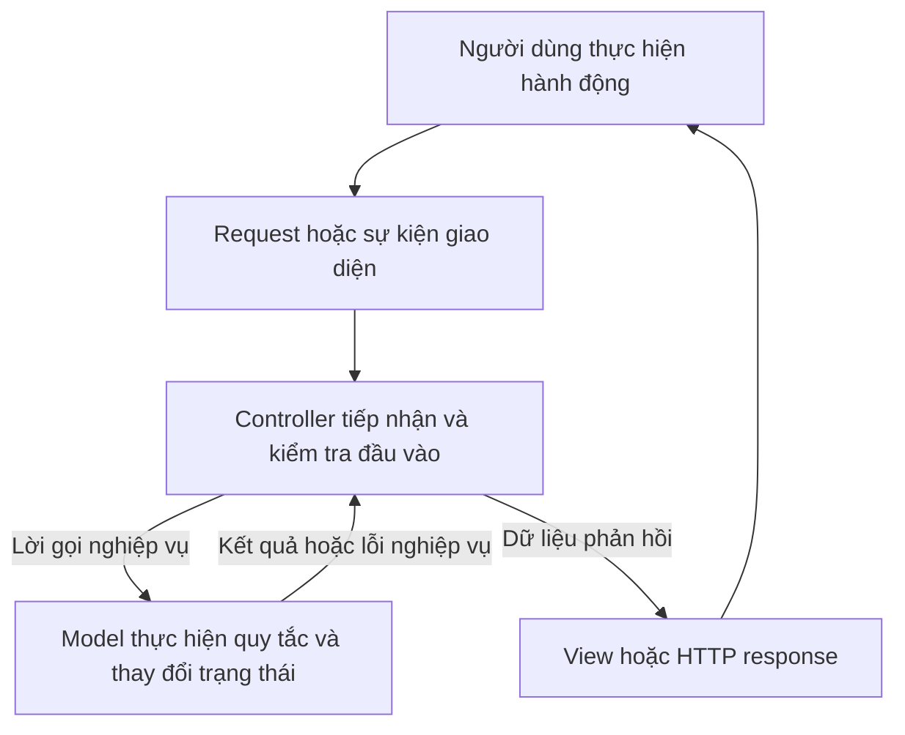
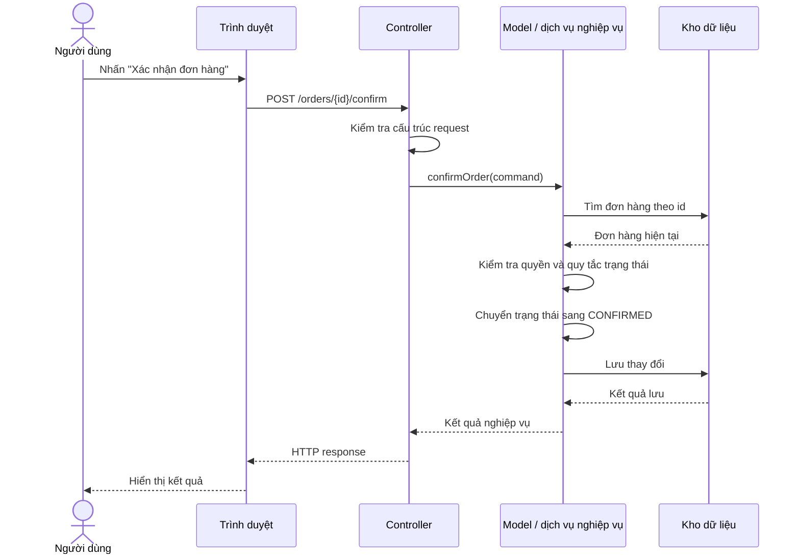

# Quan hệ giữa Controller và Model khi thực hiện hành động

Trong kiến trúc Model–View–Controller (MVC), một hành động của người dùng thường bắt đầu ở giao diện, đi qua Controller, làm thay đổi hoặc truy vấn Model, rồi kết quả được chuyển về View để hiển thị. Quan hệ giữa Controller và Model quyết định ứng dụng có giữ được ranh giới rõ ràng giữa việc tiếp nhận yêu cầu và việc thực hiện nghiệp vụ hay không.

Ví dụ, khi người dùng nhấn nút **Xác nhận đơn hàng**, ứng dụng cần nhận diện đơn hàng, kiểm tra yêu cầu, xác định người dùng có quyền thực hiện hành động, kiểm tra đơn hàng có đủ điều kiện xác nhận, cập nhật trạng thái và trả kết quả. Controller điều phối luồng xử lý của yêu cầu; Model chịu trách nhiệm về trạng thái và quy tắc nghiệp vụ của đơn hàng.

## 1. Vai trò của Controller và Model

### Controller tiếp nhận và điều phối hành động

Controller là điểm tiếp nhận một hành động từ bên ngoài ứng dụng. Trong ứng dụng web, hành động đó thường được biểu diễn bằng một HTTP request. Controller có các trách nhiệm chính:

- Nhận diện hành động thông qua route, HTTP method hoặc cơ chế điều hướng tương ứng.
- Đọc dữ liệu đầu vào từ path parameter, query parameter, header hoặc request body.
- Kiểm tra dữ liệu ở mức giao tiếp, chẳng hạn trường bắt buộc, kiểu dữ liệu và định dạng.
- Lấy thông tin người dùng đã được xác thực và phối hợp với cơ chế kiểm tra quyền truy cập.
- Chuyển dữ liệu nhận được thành một lời gọi có ý nghĩa đối với Model, sau đó gọi đúng thao tác.
- Nhận kết quả hoặc lỗi từ Model và quyết định phản hồi phù hợp: trả JSON, hiển thị View, chuyển hướng hoặc trả mã trạng thái HTTP.

Controller nên hiểu **người dùng đang yêu cầu thực hiện thao tác nào** và **cần trao đổi với ứng dụng bằng giao thức nào**. Nó không nên tự quyết định các quy tắc cốt lõi như đơn hàng nào được xác nhận, số lượng tồn kho có đủ hay trạng thái nào được phép chuyển tiếp.

### Model quản lý dữ liệu và quy tắc nghiệp vụ

Model đại diện cho dữ liệu và hành vi nghiệp vụ mà ứng dụng cần quản lý. Tùy cách tổ chức dự án, Model có thể bao gồm các đối tượng miền nghiệp vụ (domain objects), dịch vụ ứng dụng, các thành phần truy cập dữ liệu và những thành phần phối hợp để thực hiện một ca sử dụng.

Khi xử lý một hành động, Model có thể:

- Đọc trạng thái hiện tại từ nguồn dữ liệu.
- Kiểm tra các điều kiện và bất biến nghiệp vụ.
- Thực hiện phép chuyển trạng thái hoặc tính toán nghiệp vụ.
- Phối hợp lưu dữ liệu và bảo đảm các thay đổi liên quan được thực hiện nhất quán.
- Trả về kết quả có ý nghĩa với nghiệp vụ hoặc phát sinh lỗi nghiệp vụ khi hành động không hợp lệ.

Model không cần biết request được gửi bằng HTTP, người dùng đã nhấn nút nào, Controller nào gọi nó hay kết quả sẽ được hiển thị bằng trang HTML nào. Nhờ vậy, cùng một thao tác nghiệp vụ có thể được sử dụng từ giao diện web, API, tác vụ nền hoặc một luồng xử lý khác.

### Quan hệ phụ thuộc giữa hai thành phần

Trong một luồng xử lý MVC thông thường, Controller gọi Model và nhận kết quả từ Model. Model không gọi ngược Controller để yêu cầu hiển thị giao diện hoặc tạo phản hồi HTTP.



Mũi tên từ Controller đến Model biểu thị lời gọi xử lý. Chiều ngược lại biểu thị kết quả được trả về theo lời gọi đó, không có nghĩa Model phụ thuộc vào Controller. Đây là ranh giới quan trọng: Controller biết cách gọi nghiệp vụ; Model không biết chi tiết của lớp giao tiếp.

## 2. Luồng xử lý khi người dùng thực hiện một hành động

Hãy xét hành động xác nhận đơn hàng. Một luồng điển hình có thể diễn ra như sau:

1. **Người dùng gửi yêu cầu.** Trình duyệt gửi request đến endpoint xác nhận một đơn hàng, chẳng hạn `POST /orders/{id}/confirm`.
2. **Controller nhận và chuyển đổi đầu vào.** Controller đọc mã đơn hàng, nội dung biểu mẫu và thông tin người dùng đã được xác thực. Nó kiểm tra các điều kiện về cấu trúc và định dạng của request.
3. **Controller tạo lời gọi nghiệp vụ.** Controller chuyển các dữ liệu cần thiết thành tham số hoặc một đối tượng lệnh (command), rồi gọi thao tác tương ứng của Model.
4. **Model lấy trạng thái cần thiết.** Thành phần nghiệp vụ tìm đơn hàng theo mã và đọc dữ liệu liên quan từ kho lưu trữ.
5. **Model kiểm tra quy tắc.** Model xác định đơn hàng có tồn tại, người dùng có được phép thao tác theo chính sách nghiệp vụ và trạng thái hiện tại có cho phép xác nhận hay không.
6. **Model thực hiện hành động.** Nếu các điều kiện hợp lệ, Model thay đổi trạng thái và lưu kết quả. Các thay đổi cần đi cùng nhau nên được xử lý trong một ranh giới giao dịch thích hợp.
7. **Model trả kết quả.** Model trả về thông tin nghiệp vụ sau khi xử lý hoặc phát sinh lỗi có ý nghĩa, ví dụ đơn hàng không tồn tại hay không thể xác nhận ở trạng thái hiện tại.
8. **Controller tạo phản hồi.** Controller chuyển kết quả thành dữ liệu phản hồi, chọn mã trạng thái hoặc View phù hợp và gửi về cho người dùng.



Sơ đồ mô tả một trường hợp thành công. Nếu dữ liệu đầu vào sai, Controller có thể từ chối request trước khi gọi Model. Nếu đơn hàng không tồn tại hoặc vi phạm quy tắc nghiệp vụ, Model trả lỗi; Controller chuyển lỗi đó thành phản hồi phù hợp.

## 3. Hợp đồng dữ liệu giữa Controller và Model

Controller và Model cần thống nhất một hợp đồng rõ ràng: thao tác nào được gọi, cần những dữ liệu gì và kết quả được biểu diễn ra sao. Hợp đồng này giúp hai thành phần ít phụ thuộc vào chi tiết nội bộ của nhau.

### Truyền dữ liệu cần thiết, không truyền đối tượng HTTP

Giả sử Controller nhận được request xác nhận đơn hàng. Nó có thể chuyển dữ liệu thành một đối tượng lệnh như sau:

```java
public record ConfirmOrderCommand(
    UUID orderId,
    UUID actorId,
    String note
) {}
```

Controller gọi Model bằng dữ liệu nghiệp vụ:

```java
orderApplicationService.confirmOrder(
    new ConfirmOrderCommand(orderId, currentUser.id(), request.note())
);
```

Model nhận mã đơn hàng, người thực hiện và ghi chú cần thiết. Model không nhận `HttpServletRequest`, `HttpSession`, `HttpServletResponse`, `ModelAndView` hoặc một đối tượng phụ thuộc vào framework web. Nếu truyền những đối tượng này vào Model, logic nghiệp vụ sẽ bị gắn với cách ứng dụng tiếp nhận request.

### Phân biệt dữ liệu request, command và đối tượng miền

Các loại dữ liệu sau có mục đích khác nhau:

| Loại dữ liệu | Vai trò | Ví dụ |
|---|---|---|
| Request DTO | Mô tả dữ liệu mà giao diện/API gửi lên | `ConfirmOrderRequest(note)` |
| Command | Mô tả yêu cầu thực hiện một thao tác nghiệp vụ | `ConfirmOrderCommand(orderId, actorId, note)` |
| Domain object | Biểu diễn trạng thái và hành vi của nghiệp vụ | `Order`, `OrderLine` |
| Response DTO hoặc View model | Mô tả dữ liệu cần trả về cho giao diện | `OrderResponse(id, status)` |

Không phải dự án nào cũng cần đủ bốn loại đối tượng. Với ứng dụng nhỏ, một số loại có thể được gộp. Tuy nhiên, cần nhận biết mục đích của từng loại để tránh dùng trực tiếp cấu trúc request làm mô hình nghiệp vụ hoặc trả toàn bộ đối tượng miền ra API.

### Quy ước kết quả và lỗi

Model nên trả về kết quả nghiệp vụ hoặc phát sinh lỗi nghiệp vụ. Ví dụ:

- Thành công: trả về đơn hàng đã xác nhận hoặc một kết quả xác nhận chứa mã đơn hàng và trạng thái mới.
- Không tìm thấy dữ liệu: phát sinh lỗi `OrderNotFoundException`.
- Hành động không hợp lệ: phát sinh lỗi `InvalidOrderStateException`.
- Không được phép thực hiện: phát sinh lỗi quyền truy cập phù hợp với chính sách ứng dụng.

Model không nên trả về `ResponseEntity`, mã HTTP, trang HTML hoặc tên template. Những chi tiết đó thuộc lớp giao tiếp. Controller hoặc một thành phần xử lý lỗi tập trung sẽ ánh xạ kết quả và lỗi nghiệp vụ thành phản hồi của giao thức đang sử dụng.

## 4. Ví dụ triển khai bằng Java với Spring MVC

Ví dụ dưới đây minh họa cách Controller tiếp nhận request, chuyển dữ liệu thành command và gọi dịch vụ nghiệp vụ. Dịch vụ phối hợp với đối tượng miền và kho dữ liệu để thực hiện hành động.

Các import, constructor, getter và định nghĩa kiểu hỗ trợ được lược bỏ để tập trung vào ranh giới trách nhiệm giữa các thành phần.

### Request DTO và Controller

```java
public record ConfirmOrderRequest(
    @NotBlank String note
) {}
```

```java
@RestController
@RequestMapping("/orders")
@RequiredArgsConstructor
public class OrderController {

    private final OrderApplicationService orderService;

    @PostMapping("/{id}/confirm")
    public ResponseEntity<OrderResponse> confirm(
            @PathVariable UUID id,
            @Valid @RequestBody ConfirmOrderRequest request,
            @AuthenticationPrincipal AppPrincipal principal) {

        ConfirmOrderCommand command = new ConfirmOrderCommand(
            id,
            principal.userId(),
            request.note()
        );

        Order confirmedOrder = orderService.confirmOrder(command);
        return ResponseEntity.ok(OrderResponse.from(confirmedOrder));
    }
}
```

Controller trong ví dụ này thực hiện các việc thuộc ranh giới HTTP: nhận `id`, kiểm tra request bằng `@Valid`, lấy người dùng đã xác thực, tạo command, gọi dịch vụ và chuyển kết quả thành response. Nó không tự thay đổi trạng thái của đơn hàng hoặc tự viết quy tắc xác nhận.

### Dịch vụ nghiệp vụ và đối tượng miền

```java
@Service
@RequiredArgsConstructor
public class OrderApplicationService {

    private final OrderRepository orderRepository;

    @Transactional
    public Order confirmOrder(ConfirmOrderCommand command) {
        Order order = orderRepository.findById(command.orderId())
            .orElseThrow(() -> new OrderNotFoundException(command.orderId()));

        order.assertCanBeConfirmedBy(command.actorId());
        order.confirm();

        return orderRepository.save(order);
    }
}
```

```java
public class Order {

    private UUID ownerId;
    private OrderStatus status;
    private List<OrderLine> lines;

    public void assertCanBeConfirmedBy(UUID actorId) {
        if (!ownerId.equals(actorId)) {
            throw new OrderAccessDeniedException();
        }
    }

    public void confirm() {
        if (status != OrderStatus.DRAFT) {
            throw new InvalidOrderStateException(
                "Chỉ đơn hàng ở trạng thái DRAFT mới được xác nhận"
            );
        }

        if (lines == null || lines.isEmpty()) {
            throw new EmptyOrderException();
        }

        status = OrderStatus.CONFIRMED;
    }
}
```

Trong ví dụ, `OrderApplicationService` điều phối ca sử dụng: tải đơn hàng, gọi hành vi miền và lưu thay đổi trong một giao dịch. Đối tượng `Order` bảo vệ quy tắc chuyển trạng thái. Controller chỉ biết hợp đồng `confirmOrder` và kết quả của nó.

Trong ứng dụng thực tế, việc kiểm tra quyền của người thực hiện cũng phải được đặt ở một lớp có đủ thông tin và trách nhiệm phù hợp. Controller hoặc lớp bảo mật có thể chặn request ngay từ biên ứng dụng; dịch vụ nghiệp vụ có thể kiểm tra quyền theo tài nguyên; Model vẫn phải bảo vệ các bất biến cốt lõi của nó. Không nên dựa vào việc giao diện đã ẩn nút thao tác để bảo đảm an toàn.

## 5. Xử lý lỗi giữa Controller và Model

Một hành động có thể thất bại ở nhiều giai đoạn. Cần phân biệt lỗi của request với lỗi phát sinh từ nghiệp vụ:

| Tình huống | Thành phần thường phát hiện | Cách phản hồi thường dùng trong API |
|---|---|---|
| Thiếu trường bắt buộc hoặc sai định dạng | Controller / bộ kiểm tra request | `400 Bad Request` |
| Chưa đăng nhập hoặc thông tin xác thực không hợp lệ | Lớp bảo mật tại biên ứng dụng | `401 Unauthorized` |
| Người dùng không có quyền truy cập tài nguyên | Lớp bảo mật hoặc dịch vụ nghiệp vụ | `403 Forbidden` |
| Đơn hàng không tồn tại | Model / dịch vụ nghiệp vụ | `404 Not Found` |
| Đơn hàng đang ở trạng thái không thể xác nhận | Model / dịch vụ nghiệp vụ | `409 Conflict` |
| Lỗi hệ thống ngoài dự kiến | Hạ tầng hoặc lớp xử lý lỗi | `500 Internal Server Error` |

Các mã trên là cách ánh xạ phổ biến, không phải quy tắc bắt buộc cho mọi API. Hợp đồng API của dự án cần xác định nhất quán mã trạng thái và cấu trúc lỗi.

Với Spring MVC, có thể dùng `@ControllerAdvice` và `@ExceptionHandler` để tập trung ánh xạ lỗi:

```java
@RestControllerAdvice
public class ApiExceptionHandler {

    @ExceptionHandler(OrderNotFoundException.class)
    public ResponseEntity<ApiError> handleNotFound(
            OrderNotFoundException exception) {
        return ResponseEntity.status(HttpStatus.NOT_FOUND)
            .body(new ApiError("ORDER_NOT_FOUND", exception.getMessage()));
    }

    @ExceptionHandler(InvalidOrderStateException.class)
    public ResponseEntity<ApiError> handleInvalidState(
            InvalidOrderStateException exception) {
        return ResponseEntity.status(HttpStatus.CONFLICT)
            .body(new ApiError("INVALID_ORDER_STATE", exception.getMessage()));
    }
}
```

Nhờ ánh xạ tập trung, Model có thể giữ nguyên ý nghĩa nghiệp vụ của lỗi trong khi API thống nhất cách trình bày lỗi. Controller không cần lặp lại cùng một khối `try/catch` cho mọi endpoint. Lỗi bất ngờ cũng cần được ghi log phù hợp và không làm lộ thông tin nội bộ trong phản hồi gửi cho người dùng.

### Điều gì xảy ra khi lưu dữ liệu thất bại?

Nếu một hành động cập nhật nhiều dữ liệu liên quan, Model hoặc dịch vụ nghiệp vụ cần xác định ranh giới giao dịch. Ví dụ, xác nhận đơn hàng có thể đồng thời cập nhật trạng thái đơn hàng và ghi nhận việc giữ hàng. Nếu một bước bắt buộc thất bại, các thay đổi thuộc cùng giao dịch phải được hoàn tác để dữ liệu không rơi vào trạng thái dở dang.

Controller chỉ nhận kết quả cuối cùng của thao tác. Nó không nên tự mở kết nối cơ sở dữ liệu để thử sửa trạng thái khi Model báo lỗi. Với các request có thể được gửi lại do mạng không ổn định, thiết kế nghiệp vụ cũng cần cân nhắc tính lặp an toàn (idempotency) hoặc cơ chế chống xử lý trùng nếu thao tác có tác động không thể lặp tùy ý.

## 6. Những cách kết hợp sai thường gặp

| Cách làm | Hệ quả | Cách tổ chức phù hợp hơn |
|---|---|---|
| Controller tự kiểm tra toàn bộ quy tắc nghiệp vụ | Quy tắc bị phân tán giữa nhiều endpoint và dễ không nhất quán | Đưa quy tắc vào Model hoặc dịch vụ nghiệp vụ |
| Controller truy cập bảng dữ liệu và tự cập nhật nhiều cột | Controller phụ thuộc vào cấu trúc lưu trữ và khó bảo đảm giao dịch | Gọi thao tác nghiệp vụ của Model; để Model phối hợp lưu dữ liệu |
| Model nhận `HttpServletRequest` hoặc trả `ResponseEntity` | Model bị phụ thuộc vào HTTP và framework web | Dùng command, kiểu dữ liệu miền và kết quả nghiệp vụ |
| Model gọi Controller để yêu cầu chuyển trang hoặc gửi response | Hai thành phần phụ thuộc vòng và khó kiểm thử độc lập | Model trả kết quả; Controller quyết định phản hồi |
| Chỉ kiểm tra điều kiện ở giao diện hoặc Controller | Hành động có thể bị gọi trực tiếp qua API hoặc từ luồng khác mà không được bảo vệ | Bảo vệ bất biến tại Model và kiểm tra quyền ở lớp phù hợp |
| Trả thẳng đối tượng miền ra API | Có thể vô tình công khai trường nội bộ hoặc làm hợp đồng API phụ thuộc cấu trúc miền | Chuyển kết quả thành Response DTO hoặc View model |

Một dấu hiệu dễ nhận thấy của ranh giới không rõ ràng là cùng một quy tắc được viết lại ở nhiều Controller. Ví dụ, nếu mọi endpoint đều tự kiểm tra `order.status == DRAFT` trước khi xác nhận, quy tắc đó có thể bị bỏ sót khi một tác vụ nền hoặc API khác thực hiện cùng hành động. Đặt quy tắc trong Model giúp mọi nơi gọi đều phải tuân theo cùng một điều kiện.

## 7. Kiểm thử quan hệ giữa Controller và Model

Có thể kiểm thử từng thành phần theo trách nhiệm của nó, sau đó kiểm thử tích hợp toàn luồng.

### Kiểm thử Controller

Kiểm thử Controller tập trung vào hợp đồng HTTP và cách điều phối:

- Endpoint có nhận đúng HTTP method và tham số hay không.
- Request thiếu hoặc sai dữ liệu có bị từ chối đúng cách hay không.
- Thông tin người dùng đã xác thực có được chuyển vào command hay không.
- Controller có gọi đúng thao tác nghiệp vụ với dữ liệu cần thiết hay không.
- Kết quả thành công và lỗi nghiệp vụ có được ánh xạ thành response đúng hợp đồng hay không.

Trong kiểm thử đơn vị, có thể thay `OrderApplicationService` bằng mock để xác nhận Controller gọi đúng phương thức và tạo phản hồi phù hợp. Kiểm thử này không cần chứng minh quy tắc chuyển trạng thái của `Order` là đúng.

### Kiểm thử Model và dịch vụ nghiệp vụ

Kiểm thử Model tập trung vào hành vi và tính nhất quán của nghiệp vụ:

- Đơn hàng ở trạng thái hợp lệ có được xác nhận hay không.
- Đơn hàng ở trạng thái không hợp lệ có bị từ chối hay không.
- Đơn hàng rỗng có bị từ chối hay không.
- Các bất biến của đối tượng miền có luôn được giữ sau thao tác hay không.
- Khi lưu thất bại, giao dịch có hoàn tác các thay đổi cần thiết hay không.

Những kiểm thử này nên gọi trực tiếp phương thức nghiệp vụ hoặc dịch vụ ứng dụng với dữ liệu đầu vào phù hợp. Không cần tạo HTTP request để kiểm tra một quy tắc thuần nghiệp vụ.

### Kiểm thử tích hợp

Kiểm thử tích hợp gửi request qua Spring MVC và sử dụng các thành phần nghiệp vụ cùng kho dữ liệu phù hợp. Nó giúp phát hiện lỗi kết nối giữa các lớp, chẳng hạn sai cấu hình route, sai chuyển đổi dữ liệu, ánh xạ lỗi không đúng hoặc thay đổi không được lưu như mong đợi. Với hành động nhạy cảm, cần có kiểm thử xác thực và phân quyền để xác minh request không hợp lệ hoặc không được phép không thể làm thay đổi dữ liệu.

## 8. Checklist khi thiết kế một hành động MVC

Trước khi hoàn thành một endpoint hoặc một hành động giao diện, hãy kiểm tra:

- Controller có tiếp nhận request và chuyển dữ liệu sang một hợp đồng nghiệp vụ rõ ràng không?
- Model có tự bảo vệ các quy tắc và bất biến cần thiết không?
- Model có tránh phụ thuộc vào HTTP, View và Controller không?
- Dữ liệu request, dữ liệu nghiệp vụ và dữ liệu response có được phân biệt khi cần thiết không?
- Lỗi đầu vào, lỗi nghiệp vụ và lỗi hệ thống có cách xử lý nhất quán không?
- Các thay đổi dữ liệu liên quan có được bảo vệ bằng giao dịch hoặc cơ chế nhất quán phù hợp không?
- Controller, Model và luồng tích hợp có các kiểm thử đúng với trách nhiệm của từng lớp không?

## Kết luận

Khi người dùng thực hiện một hành động, Controller tiếp nhận yêu cầu, kiểm tra dữ liệu ở ranh giới giao tiếp, gọi thao tác phù hợp của Model và chuyển kết quả thành phản hồi. Model quản lý trạng thái cùng quy tắc nghiệp vụ, quyết định hành động có hợp lệ hay không và phối hợp lưu thay đổi. Hợp đồng dữ liệu rõ ràng và hướng phụ thuộc từ Controller đến Model giúp mỗi thành phần có thể thay đổi, tái sử dụng và kiểm thử với ít ảnh hưởng lẫn nhau hơn.
