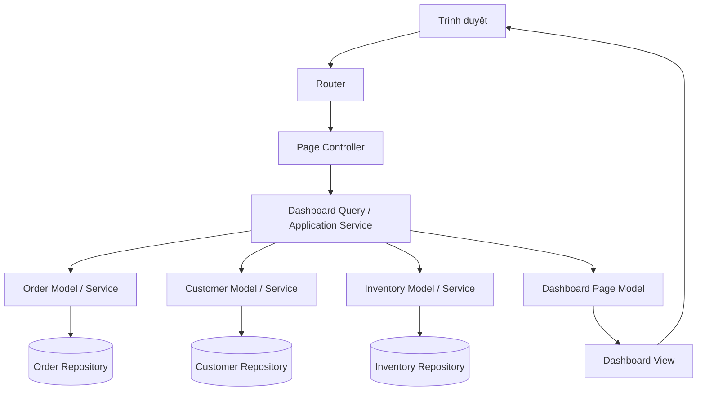

# Một màn hình phối hợp nhiều Model và Controller

## 1. Bối cảnh: một màn hình thường cần nhiều nguồn dữ liệu

Trong ứng dụng thực tế, một màn hình hiếm khi chỉ hiển thị một đối tượng nghiệp vụ. Trang tổng quan bán hàng có thể đồng thời hiển thị doanh thu, đơn hàng mới, tồn kho và thông báo cần xử lý. Mỗi vùng dữ liệu có thể thuộc một miền nghiệp vụ và một Model khác nhau.

Tương tự, người dùng có thể thực hiện nhiều loại thao tác ngay trên cùng màn hình: lọc danh sách, duyệt trang, xác nhận đơn hàng, cập nhật thông tin khách hàng hoặc tải lại một biểu đồ. Những thao tác này không nhất thiết thuộc cùng một Controller.

MVC vẫn áp dụng được trong tình huống đó. Điều cần thiết là xác định ranh giới của từng trách nhiệm và cách các phần phối hợp với nhau:

- **View** là màn hình tổng hợp hoặc tập hợp các vùng giao diện nhỏ.
- **Model** có thể gồm nhiều mô hình miền nghiệp vụ và các đối tượng dữ liệu dành riêng cho màn hình.
- **Controller** tiếp nhận từng loại tương tác, điều phối nghiệp vụ và trả dữ liệu hoặc phản hồi cho vùng giao diện tương ứng.

Một màn hình có thể dùng nhiều Model và nhiều Controller mà không cần biến tất cả thành một đối tượng lớn. Thiết kế cần bảo đảm dữ liệu được tổng hợp nhất quán, thao tác đi đúng nơi xử lý và mỗi thành phần vẫn có thể kiểm thử độc lập.

## 2. Phân biệt nhiều Model và nhiều Controller

### 2.1. Một View sử dụng nhiều Model

Một View có thể cần dữ liệu từ nhiều mô hình nghiệp vụ. Ví dụ, màn hình chi tiết đơn hàng cần:

- `Order`: mã đơn, trạng thái, ngày tạo và các dòng hàng.
- `Customer`: tên, địa chỉ giao hàng và thông tin liên hệ được phép hiển thị.
- `Payment`: phương thức và trạng thái thanh toán.
- `Shipment`: đơn vị vận chuyển và trạng thái giao hàng.

Các Model này có vòng đời và quy tắc riêng. Đơn hàng có thể được hủy theo quy tắc đơn hàng; thanh toán có thể được hoàn theo quy tắc thanh toán; vận chuyển có thể cập nhật trạng thái từ một hệ thống ngoài. View tổng hợp thông tin của chúng để người dùng có một góc nhìn liền mạch.

Không nên vì cùng xuất hiện trên một màn hình mà gộp các Model thành một lớp miền nghiệp vụ khổng lồ. Thay vào đó, có thể tạo một **View Model** hoặc **Page Model** làm hợp đồng dữ liệu dành riêng cho màn hình. Đối tượng này tổng hợp các trường cần trình bày, còn các Model nghiệp vụ tiếp tục sở hữu quy tắc của mình.

### 2.2. Một View nhận tương tác từ nhiều Controller

Một màn hình có thể có nhiều vùng tương tác, mỗi vùng có thể gửi request đến một Controller hoặc action khác nhau. Ví dụ:

- Bộ lọc danh sách gửi request đến `OrderController`.
- Nút xác nhận đơn hàng gọi action xử lý trong `OrderController`.
- Vùng thông tin khách hàng gửi yêu cầu cập nhật đến `CustomerController`.
- Thành phần thanh toán gọi endpoint thuộc `PaymentController`.

Trong ứng dụng web phía máy chủ, mỗi HTTP request cụ thể thường được router ánh xạ đến một handler hoặc action. Vì vậy, khi người dùng thao tác nhiều vùng trên cùng trang, trình duyệt có thể gửi nhiều request khác nhau đến nhiều Controller. Các Controller đó có thể trả về trang mới, redirect, JSON hoặc một mảnh HTML để cập nhật vùng giao diện.

Trong ứng dụng phía trình duyệt, một trang cũng có thể gồm nhiều component. Mỗi component quản lý một nhóm sự kiện và gọi một controller, command handler hoặc API tương ứng. Một controller cấp trang có thể điều phối dữ liệu dùng chung, trong khi controller của từng vùng xử lý thao tác cục bộ.

### 2.3. Không đồng nhất Model nghiệp vụ với dữ liệu của View

Từ *Model* có thể chỉ nhiều loại đối tượng. Cần phân biệt:

| Loại | Vai trò | Ví dụ |
|---|---|---|
| Domain Model | Bảo vệ trạng thái và quy tắc của một miền nghiệp vụ | `Order`, `Customer`, `Payment` |
| Data Transfer Object (DTO) | Chuyển dữ liệu giữa các lớp hoặc qua API | `OrderSummaryDto` |
| View Model / Page Model | Cung cấp dữ liệu được thiết kế cho một màn hình | `OrderDetailPageModel` |
| Framework Model | Vùng chứa thuộc tính Controller chuyển cho View template | `org.springframework.ui.Model` |

Một Page Model có thể tổng hợp DTO từ nhiều miền nghiệp vụ. Nó không nhất thiết là một Domain Model và không nên trở thành nơi chứa mọi quy tắc nghiệp vụ chỉ vì màn hình cần dữ liệu từ nhiều nơi.

## 3. Kiến trúc phối hợp ở cấp màn hình

Một cách tổ chức phổ biến là dùng **Page Controller** làm điểm vào của trang. Page Controller gọi một lớp ứng dụng hoặc query service để chuẩn bị dữ liệu tổng hợp. Lớp này phối hợp các dịch vụ miền và trả về Page Model cho View.



Luồng này có các đặc điểm:

1. Router chọn Page Controller dựa trên request.
2. Page Controller gọi một dịch vụ ứng dụng chịu trách nhiệm chuẩn bị dữ liệu trang.
3. Dịch vụ ứng dụng lấy dữ liệu từ các dịch vụ hoặc Model liên quan.
4. Dữ liệu được ánh xạ sang Page Model chỉ chứa thông tin cần hiển thị.
5. Controller chuyển Page Model cho View để dựng màn hình.

Page Controller không cần biết chi tiết truy vấn của từng miền. Các dịch vụ nghiệp vụ cũng không cần biết chúng đang được dùng bởi trang tổng quan hay một API khác. Ranh giới này giúp tái sử dụng nghiệp vụ và thay đổi giao diện với ít ảnh hưởng hơn.

## 4. Ví dụ: trang tổng quan bán hàng với Spring MVC

Giả sử trang tổng quan cần hiển thị ba vùng: đơn hàng gần đây, số liệu tồn kho và thông tin khách hàng nổi bật. Mỗi vùng được cung cấp bởi một dịch vụ nghiệp vụ riêng.

### 4.1. Định nghĩa dữ liệu dành cho trang

```java
public record RecentOrderItem(
        String orderNumber,
        String customerName,
        String status,
        BigDecimal total) {}

public record InventorySummary(
        long lowStockCount,
        long outOfStockCount) {}

public record CustomerSummary(
        String displayName,
        int activeOrderCount) {}

public record SalesDashboardPageModel(
        List<RecentOrderItem> recentOrders,
        InventorySummary inventory,
        CustomerSummary featuredCustomer) {}
```

`SalesDashboardPageModel` là hợp đồng dữ liệu của màn hình. Nó tập hợp những phần cần trình bày và không phơi bày toàn bộ entity hoặc cấu trúc lưu trữ của từng miền.

### 4.2. Dịch vụ ứng dụng tổng hợp dữ liệu

```java
@Service
public class SalesDashboardQueryService {
    private final OrderService orderService;
    private final InventoryService inventoryService;
    private final CustomerService customerService;

    public SalesDashboardQueryService(
            OrderService orderService,
            InventoryService inventoryService,
            CustomerService customerService) {
        this.orderService = orderService;
        this.inventoryService = inventoryService;
        this.customerService = customerService;
    }

    public SalesDashboardPageModel loadDashboard() {
        List<RecentOrderItem> orders = orderService.findRecentForDashboard();
        InventorySummary inventory = inventoryService.getSummary();
        CustomerSummary customer = customerService.findFeaturedCustomer();

        return new SalesDashboardPageModel(orders, inventory, customer);
    }
}
```

Lớp tổng hợp này điều phối việc đọc dữ liệu cho một trường hợp sử dụng cụ thể. Quy tắc tạo đơn hàng vẫn thuộc `OrderService`; quy tắc tồn kho thuộc `InventoryService`; quy tắc khách hàng thuộc `CustomerService`. Dịch vụ tổng hợp chịu trách nhiệm kết hợp kết quả và ánh xạ thành dữ liệu trang.

Với truy vấn độc lập và không phụ thuộc thứ tự, có thể cân nhắc thực hiện song song để giảm thời gian phản hồi. Khi làm vậy, cần giới hạn tài nguyên, đặt timeout, xử lý lỗi từng phần và bảo đảm các lời gọi không gây tranh chấp trạng thái. Ví dụ trên dùng lời gọi tuần tự để giữ cách trình bày đơn giản.

### 4.3. Page Controller chọn View

```java
@Controller
@RequestMapping("/sales")
public class SalesDashboardController {
    private final SalesDashboardQueryService queryService;

    public SalesDashboardController(SalesDashboardQueryService queryService) {
        this.queryService = queryService;
    }

    @GetMapping("/dashboard")
    public String dashboard(Model viewModel) {
        SalesDashboardPageModel page = queryService.loadDashboard();
        viewModel.addAttribute("dashboard", page);
        return "sales/dashboard";
    }
}
```

Controller chỉ nhận request, gọi dịch vụ ứng dụng, đưa dữ liệu vào framework Model và chọn template. `Model` trong chữ ký phương thức là `org.springframework.ui.Model`, đóng vai trò vùng chứa thuộc tính cho View. Dữ liệu nghiệp vụ được tổng hợp trong `SalesDashboardPageModel`.

### 4.4. View chia thành các vùng nhỏ

Template `sales/dashboard` có thể chia thành các fragment hoặc component:

```text
sales/dashboard
├── dashboard-header
├── recent-orders
├── inventory-summary
└── featured-customer
```

Mỗi fragment nhận đúng phần dữ liệu cần dùng. `recent-orders` nhận danh sách đơn hàng; `inventory-summary` nhận số liệu tồn kho; `featured-customer` nhận thông tin khách hàng. Cấu trúc này giúp View dễ đọc và mỗi vùng có thể được thay đổi độc lập.

## 5. Khi nào cần nhiều Controller cho cùng một màn hình?

Không phải màn hình nào cũng cần nhiều Controller. Có thể chọn một trong các cách sau tùy theo kiểu tương tác.

### 5.1. Một Page Controller cho lần tải trang ban đầu

Khi toàn bộ dữ liệu có thể tải cùng lúc và người dùng chủ yếu điều hướng bằng request truyền thống, một Page Controller thường là đủ. Nó tổng hợp Page Model rồi trả một trang HTML hoàn chỉnh.

### 5.2. Nhiều endpoint cho các thao tác độc lập

Nếu từng vùng cần cập nhật riêng, mỗi thao tác có thể dùng endpoint riêng:

| Vùng trên màn hình | Endpoint minh họa | Trách nhiệm |
|---|---|---|
| Bộ lọc đơn hàng | `GET /api/orders?status=OPEN` | Truy vấn danh sách theo điều kiện |
| Xác nhận đơn | `POST /api/orders/{id}/confirm` | Thực hiện chuyển trạng thái đơn hàng |
| Làm mới tồn kho | `GET /api/inventory/summary` | Lấy số liệu tồn kho mới |
| Cập nhật liên hệ | `PATCH /api/customers/{id}/contact` | Cập nhật dữ liệu liên hệ được phép |

Các endpoint có thể thuộc những Controller khác nhau. View gọi endpoint tương ứng và chỉ cập nhật vùng giao diện liên quan. Mỗi Controller vẫn phải kiểm tra quyền, dữ liệu đầu vào và điều kiện nghiệp vụ thông qua lớp phù hợp.

### 5.3. Controller cho từng component phía trình duyệt

Trong ứng dụng client-side, một màn hình có thể được chia thành các component độc lập. Ví dụ, `RecentOrdersController` quản lý bộ lọc và phân trang; `InventoryWidgetController` quản lý việc tải lại số liệu tồn kho; `CustomerPanelController` xử lý biểu mẫu liên hệ. Một controller cấp trang có thể cung cấp trạng thái dùng chung hoặc điều phối sự kiện giữa các vùng.

Các component nên giao tiếp qua hợp đồng rõ ràng như props, event, command hoặc service dùng chung. Tránh để controller của component này truy cập trực tiếp biến nội bộ của component khác, vì điều đó tạo ra phụ thuộc khó kiểm soát.

## 6. Điều phối dữ liệu và trạng thái của nhiều vùng

Khi một màn hình tổng hợp nhiều nguồn, thiết kế cần xử lý cả trạng thái tải và lỗi. Không phải mọi vùng đều luôn sẵn sàng cùng lúc.

### 6.1. Tải đồng thời và tải độc lập

Có hai lựa chọn phổ biến:

- **Tải cùng lúc ở máy chủ:** Page Controller hoặc query service lấy mọi dữ liệu rồi trả một trang hoàn chỉnh. Cách này đơn giản với trang cần dữ liệu nhất quán và số nguồn không quá lớn, nhưng một nguồn chậm có thể làm chậm toàn trang.
- **Tải độc lập theo vùng:** trang khung được trả trước, sau đó mỗi component gọi endpoint riêng. Cách này giúp vùng ít phụ thuộc hiển thị sớm và có thể tải lại riêng, nhưng cần quản lý nhiều request, trạng thái tải và lỗi ở client.

Có thể kết hợp hai cách: tải dữ liệu cốt lõi cùng trang, còn biểu đồ hoặc vùng ít quan trọng tải bất đồng bộ.

### 6.2. Trạng thái riêng cho từng vùng

Mỗi vùng giao diện nên biểu diễn được ít nhất các trạng thái:

| Trạng thái | Ý nghĩa | Cách hiển thị gợi ý |
|---|---|---|
| Loading | Đang lấy dữ liệu | Skeleton hoặc chỉ báo tải |
| Success | Đã có dữ liệu | Nội dung của vùng |
| Empty | Request thành công nhưng không có dữ liệu | Thông báo chưa có dữ liệu |
| Error | Không lấy hoặc cập nhật được dữ liệu | Thông báo lỗi và hành động thử lại phù hợp |
| Stale | Đang hiển thị dữ liệu cũ trong khi làm mới | Nhãn thời điểm cập nhật hoặc chỉ báo làm mới |

Không nên để một lỗi nhỏ ở vùng biểu đồ khiến toàn bộ trang biến thành lỗi nếu các vùng khác vẫn có thể sử dụng. Ngược lại, nếu một dữ liệu là điều kiện bắt buộc để thao tác an toàn, cần ngăn thao tác đó khi dữ liệu chưa sẵn sàng.

### 6.3. Tính nhất quán giữa các Model

Khi một trang đọc nhiều miền nghiệp vụ, dữ liệu có thể được cập nhật ở những thời điểm khác nhau. Ví dụ, số lượng đơn hàng và số liệu tồn kho có thể phản ánh hai thời điểm đọc khác nhau. Với màn hình báo cáo, độ trễ nhỏ có thể chấp nhận được nếu giao diện hiển thị thời điểm cập nhật. Với thao tác tài chính hoặc xác nhận đơn hàng, không được dựa vào số liệu cũ ở View để quyết định kết quả cuối cùng.

Thao tác ghi cần được xử lý trong dịch vụ nghiệp vụ có thẩm quyền. Dịch vụ đó phải kiểm tra lại trạng thái mới nhất, phân quyền, điều kiện chuyển trạng thái và các ràng buộc giao dịch trước khi lưu. View chỉ trình bày kết quả trả về từ máy chủ.

## 7. Quy tắc thiết kế ranh giới giữa các Controller

Khi chia một màn hình cho nhiều Controller hoặc endpoint, hãy dựa vào hành vi và quyền sở hữu nghiệp vụ:

- Mỗi Controller xử lý một nhóm request có mục đích rõ ràng.
- Controller không gọi trực tiếp Controller khác như cách gọi một dịch vụ nội bộ. Nếu cần dùng chung nghiệp vụ, hãy gọi service hoặc application layer.
- Một thao tác nghiệp vụ nên có một nơi chịu trách nhiệm kiểm tra và thực hiện thay đổi.
- Controller cấp trang có thể tổng hợp dữ liệu đọc, nhưng không nên trở thành nơi chứa toàn bộ quy tắc của mọi miền.
- Các endpoint độc lập phải có hợp đồng request/response rõ ràng, bao gồm mã trạng thái và cấu trúc lỗi.
- Các vùng giao diện chỉ chia sẻ dữ liệu khi có nhu cầu thực sự; tránh tạo một store toàn cục chứa mọi trạng thái của ứng dụng.

Ví dụ, nút xác nhận đơn hàng trên trang tổng quan có thể gọi `POST /api/orders/{id}/confirm`. `OrderController` tiếp nhận request và gọi `OrderService.confirm(id, currentUser)`. Dịch vụ kiểm tra người dùng có quyền xác nhận, đơn hàng có ở trạng thái cho phép và tồn kho đáp ứng điều kiện. `InventoryController` không cần được gọi trực tiếp để thực hiện một phần của cùng hành động; nếu nghiệp vụ xác nhận cần giữ chỗ tồn kho, `OrderService` phối hợp với `InventoryService` hoặc một application service thích hợp.

## 8. Bảo mật khi phối hợp nhiều Model và Controller

Một màn hình tổng hợp có thể hiển thị dữ liệu từ nhiều miền, do đó quyền truy cập cần được kiểm tra cho từng loại tài nguyên và hành động.

- Không giả định người dùng được xem mọi dữ liệu chỉ vì họ mở được trang tổng quan.
- Kiểm tra quyền ở từng endpoint và trong luồng nghiệp vụ có liên quan; ẩn nút trên View không phải biện pháp phân quyền.
- Giới hạn trường dữ liệu đưa vào Page Model để tránh làm lộ thông tin nhạy cảm từ một Model phụ.
- Kiểm tra dữ liệu đầu vào và chỉ cho phép cập nhật các trường nằm trong hợp đồng request.
- Bảo vệ các request thay đổi trạng thái bằng cơ chế phù hợp như CSRF token khi dùng cookie phiên.
- Tránh ghi token, thông tin cá nhân hoặc dữ liệu bí mật vào log tổng hợp của trang.
- Không để một endpoint tổng hợp trở thành đường vòng bỏ qua quyền của các miền nghiệp vụ.

Nếu một màn hình có nhiều request bất đồng bộ, mỗi request vẫn là một ranh giới bảo mật độc lập. Người dùng có thể gọi endpoint trực tiếp mà không cần thông qua giao diện, vì vậy máy chủ phải tự xác thực và phân quyền.

## 9. Kiểm thử màn hình tổng hợp

Nên kiểm thử cả từng phần lẫn cách chúng phối hợp:

| Phạm vi | Nội dung kiểm thử |
|---|---|
| Domain Model / Service | Quy tắc của từng miền và điều kiện thay đổi trạng thái |
| Query / Application Service | Tổng hợp dữ liệu từ nhiều dịch vụ, ánh xạ đúng sang Page Model |
| Page Controller | Route, quyền truy cập, lựa chọn View và dữ liệu được truyền cho View |
| Controller của endpoint | Validation, phân quyền, mã trạng thái và cấu trúc response/error |
| Component / Fragment | Hiển thị đúng dữ liệu, trạng thái loading, empty và error |
| Integration test | Toàn luồng từ request đến các vùng giao diện hoặc response tương ứng |

Một số tình huống cần có trong kiểm thử:

1. Tất cả nguồn dữ liệu đều thành công.
2. Một nguồn dữ liệu lỗi trong khi các vùng khác vẫn có dữ liệu.
3. Một nguồn trả về danh sách rỗng.
4. Người dùng có quyền xem trang nhưng không có quyền thực hiện một hành động cụ thể.
5. Dữ liệu đã thay đổi sau khi trang được tải; thao tác ghi phải được kiểm tra lại trên máy chủ.
6. Người dùng gửi liên tiếp nhiều request hoặc nhấn nút nhiều lần; thao tác quan trọng cần có cơ chế chống thực hiện lặp phù hợp.

Kiểm thử query service có thể mock các dịch vụ miền để xác minh việc tổng hợp. Kiểm thử từng Controller xác minh hợp đồng HTTP. Kiểm thử giao diện tập trung vào việc mỗi vùng phản ánh đúng trạng thái mà nó nhận được.

## 10. Lỗi thiết kế thường gặp

1. **Một Page Model chứa toàn bộ entity của hệ thống:** View nhận quá nhiều dữ liệu, phụ thuộc vào cấu trúc nội bộ và có nguy cơ lộ thông tin.
2. **Page Controller làm mọi việc:** Controller vừa truy vấn nhiều repository, vừa thực hiện quy tắc nghiệp vụ, vừa xử lý định dạng và lỗi; nó trở thành điểm tập trung khó bảo trì.
3. **Controller gọi Controller khác:** tạo phụ thuộc vòng hoặc khiến logic nghiệp vụ bị gắn với giao thức HTTP. Hãy chuyển phần dùng chung vào service hoặc application layer.
4. **Các component truy cập trạng thái riêng tư của nhau:** thay đổi một component có thể làm hỏng component khác.
5. **Một request lỗi làm hỏng mọi vùng:** giao diện mất khả năng sử dụng dù phần dữ liệu quan trọng khác vẫn sẵn sàng.
6. **Dùng dữ liệu hiển thị để quyết định ghi:** dữ liệu có thể cũ hoặc đã bị thay đổi bởi người dùng khác; máy chủ phải kiểm tra lại.
7. **Chia quá nhiều Controller và endpoint:** những thao tác không có ranh giới rõ bị phân mảnh, làm tăng số request và chi phí điều phối.

## 11. Cách chọn cấu trúc phù hợp

Trước khi chia màn hình, hãy xác định dữ liệu nào thuộc từng miền, hành động nào thay đổi trạng thái và vùng nào cần tải độc lập.

- Nếu màn hình chỉ tổng hợp một lượng dữ liệu nhỏ cho một lần render, dùng một Page Controller cùng một query service là lựa chọn dễ quản lý.
- Nếu mỗi vùng có vòng đời, tần suất cập nhật hoặc quyền truy cập khác nhau, cân nhắc component và endpoint riêng.
- Nếu nhiều màn hình cần cùng quy tắc nghiệp vụ, đặt quy tắc trong service hoặc Model của miền thay vì sao chép vào từng Controller.
- Nếu các nguồn dữ liệu cần một snapshot nhất quán, thiết kế cơ chế đọc phù hợp ở tầng ứng dụng hoặc dữ liệu; không dựa vào việc View tình cờ gọi các endpoint gần nhau.
- Nếu một hành động tác động nhiều miền, xác định rõ application service điều phối và chiến lược giao dịch hoặc xử lý nhất quán cần thiết.

## 12. Kết luận

Một màn hình MVC có thể phối hợp nhiều Model để lấy dữ liệu từ nhiều miền nghiệp vụ và nhiều Controller để xử lý các nhóm tương tác khác nhau. Page Controller cùng Page Model là cách phổ biến để tổng hợp dữ liệu ban đầu; các endpoint hoặc controller cấp component phù hợp khi từng vùng cần hoạt động độc lập.

Giữ quy tắc nghiệp vụ trong đúng miền, dùng DTO hoặc Page Model làm hợp đồng trình bày, xác định rõ trạng thái tải và lỗi của từng vùng, đồng thời kiểm tra quyền và trạng thái mới nhất ở phía máy chủ. Nhờ đó, màn hình tổng hợp vẫn có thể phát triển thành nhiều vùng chức năng mà các thành phần không bị ràng buộc chặt vào nhau.
